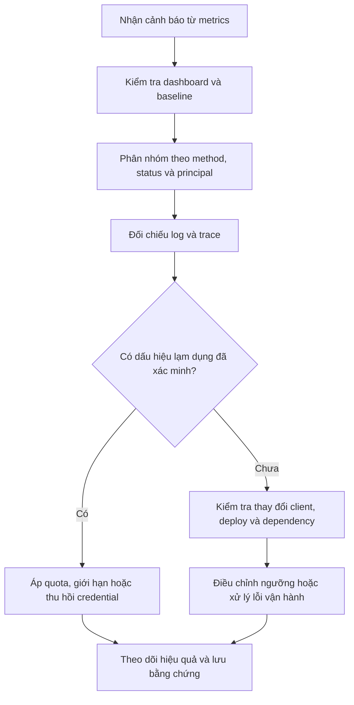

# Theo dõi request bất thường

Trong một dịch vụ **SPRING_GRPC**, mỗi lời gọi RPC đi qua mạng, mang theo metadata, danh tính đã xác thực và một hoặc nhiều message. Một request có thể hợp lệ về cú pháp nhưng vẫn bất thường về tần suất, kích thước, thời gian xử lý hoặc cách sử dụng phương thức. Nếu chỉ kiểm tra log lỗi sau khi sự cố xảy ra, đội vận hành thường phát hiện quá muộn hoặc không đủ dữ liệu để xác định nguồn gây ra sự cố.

Theo dõi request bất thường là việc thu thập và đối chiếu tín hiệu của các RPC để nhận ra hành vi lệch khỏi mức sử dụng bình thường, điều tra nguyên nhân và áp dụng biện pháp giảm thiểu phù hợp. Công việc này kết hợp metadata, status code, deadline, metrics, logs và traces. Nó bổ sung cho xác thực, phân quyền, TLS và giới hạn tài nguyên; bản thân việc ghi log không thay thế các cơ chế bảo vệ đó.

## 1. Xác định điều gì được xem là bất thường

Một RPC thất bại chưa chắc là một cuộc tấn công. Client có thể gửi dữ liệu sai, mất kết nối, hết deadline hoặc chủ động hủy lời gọi. Ngược lại, một RPC trả về `OK` vẫn có thể đáng chú ý nếu một danh tính gọi phương thức nhạy cảm với tần suất cao bất thường hoặc mở quá nhiều stream đồng thời.

Vì vậy, cần đánh giá request theo ngữ cảnh: phương thức được gọi, danh tính đã xác thực, nguồn kết nối, thời điểm, tần suất, kích thước message, thời lượng và kết quả RPC. Một dấu hiệu đơn lẻ thường chỉ nên tạo tín hiệu điều tra; nhiều dấu hiệu xuất hiện cùng lúc mới là cơ sở tốt hơn để nâng mức cảnh báo.

| Dấu hiệu | Tín hiệu cần quan sát | Cách diễn giải |
| --- | --- | --- |
| Tăng đột biến số RPC | Số lời gọi theo phương thức, danh tính và khoảng thời gian | Có thể là tải hợp lệ, retry quá mức hoặc hành vi dò quét |
| Nhiều lần xác thực/phân quyền thất bại | `UNAUTHENTICATED`, `PERMISSION_DENIED`, danh tính và phương thức | Có thể là token hết hạn, cấu hình client sai hoặc thử truy cập trái phép |
| Request quá lớn hoặc quá dày | Kích thước message, số message trong stream, giới hạn inbound | Có thể là lỗi client hoặc hành vi làm cạn bộ nhớ và băng thông |
| Nhiều RPC kéo dài hoặc hết deadline | Latency, `DEADLINE_EXCEEDED`, số RPC đang hoạt động | Có thể là backend chậm, deadline không phù hợp hoặc tạo tải có chủ đích |
| Mở nhiều stream đồng thời | Số stream đang mở, thời lượng stream, tốc độ message | Có thể làm cạn thread, connection hoặc tài nguyên xử lý |
| Gọi phương thức hiếm hoặc sai thứ tự | Tần suất theo full method name và chuỗi thao tác | Có thể là client mới, tích hợp sai hoặc dò tìm bề mặt API |
| Metadata không bình thường | Số lượng, kích thước và loại metadata được cho phép | Có thể là cấu hình sai hoặc cố tình gửi header lớn, header lạ |

Các tín hiệu phải được đối chiếu với đặc điểm nghiệp vụ. Ví dụ, một phương thức đồng bộ dữ liệu có thể tăng tải vào đầu ngày; một phương thức đọc trạng thái có thể được gọi thường xuyên hơn phương thức thay đổi quyền. Không dùng một ngưỡng chung cho mọi phương thức.

## 2. Thu thập telemetry ở đúng tầng

Một hệ thống quan sát hữu ích cần kết hợp ba loại dữ liệu:

- **Metrics** cho biết xu hướng và quy mô: số RPC, tỷ lệ lỗi, latency, số stream đang hoạt động và số message mỗi stream.
- **Logs có cấu trúc** lưu lại sự kiện cần điều tra: thời điểm, phương thức, status, mã tương quan, danh tính đã xác thực nếu chính sách cho phép và kết quả kiểm soát bảo mật.
- **Traces** nối một RPC với các lời gọi downstream để tìm nơi phát sinh độ trễ, retry hoặc lỗi dây chuyền.

### Metrics nên có

Các tên dưới đây là tên minh họa; tên metric thực tế phụ thuộc thư viện instrumentation và cấu hình Micrometer/Prometheus đang dùng.

| Metric | Kiểu dữ liệu | Mục đích |
| --- | --- | --- |
| `grpc_server_started_total` | Counter | Tổng số RPC bắt đầu, phân theo phương thức |
| `grpc_server_handled_total` | Counter | Tổng số RPC kết thúc, phân theo phương thức và status code |
| `grpc_server_handling_seconds` | Histogram | Phân bố thời gian xử lý để tính p50, p95, p99 |
| `grpc_server_active_calls` | Gauge | Số RPC đang hoạt động tại thời điểm đo |
| `grpc_server_request_messages_total` | Counter | Số message client gửi vào, hữu ích với streaming |
| `grpc_server_stream_duration_seconds` | Histogram | Thời lượng của các stream |

Giữ nhãn metric ở mức có số lượng giá trị hữu hạn, chẳng hạn `method`, `grpc_code` và `rpc_type`. Không đưa `request_id`, token, email, địa chỉ IP hoặc user ID tùy ý vào nhãn metric: mỗi giá trị mới có thể tạo thêm một time series, làm tăng bộ nhớ và chi phí lưu trữ. Nếu cần phân tích theo danh tính, ghi một mã định danh đã được chính sách bảo mật cho phép vào log có kiểm soát truy cập.

### Log sự kiện có cấu trúc

Một bản ghi kết thúc RPC có thể có dạng sau:

```json
{
  "event": "grpc.server.call.completed",
  "timestamp": "2026-11-19T08:30:15.120Z",
  "trace_id": "4bf92f3577b34da6a3ce929d0e0e4736",
  "rpc_method": "inventory.v1.InventoryService/GetItem",
  "rpc_type": "unary",
  "grpc_status": "PERMISSION_DENIED",
  "duration_ms": 12.8,
  "request_message_count": 1,
  "principal_ref": "service-account-42",
  "source": "10.20.4.18"
}
```

Đây là ví dụ về cấu trúc, không phải yêu cầu phải ghi tất cả các trường. Chỉ ghi danh tính và địa chỉ nguồn khi có mục đích vận hành rõ ràng, quyền truy cập log phù hợp và thời hạn lưu trữ được xác định. Địa chỉ nguồn lấy từ kết nối thực tế đáng tin cậy; không mặc nhiên tin `x-forwarded-for` hoặc metadata do client tự gửi nếu request chưa đi qua proxy đáng tin cậy.

Không ghi giá trị `authorization`, access token, private key, cookie, nội dung message hoặc dữ liệu cá nhân nhạy cảm vào log thông thường. Nếu cần lưu bằng chứng nghiệp vụ, hãy định nghĩa riêng trường dữ liệu được phép, che hoặc giả danh hóa dữ liệu và giới hạn người có quyền truy cập. Mã request do client cung cấp cũng là dữ liệu không đáng tin cậy: cần kiểm tra độ dài/ký tự, không dùng nó làm danh tính và không để nó ghi đè trace context đáng tin cậy.

### Traces và tương quan

Mỗi RPC nên có trace/span context để nối sự kiện ở gRPC server với database, HTTP client hoặc service downstream. Khi điều tra, dùng `trace_id` hoặc mã tương quan do hệ thống tin cậy tạo để tìm các log liên quan. Không đưa token hay dữ liệu nhạy cảm vào span attribute hoặc baggage. Nếu một request bị retry, cần phân biệt từng lần thử với thao tác nghiệp vụ ban đầu để tránh đếm sai số request.

## 3. Ghi nhận vòng đời RPC bằng ServerInterceptor

Trong gRPC Java, `ServerInterceptor` là điểm phù hợp để quan sát các thuộc tính chung của lời gọi mà không phải lặp lại logic trong từng service implementation. Interceptor có thể đọc full method name, đo thời gian, đếm message đầu vào và ghi nhận status khi server đóng lời gọi. Với streaming RPC, việc đếm message giúp phân biệt một lời gọi dài có nhiều message với nhiều lời gọi unary ngắn.

Ví dụ sau minh họa khung triển khai. `RpcTelemetry` là adapter do ứng dụng cung cấp để chuyển dữ liệu sang Micrometer, OpenTelemetry hoặc hệ thống quan sát hiện có.

```java
import io.grpc.ForwardingServerCall;
import io.grpc.ForwardingServerCallListener;
import io.grpc.Metadata;
import io.grpc.ServerCall;
import io.grpc.ServerCallHandler;
import io.grpc.ServerInterceptor;
import io.grpc.Status;

import java.util.concurrent.atomic.AtomicBoolean;
import java.util.concurrent.atomic.AtomicLong;
import java.util.function.Consumer;
import java.util.logging.Level;
import java.util.logging.Logger;

public final class RpcMonitoringInterceptor implements ServerInterceptor {
    private static final Logger LOGGER =
            Logger.getLogger(RpcMonitoringInterceptor.class.getName());

    private final RpcTelemetry telemetry;

    public RpcMonitoringInterceptor(RpcTelemetry telemetry) {
        this.telemetry = telemetry;
    }

    @Override
    public <ReqT, RespT> ServerCall.Listener<ReqT> interceptCall(
            ServerCall<ReqT, RespT> call,
            Metadata headers,
            ServerCallHandler<ReqT, RespT> next) {

        String method = call.getMethodDescriptor().getFullMethodName();
        long startedAt = System.nanoTime();
        AtomicLong requestMessages = new AtomicLong();
        AtomicBoolean recorded = new AtomicBoolean();

        recordSafely(() -> telemetry.started(method));

        Consumer<Status> finish = status -> {
            if (recorded.compareAndSet(false, true)) {
                long elapsedNanos = System.nanoTime() - startedAt;
                long messageCount = requestMessages.get();
                recordSafely(() -> telemetry.completed(
                        method, status.getCode(), elapsedNanos, messageCount));
            }
        };

        ServerCall<ReqT, RespT> observedCall =
                new ForwardingServerCall.SimpleForwardingServerCall<>(call) {
                    @Override
                    public void close(Status status, Metadata trailers) {
                        finish.accept(status);
                        super.close(status, trailers);
                    }
                };

        try {
            ServerCall.Listener<ReqT> listener = next.startCall(observedCall, headers);
            return new ForwardingServerCallListener
                    .SimpleForwardingServerCallListener<>(listener) {
                @Override
                public void onMessage(ReqT message) {
                    requestMessages.incrementAndGet();
                    super.onMessage(message);
                }

                @Override
                public void onCancel() {
                    finish.accept(Status.CANCELLED);
                    super.onCancel();
                }
            };
        } catch (RuntimeException ex) {
            finish.accept(Status.UNKNOWN);
            throw ex;
        }
    }

    private void recordSafely(Runnable event) {
        try {
            event.run();
        } catch (RuntimeException ex) {
            // Lỗi của hệ thống telemetry không được làm hỏng RPC đang xử lý.
            LOGGER.log(Level.WARNING, "Unable to record gRPC telemetry", ex);
        }
    }
}
```

Interface tối thiểu cho adapter:

```java
import io.grpc.Status;

public interface RpcTelemetry {
    void started(String method);

    void completed(
            String method,
            Status.Code status,
            long elapsedNanos,
            long requestMessageCount);
}
```

Một số điểm cần hiểu khi áp dụng:

1. `getFullMethodName()` cung cấp tên phương thức ổn định theo dạng `package.Service/Method`, phù hợp làm nhãn metric nếu tập service được kiểm soát.
2. `System.nanoTime()` dùng để đo khoảng thời gian đã trôi qua; không dùng nó làm timestamp lịch. Timestamp sự kiện có thể lấy từ clock của hệ thống log.
3. `onMessage()` đếm số message client gửi. Nó không đo số byte trên mạng và không thay thế giới hạn kích thước message. Muốn đo byte cần instrumentation ở tầng serialization/transport hoặc logic chuyên biệt của ứng dụng.
4. `close()` ghi nhận status server trả về; `onCancel()` ghi nhận client hủy lời gọi. Cờ `AtomicBoolean` tránh ghi hai lần khi hai đường kết thúc cùng xuất hiện.
5. Adapter telemetry cần xử lý nhanh, không chặn thread RPC và không gọi dịch vụ log từ xa đồng bộ. Lỗi telemetry được cô lập để không biến lỗi giám sát thành lỗi nghiệp vụ.

Đăng ký interceptor theo cơ chế mà Spring gRPC starter đang sử dụng trong dự án. Thứ tự interceptor có ý nghĩa: nếu muốn ghi nhận principal, bước xác thực phải đặt principal vào `io.grpc.Context` trước khi interceptor giám sát đọc nó. Không lấy danh tính từ một header tùy ý do client gửi. Cấu hình cụ thể phụ thuộc starter và phiên bản gRPC được chọn; cần kiểm tra cơ chế đăng ký tương ứng trước khi đưa vào ứng dụng.

## 4. Phát hiện bất thường từ baseline

Baseline mô tả mức hoạt động bình thường theo phương thức, danh tính, nguồn kết nối và khung thời gian. Có thể bắt đầu bằng ngưỡng tĩnh để bảo vệ tài nguyên, sau đó điều chỉnh bằng dữ liệu thực tế. Với lưu lượng có chu kỳ, so sánh cùng khung giờ hoặc cùng ngày trong tuần sẽ hữu ích hơn so sánh với trung bình toàn thời gian.

Một số quy tắc thực tế:

- **Tần suất tăng nhanh:** cảnh báo khi số RPC trên một danh tính hoặc nguồn vượt ngưỡng cho phép trong cửa sổ ngắn. Kết hợp giới hạn tuyệt đối với mức tăng so với baseline để phát hiện cả tải vượt quota lẫn đột biến mới.
- **Thất bại xác thực lặp lại:** theo dõi tỷ lệ `UNAUTHENTICATED` và `PERMISSION_DENIED` theo phương thức. Phân biệt token hết hạn hàng loạt do sự cố cấp phát với nhiều danh tính thử truy cập một phương thức.
- **Lạm dụng tài nguyên:** theo dõi message size, số message mỗi stream, thời lượng stream và số RPC đồng thời. Cảnh báo khi một danh tính giữ nhiều stream lâu bất thường hoặc gửi message vượt nhịp dự kiến.
- **Thăm dò API:** phát hiện một nguồn gọi nhiều phương thức hiếm, gọi tuần tự các phương thức không thường đi cùng nhau hoặc liên tục nhận `NOT_FOUND`/`UNIMPLEMENTED`.
- **Tải chậm:** theo dõi p95/p99 latency, số RPC đang hoạt động và tỷ lệ `DEADLINE_EXCEEDED`. Đối chiếu trace downstream để xác định backend chậm hay client đặt deadline quá ngắn.
- **Retry bất thường:** quan sát số lần gọi lặp lại theo cùng mã tương quan hoặc cùng thao tác nghiệp vụ. Retry storm có thể khuếch đại một sự cố backend thành quá tải toàn hệ thống.

Ví dụ truy vấn Prometheus để xem tốc độ tăng của các RPC bị từ chối theo phương thức (điều chỉnh tên metric/label theo exporter thực tế):

```promql
sum by (method) (
  rate(grpc_server_handled_total{
    grpc_code=~"UNAUTHENTICATED|PERMISSION_DENIED"
  }[5m])
)
```

Và truy vấn p95 latency nếu metric được xuất dưới dạng histogram Prometheus:

```promql
histogram_quantile(
  0.95,
  sum by (le, method) (
    rate(grpc_server_handling_seconds_bucket[5m])
  )
)
```

Không đặt ngưỡng cảnh báo chỉ dựa trên tổng số lỗi. `CANCELLED`, `DEADLINE_EXCEEDED` hoặc `INVALID_ARGUMENT` có thể xuất hiện trong hoạt động bình thường. Cần xét tỷ lệ, mức tăng, danh tính, phương thức và tác động đến tài nguyên. Mỗi cảnh báo nên nêu rõ cửa sổ đo, ngưỡng, đối tượng bị ảnh hưởng và liên kết tới dashboard/trace để người trực có thể xác minh.

## 5. Diễn giải gRPC status đúng ngữ cảnh

| Status | Ý nghĩa thường gặp | Điều cần kiểm tra khi xuất hiện bất thường |
| --- | --- | --- |
| `UNAUTHENTICATED` | Thiếu hoặc không hợp lệ thông tin xác thực | Vòng đời token, cấu hình client, nguồn phát sinh và tần suất thử lại |
| `PERMISSION_DENIED` | Danh tính đã biết nhưng không được phép thực hiện | Quy tắc phân quyền, phương thức nhạy cảm và mẫu truy cập của principal |
| `RESOURCE_EXHAUSTED` | Vượt quota hoặc giới hạn tài nguyên | Giới hạn message, rate limit, số stream và dấu hiệu quá tải |
| `DEADLINE_EXCEEDED` | Không hoàn tất trước deadline | Latency từng dependency, timeout, retry và tình trạng backend |
| `CANCELLED` | Lời gọi bị hủy | Client đóng kết nối, người dùng hủy thao tác hay stream bị bỏ dở |
| `INVALID_ARGUMENT` | Dữ liệu đầu vào không hợp lệ | Lỗi phiên bản/schema client hay chuỗi payload bất thường |
| `INTERNAL` / `UNKNOWN` | Lỗi nội bộ hoặc không phân loại được | Exception server, log ứng dụng và trace liên quan |

Status code là một phần của bằng chứng, không phải kết luận về ý đồ của client. Ví dụ, nhiều `UNAUTHENTICATED` có thể do secret vừa được luân chuyển nhưng client chưa cập nhật. Cần xác minh nguyên nhân trước khi khóa danh tính hoặc chặn nguồn kết nối.

## 6. Kết hợp phát hiện với biện pháp bảo vệ

Khi đã xác nhận hành vi bất thường, chọn biện pháp theo nguyên nhân và phạm vi ảnh hưởng:

1. **Giới hạn tốc độ:** áp quota theo principal và phương thức; ưu tiên giới hạn ở gateway hoặc tầng phục vụ RPC có khả năng áp dụng nhất quán.
2. **Giới hạn tài nguyên:** đặt giới hạn inbound message, số lời gọi đồng thời, kích thước metadata và thời gian xử lý phù hợp với hợp đồng API.
3. **Bảo vệ stream:** giới hạn số stream đồng thời, thời lượng hoặc tốc độ message khi nghiệp vụ cho phép; giải phóng tài nguyên khi client hủy.
4. **Củng cố danh tính:** dùng TLS; dùng mTLS khi mô hình service-to-service yêu cầu danh tính ở tầng kết nối; xác thực và phân quyền theo từng phương thức.
5. **Kiểm soát retry và deadline:** đặt deadline hợp lý ở client, dùng retry có giới hạn và backoff, tránh retry đồng loạt khi server đang quá tải.
6. **Ứng phó theo danh tính:** thu hồi hoặc luân chuyển credential bị lộ, giảm quyền hoặc tạm khóa principal khi có bằng chứng đủ mạnh; ghi lại người thực hiện và thời điểm thay đổi.

Không dùng việc tăng timeout hoặc tăng tài nguyên làm phản ứng mặc định trước một đợt request bất thường. Nếu nguyên nhân là retry storm hoặc stream bị giữ quá lâu, tăng giới hạn có thể làm sự cố lan rộng. Sau khi giảm thiểu, tiếp tục quan sát để xác nhận tỷ lệ lỗi, latency và số RPC đồng thời trở về mức bình thường.

## 7. Quy trình điều tra một cảnh báo



Khi trực xử lý, thực hiện theo trình tự sau:

1. Xác định cảnh báo bắt đầu lúc nào, ảnh hưởng tới phương thức nào và tăng bao nhiêu so với baseline.
2. Phân nhóm theo `grpc_code`, principal và nguồn kết nối đáng tin cậy. Kiểm tra xem nhiều client có cùng bị ảnh hưởng sau một lần triển khai hay không.
3. Dùng trace để tìm dependency gây chậm; dùng log để xác minh danh tính và chuỗi thao tác trong phạm vi dữ liệu được phép.
4. Đối chiếu lịch deploy, luân chuyển credential, thay đổi quota và sự kiện nghiệp vụ có thể giải thích đột biến.
5. Nếu có dấu hiệu lạm dụng, áp biện pháp giới hạn có phạm vi hẹp nhất đủ hiệu quả; theo dõi tác động tới client hợp lệ.
6. Ghi lại nguyên nhân, bằng chứng, hành động đã thực hiện và điều kiện kết thúc cảnh báo. Cập nhật baseline sau khi đã hiểu thay đổi hợp lệ của hệ thống.

## 8. Kiểm thử khả năng quan sát

Kiểm thử tích hợp nên xác nhận rằng telemetry phản ánh đúng vòng đời RPC và không làm thay đổi kết quả nghiệp vụ:

- Gọi unary RPC thành công: có một lần bắt đầu, một lần kết thúc với `OK` và latency hợp lý.
- Gửi request không hợp lệ hoặc thiếu xác thực: status được ghi chính xác; log không chứa token hay payload nhạy cảm.
- Gọi server-streaming, client-streaming và bidirectional-streaming: số message, thời lượng và sự kiện hủy được ghi nhận đúng.
- Hủy RPC từ client: sự kiện `CANCELLED` không bị ghi trùng với sự kiện kết thúc khác.
- Tạo tải tăng dần: dashboard thể hiện được tốc độ RPC, số lời gọi đồng thời và latency; cảnh báo kích hoạt theo ngưỡng đã định.
- Gửi message vượt giới hạn cấu hình: server từ chối theo cơ chế giới hạn và tạo tín hiệu vận hành phù hợp.
- Làm telemetry backend chậm hoặc tạm thời lỗi: RPC không bị treo vì thao tác ghi metrics/log đồng bộ.

Ngoài kiểm thử chức năng, cần kiểm tra quyền truy cập dashboard/log, thời hạn lưu trữ, khả năng che dữ liệu và chi phí time series. Một hệ thống quan sát tốt phải giúp tìm nguyên nhân mà không tạo thêm điểm nghẽn hoặc làm lộ thông tin xác thực.

## 9. Checklist vận hành

- [ ] Có metrics cho số RPC, status, latency, RPC đang hoạt động và streaming.
- [ ] Có dashboard phân theo full method name và status code.
- [ ] Có baseline và ngưỡng riêng cho các phương thức có đặc tính tải khác nhau.
- [ ] Log có cấu trúc, có trace/correlation ID đáng tin cậy và không ghi token hoặc payload nhạy cảm.
- [ ] Danh tính lấy từ context sau xác thực; metadata do client gửi được xem là dữ liệu không đáng tin cậy.
- [ ] Có giới hạn message, metadata, tốc độ và số stream phù hợp với nghiệp vụ.
- [ ] Có cảnh báo cho đột biến lưu lượng, lỗi xác thực, latency và dấu hiệu cạn tài nguyên.
- [ ] Có quy trình xác minh, giảm thiểu, lưu bằng chứng và điều chỉnh baseline sau sự cố.

Theo dõi request bất thường hiệu quả khi mỗi cảnh báo dẫn được tới bằng chứng có thể kiểm tra: RPC nào, phương thức nào, danh tính nào, thay đổi ra sao và tài nguyên nào bị ảnh hưởng. Kết hợp interceptor ở tầng gRPC với metrics, logs và traces giúp dịch vụ Spring gRPC phát hiện sớm hành vi lệch chuẩn, điều tra có căn cứ và phản ứng mà vẫn giữ được khả năng phục vụ client hợp lệ.
