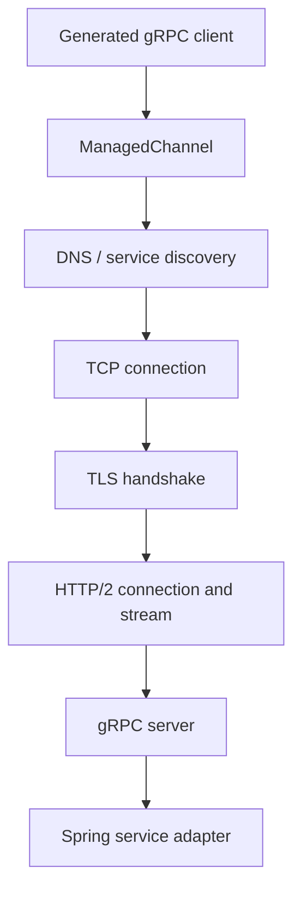

# UNAVAILABLE do connection reset

Trong **SPRING_GRPC**, client có thể nhận status `UNAVAILABLE` cùng lỗi transport như `Connection reset by peer` khi TCP connection bị đóng đột ngột bởi server hoặc một thiết bị trung gian. Đây thường là dấu hiệu kết nối hiện tại không còn dùng được; nó chưa đủ để kết luận application service bị lỗi hay request chưa được xử lý.

Cần lần theo đường đi của RPC qua DNS, TCP, TLS, HTTP/2 và gRPC. Reset có thể xảy ra khi server restart, proxy đóng connection idle, load balancer loại backend, firewall/NAT hết trạng thái connection hoặc client dùng channel đã bị đóng. Cách xử lý đúng là xác định reset ở thời điểm nào, kiểm tra lifecycle của server/channel và chỉ retry khi operation an toàn.

## 1. Hiểu ý nghĩa của UNAVAILABLE

`UNAVAILABLE` là gRPC status cho biết service hiện không thể phục vụ RPC. Nó thường phù hợp với lỗi kết nối hoặc tình trạng tạm thời, nhưng không tự chỉ ra nguyên nhân cụ thể.

| Status/triệu chứng | Ý nghĩa thường gặp | Hướng điều tra |
| --- | --- | --- |
| `UNAVAILABLE` + connection reset | Kết nối bị đóng đột ngột hoặc endpoint không sẵn sàng | TCP, server, proxy, load balancer |
| `UNAVAILABLE` + connection refused | Không có process lắng nghe ở host/port hoặc bị từ chối | Server process, port, container mapping |
| `UNAVAILABLE` + DNS failure | Không phân giải được target | DNS/service discovery |
| `DEADLINE_EXCEEDED` | RPC vượt deadline | Latency, queue, dependency và budget |
| `UNAUTHENTICATED` | Credential không được xác minh | Metadata, token, TLS identity |
| `INTERNAL` | Server báo lỗi nội bộ | Application logs và error mapping |

Connection reset không đồng nghĩa với server process chắc chắn đã chết. Proxy, sidecar, firewall hoặc NAT cũng có thể gửi TCP reset. Một HTTP/2 stream reset cũng khác với TCP connection reset; cả hai có thể làm RPC thất bại nhưng phạm vi ảnh hưởng khác nhau.

Status cuối cùng mà client nhận được phụ thuộc tầng phát hiện lỗi và thời điểm lỗi xảy ra. Luôn xem status, cause chain, channel state và log của endpoint cùng thời điểm.

## 2. Phân biệt các lớp kết nối

Một RPC đi qua nhiều lớp:



Một reset có thể xảy ra ở các vị trí khác nhau:

- **DNS/service discovery**: target phân giải tới IP cũ hoặc backend đã bị loại.
- **TCP**: peer hoặc intermediary gửi RST, socket không còn hợp lệ.
- **TLS**: handshake bị đóng do certificate, protocol hoặc cấu hình TLS không tương thích; cần xem handshake log thay vì mặc định coi mọi lỗi TLS là connection reset.
- **HTTP/2 connection**: connection bị đóng hoặc gửi GOAWAY.
- **HTTP/2 stream**: một stream bị reset trong khi connection có thể vẫn phục vụ stream khác.
- **gRPC/application**: server chủ động trả status, không nhất thiết có TCP reset.

Không suy ra toàn bộ connection đã hỏng chỉ từ một RPC failure. Nếu HTTP/2 connection vẫn sống nhưng một stream bị reset, các RPC khác có thể tiếp tục bình thường.

## 3. Xác định thời điểm connection reset

Thời điểm lỗi thường giúp khoanh vùng nhanh hơn stack trace:

| Thời điểm | Nguyên nhân có thể | Dữ liệu cần kiểm tra |
| --- | --- | --- |
| Ngay lần gọi đầu tiên | Sai host/port, server chưa start, TLS/proxy route sai | DNS, listener, handshake, startup log |
| Sau deploy/restart | Connection cũ bị đóng trong lúc thay instance | Deployment event, graceful shutdown |
| Sau một khoảng idle | Proxy/LB/NAT idle timeout | Idle timeout, keepalive, connection age |
| Khi tải tăng | Backend overload, connection limit, proxy saturation | CPU, queue, active calls, file descriptors |
| Giữa streaming RPC | Server restart, stream reset, proxy timeout hoặc network interruption | Stream duration, GOAWAY/RST_STREAM, cleanup |
| Chỉ một backend bị lỗi | Backend health hoặc cấu hình instance không đồng nhất | Backend address, instance ID, rollout |

Ghi lại RPC method, target, thời điểm, trace ID và backend instance. Không ghi token hoặc raw payload khi bật chẩn đoán transport.

## 4. Kiểm tra server restart và graceful shutdown

Trong lúc deploy, server cần ngừng nhận request mới và cho request đang chạy một khoảng thời gian để hoàn tất. Nếu process bị kill ngay, các connection đang hoạt động có thể bị reset.

Với grpc-java Server API, shutdown có hai mức:

```java
server.shutdown(); // Ngừng nhận RPC mới, cho RPC đang chạy hoàn tất.

if (!server.awaitTermination(30, TimeUnit.SECONDS)) {
    server.shutdownNow(); // Buộc hủy RPC còn lại sau drain timeout.
    server.awaitTermination(5, TimeUnit.SECONDS);
}
```

Trong ứng dụng Spring gRPC, server thường được quản lý bởi Spring lifecycle. Ưu tiên cấu hình graceful shutdown và lifecycle hook do framework cung cấp; không tự tạo một Server thứ hai hoặc tự shutdown instance mà Spring đang quản lý.

Một quy trình deploy an toàn thường gồm:

1. Đánh dấu instance không còn ready để load balancer ngừng gửi request mới.
2. Chờ propagation của readiness/endpoint removal.
3. Yêu cầu gRPC server graceful shutdown.
4. Cho in-flight RPC hoàn tất trong drain window.
5. Sau drain timeout, hủy các RPC còn lại và đóng dependency.
6. Chỉ kết thúc process sau khi lifecycle đã hoàn tất.

Drain window phải phù hợp với deadline tối đa của RPC và thời gian deploy. Streaming RPC dài cần policy riêng: cho phép kết thúc, gửi tín hiệu ứng dụng để client reconnect hoặc giới hạn tuổi stream.

## 5. Dùng ManagedChannel đúng lifecycle

Không tạo channel mới cho từng request. Channel là tài nguyên lâu dài, quản lý connection, name resolution, load balancing và reconnect.

Ví dụ một client gateway giữ channel trong suốt vòng đời ứng dụng:

```java
public final class InventoryGrpcClient implements AutoCloseable {

    private final ManagedChannel channel;
    private final InventoryServiceGrpc.InventoryServiceBlockingStub stub;

    public InventoryGrpcClient(String target) {
        this.channel = ManagedChannelBuilder
                .forTarget(target)
                .useTransportSecurity()
                .build();

        this.stub = InventoryServiceGrpc
                .newBlockingStub(channel);
    }

    public StockReply getStock(String sku) {
        return stub.withDeadlineAfter(500, TimeUnit.MILLISECONDS)
                .getStock(
                        StockRequest.newBuilder()
                                .setSku(sku)
                                .build());
    }

    @Override
    public void close() throws InterruptedException {
        channel.shutdown();
        if (!channel.awaitTermination(5, TimeUnit.SECONDS)) {
            channel.shutdownNow();
            channel.awaitTermination(5, TimeUnit.SECONDS);
        }
    }
}
```

Trong Spring, đăng ký channel/client gateway như bean singleton hoặc dùng client integration do Spring gRPC cung cấp. Đóng channel khi application context shutdown, không đóng sau từng method call.

Các lỗi lifecycle phổ biến:

- Tạo `ManagedChannel` mỗi lần gọi RPC, gây connection churn và leak thread/socket.
- Dùng channel đã `shutdown()` rồi tiếp tục gọi.
- Đóng channel ngay sau khi tạo async call, trước khi call hoàn tất.
- Dùng một channel tới endpoint cũ sau khi service discovery/configuration thay đổi mà không có cơ chế refresh phù hợp.

Channel có thể tự reconnect sau lỗi transient, nhưng reconnect không khôi phục một RPC đã thất bại. Client cần quyết định có gửi lại operation hay không.

## 6. Đọc connectivity state của channel

gRPC channel có các trạng thái như `IDLE`, `CONNECTING`, `READY`, `TRANSIENT_FAILURE` và `SHUTDOWN`. Có thể quan sát state khi điều tra:

```java
ConnectivityState state = channel.getState(true);

log.info("Inventory channel state={}", state);

channel.notifyWhenStateChanged(state, () -> {
    ConnectivityState next = channel.getState(false);
    log.info("Inventory channel state changed: {}", next);
});
```

`getState(true)` có thể yêu cầu channel bắt đầu kết nối nếu đang IDLE. `notifyWhenStateChanged` đăng ký callback khi state rời khỏi state hiện tại; callback cần đăng ký lại nếu muốn tiếp tục theo dõi các lần thay đổi sau.

Connectivity state là tín hiệu quan sát, không phải bảo đảm rằng RPC kế tiếp sẽ thành công. Channel có thể đang READY rồi connection reset ngay sau đó. Không dùng state check như thay thế cho deadline, xử lý lỗi và retry policy.

Tránh polling liên tục hoặc ghi log mỗi lần state thay đổi ở mức quá chi tiết trong production. Gắn state với target/service name và dùng metrics để quan sát tỷ lệ thời gian channel ở TRANSIENT_FAILURE.

## 7. Kiểm tra proxy, load balancer và idle timeout

Một connection có thể bị đóng bởi intermediary dù server vẫn khỏe. Các cấu hình cần đối chiếu:

- Idle timeout của load balancer, ingress, API gateway hoặc service mesh.
- Maximum connection age và grace period.
- HTTP/2 support ở cả frontend lẫn upstream.
- Chính sách forwarding GOAWAY và RST_STREAM.
- Backend draining khi health check chuyển sang unhealthy.
- NAT/firewall connection tracking timeout.
- Giới hạn concurrent streams và connection count.

Nếu lỗi chỉ xảy ra sau một khoảng idle gần như cố định, so sánh khoảng thời gian đó với idle timeout của từng lớp. Đừng bật keepalive thật thường xuyên để che lỗi: keepalive traffic có thể bị giới hạn hoặc làm tăng tải. Cấu hình client/server keepalive phải tuân theo policy của server và intermediary.

Nếu proxy kết thúc TLS rồi tạo một connection TLS khác tới backend, cần kiểm tra cả hai leg. Client có thể kết nối TLS thành công tới proxy nhưng proxy không kết nối được tới gRPC server.

## 8. Phân biệt TCP reset, HTTP/2 GOAWAY và RST_STREAM

Ba tín hiệu này có phạm vi khác nhau:

| Tín hiệu | Phạm vi | Hệ quả có thể thấy |
| --- | --- | --- |
| TCP RST | Toàn bộ TCP connection | Các HTTP/2 stream trên connection bị ảnh hưởng |
| HTTP/2 GOAWAY | Báo connection sẽ ngừng nhận stream mới | Stream đã được nhận có thể hoàn tất; client tạo connection mới |
| HTTP/2 RST_STREAM | Một stream | RPC đó kết thúc; connection có thể vẫn dùng được |

GOAWAY thường là một phần của shutdown/draining có kiểm soát. TCP RST thường biểu thị đóng đột ngột. RST_STREAM có thể do cancel, protocol error hoặc intermediary policy; cần đọc error code và log tương ứng.

Một gRPC status `UNAVAILABLE` không cho biết chính xác frame HTTP/2 hay TCP packet nào đã xuất hiện. Dùng client transport logs, server logs và proxy telemetry để đối chiếu. Khi cần phân tích sâu, packet capture phải được thực hiện trong môi trường được phép và tránh lưu payload nhạy cảm.

## 9. Kiểm tra TLS và certificate

Connection reset có thể xuất hiện gần thời điểm TLS handshake, nhưng không phải mọi lỗi TLS đều có cùng nguyên nhân. Kiểm tra:

- Server certificate còn hạn và hostname/SAN khớp target.
- Client trust đúng CA chain.
- Client và server thống nhất TLS version/cipher policy.
- mTLS client certificate được gửi và được server trust nếu bắt buộc.
- Proxy TLS termination và upstream TLS được cấu hình đúng.
- Certificate rotation không tạo khoảng thời gian instance dùng certificate không tương thích.

Dùng `grpcurl -vv` với đúng TLS/CA options để xem lỗi kết nối từ client. Có thể dùng `openssl s_client` để kiểm tra TLS handshake tới endpoint TLS, nhưng một TLS handshake thành công không chứng minh HTTP/2/gRPC service đã hoạt động.

Không khắc phục bằng cách tắt certificate validation hoặc chuyển production sang plaintext. Nếu TLS handshake lỗi, phân loại lỗi certificate/protocol riêng với TCP reset và authentication metadata.

## 10. Reconnect và retry là hai việc khác nhau

Channel reconnect tạo kết nối mới cho các RPC tiếp theo. Retry gửi lại một RPC đã thất bại. Không phải mọi lỗi connection reset đều có thể retry an toàn.

Một số tình huống:

- **Read-only RPC**: thường có thể retry khi status và deadline policy cho phép.
- **Idempotent write**: có thể retry nếu server bảo đảm cùng request không tạo side effect lặp.
- **Non-idempotent write**: reset có thể xảy ra sau khi server đã commit nhưng trước khi client nhận response; retry có thể tạo thao tác trùng.
- **Streaming RPC**: không thể mặc định replay toàn bộ stream từ đầu; cần resume token, offset hoặc application protocol.

Với write, dùng idempotency key hoặc operation ID và lưu kết quả theo key để client có thể hỏi lại trạng thái sau khi connection bị reset. Không coi `UNAVAILABLE` là bằng chứng server chưa nhận request.

## 11. Cấu hình retry có giới hạn

Retry policy nên giới hạn attempt, backoff và tổng thời gian. Ví dụ service config minh họa cho một method đọc:

```json
{
  "methodConfig": [{
    "name": [{
      "service": "inventory.v1.InventoryService",
      "method": "GetStock"
    }],
    "retryPolicy": {
      "maxAttempts": 3,
      "initialBackoff": "0.1s",
      "maxBackoff": "1s",
      "backoffMultiplier": 2,
      "retryableStatusCodes": ["UNAVAILABLE"]
    }
  }]
}
```

Đây là ví dụ policy; cần bật retry và cấu hình service config theo grpc-java version/resolver đang dùng. Một số resolver hoặc channel setup không nhận service config theo cùng cách. Kiểm tra retry policy thực tế trong integration test thay vì giả định JSON đã được áp dụng.

Không áp dụng retry policy này đại trà cho mọi method. Giữ deadline tổng, giới hạn attempt, thêm jitter theo policy phù hợp và tránh retry storm khi cả fleet cùng mất backend. Với operation ghi, chỉ retry khi semantics idempotency đã được bảo đảm.

## 12. Chẩn đoán bằng log, metrics và công cụ

Khi gặp reset, thu thập các dữ kiện sau theo cùng một timestamp:

| Dữ kiện | Câu hỏi cần trả lời |
| --- | --- |
| RPC full method name | Method nào bị ảnh hưởng? |
| Client target/backend address | Request đang tới instance nào? |
| Channel connectivity state | Channel đang READY hay TRANSIENT_FAILURE? |
| RPC start/end và deadline | Reset xảy ra ngay hay sau khi chờ? |
| Server instance lifecycle | Có restart, rollout hoặc OOM không? |
| Proxy/LB logs | Có idle timeout, backend drain hoặc upstream reset không? |
| TLS handshake result | Có lỗi certificate/protocol không? |
| Concurrent calls/streams | Một RPC hay toàn connection bị ảnh hưởng? |

Một số lệnh hữu ích:

```powershell
Test-NetConnection grpc.example.internal -Port 9090
```

Lệnh trên kiểm tra TCP reachability từ Windows; nó không xác minh TLS hay gRPC method.

```bash
grpcurl -vv grpc.example.internal:9090 list
```

Với endpoint plaintext nội bộ, dùng `-plaintext`; với TLS, dùng CA và client certificate options phù hợp. Reflection phải được bật để lệnh `list` khám phá service.

Khi có quyền vận hành, đối chiếu packet capture ở client, proxy và server. Nếu client thấy RST nhưng server không ghi nhận socket đóng, intermediary có thể là nơi phát reset. Không bật wire logging toàn bộ metadata trong production nếu có nguy cơ lộ authorization header.

## 13. Kiểm thử connection reset trên transport mạng thật

In-process gRPC test hữu ích cho service behavior, nhưng không tạo TCP socket nên không mô phỏng được TCP RST, TLS handshake hoặc proxy idle timeout. Những tình huống này cần network integration test.

Một test cơ bản có thể:

1. Khởi động gRPC server trên port động.
2. Tạo `ManagedChannel` thật trỏ tới port đó.
3. Gọi unary RPC thành công để xác nhận baseline.
4. Dừng server đột ngột hoặc dùng fault proxy để reset connection trong lúc RPC đang chạy.
5. Xác nhận client nhận một lỗi transport/status phù hợp với thời điểm reset.
6. Khởi động lại server và xác nhận channel có thể phục hồi cho RPC mới.
7. Đóng channel, server và proxy trong `finally`.

Không assert một low-level exception string cố định như `Connection reset by peer`; nội dung khác nhau theo OS, transport implementation và phiên bản grpc-java. Assert status/category, thời điểm, cleanup và khả năng phục hồi. Với fault proxy, có thể mô phỏng reset, latency hoặc đóng connection theo kịch bản; chỉ dùng công cụ phù hợp với test environment.

Test server graceful shutdown riêng với test forced reset. Graceful shutdown có thể cho in-flight RPC hoàn tất hoặc trả status có kiểm soát; forced reset kiểm tra behavior khi transport mất đột ngột.

## 14. Các lỗi thường gặp

| Lỗi | Hậu quả | Cách xử lý |
| --- | --- | --- |
| Tạo channel cho mỗi request | Connection churn, thread/socket leak | Reuse channel theo lifecycle ứng dụng |
| Đóng channel sau mỗi RPC | Các call tiếp theo thất bại | Chỉ shutdown khi client bean đóng |
| Retry mọi `UNAVAILABLE` | Duplicate write hoặc retry storm | Retry theo method và idempotency |
| Tắt TLS để “sửa” reset | Mất bảo vệ transport, không giải quyết root cause | Kiểm tra certificate/handshake |
| Bỏ qua proxy idle timeout | Connection cũ bị reset theo chu kỳ | Đối chiếu timeout và keepalive policy |
| Kill server ngay khi deploy | In-flight RPC bị ngắt | Readiness removal và graceful drain |
| Dùng in-process test để xác minh TCP reset | Test không đi qua TCP | Network integration/fault proxy |
| Dựa vào channel state để quyết định call chắc chắn thành công | State có thể đổi ngay sau khi đọc | Xử lý lỗi RPC và deadline |
| Retry non-idempotent write | Side effect có thể lặp | Idempotency key và status lookup |

## 15. Bài tập thực hành

1. Tạo một singleton `ManagedChannel` và client gateway trong Spring lifecycle; xác nhận channel không bị tạo lại cho từng RPC.
2. Ghi nhận full method, target, status và channel connectivity state khi RPC lỗi.
3. Khởi động server với graceful shutdown; gửi RPC dài và xác minh request đang chạy có cơ hội hoàn tất trong drain window.
4. Dừng server đột ngột trong network integration test và quan sát lỗi phía client.
5. Khởi động lại server, gọi RPC mới và xác nhận channel phục hồi.
6. Dùng proxy test để tạo idle timeout hoặc reset connection; đối chiếu proxy log với client/server log.
7. Kiểm tra TLS handshake, certificate chain và hostname trên endpoint thật.
8. Thử retry cho RPC đọc với max attempts và backoff có giới hạn.
9. Với write, mô phỏng reset sau commit và xác minh idempotency key ngăn side effect lặp.
10. Xác nhận in-process tests chỉ bao phủ gRPC service behavior, còn TCP/TLS/proxy reset được kiểm tra bằng network tests.

### Ghi nhớ

**`UNAVAILABLE` kèm connection reset cho biết RPC không thể tiếp tục qua kết nối hiện tại; nó không chứng minh server đã chết hoặc request chưa được xử lý.** Xác định reset ở TCP, TLS, HTTP/2 hay proxy; kiểm tra server drain/restart và channel lifecycle; tái sử dụng `ManagedChannel`; chỉ retry operation an toàn với budget giới hạn. Kiểm chứng reset bằng network integration test, vì in-process transport không mô phỏng TCP connection.

## Tài liệu tham khảo

- [gRPC — Status Codes](https://grpc.io/docs/guides/status-codes/)
- [gRPC — Connectivity Semantics and API](https://github.com/grpc/grpc/blob/master/doc/connectivity-semantics-and-api.md)
- [gRPC — Keepalive](https://grpc.io/docs/guides/keepalive/)
- [gRPC — Retry](https://grpc.io/docs/guides/retry/)
- [gRPC Java — ManagedChannel](https://grpc.github.io/grpc-java/javadoc/io/grpc/ManagedChannel.html)
- [gRPC Java — ConnectivityState](https://grpc.github.io/grpc-java/javadoc/io/grpc/ConnectivityState.html)
- [Spring gRPC — Server](https://docs.spring.io/spring-grpc/reference/server.html)
