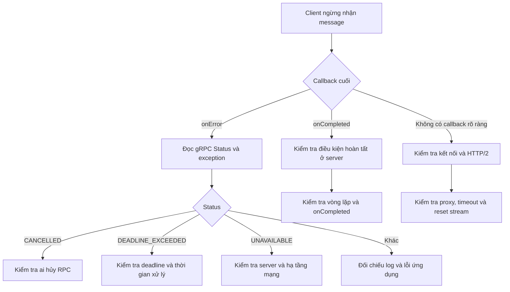

# Streaming kết thúc sớm

Trong Spring gRPC, một RPC streaming chỉ kết thúc khi một phía gửi tín hiệu kết thúc, RPC bị hủy, deadline hết hạn hoặc kết nối gặp lỗi. Vì vậy, khi client chỉ nhận được một phần dữ liệu rồi stream dừng, cần xác định **ai đã kết thúc RPC và kết thúc bằng trạng thái nào** trước khi thay đổi cấu hình.

Spring gRPC sử dụng hợp đồng Protocol Buffers và các API streaming của gRPC Java. Các service được đăng ký trong Spring vẫn tuân theo vòng đời `StreamObserver`: `onNext` chuyển một message, `onCompleted` kết thúc thành công và `onError` kết thúc với lỗi. Ba tín hiệu này quyết định cách client nhìn thấy kết quả.

## 1. Phân biệt kết thúc bình thường và kết thúc bất thường

Ở phía nhận, `onCompleted()` có nghĩa RPC đã kết thúc thành công. Nó không có nghĩa stream đã gửi đủ số message mà nghiệp vụ mong đợi. Nếu server chỉ truy vấn được một trang dữ liệu, vòng lặp đọc nguồn dữ liệu dừng sớm hoặc điều kiện lọc loại bỏ phần còn lại, gRPC vẫn có thể hoàn tất RPC với trạng thái `OK`.

`onError(Throwable)` cho biết RPC kết thúc với lỗi. Với lỗi gRPC, dùng `Status.fromThrowable(error)` để lấy mã trạng thái và mô tả. Một số mã thường gặp:

| Trạng thái | Dấu hiệu thường gặp | Hướng kiểm tra |
|---|---|---|
| `OK` | Client nhận `onCompleted()` | Kiểm tra điều kiện kết thúc, vòng lặp và nguồn dữ liệu ở server |
| `CANCELLED` | Một phía chủ động hủy RPC | Kiểm tra thao tác đóng màn hình, hủy subscription, client timeout riêng hoặc handler hủy ở server |
| `DEADLINE_EXCEEDED` | RPC vượt quá deadline của client | Kiểm tra deadline, thời gian xử lý và thời gian chờ giữa các message |
| `UNAVAILABLE` | Kết nối hoặc dịch vụ tạm thời không khả dụng | Kiểm tra server restart, mạng, load balancer, proxy và HTTP/2 |
| `RESOURCE_EXHAUSTED` | Một giới hạn tài nguyên hoặc kích thước bị vượt | Kiểm tra giới hạn message, bộ nhớ, quota và tải hệ thống |
| `INTERNAL` hoặc `UNKNOWN` | Lỗi xử lý hoặc lỗi không được ánh xạ rõ | Đối chiếu log server với exception gốc và thời điểm stream dừng |

Không nên kết luận chỉ từ mã trạng thái. `CANCELLED` có thể xuất hiện khi client đóng kết nối hoặc khi server hủy công việc; `UNAVAILABLE` có thể do hạ tầng ngắt kết nối mà không có exception nghiệp vụ ở server. Hãy ghi nhận trạng thái ở cả hai phía và thời điểm xảy ra.

## 2. Xác định kiểu streaming và phía có quyền kết thúc

Trước khi đọc code, xác định RPC đang dùng kiểu nào. Mỗi kiểu có một vòng đời request và response khác nhau.

| Kiểu RPC | Luồng request | Luồng response | Điều cần xác minh |
|---|---|---|---|
| Server streaming | Client gửi một request | Server gửi nhiều message | Server có dừng vòng lặp hoặc gọi `onCompleted()` quá sớm không? |
| Client streaming | Client gửi nhiều message | Server gửi một response | Client đã gọi `onCompleted()` sau message cuối chưa? Server có đợi xử lý hết request không? |
| Bidirectional streaming | Hai phía gửi nhiều message độc lập | Hai phía gửi nhiều message độc lập | Một phía có kết thúc luồng của mình trong khi phía kia vẫn cần trao đổi không? |

Với client streaming, `requestObserver.onCompleted()` chỉ báo rằng client đã gửi xong request. Nó không thay thế việc server hoàn tất response. Với bidirectional streaming, client có thể đóng chiều gửi request mà server vẫn tiếp tục gửi response. Nếu server gọi `responseObserver.onCompleted()`, chiều response kết thúc và client không thể chờ thêm message từ RPC đó.

## 3. Kiểm tra vòng đời `StreamObserver`

Mỗi RPC chỉ được phát đúng một tín hiệu kết thúc cho một chiều stream: `onCompleted()` hoặc `onError()`. Sau tín hiệu kết thúc, không gọi thêm `onNext()`, `onCompleted()` hay `onError()`. Những lỗi thường làm stream dừng sớm gồm:

- Gọi `onCompleted()` ngay sau message đầu tiên vì đặt lệnh này bên trong vòng lặp.
- Một nhánh điều kiện hoặc `return` kết thúc tác vụ trước khi đọc hết nguồn.
- Exception xảy ra trong callback bất đồng bộ nhưng không được chuyển thành `onError()`.
- Client gọi `onCompleted()` hoặc `cancel()` khi vẫn còn cần gửi hoặc nhận dữ liệu.
- Server gửi response trước khi hoàn tất xử lý toàn bộ request của client-streaming hoặc bidirectional RPC.

Ví dụ dưới đây minh họa server streaming. Service kiểm tra việc client hủy RPC, phát message trong một tác vụ riêng và chỉ hoàn tất sau khi nguồn dữ liệu được đọc hết. Các kiểu `Event`, `WatchEventsRequest`, `EventSource` và `EventServiceGrpc` là kiểu được sinh từ file `.proto` hoặc thành phần ứng dụng.

```java
@GrpcService
public class EventGrpcService extends EventServiceGrpc.EventServiceImplBase {

    private final Executor executor;
    private final EventSource eventSource;

    public EventGrpcService(Executor executor, EventSource eventSource) {
        this.executor = executor;
        this.eventSource = eventSource;
    }

    @Override
    public void watchEvents(
            WatchEventsRequest request,
            StreamObserver<Event> responseObserver) {

        ServerCallStreamObserver<Event> call =
                (ServerCallStreamObserver<Event>) responseObserver;
        AtomicBoolean cancelled = new AtomicBoolean();
        call.setOnCancelHandler(() -> cancelled.set(true));

        executor.execute(() -> {
            try {
                for (Event event : eventSource.read(request)) {
                    if (cancelled.get() || call.isCancelled()) {
                        return;
                    }
                    call.onNext(event);
                }

                if (!cancelled.get() && !call.isCancelled()) {
                    call.onCompleted();
                }
            } catch (Exception ex) {
                if (!cancelled.get() && !call.isCancelled()) {
                    call.onError(Status.INTERNAL
                            .withDescription("Không thể đọc luồng sự kiện")
                            .withCause(ex)
                            .asRuntimeException());
                }
            }
        });
    }
}
```

Ví dụ cần các import gRPC tương ứng như `StreamObserver`, `ServerCallStreamObserver` và `Status`, cùng `AtomicBoolean` của Java. `@GrpcService` đăng ký service với Spring gRPC. Trong ứng dụng thực tế, hãy bảo đảm nguồn dữ liệu có thể dừng khi nhận cancellation; chỉ kiểm tra cờ sau mỗi lần đọc là chưa đủ nếu thao tác đọc đang bị chặn lâu. Executor cũng cần được quản lý theo vòng đời ứng dụng và có giới hạn tải phù hợp.

Nếu tác vụ chạy nền ném exception sau khi method service đã trả về, exception đó không tự động trở thành trạng thái lỗi của RPC. Bắt exception trong tác vụ và gọi `onError()` khi RPC vẫn còn hoạt động. Không gọi `onError()` sau khi client đã hủy hoặc sau khi response đã kết thúc.

## 4. Kiểm tra deadline và cancellation ở client

Deadline giới hạn tổng thời gian một RPC được phép chạy. Khi deadline hết hạn, gRPC hủy RPC và client thường nhận `DEADLINE_EXCEEDED`. Deadline áp dụng cho toàn bộ RPC, không được tự làm mới sau mỗi message. Một stream kéo dài nhiều phút có thể bị cắt dù server vẫn đang tạo dữ liệu bình thường nếu client đặt deadline quá ngắn.

Ví dụ đặt deadline cho một RPC có thời lượng dự kiến hữu hạn:

```java
EventServiceGrpc.EventServiceStub boundedStub =
        asyncStub.withDeadlineAfter(2, TimeUnit.MINUTES);

boundedStub.watchEvents(request, new StreamObserver<Event>() {
    @Override
    public void onNext(Event event) {
        handle(event);
    }

    @Override
    public void onError(Throwable error) {
        Status status = Status.fromThrowable(error);
        log.warn("Stream failed: code={}, description={}",
                status.getCode(), status.getDescription(), error);
    }

    @Override
    public void onCompleted() {
        log.info("Stream completed successfully");
    }
});
```

Chọn deadline theo thời gian xử lý và thời gian chờ hợp lệ của nghiệp vụ. Với stream dài hạn, tránh deadline ngắn cố định; cần xác định chính sách tuổi thọ kết nối và cơ chế kết nối lại. Ghi lại deadline còn lại khi bắt đầu RPC và thời gian thực tế đến lúc kết thúc để phân biệt deadline với việc server tự hoàn tất.

Cancellation là tín hiệu riêng với deadline. Client có thể hủy khi người dùng rời màn hình, tác vụ không còn cần kết quả hoặc ứng dụng đóng. Server nên đăng ký `setOnCancelHandler()` để dừng truy vấn, subscription, tác vụ nền hoặc thao tác I/O liên quan. Nếu chỉ đóng phía client mà server vẫn tiếp tục xử lý, tài nguyên có thể bị giữ đến khi công việc tự kết thúc.

## 5. Kiểm tra flow control và xử lý bất đồng bộ

Flow control điều tiết tốc độ gửi message để phía nhận không bị quá tải. Nó thường làm stream tạm ngừng phát message; bản thân việc hết khả năng gửi không đồng nghĩa RPC đã hoàn tất. Tuy nhiên, code có thể vô tình kết thúc stream nếu coi trạng thái chưa sẵn sàng là điều kiện thoát vòng lặp.

Ở phía gửi, `CallStreamObserver.isReady()` cho biết có thể gửi thêm dữ liệu mà không làm bộ đệm tăng quá mức. Có thể đăng ký `setOnReadyHandler()` để tiếp tục phát khi gRPC sẵn sàng. Không nên dùng vòng lặp bận chờ `isReady()` hoặc giữ toàn bộ kết quả trong bộ nhớ. Ở RPC nhận nhiều request, nếu tắt tự động điều tiết luồng vào bằng `disableAutoInboundFlowControl()`, ứng dụng phải gọi `request(n)` để yêu cầu thêm message sau khi xử lý xong số message đã nhận; quên gọi `request(n)` sẽ khiến luồng request dừng chờ.

Khi nối gRPC với `Executor`, `CompletableFuture`, reactive publisher hoặc callback của thư viện khác, hãy kiểm tra ba điểm:

1. Lỗi từ tác vụ nền có được chuyển thành `responseObserver.onError()` không?
2. Khi client hủy, nguồn dữ liệu và tác vụ nền có nhận tín hiệu dừng không?
3. Có nhiều thread cùng gọi `onNext()` hoặc tín hiệu kết thúc trên cùng observer không?

Các observer không nên bị gọi đồng thời từ nhiều thread nếu ứng dụng không tự đồng bộ hóa việc phát message. Một nguồn phát tuần tự giúp giữ đúng thứ tự dữ liệu và tránh race giữa `onNext()` với `onCompleted()` hoặc `onError()`.

## 6. Kiểm tra proxy, load balancer và kết nối HTTP/2

Nếu code server không gọi tín hiệu kết thúc nhưng client vẫn mất stream, kiểm tra đường truyền giữa client và server. Ingress, reverse proxy, service mesh, load balancer hoặc firewall có thể đóng kết nối do idle timeout, giới hạn thời lượng kết nối, restart hoặc lỗi HTTP/2. Trường hợp này thường có log ngắt kết nối hoặc reset stream thay vì exception nghiệp vụ tương ứng.

Đối chiếu các mốc sau trên client, server và hạ tầng:

- Thời điểm RPC bắt đầu, message đầu tiên và message cuối cùng.
- Khoảng thời gian không có message trước khi kết nối bị đóng.
- Thời điểm server restart, deploy, scale hoặc chuyển endpoint.
- Log HTTP/2 như `RST_STREAM` hoặc `GOAWAY`, nếu proxy và client có ghi nhận.
- Idle timeout và giới hạn thời lượng kết nối của từng hop trong tuyến mạng.

Keepalive HTTP/2 có thể giúp phát hiện kết nối chết, nhưng không tự khắc phục idle timeout của proxy hoặc giới hạn tuổi thọ kết nối. Chỉ cấu hình keepalive theo chính sách của server và hạ tầng. Nếu nghiệp vụ cần heartbeat, hãy định nghĩa message heartbeat trong protobuf và quy tắc xử lý rõ ràng; không gửi message tùy tiện làm thay đổi hợp đồng API.

## 7. Không giả định gRPC tự tiếp tục stream sau khi kết nối lại

Khi streaming RPC bị ngắt, một lần gọi mới là một RPC mới. Ứng dụng không nên giả định gRPC tự phát lại những message đã nhận hoặc tiếp tục từ vị trí cuối. Retry tự động cũng không thể bảo đảm an toàn cho một stream đã trao đổi dữ liệu hoặc đã tạo side effect.

Với luồng sự kiện hoặc dữ liệu lớn, hãy thiết kế cơ chế tiếp tục ở tầng ứng dụng nếu nghiệp vụ cần:

- Mỗi message có sequence number, event ID hoặc cursor ổn định.
- Client lưu checkpoint sau khi xử lý thành công message.
- Request mở lại stream mang theo cursor cuối cùng đã xác nhận.
- Server xác định rõ dữ liệu có thể phát lại và cách loại bỏ message trùng.
- Các thao tác ghi có idempotency key hoặc quy tắc chống thực thi lặp.

Thiết kế này cho phép client khôi phục sau `UNAVAILABLE`, deploy hoặc timeout mà không phụ thuộc vào việc kết nối TCP/HTTP/2 cũ còn tồn tại.

## 8. Quy trình chẩn đoán

Thực hiện theo thứ tự để khoanh vùng nguyên nhân:

1. Ghi nhận loại RPC, tên method, thời điểm bắt đầu, số message đã nhận và callback cuối cùng (`onCompleted` hay `onError`).
2. Nếu là `onCompleted`, kiểm tra vòng lặp, điều kiện lọc, phân trang và nhánh code gọi `onCompleted()` ở server.
3. Nếu là `onError`, lấy `Status` và đối chiếu exception gốc, deadline và cancellation ở cả hai phía.
4. Nếu server không ghi nhận kết thúc, kiểm tra cancellation handler, log kết nối và các proxy hoặc load balancer trên đường truyền.
5. Nếu stream chỉ dừng khi tải cao, kiểm tra flow control, executor, hàng đợi, giới hạn message và thời gian xử lý của consumer.
6. Tái hiện riêng từng trường hợp: nguồn dữ liệu kết thúc bình thường, server phát lỗi, client hủy, deadline hết hạn và kết nối bị ngắt.

Sơ đồ quyết định nhanh:



Trong interceptor hoặc log tại service, nên ghi tên method, correlation ID, thời gian bắt đầu/kết thúc, số message, thời gian đến message cuối, trạng thái gRPC và nguyên nhân cancellation. Metadata gRPC được gửi ở cấp RPC, không phải một bộ metadata mới cho từng message. Không ghi token, thông tin xác thực hoặc dữ liệu nhạy cảm vào log.

## 9. Kiểm thử để ngăn lỗi tái diễn

Kiểm thử tích hợp nên bao gồm cả đường chạy thành công và các cách stream bị dừng:

| Kịch bản | Kết quả cần xác minh |
|---|---|
| Nguồn có đủ dữ liệu | Client nhận đủ message theo hợp đồng và cuối cùng nhận `onCompleted()` |
| Nguồn kết thúc sớm | Hệ thống phát hiện số lượng hoặc cursor thiếu theo quy tắc nghiệp vụ; không nhầm `OK` với dữ liệu đầy đủ |
| Nguồn phát exception | Client nhận trạng thái lỗi phù hợp; server ghi exception gốc |
| Client chủ động hủy | Server nhận cancellation và dừng công việc nền |
| Deadline hết hạn | Client nhận `DEADLINE_EXCEEDED`; tài nguyên phía server được giải phóng |
| Tốc độ consumer thấp | Flow control điều tiết message mà không làm RPC kết thúc ngoài ý muốn |
| Kết nối bị ngắt | Client nhận lỗi phù hợp và cơ chế resume của ứng dụng hoạt động nếu có |

Có thể bắt đầu với kiểm thử in-process để xác minh vòng đời observer và logic service, sau đó chạy kiểm thử qua cấu hình mạng thực tế để phát hiện timeout hoặc giới hạn của proxy. Khi kiểm thử stream dài hạn, đặt thời gian chạy và điều kiện dừng rõ ràng để tránh test treo.

## Checklist xử lý nhanh

- [ ] Xác định RPC là server streaming, client streaming hay bidirectional.
- [ ] Ghi lại callback cuối cùng và gRPC status ở client.
- [ ] Xác minh server chỉ gọi một tín hiệu kết thúc và không gửi message sau đó.
- [ ] Kiểm tra deadline, cancellation và tác vụ nền.
- [ ] Kiểm tra flow control nếu stream dừng khi tải tăng.
- [ ] Đối chiếu idle timeout, giới hạn kết nối và log HTTP/2 của hạ tầng.
- [ ] Nếu cần khôi phục stream, xác định cursor, sequence number và cách xử lý message trùng.
