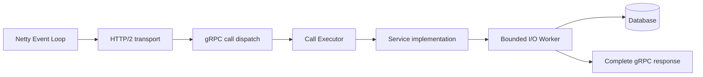

# Chặn event loop bằng lời gọi blocking

## 1. Vì sao blocking làm giảm khả năng phục vụ?

Trong **SPRING_GRPC**, một server có thể nhận nhiều RPC đồng thời trên HTTP/2. Transport cần xử lý socket, frame, flow control, timer và callback để tiếp tục phục vụ các call khác. Nếu một thread event loop bị giữ bởi JDBC query, HTTP call đồng bộ, đọc file hoặc chờ Future, thread đó không thể xử lý các sự kiện I/O khác trong lúc chờ.

Một blocking call có thể chỉ mất vài trăm mili giây khi hệ thống bình thường. Dưới tải, nhiều call cùng chờ database hoặc dependency có thể chiếm hết thread xử lý. Các request mới phải xếp hàng, latency tăng, deadline hết và retry làm tải nặng hơn.

Cần hiểu chính xác thread model: gRPC Java Netty thường dispatch application callbacks qua call executor; không phải mọi implementation service mặc định đều chạy trực tiếp trên Netty event loop. Tuy nhiên, nếu cấu hình direct executor, tự gọi code từ event-loop callback, dùng reactive Netty/WebFlux hoặc chuyển callback sang event loop, blocking sẽ chặn chính thread I/O. Ngay cả khi handler chạy trên call executor riêng, blocking không kiểm soát vẫn có thể làm cạn executor và tạo hàng đợi lớn.

Bài tập trung vào:

- Phân biệt Netty event loop, gRPC call executor và worker executor.
- Nhận diện blocking operation trong service và callback.
- Tránh directExecutor khi application code có blocking.
- Offload blocking I/O sang executor có giới hạn.
- Phối hợp executor, connection pool, deadline và cancellation.
- Giữ backpressure cho streaming.
- Quan sát thread starvation và kiểm thử dưới tải.

## 2. Phân biệt event loop với gRPC call executor

Netty dùng một nhóm event loop để xử lý I/O không blocking. Một event loop thường quản lý nhiều channel; nếu một callback giữ thread quá lâu, mọi channel được gán cho event loop đó có thể bị ảnh hưởng.

Ở phía server gRPC Java, application service callbacks thường được dispatch qua executor do server quản lý. Có thể cấu hình executor bằng ServerBuilder.executor(...). Nếu dùng directExecutor(), application callbacks chạy trực tiếp trên transport thread theo contract của gRPC; khi đó code service phải tránh blocking.

Mô hình khái quát:



Trong mô hình này, Netty event loop xử lý transport; call executor chạy application callback; blocking worker xử lý thao tác I/O đồng bộ khi cần. Đây là sơ đồ khái niệm, không phải cam kết mỗi starter luôn tạo đúng ba nhóm thread như hình.

Hai dạng starvation cần phân biệt:

- **Event-loop starvation:** event loop bị block, gây trễ I/O trên nhiều channel.
- **Call-executor starvation:** event loop vẫn chạy nhưng executor xử lý service callbacks hết thread; request mới chờ dispatch hoặc xử lý.

Cả hai đều làm latency tăng, nhưng điểm nghẽn và cách điều tra khác nhau.

## 3. Nhận diện blocking operation

Các lời gọi sau có thể block thread hiện tại:

| Operation | Vì sao block |
| --- | --- |
| JDBC/JPA repository | Chờ connection, lock hoặc query hoàn tất |
| RestTemplate hoặc HTTP client đồng bộ | Chờ network response |
| Blocking gRPC stub | Chờ server trả response |
| Future.get() / CompletableFuture.join() | Chờ task khác hoàn tất |
| Thread.sleep() | Giữ thread trong thời gian ngủ |
| Files.readAllBytes()/write() | Chờ filesystem |
| Synchronized lock / lock.lock() | Chờ thread khác nhả lock |
| Blocking queue take()/put() | Chờ item hoặc capacity |
| CPU loop kéo dài | Không nhường thread dù không chờ I/O |

Một lời gọi có tên async không tự động làm toàn bộ pipeline non-blocking. Ví dụ gọi supplyAsync rồi join ngay vẫn block thread gọi join. Tương tự, đưa một blocking query vào callback đang chạy trên event loop vẫn chặn event loop.

Hãy kiểm tra cả helper method và thư viện được gọi gián tiếp. Một repository method trông ngắn có thể chờ connection pool hoặc database lock hàng giây.

## 4. Anti-pattern: gọi blocking trực tiếp từ callback transport

Ví dụ nguy hiểm khi service callback có thể chạy trên event loop hoặc executor cần giữ khả năng phản hồi nhanh:

```java
@Override
public void getOrder(
        GetOrderRequest request,
        StreamObserver<GetOrderReply> observer) {

    // JDBC call có thể chờ connection và database.
    Order order = orderRepository.findById(request.getOrderId())
        .orElseThrow(OrderNotFoundException::new);

    observer.onNext(toReply(order));
    observer.onCompleted();
}
```

Nếu callback này chạy trên event loop, toàn bộ event loop bị chặn trong thời gian repository hoạt động. Nếu callback chạy trên call executor riêng, thread call executor bị giữ; nhiều request đồng thời vẫn có thể làm cạn executor.

Không phải mọi lời gọi repository đều phải chuyển sang một executor khác trong mọi kiến trúc. Điều bắt buộc là biết callback chạy trên thread nào, giới hạn concurrency của blocking work và bảo đảm không block thread dành cho I/O hoặc scheduling.

## 5. Tránh directExecutor khi service có blocking work

gRPC Java cho phép cấu hình direct executor để giảm scheduling overhead:

```java
Server server = NettyServerBuilder
    .forPort(8443)
    .directExecutor()
    .addService(orderService)
    .build();
```

Đây là lựa chọn có yêu cầu cao: service implementation, interceptor và callback phải chạy nhanh, không block, không chờ lock và không thực hiện I/O đồng bộ. Nếu service gọi JDBC/JPA, blocking HTTP client hoặc Future.get(), directExecutor có thể đưa các thao tác đó lên transport thread.

Trong server xử lý nghiệp vụ Spring thông thường, không bật directExecutor chỉ để giảm một bước dispatch khi chưa đo và kiểm chứng thread behavior. Dùng executor phù hợp với workload và cấu hình của Spring gRPC starter đang triển khai.

## 6. Offload blocking I/O sang bounded executor

Nếu dùng JDBC/JPA hoặc thư viện đồng bộ, chạy phần blocking trên worker pool có giới hạn. Không dùng một cached/unbounded pool tạo thread không giới hạn; cũng không dùng queue vô hạn khiến request chờ lâu hơn deadline.

Ví dụ executor dành cho blocking I/O:

```java
@Bean(destroyMethod = "shutdown")
ExecutorService blockingIoExecutor() {
    return new ThreadPoolExecutor(
        16,
        32,
        60,
        TimeUnit.SECONDS,
        new ArrayBlockingQueue<>(200),
        namedThreadFactory("grpc-blocking-"),
        new ThreadPoolExecutor.AbortPolicy()
    );
}
```

Các con số chỉ minh họa. Sizing phải dựa trên DB pool, latency dependency, CPU, số replica và concurrency mục tiêu.

Khi queue đầy, AbortPolicy ném RejectedExecutionException để ứng dụng có thể từ chối sớm hoặc áp dụng load shedding. Tránh CallerRunsPolicy trong đường xử lý transport: policy này chạy task bị từ chối ngay trên thread gọi execute(), có thể chính là event loop và tái tạo lỗi blocking.

Nếu dùng Spring gRPC starter, hãy đăng ký executor qua cơ chế cấu hình được hỗ trợ hoặc inject worker riêng trong service; không tự dựng server thứ hai chỉ để đổi executor.

## 7. Hoàn tất unary RPC sau khi offload

Một service có thể chuyển database work sang worker rồi hoàn tất observer khi kết quả sẵn sàng. Ví dụ khái niệm:

```java
@Override
public void getOrder(
        GetOrderRequest request,
        StreamObserver<GetOrderReply> observer) {

    Context callContext = Context.current();

    try {
        blockingIoExecutor.execute(() -> {
            Context previous = callContext.attach();
            try {
                if (callContext.isCancelled()) {
                    return;
                }

                Order order = orderRepository
                    .findById(request.getOrderId())
                    .orElseThrow(OrderNotFoundException::new);

                if (callContext.isCancelled()) {
                    return;
                }

                observer.onNext(toReply(order));
                observer.onCompleted();
            } catch (Throwable error) {
                observer.onError(exceptionMapper.toStatus(error));
            } finally {
                callContext.detach(previous);
            }
        });
    } catch (RejectedExecutionException rejected) {
        observer.onError(
            Status.RESOURCE_EXHAUSTED
                .withDescription("Server is busy")
                .asRuntimeException()
        );
    }
}
```

Đây là skeleton minh họa; production cần bảo đảm observer chỉ có một terminal signal, cancellation không race với response, và lỗi không bị nuốt. Nếu dùng ServerCallStreamObserver, đăng ký onCancelHandler để báo worker dừng khi có thể.

Context được capture từ call và attach trên worker để deadline/cancellation cùng các gRPC context value có thể được đọc đúng. Luôn detach trong finally để không rò Context sang task kế tiếp. Không giả định ThreadLocal tự truyền qua executor.

Nếu thao tác JDBC đã chạy, cancel Future bằng interrupt không đảm bảo driver hủy query. Cần query timeout/database-side timeout và transaction policy riêng.

## 8. Dùng non-blocking client khi dependency hỗ trợ

Với HTTP hoặc gRPC downstream, ưu tiên API bất đồng bộ/non-blocking nếu kiến trúc cho phép:

- gRPC async stub thay cho blocking stub.
- HTTP client non-blocking thay cho RestTemplate.
- R2DBC/reactive driver thay cho JDBC khi toàn bộ data path phù hợp.
- CompletionStage/reactive composition thay vì chờ get()/join().

Ví dụ async stub:

```java
orderAsyncStub
    .withDeadlineAfter(300, TimeUnit.MILLISECONDS)
    .getOrder(request, new StreamObserver<>() {
        @Override
        public void onNext(OrderReply reply) {
            // Chuyển tiếp kết quả theo đúng call lifecycle.
        }

        @Override
        public void onError(Throwable error) {
            // Giữ status và hoàn tất lỗi đúng một lần.
        }

        @Override
        public void onCompleted() {
            // Hoàn tất response.
        }
    });
```

Dùng async API không có nghĩa callback có thể làm blocking work. Nếu onNext/onError callback chạy trên executor nhạy với latency, chỉ thực hiện công việc ngắn rồi offload phần blocking.

Không gọi async API rồi lập tức block bằng get(), join() hoặc latch.await(); như vậy chỉ đổi hình thức code, không đổi thread behavior.

## 9. Chọn executor theo loại công việc

Không nên dồn mọi loại công việc vào một pool không phân biệt:

| Workload | Chiến lược |
| --- | --- |
| Netty transport I/O | Event loop do transport quản lý; không chạy blocking business code |
| gRPC application callback | Executor có concurrency phù hợp; callback nên ngắn |
| JDBC/JPA blocking | Bounded worker pool phối hợp DB connection pool |
| Blocking HTTP/SDK | Worker pool giới hạn theo downstream capacity |
| CPU-heavy transform | CPU pool có số thread gần năng lực CPU |
| Scheduled cleanup | Scheduler riêng, không dùng event loop |
| Async/non-blocking I/O | Event-driven composition, không chờ đồng bộ |

Tách pool giúp một dependency chậm không chiếm hết thread phục vụ mọi RPC. Nhưng quá nhiều pool cũng tạo thêm queue và context switching. Mỗi pool cần owner, capacity, queue limit, rejection policy và metrics.

## 10. Sizing worker pool phải gắn với database pool

Giả sử mỗi replica có 20 JDBC connections. Nếu tạo 200 worker threads cùng lúc gọi database, tối đa 20 thread có connection; phần còn lại chờ trong pool, giữ thread và làm tăng latency.

Sizing cần cân nhắc:

- Số connection DB tối đa dành cho instance.
- Thời gian giữ connection trung bình và p95/p99.
- Tỷ lệ RPC thực sự dùng database.
- Số dependency call đồng thời trên mỗi request.
- Replica tối đa và tổng connection budget của database.
- Queue capacity và deadline của RPC.

Không chọn thread count chỉ theo số CPU hoặc số RPC concurrent. Với blocking I/O, số thread có thể lớn hơn core count, nhưng phải có giới hạn theo tài nguyên downstream. Nếu DB pool là 20, concurrency của DB work không nên vượt xa capacity đó mà không có lý do và kiểm soát queue rõ ràng.

## 11. Deadline phải tính cả thời gian nằm trong queue

Offload không làm biến mất thời gian chờ. Một request có thể nằm trong worker queue 700 ms rồi mới bắt đầu query, dù RPC deadline chỉ còn 100 ms.

Trước khi enqueue và trước khi thực thi blocking operation:

1. Đọc remaining deadline từ gRPC Context.
2. Từ chối sớm nếu deadline đã hết hoặc không đủ cho công việc.
3. Khi worker bắt đầu, tính lại remaining budget.
4. Đặt query/statement timeout nhỏ hơn phần còn lại, chừa thời gian commit/response.
5. Nếu request đã bị cancel trong queue, bỏ qua task trước khi chiếm connection.

Không đặt timeout đầy đủ mới khi task bắt đầu. Deadline là ngân sách đầu cuối và thời gian chờ executor đã tiêu thụ ngân sách đó.

## 12. Cancellation và cleanup cho blocking task

Khi client hủy RPC hoặc deadline hết, server nên dừng công việc chưa cần thiết:

- Kiểm tra Context.isCancelled() trước khi lấy connection và trước các bước tiếp theo.
- Đăng ký cancellation handler cho server call nếu phù hợp.
- Hủy Future/task khi có thể.
- Cấu hình JDBC query timeout và database statement timeout.
- Đảm bảo transaction rollback khi query thất bại trước commit.
- Không phát response sau terminal cancellation.
- Không giả định interrupt luôn hủy được JDBC/SDK call.

Nếu task đã commit database trước khi cancellation tới, không thể rollback chỉ vì client đã hủy. Với command có side effect, dùng idempotency key và operation status để client xác định kết quả.

## 13. Backpressure cho streaming RPC

Streaming có thể duy trì nhiều message trong thời gian dài. Nếu producer tạo dữ liệu nhanh hơn client nhận, queue message sẽ tăng và heap có thể cạn.

Với ServerCallStreamObserver, có thể kiểm tra isReady() và đăng ký onReadyHandler để chỉ gửi tiếp khi transport sẵn sàng:

```java
ServerCallStreamObserver<OrderUpdate> serverObserver =
    (ServerCallStreamObserver<OrderUpdate>) observer;

serverObserver.setOnReadyHandler(() -> {
    // Đánh thức producer; chỉ gửi khi serverObserver.isReady().
});
```

Callback onReadyHandler cần ngắn và không block. Nếu producer đọc database hoặc file, dùng worker/async source có bounded buffer; không đọc hết dữ liệu vào memory rồi mới phát stream.

Cũng cần:

- Giới hạn số stream đồng thời.
- Giới hạn in-flight message và byte buffer.
- Hủy producer khi client cancel.
- Không giữ transaction database mở trong suốt stream.
- Dùng cursor/page theo từng batch nếu đọc database.
- Xác định semantics partial result và resume khi stream bị ngắt.

HTTP/2 flow control giúp điều tiết transport, nhưng application vẫn phải kiểm soát queue và tốc độ tạo dữ liệu.

## 14. Virtual threads không làm event loop trở thành nơi chạy blocking code

Virtual threads có thể làm code blocking dễ quản lý hơn và giảm chi phí thread cho một số workload. Tuy nhiên, chúng không biến một Netty event loop thành môi trường được phép block.

Quy tắc:

- Không chạy JDBC/HTTP blocking trực tiếp trên event loop dù có virtual thread.
- Offload blocking operation sang executor tạo virtual thread hoặc worker phù hợp.
- Giới hạn concurrency bằng semaphore/bulkhead theo DB/provider capacity.
- Kiểm tra driver và thư viện có hành vi phù hợp với virtual threads.
- Theo dõi pinning, memory và resource pool; virtual thread không tạo thêm database connections.
- Vẫn giữ deadline, cancellation và bounded admission.

Virtual thread giúp quản lý nhiều task đang chờ I/O, nhưng không tăng năng lực database hoặc downstream service.

## 15. Rejection và load shedding khi quá tải

Khi worker pool đầy, tiếp tục nhận mọi request chỉ làm queue tăng và deadline hết trong lúc chờ. Hệ thống nên từ chối sớm theo policy:

- RESOURCE_EXHAUSTED khi capacity/quota đã đạt và caller có thể backoff.
- UNAVAILABLE khi service tạm thời không thể phục vụ theo contract.
- RetryInfo/backoff metadata nếu API hỗ trợ.
- Giới hạn retry để không tạo retry storm.

Không trả INTERNAL chỉ vì executor reject task. Không dùng CallerRunsPolicy nếu thread submit có thể là event loop. Rejection handler cần bảo đảm gRPC call được kết thúc đúng một lần và không làm rò tài nguyên.

Nếu service có nhiều RPC method, có thể cần bulkhead riêng cho workload nặng để một export/report không chiếm hết worker của query nhỏ.

## 16. Observability: nhận diện event-loop và executor starvation

Theo dõi riêng từng nhóm:

- Event-loop thread utilization/lag và callback duration nếu có instrument.
- gRPC call executor active threads, queue depth, queue wait và rejected tasks.
- Blocking worker active count, queue depth, execution time và rejection.
- JDBC active/idle/pending connections, acquisition time và query duration.
- RPC latency p50/p95/p99, in-flight calls, deadline exceeded và cancellation.
- Streaming in-flight bytes, readiness wait và slow-consumer count.
- CPU, GC pause, heap và thread count.

Dấu hiệu event-loop starvation: transport callback/heartbeat/I/O latency tăng cùng lúc event-loop thread bị chiếm lâu. Dấu hiệu call-executor starvation: transport vẫn nhận traffic nhưng service dispatch queue và RPC latency tăng. Dấu hiệu DB saturation: worker chờ connection hoặc query/lock lâu.

Không dùng một metric “thread count” để kết luận. Correlate trace span, executor queue và database metrics theo thời gian.

## 17. Kiểm thử để phát hiện blocking

Một test hữu ích phải chứng minh RPC nhanh vẫn được phục vụ khi một operation chậm:

| Kịch bản | Điều cần xác nhận |
| --- | --- |
| Một RPC giả lập blocking bằng latch | Thread xử lý I/O bị chiếm đúng như dự kiến |
| RPC nhanh chạy đồng thời | Không bị treo theo RPC chậm khi pool được tách đúng |
| Worker queue đầy | Request bị từ chối sớm, không chạy trên event loop |
| Deadline hết khi còn trong queue | Task không bắt đầu query sau khi đã hết hạn |
| Client cancel khi query đang chạy | Cancellation được truyền; query timeout giới hạn phần còn lại |
| Slow streaming client | Buffer có giới hạn và producer tạm dừng |
| Dependency chậm | Pool riêng không làm cạn executor của RPC khác |
| Server shutdown | Worker dừng/drain theo policy, không bỏ task vô hạn |
| Load test concurrency cao | p99, queue và rejection vẫn trong SLO |

Dùng CountDownLatch hoặc controllable fake để giữ một operation ở trạng thái chờ; tránh dựa vào Thread.sleep để tạo race. Chạy test trên cấu hình executor gần production và đo thread/queue metrics. Nếu dùng directExecutor, thêm test xác nhận không có blocking call trong callback.

## 18. Checklist review

- Biết rõ callback chạy trên Netty event loop, gRPC call executor hay worker thread.
- Không giả định mọi gRPC service implementation mặc định chạy trên Netty event loop.
- Không dùng directExecutor khi application callback có blocking work.
- Không gọi JDBC, blocking HTTP/gRPC, file I/O hoặc Future.get()/join() trên event loop.
- Blocking work được offload sang bounded executor.
- Không dùng queue vô hạn hoặc CallerRunsPolicy trong đường transport.
- Executor sizing gắn với DB pool, downstream capacity và replica count.
- Deadline tính cả queue wait; task kiểm tra remaining budget khi bắt đầu.
- Cancellation được truyền xuống task và dependency; JDBC có query timeout.
- Async API không bị block lại bằng get()/join().
- Streaming có backpressure, bounded buffer và cancellation.
- Virtual threads không được dùng làm lý do block event loop.
- Rejection được ánh xạ theo overload policy và kết thúc call đúng một lần.
- Metrics phân biệt event-loop lag, call executor starvation và DB saturation.
- Có concurrency/load tests chứng minh RPC nhanh không bị operation chậm làm nghẽn.

Trong **SPRING_GRPC**, blocking operation trên event loop có thể làm trễ mọi I/O mà thread đó quản lý; blocking trên call executor riêng vẫn có thể làm cạn khả năng dispatch RPC. Xác định thread model thực tế, giữ callback ngắn, offload JDBC/HTTP/file work sang worker pool có giới hạn và phối hợp queue với deadline, cancellation cùng capacity của database. Với streaming, thêm backpressure và bounded buffering để tải không tích tụ trong heap.
