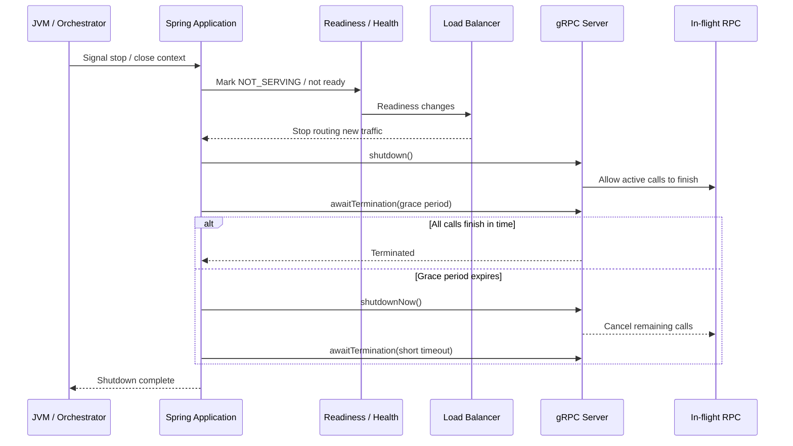

# Không graceful shutdown server

Một dịch vụ **SPRING_GRPC** cần xử lý cả lúc khởi động lẫn lúc dừng. Trong môi trường thực tế, server có thể phải dừng khi triển khai phiên bản mới, thay đổi cấu hình, thu hẹp số replica hoặc tắt ứng dụng. Nếu tiến trình kết thúc ngay khi nhận tín hiệu dừng, những RPC đang chạy có thể bị ngắt giữa chừng, client nhận lỗi không mong đợi và các thao tác nghiệp vụ có nguy cơ phải thực hiện lại.

Lỗi thường gặp là chỉ gọi `shutdownNow()`, gọi `System.exit()` hoặc để tiến trình/container bị kết thúc trước khi gRPC server kịp giải phóng các lời gọi đang hoạt động. Cách dừng đúng cần có một khoảng thời gian **graceful shutdown**: ngừng nhận công việc mới, cho các RPC đang chạy hoàn tất trong giới hạn đã định, rồi mới cưỡng bức kết thúc phần còn lại nếu hết thời gian.

## 1. Phân biệt graceful shutdown và shutdown tức thời

Trong gRPC Java, `io.grpc.Server` cung cấp hai thao tác dừng chính:

| API | Hành vi | Khi nào sử dụng |
| --- | --- | --- |
| `shutdown()` | Khởi tạo quá trình dừng có trật tự. Server ngừng nhận RPC mới và cho các RPC hiện tại tiếp tục hoàn tất. | Bắt đầu graceful shutdown trong tình huống vận hành bình thường. |
| `awaitTermination(timeout, unit)` | Chờ server kết thúc cho tới khi hết thời gian chờ hoặc server đã dừng. | Giới hạn thời gian chờ drain. |
| `shutdownNow()` | Yêu cầu hủy các RPC đang hoạt động và dừng server nhanh nhất có thể. | Bước cuối khi đã hết grace period hoặc cần dừng khẩn cấp. |
| `awaitTermination()` | Chờ vô thời hạn cho tới khi server kết thúc. | Chỉ dùng khi tiến trình và cơ chế điều phối bảo đảm có thể chờ vô thời hạn; thường không phù hợp với thời hạn dừng của container. |

`shutdown()` không có nghĩa là mọi RPC sẽ hoàn tất ngay lập tức. Một unary RPC có thời gian xử lý hữu hạn thường có thể kết thúc trong khoảng drain. Một streaming RPC có thể tồn tại rất lâu nếu client giữ stream mở hoặc server chờ message tiếp theo. Vì vậy, graceful shutdown phải đi cùng deadline, chính sách thời lượng stream và một giới hạn chờ cuối cùng.

## 2. Những hậu quả khi dừng server đột ngột

Các lỗi phổ biến xuất hiện theo nhiều dạng:

- **RPC đang xử lý bị ngắt:** client nhận `UNAVAILABLE`, `CANCELLED` hoặc lỗi transport tùy thời điểm kết nối bị đóng. Client không thể mặc định biết thao tác nghiệp vụ đã được commit hay chưa.
- **Stream bị cắt giữa chừng:** client-streaming, server-streaming và bidirectional-streaming có thể mất phần message chưa trao đổi xong hoặc không nhận được trạng thái kết thúc mong muốn.
- **Retry tạo tác dụng phụ lặp:** nếu client tự động thử lại một thao tác ghi mà server đã commit nhưng phản hồi chưa tới client, nghiệp vụ có thể bị thực hiện hai lần nếu không có idempotency.
- **Triển khai gây gián đoạn:** instance cũ rời khỏi cụm trước khi load balancer ngừng gửi request, làm tăng lỗi trong thời gian rollout.
- **Tài nguyên không được giải phóng đúng trình tự:** công việc nền, callback, connection tới dependency hoặc tác vụ ghi dữ liệu có thể chưa hoàn tất khi context ứng dụng bị đóng.
- **Thời gian dừng không dự đoán được:** nếu chỉ chờ vô hạn, một stream bị treo có thể khiến quá trình rollout hoặc scale-in không kết thúc.

Một lỗi `UNAVAILABLE` trong lúc deploy không nhất thiết là lỗi bảo mật hay lỗi mạng. Cần xem thời điểm shutdown, trạng thái instance, log vòng đời server và trace của RPC để xác định nguyên nhân.

## 3. Trình tự dừng có trật tự

Một quy trình vận hành thường có các bước sau:

1. Nhận tín hiệu dừng từ Spring ApplicationContext, JVM hoặc nền tảng điều phối.
2. Đánh dấu instance không còn sẵn sàng nhận traffic mới; cập nhật readiness hoặc trạng thái gRPC Health Checking nếu hệ thống sử dụng chúng.
3. Chờ load balancer, service discovery hoặc Kubernetes cập nhật endpoint và ngừng định tuyến request mới tới instance.
4. Gọi `Server.shutdown()` để bắt đầu dừng server và drain các RPC đang hoạt động.
5. Chờ trong grace period đã cấu hình. Trong thời gian này, RPC hiện tại tiếp tục xử lý và trả response nếu hoàn tất đúng hạn.
6. Nếu hết grace period, gọi `shutdownNow()` để yêu cầu hủy RPC còn lại.
7. Chờ thêm một khoảng ngắn để transport và callback kết thúc, ghi nhận kết quả dừng rồi cho phép tiến trình thoát.



Thứ tự readiness và `shutdown()` cần phù hợp với hạ tầng. Nếu gọi `shutdown()` trước khi hệ thống định tuyến ngừng gửi request, một số request mới có thể bị từ chối trong lúc endpoint vẫn còn được xem là healthy. Ngược lại, chỉ đánh dấu readiness nhưng không dừng nhận RPC có thể khiến instance tiếp tục nhận traffic từ client gọi trực tiếp hoặc từ một đường định tuyến khác.

## 4. Cài đặt giới hạn chờ với gRPC Java

Ví dụ dưới đây minh họa phần điều phối dừng cho một `Server` do ứng dụng tự tạo và sở hữu:

```java
import io.grpc.Server;

import java.util.concurrent.TimeUnit;
import java.util.logging.Level;
import java.util.logging.Logger;

public final class GrpcServerShutdown {
    private static final Logger LOGGER =
            Logger.getLogger(GrpcServerShutdown.class.getName());

    private final Server server;

    public GrpcServerShutdown(Server server) {
        this.server = server;
    }

    public void stop() {
        LOGGER.info("Starting graceful gRPC server shutdown");
        server.shutdown();

        try {
            if (server.awaitTermination(20, TimeUnit.SECONDS)) {
                LOGGER.info("gRPC server terminated gracefully");
                return;
            }

            LOGGER.warning("Grace period expired; forcing remaining RPCs to stop");
            server.shutdownNow();

            if (!server.awaitTermination(5, TimeUnit.SECONDS)) {
                LOGGER.severe("gRPC server did not terminate after forced shutdown");
            } else {
                LOGGER.info("gRPC server terminated after forced shutdown");
            }
        } catch (InterruptedException ex) {
            LOGGER.log(Level.WARNING, "Interrupted while waiting for gRPC shutdown", ex);
            server.shutdownNow();
            Thread.currentThread().interrupt();
        }
    }
}
```

Điểm quan trọng trong ví dụ:

- Bắt đầu bằng `shutdown()` để cho RPC hiện tại có cơ hội kết thúc.
- Dùng `awaitTermination()` có timeout để thời gian dừng luôn hữu hạn.
- Chỉ gọi `shutdownNow()` sau khi grace period đã hết.
- Nếu thread bị interrupt, yêu cầu dừng khẩn cấp và khôi phục interrupt flag bằng `Thread.currentThread().interrupt()`.
- Ghi log rõ ràng giữa trường hợp dừng bình thường, hết grace period và không thể kết thúc sau khi cưỡng bức.

Nếu ứng dụng tự quản lý server bằng Spring bean, có thể gọi coordinator từ callback vòng đời của bean, chẳng hạn `@PreDestroy`:

```java
import jakarta.annotation.PreDestroy;
import org.springframework.stereotype.Component;

@Component
public final class CustomGrpcServerLifecycle {
    private final GrpcServerShutdown shutdown;

    public CustomGrpcServerLifecycle(GrpcServerShutdown shutdown) {
        this.shutdown = shutdown;
    }

    @PreDestroy
    public void stop() {
        shutdown.stop();
    }
}
```

Ví dụ này dành cho trường hợp ứng dụng tự tạo và sở hữu `io.grpc.Server`; với Spring Boot 3 sử dụng `jakarta.annotation.PreDestroy`. Nếu Spring gRPC starter hoặc một integration khác đã quản lý vòng đời server, hãy dùng cơ chế shutdown do integration đó cung cấp và cấu hình grace period tại đúng tầng. Không thêm một bean shutdown thứ hai cùng dừng một server đã được framework sở hữu, vì hai nơi cùng điều khiển lifecycle có thể tạo thứ tự dừng khó dự đoán. API và thuộc tính cấu hình cụ thể phụ thuộc starter cùng phiên bản đang dùng.

## 5. Phối hợp readiness, load balancer và Kubernetes

Graceful shutdown ở transport chỉ giải quyết việc dừng nhận và hoàn tất RPC ở server. Nó không tự bảo đảm load balancer đã loại instance khỏi danh sách endpoint. Cần phối hợp readiness và thời gian drain:

- **Readiness:** đánh dấu instance không sẵn sàng trước khi bắt đầu drain. Với gRPC Health Checking Protocol, có thể chuyển trạng thái service sang `NOT_SERVING` nếu client hoặc load balancer có sử dụng health service.
- **Service discovery/load balancer:** dành thời gian để thay đổi endpoint được truyền tới các thành phần định tuyến. Không giả định mọi proxy cập nhật tức thời.
- **Kubernetes:** readiness probe quyết định pod có nhận traffic qua Service hay không; `terminationGracePeriodSeconds` giới hạn tổng thời gian pod được phép kết thúc sau khi bị terminate. `preStop` hook có thể hỗ trợ quá trình drain nếu được thiết kế phù hợp với cơ chế nhận SIGTERM của ứng dụng.
- **JVM/Spring:** để Spring đóng ApplicationContext theo vòng đời chuẩn khi nhận SIGTERM. Tránh tự gọi `System.exit()` ngay khi nhận tín hiệu vì có thể cắt ngang callback dừng.

Ví dụ cấu hình Kubernetes rút gọn:

```yaml
spec:
  terminationGracePeriodSeconds: 40
  containers:
    - name: spring-grpc
      lifecycle:
        preStop:
          exec:
            command: ["/bin/sh", "-c", "sleep 5"]
```

Đây chỉ là ví dụ minh họa một khoảng đệm cho việc cập nhật endpoint. `sleep` không thay thế logic graceful shutdown của ứng dụng; cần chọn cách drain phù hợp với ingress, service mesh và cơ chế health check thực tế. Tổng thời gian chờ bên trong ứng dụng phải đủ ngắn để còn khoảng dự phòng trước khi Kubernetes gửi SIGKILL khi hết `terminationGracePeriodSeconds`.

Không nhầm thuộc tính graceful shutdown của embedded HTTP server trong Spring Boot với vòng đời một gRPC server độc lập. Nếu ứng dụng đồng thời chạy HTTP và gRPC, hãy xác minh cả hai server có lifecycle và grace period riêng hay được integration điều phối chung.

## 6. Xử lý streaming RPC đang mở

Streaming là nguyên nhân thường khiến graceful shutdown kéo dài hơn dự kiến. Một server-streaming RPC có thể tiếp tục gửi dữ liệu cho tới khi hết dữ liệu; client-streaming hoặc bidirectional-streaming có thể chờ client gửi message tiếp theo. `shutdown()` cho các RPC hiện tại tiếp tục hoàn tất, vì vậy một stream không có điều kiện kết thúc có thể giữ server sống quá lâu.

Nên thiết kế stream với các giới hạn rõ ràng:

1. Client đặt deadline hoặc timeout cho phiên stream nếu nghiệp vụ cho phép.
2. Server có giới hạn thời lượng stream hoặc chu kỳ tái kết nối để tránh kết nối tồn tại vô hạn.
3. Server kiểm tra cancellation và dừng công việc nền khi client hủy hoặc transport đóng.
4. Với stream dài, định nghĩa cách tiếp tục từ checkpoint/sequence number sau khi reconnect để client không mất hoặc xử lý lặp dữ liệu.
5. Trong giai đoạn drain, ngừng tạo stream mới và cho stream hiện tại hoàn tất trong giới hạn đã định; hết thời gian thì chấp nhận hủy có kiểm soát.

Ví dụ kiểm tra cancellation trong logic xử lý stream:

```java
import io.grpc.Context;
import io.grpc.stub.StreamObserver;

public void streamUpdates(StreamObserver<Update> observer) {
    Context context = Context.current();

    while (!context.isCancelled() && hasNextUpdate()) {
        Update update = nextUpdate();
        observer.onNext(update);
    }

    if (!context.isCancelled()) {
        observer.onCompleted();
    }
}
```

Đây là khung minh họa cho logic đồng bộ; `Update`, `hasNextUpdate()` và `nextUpdate()` thuộc phần triển khai nghiệp vụ. Với tác vụ blocking hoặc callback bất đồng bộ, cần truyền cancellation tới nguồn dữ liệu, hủy subscription hoặc đóng resource tương ứng. Chỉ kiểm tra `isCancelled()` trong một vòng lặp không đủ nếu thread đang bị chặn lâu ở thao tác I/O.

## 7. Deadline, retry và tính idempotent ở client

Graceful shutdown giảm khả năng ngắt RPC nhưng không loại bỏ mọi lỗi transport. Client vẫn cần xử lý tình huống server biến mất hoặc RPC bị hủy:

- Đặt deadline cho RPC để client không chờ vô hạn.
- Retry với backoff và jitter, giới hạn số lần thử và chỉ retry status phù hợp với chính sách API.
- Không retry thao tác ghi không idempotent một cách mù quáng. Dùng idempotency key hoặc mã thao tác duy nhất được server lưu và kiểm tra để tránh thực hiện trùng.
- Với stream, thiết kế resume token hoặc sequence number để reconnect từ vị trí đã xác nhận.
- Phân biệt lỗi xảy ra trước khi server xử lý với lỗi xảy ra sau khi server có thể đã commit. Status transport không phải bằng chứng chắc chắn rằng transaction chưa được thực hiện.

Ví dụ: client gửi yêu cầu tạo đơn hàng, server ghi đơn thành công nhưng pod bị terminate trước khi response tới client. Client thấy `UNAVAILABLE` và gửi lại. Nếu API hỗ trợ idempotency key, lần gửi lại có thể trả về kết quả của thao tác trước thay vì tạo đơn hàng thứ hai.

## 8. Những cách triển khai sai thường gặp

| Cách làm sai | Vấn đề | Cách sửa |
| --- | --- | --- |
| Gọi thẳng `shutdownNow()` khi nhận SIGTERM | Hủy ngay các RPC đang chạy | Gọi `shutdown()`, chờ grace period rồi mới force nếu cần |
| Gọi `awaitTermination()` vô thời hạn | Pod hoặc rollout có thể bị treo vì stream không kết thúc | Dùng timeout hữu hạn và có bước cưỡng bức cuối cùng |
| Chỉ đánh dấu readiness nhưng không dừng server | Request từ đường gọi trực tiếp vẫn có thể tới instance | Kết hợp readiness drain với `Server.shutdown()` |
| Chỉ gọi `shutdown()` nhưng không chờ kết thúc | Tiến trình có thể thoát trước khi RPC hiện tại hoàn tất | Chờ bằng `awaitTermination()` trong giới hạn thời gian |
| Dùng một `@PreDestroy` tự viết cho server do starter quản lý | Hai thành phần cùng điều khiển lifecycle | Chỉ để một chủ sở hữu quản lý quá trình dừng |
| Đặt grace period lớn hơn thời gian Kubernetes cho phép | Container bị SIGKILL trước khi ứng dụng drain xong | Phối hợp timeout ứng dụng, hook, load balancer và `terminationGracePeriodSeconds` |
| Không giới hạn streaming RPC | Một stream có thể giữ server hoạt động vô hạn | Đặt deadline, max stream age và cơ chế resume |
| Retry mọi lỗi `UNAVAILABLE` | Có thể lặp thao tác ghi đã commit | Thiết kế idempotency và chính sách retry theo phương thức |
| Gọi `System.exit()` trong callback dừng | Cắt ngang các bước đóng resource khác | Để Spring/JVM kết thúc sau khi lifecycle hoàn tất |

## 9. Quan sát và ghi nhận kết quả shutdown

Quá trình dừng cũng cần telemetry để biết server có thực sự drain thành công hay liên tục phải cưỡng bức. Nên ghi nhận:

- Thời điểm nhận tín hiệu dừng và thời điểm bắt đầu shutdown.
- Số RPC đang hoạt động tại thời điểm drain, phân theo phương thức và loại RPC.
- Số RPC hoàn tất trong grace period và số RPC bị hủy sau `shutdownNow()`.
- Thời gian từ lúc bắt đầu shutdown tới khi server terminated.
- Số stream còn mở khi bắt đầu drain và số stream bị kết thúc cưỡng bức.
- Nguyên nhân dừng: rollout, scale-in, lỗi ứng dụng hay thao tác quản trị.

Không đưa token, metadata nhạy cảm hoặc payload vào log shutdown. Metrics nên dùng nhãn có tập giá trị hữu hạn như `method`, `rpc_type` và `shutdown_result`; không dùng request ID hoặc principal tùy ý làm nhãn có cardinality cao.

Một số chỉ số hữu ích có thể được triển khai theo hệ thống metrics hiện có:

| Chỉ số | Mục đích |
| --- | --- |
| `grpc_shutdown_duration_seconds` | Đo tổng thời gian drain tới khi server dừng |
| `grpc_shutdown_active_calls` | Số RPC còn hoạt động khi bắt đầu shutdown |
| `grpc_shutdown_forced_calls_total` | Số RPC còn lại khi phải gọi `shutdownNow()` |
| `grpc_shutdown_timeout_total` | Số lần hết grace period |
| `grpc_active_streams` | Số stream đang hoạt động theo thời gian |

Tên metric trên là gợi ý, không phải tên chuẩn bắt buộc của gRPC. Cần giữ cách định nghĩa nhất quán giữa các phiên bản ứng dụng để so sánh được tỷ lệ shutdown thành công và phát hiện stream bị giữ quá lâu.

## 10. Kiểm thử graceful shutdown

Không nên chỉ kiểm tra rằng process thoát được. Cần xác minh các RPC đang chạy có cơ hội hoàn tất và timeout cưỡng bức thực sự hoạt động:

1. **Unary RPC hoàn tất nhanh:** bắt đầu RPC, gửi tín hiệu dừng khi RPC đang xử lý và xác nhận response được trả trước khi server terminated.
2. **RPC kéo dài hơn grace period:** giữ một lời gọi chưa hoàn tất, bắt đầu shutdown và xác nhận `shutdownNow()` được gọi sau timeout.
3. **Streaming RPC đang mở:** giữ stream hoạt động, kiểm tra readiness chuyển trạng thái, stream có thể hoàn tất trong giới hạn và bị hủy đúng cách khi hết hạn.
4. **Client gọi trong lúc drain:** xác nhận load balancer ngừng định tuyến tới instance và client nhận lỗi có thể xử lý khi gọi trực tiếp vào server đã shutdown.
5. **Thread bị interrupt:** xác nhận server được yêu cầu dừng khẩn cấp và interrupt flag được khôi phục.
6. **Triển khai nhiều replica:** thực hiện rolling update dưới tải, theo dõi tỷ lệ `UNAVAILABLE`, latency và số request bị retry.
7. **Tác vụ ghi có idempotency:** mô phỏng server commit nhưng response bị mất, gửi lại cùng idempotency key và xác nhận không tạo tác dụng phụ lần hai.
8. **Ngân sách thời gian:** xác nhận tổng thời gian preStop, endpoint propagation, grace period và force timeout nhỏ hơn thời gian orchestrator cho phép.

## 11. Checklist trước khi đưa vào production

- [ ] Có một thành phần chịu trách nhiệm rõ ràng cho vòng đời gRPC server.
- [ ] Khi dừng bình thường, server gọi `shutdown()` trước `shutdownNow()`.
- [ ] Có timeout hữu hạn cho drain và một khoảng chờ ngắn sau khi force shutdown.
- [ ] Readiness/health được cập nhật để ngừng nhận traffic mới.
- [ ] Thời gian cập nhật endpoint của load balancer được tính vào ngân sách shutdown.
- [ ] Streaming RPC có deadline, giới hạn thời lượng hoặc cơ chế resume phù hợp.
- [ ] Client có deadline, retry có giới hạn và idempotency cho thao tác ghi cần retry.
- [ ] Grace period của ứng dụng nhỏ hơn thời gian termination mà nền tảng cấp phát.
- [ ] Có log/metrics cho thời gian drain, RPC còn hoạt động và số RPC bị hủy cưỡng bức.
- [ ] Kiểm thử rolling update dưới tải và tình huống server bị dừng khi RPC đang chạy.

Graceful shutdown là một phần của độ tin cậy đầu cuối: server cần dừng có trật tự, hạ tầng cần ngừng định tuyến traffic mới, còn client cần xử lý reconnect và retry an toàn. Khi ba phía phối hợp với cùng một ngân sách thời gian, việc deploy hoặc scale dịch vụ Spring gRPC sẽ ít làm gián đoạn RPC đang xử lý và dễ điều tra hơn khi có lời gọi không thể hoàn tất.
