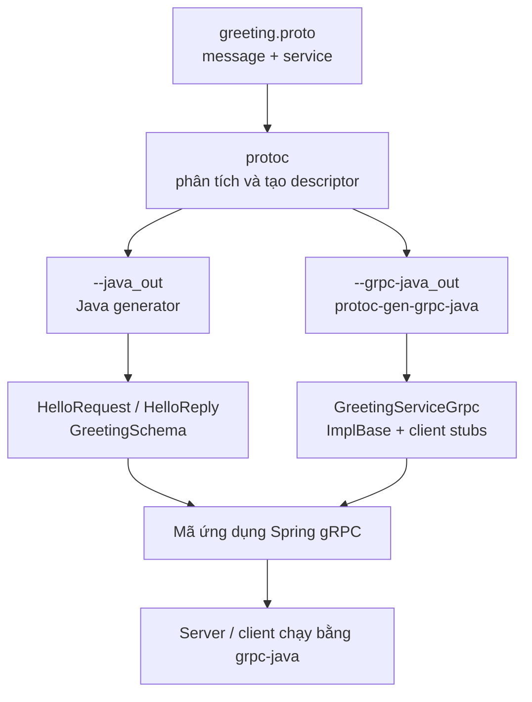

# protoc và plugin code generation trong Spring gRPC

Trong một dịch vụ **Spring gRPC**, hợp đồng giữa client và server thường được viết bằng **Protocol Buffers** (tệp `.proto`). Từ hợp đồng đó, `protoc` và các plugin sinh ra lớp Java biểu diễn thông điệp, mô tả dịch vụ và các stub gọi RPC. Phần mã được sinh giúp hai phía thống nhất kiểu dữ liệu và chữ ký phương thức; lập trình viên vẫn phải triển khai nghiệp vụ, cấu hình Spring, bảo mật và vận hành dịch vụ.

Sau bài này, bạn có thể:

- Phân biệt trách nhiệm của `protoc`, bộ sinh mã Java tích hợp và plugin `protoc-gen-grpc-java`.
- Tự sinh lớp thông điệp và gRPC stub từ cùng một tệp `.proto` bằng dòng lệnh hoặc Gradle.
- Dùng mã đã sinh để viết server và client trong ứng dụng Spring gRPC.
- Nhận diện lỗi sinh mã, lỗi tương thích phiên bản và ranh giới giữa hợp đồng RPC với cấu hình runtime.

## 1. Chuỗi công cụ sinh mã hoạt động như thế nào?

`protoc` là trình biên dịch Protocol Buffers. Nó phân tích cú pháp, kiểm tra các khai báo và xây dựng mô tả có cấu trúc (descriptor) từ một hoặc nhiều tệp `.proto`. Tùy các cờ đầu ra, `protoc` sẽ gọi bộ sinh mã thích hợp.

| Thành phần | Đầu vào | Kết quả chính | Trách nhiệm |
| --- | --- | --- | --- |
| `protoc` | Tệp `.proto` và các import | Descriptor và đầu ra của các generator | Phân tích, kiểm tra hợp đồng, điều phối sinh mã |
| Java generator tích hợp | Mô tả message, enum... | Các lớp Java Protocol Buffers | Mã hóa, giải mã, builder, truy cập field |
| `protoc-gen-grpc-java` | Mô tả `service` và `rpc` | Lớp `*Grpc`, server base class và client stubs | Ánh xạ lời gọi RPC vào API grpc-java |
| Spring gRPC và grpc-java runtime | Các lớp đã sinh cùng cấu hình ứng dụng | Server, channel, interceptor và các lời gọi thực tế | Chạy RPC, quản lý kết nối và tích hợp với Spring |

`--java_out` yêu cầu sinh các lớp Protocol Buffers cho Java; `--grpc-java_out` yêu cầu gọi plugin gRPC Java. **Sinh message Java không tự động sinh gRPC stub.** Ngược lại, chỉ có gRPC stub mà thiếu message class cũng không đủ để biên dịch ứng dụng.



Hai nhóm mã sinh ra phục vụ những mục đích khác nhau: `HelloRequest` và `HelloReply` định nghĩa dữ liệu truyền đi; `GreetingServiceGrpc` định nghĩa cách client gọi và server nhận các RPC đó. `protoc` không thay thế `javac`: các tệp `.java` được sinh vẫn cần được biên dịch như mã Java thông thường.

## 2. Viết hợp đồng Protocol Buffers làm nguồn sự thật

Tạo `src/main/proto/greeting.proto`:

```proto
syntax = "proto3";

package learning.greeting.v1;

option java_package = "vn.example.springgrpc.greeting.v1";
option java_multiple_files = true;
option java_outer_classname = "GreetingSchema";

service GreetingService {
  rpc SayHello(HelloRequest) returns (HelloReply);
  rpc StreamHello(HelloRequest) returns (stream HelloReply);
}

message HelloRequest {
  string name = 1;
}

message HelloReply {
  string message = 1;
}
```

Các khai báo cần đọc đúng:

- `syntax = "proto3"` chọn cú pháp Protocol Buffers phiên bản 3.
- `package learning.greeting.v1` xác định namespace ở cấp hợp đồng gRPC; tên dịch vụ đầy đủ sẽ là `learning.greeting.v1.GreetingService`. Đây không nhất thiết là Java package.
- `java_package` chọn package của các lớp Java sinh ra, giúp tránh phụ thuộc vào cách đặt `package` trong hợp đồng.
- `java_multiple_files = true` khiến `HelloRequest`, `HelloReply` và các loại top-level được sinh thành các lớp Java riêng. `GreetingSchema` chủ yếu chứa thông tin descriptor.
- `SayHello` là **unary RPC**: một request và một response. `StreamHello` là **server-streaming RPC**: một request và một luồng response.
- Các số `= 1` là **field number** trên wire format. Khi tiến hóa API, không tùy tiện đổi hoặc tái sử dụng số đã cấp.

Từ ví dụ này, bạn sẽ sử dụng các tên Java điển hình sau:

| Khai báo trong `.proto` | Mã Java được sinh | Mục đích |
| --- | --- | --- |
| `message HelloRequest` | `HelloRequest` | Tạo và đọc request |
| `message HelloReply` | `HelloReply` | Tạo và đọc response |
| `service GreetingService` | `GreetingServiceGrpc` | Descriptor dịch vụ, factory tạo stub |
| `rpc SayHello` | `sayHello(...)` | Phương thức RPC trên stub hoặc server base |
| `rpc StreamHello` | `streamHello(...)` | Phương thức trả luồng response |

Tên và vị trí Java class còn chịu ảnh hưởng của các `option java_*`. Nếu không bật `java_multiple_files`, message class có thể nằm bên trong outer class thay vì đứng riêng.

## 3. Sinh mã trực tiếp bằng protoc

Để hiểu công cụ bên dưới Gradle, có thể chạy trực tiếp ở môi trường đã cài `protoc` và có executable của plugin gRPC Java phù hợp hệ điều hành:

```bash
# Kiểm tra compiler.
protoc --version

# Tạo trước hai thư mục đầu ra.
mkdir -p build/generated/manual/java build/generated/manual/grpc

protoc \
  --proto_path=src/main/proto \
  --java_out=build/generated/manual/java \
  --plugin=protoc-gen-grpc-java=/path/to/protoc-gen-grpc-java \
  --grpc-java_out=build/generated/manual/grpc \
  src/main/proto/greeting.proto
```

Lệnh trên dùng cú pháp shell kiểu Unix; trên Windows có thể tạo thư mục bằng PowerShell và trỏ `--plugin` tới executable `.exe`. Thư mục sau `--proto_path` là gốc dùng để phân giải import và đường dẫn tệp đầu vào. `--java_out` cùng `--grpc-java_out` có thể trỏ đến hai thư mục riêng để dễ đối chiếu kết quả.

Theo ví dụ, bạn thường thấy:

```text
build/generated/manual/
├── java/vn/example/springgrpc/greeting/v1/
│   ├── GreetingSchema.java
│   ├── HelloRequest.java
│   └── HelloReply.java
└── grpc/vn/example/springgrpc/greeting/v1/
    └── GreetingServiceGrpc.java
```

**Vì sao phải chỉ rõ plugin?** `protoc` không tự biết cách sinh API đặc thù grpc-java. Với cơ chế plugin, cờ `--grpc-java_out` yêu cầu `protoc` tìm chương trình có tên quy ước `protoc-gen-grpc-java`, hoặc dùng đúng đường dẫn truyền qua `--plugin`. Plugin giao tiếp với `protoc` bằng các bản tin Protocol Buffers `CodeGeneratorRequest` và `CodeGeneratorResponse`: nó nhận mô tả hợp đồng rồi trả về tên tệp và nội dung mã cần tạo. Nhờ vậy, một hợp đồng có thể được xử lý bởi nhiều generator cho các ngôn ngữ hoặc mục đích khác nhau.

Ngoài mã nguồn, có thể xuất descriptor set để phục vụ tooling và kiểm tra hợp đồng:

```bash
protoc \
  -I=src/main/proto \
  --include_imports \
  --descriptor_set_out=build/greeting-descriptor.pb \
  src/main/proto/greeting.proto
```

Descriptor set là mô tả schema ở dạng nhị phân; nó **không phải** lớp Java, cũng không tự bật server reflection. Reflection cần được cấu hình riêng ở runtime nếu ứng dụng sử dụng tính năng đó.

## 4. Tự động hóa code generation trong Gradle

Trong ứng dụng Spring Boot/Spring gRPC thực tế, nên gắn sinh mã vào vòng build để schema và mã Java luôn đồng bộ. Ví dụ dưới đây dùng Gradle Groovy DSL và plugin `com.google.protobuf`. Các phiên bản chỉ mang tính minh họa; hãy chốt cặp protobuf/grpc-java tương thích với BOM hoặc hệ quản lý dependency của dự án.

```properties
# gradle.properties — phiên bản ví dụ, cần rà soát theo dự án
protobufVersion=4.30.2
grpcVersion=1.71.0
```

```groovy
// build.gradle — phần cấu hình liên quan đến sinh mã
plugins {
    id 'java'
    id 'com.google.protobuf' version '0.9.5'
}

def protobufVersion = project.property('protobufVersion')
def grpcVersion = project.property('grpcVersion')

dependencies {
    implementation "com.google.protobuf:protobuf-java:$protobufVersion"
    implementation platform("io.grpc:grpc-bom:$grpcVersion")
    implementation 'io.grpc:grpc-protobuf'
    implementation 'io.grpc:grpc-stub'

    // Cần khi mã do một số phiên bản plugin sinh có @javax.annotation.Generated.
    compileOnly 'javax.annotation:javax.annotation-api:1.3.2'
}

protobuf {
    protoc {
        artifact = "com.google.protobuf:protoc:$protobufVersion"
    }
    plugins {
        grpc {
            artifact = "io.grpc:protoc-gen-grpc-java:$grpcVersion"
        }
    }
    generateProtoTasks {
        all().configureEach { task ->
            task.plugins {
                grpc {}
            }
        }
    }
}
```

Phần `dependencies` trên phục vụ biên dịch message và stub. Một ứng dụng Spring gRPC hoàn chỉnh còn cần các starter và dependency runtime theo phiên bản Spring Boot/Spring gRPC mà dự án chọn; không nên lấy cấu hình sinh mã này làm toàn bộ cấu hình server.

Đặt `greeting.proto` vào `src/main/proto/` rồi chạy:

```bash
./gradlew generateProto compileJava
# Trên Windows: .\gradlew.bat generateProto compileJava
```

Gradle plugin sẽ tổ chức các bước: tìm proto source, tải `protoc` và plugin tương ứng hệ điều hành, sinh Java, rồi cho tác vụ biên dịch nhìn thấy các generated sources. Với bố cục mặc định, có thể kiểm tra:

```text
build/generated/source/proto/main/java/
build/generated/source/proto/main/grpc/
```

Không sửa trực tiếp các tệp trong `build/generated`: build tiếp theo có thể ghi đè. Sửa `.proto` nếu muốn đổi hợp đồng; sửa mã triển khai hoặc cấu hình build nếu muốn đổi hành vi nghiệp vụ hay cách sinh mã. Trong quy trình CI, chạy generate/compile từ source để phát hiện sớm lỗi schema và lệch phiên bản.

## 5. Sử dụng mã đã sinh trong server Spring gRPC

`GreetingServiceGrpc.GreetingServiceImplBase` là server base class do plugin tạo. Lớp này khai báo các RPC theo hợp đồng; bạn cần override để viết hành vi thực tế. Ví dụ một Spring bean triển khai cả unary và server streaming:

```java
package vn.example.springgrpc.greeting;

import io.grpc.stub.StreamObserver;
import org.springframework.stereotype.Service;
import vn.example.springgrpc.greeting.v1.GreetingServiceGrpc;
import vn.example.springgrpc.greeting.v1.HelloReply;
import vn.example.springgrpc.greeting.v1.HelloRequest;

@Service
public class GreetingServiceImpl
        extends GreetingServiceGrpc.GreetingServiceImplBase {

    @Override
    public void sayHello(
            HelloRequest request,
            StreamObserver<HelloReply> responseObserver) {

        String name = request.getName().isBlank()
                ? "bạn" : request.getName();

        HelloReply reply = HelloReply.newBuilder()
                .setMessage("Xin chào, " + name)
                .build();

        responseObserver.onNext(reply);
        responseObserver.onCompleted();
    }

    @Override
    public void streamHello(
            HelloRequest request,
            StreamObserver<HelloReply> responseObserver) {

        for (int i = 1; i <= 3; i++) {
            responseObserver.onNext(HelloReply.newBuilder()
                    .setMessage("Lời chào " + i + " gửi " + request.getName())
                    .build());
        }
        responseObserver.onCompleted();
    }
}
```

Trong ứng dụng dùng Spring gRPC với auto-configuration đăng ký các bean `BindableService`, lớp triển khai này được đưa vào gRPC server. Một số thư viện tích hợp gRPC với Spring khác có cơ chế annotation/đăng ký dịch vụ riêng, nên cần đối chiếu starter thực tế của dự án. Dù cơ chế đăng ký là gì, phần **hợp đồng phương thức** vẫn đến từ `GreetingServiceGrpc`, còn phần **xử lý nghiệp vụ** nằm ở `GreetingServiceImpl`.

Lưu ý vòng đời `StreamObserver`: với lời gọi thành công, server gửi `onNext(...)` rồi kết thúc bằng `onCompleted()`; khi lỗi, dùng `onError(...)` với gRPC status thích hợp. Không gọi cả `onCompleted()` và `onError()` cho cùng một lời gọi. Ví dụ server-streaming chỉ phát ba phần tử để minh họa; với luồng dài, phải quan tâm hủy lời gọi, tài nguyên và cơ chế backpressure.

## 6. Sử dụng client stub và hiểu các kiểu RPC

Plugin gRPC Java thường cung cấp ba họ client stub: blocking, async và future (future chủ yếu cho unary). Ví dụ client unary tối thiểu dùng grpc-java:

```java
import io.grpc.ManagedChannel;
import io.grpc.ManagedChannelBuilder;
import java.util.concurrent.TimeUnit;
import vn.example.springgrpc.greeting.v1.GreetingServiceGrpc;
import vn.example.springgrpc.greeting.v1.HelloRequest;
import vn.example.springgrpc.greeting.v1.HelloReply;

ManagedChannel channel = ManagedChannelBuilder
        .forAddress("localhost", 9090)
        .usePlaintext() // Chỉ minh họa kết nối local không TLS.
        .build();

try {
    GreetingServiceGrpc.GreetingServiceBlockingStub stub =
            GreetingServiceGrpc.newBlockingStub(channel)
                    .withDeadlineAfter(2, TimeUnit.SECONDS);

    HelloRequest request = HelloRequest.newBuilder()
            .setName("Lan")
            .build();

    HelloReply reply = stub.sayHello(request);
    System.out.println(reply.getMessage());
} finally {
    channel.shutdown();
}
```

`ManagedChannel` quản lý kết nối, còn stub là đối tượng dùng channel để gọi RPC. Trong Spring gRPC, ứng dụng thường để Spring quản lý channel/stub theo cơ chế cấu hình client của phiên bản đang dùng thay vì tạo channel mới cho từng request. `usePlaintext()` chỉ phù hợp ví dụ local; môi trường sản xuất cần cấu hình TLS/xác thực theo hệ thống.

Nhìn vào chữ ký của hợp đồng để chọn stub:

| Dạng RPC | Cú pháp trong `.proto` | Cách dùng Java phổ biến |
| --- | --- | --- |
| Unary | `rpc A(Req) returns (Res)` | Blocking stub nhận một `Res`; async stub nhận `StreamObserver<Res>` |
| Server streaming | `rpc B(Req) returns (stream Res)` | Blocking stub trả `Iterator<Res>`; async stub phát nhiều `onNext` |
| Client streaming | `rpc C(stream Req) returns (Res)` | Async stub nhận nhiều request qua `StreamObserver<Req>` |
| Bidirectional streaming | `rpc D(stream Req) returns (stream Res)` | Async stub dùng luồng request và response song song |

Với `StreamHello` trong ví dụ, client blocking có thể lặp qua các bản tin nhận về:

```java
java.util.Iterator<HelloReply> replies = stub.streamHello(request);
while (replies.hasNext()) {
    System.out.println(replies.next().getMessage());
}
```

Đoạn lặp này nằm **bên trong** phạm vi còn sống của channel và deadline của lời gọi. Blocking API thích hợp để hiểu ví dụ ngắn; async API thường linh hoạt hơn khi làm streaming dài hoặc khi cần xử lý bất đồng bộ.

## 7. Code generation không sinh những phần nào?

Hợp đồng `.proto` và stub chỉ xác định các phương thức, kiểu message cùng cơ chế gọi RPC. Những khía cạnh sau thuộc cấu hình runtime và mã ứng dụng:

| Mối quan tâm | Nơi xử lý phù hợp |
| --- | --- |
| Metadata như authorization token, correlation ID | Client/server interceptor, call credentials hoặc context |
| Deadline, hủy yêu cầu | Cấu hình/lệnh gọi stub, xử lý hủy ở server |
| Status `INVALID_ARGUMENT`, `NOT_FOUND`, `UNAVAILABLE` | Kiểm tra nghiệp vụ, xử lý ngoại lệ và ánh xạ gRPC status |
| TLS, certificate, xác thực hai chiều | Cấu hình channel và server transport |
| Tracing, metrics, logging | Interceptor, instrumentation và hệ quan sát |
| Retry, load balancing, health check | Chính sách client/server và cơ sở hạ tầng |
| Đăng ký service, lifecycle, dependency injection | Spring gRPC và cấu hình Spring Boot |

Ví dụ, `withDeadlineAfter(...)` là API trên stub đã sinh nhưng **giá trị deadline** do caller quyết định. Tương tự, plugin sinh chữ ký `sayHello` nhưng không sinh quy tắc xác thực người dùng hoặc ánh xạ lỗi nghiệp vụ. Phân biệt hai lớp trách nhiệm này giúp tránh đặt thông tin môi trường vào hợp đồng Protocol Buffers.

## 8. Tương thích schema và quản lý phiên bản

Code generation thành công không đồng nghĩa client/server tương thích về ý nghĩa dữ liệu. Một số nguyên tắc khi thay đổi `.proto`:

1. **Không đổi ý nghĩa field number đã phát hành.** Đổi `string name = 1` thành field có ý nghĩa khác nhưng giữ số `1` có thể làm client cũ hiểu sai dữ liệu.
2. **Không tái sử dụng field number hoặc tên đã xóa.** Dùng `reserved` để ghi nhớ các định danh không được cấp lại.
3. **Thêm field mới thường an toàn hơn thay thế field cũ**, nhưng vẫn cần xem xét mặc định proto3, kiểm tra hợp lệ và hành vi nghiệp vụ.
4. **Không đổi tùy tiện package/service/method.** Tên RPC đầy đủ được client gọi theo namespace và tên dịch vụ; thay đổi có thể gây `UNIMPLEMENTED`.
5. **Đồng bộ generator và runtime**: `protoc`, `protobuf-java`, `protoc-gen-grpc-java`, grpc-java runtime và dependency management của Spring gRPC phải nằm trong tổ hợp được dự án kiểm thử.

Ví dụ cách ngăn tái sử dụng field cũ:

```proto
message HelloRequest {
  reserved 2;
  reserved "legacy_id";
  string name = 1;
  string locale = 3;
}
```

Nếu tổ chức có nhiều client/server phát hành độc lập, hãy coi tệp `.proto` là **hợp đồng versioned**; kiểm tra breaking changes trong CI và kiểm thử giao tiếp giữa phiên bản cũ/mới, không chỉ kiểm tra Java compile.

## 9. Chẩn đoán lỗi thường gặp

| Triệu chứng | Nguyên nhân cần kiểm tra | Cách xử lý |
| --- | --- | --- |
| `protoc-gen-grpc-java: program not found or is not executable` | Thiếu executable, sai đường dẫn hoặc sai hệ điều hành/kiến trúc | Kiểm tra `--plugin`, quyền chạy, classifier của plugin hoặc để Gradle tải artifact phù hợp |
| `File does not reside within any path specified using --proto_path` | Đường dẫn proto/import không thuộc import root | Chỉnh `--proto_path` và đường dẫn tệp nhất quán |
| Có `HelloRequest.java` nhưng không có `GreetingServiceGrpc.java` | Chỉ cấu hình `--java_out` hoặc chưa áp dụng plugin `grpc` vào task | Bật `--grpc-java_out` hoặc `task.plugins { grpc {} }` |
| `cannot find symbol: GreetingServiceGrpc` | Chưa chạy generation, source set chưa nhận mã sinh, package/import sai | Chạy `generateProto compileJava` và kiểm tra generated directory, `java_package` |
| `NoSuchMethodError` / lỗi liên kết lớp protobuf hoặc grpc | Generator và runtime/dependency kéo về các bản không tương thích | Kiểm tra dependency tree, dùng BOM và thống nhất phiên bản |
| Lỗi `javax.annotation.Generated` | Một số bản mã sinh dùng annotation không có sẵn trong JDK mới | Thêm dependency annotation phù hợp hoặc cập nhật generator |
| RPC trả `UNIMPLEMENTED` dù compile thành công | Service chưa được đăng ký, RPC name sai hoặc server khác phiên bản | Kiểm tra tên service đầy đủ, việc đăng ký Spring bean, địa chỉ server và hợp đồng deploy |

**Cách kiểm chứng nhanh khi vừa thêm RPC:** kiểm tra tệp `.proto` đã lưu, chạy generation, tìm phương thức mới trong `GreetingServiceGrpc.java`, biên dịch lớp triển khai, sau đó chạy integration test gọi server thật. Khi phát hiện lỗi, xác định nó xảy ra ở tầng schema, sinh mã, Java compile hay runtime để khoanh vùng đúng công cụ.

## 10. Thực hành tự kiểm tra

1. Tạo `greeting.proto` như mục 2, chạy `generateProto compileJava` và đối chiếu hai thư mục mã sinh. Giải thích vì sao có cả `HelloRequest.java` lẫn `GreetingServiceGrpc.java`.
2. Thêm `rpc Echo(HelloRequest) returns (HelloReply);` rồi chạy generation lần nữa. Tìm chữ ký `echo(...)` được sinh và triển khai một unary RPC trả lại tên nhận được.
3. Thêm một RPC `rpc Chat(stream HelloRequest) returns (stream HelloReply);`. Kiểm tra bằng mã sinh rằng bidirectional streaming cần async observer, không thể triển khai như lời gọi blocking unary.
4. Mô phỏng xóa một field cũ và dùng `reserved` cho field number của nó. Giải thích vì sao thao tác này liên quan tương thích wire format, không liên quan trực tiếp đến Gradle.
5. Cố tình bỏ phần `task.plugins { grpc {} }` khỏi cấu hình rồi build lại từ đầu. Xác định nhóm tệp nào còn được sinh, nhóm nào mất và lý do.

### Ghi nhớ

`protoc` đọc **hợp đồng**, Java generator sinh **message**, `protoc-gen-grpc-java` sinh **service API và stub**. Gradle gắn các bước này vào build; Spring gRPC cung cấp môi trường triển khai client/server từ mã đã sinh. Hiểu đúng ranh giới giúp bạn thay đổi schema, truy tìm lỗi và vận hành unary/streaming RPC một cách có kiểm soát.
