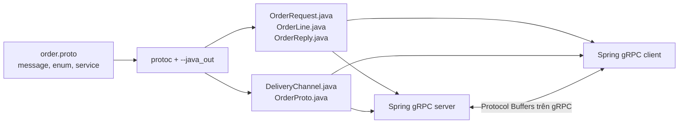

# Sinh message class từ proto trong Spring gRPC

Trong **Spring gRPC**, yêu cầu và phản hồi của một lời gọi RPC thường được mô tả bằng `message` trong tệp **Protocol Buffers** (`.proto`). Trình biên dịch `protoc` chuyển những khai báo đó thành các lớp Java có kiểu dữ liệu rõ ràng, API tạo đối tượng, đọc field và mã hóa/giải mã nhị phân. Client và server dùng cùng hợp đồng để trao đổi dữ liệu cho cả **unary RPC** lẫn **streaming RPC**.

Bài học thuộc phần **Code generation** của SPRING_GRPC, tập trung vào **message class**: cách khai báo schema, sinh mã, hiểu API Java đã sinh và sử dụng nó an toàn. Việc tạo service stub, cấu hình channel/server, metadata, deadline, interceptor, TLS và giám sát là các trách nhiệm liên quan nhưng độc lập với mã message.

Sau bài này, bạn có thể:

- Tạo một schema `.proto` với scalar, message lồng nhau, enum, `repeated`, `map`, `optional` và `oneof`.
- Chạy Java code generation và xác định đúng package, tên lớp cùng các phương thức được sinh.
- Tạo và đọc đối tượng message bằng `Builder`; hiểu bất biến, giá trị mặc định và sự hiện diện của field.
- Tuần tự hóa, giải mã, cập nhật message và phân biệt protobuf binary với protobuf JSON.
- Tiến hóa hợp đồng mà không vô tình phá khả năng giao tiếp giữa các phiên bản client/server.

## 1. Từ khai báo trong .proto đến lớp Java

Một tệp `.proto` là **hợp đồng dữ liệu**. Nó quy định tên, kiểu, số định danh và cấu trúc của field; mã Java được tạo tự động là biểu diễn của hợp đồng đó trong ngôn ngữ Java.



`protoc` thực hiện phân tích và kiểm tra schema, sau đó dùng **Java generator** để tạo message class. Với mỗi loại message, mã sinh ra thường có:

| Thành phần | Chức năng |
| --- | --- |
| `newBuilder()` | Tạo builder để gán field |
| `build()` | Kết thúc builder và tạo message bất biến |
| `getXxx()` | Đọc giá trị của field |
| `hasXxx()` | Kiểm tra sự hiện diện, **chỉ ở các field hỗ trợ presence** |
| `parseFrom(...)` | Đọc biểu diễn nhị phân thành message |
| `toByteArray()` / `writeTo(...)` | Ghi biểu diễn nhị phân |
| `toBuilder()` | Tạo builder mới từ giá trị message đã có |
| `getDescriptor()` | Truy cập mô tả cấu trúc để phục vụ reflection/tooling |

**Không viết tay hoặc chỉnh sửa generated class.** Chúng được sinh lại từ `.proto` và có thể bị ghi đè ở lần build kế tiếp. Thay đổi hợp đồng ở schema; thay đổi quy tắc nghiệp vụ ở lớp ứng dụng.

## 2. Ví dụ hợp đồng đặt hàng

Giả sử hệ thống Spring gRPC nhận yêu cầu đặt hàng bằng unary RPC `SubmitOrder`. Một request gồm mã đơn, khách hàng, các dòng hàng, nhãn tự do, mã khuyến mãi tùy chọn, loại giao hàng và một trong hai phương thức thanh toán. Thời điểm tạo được biểu diễn bằng `google.protobuf.Timestamp`.

Tạo tệp `src/main/proto/order.proto`:

```proto
syntax = "proto3";

package learning.orders.v1;

import "google/protobuf/timestamp.proto";

option java_package = "vn.example.springgrpc.orders.v1";
option java_multiple_files = true;
option java_outer_classname = "OrderProto";

enum DeliveryChannel {
  DELIVERY_CHANNEL_UNSPECIFIED = 0;
  DELIVERY_CHANNEL_COURIER = 1;
  DELIVERY_CHANNEL_PICKUP = 2;
}

message OrderLine {
  string sku = 1;
  int32 quantity = 2;
}

message OrderRequest {
  string order_id = 1;
  int64 customer_id = 2;
  repeated OrderLine lines = 3;
  map<string, string> labels = 4;
  optional string coupon_code = 5;
  DeliveryChannel delivery_channel = 6;

  oneof payment {
    string card_token = 7;
    string wallet_id = 8;
  }

  google.protobuf.Timestamp created_at = 9;
  bytes audit_digest = 10;
}

message OrderReply {
  string confirmation_id = 1;
  bool accepted = 2;
}

service OrderService {
  rpc SubmitOrder(OrderRequest) returns (OrderReply);
}
```

Điểm cần hiểu trước khi sinh mã:

1. **Số field** như `order_id = 1` và `lines = 3` là định danh dùng trên wire format. Client và server dựa vào số này để hiểu dữ liệu, không dựa vào thứ tự khai báo hay tên Java.
2. `repeated OrderLine` biểu diễn danh sách dòng hàng bên trong **một** message. Nó **không có nghĩa** RPC streaming: streaming là thuộc tính của chữ ký `rpc`.
3. `map<string, string>` là tập khóa–giá trị. Khóa có kiểu cho phép theo quy định Protocol Buffers; ví dụ này dùng `string`.
4. `optional string coupon_code` cho phép phân biệt trường **chưa được cung cấp** với trường **được cung cấp nhưng bằng chuỗi rỗng**.
5. `oneof payment` bảo đảm tại một thời điểm chỉ có một trường được chọn trong nhóm `card_token` và `wallet_id`.
6. `DeliveryChannel` có giá trị số `0` làm trạng thái mặc định/không xác định, hữu ích khi client không gửi field.
7. `google.protobuf.Timestamp` là một **well-known type**, có runtime API Java tương ứng; không cần tự định nghĩa kiểu timestamp riêng.

Ở mức gRPC, `SubmitOrder` nhận một `OrderRequest` và trả một `OrderReply`. Nếu sau này có một RPC server-streaming, client-streaming hoặc bidirectional-streaming, các message class này vẫn được dùng để biểu diễn **từng** request/response; chỉ cách trao đổi nhiều message mới thay đổi.

## 3. Cấu hình package và tổ chức mã được sinh

Ba lựa chọn quan trọng trong `.proto` thường bị nhầm lẫn:

| Khai báo | Ảnh hưởng |
| --- | --- |
| `package learning.orders.v1` | Namespace Protocol Buffers; góp phần tạo tên đầy đủ của service, message và RPC |
| `option java_package = "vn.example.springgrpc.orders.v1"` | Java package của các lớp được sinh |
| `option java_multiple_files = true` | Sinh các message/enum top-level dưới dạng các Java class riêng |
| `option java_outer_classname = "OrderProto"` | Đặt tên lớp chứa descriptor và thành phần dùng chung |

Với tùy chọn trong ví dụ, đầu ra Java sẽ có dạng:

```text
vn/example/springgrpc/orders/v1/
├── DeliveryChannel.java
├── OrderLine.java
├── OrderProto.java
├── OrderReply.java
└── OrderRequest.java
```

Lớp `OrderRequest` và `OrderReply` được dùng trực tiếp trong Java; `OrderProto` chứa thông tin descriptor và các phần chung phục vụ generated code.

Nếu bỏ `java_multiple_files = true` (mặc định là `false`), các message/enum top-level thường trở thành **kiểu lồng** bên trong outer class, chẳng hạn `OrderProto.OrderRequest`. Cách tổ chức này ảnh hưởng tới import trong Java, **không thay đổi** wire format Protocol Buffers. Nếu không đặt `java_outer_classname`, generator suy tên outer class từ tên tệp và xử lý trường hợp trùng tên.

> **Quy ước nên áp dụng:** Với dự án Java có nhiều message, đặt `java_package` rõ ràng và dùng `java_multiple_files = true` để mã phía client/server dễ đọc và dễ import. Đây là lựa chọn tổ chức mã; nhóm có thể dùng quy ước khác nếu đã thống nhất.

## 4. Sinh message class bằng protoc

Máy cần có `protoc` tương thích với schema và Java runtime sử dụng. Kiểm tra:

```bash
protoc --version
```

Trong môi trường shell kiểu Unix, ví dụ sinh Java vào thư mục tạm:

```bash
mkdir -p build/generated/manual/java

protoc \
  --proto_path=src/main/proto \
  --java_out=build/generated/manual/java \
  src/main/proto/order.proto
```

Cờ `--proto_path` đặt gốc tìm source và các import; `--java_out` chọn nơi ghi mã Java. Import `google/protobuf/timestamp.proto` cần có trong đường dẫn import mà bản phân phối `protoc` cung cấp. Nếu dùng tệp proto của bên thứ ba, thêm đường dẫn import tương ứng bằng `-I`/`--proto_path`.

Ở đây **chỉ có mã message và enum**. Dù hợp đồng có `service OrderService`, chỉ truyền `--java_out` thì **chưa có** `OrderServiceGrpc.java`. Stub/service base của grpc-java do plugin `protoc-gen-grpc-java` sinh riêng bằng `--grpc-java_out`.

Bạn nên kiểm tra cả **vị trí tệp** và **đúng package** ở đầu source sinh ra. Hai lỗi dễ gặp là tìm lớp trong sai package do nhầm `package` với `java_package`, và chỉ chạy generator message trong khi mã ứng dụng đang import `OrderServiceGrpc`.

## 5. Sinh mã tự động trong dự án Gradle

Để tích hợp với vòng build của Spring gRPC, cấu hình protobuf Gradle plugin thay cho việc tự chạy `protoc` mỗi lần sửa schema. Ví dụ tối thiểu dùng Gradle **Groovy DSL**, minh họa phần **message generation**:

```groovy
// build.gradle
plugins {
    id 'java'
    id 'com.google.protobuf' version '0.9.5'
}

def protobufVersion = '4.30.2' // Ví dụ: chọn phiên bản theo dự án.

dependencies {
    implementation "com.google.protobuf:protobuf-java:$protobufVersion"
}

protobuf {
    protoc {
        artifact = "com.google.protobuf:protoc:$protobufVersion"
    }
}
```

Đặt `order.proto` trong `src/main/proto/` rồi chạy:

```bash
./gradlew generateProto compileJava
# Trên Windows: .\gradlew.bat generateProto compileJava
```

Theo bố cục mặc định thường thấy, output Java nằm ở:

```text
build/generated/source/proto/main/java/
```

Plugin Gradle đưa generated source vào Java source set để `compileJava` có thể sử dụng chúng. Nếu cần server/client gRPC thực sự, dự án cần bổ sung **gRPC Java codegen plugin**, grpc-java runtime và dependency Spring gRPC phù hợp. Cấu hình ngắn ở trên chỉ đủ để giải thích **message class**; nó chưa tạo stub `OrderServiceGrpc` hay chạy gRPC server.

Phiên bản `protoc` và `protobuf-java` cần tương thích; ví dụ đặt chung `protobufVersion` để hạn chế sai lệch. Những phiên bản ghi ở đây là **mốc minh họa** chứ không phải khuyến nghị phiên bản mới nhất cho mọi dự án.

## 6. Mapping từ proto field sang API Java

Giả sử đã bật `java_multiple_files`, ta có lớp Java `OrderRequest` với các phương thức truy cập tương ứng:

| Khai báo proto | Kiểu Java/giá trị đọc | API phổ biến |
| --- | --- | --- |
| `string order_id` | `String` | `getOrderId()`, `setOrderId(String)` |
| `int64 customer_id` | `long` | `getCustomerId()`, `setCustomerId(long)` |
| `repeated OrderLine lines` | `List<OrderLine>` | `getLinesList()`, `getLinesCount()`, `addLines(...)`, `clearLines()` |
| `map<string,string> labels` | `Map<String,String>` | `getLabelsMap()`, `putLabels(...)`, `clearLabels()` |
| `optional string coupon_code` | `String` cộng với presence | `getCouponCode()`, `hasCouponCode()`, `clearCouponCode()` |
| `DeliveryChannel delivery_channel` | `DeliveryChannel` | `getDeliveryChannel()`, `setDeliveryChannel(...)`, `getDeliveryChannelValue()` |
| `oneof payment` | Một lựa chọn trong nhóm | `getPaymentCase()`, `setCardToken(...)`, `setWalletId(...)` |
| `google.protobuf.Timestamp created_at` | `Timestamp` | `hasCreatedAt()`, `getCreatedAt()`, `setCreatedAt(...)` |
| `bytes audit_digest` | `ByteString` | `getAuditDigest()`, `setAuditDigest(ByteString)` |

Generator chuyển tên `snake_case` của field thành tên hàm Java kiểu `camelCase`: `order_id` trở thành `getOrderId()`; `coupon_code` trở thành `getCouponCode()`. Một số tên đặc biệt hoặc xung đột tên có quy tắc sinh mã riêng, vì vậy khi nghi ngờ hãy xem API thực tế của generated class.

Các kiểu scalar thường gặp:

| Proto | Java | Lưu ý |
| --- | --- | --- |
| `string` | `String` | UTF-8 trên wire |
| `bool` | `boolean` | Giá trị mặc định `false` |
| `int32`, `sint32`, `fixed32` | `int` | Cùng kiểu Java, cách mã hóa wire khác nhau |
| `uint32` | `int` | Cần hiểu giá trị **unsigned** khi xử lý |
| `int64`, `sint64`, `fixed64` | `long` | Cùng kiểu Java, cách mã hóa wire khác nhau |
| `uint64` | `long` | Cần hiểu giá trị **unsigned** khi xử lý |
| `float` / `double` | `float` / `double` | Số thực có thể làm tròn theo chuẩn IEEE 754 |
| `bytes` | `ByteString` | Đối tượng byte bất biến, không phải `byte[]` |
| `enum` | Enum Java sinh ra | Có thêm API đọc giá trị số |
| `message` | Generated message class | Hỗ trợ presence và builder riêng |

**Chú ý:** protobuf message là lớp dữ liệu được sinh ra từ schema, không phải JPA entity hay Java `record`. Nó không tự thực hiện xác thực nghiệp vụ, không truy cập database và không tự đăng ký RPC.

## 7. Tạo message bằng Builder

Generated message bất biến sau khi được xây dựng. Ta đặt giá trị thông qua builder, rồi gọi `build()` để lấy một giá trị có thể truyền qua các lớp ứng dụng hoặc RPC.

```java
import com.google.protobuf.ByteString;
import com.google.protobuf.Timestamp;
import java.time.Instant;
import vn.example.springgrpc.orders.v1.DeliveryChannel;
import vn.example.springgrpc.orders.v1.OrderLine;
import vn.example.springgrpc.orders.v1.OrderRequest;

public class BuildOrderExample {
    public static void main(String[] args) {
        Instant now = Instant.parse("2026-11-19T08:00:00Z");
        Timestamp createdAt = Timestamp.newBuilder()
                .setSeconds(now.getEpochSecond())
                .setNanos(now.getNano())
                .build();

        OrderRequest request = OrderRequest.newBuilder()
                .setOrderId("ORD-2048")
                .setCustomerId(42L)
                .addLines(OrderLine.newBuilder()
                        .setSku("BOOK-101")
                        .setQuantity(2)
                        .build())
                .addLines(OrderLine.newBuilder()
                        .setSku("PEN-202")
                        .setQuantity(3)
                        .build())
                .putLabels("source", "mobile")
                .putLabels("region", "vn")
                .setCouponCode("") // Có gửi coupon_code, dù giá trị rỗng.
                .setDeliveryChannel(
                        DeliveryChannel.DELIVERY_CHANNEL_PICKUP)
                .setWalletId("wallet-ref-123")
                .setCreatedAt(createdAt)
                .setAuditDigest(
                        ByteString.copyFrom(new byte[]{0x1A, 0x2B}))
                .build();

        System.out.println(request.getOrderId());
        System.out.println(request.getLinesCount());     // 2
        System.out.println(request.hasCouponCode());     // true
        System.out.println(request.getPaymentCase());    // WALLET_ID
    }
}
```

Trong ví dụ:

- `addLines(...)` thêm từng `OrderLine` vào field `repeated`. Với nhiều phần tử, builder còn hỗ trợ `addAllLines(...)`.
- `putLabels(...)` bổ sung phần tử vào `map`.
- `setCouponCode("")` vẫn đánh dấu field `optional` là **có mặt**; `getCouponCode()` trả chuỗi rỗng nhưng `hasCouponCode()` trả `true`.
- `setWalletId(...)` chọn nhánh `wallet_id` của `oneof payment`. Nếu sau đó gọi `setCardToken(...)`, nhánh `wallet_id` sẽ bị thay thế.
- `Timestamp` và `ByteString` là các đối tượng riêng, thay vì gán trực tiếp `Instant` hoặc `byte[]` cho field.

Builder có thể thay đổi trạng thái trong quá trình xây dựng; đối tượng trả về từ `build()` là bất biến. Không coi builder là đối tượng dùng chung an toàn giữa nhiều luồng. Với message đã tạo, có thể cập nhật theo kiểu **copy-on-write**:

```java
OrderRequest revised = request.toBuilder()
        .putLabels("reviewed", "true")
        .clearCouponCode()
        .build();

System.out.println(request.hasCouponCode()); // true: bản gốc không đổi
System.out.println(revised.hasCouponCode()); // false: bản cập nhật
```

Trong mã ứng dụng, nên lưu/trao đổi **message đã build**, thay vì giữ và chia sẻ builder giữa các request.

## 8. Giá trị mặc định, field presence và oneof

Đây là phần dễ gây lỗi nhất khi làm việc với proto3. **Giá trị đọc ra không phải lúc nào cũng cho biết field có được gửi hay không.**

### 8.1. Scalar thông thường có giá trị mặc định

Với schema ở mục 2, một `OrderRequest` không gán field sẽ trả:

```java
OrderRequest empty = OrderRequest.getDefaultInstance();

System.out.println(empty.getOrderId());         // ""
System.out.println(empty.getCustomerId());      // 0
System.out.println(empty.getLinesCount());      // 0
System.out.println(empty.getLabelsMap().size());// 0
System.out.println(empty.getDeliveryChannel()); // DELIVERY_CHANNEL_UNSPECIFIED
```

Với scalar proto3 thông thường như `string order_id` và `int64 customer_id`, không có `hasOrderId()` hay `hasCustomerId()` để hỏi client có thực sự gửi field hay chưa. Ví dụ `0` có thể là giá trị mặc định do thiếu field hoặc giá trị client chủ động gửi. Nếu cần phân biệt, chọn **`optional`**, **`oneof`** hoặc một message wrapper theo yêu cầu hợp đồng.

### 8.2. Optional phân biệt “không có” với “rỗng”

```java
OrderRequest a = OrderRequest.newBuilder().build();
OrderRequest b = OrderRequest.newBuilder()
        .setCouponCode("")
        .build();

System.out.println(a.getCouponCode().equals("")); // true
System.out.println(b.getCouponCode().equals("")); // true
System.out.println(a.hasCouponCode());            // false
System.out.println(b.hasCouponCode());            // true
```

Điều này quan trọng với API cập nhật một phần: **không cung cấp coupon** có thể có ý nghĩa khác với **chủ động xóa coupon**. Bạn phải định nghĩa ngữ nghĩa nghiệp vụ rõ ràng. `optional` mô tả sự hiện diện dữ liệu; nó không tự chọn hành vi cập nhật database.

### 8.3. Message field cũng có presence

`created_at` là một message field nên có `hasCreatedAt()`. Khi field chưa được gán, `getCreatedAt()` vẫn trả một default instance tiện cho việc đọc, vì vậy:

```java
if (request.hasCreatedAt()) {
    Timestamp value = request.getCreatedAt();
    Instant created = Instant.ofEpochSecond(
            value.getSeconds(), value.getNanos());
    System.out.println(created);
}
```

Không kết luận rằng timestamp đã được cung cấp chỉ vì `getCreatedAt()` trả đối tượng khác `null`.

### 8.4. Oneof biểu diễn lựa chọn loại trừ nhau

```java
switch (request.getPaymentCase()) {
    case CARD_TOKEN -> {
        System.out.println("Thanh toán thẻ: " + request.getCardToken());
    }
    case WALLET_ID -> {
        System.out.println("Ví: " + request.getWalletId());
    }
    case PAYMENT_NOT_SET -> {
        System.out.println("Chưa chọn phương thức thanh toán");
    }
}
```

`getPaymentCase()` cho biết nhánh nào được chọn. Với `oneof`, việc đặt một thành viên sẽ xóa trạng thái của thành viên còn lại, kể cả khi giá trị mới là chuỗi rỗng. Kiểm tra `PaymentCase` an toàn hơn suy ra lựa chọn dựa trên việc `getCardToken().isEmpty()` hay `getWalletId().isEmpty()`.

### 8.5. Enum cần xử lý giá trị không nhận biết

`getDeliveryChannel()` đọc enum Java, còn `getDeliveryChannelValue()` đọc giá trị số. Với dữ liệu đến từ client có schema mới hơn, enum có thể nhận giá trị số chưa được định nghĩa ở phiên bản hiện tại. Không nên giả định rằng chỉ có hai lựa chọn `COURIER` và `PICKUP`.

```java
switch (request.getDeliveryChannel()) {
    case DELIVERY_CHANNEL_COURIER -> {
        // Giao qua đơn vị vận chuyển.
    }
    case DELIVERY_CHANNEL_PICKUP -> {
        // Khách tự đến nhận hàng.
    }
    default -> {
        // UNSPECIFIED hoặc giá trị chưa được client này nhận biết.
    }
}
```

Mẫu `default` giúp tránh xử lý nhầm dữ liệu chưa có lựa chọn hoặc schema mới chưa được triển khai đồng bộ.

## 9. Repeated, map và bytes: đọc đúng kiểu dữ liệu

**Danh sách:** `getLinesList()` trả danh sách có thể duyệt nhưng không nên sửa trực tiếp để thay đổi message. Hãy dùng builder:

```java
for (OrderLine line : request.getLinesList()) {
    if (line.getQuantity() <= 0) {
        throw new IllegalArgumentException(
                "quantity phải lớn hơn 0: " + line.getSku());
    }
}

OrderRequest updated = request.toBuilder()
        .addLines(OrderLine.newBuilder()
                .setSku("NOTE-303")
                .setQuantity(1)
                .build())
        .build();
```

**Map:** `getLabelsMap()` cho phép tra cứu nhãn. Muốn thêm hoặc xóa nhãn, dùng `putLabels` / `removeLabels` trên builder:

```java
String source = request.getLabelsOrDefault("source", "unknown");

OrderRequest sanitized = request.toBuilder()
        .removeLabels("internal-only")
        .build();
```

**Bytes:** `bytes` được ánh xạ sang `ByteString` để giữ cách làm việc bất biến và tránh nhầm với các kiểu ký tự.

```java
byte[] digestBytes = request.getAuditDigest().toByteArray();

OrderRequest withDigest = request.toBuilder()
        .setAuditDigest(ByteString.copyFrom(digestBytes))
        .build();
```

`ByteString` không tự tính checksum hoặc chữ ký số. Ví dụ `audit_digest` chỉ minh họa cách chứa bytes; ứng dụng phải tự xác định thuật toán và cách xác thực. Tương tự, protobuf không tự kiểm tra số lượng dòng hàng, số lượng âm/dương hay định dạng SKU: đó là việc của lớp nghiệp vụ.

## 10. Tuần tự hóa nhị phân và giải mã

Phần lớn ứng dụng Spring gRPC không cần tự gọi `toByteArray()`: grpc-java dùng protobuf marshaller để mã hóa/giải mã message cho RPC. Tuy nhiên, hiểu API này rất hữu ích khi ghi dữ liệu vào file, tạo fixture hoặc chẩn đoán lỗi.

```java
import com.google.protobuf.InvalidProtocolBufferException;
import vn.example.springgrpc.orders.v1.OrderRequest;

public static OrderRequest roundTrip(OrderRequest input)
        throws InvalidProtocolBufferException {

    byte[] wire = input.toByteArray();
    OrderRequest decoded = OrderRequest.parseFrom(wire);

    if (!decoded.equals(input)) {
        throw new IllegalStateException("Round-trip không khớp");
    }
    return decoded;
}
```

`parseFrom(byte[])` có thể ném `InvalidProtocolBufferException` nếu đầu vào không hợp lệ. Dữ liệu nhị phân protobuf **không phải định dạng dễ đọc trực tiếp**, và JSON viết tay không thay thế cho wire format protobuf.

Khi xử lý nhiều message tuần tự trong một stream, cần tự xác định ranh giới giữa chúng. API `writeDelimitedTo(OutputStream)` và `parseDelimitedFrom(InputStream)` dùng dạng có **tiền tố độ dài** (length-delimited):

```java
import java.io.ByteArrayInputStream;
import java.io.ByteArrayOutputStream;

ByteArrayOutputStream output = new ByteArrayOutputStream();
request.writeDelimitedTo(output);

ByteArrayInputStream input =
        new ByteArrayInputStream(output.toByteArray());
OrderRequest restored = OrderRequest.parseDelimitedFrom(input);
```

Nếu stream đã kết thúc trước khi có message tiếp theo, `parseDelimitedFrom` có thể trả `null`; cần kiểm tra trong vòng lặp. API này hữu ích với file/stream do ứng dụng tự quản lý; **không cần tự đóng khung** request khi dùng gRPC, vì HTTP/2 và grpc-java đã đảm nhiệm truyền tải.

Với đầu vào không tin cậy, giới hạn kích thước và tài nguyên ở transport/parser phù hợp với hệ thống; việc `parseFrom` thành công chỉ chứng minh payload hợp lệ về mặt cú pháp, **không** chứng minh nó hợp lệ về nghiệp vụ hoặc an toàn để xử lý.

### Protobuf JSON khác JSON thông thường như thế nào?

Khi cần trao đổi với hệ thống dùng JSON, sử dụng protobuf JSON mapping thay vì giả định thư viện JSON thông thường tự hiểu generated message. Thêm thư viện `protobuf-java-util` có phiên bản tương thích `protobuf-java`:

```groovy
dependencies {
    implementation "com.google.protobuf:protobuf-java-util:$protobufVersion"
}
```

```java
import com.google.protobuf.util.JsonFormat;

String json = JsonFormat.printer().print(request);

OrderRequest.Builder builder = OrderRequest.newBuilder();
JsonFormat.parser().merge(json, builder);
OrderRequest fromJson = builder.build();
```

Protobuf JSON mapping có quy ước riêng: field `order_id` có thể được biểu diễn thành `orderId`, `int64` thường là chuỗi thập phân, `bytes` dùng base64, `Timestamp` dùng chuỗi thời gian chuẩn RFC 3339. Với `oneof` và optional, hành vi có/không có field cũng cần được cân nhắc. Đừng dùng ví dụ JSON này để suy ra độ lớn, hiệu năng hoặc định dạng của payload gRPC trên mạng.

## 11. Message class được dùng trong Spring gRPC như thế nào?

Trong Spring gRPC, client và server trao đổi những kiểu Java đã sinh, nhưng **lớp message không chứa logic RPC**. Khi có thêm plugin sinh gRPC Java service stub, một lớp triển khai unary RPC có thể nhận trực tiếp `OrderRequest` và trả `OrderReply`:

```java
import io.grpc.Status;
import io.grpc.stub.StreamObserver;
import org.springframework.stereotype.Service;
import vn.example.springgrpc.orders.v1.OrderReply;
import vn.example.springgrpc.orders.v1.OrderRequest;
import vn.example.springgrpc.orders.v1.OrderServiceGrpc;

@Service
public class OrderServiceImpl
        extends OrderServiceGrpc.OrderServiceImplBase {

    @Override
    public void submitOrder(
            OrderRequest request,
            StreamObserver<OrderReply> responseObserver) {

        if (request.getOrderId().isBlank()
                || request.getLinesCount() == 0) {
            responseObserver.onError(Status.INVALID_ARGUMENT
                    .withDescription("Thiếu order_id hoặc lines")
                    .asRuntimeException());
            return;
        }

        // Ví dụ minh họa: nghiệp vụ thật cần xác thực và lưu đơn.
        OrderReply reply = OrderReply.newBuilder()
                .setConfirmationId("CONF-" + request.getOrderId())
                .setAccepted(true)
                .build();

        responseObserver.onNext(reply);
        responseObserver.onCompleted();
    }
}
```

`OrderServiceGrpc` **không** được tạo bởi riêng `--java_out`; cần plugin `protoc-gen-grpc-java` và dependencies Spring gRPC/grpc-java. Cách Spring đăng ký `BindableService` và tạo client stub tùy starter/phiên bản tích hợp được sử dụng.

Điểm cần phân định:

| Khía cạnh | Ai chịu trách nhiệm? |
| --- | --- |
| Tên và kiểu field, số field, encoding, parse/builder | Hợp đồng `.proto` và generated message class |
| Tên service, RPC, stub và server base | Hợp đồng `service/rpc` và gRPC Java generator |
| Validate `order_id`, `quantity`, tra cứu đơn hàng | Mã nghiệp vụ Spring |
| Metadata, deadline, interceptor, TLS, channel | grpc-java/Spring gRPC và cấu hình runtime |
| Status lỗi, đo thời gian, tracing, metrics | Xử lý RPC và hệ thống quan sát |

Một request có thể đi qua interceptor xác thực, được giải mã thành `OrderRequest`, được validate rồi được server trả lại dưới dạng `OrderReply`. Sự có mặt của field `order_id` trong schema không làm cho token bảo mật hoặc deadline tự xuất hiện trong message. Đó là các lớp thông tin riêng.

## 12. Tương thích hợp đồng qua các lần sinh mã

Đổi tên phương thức Java có thể khiến code ứng dụng không biên dịch được; đổi số field trong `.proto` có thể khiến **dữ liệu trên mạng bị diễn giải sai**. Hai loại tương thích cần được xem xét riêng.

| Thay đổi schema | Đánh giá ban đầu |
| --- | --- |
| Thêm field mới với số mới | Thường tương thích với client cũ, nhưng phải xem xét ngữ nghĩa mặc định |
| Xóa field đã dùng | Có thể được client mới bỏ qua; cần `reserved` và phân tích yêu cầu dữ liệu |
| Đổi số field cũ | Có nguy cơ phá tương thích wire nghiêm trọng |
| Đổi kiểu field | Phụ thuộc kiểu cũ/mới và wire type; không suy đoán an toàn nếu chưa kiểm tra |
| Đổi `java_package` | Ảnh hưởng mã Java/import, không trực tiếp đổi wire field number |
| Đổi `package` hoặc tên service/method | Có thể đổi tên RPC đầy đủ, gây lỗi định tuyến gRPC |
| Đổi field thông thường thành `optional` | Ảnh hưởng API presence và cách xử lý; cần kiểm thử phiên bản cũ/mới |
| Bổ sung giá trị enum | Client cũ có thể gặp số enum chưa biết; phải có nhánh xử lý phù hợp |

Nếu xóa field cũ, ghi lại field number và tên bằng `reserved` để không vô tình tái sử dụng:

```proto
message OrderLine {
  string sku = 1;
  int32 quantity = 2;

  reserved 3;
  reserved "legacy_display_name";
}
```

Ví dụ này giả định field số `3` và tên `legacy_display_name` đã từng tồn tại rồi bị loại bỏ. `reserved` không loại dữ liệu cũ khỏi payload và không tự thực hiện di trú dữ liệu; nó giúp trình biên dịch ngăn khai báo mới dùng lại định danh đã dành riêng.

Giá trị field không xác định ở một phiên bản có thể được protobuf giữ dưới dạng **unknown fields**, nhưng mức độ bảo toàn phụ thuộc hành trình chuyển đổi dữ liệu (ví dụ serialize binary → JSON → binary có thể khác với binary → binary). Không dựa vào unknown fields để triển khai nghiệp vụ cần hiểu field mới; thay vào đó phải nâng cấp schema/client/server có chủ đích.

## 13. Những lỗi và ngộ nhận thường gặp

| Dấu hiệu | Cần kiểm tra |
| --- | --- |
| `cannot find symbol: OrderRequest` | Chưa chạy `generateProto`, source set chưa chứa generated code, sai `java_package` hoặc import |
| `cannot find symbol: OrderServiceGrpc` | Chỉ sinh message, chưa cấu hình plugin gRPC stub |
| Không tìm thấy `hasOrderId()` | `order_id` là scalar proto3 không có explicit presence; cần `optional` nếu hợp đồng đòi hỏi |
| `getCouponCode()` trả `""` nhưng kiểm tra logic sai | Phải dùng `hasCouponCode()` để biết field optional có được đặt |
| Thay đổi `getLinesList()` bằng `add(...)` báo lỗi | Message bất biến; thêm phần tử qua `toBuilder().addLines(...)` |
| Gửi `byte[]` trực tiếp cho `setAuditDigest` | `bytes` trong Java là `ByteString`; dùng `ByteString.copyFrom(...)` |
| `InvalidProtocolBufferException` | Payload sai định dạng, hỏng/truncated hoặc không phải binary của message kỳ vọng |
| Lỗi runtime kiểu `NoSuchMethodError`, `RuntimeVersion` | Kiểm tra phiên bản `protoc`/`protobuf-java` và dependency transitives |
| Đổi tên field nhưng build Java vẫn qua, client đọc sai dữ liệu | Phân tích field number, kiểu wire và tương thích ứng dụng; build không đảm bảo hợp đồng triển khai tương thích |
| Nhầm `repeated` với RPC streaming | `repeated` là tập phần tử **trong một message**; `stream` trong chữ ký RPC là **nhiều message theo thời gian** |

Một quy trình chẩn đoán hiệu quả là xác định lỗi xảy ra tại **schema parsing**, **code generation**, **Java compilation**, **binary parse** hay **lúc xử lý RPC**. Đừng sửa generated Java để làm mất triệu chứng; hãy chỉnh schema, phiên bản thư viện, cấu hình build hoặc logic ứng dụng tùy nguyên nhân.

## 14. Bài tập thực hành

1. **Sinh và kiểm tra class:** Tạo `order.proto` như mục 2, chạy `generateProto compileJava`, tìm `OrderRequest.java` và `OrderProto.java`. Giải thích vì sao có hai lớp này và tại sao `OrderServiceGrpc.java` chưa xuất hiện.
2. **Builder và bất biến:** Tạo một `OrderRequest` có hai dòng hàng, cập nhật thành ba dòng bằng `toBuilder()`. Kiểm tra message cũ vẫn có đúng hai dòng.
3. **Presence:** Tạo hai request, một request bỏ qua `coupon_code` và một request gọi `setCouponCode("")`. So sánh `getCouponCode()` với `hasCouponCode()`.
4. **Oneof:** Tạo builder lần lượt gọi `setCardToken("T")` rồi `setWalletId("W")`. Sau `build()`, xác định `getPaymentCase()` và giải thích vì sao không thể giữ cả hai lựa chọn.
5. **Binary round-trip:** Tuần tự hóa một `OrderRequest` thành `byte[]`, dùng `parseFrom` đọc lại và xác nhận `equals`; tiếp tục kiểm tra kết quả khi dữ liệu nhị phân bị cắt ngắn.
6. **Tương thích:** Giả lập việc bỏ field có số `3` ở một message khác. Thêm `reserved` và giải thích sự khác nhau giữa tương thích wire, tương thích Java source và tương thích nghiệp vụ.
7. **Ứng dụng RPC:** Viết validator kiểm tra `order_id` khác rỗng, `lines` không rỗng và mọi `quantity` dương. Gọi validator trước khi server trả `OrderReply`; dùng `Status.INVALID_ARGUMENT` khi dữ liệu không hợp lệ.

### Ghi nhớ

**Message class là biểu diễn Java của hợp đồng dữ liệu Protocol Buffers.** `protoc --java_out` sinh ra các kiểu dữ liệu bất biến và builder để tạo/đọc/serialize message; plugin gRPC riêng sinh service stub. Khi sử dụng trong Spring gRPC, hãy kiểm tra đúng **field presence**, quy tắc `oneof`, sự khác biệt giữa `repeated` và RPC streaming, cũng như khả năng tương thích của field number qua các phiên bản. Generated code thống nhất định dạng trao đổi, còn nghiệp vụ, bảo mật và vận hành vẫn thuộc ứng dụng.
