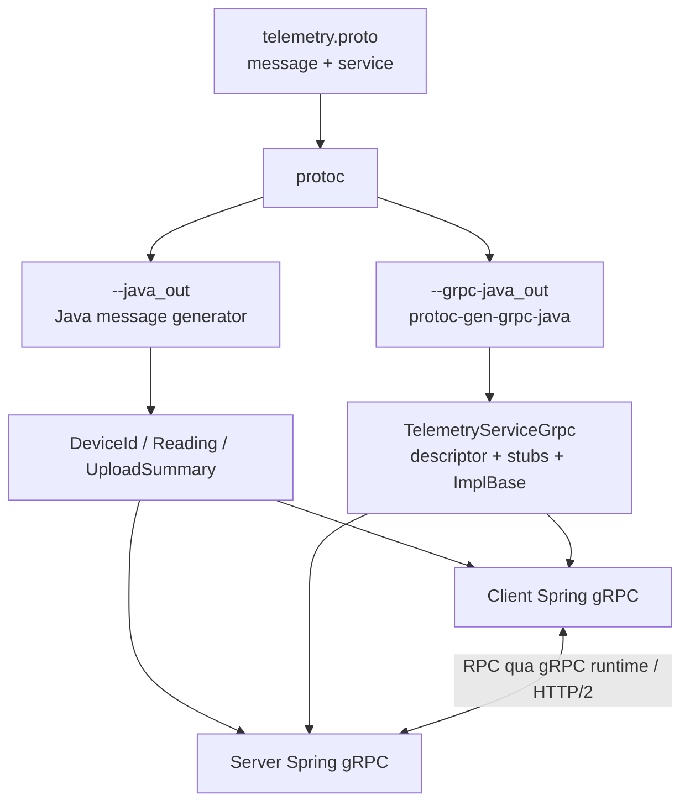
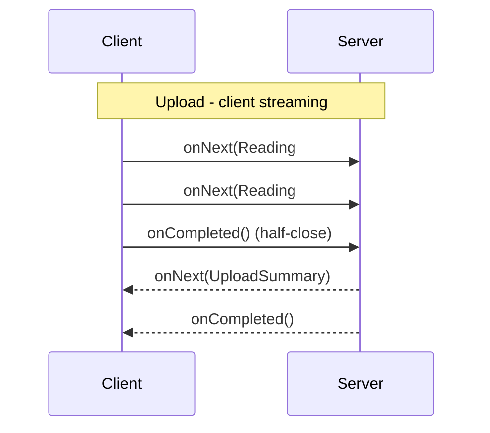
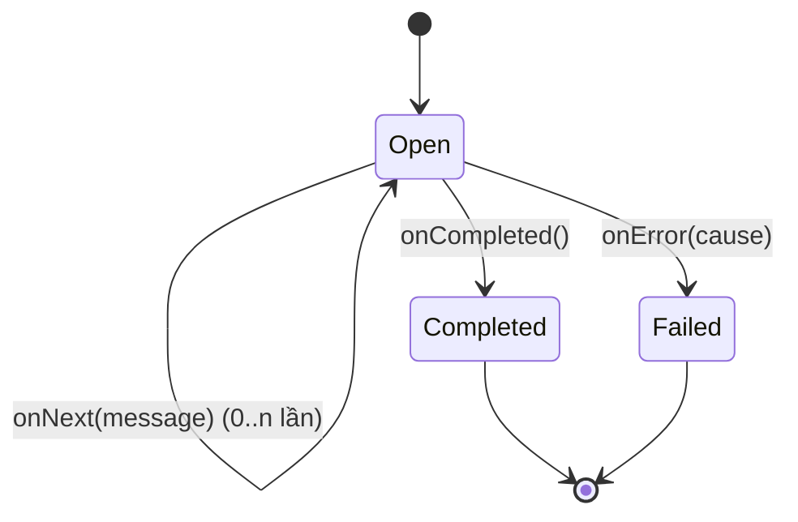

# Sinh client stub và server base từ hợp đồng Protocol Buffers

Trong **Spring gRPC**, client gọi các phương thức trên **stub** còn server hiện thực các phương thức được khai báo trong **server base class**. Cả hai loại mã này được sinh từ phần `service` và `rpc` trong tệp `.proto` nhờ plugin `protoc-gen-grpc-java`. Nhờ dùng chung một hợp đồng, tên RPC, kiểu request/response và phương thức streaming được xác định nhất quán giữa client và server.

Bài học thuộc chương **Code generation** của module **SPRING_GRPC**. Nội dung tập trung vào **sinh client stub và server base**, cách đọc API Java sau khi sinh mã và cách đưa chúng vào ứng dụng Spring để phát triển dịch vụ unary hoặc streaming. Các chủ đề metadata, deadline, status, interceptor, TLS, kiểm thử tích hợp và quan sát hệ thống cũng sẽ được liên hệ ở những nơi cần thiết, vì chúng ảnh hưởng trực tiếp đến việc sử dụng stub và server base khi triển khai thực tế.

Sau bài này, bạn có thể:

- Phân biệt mã message do `--java_out` tạo với mã service/stub do `--grpc-java_out` tạo.
- Xác định các lớp `*Grpc`, `*ImplBase`, asynchronous stub, blocking stub và future stub.
- Hiểu chữ ký Java được sinh cho unary, server streaming, client streaming và bidirectional streaming.
- Viết một server Spring gRPC từ server base và gọi RPC thông qua client stub.
- Sử dụng `StreamObserver` đúng vòng đời, quản lý channel/deadline và nhận diện lỗi cấu hình sinh mã.

## 1. Stub và server base giải quyết việc gì?

Giả sử hợp đồng khai báo `rpc GetLatest(DeviceId) returns (Reading);`. Phía client cần một phương thức Java `getLatest(...)` để gọi tới server, còn phía server cần một điểm mở rộng để triển khai cách tìm số đo mới nhất. Việc viết tay tất cả tên dịch vụ, descriptor, bộ mã hóa và lời gọi RPC vừa tốn công vừa dễ sai khác.

`protoc-gen-grpc-java` đọc **service descriptor** từ `protoc` và sinh ra lớp kiểu `TelemetryServiceGrpc`. Lớp này chứa:

| Thành phần | Vai trò |
| --- | --- |
| `SERVICE_NAME` | Tên dịch vụ gRPC đầy đủ, bao gồm protobuf package |
| Method descriptor | Mô tả tên, kiểu RPC, marshaller cho request/response |
| `TelemetryServiceImplBase` | Server base class để ứng dụng triển khai các RPC |
| `TelemetryServiceStub` | Client stub bất đồng bộ, dùng callback/`StreamObserver` |
| `TelemetryServiceBlockingStub` | Client stub đồng bộ cho unary và server streaming trong API blocking thông dụng |
| `TelemetryServiceFutureStub` | Client stub trả future cho unary RPC |
| `newStub(...)`, `newBlockingStub(...)`, `newFutureStub(...)` | Các factory tạo stub từ một `Channel` |
| `getServiceDescriptor()` | Thông tin mô tả dịch vụ phục vụ grpc-java và tooling |

Client **không trực tiếp khởi tạo lớp triển khai server**; nó tạo stub gắn với `Channel`. Server **không gọi stub để triển khai nghiệp vụ**; nó kế thừa hoặc hiện thực API do generator cung cấp rồi đăng ký dịch vụ với gRPC runtime. Các lớp message như `DeviceId` và `Reading` được sinh riêng bằng Java generator chuẩn.



Điều quan trọng: **code generation tạo khung giao tiếp, không tạo logic nghiệp vụ, kết nối hoạt động hay cấu hình Spring tự động**. Bạn vẫn phải triển khai service, cấu hình server/channel, xác thực, xử lý lỗi và quan sát hệ thống.

## 2. Định nghĩa hợp đồng chứa bốn kiểu RPC

Ví dụ một dịch vụ đo đạc từ thiết bị IoT. Đặt tệp `src/main/proto/telemetry.proto`:

```proto
syntax = "proto3";

package learning.telemetry.v1;

option java_package = "vn.example.springgrpc.telemetry.v1";
option java_multiple_files = true;
option java_outer_classname = "TelemetryProto";

message DeviceId {
  string value = 1;
}

message Reading {
  string device_id = 1;
  int64 sequence = 2;
  double temperature_c = 3;
}

message UploadSummary {
  int32 received = 1;
}

service TelemetryService {
  // Một yêu cầu, một phản hồi.
  rpc GetLatest(DeviceId) returns (Reading);

  // Một yêu cầu, nhiều phản hồi.
  rpc Watch(DeviceId) returns (stream Reading);

  // Nhiều yêu cầu, một phản hồi.
  rpc Upload(stream Reading) returns (UploadSummary);

  // Nhiều yêu cầu và nhiều phản hồi độc lập theo thời gian.
  rpc Exchange(stream Reading) returns (stream Reading);
}
```

Với hợp đồng này:

- `package learning.telemetry.v1` là namespace protobuf. Tên gRPC đầy đủ của dịch vụ là `learning.telemetry.v1.TelemetryService`; đường dẫn RPC GetLatest có dạng `/learning.telemetry.v1.TelemetryService/GetLatest`.
- `java_package` quyết định package Java được sinh, ở đây là `vn.example.springgrpc.telemetry.v1`. Đừng nhầm package Java với protobuf package.
- `java_multiple_files = true` giúp có các lớp độc lập `DeviceId`, `Reading` và `UploadSummary`.
- Từ khóa `stream` đứng trước kiểu request/response trong **chữ ký RPC**, cho biết đây là nhiều bản tin theo thời gian. Nó khác `repeated`, vốn là danh sách **nằm trong một bản tin**.

Bốn phương thức trên dùng cùng một hệ thống mã message nhưng sinh ra **các hình thức API khác nhau** tùy kiểu streaming.

## 3. Sinh hai nhóm mã: Java message và gRPC service

Khi đã cài `protoc` và có executable `protoc-gen-grpc-java` tương thích với hệ điều hành, có thể chạy thủ công:

```bash
protoc --version

mkdir -p build/generated/manual/java build/generated/manual/grpc

protoc \
  --proto_path=src/main/proto \
  --java_out=build/generated/manual/java \
  --plugin=protoc-gen-grpc-java=/path/to/protoc-gen-grpc-java \
  --grpc-java_out=build/generated/manual/grpc \
  src/main/proto/telemetry.proto
```

Đây là cú pháp shell kiểu Unix; trên Windows cần điều chỉnh cách tạo thư mục, xuống dòng và đường dẫn đến executable `.exe`. Nếu `protoc-gen-grpc-java` đã nằm trong `PATH`, cơ chế tìm plugin mặc định có thể được sử dụng thay cho `--plugin=...`.

Kết quả minh họa:

```text
build/generated/manual/
├── java/vn/example/springgrpc/telemetry/v1/
│   ├── DeviceId.java
│   ├── Reading.java
│   ├── UploadSummary.java
│   └── TelemetryProto.java
└── grpc/vn/example/springgrpc/telemetry/v1/
    └── TelemetryServiceGrpc.java
```

| Cờ | Được sinh | Sẽ thiếu gì nếu chỉ dùng cờ đó? |
| --- | --- | --- |
| `--java_out` | Java message/enum, descriptor | Thiếu `TelemetryServiceGrpc`, client stub và server base |
| `--grpc-java_out` | API grpc-java cho service | Thiếu những message class mà API service tham chiếu |
| Cả hai | Mã message và mã gRPC service | Vẫn cần dependency runtime và mã triển khai nghiệp vụ |

Plugin gRPC giao tiếp với `protoc` thông qua `CodeGeneratorRequest` và `CodeGeneratorResponse`, nhận các descriptor đã được xử lý và trả lại nội dung các tệp Java. `protoc` không biên dịch các tệp Java đó; bước `javac`/`compileJava` diễn ra sau.

**Không sửa trực tiếp mã trong thư mục generated.** Nếu cần thay đổi chữ ký RPC, sửa `.proto` và sinh lại. Nếu cần thay đổi xử lý request, sửa lớp triển khai trên server hoặc logic gọi từ client.

## 4. Cấu hình Gradle sinh stub tự động

Trong một dự án Java/Spring Boot sử dụng Gradle Groovy DSL, có thể cấu hình như sau. Phiên bản bên dưới là **ví dụ minh họa**, không hàm ý đây là các phiên bản mới nhất hay tổ hợp đã được kiểm thử trong mọi phiên bản Spring gRPC:

```groovy
// build.gradle - phần cấu hình sinh mã và compile
plugins {
    id 'java'
    id 'com.google.protobuf' version '0.9.5'
}

def protobufVersion = '4.30.2'
def grpcVersion = '1.71.0'

dependencies {
    implementation "com.google.protobuf:protobuf-java:$protobufVersion"
    implementation platform("io.grpc:grpc-bom:$grpcVersion")
    implementation 'io.grpc:grpc-protobuf'
    implementation 'io.grpc:grpc-stub'

    // Thường được runtime/server dùng nếu không do starter Spring cung cấp.
    runtimeOnly 'io.grpc:grpc-netty-shaded'

    // Một số phiên bản generator dùng @javax.annotation.Generated.
    compileOnly 'javax.annotation:javax.annotation-api:1.3.2'
}

protobuf {
    protoc {
        artifact = "com.google.protobuf:protoc:$protobufVersion"
    }
    plugins {
        grpc {
            artifact = "io.grpc:protoc-gen-grpc-java:$grpcVersion"
        }
    }
    generateProtoTasks {
        all().configureEach { task ->
            task.plugins {
                grpc {}
            }
        }
    }
}
```

Chạy các task trong dự án thực tế:

```bash
./gradlew generateProto compileJava
# Windows PowerShell: .\gradlew.bat generateProto compileJava
```

Đường dẫn mặc định phổ biến của Gradle protobuf plugin là:

```text
build/generated/source/proto/main/java/
build/generated/source/proto/main/grpc/
```

Trong đó thư mục `java` chứa message, còn thư mục `grpc` chứa `TelemetryServiceGrpc.java`. Plugin nối generated sources vào Java source set để compiler có thể tìm các lớp đó. Đừng tự thêm thư mục generated vào Git nếu dự án đã thống nhất sinh mã ở build/CI.

Đây là **cấu hình code generation và grpc-java cơ bản**, chưa phải toàn bộ cấu hình ứng dụng Spring gRPC: muốn chạy server/client qua Spring Boot còn cần starter tương ứng, cơ chế đăng ký service, cấu hình port, channel và các dependency quản lý bởi Spring. Với dự án sử dụng dependency management/BOM của Spring, nên rà soát cách quản lý phiên bản để tránh khai báo chồng chéo.

## 5. Đọc cấu trúc lớp TelemetryServiceGrpc

Một lớp `*Grpc` do generator tạo ra có thể được đọc theo sơ đồ:

```text
TelemetryServiceGrpc
├── SERVICE_NAME
├── getServiceDescriptor()
├── descriptor của GetLatest / Watch / Upload / Exchange
├── TelemetryServiceImplBase          // server base
├── TelemetryServiceStub              // async
├── TelemetryServiceBlockingStub      // blocking
├── TelemetryServiceFutureStub        // future
├── newStub(Channel)
├── newBlockingStub(Channel)
└── newFutureStub(Channel)
```

Tùy phiên bản `grpc-java`, generated class có thể còn có interface `AsyncService`, phương thức `bindService(...)`, các lớp hỗ trợ nội bộ hoặc biến thể blocking API mới. Do đó, hãy ưu tiên **public API thật trong phiên bản dự án** thay vì phụ thuộc vào cấu trúc private của tệp sinh ra.

### 5.1. Service descriptor và method descriptor

`SERVICE_NAME` phản ánh protobuf package và tên service, ví dụ:

```text
learning.telemetry.v1.TelemetryService
```

Mỗi `rpc` có descriptor mô tả `MethodType`:

| RPC | MethodType trong grpc-java |
| --- | --- |
| `GetLatest` | `UNARY` |
| `Watch` | `SERVER_STREAMING` |
| `Upload` | `CLIENT_STREAMING` |
| `Exchange` | `BIDI_STREAMING` |

Descriptor còn tham chiếu protobuf marshaller cho request/response. Các thông tin này được grpc-java dùng để điều phối lời gọi mà ứng dụng không cần mã hóa message thủ công.

### 5.2. Server base có điểm mở rộng nào?

`TelemetryServiceImplBase` là lớp cơ sở cho server implement. Trong nhiều phiên bản grpc-java hiện đại, nó hiện thực `BindableService` và giao việc xử lý tới API `AsyncService`. Bạn thường **kế thừa `ImplBase` rồi override phương thức tương ứng RPC**.

Nếu không override một RPC, implementation mặc định thường trả trạng thái `UNIMPLEMENTED`. Điều này giải thích tình huống server khởi động được nhưng lời gọi đến một phương thức chưa viết lại thất bại.

### 5.3. Client stub hoạt động với Channel

Các factory:

```java
TelemetryServiceGrpc.TelemetryServiceBlockingStub blocking =
        TelemetryServiceGrpc.newBlockingStub(channel);

TelemetryServiceGrpc.TelemetryServiceStub async =
        TelemetryServiceGrpc.newStub(channel);

TelemetryServiceGrpc.TelemetryServiceFutureStub future =
        TelemetryServiceGrpc.newFutureStub(channel);
```

`channel` là một `io.grpc.Channel` (thường dùng `ManagedChannel` để quản lý lifecycle). Stub không phải socket; nó chứa thông tin để gửi các lời gọi qua channel đã cấu hình. Bạn có thể tạo nhiều stub trên một channel được tái sử dụng.

## 6. Ánh xạ bốn kiểu RPC sang chữ ký Java

Khác biệt quan trọng nhất trong generated code là số lượng request/response và vị trí `StreamObserver`:

| Phương thức proto | Server `ImplBase` (ý nghĩa chữ ký) | Client async stub |
| --- | --- | --- |
| `GetLatest(DeviceId) returns (Reading)` | `void getLatest(DeviceId, StreamObserver<Reading>)` | `void getLatest(DeviceId, StreamObserver<Reading>)` |
| `Watch(DeviceId) returns (stream Reading)` | `void watch(DeviceId, StreamObserver<Reading>)` | `void watch(DeviceId, StreamObserver<Reading>)` |
| `Upload(stream Reading) returns (UploadSummary)` | `StreamObserver<Reading> upload(StreamObserver<UploadSummary>)` | `StreamObserver<Reading> upload(StreamObserver<UploadSummary>)` |
| `Exchange(stream Reading) returns (stream Reading)` | `StreamObserver<Reading> exchange(StreamObserver<Reading>)` | `StreamObserver<Reading> exchange(StreamObserver<Reading>)` |

Để đọc bảng:

- Với **unary** và **server streaming**, request xuất hiện trực tiếp trong đối số. Server nhận `responseObserver` để phát một hoặc nhiều phản hồi và kết thúc lời gọi.
- Với **client streaming** và **bidirectional streaming**, đối số request là một **luồng**. Server trả về một `StreamObserver<Reading>` để grpc-java gửi lần lượt từng request vào `onNext(...)`. Client async cũng nhận một request observer từ stub để chủ động gửi các request.
- Observer trả về trên **client** dùng để **gửi** request; observer truyền vào client dùng để **nhận** response. Trên **server**, observer do phương thức trả về dùng để **nhận** request; observer truyền vào dùng để **gửi** response.

Người mới thường bị lẫn phương hướng vì cùng là `StreamObserver`, nhưng ý nghĩa của nó phụ thuộc bên đang gửi/nhận.



Ở đây, `onCompleted()` của request observer bên client có nghĩa **client đã gửi xong request**, không có nghĩa toàn bộ RPC đã hoàn tất. Server vẫn cần gửi phản hồi hoặc lỗi ở luồng response.

### Blocking stub và future stub có gì khác?

Blocking stub thông dụng của grpc-java có các dạng:

```java
Reading latest = blocking.getLatest(deviceId);

java.util.Iterator<Reading> stream = blocking.watch(deviceId);
while (stream.hasNext()) {
    Reading item = stream.next();
    // Xử lý từng phản hồi.
}
```

Future stub thông dụng hỗ trợ unary:

```java
com.google.common.util.concurrent.ListenableFuture<Reading> result =
        future.getLatest(deviceId);
```

Các RPC client-streaming và bidirectional-streaming thường được thực hiện qua **async stub** với hai chiều observer. Một số phiên bản grpc-java có API blocking bổ sung cho streaming; không nên giả định biến thể đó tồn tại trong mọi bản generator. Với ứng dụng cần xử lý luồng theo thời gian hoặc dùng callback, async stub là điểm xuất phát thống nhất.

## 7. Hiện thực server base trong Spring gRPC

Với các generated classes ở trên, một lớp Spring bean có thể kế thừa `TelemetryServiceImplBase`. Ví dụ dưới đây triển khai cả bốn phương thức để minh họa chữ ký và vòng đời observer; nguồn dữ liệu được giả lập để dễ quan sát.

```java
package vn.example.springgrpc.telemetry;

import io.grpc.Status;
import io.grpc.stub.StreamObserver;
import org.springframework.stereotype.Service;
import vn.example.springgrpc.telemetry.v1.DeviceId;
import vn.example.springgrpc.telemetry.v1.Reading;
import vn.example.springgrpc.telemetry.v1.TelemetryServiceGrpc;
import vn.example.springgrpc.telemetry.v1.UploadSummary;

@Service
public class TelemetryServiceImpl
        extends TelemetryServiceGrpc.TelemetryServiceImplBase {

    @Override
    public void getLatest(
            DeviceId request,
            StreamObserver<Reading> responseObserver) {

        if (request.getValue().isBlank()) {
            responseObserver.onError(Status.INVALID_ARGUMENT
                    .withDescription("device id không được rỗng")
                    .asRuntimeException());
            return;
        }

        responseObserver.onNext(Reading.newBuilder()
                .setDeviceId(request.getValue())
                .setSequence(10)
                .setTemperatureC(24.5)
                .build());
        responseObserver.onCompleted();
    }

    @Override
    public void watch(
            DeviceId request,
            StreamObserver<Reading> responseObserver) {

        // Ví dụ hữu hạn; dịch vụ thực cần xử lý hủy và backpressure.
        for (int i = 1; i <= 3; i++) {
            responseObserver.onNext(Reading.newBuilder()
                    .setDeviceId(request.getValue())
                    .setSequence(i)
                    .setTemperatureC(24.0 + i)
                    .build());
        }
        responseObserver.onCompleted();
    }

    @Override
    public StreamObserver<Reading> upload(
            StreamObserver<UploadSummary> responseObserver) {

        return new StreamObserver<Reading>() {
            private int count;

            @Override
            public void onNext(Reading reading) {
                // Mỗi onNext là một message từ client.
                count++;
            }

            @Override
            public void onError(Throwable error) {
                // Client hủy hoặc luồng lỗi: giải phóng tài nguyên nếu có.
            }

            @Override
            public void onCompleted() {
                responseObserver.onNext(UploadSummary.newBuilder()
                        .setReceived(count)
                        .build());
                responseObserver.onCompleted();
            }
        };
    }

    @Override
    public StreamObserver<Reading> exchange(
            StreamObserver<Reading> responseObserver) {

        return new StreamObserver<Reading>() {
            @Override
            public void onNext(Reading incoming) {
                // Minh họa phản hồi cho từng message nhận được.
                responseObserver.onNext(incoming.toBuilder()
                        .setSequence(incoming.getSequence() + 1)
                        .build());
            }

            @Override
            public void onError(Throwable error) {
                // Kết thúc/lỗi từ chiều request: giải phóng tài nguyên.
            }

            @Override
            public void onCompleted() {
                responseObserver.onCompleted();
            }
        };
    }
}
```

Lớp `TelemetryServiceImpl` chỉ có nghiệp vụ giả lập; `Reading`, `UploadSummary` và `TelemetryServiceGrpc` là generated code. Phương thức Java được đặt theo `camelCase`, dù tên RPC trong schema là `GetLatest`/`Upload`.

Trong các phiên bản **Spring gRPC** có auto-configuration đăng ký Spring bean kiểu `BindableService`, bean trên sẽ được đưa vào gRPC server. Các thư viện tích hợp Spring–gRPC khác có thể yêu cầu annotation hoặc đăng ký riêng. Kiểm tra starter thực tế để bảo đảm dịch vụ được bind; chỉ gắn `@Service` không bảo đảm mọi thư viện tự đăng ký RPC.

### Vì sao onError phải kết thúc đường xử lý?

Đối với một lời gọi thành công, server gửi phản hồi bằng `onNext(...)` rồi đóng luồng response bằng `onCompleted()`. Khi lỗi, gọi `onError(...)` cùng gRPC status phù hợp rồi **không tiếp tục** gọi `onNext` hay `onCompleted` trên cùng observer.

Ví dụ `getLatest` trả `INVALID_ARGUMENT` và kết thúc bằng `return`. Nếu bỏ `return`, code phía dưới có thể tiếp tục gửi `onNext` sau `onError`, vi phạm vòng đời observer.

Các callback `onError` của **request observer** trong client-streaming/bidi phía server thể hiện lỗi hoặc hủy từ phía request; thường nên dọn tài nguyên và ghi log thích hợp. Tránh cố gửi thêm response lên một lời gọi đã bị hủy.

## 8. Tạo client stub và gọi unary/server-streaming

Một ví dụ grpc-java độc lập để làm rõ API, kể cả khi ứng dụng cuối cùng do Spring quản lý channel/stub:

```java
package vn.example.springgrpc.telemetry;

import io.grpc.ManagedChannel;
import io.grpc.ManagedChannelBuilder;
import io.grpc.StatusRuntimeException;
import java.util.Iterator;
import java.util.concurrent.TimeUnit;
import vn.example.springgrpc.telemetry.v1.DeviceId;
import vn.example.springgrpc.telemetry.v1.Reading;
import vn.example.springgrpc.telemetry.v1.TelemetryServiceGrpc;

public final class TelemetryBlockingClient {
    public static void main(String[] args) throws InterruptedException {
        ManagedChannel channel = ManagedChannelBuilder
                .forAddress("localhost", 9090)
                .usePlaintext() // Chỉ dành cho ví dụ local.
                .build();

        try {
            TelemetryServiceGrpc.TelemetryServiceBlockingStub stub =
                    TelemetryServiceGrpc.newBlockingStub(channel)
                            .withDeadlineAfter(3, TimeUnit.SECONDS);

            DeviceId device = DeviceId.newBuilder()
                    .setValue("sensor-7")
                    .build();

            Reading latest = stub.getLatest(device);
            System.out.println("Mới nhất: " + latest.getTemperatureC());

            Iterator<Reading> updates = stub.watch(device);
            while (updates.hasNext()) {
                Reading item = updates.next();
                System.out.println("Sequence: " + item.getSequence());
            }
        } catch (StatusRuntimeException error) {
            System.err.println("RPC status: " + error.getStatus().getCode());
        } finally {
            channel.shutdown();
            if (!channel.awaitTermination(3, TimeUnit.SECONDS)) {
                channel.shutdownNow();
            }
        }
    }
}
```

Đoạn mã gồm ba đối tượng khác nhau:

1. `ManagedChannel`: kênh giao tiếp gRPC, có lifecycle riêng và có thể được tái sử dụng cho nhiều RPC.
2. `TelemetryServiceBlockingStub`: wrapper lời gọi, chứa channel và call options như deadline; nó không phải server và không tự quản lý vòng đời kết nối.
3. `DeviceId`/`Reading`: message classes dùng để trao đổi dữ liệu theo protobuf.

`withDeadlineAfter(3, TimeUnit.SECONDS)` trả về một **stub dẫn xuất có cấu hình deadline**, không sửa trực tiếp một stub được chia sẻ theo cách mutable. Deadline là giới hạn cho mỗi lời gọi được tạo bằng stub đó. Với RPC streaming dài, phải đặt deadline phù hợp; tránh vô tình dùng deadline quá ngắn khiến luồng hết hạn giữa chừng.

Trong ứng dụng Spring gRPC, channel và stub thường được tạo/quản lý qua cấu hình client và dependency injection của starter. Cách inject cụ thể phụ thuộc phiên bản Spring gRPC. Đối với ví dụ local, `usePlaintext()` giúp tránh cấu hình chứng chỉ; khi chạy production, phải thiết lập TLS và xác thực theo môi trường thay vì giữ kết nối plaintext.

## 9. Gọi client-streaming bằng async stub

Với `Upload(stream Reading) returns (UploadSummary)`, client gửi nhiều `Reading` rồi nhận một `UploadSummary`. Chữ ký của async stub có dạng:

```java
StreamObserver<Reading> requestObserver =
        async.upload(responseObserver);
```

`responseObserver` là nơi nhận kết quả từ server; `requestObserver` là nơi client gửi lần lượt các message. Ví dụ sử dụng một channel đã được tạo và một async stub gắn với channel:

```java
import io.grpc.stub.StreamObserver;
import java.util.concurrent.CountDownLatch;
import java.util.concurrent.TimeUnit;
import vn.example.springgrpc.telemetry.v1.Reading;
import vn.example.springgrpc.telemetry.v1.TelemetryServiceGrpc;
import vn.example.springgrpc.telemetry.v1.UploadSummary;

TelemetryServiceGrpc.TelemetryServiceStub async =
        TelemetryServiceGrpc.newStub(channel)
                .withDeadlineAfter(5, TimeUnit.SECONDS);

CountDownLatch completed = new CountDownLatch(1);

StreamObserver<UploadSummary> responseObserver =
        new StreamObserver<UploadSummary>() {
            @Override
            public void onNext(UploadSummary summary) {
                System.out.println("Received: " + summary.getReceived());
            }

            @Override
            public void onError(Throwable error) {
                System.err.println("Upload lỗi: " + error);
                completed.countDown();
            }

            @Override
            public void onCompleted() {
                completed.countDown();
            }
        };

StreamObserver<Reading> requestObserver =
        async.upload(responseObserver);

requestObserver.onNext(Reading.newBuilder()
        .setDeviceId("sensor-7")
        .setSequence(1)
        .setTemperatureC(25.1)
        .build());
requestObserver.onNext(Reading.newBuilder()
        .setDeviceId("sensor-7")
        .setSequence(2)
        .setTemperatureC(25.3)
        .build());
requestObserver.onCompleted(); // Client gửi xong, chờ response.

if (!completed.await(6, TimeUnit.SECONDS)) {
    throw new IllegalStateException("Không nhận được kết thúc RPC");
}
```

Đoạn mã giả định biến `channel` đang tồn tại và được đóng sau khi callback hoàn tất; đây là đoạn bên trong một phương thức có `throws InterruptedException` hoặc xử lý interruption tương đương. Trong ứng dụng thật, cần **chuyển lỗi bất đồng bộ** từ `onError` về tầng gọi (ví dụ `CompletableFuture` hoặc kiểu kết quả thống nhất), thay vì chỉ in lỗi ra console.

### Lời gọi bidi cũng sử dụng hai observer

`Exchange(stream Reading) returns (stream Reading)` có dạng tương tự, nhưng callback response có thể nhận **nhiều** `Reading`:

```java
StreamObserver<Reading> outbound = async.exchange(
        new StreamObserver<Reading>() {
            @Override
            public void onNext(Reading incoming) {
                System.out.println("Server gửi #" + incoming.getSequence());
            }

            @Override
            public void onError(Throwable error) {
                // Báo lỗi và giải phóng tài nguyên.
            }

            @Override
            public void onCompleted() {
                // Phía server đã hoàn tất luồng response.
            }
        });

outbound.onNext(Reading.newBuilder()
        .setDeviceId("sensor-7")
        .setSequence(10)
        .setTemperatureC(26.0)
        .build());
outbound.onCompleted(); // Kết thúc luồng request của client.
```

Ở bidirectional streaming, hai chiều có thể tiến triển **độc lập**: server không bắt buộc đợi client gửi hết mới phản hồi, và không có bảo đảm số lượng response phải bằng số lượng request. Thứ tự các bản tin **trên từng chiều** được gRPC giữ trong phạm vi một RPC, nhưng quan hệ một–một giữa hai chiều hoàn toàn do hợp đồng và ứng dụng quyết định.

## 10. Vòng đời StreamObserver, hủy và backpressure

Với streaming RPC, cách xử lý observer quan trọng không kém kiểu dữ liệu được sinh. Một vòng đời điển hình gồm:



- `onNext(...)` có thể xuất hiện nhiều lần tùy loại streaming; riêng unary, phía response chỉ có tối đa một message thành công.
- `onCompleted()` thông báo đã hết message trên **chiều tương ứng**.
- `onError(...)` kết thúc chiều đó bằng lỗi; **không tiếp tục** phát message sau khi kết thúc.
- Trong client-streaming/bidi, `onCompleted()` của request observer là thao tác **half-close**. Client vẫn phải chờ response hoặc status cuối cùng.
- Lỗi/hủy từ client, deadline hết hạn hoặc mất kết nối có thể làm RPC kết thúc trước khi hoàn tất thông thường.

`StreamObserver` là abstraction bất đồng bộ; không nên giả định có thể gọi `onNext(...)` đồng thời từ nhiều thread trên cùng một request/response observer. Nếu các nguồn dữ liệu gửi song song, cần phối hợp đồng bộ hoặc dùng một pipeline phát tuần tự phù hợp. Callback nhận response cũng phải tránh xử lý blocking kéo dài trên các luồng thực thi của gRPC.

Với luồng lớn hoặc không giới hạn, ví dụ vòng `for` gửi ba phần tử ở mục 7 **không đủ**. Bạn cần:

- Quan sát khả năng gửi của transport qua `ServerCallStreamObserver` hoặc `ClientCallStreamObserver` và `isReady()`/`setOnReadyHandler(...)` khi phù hợp.
- Tôn trọng hủy lời gọi, deadline và dọn subscription/file handle/tác vụ nền khi không còn client.
- Chọn cấu hình flow control và chiến lược cấp phát/bộ đệm theo nhịp producer/consumer.
- Tránh tích lũy vô hạn message trong bộ nhớ nếu receiver chậm hơn producer.

Generated stub cung cấp giao diện stream, còn **chính sách flow control, giới hạn tài nguyên và cách dừng luồng** thuộc phần triển khai runtime và ứng dụng.

## 11. Metadata, deadline, status, interceptor và TLS liên quan ra sao?

Các tùy chọn vận hành gRPC không biến thành field trong `.proto`. Chúng được đặt ở tầng lời gọi, channel, server hoặc interceptor:

| Mối quan tâm | Điểm cấu hình hoặc xử lý |
| --- | --- |
| Metadata như token/correlation ID | `ClientInterceptor`, `ServerInterceptor`, `CallCredentials` hoặc metadata context |
| Deadline | `stub.withDeadlineAfter(...)` hoặc `withDeadline(...)` cho lời gọi |
| Status lỗi | `Status.INVALID_ARGUMENT`, `Status.NOT_FOUND`, `Status.UNAVAILABLE`, v.v. ở xử lý RPC |
| TLS/mTLS | Cấu hình `ManagedChannel`/server transport và chứng chỉ |
| Tracing, metrics, logs | Interceptor, instrumentation và hệ quan sát |
| Quản lý kết nối | `ManagedChannel` hoặc bean channel do Spring quản lý |
| Đăng ký service và lifecycle | `BindableService`, `ServerServiceDefinition` và Spring gRPC auto-configuration |

Ví dụ một lời gọi kết thúc bởi `Status.INVALID_ARGUMENT` sẽ được client quan sát dưới dạng lỗi (thường `StatusRuntimeException` ở blocking stub), dù phía server đã khai báo kiểu response là `Reading`. RPC status thuộc giao thức/lời gọi, khác với một field báo lỗi nghiệp vụ bên trong `Reading`.

Không đưa token bí mật, URL TLS hoặc deadline cố định vào `.proto` chỉ để generated class “có sẵn” chúng. Metadata/deadline là thông tin của **lời gọi**, còn `.proto` chủ yếu mô tả hợp đồng dữ liệu và phương thức.

## 12. Gọi đúng server: tên service, phiên bản và đăng ký

Mã client và server cùng biên dịch được chưa đủ chứng minh chúng kết nối được. Một lời gọi unary phải đi đúng đến:

1. **Địa chỉ/port và endpoint** của gRPC server.
2. **Tên protobuf package + service** đúng: ví dụ `learning.telemetry.v1.TelemetryService`.
3. **Tên RPC** đúng: ví dụ `GetLatest`.
4. **Hợp đồng message tương thích** giữa phía client và server.
5. **Đăng ký service implementation** đúng vào gRPC server.

Khi thay đổi `package`, `service` hoặc tên `rpc`, đường dẫn RPC đầy đủ có thể đổi dù package Java nhìn có vẻ gần như cũ. Khi server không đăng ký service hoặc chưa override phương thức, client có thể nhận `UNIMPLEMENTED`.

Một số hệ thống phát hành nhiều phiên bản proto cùng lúc. Nên đưa phiên bản hợp đồng vào namespace như `learning.telemetry.v1` khi thiết kế API; khi tiến hóa, xem xét khả năng tương thích của field number, kiểu message, tên RPC và hành vi nghiệp vụ. **Sinh lại mã thành công không đồng nghĩa client cũ sẽ gọi được server mới.**

## 13. Các lỗi phổ biến và cách chẩn đoán

| Hiện tượng | Nguyên nhân thường gặp | Hướng kiểm tra |
| --- | --- | --- |
| Có `Reading.java` nhưng thiếu `TelemetryServiceGrpc.java` | Chỉ chạy Java generator, chưa chạy gRPC plugin | Kiểm tra `--grpc-java_out` hoặc block `task.plugins { grpc {} }` |
| `protoc-gen-grpc-java: program not found or is not executable` | Plugin chưa có, đường dẫn sai, không đúng OS/architecture | Sửa `--plugin`, executable/quyền chạy hoặc Gradle artifact classifier |
| `cannot find symbol TelemetryServiceGrpc` | Sinh mã chưa chạy, Gradle source set sai, `java_package` không đúng | Chạy `generateProto compileJava`, xem đầu ra `main/grpc` |
| Không override được `getLatest(...)` | Import sai `DeviceId`/`Reading`, tên hoặc chữ ký method sai | So khớp method trong generated `ImplBase` |
| Client nhận `UNIMPLEMENTED` | Service chưa được đăng ký, gọi nhầm endpoint/tên RPC, method chưa override | Kiểm tra service bean và fully qualified RPC name |
| Client nhận `DEADLINE_EXCEEDED` | Server phản hồi muộn hoặc deadline ngắn | Kiểm tra latency, thời hạn stub và downstream calls |
| Client nhận `UNAVAILABLE` | Không kết nối được, TLS/endpoint/transport có vấn đề | Kiểm tra channel target, port, TLS, trạng thái server |
| `StatusRuntimeException` khi gọi blocking | Server trả gRPC status lỗi hoặc transport thất bại | Đọc `getStatus().getCode()` và chi tiết lỗi có thể công bố |
| Future/async không trả dữ liệu ngay | RPC bất đồng bộ chưa hoàn tất hoặc không chờ callback | Dùng `ListenableFuture`/latch/future có timeout và xử lý lỗi |
| Streaming treo hoặc tăng bộ nhớ | Chưa half-close, thiếu terminal callback hoặc thiếu backpressure | Kiểm tra `onCompleted`, `onError`, cancel và flow control |
| `NoSuchMethodError`, lỗi liên kết runtime | Mismatch grpc-java/protobuf generator và runtime | Rà dependency tree, BOM, versions |
| Lỗi `javax.annotation.Generated` trên JDK mới | Một số bản generated code cần annotation API | Bổ sung `javax.annotation-api` phù hợp hoặc cập nhật generator |

Phân loại lỗi theo **lúc xuất hiện** giúp chẩn đoán đúng tầng: cú pháp `.proto` → code generation → biên dịch Java → khởi động/đăng ký server → kết nối channel → lời gọi RPC → xử lý nghiệp vụ. Việc chỉnh sửa trực tiếp `*Grpc.java` gần như luôn chỉ che giấu lỗi gốc.

## 14. Kiểm thử và xác nhận mã đã sinh

Để chứng minh pipeline hoạt động đúng, áp dụng quy trình:

1. Kiểm tra `telemetry.proto` được lưu đúng ở source set và không lỗi cú pháp; chạy `generateProto`.
2. Xác nhận xuất hiện đồng thời `DeviceId.java`/`Reading.java`/`UploadSummary.java` và `TelemetryServiceGrpc.java`.
3. Xem các factory `newStub`/`newBlockingStub`/`newFutureStub` và server `ImplBase` trong lớp sinh ra.
4. Viết server override `getLatest`, chạy `compileJava`; kiểm tra Spring gRPC đăng ký bean service trên server.
5. Dùng client unary gọi `getLatest` với request hợp lệ và request thiếu device ID; kiểm tra giá trị trả về cùng `INVALID_ARGUMENT`.
6. Gọi `watch` để xác nhận nhiều message và terminal callback; gọi `upload` để xác nhận half-close và response tổng hợp.
7. Với `exchange`, kiểm tra hai chiều gửi/nhận, completion, lỗi, hủy và deadline; dùng integration test khởi tạo server và client trong môi trường kiểm soát được.

Khi viết integration test grpc-java, có thể sử dụng **in-process server/channel** để kiểm thử nhanh đường đi service/stub mà không cần cổng TCP:

```java
// Phác thảo test harness grpc-java, cần grpc-inprocess dependency:
String name = io.grpc.inprocess.InProcessServerBuilder
        .generateName();

io.grpc.Server server =
        io.grpc.inprocess.InProcessServerBuilder
                .forName(name)
                .directExecutor()
                .addService(new TelemetryServiceImpl())
                .build()
                .start();

io.grpc.ManagedChannel channel =
        io.grpc.inprocess.InProcessChannelBuilder
                .forName(name)
                .directExecutor()
                .build();

try {
    DeviceId id = DeviceId.newBuilder()
            .setValue("sensor-test")
            .build();
    Reading result = TelemetryServiceGrpc
            .newBlockingStub(channel)
            .getLatest(id);
    // Assert result.getDeviceId().equals("sensor-test").
} finally {
    channel.shutdownNow();
    server.shutdownNow();
}
```

Ví dụ này kiểm tra phần gRPC Java trực tiếp. Muốn chứng minh **Spring Boot auto-configuration** (đăng ký bean, interceptor, bảo mật, cổng, cấu hình TLS...), cần bổ sung kiểm thử tích hợp phù hợp với starter Spring gRPC đang sử dụng. `directExecutor()` tiện cho test đơn giản; tránh dựa vào nó để mô phỏng concurrency hay hiệu năng production.

## 15. Bài tập thực hành

1. **Phân biệt hai generator:** Từ `telemetry.proto`, sinh mã chỉ với `--java_out`. Ghi lại file nào có mặt và giải thích vì sao không thể biên dịch code tham chiếu `TelemetryServiceGrpc`. Bật `--grpc-java_out` để hoàn chỉnh.
2. **Đọc generated signatures:** Tìm bốn RPC trong server base và trong async stub. Chỉ ra observer nào là request stream, observer nào là response stream cho `Upload` và `Exchange`.
3. **Triển khai unary có lỗi:** Khi `device_id` không tồn tại, trả `Status.NOT_FOUND`; khi chuỗi rỗng, trả `INVALID_ARGUMENT`. Đảm bảo không gọi `onCompleted()` sau `onError()`.
4. **Chuyển lời gọi client:** Viết cả blocking unary và async unary cho `GetLatest`. Đặt deadline ở mỗi call và xử lý success/error ở async callback.
5. **Streaming:** Gửi năm `Reading` bằng `Upload`; xác nhận server nhận đủ năm phần tử, client gọi `onCompleted()` ở request observer và nhận đúng một `UploadSummary`.
6. **Dọn tài nguyên:** Mở `Watch` rồi hủy trước khi kết thúc. Thiết kế cách server dừng tác vụ phát dữ liệu và dọn subscription.
7. **Thay đổi contract:** Đổi `package` từ `learning.telemetry.v1` sang `learning.telemetry.v2` và giữ nguyên `java_package`. Giải thích vì sao mã Java vẫn có thể biên dịch nhưng client cũ có thể nhận `UNIMPLEMENTED`.
8. **Integration test:** Khởi tạo in-process server/channel, gọi `GetLatest` và kiểm tra success/error; tiếp tục viết test cho `Upload` để xác nhận terminal event và thời hạn chờ.

### Ghi nhớ

`protoc --java_out` tạo **message class**, còn `protoc-gen-grpc-java` qua `--grpc-java_out` tạo **client stub, server base và mô tả RPC**. Server hiện thực phương thức trong `*ImplBase`; client tạo stub từ `Channel` và gọi RPC theo chữ ký đã sinh. Với unary và streaming, hãy chú ý hướng request/response của `StreamObserver`, sự khác nhau giữa half-close và RPC hoàn tất, cùng việc xử lý status, deadline, hủy và backpressure. Spring gRPC tích hợp các thành phần đã sinh vào vòng đời ứng dụng, còn nghiệp vụ và chính sách vận hành vẫn do ứng dụng quyết định.
