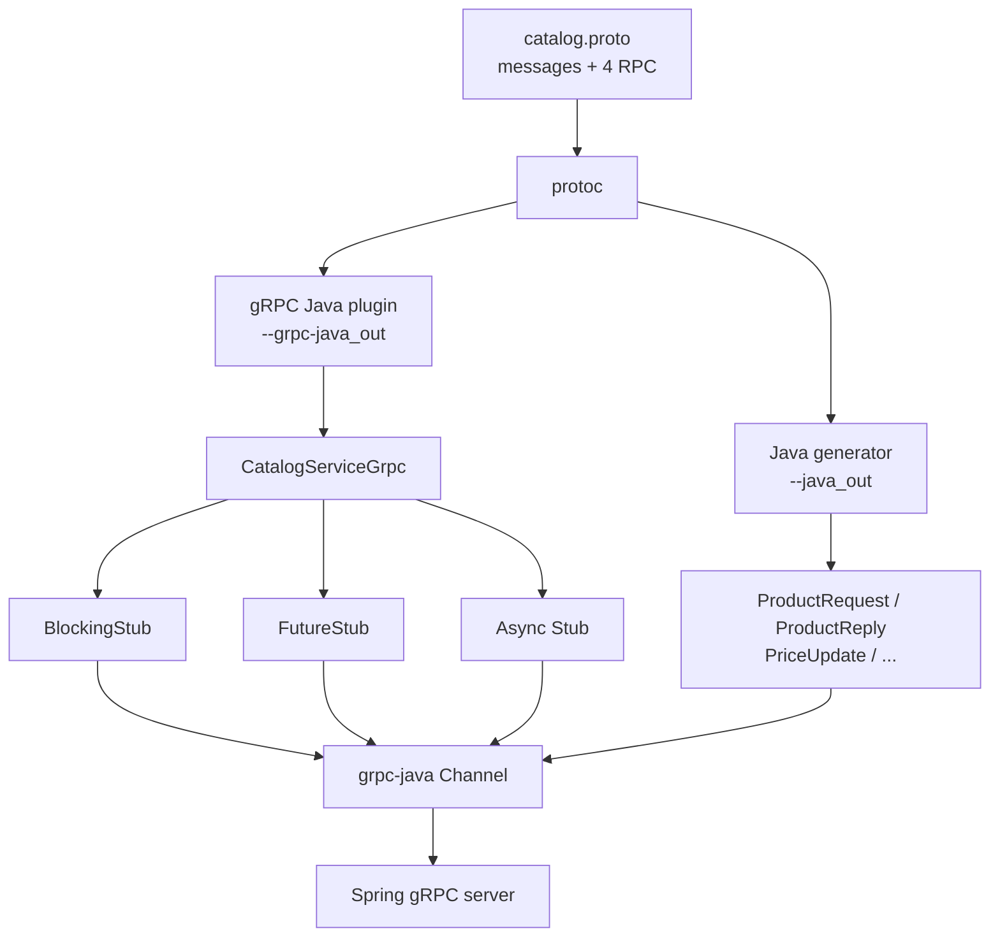
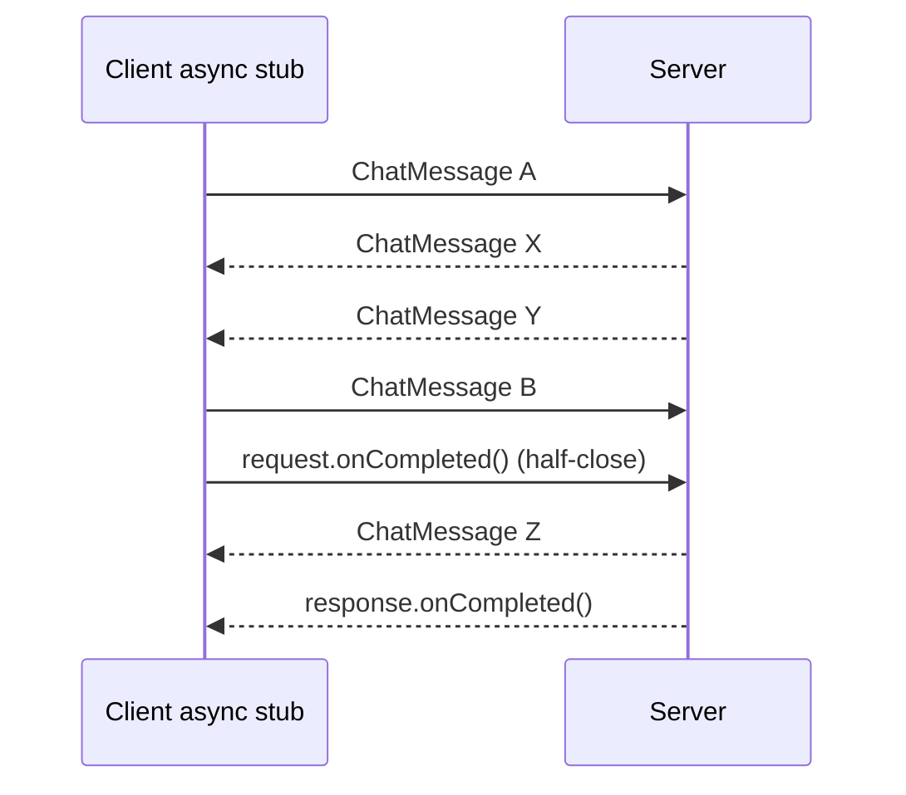
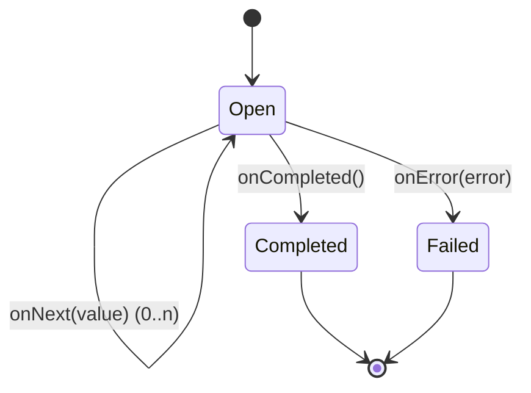

# Blocking, future và async stub trong Spring gRPC

Khi client gọi một dịch vụ **Spring gRPC**, chương trình thường không tự xây dựng yêu cầu HTTP/2 hay mã hóa từng bản tin Protocol Buffers. Thay vào đó, **`protoc-gen-grpc-java`** sinh ra các **client stub** có phương thức Java tương ứng với các RPC trong tệp `.proto`. Cùng một hợp đồng có thể cung cấp **blocking stub**, **future stub** và **async stub**. Chúng gọi cùng một dịch vụ nhưng khác nhau về cách trả kết quả, chiếm dụng luồng và hỗ trợ streaming.

Bài học thuộc chương **Code generation** của module **SPRING_GRPC**. Trọng tâm là hiểu và lựa chọn ba họ stub khi phát triển client cho unary hoặc streaming RPC; đồng thời xác định nơi đặt metadata, deadline, status handling, interceptor, TLS và cách kiểm thử để ứng dụng vận hành tin cậy.

Sau bài này, bạn có thể:

- Nhận diện ba họ stub được sinh trong lớp `*Grpc` và xác định RPC nào được hỗ trợ.
- Viết client unary bằng blocking, future hoặc async API, đồng thời xử lý kết quả và lỗi phù hợp.
- Dùng blocking iterator hoặc async `StreamObserver` khi nhận server-streaming RPC.
- Dùng async stub cho client-streaming và bidirectional-streaming, phân biệt gửi xong request với RPC hoàn tất.
- Quản lý channel, deadline, cancellation, backpressure và thread khi tích hợp với Spring.

## 1. Stub được sinh từ đâu?

Trong gRPC Java, hợp đồng thường định nghĩa cả **message** và **service**. Ví dụ dịch vụ danh mục hàng hóa:

```proto
// src/main/proto/catalog.proto
syntax = "proto3";

package learning.catalog.v1;

option java_package = "vn.example.springgrpc.catalog.v1";
option java_multiple_files = true;
option java_outer_classname = "CatalogProto";

message ProductRequest {
  string sku = 1;
}

message ProductReply {
  string sku = 1;
  string title = 2;
  int64 price_minor = 3;
}

message PriceUpdate {
  string sku = 1;
  int64 price_minor = 2;
}

message ViewEvent {
  string sku = 1;
  string visitor_id = 2;
}

message UploadSummary {
  int32 accepted = 1;
}

message ChatMessage {
  string text = 1;
}

service CatalogService {
  rpc GetProduct(ProductRequest) returns (ProductReply);
  rpc WatchPrices(ProductRequest) returns (stream PriceUpdate);
  rpc UploadViews(stream ViewEvent) returns (UploadSummary);
  rpc Chat(stream ChatMessage) returns (stream ChatMessage);
}
```

Tên và kiểu phương thức trong Java được suy ra từ khai báo trên. Với `GetProduct`, generated method thường tên `getProduct(...)`; `WatchPrices` thành `watchPrices(...)`. Gói Java `vn.example.springgrpc.catalog.v1` đến từ `java_package`; tên dịch vụ gRPC đầy đủ vẫn là `learning.catalog.v1.CatalogService` theo protobuf `package`.

Để có cả message class và stub, cần hai bước sinh mã:

| Công cụ | Sinh gì? |
| --- | --- |
| `protoc --java_out=...` | `ProductRequest`, `ProductReply`, `PriceUpdate`, `ViewEvent`, `UploadSummary`, `ChatMessage` và descriptor |
| `protoc-gen-grpc-java` với `--grpc-java_out=...` | `CatalogServiceGrpc` chứa API server, các họ client stub và mô tả RPC |



Với plugin Gradle `com.google.protobuf`, cấu hình tối thiểu minh họa:

```groovy
// build.gradle (Groovy DSL) — ví dụ phần code generation
plugins {
    id 'java'
    id 'com.google.protobuf' version '0.9.5'
}

def protobufVersion = '4.30.2'
def grpcVersion = '1.71.0'

dependencies {
    implementation "com.google.protobuf:protobuf-java:$protobufVersion"
    implementation platform("io.grpc:grpc-bom:$grpcVersion")
    implementation 'io.grpc:grpc-protobuf'
    implementation 'io.grpc:grpc-stub'
    runtimeOnly 'io.grpc:grpc-netty-shaded'

    // Một số phiên bản plugin sinh @javax.annotation.Generated.
    compileOnly 'javax.annotation:javax.annotation-api:1.3.2'
}

protobuf {
    protoc {
        artifact = "com.google.protobuf:protoc:$protobufVersion"
    }
    plugins {
        grpc {
            artifact = "io.grpc:protoc-gen-grpc-java:$grpcVersion"
        }
    }
    generateProtoTasks {
        all().configureEach { task ->
            task.plugins { grpc {} }
        }
    }
}
```

Chạy `./gradlew generateProto compileJava` (Windows: `.\gradlew.bat generateProto compileJava`). Theo mặc định thường gặp, mã message ở `build/generated/source/proto/main/java` và stub ở `build/generated/source/proto/main/grpc`. Đây là cấu hình **sinh mã và biên dịch**, chưa bao gồm toàn bộ Spring Boot starter, đăng ký service hay thiết lập client/server runtime. Các phiên bản chỉ là ví dụ: dự án cần kiểm tra tương thích giữa `protoc`, `protobuf-java`, grpc-java và BOM/starter Spring gRPC.

## 2. Ba họ client stub được sinh

Trong `CatalogServiceGrpc`, bạn thường gặp các factory:

```java
CatalogServiceGrpc.CatalogServiceBlockingStub blocking =
        CatalogServiceGrpc.newBlockingStub(channel);

CatalogServiceGrpc.CatalogServiceFutureStub future =
        CatalogServiceGrpc.newFutureStub(channel);

CatalogServiceGrpc.CatalogServiceStub async =
        CatalogServiceGrpc.newStub(channel);
```

Ở đây `channel` là một `io.grpc.Channel` (thường là `ManagedChannel`). Stub giữ tham chiếu đến channel cùng các **call options**. Nó không phải server và không tự tạo kết nối riêng cho từng RPC.

| Tiêu chí | Blocking stub | Future stub | Async stub |
| --- | --- | --- | --- |
| Kết quả unary | Trả message trực tiếp | `ListenableFuture<Response>` | Kết quả qua `StreamObserver<Response>` |
| Chặn luồng gọi? | Có, đến khi trả kết quả hoặc lỗi | Việc bắt đầu RPC không chặn chờ response; `get()` có thể chặn | Việc bắt đầu RPC không chặn chờ response; callback xử lý sau |
| Server streaming | `Iterator<Response>` | Không có API future chuẩn cho kiểu này | `StreamObserver<Response>` |
| Client streaming | Không có trong blocking stub thông dụng của grpc-java | Không | Request `StreamObserver<Request>` |
| Bidirectional streaming | Không có trong blocking stub thông dụng của grpc-java | Không | Request và response `StreamObserver` |
| Xử lý lỗi | Thường ném `StatusRuntimeException` tại lệnh gọi/duyệt iterator | Future hoàn tất thất bại; có thể unwrap `ExecutionException` hoặc dùng callback | Callback `onError(Throwable)` |
| Phù hợp | Lệnh gọi tuần tự, tác vụ ngắn, mô hình thread-per-request | Unary cần phối hợp nhiều tác vụ hoặc kết quả bất đồng bộ | Giao tiếp bất đồng bộ và mọi dạng streaming |

**Giới hạn phiên bản:** Bảng mô tả ba họ stub được sinh phổ biến. Một số bản grpc-java bổ sung API blocking mới cho streaming; không nên suy ra API ấy có mặt trong tất cả generated stubs. Hãy kiểm tra chữ ký thực tế của `CatalogServiceGrpc` trong dự án.

### Chữ ký điển hình cho bốn RPC

| RPC | Blocking stub | Future stub | Async stub |
| --- | --- | --- | --- |
| `GetProduct` (unary) | `ProductReply getProduct(ProductRequest)` | `ListenableFuture<ProductReply> getProduct(ProductRequest)` | `void getProduct(ProductRequest, StreamObserver<ProductReply>)` |
| `WatchPrices` (server streaming) | `Iterator<PriceUpdate> watchPrices(ProductRequest)` | — | `void watchPrices(ProductRequest, StreamObserver<PriceUpdate>)` |
| `UploadViews` (client streaming) | — | — | `StreamObserver<ViewEvent> uploadViews(StreamObserver<UploadSummary>)` |
| `Chat` (bidirectional streaming) | — | — | `StreamObserver<ChatMessage> chat(StreamObserver<ChatMessage>)` |

Phân biệt `repeated` trong message với `stream` trong chữ ký RPC. Một `repeated PriceUpdate` là danh sách bên trong **một** bản tin protobuf; `returns (stream PriceUpdate)` là chuỗi **nhiều bản tin** gửi qua RPC trong suốt thời gian lời gọi.

## 3. Channel, stub và call options

Client cần một channel trỏ đến gRPC server:

```java
import io.grpc.ManagedChannel;
import io.grpc.ManagedChannelBuilder;
import vn.example.springgrpc.catalog.v1.CatalogServiceGrpc;

ManagedChannel channel = ManagedChannelBuilder
        .forAddress("localhost", 9090)
        .usePlaintext() // Chỉ sử dụng cho bài thực hành local.
        .build();

CatalogServiceGrpc.CatalogServiceBlockingStub base =
        CatalogServiceGrpc.newBlockingStub(channel);
```

Trong thực tế, `ManagedChannel` thường được **tái sử dụng** cho nhiều RPC. Tạo rồi đóng channel cho từng lời gọi làm tăng chi phí thiết lập kết nối và cản trở cơ chế quản lý tài nguyên. Stub grpc-java thường là đối tượng nhẹ, bất biến về cấu hình gọi; có thể giữ một stub nền rồi tạo các biến thể với deadline, interceptor/call credentials, compression hoặc các call options khác.

```java
import java.util.concurrent.TimeUnit;

CatalogServiceGrpc.CatalogServiceBlockingStub quickCall =
        base.withDeadlineAfter(2, TimeUnit.SECONDS);

// base vẫn không đổi; quickCall giữ call options mới.
```

**Chú ý deadline:** `withDeadlineAfter(...)` đặt thời hạn tương đối cho các lời gọi được tạo bằng stub mới. Thời hạn tác động đến **toàn bộ một RPC**, kể cả chuỗi response của server-streaming; nó không phải timeout riêng cho mỗi `onNext`. Nếu deadline hết hạn, grpc-java chấm dứt lời gọi với status thường là `DEADLINE_EXCEEDED`.

Trong Spring gRPC, nên ưu tiên cơ chế quản lý channel và stub do starter đang dùng hỗ trợ (cấu hình client, bean, dependency injection). Nếu cần hiểu bản chất của generated API, có thể tạo bean bằng grpc-java trực tiếp trong ví dụ local:

```java
import io.grpc.ManagedChannel;
import io.grpc.ManagedChannelBuilder;
import org.springframework.context.annotation.Bean;
import org.springframework.context.annotation.Configuration;
import vn.example.springgrpc.catalog.v1.CatalogServiceGrpc;

@Configuration
class CatalogClientConfig {
    @Bean(destroyMethod = "shutdown")
    ManagedChannel catalogChannel() {
        return ManagedChannelBuilder.forAddress("localhost", 9090)
                .usePlaintext()
                .build();
    }

    @Bean
    CatalogServiceGrpc.CatalogServiceBlockingStub catalogBlockingStub(
            ManagedChannel catalogChannel) {
        return CatalogServiceGrpc.newBlockingStub(catalogChannel);
    }

    @Bean
    CatalogServiceGrpc.CatalogServiceFutureStub catalogFutureStub(
            ManagedChannel catalogChannel) {
        return CatalogServiceGrpc.newFutureStub(catalogChannel);
    }

    @Bean
    CatalogServiceGrpc.CatalogServiceStub catalogAsyncStub(
            ManagedChannel catalogChannel) {
        return CatalogServiceGrpc.newStub(catalogChannel);
    }
}
```

Ví dụ này dùng plaintext trên localhost để minh họa cách stub được tạo từ một channel. Production cần TLS/mTLS, target resolution, load balancing và chính sách quản lý lifecycle thích hợp. Nếu starter Spring gRPC đã tạo channel bean, không cấu hình trùng một channel chỉ vì muốn có cả ba họ stub.

## 4. Blocking stub cho unary RPC

Với `GetProduct`, blocking stub cung cấp cách gọi gần giống một hàm Java bình thường:

```java
import io.grpc.StatusRuntimeException;
import java.util.concurrent.TimeUnit;
import vn.example.springgrpc.catalog.v1.CatalogServiceGrpc;
import vn.example.springgrpc.catalog.v1.ProductReply;
import vn.example.springgrpc.catalog.v1.ProductRequest;

public class CatalogBlockingClient {
    private final CatalogServiceGrpc.CatalogServiceBlockingStub stub;

    public CatalogBlockingClient(
            CatalogServiceGrpc.CatalogServiceBlockingStub stub) {
        this.stub = stub;
    }

    public ProductReply load(String sku) {
        ProductRequest request = ProductRequest.newBuilder()
                .setSku(sku)
                .build();

        try {
            return stub.withDeadlineAfter(2, TimeUnit.SECONDS)
                    .getProduct(request);
        } catch (StatusRuntimeException error) {
            System.err.println(
                    "GetProduct lỗi: " + error.getStatus().getCode());
            throw error;
        }
    }
}
```

Lệnh `getProduct(request)` chặn luồng Java đang gọi cho đến khi RPC hoàn tất hoặc thất bại. Khi thành công, caller nhận `ProductReply`; khi lỗi ở tầng gRPC, caller thường nhận `StatusRuntimeException`.

Đây là lựa chọn phù hợp cho tác vụ có logic tuyến tính, truy vấn ngắn, batch job hoặc code đang chạy trên luồng dành cho blocking I/O. Không gọi blocking stub ngay trên event-loop hoặc luồng xử lý cần phản hồi cực nhanh mà không có chiến lược tách tác vụ; một RPC chậm sẽ giữ luồng đó.

### Kiểm soát trạng thái lỗi

Không coi mọi lỗi là `INTERNAL` hoặc tự retry vô hạn. Ví dụ:

| Status gRPC | Ý nghĩa thường gặp ở client | Hướng xử lý |
| --- | --- | --- |
| `INVALID_ARGUMENT` | Input không hợp lệ theo server | Sửa request hoặc trả lỗi hợp lệ cho người gọi |
| `NOT_FOUND` | Tài nguyên không tồn tại | Xử lý trạng thái thiếu tài nguyên |
| `DEADLINE_EXCEEDED` | Lời gọi vượt thời hạn | Kiểm tra deadline, độ trễ, timeout downstream |
| `UNAVAILABLE` | Dịch vụ tạm không thể truy cập | Xem xét retry có giới hạn, backoff và idempotency |
| `UNAUTHENTICATED` | Thiếu hoặc sai thông tin xác thực | Kiểm tra token/call credentials |
| `PERMISSION_DENIED` | Không đủ quyền | Không retry tự động khi quyền chưa thay đổi |
| `CANCELLED` | Lời gọi đã bị hủy | Dừng xử lý tiếp và giải phóng tài nguyên |

Một số lỗi có thể do server trả về, số khác do transport hoặc client runtime. Cách mapping status của ứng dụng phải nhất quán, có log/metrics phù hợp nhưng không vô tình in token bí mật.

## 5. Blocking stub cho server streaming

`WatchPrices(ProductRequest) returns (stream PriceUpdate)` có thể được đọc qua `Iterator<PriceUpdate>`:

```java
import java.util.Iterator;
import java.util.concurrent.TimeUnit;
import vn.example.springgrpc.catalog.v1.PriceUpdate;
import vn.example.springgrpc.catalog.v1.ProductRequest;

ProductRequest request = ProductRequest.newBuilder()
        .setSku("BOOK-101")
        .build();

Iterator<PriceUpdate> updates =
        blocking.withDeadlineAfter(15, TimeUnit.SECONDS)
                .watchPrices(request);

while (updates.hasNext()) {
    PriceUpdate next = updates.next();
    System.out.println(
            next.getSku() + ": " + next.getPriceMinor());
}
```

Ở đây `blocking` là biến `CatalogServiceBlockingStub` đã tạo trong cùng phạm vi chương trình. `hasNext()` hoặc `next()` có thể chặn khi chưa có phần tử tiếp theo và có thể ném `StatusRuntimeException` nếu luồng thất bại. Với stream kết thúc bình thường, iterator sẽ hết phần tử.

**Không dùng một vòng `while` không giới hạn trên luồng request của HTTP server nếu nó có thể chạy mãi.** Chọn deadline/hủy lời gọi rõ ràng và chạy tác vụ đọc trên luồng phù hợp. Nếu nghiệp vụ cần cập nhật liên tục, cần xử lý sự kiện bất đồng bộ và giới hạn bộ nhớ, async stub thường phù hợp hơn.

## 6. Future stub: unary không chặn tại điểm gọi

Future stub cung cấp `com.google.common.util.concurrent.ListenableFuture` cho unary RPC. Nó hữu ích khi client muốn bắt đầu một tác vụ mạng rồi tiếp tục thực hiện công việc khác, hoặc kết hợp kết quả từ nhiều nguồn.

```java
import com.google.common.util.concurrent.ListenableFuture;
import java.util.concurrent.TimeUnit;
import vn.example.springgrpc.catalog.v1.CatalogServiceGrpc;
import vn.example.springgrpc.catalog.v1.ProductReply;
import vn.example.springgrpc.catalog.v1.ProductRequest;

CatalogServiceGrpc.CatalogServiceFutureStub stub =
        CatalogServiceGrpc.newFutureStub(channel)
                .withDeadlineAfter(3, TimeUnit.SECONDS);

ListenableFuture<ProductReply> pending =
        stub.getProduct(ProductRequest.newBuilder()
                .setSku("BOOK-101")
                .build());

// pending đã được trả về trước khi server nhất thiết phản hồi.
```

Để xử lý khi future hoàn tất, đăng ký callback với một executor phù hợp:

```java
import com.google.common.util.concurrent.FutureCallback;
import com.google.common.util.concurrent.Futures;
import java.util.concurrent.Executor;

Executor callbackExecutor = java.util.concurrent.ForkJoinPool.commonPool();

Futures.addCallback(pending, new FutureCallback<ProductReply>() {
    @Override
    public void onSuccess(ProductReply reply) {
        System.out.println(reply.getTitle());
    }

    @Override
    public void onFailure(Throwable error) {
        System.err.println("GetProduct lỗi: "
                + io.grpc.Status.fromThrowable(error).getCode());
    }
}, callbackExecutor);
```

**Chú ý:** `ForkJoinPool.commonPool()` chỉ dùng để minh họa cách truyền một executor vào callback. Trong Spring, nên inject một executor được quản lý với giới hạn luồng/queue phù hợp, đặc biệt khi callback làm nhiều việc. Tránh đặt logic CPU nặng hoặc blocking I/O vào executor callback của transport.

Nếu gọi `pending.get()`, luồng gọi sẽ **chặn** tới khi future hoàn tất. Do đó, future chỉ giữ tính bất đồng bộ khi bạn dùng callback hoặc cơ chế kết hợp task phù hợp. Có thể gọi `get(timeout, unit)` để giới hạn thời gian đợi ở luồng hiện tại, nhưng timeout này **khác** deadline RPC: timeout của `get` không tự động hủy lời gọi.

```java
try {
    ProductReply result = pending.get(4, TimeUnit.SECONDS);
    System.out.println(result.getTitle());
} catch (java.util.concurrent.TimeoutException error) {
    pending.cancel(true); // Chủ động yêu cầu hủy RPC đang chạy.
} catch (InterruptedException error) {
    pending.cancel(true);
    Thread.currentThread().interrupt();
} catch (java.util.concurrent.ExecutionException error) {
    Throwable cause = error.getCause();
    System.err.println(
            io.grpc.Status.fromThrowable(cause).getCode());
} catch (java.util.concurrent.CancellationException error) {
    // Future đã bị hủy.
}
```

Mã trên nằm trong phạm vi đã khai báo `pending`. Khi future thất bại, `ExecutionException` bọc nguyên nhân bên trong; nên đọc `getCause()` rồi lấy gRPC status. Khi hủy bằng `cancel(...)`, grpc-java thường truyền yêu cầu hủy tới RPC tương ứng; hủy không bảo đảm server chưa xử lý request.

**Future stub không tự biến streaming thành future của một danh sách.** API future chuẩn của generated gRPC Java chủ yếu dành cho unary RPC. Với server streaming, client streaming hoặc bidi, dùng async observer hoặc một abstraction streaming được xây riêng phía ứng dụng.

## 7. Async stub cho unary RPC

Async stub trả kết quả qua `StreamObserver<Response>`. Ngay cả với unary, server vẫn có thể báo thành công hoặc lỗi qua các terminal callback.

```java
import io.grpc.stub.StreamObserver;
import java.util.concurrent.CompletableFuture;
import java.util.concurrent.TimeUnit;
import java.util.concurrent.atomic.AtomicReference;
import vn.example.springgrpc.catalog.v1.CatalogServiceGrpc;
import vn.example.springgrpc.catalog.v1.ProductReply;
import vn.example.springgrpc.catalog.v1.ProductRequest;

public class CatalogAsyncClient {
    private final CatalogServiceGrpc.CatalogServiceStub stub;

    public CatalogAsyncClient(CatalogServiceGrpc.CatalogServiceStub stub) {
        this.stub = stub;
    }

    public CompletableFuture<ProductReply> getProduct(String sku) {
        CompletableFuture<ProductReply> done =
                new CompletableFuture<>();
        AtomicReference<ProductReply> result =
                new AtomicReference<>();

        ProductRequest request = ProductRequest.newBuilder()
                .setSku(sku)
                .build();

        stub.withDeadlineAfter(3, TimeUnit.SECONDS)
                .getProduct(request, new StreamObserver<ProductReply>() {
                    @Override
                    public void onNext(ProductReply value) {
                        result.set(value);
                    }

                    @Override
                    public void onError(Throwable error) {
                        done.completeExceptionally(error);
                    }

                    @Override
                    public void onCompleted() {
                        ProductReply value = result.get();
                        if (value != null) {
                            done.complete(value);
                        } else {
                            done.completeExceptionally(
                                    new IllegalStateException(
                                            "Unary RPC không có response"));
                        }
                    }
                });

        return done;
    }
}
```

Điểm khác biệt:

- `getProduct(...)` bắt đầu RPC rồi trả quyền điều khiển cho caller; dữ liệu đến qua callback.
- `onNext` nhận message; `onCompleted` xác nhận luồng phản hồi kết thúc thành công; `onError` xác nhận lỗi. Trong unary thành công, chỉ có một response message.
- Ví dụ dùng `CompletableFuture` để đưa kết quả về API Java phổ biến. Đây là **adapter do ứng dụng viết**, không phải kiểu trả về gốc của generated async stub.
- Adapter trên **chưa nối hành động hủy `CompletableFuture`** với cancellation của RPC. Muốn có cancel semantics đầy đủ, cần giữ `ClientCallStreamObserver`/`Context` hoặc sử dụng cơ chế hủy được runtime hỗ trợ và kiểm thử việc truyền hủy.

Không thực hiện truy vấn database đồng bộ hay tính toán nặng ngay trong callback của grpc-java nếu chưa xác định executor thích hợp. Tùy cách cấu hình, callback có thể chạy trên luồng xử lý của gRPC.

## 8. Async server streaming: xử lý từng phần tử khi đến

Khi gọi `WatchPrices` với async stub, bạn cung cấp observer để nhận từng `PriceUpdate`:

```java
import io.grpc.stub.StreamObserver;
import java.util.concurrent.CompletableFuture;
import java.util.concurrent.TimeUnit;
import vn.example.springgrpc.catalog.v1.PriceUpdate;
import vn.example.springgrpc.catalog.v1.ProductRequest;

CompletableFuture<Void> finished = new CompletableFuture<>();
ProductRequest request = ProductRequest.newBuilder()
        .setSku("BOOK-101")
        .build();

async.withDeadlineAfter(20, TimeUnit.SECONDS)
        .watchPrices(request, new StreamObserver<PriceUpdate>() {
            @Override
            public void onNext(PriceUpdate update) {
                System.out.println("Giá mới: " + update.getPriceMinor());
            }

            @Override
            public void onError(Throwable error) {
                finished.completeExceptionally(error);
            }

            @Override
            public void onCompleted() {
                finished.complete(null);
            }
        });
```

Biến `async` ở đây là `CatalogServiceGrpc.CatalogServiceStub` đã được tạo sẵn. `finished` giúp caller quan sát thời điểm kết thúc; ứng dụng cần xử lý lỗi của future đó thay vì bỏ qua. Với stream dài, **xử lý từng message khi tới** thường tốt hơn tích lũy vô hạn vào `List<PriceUpdate>`. Nếu downstream xử lý chậm, cần cơ chế flow control.

Điểm giống giữa blocking iterator và async observer là đều nhận chuỗi message do cùng một RPC `WatchPrices` phát ra. Điểm khác là API blocking **đợi** ở `hasNext()/next()`, còn async **được gọi lại** qua `onNext()`.

## 9. Async client streaming: nhiều request, một response

`UploadViews(stream ViewEvent) returns (UploadSummary)` yêu cầu một luồng request. Generated async method nhận **response observer** và trả về **request observer**:

```java
StreamObserver<ViewEvent> requests =
        async.uploadViews(responseObserver);
```

Ví dụ hoàn chỉnh phần gửi và theo dõi kết quả:

```java
import io.grpc.stub.StreamObserver;
import java.util.concurrent.CompletableFuture;
import java.util.concurrent.TimeUnit;
import java.util.concurrent.atomic.AtomicReference;
import vn.example.springgrpc.catalog.v1.UploadSummary;
import vn.example.springgrpc.catalog.v1.ViewEvent;

CompletableFuture<UploadSummary> finished =
        new CompletableFuture<>();
AtomicReference<UploadSummary> received =
        new AtomicReference<>();

StreamObserver<UploadSummary> responseObserver =
        new StreamObserver<UploadSummary>() {
            @Override
            public void onNext(UploadSummary value) {
                received.set(value);
            }

            @Override
            public void onError(Throwable error) {
                finished.completeExceptionally(error);
            }

            @Override
            public void onCompleted() {
                UploadSummary summary = received.get();
                if (summary != null) {
                    finished.complete(summary);
                } else {
                    finished.completeExceptionally(
                            new IllegalStateException(
                                    "Thiếu UploadSummary"));
                }
            }
        };

StreamObserver<ViewEvent> requests =
        async.withDeadlineAfter(10, TimeUnit.SECONDS)
                .uploadViews(responseObserver);

requests.onNext(ViewEvent.newBuilder()
        .setSku("BOOK-101")
        .setVisitorId("visitor-a")
        .build());
requests.onNext(ViewEvent.newBuilder()
        .setSku("PEN-202")
        .setVisitorId("visitor-b")
        .build());
requests.onCompleted();

// finished hoàn tất sau khi server trả UploadSummary và đóng response.
```

Trong ví dụ:

1. Client tạo `responseObserver` để **nhận** `UploadSummary` hoặc lỗi.
2. `uploadViews(responseObserver)` trả `requests` để client **gửi** các `ViewEvent`.
3. Client gọi `requests.onNext(...)` bao nhiêu lần theo hợp đồng, rồi `requests.onCompleted()`.
4. `onCompleted()` trên request observer có nghĩa client đã gửi xong request (**half-close**). RPC chỉ hoàn tất khi chiều response cũng kết thúc bằng `onCompleted` hoặc `onError`.

Ví dụ gửi hai phần tử ngay lập tức để minh họa chữ ký; khi gửi hàng nghìn hoặc hàng triệu bản tin, phải xem xét buffer và backpressure. Khi server báo lỗi giữa lúc gửi, producer cần dừng gửi và giải phóng tài nguyên; không tiếp tục gọi `onNext` sau terminal event hoặc cancellation.

## 10. Async bidirectional streaming: hai chiều độc lập

`Chat(stream ChatMessage) returns (stream ChatMessage)` trả về một request observer tương tự client streaming, nhưng response observer có thể nhận **nhiều** message:

```java
import io.grpc.stub.StreamObserver;
import java.util.concurrent.CompletableFuture;
import vn.example.springgrpc.catalog.v1.ChatMessage;

CompletableFuture<Void> finished = new CompletableFuture<>();

StreamObserver<ChatMessage> outbound = async.chat(
        new StreamObserver<ChatMessage>() {
            @Override
            public void onNext(ChatMessage incoming) {
                System.out.println("Server: " + incoming.getText());
            }

            @Override
            public void onError(Throwable error) {
                finished.completeExceptionally(error);
            }

            @Override
            public void onCompleted() {
                finished.complete(null);
            }
        });

outbound.onNext(ChatMessage.newBuilder()
        .setText("Xin chào")
        .build());
outbound.onNext(ChatMessage.newBuilder()
        .setText("Cập nhật thêm")
        .build());
outbound.onCompleted(); // Chỉ đóng chiều gửi từ client.
```

Server có thể phản hồi ngay sau message đầu tiên, đợi nhiều request mới phản hồi, hoặc gửi nhiều phản hồi cho một request. Thứ tự message trên **mỗi chiều** được bảo toàn trong một RPC, nhưng không mặc định có quan hệ một–một giữa request và response.



Nếu muốn cho phép chat lâu dài, không nên gọi `outbound.onCompleted()` ngay; một lifecycle controller của ứng dụng phải quyết định khi nào đóng luồng. Cần cung cấp thời hạn, hành động hủy, handling mất kết nối và chính sách retry/reconnect phù hợp. Việc retry bidi stream có thể làm gửi trùng dữ liệu nếu không thiết kế giao thức nghiệp vụ cho reconnect.

## 11. Vòng đời observer, thread safety và backpressure

Đối với async stub, một response observer có vòng đời:



`onCompleted()` và `onError()` là hai đường kết thúc thay thế nhau. Không gửi tiếp `onNext` sau terminal event trên cùng một stream. Với client-streaming/bidi, request observer của client cũng có lifecycle tương tự, và việc client đóng request **không tự động đóng response**.

**An toàn luồng:** Không giả định `StreamObserver` có thể nhận `onNext` từ nhiều thread cùng lúc. Nếu có nhiều producer, hãy serialize việc gửi (qua một executor/queue riêng hoặc cơ chế đồng bộ thích hợp). Không giữ callback của gRPC để thực hiện blocking I/O kéo dài. Message protobuf đã build thường bất biến và có thể chia sẻ an toàn, nhưng observer đại diện cho luồng đang tiến triển nên cần điều phối cẩn thận.

**Backpressure:** Async không đồng nghĩa vô hạn dung lượng. Khi producer gửi nhanh hơn network/receiver, dữ liệu có thể được đệm và gây tăng bộ nhớ. grpc-java cung cấp các kiểu mở rộng `ClientCallStreamObserver`, `ServerCallStreamObserver` cùng các API như `isReady()` và `setOnReadyHandler(...)` để phối hợp khả năng gửi. Với client-streaming/bidi, có thể dùng `ClientResponseObserver` để lấy `ClientCallStreamObserver` trong `beforeStart(...)`:

```java
import io.grpc.stub.ClientCallStreamObserver;
import io.grpc.stub.ClientResponseObserver;
import io.grpc.stub.StreamObserver;
import vn.example.springgrpc.catalog.v1.UploadSummary;
import vn.example.springgrpc.catalog.v1.ViewEvent;

ClientResponseObserver<ViewEvent, UploadSummary> observer =
        new ClientResponseObserver<ViewEvent, UploadSummary>() {
            @Override
            public void beforeStart(
                    ClientCallStreamObserver<ViewEvent> requestStream) {
                requestStream.setOnReadyHandler(() -> {
                    if (requestStream.isReady()) {
                        // Báo producer có thể gửi tiếp một số phần tử.
                        // Trong mã thật cần queue có giới hạn,
                        // logic tuần tự hóa onNext và trạng thái đóng.
                    }
                });
            }

            @Override
            public void onNext(UploadSummary value) {
                System.out.println(value.getAccepted());
            }

            @Override
            public void onError(Throwable error) {
                // Dừng producer, giải phóng tài nguyên.
            }

            @Override
            public void onCompleted() {
                // Chiều response kết thúc thành công.
            }
        };

StreamObserver<ViewEvent> requestStream = async.uploadViews(observer);
```

`isReady()` chỉ báo hiệu **mức sẵn sàng để gửi** theo flow control, không phải một xác nhận server đã xử lý xong message. `setOnReadyHandler` có thể được gọi lại; producer cần tự quản lý chỉ số, đồng bộ, giới hạn bộ đệm và việc đóng request. Ngoài outbound flow control, inbound flow control cũng cần được xem xét nếu callback xử lý chậm. Không dùng polling liên tục hoặc queue không giới hạn như cách thay thế backpressure.

## 12. Deadline, cancellation và propagation

Ba họ stub đều sử dụng call options của grpc-java. Tuy nhiên, cách caller quan sát deadline/hủy khác nhau:

| Tình huống | Blocking | Future | Async |
| --- | --- | --- | --- |
| Deadline hết hạn | `StatusRuntimeException` tại lời gọi/iterator | Future hoàn tất thất bại | `onError` được gọi |
| Caller muốn dừng | Hủy qua gRPC `Context`/cơ chế RPC phù hợp | `ListenableFuture.cancel(...)` | Dùng `ClientCallStreamObserver.cancel(...)` hoặc `Context`/cơ chế cancellation được runtime hỗ trợ |
| Caller có timeout chờ riêng | Thread đợi hữu hạn theo cơ chế ứng dụng | `get(timeout)` chỉ giới hạn chờ, không tự cancel | Timeout của async adapter chỉ giới hạn người chờ, cần nối với việc hủy RPC |
| Streaming dài | Deadline áp dụng cả luồng | Không áp dụng ở API future chuẩn | Deadline áp dụng cả luồng |

Nếu deadline đã hết hạn, việc retry cần xem xét **tác dụng phụ**: ví dụ `UploadViews` có thể đã ghi một số sự kiện dù client không nhận được `UploadSummary`. Dùng khóa idempotency/sequence number hoặc thiết kế exactly-once ở cấp nghiệp vụ nếu hệ thống yêu cầu; transport không tự bảo đảm mọi thao tác side effect chỉ xảy ra một lần.

Khi ứng dụng Spring gRPC đóng một request HTTP, kết thúc tác vụ hoặc người dùng hủy thao tác, nên truyền hủy xuống RPC liên quan nếu có thể. Nếu chỉ bỏ qua `CompletableFuture` trong ứng dụng, lời gọi grpc-java bên dưới có thể vẫn tiếp tục tiêu thụ tài nguyên.

## 13. Metadata, interceptor, TLS và status không nằm trong generated stub

Stub được sinh để phản ánh **hợp đồng phương thức**, không để cố định thông tin môi trường. Một stub nhận channel và các call options tại runtime:

| Vấn đề | Cách xử lý |
| --- | --- |
| Token, trace ID, correlation ID | Gắn `Metadata` bằng client interceptor, call credentials hoặc cơ chế Spring gRPC tương ứng |
| Deadline, compression, wait-for-ready | Call options trên stub như `withDeadlineAfter(...)`, theo chính sách của ứng dụng |
| TLS/mTLS và chứng chỉ | Channel/transport config và secret management |
| Lỗi nghiệp vụ | Server ánh xạ thành `Status` phù hợp; client quan sát bằng exception/future/`onError` |
| Logging/tracing/metrics | Client/server interceptor, OpenTelemetry/instrumentation tùy hệ thống |
| Retry và load balancing | Service config, channel config, idempotency và vận hành |
| Xác thực người gọi | Credentials/interceptors và quy tắc cấp quyền ở server |

**Không thêm field token hoặc deadline vào message chỉ vì muốn stub có sẵn chúng.** Metadata thuộc thông tin của từng RPC, còn message chứa dữ liệu nghiệp vụ. Đối với production, dùng TLS, không đưa `usePlaintext()` từ các ví dụ local vào cấu hình thật.

Generated stub có thể được chia sẻ giữa các Spring bean, nhưng tránh thay call options mang tính thời điểm bằng cách ghi đè một biến chung có thể bị truy cập đồng thời. Hãy dẫn xuất stub cho lời gọi cần cấu hình riêng:

```java
CatalogServiceGrpc.CatalogServiceStub thisCall =
        sharedAsyncStub.withDeadlineAfter(5, TimeUnit.SECONDS);
```

`sharedAsyncStub` vẫn giữ cấu hình nền. Vì mỗi RPC tạo context/call state riêng, nhiều lời gọi đồng thời qua cùng một channel/stub là trường hợp sử dụng bình thường nếu resource limits được cấu hình hợp lý.

## 14. Chọn kiểu stub theo yêu cầu ứng dụng

Không có loại stub tốt nhất cho mọi tình huống. Hãy quyết định dựa trên kiểu RPC và mô hình thực thi:

| Nhu cầu thực tế | Lựa chọn thường phù hợp | Lý do |
| --- | --- | --- |
| Truy vấn giá một sản phẩm trên luồng riêng có thể block | Blocking unary | Mã tuyến tính, xử lý lỗi trực tiếp |
| Kết hợp kết quả nhiều truy vấn unary mà không chặn luồng điều phối | Future unary hoặc async unary | Cho phép chạy/ghép tác vụ bất đồng bộ |
| Phản hồi unary qua event-driven pipeline | Async unary | Nhận kết quả qua callback/adapter |
| Đọc một số ít phần tử server-streaming trong tác vụ batch | Blocking iterator | Vòng lặp đơn giản khi thời gian chờ có giới hạn |
| Subscribe cập nhật giá kéo dài | Async server-streaming | Callback từng phần tử, dễ nối pipeline streaming |
| Gửi batch lớn sự kiện từ client | Async client-streaming | Gửi nhiều request, nhận một summary; cần backpressure |
| Hội thoại hai chiều, thiết bị trao đổi realtime | Async bidi | Hai chiều tiến triển độc lập |

### Những nhầm lẫn thường gặp

1. **“Future không bao giờ chặn.”** Sai: `ListenableFuture.get()` vẫn chặn; chỉ bước gọi RPC và cách ghép kết quả có thể không chặn.
2. **“Async là một thread mới cho mỗi RPC.”** Sai: API không chặn khi chờ kết quả nhưng grpc-java dùng runtime và executor; nó không mặc định tạo thread riêng cho mỗi request.
3. **“Blocking stub không dùng được với streaming.”** Không chính xác: blocking stub thông dụng hỗ trợ **server-streaming** qua `Iterator`; các dạng request streaming thường cần async API.
4. **“onCompleted của request nghĩa là RPC đã xong.”** Sai với client-streaming/bidi: server còn có thể trả response hoặc lỗi.
5. **“Hủy CompletableFuture là hủy RPC.”** Không tự động nếu `CompletableFuture` là adapter do bạn viết và chưa nối cancellation xuống gRPC.
6. **“Dùng async nên không cần giới hạn bộ đệm.”** Sai: gửi nhanh hơn transport có thể làm memory tăng.
7. **“Stub tự áp dụng bảo mật.”** Sai: TLS, credentials và authorization phải được cấu hình ở channel/interceptor/server.

## 15. Kiểm thử và xử lý sự cố

Khi viết integration test cho client, có thể dùng grpc-java **in-process server/channel** với service implementation thử nghiệm. Điều này xác nhận generated stub và server base tương tác được mà không cần mở cổng TCP. Các bài test về TLS, cấu hình Spring Boot và network thực vẫn cần setup tương ứng.

| Trường hợp test | Quan sát quan trọng |
| --- | --- |
| Blocking unary thành công | Trả đúng `ProductReply`, không giữ luồng quá deadline |
| Blocking unary lỗi | Bắt `StatusRuntimeException` và đúng status code |
| Future unary thành công/lỗi | Callback/future hoàn tất đúng, không kẹt executor |
| Async unary thành công/lỗi | `onNext` + `onCompleted` hoặc `onError`, không hoàn tất hai lần |
| Server-streaming | Đủ phần tử, terminal callback hoặc iterator kết thúc |
| Client-streaming | `onCompleted` gửi request, server trả một `UploadSummary` |
| Bidi-streaming | Gửi và nhận độc lập, không giả định quan hệ một–một |
| Cancellation/deadline | Producer ngừng gửi, downstream được hủy phù hợp, tài nguyên được dọn |
| Backpressure | Producer không tích lũy vô hạn khi receiver chậm |

Khi có lỗi, chẩn đoán theo tầng:

| Biểu hiện | Hướng kiểm tra |
| --- | --- |
| Không tìm thấy `CatalogServiceGrpc` | Chưa chạy `protoc-gen-grpc-java` hoặc generated sources chưa được biên dịch |
| Có stub nhưng không có `ProductRequest` | Thiếu Java message generator hoặc source set |
| `UNIMPLEMENTED` | Sai tên package/service/method, service chưa bind, server chưa override RPC |
| `UNAVAILABLE` | Endpoint, channel, kết nối, TLS hoặc server chưa sẵn sàng |
| `DEADLINE_EXCEEDED` | Deadline quá ngắn, server/downstream chậm hoặc streaming kéo dài |
| Future mãi chưa xong | RPC chưa kết thúc, callback không được đăng ký đúng, deadline/cancellation chưa cấu hình |
| Async response không gọi `onCompleted` | Server thiếu terminal event, connection lỗi hoặc client bị hủy |
| Client stream không có summary | Client chưa half-close, server chưa hoàn tất response hoặc stream đã lỗi |
| Kết quả callback không an toàn | Observer được gọi đồng thời hoặc chia sẻ mutable state không đồng bộ |
| `NoSuchMethodError` hay lỗi runtime liên quan stub | Lệch phiên bản grpc-java/protobuf hoặc dependency conflict |

Đọc gRPC status cùng thông tin trong log/trace hai đầu, nhưng tránh log toàn bộ message chứa dữ liệu nhạy cảm. Các metric hữu ích gồm số RPC theo status, latency, deadline exceeded, cancellation, số stream đang hoạt động và kích thước/nhịp bản tin.

## 16. Bài tập thực hành

1. **Phân tích mã sinh:** Chạy code generation từ `catalog.proto`, tìm `CatalogServiceGrpc` và xác định ba stub factory. Ghi lại những RPC xuất hiện trong mỗi họ stub.
2. **So sánh unary:** Viết ba phiên bản gọi `GetProduct` bằng blocking, future callback và async observer. Đo số luồng caller bị giữ khi chờ server trì hoãn phản hồi hai giây.
3. **Deadline và lỗi:** Với blocking stub, đặt deadline ngắn hơn thời gian xử lý; quan sát `DEADLINE_EXCEEDED`. Lặp lại với future và async để xem cách lỗi truyền về.
4. **Future cancellation:** Bắt đầu một future unary, gọi `cancel(true)` rồi ghi nhận kết quả `isCancelled()` và phản ứng bên server. Giải thích vì sao server có thể đã bắt đầu xử lý trước khi nhận hủy.
5. **Server-streaming:** Triển khai `WatchPrices` phát ba bản tin. Đọc một lần bằng blocking iterator, một lần bằng async callback và so sánh cách chờ.
6. **Client-streaming:** Gửi 100 `ViewEvent`, gọi `onCompleted()` rồi kiểm tra `UploadSummary.accepted`. Thử bỏ `onCompleted()` để nhận ra nguyên nhân server tiếp tục chờ.
7. **Bidi-streaming:** Viết chat echo đơn giản. Gửi một message, nhận phản hồi, tiếp tục gửi message khác rồi half-close. Dùng `CompletableFuture` hoặc latch có timeout để quan sát response hoàn tất.
8. **Backpressure:** Đặt nguồn sự kiện nhanh hơn consumer; thiết kế queue có giới hạn và cơ chế `isReady()`/`setOnReadyHandler(...)` để không giữ tất cả event trong bộ nhớ.
9. **Spring integration:** Đăng ký channel và stub dưới dạng bean hoặc dùng starter Spring gRPC đang có. Xác nhận một channel có thể được tái sử dụng qua nhiều lời gọi, rồi kiểm thử cấu hình TLS/metadata ở môi trường phù hợp.
10. **Kiểm thử lỗi:** Viết integration test lần lượt cho `INVALID_ARGUMENT`, `NOT_FOUND`, `UNAVAILABLE` và `DEADLINE_EXCEEDED`. Đánh dấu rõ lỗi nào do server chủ động trả về, lỗi nào do client/transport quyết định.

### Ghi nhớ

`CatalogServiceGrpc.newBlockingStub(channel)` phù hợp cho lời gọi **đồng bộ** và server-streaming iterator; `newFutureStub(channel)` hỗ trợ **unary kết quả dạng future**; `newStub(channel)` cung cấp **API bất đồng bộ cho cả bốn kiểu RPC**. Cùng một hợp đồng Protocol Buffers và grpc-java runtime được dùng ở cả ba trường hợp. Khi đưa stub vào Spring gRPC, hãy chọn cách quan sát kết quả phù hợp với mô hình thread, quản lý deadline và cancellation, giữ đúng vòng đời `StreamObserver`, giới hạn bộ đệm streaming và cấu hình metadata/TLS ở runtime.
