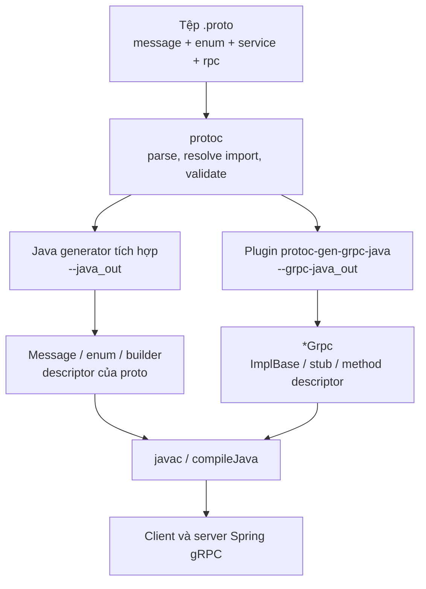

# Grpc Java codegen: từ hợp đồng .proto đến mã Java dùng trong Spring gRPC

Trong **SPRING_GRPC**, bạn mô tả dữ liệu và các phương thức gọi từ xa bằng **Protocol Buffers**, sau đó dùng công cụ **gRPC Java code generation** để chuyển hợp đồng thành lớp Java mà client và server có thể biên dịch và sử dụng. Hai phần chính của quá trình này là trình biên dịch `protoc` (sinh mã message) và plugin `protoc-gen-grpc-java` (sinh mã dịch vụ gRPC). Khi tích hợp với **Spring**, các lớp được sinh trở thành nền tảng để triển khai server, tạo client stub, thực hiện unary/streaming RPC và áp dụng chính sách vận hành.

Mã sinh giúp giảm lỗi do viết tay descriptor, tên phương thức, kiểu dữ liệu và logic chuyển message. Tuy vậy, nó **không** tự cung cấp nghiệp vụ, metadata, deadline, status mapping, interceptor, TLS, kiểm thử hay giám sát. Những phần đó thuộc lớp ứng dụng và runtime.

Sau bài này, bạn có thể:

- Mô tả chính xác nhiệm vụ của `protoc`, Java generator và `protoc-gen-grpc-java`.
- Thiết kế và biên dịch hợp đồng có unary, server-streaming, client-streaming và bidirectional-streaming RPC.
- Cấu hình build Gradle có khả năng tái lập, biết tệp nào sinh ra ở đâu và vì sao.
- Đọc các API `*Grpc`, server base, stub và message class đã sinh để tích hợp với Spring gRPC.
- Phân biệt lỗi ở tầng schema, generation, Java compile, đăng ký service và runtime.
- Xây dựng quy trình kiểm tra versioning, tương thích và CI cho hợp đồng RPC dùng chung.

## 1. gRPC Java codegen là gì?

**Code generation** là bước biến định nghĩa có cấu trúc trong `.proto` thành mã nguồn Java và metadata mà chương trình sử dụng. Nó thường chạy **trước** bước Java compilation:



| Thành phần | Chịu trách nhiệm | Không tự làm |
| --- | --- | --- |
| `protoc` | Đọc `.proto`, kiểm tra cú pháp và import, tạo descriptor, điều phối generator | Biên dịch Java bytecode, chạy gRPC server |
| Java generator | Sinh message, enum, builder, parser, trường dữ liệu và descriptor Java | Sinh client stub gRPC |
| `protoc-gen-grpc-java` | Sinh API service, method descriptor, server base, các họ client stub | Sinh nghiệp vụ hay thực hiện kết nối thật |
| `javac` / Gradle `compileJava` | Biên dịch tất cả mã Java đã sinh và mã ứng dụng | Kiểm tra RPC đã được deploy hay chưa |
| grpc-java runtime | Gửi/nhận message qua channel và server transport, quản lý trạng thái lời gọi | Quyết định nghiệp vụ hợp lệ cho từng RPC |
| Spring gRPC | Đưa server/client, bean, lifecycle và cấu hình vào ứng dụng Spring | Đoán tên/kiểu RPC nếu không có hợp đồng |

`--java_out` và `--grpc-java_out` là **hai đầu ra khác nhau**. Có message class không có nghĩa đã có gRPC stub; chỉ có `*Grpc.java` mà thiếu message class cũng không đủ để biên dịch.

### Vì sao plugin được tách khỏi protoc?

`protoc` cung cấp một giao thức plugin. Khi thấy cờ `--grpc-java_out`, nó tìm executable tên theo quy ước `protoc-gen-grpc-java` hoặc sử dụng đường dẫn truyền trong `--plugin`. `protoc` chuyển các descriptor qua `CodeGeneratorRequest`, plugin tạo `CodeGeneratorResponse` chứa các tệp cần ghi. Mô hình này cho phép nhiều công cụ sinh mã từ một hợp đồng mà không phải sửa trình biên dịch gốc.

Không cần tự viết protocol plugin để dùng gRPC Java. Bạn chỉ cần lựa chọn đúng executable/plugin artifact và gắn nó vào quy trình build.

## 2. Thiết kế hợp đồng mẫu cho codegen

Ví dụ một hệ thống vận chuyển bưu kiện. Đặt tệp tại `src/main/proto/parcel/v1/parcel.proto`:

```proto
syntax = "proto3";

package learning.parcel.v1;

import "google/protobuf/timestamp.proto";

option java_package = "vn.example.springgrpc.parcel.v1";
option java_multiple_files = true;
option java_outer_classname = "ParcelSchema";

enum ParcelStatus {
  PARCEL_STATUS_UNSPECIFIED = 0;
  PARCEL_STATUS_CREATED = 1;
  PARCEL_STATUS_IN_TRANSIT = 2;
  PARCEL_STATUS_DELIVERED = 3;
}

message GetParcelRequest {
  string parcel_id = 1;
}

message ParcelReply {
  string parcel_id = 1;
  ParcelStatus status = 2;
}

message WatchStatusRequest {
  string parcel_id = 1;
}

message ParcelEvent {
  string parcel_id = 1;
  ParcelStatus status = 2;
  google.protobuf.Timestamp occurred_at = 3;
}

message ScanEvent {
  string parcel_id = 1;
  string location_code = 2;
  int64 sequence = 3;
}

message UploadSummary {
  int32 accepted = 1;
}

service ParcelService {
  rpc GetParcel(GetParcelRequest) returns (ParcelReply);
  rpc WatchStatus(WatchStatusRequest) returns (stream ParcelEvent);
  rpc UploadScans(stream ScanEvent) returns (UploadSummary);
  rpc SyncScans(stream ScanEvent) returns (stream ParcelEvent);
}
```

Hợp đồng minh họa đủ bốn kiểu RPC:

| RPC | Request | Response | Kiểu grpc-java |
| --- | --- | --- | --- |
| `GetParcel` | Một `GetParcelRequest` | Một `ParcelReply` | `UNARY` |
| `WatchStatus` | Một `WatchStatusRequest` | Dòng `ParcelEvent` | `SERVER_STREAMING` |
| `UploadScans` | Dòng `ScanEvent` | Một `UploadSummary` | `CLIENT_STREAMING` |
| `SyncScans` | Dòng `ScanEvent` | Dòng `ParcelEvent` | `BIDI_STREAMING` |

Các khai báo `stream` thay đổi **hình thức lời gọi RPC**, không thay đổi cấu trúc message class. Chẳng hạn, `ScanEvent` vẫn là một message bình thường; chỉ có `UploadScans` và `SyncScans` nhận nhiều message theo thời gian.

### Phân biệt ba loại tên

| Khai báo | Tác dụng | Giá trị trong ví dụ |
| --- | --- | --- |
| `package` | Namespace protobuf, góp phần vào tên RPC trên mạng | `learning.parcel.v1` |
| `java_package` | Java package của mã được sinh | `vn.example.springgrpc.parcel.v1` |
| `java_outer_classname` | Tên outer class chứa descriptor | `ParcelSchema` |

Tên service gRPC đầy đủ là `learning.parcel.v1.ParcelService`. Đường dẫn RPC unary trên HTTP/2 theo gRPC là `/learning.parcel.v1.ParcelService/GetParcel`. Việc đổi Java package không trực tiếp đổi đường dẫn này; đổi protobuf `package` hoặc tên service/method thì có.

Với `java_multiple_files = true`, các message và enum top-level được sinh thành các loại Java riêng, tiện import. Nếu đặt `false`, chúng thường là nested types trong outer class, ảnh hưởng mã nguồn Java nhưng không làm thay đổi bản thân field number trên wire format.

## 3. Chạy protoc và plugin theo cách thủ công

Để hiểu quá trình mà Gradle thực hiện, hãy quan sát lệnh CLI sau. Điều kiện là đã cài `protoc` và có bản executable `protoc-gen-grpc-java` tương thích với hệ điều hành/kiến trúc.

```bash
protoc --version

# Tạo trước thư mục đích.
mkdir -p build/generated/manual/java build/generated/manual/grpc

protoc \
  -I=src/main/proto \
  --java_out=build/generated/manual/java \
  --plugin=protoc-gen-grpc-java=/path/to/protoc-gen-grpc-java \
  --grpc-java_out=build/generated/manual/grpc \
  src/main/proto/parcel/v1/parcel.proto
```

Lệnh ở trên dùng cú pháp shell kiểu Unix. Trên Windows, điều chỉnh cách xuống dòng hoặc chạy trên một dòng và chỉ đường dẫn tới executable `.exe` tương ứng. Nếu plugin đã có trong `PATH` với tên chuẩn, có thể lược bỏ `--plugin=...`.

**Ý nghĩa của các tham số:**

- `-I=src/main/proto`: gốc dùng để tìm tệp được biên dịch cùng các import. Có thể bổ sung nhiều `-I` nếu dự án import các proto khác.
- `--java_out=...`: yêu cầu Java generator sinh message, enum và các lớp hỗ trợ.
- `--grpc-java_out=...`: yêu cầu grpc-java plugin sinh API dựa trên phần `service`.
- `--plugin=protoc-gen-grpc-java=...`: chỉ rõ executable của plugin gRPC Java khi nó không thể được tìm tự động.
- Đối số cuối: tệp `.proto` nguồn. Hãy giữ đường dẫn phù hợp với import root đã khai báo.

Proto import `google/protobuf/timestamp.proto` là **well-known type**. Các bản phân phối `protoc` thông dụng có sẵn schema tương ứng; nếu môi trường tự đóng gói thiếu import này, phải cung cấp include path đúng. Java generated code cho `Timestamp` phụ thuộc vào thư viện protobuf Java runtime tương thích.

### Đầu ra thường có gì?

```text
build/generated/manual/
├── java/vn/example/springgrpc/parcel/v1/
│   ├── GetParcelRequest.java
│   ├── ParcelReply.java
│   ├── WatchStatusRequest.java
│   ├── ParcelEvent.java
│   ├── ScanEvent.java
│   ├── UploadSummary.java
│   ├── ParcelStatus.java
│   ├── ParcelSchema.java
│   └── *OrBuilder.java       (các interface hỗ trợ tương ứng)
└── grpc/vn/example/springgrpc/parcel/v1/
    └── ParcelServiceGrpc.java
```

Tên các file `*OrBuilder.java` trong sơ đồ được nhóm bằng ký hiệu đại diện; generator tạo interface riêng cho từng message theo tùy chọn cấu hình. Không dựa vào thứ tự liệt kê trong thư mục để suy ra định dạng wire.

`ParcelSchema.java` chứa mô tả tệp proto và các phần hỗ trợ; `ParcelServiceGrpc.java` chứa service/method descriptors và API RPC. Không có file implementation như `ParcelServiceImpl.java` được sinh sẵn với logic nghiệp vụ.

### Sinh descriptor set để phân phối hợp đồng

Ngoài Java source, `protoc` có thể xuất schema descriptor dưới dạng nhị phân:

```bash
mkdir -p build/descriptors

protoc \
  -I=src/main/proto \
  --include_imports \
  --descriptor_set_out=build/descriptors/parcel-v1.pb \
  src/main/proto/parcel/v1/parcel.proto
```

`--include_imports` đưa cả các descriptor được import vào descriptor set. File này hữu ích cho contract tooling, kiểm tra schema và một số công cụ khám phá API; nó **không** phải Java stub. Việc có descriptor set cũng không tự kích hoạt **gRPC server reflection** ở runtime.

## 4. Cấu hình gRPC Java codegen với Gradle

Trong Spring Boot, cách thực tế hơn là sinh mã tự động qua Gradle. Ví dụ sau sử dụng **Groovy DSL** và protobuf Gradle plugin:

```groovy
// build.gradle: phần cấu hình sinh mã
plugins {
    id 'java'
    id 'com.google.protobuf' version '0.9.5'
}

// Phiên bản minh họa. Trong dự án thật, quản lý tập trung,
// chọn tổ hợp được BOM/starter và kiểm thử CI xác nhận.
def protobufVersion = '4.30.2'
def grpcVersion = '1.71.0'

dependencies {
    implementation "com.google.protobuf:protobuf-java:$protobufVersion"
    implementation platform("io.grpc:grpc-bom:$grpcVersion")
    implementation 'io.grpc:grpc-protobuf'
    implementation 'io.grpc:grpc-stub'

    // Chỉ thêm transport trực tiếp nếu starter/runtime chưa quản lý.
    runtimeOnly 'io.grpc:grpc-netty-shaded'

    // Có thể cần cho các mã sinh dùng @javax.annotation.Generated.
    compileOnly 'javax.annotation:javax.annotation-api:1.3.2'
}

protobuf {
    protoc {
        artifact = "com.google.protobuf:protoc:$protobufVersion"
    }

    plugins {
        grpc {
            artifact = "io.grpc:protoc-gen-grpc-java:$grpcVersion"
        }
    }

    generateProtoTasks {
        all().configureEach { task ->
            task.plugins {
                grpc {}
            }
        }
    }
}
```

Trong ví dụ:

1. `com.google.protobuf` tích hợp quy trình tìm source proto, gọi `protoc` và đăng ký generated sources với Java compilation.
2. `protobuf.protoc.artifact` chỉ định binary `protoc` mà Gradle phân giải cho nền tảng đang chạy.
3. `protobuf.plugins.grpc.artifact` chỉ định plugin `protoc-gen-grpc-java`.
4. `generateProtoTasks` áp dụng plugin `grpc` cho từng tác vụ sinh mã của các source set được chọn.
5. `protobuf-java` là runtime cho generated message; `grpc-protobuf` và `grpc-stub` hỗ trợ marshaller và client/server API; transport cần cho ứng dụng chạy thật, nhưng có thể đã do Spring gRPC starter quản lý.

Chạy trong dự án đã khai báo dependency và wrapper:

```bash
./gradlew generateProto compileJava
# Windows PowerShell: .\gradlew.bat generateProto compileJava
```

Với cấu hình mặc định thường thấy của plugin, mã Java sinh ra nằm tại:

```text
build/generated/source/proto/main/java/
build/generated/source/proto/main/grpc/
```

Gradle nối hai thư mục vào Java source set để `compileJava` nhận ra các class. Khi thêm hoặc đổi `.proto`, build tiếp theo phải sinh lại mã trước khi biên dịch. Không sửa source bên trong `build/generated`: Gradle có thể ghi đè khi generation chạy lại.

**Lưu ý về phạm vi:** Đoạn Gradle này cho thấy phần **codegen và dependency grpc-java**. Một ứng dụng Spring gRPC vẫn cần starter tương ứng, cấu hình server/client, đăng ký service bean, channel, TLS và quan sát runtime. Không trộn lẫn “compile thành công” với “dịch vụ chạy thành công”.

## 5. Theo dõi pipeline build từ source đến class

Khi hệ thống hoạt động, chuỗi phụ thuộc công việc nên là:

```text
src/main/proto/**/*.proto
          |
          v
     generateProto
       /      \
      v        v
   main/java  main/grpc     (generated source)
       \      /
        v    v
      compileJava
          |
          v
      classes / jar
          |
          v
   Spring gRPC runtime
```

Nếu `generateProto` thành công nhưng Java code không thấy `ParcelServiceGrpc`, có thể Gradle chỉ bật **Java built-in generator** mà chưa bật plugin `grpc`, hoặc output directory chưa được đưa vào source set. Nếu `ParcelServiceGrpc` tồn tại nhưng `ParcelReply` không được tìm thấy, cần kiểm tra Java generator, package name và dependencies.

### Source set main và test

Các dự án thường để hợp đồng sản phẩm trong `src/main/proto`. Một source set test có thể có thêm proto dùng cho fixture, mock hoặc service kiểm thử riêng. Khi dùng `generateProtoTasks { all().configureEach { ... } }`, plugin `grpc` được áp dụng cho mọi proto task mà plugin Gradle phát hiện; cần cân nhắc liệu test proto cũng cần gRPC stub hay chỉ cần message.

Khi muốn giới hạn plugin cho main source set, có thể dùng cấu hình theo source set:

```groovy
protobuf {
    generateProtoTasks {
        ofSourceSet('main').configureEach { task ->
            task.plugins {
                grpc {}
            }
        }
    }
}
```

Đây là **một lựa chọn thay thế** cho block `generateProtoTasks` trong ví dụ trước, không phải block cần chèn đồng thời. Khi task name khác do source set/custom build, kiểm tra task của dự án và cấu hình plugin tương ứng.

### Reproducibility trong CI

Một quy trình build đáng tin cậy phải đạt các điều kiện:

- Schema nằm trong source control, có quy định review khi thay đổi hợp đồng.
- Phiên bản `protoc`, gRPC plugin và runtime được quản lý tập trung, không phụ thuộc binary “tình cờ có trên PATH”.
- CI tái sinh mã từ source theo cùng cấu hình; tránh sửa generated code thủ công.
- Build thất bại nếu schema sai, thiếu import hoặc Java source không tương thích với generated API.
- Test kiểm tra client/server tương tác được, bao gồm cả phản hồi thành công lẫn lỗi gRPC.

Để xác nhận build sạch, nhóm có thể chạy trong CI:

```bash
./gradlew clean generateProto compileJava test
```

Lệnh này chỉ là **mẫu quy trình**; đích danh các task test/verification còn phụ thuộc cấu hình repository. Không cần đưa generated Java vào Git nếu build luôn sinh đúng output, trừ khi tổ chức có quy định phân phối generated sources riêng.

## 6. Bên trong lớp ParcelServiceGrpc

`ParcelServiceGrpc` là lớp trung tâm do gRPC Java generator tạo. API thường có cấu trúc tương tự:

```text
ParcelServiceGrpc
├── SERVICE_NAME
├── getGetParcelMethod()
├── getWatchStatusMethod()
├── getUploadScansMethod()
├── getSyncScansMethod()
├── getServiceDescriptor()
├── ParcelServiceImplBase          (server base)
├── ParcelServiceStub              (async client)
├── ParcelServiceBlockingStub      (blocking client)
├── ParcelServiceFutureStub        (future unary client)
├── newStub(Channel)
├── newBlockingStub(Channel)
└── newFutureStub(Channel)
```

**Tên các API ở trên mang tính điển hình** với các phiên bản grpc-java phổ biến. Một số phiên bản còn sinh `AsyncService` hoặc biến thể blocking API mới; luôn đối chiếu với public API của mã đã sinh trong dự án.

Trong mỗi `MethodDescriptor`, generator khai báo loại RPC và marshaller cho các message liên quan. Ứng dụng thường không cần tự tạo `MethodDescriptor` khi đã có generated stub.

| RPC | `MethodDescriptor.MethodType` | Vai trò |
| --- | --- | --- |
| `GetParcel` | `UNARY` | Một request, một response |
| `WatchStatus` | `SERVER_STREAMING` | Một request, nhiều response |
| `UploadScans` | `CLIENT_STREAMING` | Nhiều request, một response |
| `SyncScans` | `BIDI_STREAMING` | Nhiều request và response |

### Server base là mã khung, không phải server chạy sẵn

Generated `ParcelServiceImplBase` cho ứng dụng các điểm override. Các phương thức chưa được triển khai thường có hành vi mặc định `UNIMPLEMENTED`. Ví dụ một lớp Spring service implement unary và server streaming:

```java
package vn.example.springgrpc.parcel;

import io.grpc.Status;
import io.grpc.stub.StreamObserver;
import org.springframework.stereotype.Service;
import vn.example.springgrpc.parcel.v1.GetParcelRequest;
import vn.example.springgrpc.parcel.v1.ParcelEvent;
import vn.example.springgrpc.parcel.v1.ParcelReply;
import vn.example.springgrpc.parcel.v1.ParcelServiceGrpc;
import vn.example.springgrpc.parcel.v1.ParcelStatus;
import vn.example.springgrpc.parcel.v1.WatchStatusRequest;

@Service
public class ParcelServiceImpl
        extends ParcelServiceGrpc.ParcelServiceImplBase {

    @Override
    public void getParcel(
            GetParcelRequest request,
            StreamObserver<ParcelReply> responseObserver) {

        if (request.getParcelId().isBlank()) {
            responseObserver.onError(Status.INVALID_ARGUMENT
                    .withDescription("parcel_id không được rỗng")
                    .asRuntimeException());
            return;
        }

        ParcelReply reply = ParcelReply.newBuilder()
                .setParcelId(request.getParcelId())
                .setStatus(ParcelStatus.PARCEL_STATUS_IN_TRANSIT)
                .build();

        responseObserver.onNext(reply);
        responseObserver.onCompleted();
    }

    @Override
    public void watchStatus(
            WatchStatusRequest request,
            StreamObserver<ParcelEvent> responseObserver) {

        if (request.getParcelId().isBlank()) {
            responseObserver.onError(Status.INVALID_ARGUMENT
                    .withDescription("parcel_id không được rỗng")
                    .asRuntimeException());
            return;
        }

        // Luồng hữu hạn chỉ để minh họa codegen và observer.
        ParcelEvent event = ParcelEvent.newBuilder()
                .setParcelId(request.getParcelId())
                .setStatus(ParcelStatus.PARCEL_STATUS_IN_TRANSIT)
                .build();
        responseObserver.onNext(event);
        responseObserver.onCompleted();
    }
}
```

Ví dụ chỉ triển khai hai RPC. `UploadScans` và `SyncScans` còn dùng implementation mặc định cho tới khi được override. `ParcelEvent.occurred_at` cũng chưa được gán; code minh họa không phải nghiệp vụ vận chuyển hoàn chỉnh.

Trong các phiên bản Spring gRPC hỗ trợ tự đăng ký Spring bean `BindableService`, class trên có thể được đăng ký thành gRPC service. Một số thư viện tích hợp Spring khác yêu cầu annotation hoặc cơ chế bind riêng. Kiểm tra starter và quy ước của dự án: bản thân `@Service` là Spring bean annotation, không phải cam kết rằng bất kỳ gRPC starter nào cũng tự bind service.

## 7. Stub được dùng như thế nào ở client?

Plugin sinh ba họ client stub thông dụng:

| Họ stub | Factory | Phù hợp |
| --- | --- | --- |
| Blocking | `ParcelServiceGrpc.newBlockingStub(channel)` | Unary đồng bộ, server streaming qua iterator |
| Future | `ParcelServiceGrpc.newFutureStub(channel)` | Unary trả `ListenableFuture<Response>` |
| Async | `ParcelServiceGrpc.newStub(channel)` | Unary và cả ba dạng streaming qua observer |

### 7.1. Blocking unary

```java
import io.grpc.ManagedChannel;
import io.grpc.ManagedChannelBuilder;
import io.grpc.StatusRuntimeException;
import java.util.concurrent.TimeUnit;
import vn.example.springgrpc.parcel.v1.GetParcelRequest;
import vn.example.springgrpc.parcel.v1.ParcelReply;
import vn.example.springgrpc.parcel.v1.ParcelServiceGrpc;

ManagedChannel channel = ManagedChannelBuilder
        .forAddress("localhost", 9090)
        .usePlaintext() // Chỉ cho môi trường local.
        .build();

try {
    ParcelServiceGrpc.ParcelServiceBlockingStub stub =
            ParcelServiceGrpc.newBlockingStub(channel)
                    .withDeadlineAfter(2, TimeUnit.SECONDS);

    ParcelReply reply = stub.getParcel(
            GetParcelRequest.newBuilder()
                    .setParcelId("PAR-1001")
                    .build());
    System.out.println(reply.getStatus());
} catch (StatusRuntimeException error) {
    System.err.println(error.getStatus().getCode());
} finally {
    channel.shutdown();
}
```

`ManagedChannel` có thể được tái sử dụng cho nhiều RPC và cần được đóng theo lifecycle ứng dụng. `usePlaintext()` chỉ dành cho minh họa local; hệ thống production cần cấu hình TLS/mTLS, chứng chỉ và credential phù hợp.

`withDeadlineAfter(...)` là **call option** của stub, không phải field trong `GetParcelRequest`. Nó trả về stub dẫn xuất với deadline, không sửa trực tiếp hợp đồng hay generated source.

### 7.2. Async và streaming

Đối với `WatchStatus`, async stub nhận `StreamObserver<ParcelEvent>` để phát mỗi phản hồi khi đến:

```java
import io.grpc.stub.StreamObserver;
import vn.example.springgrpc.parcel.v1.ParcelEvent;
import vn.example.springgrpc.parcel.v1.WatchStatusRequest;

ParcelServiceGrpc.ParcelServiceStub async =
        ParcelServiceGrpc.newStub(channel);

async.watchStatus(
        WatchStatusRequest.newBuilder()
                .setParcelId("PAR-1001")
                .build(),
        new StreamObserver<ParcelEvent>() {
            @Override
            public void onNext(ParcelEvent value) {
                System.out.println(value.getStatus());
            }

            @Override
            public void onError(Throwable error) {
                System.err.println(
                        io.grpc.Status.fromThrowable(error).getCode());
            }

            @Override
            public void onCompleted() {
                System.out.println("Server kết thúc stream");
            }
        });
```

Đoạn code giả định biến `channel` còn sống trong khi lời gọi bất đồng bộ đang hoạt động. Khi đưa vào Spring, nên quản lý channel dài hạn và để application quyết định khi nào kết thúc; không đóng channel ngay sau khi vừa khởi tạo async RPC.

Với `UploadScans` và `SyncScans`, client async nhận một **request observer** từ stub:

```java
StreamObserver<ScanEvent> requests =
        async.uploadScans(responseObserver);

// Ví dụ:
requests.onNext(ScanEvent.newBuilder()
        .setParcelId("PAR-1001")
        .setLocationCode("HCM")
        .setSequence(1)
        .build());
requests.onCompleted(); // Client gửi xong request, đợi response.
```

`responseObserver` phải là `StreamObserver<UploadSummary>` do caller tạo trước; ví dụ rút gọn để làm rõ chữ ký. Với bidi, `async.syncScans(responseObserver)` cũng trả `StreamObserver<ScanEvent>`, nhưng `responseObserver` có kiểu `StreamObserver<ParcelEvent>` và có thể nhận nhiều phần tử.

Phân biệt **half-close** (`requestObserver.onCompleted()`: client gửi xong) với **RPC hoàn tất** (server phát terminal callback ở chiều response). Nếu gửi nhiều dữ liệu, phải giới hạn bộ đệm và chú ý flow control; việc có stub bất đồng bộ không tự bảo đảm an toàn bộ nhớ.

## 8. Phân chia hợp đồng thành module dùng chung

Trong hệ thống có nhiều client/server, một cấu trúc phổ biến là tách phần **API contract** ra khỏi ứng dụng triển khai:

```text
workspace/
├── parcel-contract/
│   ├── src/main/proto/parcel/v1/parcel.proto
│   └── build.gradle          (sinh Java message + gRPC stub)
├── parcel-server/
│   └── build.gradle          (dùng contract, triển khai nghiệp vụ)
└── parcel-client/
    └── build.gradle          (dùng contract, gọi stub)
```

Với Gradle multi-project, mỗi module server/client có thể phụ thuộc vào contract:

```groovy
dependencies {
    implementation project(':parcel-contract')
    // Thêm Spring gRPC starter và dependencies riêng của module.
}
```

**Lợi ích:** client và server dùng đúng cùng API Java đã sinh, thay vì để mỗi bên tự quản lý các bản proto có thể trôi lệch. Contract có thể được đóng gói thành JAR versioned và phát hành lên artifact repository nội bộ.

**Cẩn trọng:** Đừng để cùng một fully qualified Java class được sinh hoặc đóng gói vào nhiều dependency JAR có version khác nhau trên cùng classpath. Tránh hai bản `ParcelServiceGrpc`/`ParcelReply` trùng tên, vì classloader có thể chọn phiên bản không mong đợi và gây `NoSuchMethodError` hoặc lỗi tương thích nguồn/runtime.

Trong hệ đa ngôn ngữ (Java, Go, Python...), hãy coi **tệp `.proto`** là nguồn sự thật độc lập ngôn ngữ. Mỗi nền tảng có thể sinh mã riêng, nhưng cần cùng hợp đồng và kiểm tra breaking changes. JAR generated Java chỉ phục vụ các client Java, không thay thế hoàn toàn kho hợp đồng chung.

## 9. Phiên bản codegen và runtime phải phối hợp

Một pipeline hợp lệ cần kiểm soát ít nhất những thành phần sau:

| Thành phần | Vì sao phải kiểm soát phiên bản? |
| --- | --- |
| `protoc` | Định nghĩa schema, descriptor và phiên bản Java gencode tương ứng |
| `protobuf-java` | Cung cấp runtime API được message class gọi |
| `protoc-gen-grpc-java` | Định nghĩa API `*Grpc` và lời gọi tới grpc-java runtime |
| `grpc-protobuf` / `grpc-stub` / transport | Cung cấp marshaller, stub base và transport mà mã sinh sử dụng |
| `com.google.protobuf` Gradle plugin | Điều phối source sets, tasks, tải artifacts và sinh mã |
| Spring Boot / Spring gRPC starter | Quản lý integration, auto-configuration và version dependencies |

Ví dụ tình huống lỗi:

- Sinh message bằng `protoc` rất mới nhưng kéo `protobuf-java` quá cũ: generated class có thể gọi API runtime không tồn tại.
- Sinh `ParcelServiceGrpc` từ plugin khác version runtime: có thể xuất hiện lỗi liên kết lớp hoặc method.
- Dự án dùng BOM grpc-java nhưng một dependency khác ép bản `grpc-api`/`grpc-stub` khác, làm classpath không nhất quán.
- Bản Java generator sinh annotation `javax.annotation.Generated` trong khi JDK hiện tại không có dependency annotation tương ứng.

Giải pháp là giữ các version trong catalog/BOM hoặc thuộc tính build, kiểm tra dependency graph và thực hiện kiểm thử compile/runtime theo tổ hợp chính thức của dự án. Các phiên bản ví dụ trong bài chỉ giúp hiểu cấu hình, **không phải** danh sách phiên bản mới nhất.

Để xem runtime dependency tree trong Gradle, có thể sử dụng:

```bash
./gradlew dependencies --configuration runtimeClasspath
```

Nếu nghi ngờ một thư viện bị kéo về sai phiên bản, kiểm tra tiếp bằng `dependencyInsight` cho từng artifact liên quan. Đây là bước **chẩn đoán**, không phải giải pháp thay thế cho version alignment.

### Full runtime và lite runtime

Grpc-java có các lựa chọn hỗ trợ **protobuf-lite** cho môi trường cần footprint nhỏ. Nếu dùng lite generator/runtime, phải đồng bộ cách sinh message, gRPC stub và dependencies (chẳng hạn `protobuf-javalite` và `grpc-protobuf-lite`), đồng thời hiểu giới hạn API descriptor/reflection so với full runtime. Không trộn tùy tiện generated full-runtime class với lite runtime vì chúng không có tập API giống nhau.

Đối với Spring server Java thông thường, **full protobuf runtime** là điểm xuất phát đơn giản. Chỉ chọn lite nếu mục tiêu sản phẩm và kiểm thử thực tế cho thấy nó phù hợp.

## 10. Các lỗi code generation thường gặp

| Hiện tượng | Nguyên nhân khả dĩ | Cách kiểm tra/sửa |
| --- | --- | --- |
| `protoc-gen-grpc-java: program not found or is not executable` | Thiếu plugin hoặc trỏ sai binary, quyền chạy, OS/architecture | Kiểm tra `--plugin`, `PATH`, classifier của artifact hoặc cấu hình Gradle |
| `File does not reside within any path specified using --proto_path` | Source không nằm dưới import root thích hợp | Kiểm tra `-I` và đường dẫn đầu vào |
| `Import "google/protobuf/timestamp.proto" was not found` | Thiếu include path hoặc bản phân phối protoc không chứa well-known types | Bổ sung import root đúng; kiểm tra phiên bản `protoc` |
| `"ParcelService" is not defined` hoặc lỗi symbol proto | Lỗi package/import hoặc khai báo sai tên | Kiểm tra fully qualified type và các tệp `.proto` |
| Có `ParcelReply.java` nhưng không có `ParcelServiceGrpc.java` | Chỉ chạy `--java_out`; Gradle chưa bật plugin `grpc` | Kiểm tra `--grpc-java_out` và `generateProtoTasks` |
| Có `ParcelServiceGrpc.java` nhưng `javac` không thấy `ParcelReply` | Java generation thiếu, source set sai hoặc import Java sai | Xem thư mục output, `java_package` và Java compile classpath |
| `cannot find symbol: ParcelServiceImplBase` | Tưởng class server base là top-level class | Dùng `ParcelServiceGrpc.ParcelServiceImplBase` theo API đã sinh |
| `method does not override or implement a method` | Chữ ký Java implement sai tên/kiểu | Mở public method trong generated `ImplBase`, đối chiếu request/response |
| `NoSuchMethodError`, `NoClassDefFoundError` | Version runtime/codegen không tương thích hoặc phụ thuộc trùng | Kiểm tra BOM, dependency graph và JAR đang chạy |
| `javax.annotation.Generated` không resolve | JDK mới thiếu annotation API mà generator dùng | Bổ sung dependency annotation hoặc cập nhật plugin |
| Client nhận `UNIMPLEMENTED` | Service chưa đăng ký, RPC chưa override, hoặc tên gRPC đầy đủ khác | Kiểm tra Spring bean bind, `SERVICE_NAME` và RPC path |
| Client nhận `UNAVAILABLE` | Sai địa chỉ/port, mất kết nối, TLS mismatch, server chưa chạy | Kiểm tra channel, transport, port, TLS và readiness |
| Client nhận `DEADLINE_EXCEEDED` | Deadline quá ngắn hoặc server/downstream chậm | Kiểm tra call options, metrics và latency |

**Nguyên tắc chẩn đoán:** Xác định lỗi ở tầng nào trước khi sửa:

```text
.proto syntax / imports
        -> protoc parsing
        -> plugin invocation
        -> generated Java output
        -> javac / dependency resolution
        -> Spring server registration
        -> channel connection / TLS
        -> RPC status / business logic
```

Đừng chỉnh trực tiếp `ParcelServiceGrpc.java` để che một lỗi do cấu hình plugin, cũng đừng đổi field number để chữa lỗi Java import. Hai thay đổi đó tác động ở các tầng hoàn toàn khác nhau.

## 11. Tương thích contract và thay đổi schema

Grpc Java codegen tạo API Java từ schema ở **thời điểm build**. Tính tương thích của client/server đang chạy cần được đánh giá ở cả ba lớp:

| Lớp tương thích | Ví dụ rủi ro |
| --- | --- |
| **Wire compatibility** | Đổi field number hoặc wire type làm client cũ đọc sai dữ liệu |
| **Source/binary Java compatibility** | Đổi `java_package` hay xóa tên message/method khiến mã Java không còn biên dịch/chạy |
| **RPC/application compatibility** | Đổi `package`, tên service hoặc RPC làm client gọi sai path; thay đổi hành vi nghiệp vụ phá giả định cũ |

Một số quy tắc thực hành:

1. Không tái sử dụng số field đã phát hành. Khi xóa field, dùng `reserved` để tránh cấp lại.
2. Thêm field mới với số mới thường ít rủi ro hơn đổi kiểu/số field cũ, nhưng cần xem xét ý nghĩa giá trị mặc định proto3.
3. Không đổi tên service, method hoặc protobuf package tùy tiện trong API đang phục vụ client cũ.
4. Khi đổi `java_package`, chuẩn bị migration mã ứng dụng Java dù tên dịch vụ trên mạng có thể vẫn giữ nguyên.
5. Kiểm tra client cũ với server mới và ngược lại theo lộ trình phát hành nếu các bản được deploy độc lập.

Ví dụ:

```proto
message GetParcelRequest {
  string parcel_id = 1;

  // Ví dụ số 2 và tên legacy_tracking_id từng được sử dụng.
  reserved 2;
  reserved "legacy_tracking_id";
}
```

`reserved` ngăn schema mới dùng lại các định danh đó. Nó không tự di trú dữ liệu cũ, không xóa field chưa biết khỏi mọi payload và không bảo đảm tính hợp lệ nghiệp vụ.

Đối với hệ thống quy mô lớn, cân nhắc kiểm tra **breaking changes** trong CI, versioning hợp đồng và phân phối artifacts rõ ràng. Một schema compile PASS nhưng gRPC client cũ nhận `UNIMPLEMENTED` vẫn là thay đổi không tương thích.

## 12. Kiểm thử codegen và tích hợp Spring gRPC

Code generation nên được kiểm tra theo nhiều mức:

### 12.1. Static checks sau sinh mã

1. Chạy `generateProto` để phát hiện lỗi syntax, import, plugin.
2. Xác nhận đã sinh đủ Java message và `ParcelServiceGrpc`.
3. Chạy `compileJava` để phát hiện dependency/Java API không tương thích.
4. Kiểm tra trong generated `*Grpc` có đủ bốn method descriptors theo schema.

### 12.2. Test RPC trực tiếp qua grpc-java

Để kiểm tra generated stub + server base mà không cần cổng TCP, có thể dùng **in-process server/channel**. Ví dụ test harness cơ bản (cần test dependency `grpc-inprocess` đúng phiên bản):

```java
import io.grpc.ManagedChannel;
import io.grpc.Server;
import io.grpc.inprocess.InProcessChannelBuilder;
import io.grpc.inprocess.InProcessServerBuilder;
import vn.example.springgrpc.parcel.v1.GetParcelRequest;
import vn.example.springgrpc.parcel.v1.ParcelReply;
import vn.example.springgrpc.parcel.v1.ParcelServiceGrpc;

String serverName = InProcessServerBuilder.generateName();
Server server = InProcessServerBuilder.forName(serverName)
        .directExecutor()
        .addService(new ParcelServiceImpl())
        .build()
        .start();

ManagedChannel channel = InProcessChannelBuilder.forName(serverName)
        .directExecutor()
        .build();

try {
    ParcelReply response =
            ParcelServiceGrpc.newBlockingStub(channel).getParcel(
                    GetParcelRequest.newBuilder()
                            .setParcelId("PAR-1001")
                            .build());

    if (!"PAR-1001".equals(response.getParcelId())) {
        throw new AssertionError("Sai parcel_id");
    }
} finally {
    channel.shutdownNow();
    server.shutdownNow();
}
```

Code trên giả định `ParcelServiceImpl` từ mục 6 có thể tạo trực tiếp không cần dependency Spring, và được đặt trong một phương thức test có thể `throws Exception`. Đây là **kiểm thử grpc-java**, chưa xác minh auto-configuration của Spring.

### 12.3. Test integration Spring

Để xác nhận toàn bộ ứng dụng, cần kiểm tra riêng rằng:

- Spring gRPC starter đăng ký đúng service bean.
- Client lấy đúng channel/stub từ cấu hình Spring và gọi đúng port/target.
- Metadata và interceptor xác thực hoạt động theo policy.
- Deadline, status mapping, TLS hoặc mTLS được áp dụng đúng.
- Streaming dừng khi client hủy, không phát sau terminal event và không đệm vô hạn.
- Metrics/tracing/logging ghi nhận RPC thành công, lỗi và độ trễ.

In-process test không mô phỏng TLS, load balancing và kết nối mạng thật. Nếu hệ thống phụ thuộc vào những tính năng đó, bổ sung bài kiểm tra qua transport thật theo môi trường kiểm thử phù hợp.

## 13. Bài tập thực hành

1. **Sinh mã hai nhóm:** Tạo `parcel.proto`, chạy `--java_out` và xác nhận chưa có `ParcelServiceGrpc`. Thêm `--grpc-java_out` rồi xác định thư mục chứa stub.
2. **Đọc generated API:** Tìm `SERVICE_NAME`, method descriptor của `UploadScans`, `ParcelServiceImplBase` và factory tạo ba họ stub. Phân loại unary/server/client/bidi streaming.
3. **Gradle:** Cấu hình `com.google.protobuf`, `protoc` và plugin `grpc`. Chạy `generateProto compileJava` và giải thích vì sao compiler có thể nhìn thấy generated classes mà không cần copy chúng vào `src/main/java`.
4. **Thay đổi proto:** Thêm `string carrier_code = 4;` vào `ParcelReply` và sinh lại. Chỉ ra API Java mới, kiểm tra tương thích với client cũ.
5. **Tách module:** Đặt contract trong module `parcel-contract`, sử dụng `implementation project(':parcel-contract')` ở server/client. Xác định các phụ thuộc cần có để biên dịch và chạy.
6. **Chẩn đoán lỗi:** Bỏ `task.plugins { grpc {} }` rồi build sạch. Giải thích vì sao message class vẫn có mà `*Grpc` biến mất.
7. **Kiểm thử status:** Viết in-process test cho `GetParcel` với ID rỗng, xác nhận client nhận `INVALID_ARGUMENT`; sau đó kiểm tra `UNIMPLEMENTED` khi gọi phương thức server chưa override.
8. **Streaming:** Triển khai `UploadScans` để đếm số event, kiểm tra client gửi nhiều `onNext` rồi `onCompleted`, server trả một `UploadSummary`. Chú ý dừng stream khi bị hủy.
9. **Tương thích:** Thử đổi protobuf `package` nhưng giữ nguyên `java_package`. Giải thích vì sao class Java có thể vẫn cùng package nhưng đường dẫn RPC thay đổi.
10. **CI và phiên bản:** Thiết kế một job sinh mã, compile, kiểm tra dependency tree và chạy integration test. Chỉ ra điều kiện nào làm pipeline thất bại khi plugin/runtime không tương thích.

### Ghi nhớ

**gRPC Java codegen chuyển một hợp đồng `.proto` thành hai nhóm Java source:** message/enum/builder từ Java generator của `protoc` và service descriptor, server base, client stub từ `protoc-gen-grpc-java`. Gradle tổ chức generation như một bước của build; grpc-java thực hiện truyền tải; Spring gRPC quản lý tích hợp vào ứng dụng. Kiểm soát phiên bản, import root, output/source set, schema compatibility và kiểm thử client/server là điều kiện để mã sinh ra thực sự sử dụng được trong unary và streaming RPC.
