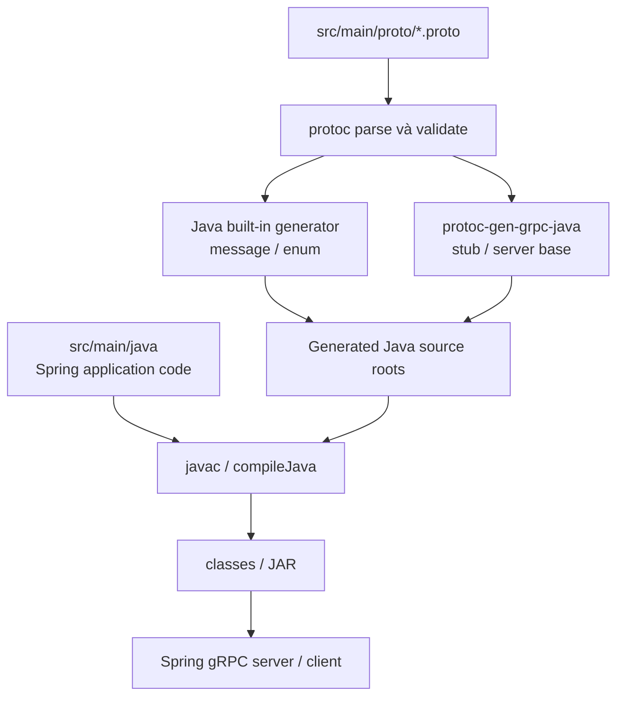

# Generated source trong Gradle hoặc Maven cho Spring gRPC

Trong hệ sinh thái **SPRING_GRPC**, hợp đồng Protocol Buffers (`.proto`) xác định dữ liệu và phương thức RPC; **generated source** là mã Java được sinh từ hợp đồng đó. Khi cấu hình đúng, Gradle hoặc Maven gọi `protoc` cùng plugin `protoc-gen-grpc-java`, nhận những tệp như `StockRequest.java` và `StockServiceGrpc.java`, rồi đưa chúng vào quá trình biên dịch của dự án. Developer tập trung vào triển khai client/server, quy tắc nghiệp vụ, metadata, deadline, status, interceptor, TLS, kiểm thử và giám sát thay vì viết tay giao thức.

Bài thuộc chương **Code generation**, có mục tiêu cụ thể: **quản lý generated source bằng Gradle hoặc Maven**. Sau khi học, bạn sẽ biết generated code nằm ở đâu, vì sao IDE có thể không thấy, khi nào cần sinh lại, cách dùng trong dự án nhiều module và cách xác nhận pipeline build hoạt động đúng.

## 1. Generated source khác gì mã nguồn viết tay?

| Loại tệp | Ví dụ | Nguồn tạo ra | Cách thay đổi |
| --- | --- | --- | --- |
| Hợp đồng gốc | `src/main/proto/stock/v1/stock.proto` | Nhóm phát triển API | Chỉnh và review tệp `.proto` |
| Java message | `StockRequest.java`, `StockReply.java` | `protoc --java_out` | Sinh lại từ hợp đồng |
| Java gRPC service API | `StockServiceGrpc.java` | `protoc-gen-grpc-java` qua `--grpc-java_out` | Sinh lại từ hợp đồng |
| Java nghiệp vụ | `StockServiceImpl.java`, client adapter | Lập trình viên | Sửa trực tiếp |
| Bytecode | `StockRequest.class`, `StockServiceImpl.class` | `javac` | Biên dịch lại |

Không sửa trực tiếp `*Grpc.java` hoặc message class trong `build/generated`, `target/generated-sources`. Chúng có thể bị ghi đè ở lần build tiếp theo. Nếu bạn cần thêm một field hoặc RPC, sửa `.proto`; nếu cần đổi cách xử lý, sửa mã ứng dụng.



**Sinh mã và biên dịch là hai bước khác nhau.** `protoc` tạo tệp `.java`; Java compiler tạo tệp `.class`. Gradle hoặc Maven phải đảm bảo thứ tự này, đồng thời thêm đúng generated directories vào các nguồn được biên dịch.

## 2. Hợp đồng mẫu để đối chiếu Gradle và Maven

Ta sử dụng một dịch vụ tồn kho có **unary RPC** và **server-streaming RPC**. Tạo `src/main/proto/stock/v1/stock.proto`:

```proto
syntax = "proto3";

package learning.stock.v1;

option java_package = "vn.example.springgrpc.stock.v1";
option java_multiple_files = true;
option java_outer_classname = "StockProto";

message StockRequest {
  string sku = 1;
}

message StockReply {
  string sku = 1;
  int64 available = 2;
  int64 version = 3;
}

service StockService {
  rpc GetStock(StockRequest) returns (StockReply);
  rpc WatchStock(StockRequest) returns (stream StockReply);
}
```

Những khai báo cần nhớ:

- `package` là **protobuf namespace**; tên gRPC đầy đủ của service là `learning.stock.v1.StockService`. Đổi tên package/service/method có thể làm thay đổi RPC path.
- `java_package` là **Java package**; nó quyết định vị trí class được sinh: `vn.example.springgrpc.stock.v1`.
- `java_multiple_files = true` tạo các message Java top-level riêng, ví dụ `StockRequest` và `StockReply`.
- `GetStock` nhận một request và trả một response; `WatchStock` trả nhiều response từ một request. Cả hai dùng các message class Java như nhau.

Nếu chỉ chạy Java generator, bạn sẽ có message class nhưng chưa có `StockServiceGrpc`. Nếu chỉ chạy gRPC plugin, API service được tạo vẫn cần message class để biên dịch.

## 3. Cấu hình generated source với Gradle

Ví dụ sử dụng **Gradle Groovy DSL** trong `build.gradle`. Các phiên bản dưới đây chỉ mang tính **minh họa**, cần được căn chỉnh với dependency management của Spring Boot và Spring gRPC trong dự án thực tế.

```groovy
plugins {
    id 'java'
    id 'com.google.protobuf' version '0.9.5'
}

def protobufVersion = '4.30.2'
def grpcVersion = '1.71.0'

dependencies {
    implementation "com.google.protobuf:protobuf-java:$protobufVersion"

    implementation platform("io.grpc:grpc-bom:$grpcVersion")
    implementation 'io.grpc:grpc-protobuf'
    implementation 'io.grpc:grpc-stub'

    // Một số phiên bản generator sử dụng @javax.annotation.Generated.
    compileOnly 'javax.annotation:javax.annotation-api:1.3.2'
}

protobuf {
    protoc {
        artifact = "com.google.protobuf:protoc:$protobufVersion"
    }
    plugins {
        grpc {
            artifact = "io.grpc:protoc-gen-grpc-java:$grpcVersion"
        }
    }
    generateProtoTasks {
        all().configureEach { task ->
            task.plugins {
                grpc {}
            }
        }
    }
}
```

Cơ chế hoạt động gồm ba phần:

1. Plugin `com.google.protobuf` tích hợp schema vào **Java source sets** và tạo các proto generation tasks.
2. `protoc.artifact` chọn trình biên dịch protoc. `plugins.grpc.artifact` chọn plugin gRPC Java được chạy cùng protoc.
3. `generateProtoTasks` yêu cầu các task dùng plugin `grpc`; nhờ đó sinh thêm `StockServiceGrpc.java` bên cạnh các message class do Java generator mặc định tạo.

Dependencies `protobuf-java`, `grpc-protobuf` và `grpc-stub` cần cho mã sinh được biên dịch và gọi API grpc-java. Một ứng dụng gRPC chạy thực tế còn cần transport và starter/cấu hình Spring tương ứng; không coi cấu hình codegen ở trên là toàn bộ ứng dụng.

### 3.1. Task generation và compilation

Với main source set thông thường, Gradle tạo task `generateProto`. Chạy:

```bash
./gradlew generateProto
./gradlew compileJava

# Trên Windows PowerShell:
# .\gradlew.bat generateProto
# .\gradlew.bat compileJava
```

Plugin thông thường nối task generation vào Java compilation; khi chạy `compileJava`, Gradle sẽ bảo đảm generated sources được tạo trước. Trong CI, có thể kiểm tra một lần từ đầu:

```bash
./gradlew clean compileJava
```

`clean` xóa output cũ và giúp chứng minh project có thể tái sinh mã. Không cần `clean` mỗi lần phát triển vì Gradle có up-to-date checks và cơ chế incremental build tùy plugin, inputs/outputs.

### 3.2. Vị trí generated sources

Output mặc định thường gặp:

```text
build/
└── generated/
    └── source/
        └── proto/
            └── main/
                ├── java/
                │   └── vn/example/springgrpc/stock/v1/
                │       ├── StockProto.java
                │       ├── StockRequest.java
                │       ├── StockRequestOrBuilder.java
                │       ├── StockReply.java
                │       └── StockReplyOrBuilder.java
                └── grpc/
                    └── vn/example/springgrpc/stock/v1/
                        └── StockServiceGrpc.java
```

Tên output path có thể thay đổi nếu source set, plugin version hoặc cấu hình build khác. Không nên hardcode đường dẫn mặc định trong script khác nếu có thể lấy output từ task Gradle.

**Không thêm các thư mục đó vào `sourceSets.main.java.srcDirs` một lần nữa nếu protobuf plugin đã đăng ký.** Việc đăng ký thủ công lặp lại có thể dẫn đến nguồn trùng và các lỗi build graph, đặc biệt với custom source sets.

### 3.3. Proto của test source set

Nếu dự án có `src/test/proto`, Gradle có thể tạo `generateTestProto` và các output kiểu:

```text
build/generated/source/proto/test/java/
build/generated/source/proto/test/grpc/
```

Block `all().configureEach` áp dụng plugin gRPC cho các source sets có proto task. Nếu chỉ muốn áp dụng gRPC plugin cho main, **thay thế** block `generateProtoTasks` ở trên bằng:

```groovy
protobuf {
    generateProtoTasks {
        ofSourceSet('main').configureEach { task ->
            task.plugins {
                grpc {}
            }
        }
    }
}
```

Không đặt cả hai block với ý định “cộng thêm một lần generation”. Test proto chỉ phục vụ test không nên bị đóng gói như API production, và cần tránh sinh duplicate classes của main contract tại test source roots.

## 4. Cấu hình generated source với Maven

Trong Maven, một lựa chọn phổ biến là plugin `org.xolstice.maven.plugins:protobuf-maven-plugin`. Maven sử dụng **lifecycle phases** và **plugin goals** thay vì task graph kiểu Gradle.

Ví dụ `pom.xml` sau tập trung vào generation; bạn cần phối hợp với parent/BOM Spring Boot nếu ứng dụng thực tế sử dụng chúng:

```xml
<project xmlns="http://maven.apache.org/POM/4.0.0"
         xmlns:xsi="http://www.w3.org/2001/XMLSchema-instance"
         xsi:schemaLocation="http://maven.apache.org/POM/4.0.0
         https://maven.apache.org/xsd/maven-4.0.0.xsd">
    <modelVersion>4.0.0</modelVersion>
    <groupId>vn.example</groupId>
    <artifactId>stock-contract</artifactId>
    <version>1.0.0</version>

    <properties>
        <maven.compiler.release>17</maven.compiler.release>
        <project.build.sourceEncoding>UTF-8</project.build.sourceEncoding>
        <protobuf.version>4.30.2</protobuf.version>
        <grpc.version>1.71.0</grpc.version>
    </properties>

    <dependencyManagement>
        <dependencies>
            <dependency>
                <groupId>io.grpc</groupId>
                <artifactId>grpc-bom</artifactId>
                <version>${grpc.version}</version>
                <type>pom</type>
                <scope>import</scope>
            </dependency>
        </dependencies>
    </dependencyManagement>

    <dependencies>
        <dependency>
            <groupId>com.google.protobuf</groupId>
            <artifactId>protobuf-java</artifactId>
            <version>${protobuf.version}</version>
        </dependency>
        <dependency>
            <groupId>io.grpc</groupId>
            <artifactId>grpc-protobuf</artifactId>
        </dependency>
        <dependency>
            <groupId>io.grpc</groupId>
            <artifactId>grpc-stub</artifactId>
        </dependency>
        <dependency>
            <groupId>javax.annotation</groupId>
            <artifactId>javax.annotation-api</artifactId>
            <version>1.3.2</version>
            <scope>provided</scope>
        </dependency>
    </dependencies>

    <build>
        <extensions>
            <extension>
                <groupId>kr.motd.maven</groupId>
                <artifactId>os-maven-plugin</artifactId>
                <version>1.7.1</version>
            </extension>
        </extensions>
        <plugins>
            <plugin>
                <groupId>org.xolstice.maven.plugins</groupId>
                <artifactId>protobuf-maven-plugin</artifactId>
                <version>0.6.1</version>
                <configuration>
                    <protocArtifact>
                        com.google.protobuf:protoc:${protobuf.version}:exe:${os.detected.classifier}
                    </protocArtifact>
                    <pluginId>grpc-java</pluginId>
                    <pluginArtifact>
                        io.grpc:protoc-gen-grpc-java:${grpc.version}:exe:${os.detected.classifier}
                    </pluginArtifact>
                </configuration>
                <executions>
                    <execution>
                        <phase>generate-sources</phase>
                        <goals>
                            <goal>compile</goal>
                            <goal>compile-custom</goal>
                        </goals>
                    </execution>
                </executions>
            </plugin>
        </plugins>
    </build>
</project>
```

**Hai goals khác nhau:**

| Goal của protobuf Maven plugin | Kết quả |
| --- | --- |
| `protobuf:compile` | Dùng Java built-in generator của protoc để sinh message, enum, builder |
| `protobuf:compile-custom` | Dùng plugin `grpc-java` để sinh `*Grpc.java`, stub và server base |

Tên **goal `compile` của protobuf plugin** khác với **phase `compile` của Maven**. Trong cấu hình trên, hai goals chạy ở phase `generate-sources`, trước khi Java compiler xử lý mã.

### 4.1. Chạy Maven lifecycle

```bash
mvn generate-sources
mvn compile
mvn test
```

`mvn compile` và `mvn test` đi qua các phases trước đó, trong đó có `generate-sources`; vì vậy nếu plugin đã bind đúng, chúng tự chạy codegen. `mvn generate-sources` riêng chỉ hữu ích khi muốn kiểm tra kết quả generation.

Extension `os-maven-plugin` cung cấp `${os.detected.classifier}` để Maven chọn executable protoc và plugin phù hợp môi trường. Thiếu classifier hay tải sai binary có thể gây lỗi plugin không tìm thấy hoặc không chạy được.

### 4.2. Nơi Maven lưu generated sources

Với `protobuf-maven-plugin` trong ví dụ, các thư mục thường là:

```text
target/
├── generated-sources/
│   └── protobuf/
│       ├── java/
│       │   └── vn/example/springgrpc/stock/v1/
│       │       ├── StockRequest.java
│       │       ├── StockReply.java
│       │       └── ...
│       └── grpc-java/
│           └── vn/example/springgrpc/stock/v1/
│               └── StockServiceGrpc.java
└── classes/
    └── vn/example/springgrpc/stock/v1/
        ├── StockRequest.class
        ├── StockReply.class
        └── StockServiceGrpc.class
```

Plugin thường tự thêm các generated source roots vào Maven project. Do đó **không cần** copy generated code về `src/main/java`, cũng không nên thêm `build-helper-maven-plugin` chỉ để đăng ký lặp lại những roots mà protobuf plugin đã đăng ký.

### 4.3. Generation cho test sources

Với `src/test/proto`, thêm một execution khác **bên trong cùng `<executions>`**:

```xml
<execution>
    <id>generate-test-protobuf</id>
    <phase>generate-test-sources</phase>
    <goals>
        <goal>test-compile</goal>
        <goal>test-compile-custom</goal>
    </goals>
</execution>
```

Các output tương ứng thường ở `target/generated-test-sources/protobuf/java` và `target/generated-test-sources/protobuf/grpc-java`. Chỉ sinh test service nếu test thực sự cần; tránh duplicate class giữa test/main và tránh vô tình đóng gói test API thành JAR production.

## 5. So sánh Gradle và Maven

| Mục cần đối chiếu | Gradle | Maven |
| --- | --- | --- |
| Build file | `build.gradle` hoặc `build.gradle.kts` | `pom.xml` |
| Plugin minh họa | `com.google.protobuf` | `protobuf-maven-plugin` |
| Hợp đồng đầu vào | `src/main/proto` | `src/main/proto` |
| Bước sinh message | `generateProto` với Java generator | Goal `compile` của protobuf plugin |
| Bước sinh gRPC stub | Plugin `grpc` trong proto task | Goal `compile-custom` |
| Thư mục message | `build/generated/source/proto/main/java` | `target/generated-sources/protobuf/java` |
| Thư mục gRPC | `build/generated/source/proto/main/grpc` | `target/generated-sources/protobuf/grpc-java` |
| Java compiler nhận nguồn | Plugin đăng ký source set và task dependency | Plugin đăng ký compile roots và goals theo phase |
| Lệnh compile từ đầu | `./gradlew clean compileJava` | `mvn clean compile` |

Đường dẫn phụ thuộc plugin/configuration; hãy kiểm tra output thực tế nếu dùng source set riêng, plugin khác hoặc build tùy chỉnh.

Dù khác cú pháp, **yêu cầu kiến trúc giống nhau**: một nguồn `.proto` rõ ràng, hai nhóm generated source đúng phiên bản, Java compiler nhận cả hai và có thể build từ môi trường sạch.

## 6. IDE có nhận generated source không?

Một tình huống phổ biến: `./gradlew compileJava` hoặc `mvn compile` thành công nhưng IntelliJ IDEA/Eclipse vẫn báo đỏ ở `StockServiceGrpc`.

Hãy kiểm tra lần lượt:

1. IDE đã import project **dưới dạng Gradle hoặc Maven project** chưa, hay chỉ mở thư mục Java đơn lẻ?
2. Đã chạy generation ít nhất một lần để generated directories thực sự tồn tại chưa?
3. Đã **reload/sync build project** để IDE cập nhật source roots chưa?
4. Output `java` và `grpc` có cùng nằm trong đúng **main module/source set** không?
5. Có cấu hình source root thủ công trùng với plugin khiến IDE dùng dữ liệu cũ không?

Với Gradle, reload Gradle project; với Maven, reload Maven project rồi quan sát compile source roots. Không commit generated Java vào Git chỉ để IDE ngừng báo đỏ. Nếu command-line build và IDE khác nhau, cần giải quyết project model và generated source configuration.

| Quan sát | Hướng điều tra |
| --- | --- |
| CLI compile PASS, IDE báo đỏ | IDE chưa sync source root hoặc chưa thấy generated folder |
| IDE thấy `StockRequest` nhưng thiếu `StockServiceGrpc` | Chưa sinh gRPC stub hoặc `grpc` source root chưa được nhận |
| Chạy `clean` rồi IDE báo đỏ | Output bị xóa, cần generation lại và sync IDE |
| IDE đề xuất sửa code trong `build/generated` | Nguồn sinh không phải nơi sửa; quay lại `.proto` hoặc mã ứng dụng |

## 7. Có nên commit generated source?

Trong dự án Spring gRPC có build tool ổn định, thông thường bạn **commit schema và build configuration**, còn `build/` và `target/` là outputs có thể tái sinh:

```gitignore
.gradle/
build/
target/
```

Lợi ích: giảm diff generated code dài, hạn chế merge conflict, không để schema mới đi kèm generated Java cũ, và buộc CI chứng minh build tái lập được.

Ngoại lệ có chủ đích: nếu tổ chức cung cấp **Java SDK hoặc contract JAR** cho ứng dụng không chạy protoc, có thể publish generated artifacts qua quy trình version/release. Việc phân phối **JAR chứa generated classes** khác với việc commit ngẫu nhiên các output build vào source repository.

**Một nguồn sự thật:** nội dung `.proto` quyết định API wire. Generated Java chỉ là sản phẩm của một bộ công cụ tại một phiên bản nhất định.

## 8. Mô hình nhiều module: contract module riêng

Với cả client và server Java, có thể tạo module **stock-contract** chứa `.proto` và codegen:

```text
workspace/
├── stock-contract/
│   ├── src/main/proto/stock/v1/stock.proto
│   └── build.gradle  (hoặc pom.xml)
├── stock-server/
│   └── src/main/java/.../StockServiceImpl.java
└── stock-client/
    └── src/main/java/.../StockGateway.java
```

Contract module sinh và đóng gói message + `StockServiceGrpc` thành JAR. Client và server phụ thuộc artifact đó.

Trong Gradle multi-project:

```groovy
dependencies {
    implementation project(':stock-contract')
}
```

Trong Maven, sau khi artifact đã được build/publish:

```xml
<dependency>
    <groupId>vn.example</groupId>
    <artifactId>stock-contract</artifactId>
    <version>1.0.0</version>
</dependency>
```

Cấu trúc này giúp các ứng dụng Java dùng cùng một phiên bản schema/gencode. Tránh vừa phụ thuộc contract JAR **vừa sinh lại cùng fully qualified Java classes** trong module client/server: hai bản `StockRequest` hoặc `StockServiceGrpc` trùng tên trên classpath có thể gây lỗi khó dự đoán.

Với hệ đa ngôn ngữ, contract `.proto` vẫn là nguồn độc lập ngôn ngữ. Java contract JAR không thể thay thế bước codegen cho client Go, Python hay các ngôn ngữ khác.

## 9. Quản lý phiên bản protoc và dependency

Một codegen pipeline có thể sinh mã thành công nhưng **compile/runtime fail** khi phiên bản không phù hợp:

| Thành phần | Vai trò |
| --- | --- |
| `protoc` | Đọc schema và sinh Java message theo API tương ứng |
| `protobuf-java` | Runtime message: builder, parser, serialization |
| `protoc-gen-grpc-java` | Sinh service API, client stubs và server base |
| `grpc-protobuf`, `grpc-stub`, `grpc-api` | Runtime API được `*Grpc.java` sử dụng |
| gRPC transport | HTTP/2, TLS, channel/server thực thi RPC |
| Spring gRPC starter/BOM | Quản lý integration, bean/lifecycle và dependencies |
| Build plugin | Gắn codegen vào đúng task, source set hoặc Maven phase |

Khi nâng cấp codegen, cần kiểm tra **cả generated code và runtime dependency graph**. Ví dụ plugin gRPC Java tạo code tham chiếu API chưa có ở `grpc-stub` cũ có thể gây `NoSuchMethodError` hoặc compilation error.

Kiểm tra Gradle dependencies:

```bash
./gradlew dependencies --configuration runtimeClasspath
./gradlew dependencyInsight --configuration runtimeClasspath --dependency grpc-stub
```

Kiểm tra Maven dependencies:

```bash
mvn dependency:tree
```

Tổ chức nên chốt phiên bản bằng BOM/version catalog/properties; các version trong ví dụ chỉ phục vụ minh họa build syntax. Khi Spring Boot/Spring gRPC starter đã quản lý dependencies, tránh áp đặt phiên bản khác thiếu kiểm thử.

## 10. Build cache, incremental và CI

Không phải mọi lần biên dịch đều phải chạy lại toàn bộ protoc nếu đầu vào không đổi. Tuy nhiên, **không mặc định mọi plugin codegen đều có incremental/cache behavior giống nhau**.

Đầu vào liên quan có thể gồm:

- Tệp `.proto` chính và những tệp được import.
- Phiên bản binary `protoc` và `protoc-gen-grpc-java`.
- Các cờ codegen, `java_package`, `java_multiple_files` và output paths.
- Proto dependencies, source sets, JDK/build environment tùy plugin.

Với Gradle:

```bash
./gradlew generateProto --info
```

Quan sát vì sao task `UP-TO-DATE` hoặc phải chạy lại. Không tắt task generation thủ công để che vấn đề build chậm.

Với Maven:

```bash
mvn clean compile
```

Lệnh này hữu ích khi nghi ngờ output cũ, còn build phát triển thường xuyên có thể dùng `mvn compile`. Cần đảm bảo Maven lifecycle đã liên kết cả goals sinh message và stub.

Một CI pipeline tối thiểu:

1. Checkout repository chứa `.proto` và versioned build configuration.
2. Phân giải dependencies cùng executable đúng nền tảng.
3. Chạy generation và Java compilation trên workspace sạch.
4. Chạy test kiểm tra message serialization, generated API và một gRPC call thật.
5. Kiểm tra breaking changes khi có nhiều client/server phát hành độc lập.
6. Đóng gói/publish contract JAR hoặc ứng dụng sau khi các checks đạt yêu cầu.

Các lệnh ví dụ:

```bash
# Gradle
./gradlew clean build

# Maven
mvn clean verify
```

Các lệnh này yêu cầu project đã có các plugins/test goals phù hợp; chúng **không tự tạo kiểm thử** nếu dự án chưa viết test.

## 11. Dùng generated classes trong Spring gRPC

Sau generation và compile, server có thể kế thừa `StockServiceGrpc.StockServiceImplBase`. Đây là một Spring bean minh họa unary:

```java
package vn.example.springgrpc.stock;

import io.grpc.Status;
import io.grpc.stub.StreamObserver;
import org.springframework.stereotype.Service;
import vn.example.springgrpc.stock.v1.StockReply;
import vn.example.springgrpc.stock.v1.StockRequest;
import vn.example.springgrpc.stock.v1.StockServiceGrpc;

@Service
public class StockServiceImpl
        extends StockServiceGrpc.StockServiceImplBase {

    @Override
    public void getStock(
            StockRequest request,
            StreamObserver<StockReply> responses) {

        if (request.getSku().isBlank()) {
            responses.onError(Status.INVALID_ARGUMENT
                    .withDescription("sku không được rỗng")
                    .asRuntimeException());
            return;
        }

        StockReply reply = StockReply.newBuilder()
                .setSku(request.getSku())
                .setAvailable(8)
                .setVersion(1)
                .build();

        responses.onNext(reply);
        responses.onCompleted();
    }
}
```

Mã `StockServiceGrpc` và `StockReply` được sinh, nhưng `StockServiceImpl` **do developer viết**. Với các phiên bản Spring gRPC tự đăng ký bean `BindableService`, lớp này có thể được gắn vào server. Nếu dùng starter khác, hãy kiểm tra cơ chế annotation/bind service thực tế.

Client gọi unary qua stub:

```java
import io.grpc.ManagedChannel;
import io.grpc.ManagedChannelBuilder;
import java.util.concurrent.TimeUnit;
import vn.example.springgrpc.stock.v1.StockReply;
import vn.example.springgrpc.stock.v1.StockRequest;
import vn.example.springgrpc.stock.v1.StockServiceGrpc;

ManagedChannel channel = ManagedChannelBuilder
        .forAddress("localhost", 9090)
        .usePlaintext() // Chỉ ví dụ local; production cần TLS.
        .build();

try {
    StockReply reply = StockServiceGrpc
            .newBlockingStub(channel)
            .withDeadlineAfter(2, TimeUnit.SECONDS)
            .getStock(StockRequest.newBuilder()
                    .setSku("BOOK-101")
                    .build());

    System.out.println(reply.getAvailable());
} finally {
    channel.shutdown();
}
```

Codegen cung cấp **kiểu dữ liệu và API**, nhưng không tự sinh các quyết định runtime:

| Vấn đề | Nơi thực hiện |
| --- | --- |
| Metadata, token, correlation ID | Interceptor, call credentials, context |
| Deadline và cancellation | Call options và xử lý trạng thái gRPC |
| Status `INVALID_ARGUMENT`, `UNAVAILABLE` | Server logic hoặc transport; client xử lý exception/callback |
| TLS, mTLS | Channel và server transport |
| Metrics, tracing, logging | Instrumentation/interceptors và hệ quan sát |
| Server streaming `WatchStock` | Server phát nhiều `StockReply`, client dùng iterator hoặc async observer |
| Flow control và hủy stream | grpc-java runtime + quản lý tài nguyên của ứng dụng |

Trong ứng dụng Spring, channel và stub thường được starter quản lý qua dependency injection. Không tạo/đóng channel cho từng request sản xuất chỉ vì generated stub cần một `Channel`.

## 12. Xác định lỗi ở đúng bước

```text
.proto syntax/import
        ↓
protoc
        ↓
plugin protoc-gen-grpc-java
        ↓
generated source roots
        ↓
Java compiler / dependencies
        ↓
Spring service registration
        ↓
channel / TLS / metadata / deadline
        ↓
RPC status và xử lý nghiệp vụ
```

| Dấu hiệu | Nguyên nhân cần kiểm tra | Hướng xử lý |
| --- | --- | --- |
| `Import "..." was not found` | Sai proto import root/dependency | Kiểm tra `src/main/proto`, include path, schema phụ thuộc |
| `protoc-gen-grpc-java: program not found` | Plugin binary/classifier sai | Kiểm tra Gradle `plugins.grpc` hoặc Maven `pluginArtifact` |
| Có `StockRequest.java` nhưng thiếu `StockServiceGrpc.java` | Chưa chạy gRPC plugin | Gradle `grpc {}`; Maven `compile-custom` |
| Có `StockServiceGrpc.java` nhưng compiler không nhận | Generated root không được thêm vào source set/compile roots | Kiểm tra plugin integration và main/test source sets |
| IDE báo đỏ dù CLI compile PASS | IDE chưa đồng bộ project model | Reload Gradle/Maven và generated roots |
| `javax.annotation.Generated` không tìm thấy | Một số gencode cần annotation dependency | Thêm annotation API phù hợp hoặc nâng cấp generator |
| `method does not override` | Chữ ký server implementation không đúng generated API | Đối chiếu `ImplBase`, package và types |
| `NoSuchMethodError` hoặc `NoClassDefFoundError` | Protobuf/grpc-java version lệch | Kiểm tra BOM, dependency tree, các JAR trùng |
| `UNIMPLEMENTED` | Service chưa đăng ký, method chưa override hoặc RPC name sai | Kiểm tra Spring bean và fully qualified service/method |
| `UNAVAILABLE` | Sai endpoint/transport/TLS | Kiểm tra channel target, port, certificate, readiness |
| `DEADLINE_EXCEEDED` | RPC vượt thời hạn | Kiểm tra latency, downstream, deadline |
| Output vẫn là schema cũ | Build dùng sai proto source/output cũ | Kiểm tra task inputs, source set, chạy clean build |

Nguyên tắc: **compile PASS không bảo đảm server đã đăng ký service, client kết nối được hoặc schema tương thích giữa các phiên bản đang deploy**. Chẩn đoán theo giai đoạn để không phải sửa generated Java hoặc thay đổi field number một cách tùy tiện.

## 13. Kiểm thử code generation và RPC

Để chứng minh pipeline hoạt động, cần kiểm tra cả sinh mã lẫn một lời gọi gRPC:

1. Chạy generation từ môi trường sạch; xác nhận có `StockRequest.java`, `StockReply.java` và `StockServiceGrpc.java`.
2. Chạy Java compilation và kiểm tra không thiếu class/dependency.
3. Dùng generated client stub gọi server implementation và xác nhận kết quả.
4. Thử request không hợp lệ để kiểm tra status `INVALID_ARGUMENT`.
5. Với `WatchStock`, kiểm thử server-streaming, deadline, cancellation và terminal callbacks.
6. Khi cần xác minh Spring Boot, kiểm tra bean registration, channel configuration, interceptor, TLS và metrics bằng integration test phù hợp.

Có thể dùng **in-process server/channel** cho test grpc-java đơn giản (cần test dependency `grpc-inprocess` cùng phiên bản runtime):

```java
// Trong một phương thức test throws Exception;
// StockServiceImpl từ ví dụ trên có thể được tạo trực tiếp.
String name =
        io.grpc.inprocess.InProcessServerBuilder.generateName();

io.grpc.Server server =
        io.grpc.inprocess.InProcessServerBuilder.forName(name)
                .directExecutor()
                .addService(new StockServiceImpl())
                .build()
                .start();

io.grpc.ManagedChannel channel =
        io.grpc.inprocess.InProcessChannelBuilder.forName(name)
                .directExecutor()
                .build();

try {
    StockReply reply = StockServiceGrpc
            .newBlockingStub(channel)
            .getStock(StockRequest.newBuilder()
                    .setSku("BOOK-101")
                    .build());

    if (reply.getAvailable() != 8) {
        throw new AssertionError("Wrong stock");
    }
} finally {
    channel.shutdownNow();
    server.shutdownNow();
}
```

Bài test trên kiểm chứng **gencode + grpc-java dispatch** nhưng chưa kiểm chứng transport mạng, TLS hay Spring auto-configuration. Test cấp ứng dụng cần bổ sung các yếu tố đó khi chúng là một phần yêu cầu sản phẩm.

## 14. Bài tập thực hành

1. **Gradle:** Sinh mã từ `stock.proto`, tìm chính xác hai thư mục `main/java` và `main/grpc`. Mô tả nhiệm vụ của từng nhóm tệp.
2. **Maven:** Chỉ chạy goal `compile` của protobuf plugin rồi so sánh với trường hợp bật thêm `compile-custom`.
3. **Build lifecycle:** Xóa build output trong bản sao dự án thực hành và chạy `compileJava` hoặc `mvn compile`. Giải thích vì sao generation có thể chạy tự động trước Java compiler.
4. **IDE:** Import một project Gradle/Maven trước và sau generation; xác minh source roots đã được IDE nhận đúng.
5. **Test source set:** Tạo `src/test/proto/mock.proto` và cho build sinh mock service; xác nhận nó không đi vào production JAR.
6. **Đa module:** Chuyển hợp đồng sang `stock-contract`, để server/client phụ thuộc contract JAR. Loại bỏ mã sinh trùng class trên classpath.
7. **Phiên bản:** Tìm dependency grpc-java bị kéo về sai version bằng `dependencyInsight` hoặc `dependency:tree`; điều chỉnh BOM/properties.
8. **Lỗi plugin:** Bỏ `grpc {}` trong Gradle hoặc `compile-custom` trong Maven, clean build và giải thích tại sao thiếu `*Grpc.java`.
9. **Runtime:** Viết in-process test cho `GetStock`, kiểm tra success và `INVALID_ARGUMENT`, rồi mở rộng sang server-streaming `WatchStock`.
10. **CI:** Thiết kế pipeline gồm generation, compile, contract compatibility checks và integration tests; phân biệt lỗi schema, build và runtime.

### Ghi nhớ

**Generated source là sản phẩm của build, được tạo từ hợp đồng `.proto` và cần được biên dịch như mã Java khác.** Gradle dùng `com.google.protobuf` để tích hợp `generateProto`, gRPC plugin và Java source sets; Maven dùng các goals `compile`/`compile-custom` tại phase `generate-sources` và đưa output vào compile roots. Với Spring gRPC, hãy quản lý generated sources bằng build reproducible, kiểm tra đúng package/source set, căn chỉnh versions và xác nhận client/server giao tiếp được bằng integration test. Khi schema thay đổi, **chỉnh hợp đồng và sinh lại**, không sửa trực tiếp Java gencode.
