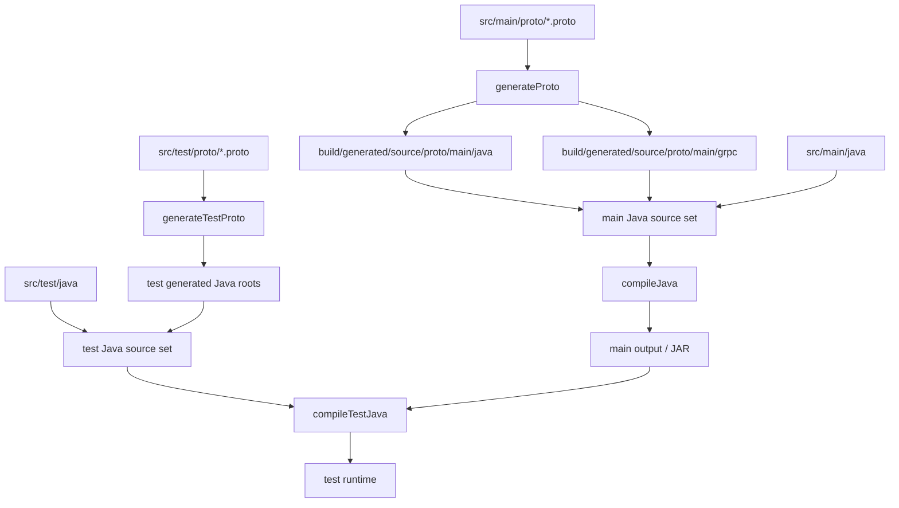

# Source set cho mã sinh trong Gradle

Trong dự án **Spring gRPC**, các lớp Java từ Protocol Buffers được tạo tự động từ tệp `.proto`. Gradle cần biết **những lớp được sinh thuộc source set nào** để biên dịch chúng cùng mã ứng dụng và giữ đúng phạm vi sử dụng. Đây là vai trò của **source set cho mã sinh**.

Một source set là tập hợp nguồn và tài nguyên cho một mục đích build, thường gồm `main`, `test` hoặc source set tùy chỉnh như `integrationTest`. Với protobuf Gradle plugin, mỗi source set có thể có proto sources, generated Java sources và các tác vụ biên dịch tương ứng.

Bài này tập trung vào cách tổ chức source sets và generated sources trong Gradle: nơi đặt schema, cách gắn output với `main`/`test`, cách tạo source set kiểm thử tích hợp và cách xác nhận task graph. Phần sinh message/stub, cấu hình Gradle tổng quát và Maven lifecycle đã có nội dung riêng trong chương Code generation.

## 1. Source set và generated source liên hệ thế nào?

Trong Gradle Java plugin, source set mô tả một nhóm mã Java có cùng mục đích biên dịch. Hai source set mặc định quan trọng:

| Source set | Nguồn Java mặc định | Mục đích |
| --- | --- | --- |
| `main` | `src/main/java` | Mã được đóng gói vào ứng dụng/thư viện |
| `test` | `src/test/java` | Mã kiểm thử, không đưa vào artifact production |

Protobuf Gradle plugin mở rộng source set để nhận proto files. Với một source set, plugin chạy Java generator và các generator được cấu hình, rồi đăng ký output như generated Java sources của source set tương ứng.



Điểm cần nhớ: **generated source được gắn với source set**, không phải một nguồn Java dùng chung không phân biệt main/test. Mã sinh từ `src/main/proto` phục vụ ứng dụng; mã sinh từ `src/test/proto` phục vụ kiểm thử.

## 2. Main source set: generated code của ứng dụng

Với protobuf Gradle plugin, thư mục proto mặc định cho main là:

```text
src/main/proto/
```

Không cần khai báo lại nếu dự án dùng cấu trúc mặc định. Khi cần thêm schema ở vị trí khác, có thể thêm proto source directory cho main:

```groovy
sourceSets {
    main {
        proto {
            srcDir 'src/shared-proto'
        }
    }
}
```

Cấu hình này bổ sung `src/shared-proto` vào proto source set của `main`; nó không thay thế thư mục mặc định `src/main/proto`. Chỉ thêm thư mục dùng chung khi dự án thực sự có schema nằm ở đó.

Với Java generator và plugin gRPC tên `grpc`, output phổ biến là:

```text
build/generated/source/proto/main/
├── java/       # Message, enum, builder, descriptor
└── grpc/       # *Grpc, stub, server base
```

Plugin protobuf tự đăng ký các thư mục generated tương ứng với Java source set. Do đó, mã trong `src/main/java` có thể import trực tiếp:

```java
import vn.example.springgrpc.stock.v1.StockReply;
import vn.example.springgrpc.stock.v1.StockRequest;
import vn.example.springgrpc.stock.v1.StockServiceGrpc;
```

và Java compiler sẽ biên dịch các lớp generated cùng mã ứng dụng khi chạy `compileJava`. Nếu plugin đã đăng ký source roots, không thêm lại các thư mục `build/generated` vào `sourceSets.main.java.srcDirs` theo thói quen; khai báo trùng thường làm cấu hình khó hiểu và có thể gây duplicate source.

### Ví dụ lớp ứng dụng sử dụng generated code

```java
package vn.example.springgrpc.stock;

import io.grpc.stub.StreamObserver;
import org.springframework.stereotype.Service;
import vn.example.springgrpc.stock.v1.StockReply;
import vn.example.springgrpc.stock.v1.StockRequest;
import vn.example.springgrpc.stock.v1.StockServiceGrpc;

@Service
public class StockServiceImpl
        extends StockServiceGrpc.StockServiceImplBase {

    @Override
    public void getStock(
            StockRequest request,
            StreamObserver<StockReply> observer) {

        StockReply reply = StockReply.newBuilder()
                .setSku(request.getSku())
                .setAvailable(12)
                .setVersion(1)
                .build();

        observer.onNext(reply);
        observer.onCompleted();
    }
}
```

`StockRequest`, `StockReply` và `StockServiceGrpc` thuộc generated source của main; `StockServiceImpl` là mã ứng dụng trong `src/main/java`. Lớp service chỉ biên dịch được khi generated roots đã được tạo và đưa vào main source set.

## 3. Test source set: generated code chỉ dùng trong kiểm thử

Gradle Java plugin có source set `test`. Proto dành riêng cho kiểm thử nên đặt tại:

```text
src/test/proto/
```

Protobuf Gradle plugin có thể tạo generated roots cho test, thường là:

```text
build/generated/source/proto/test/
├── java/
└── grpc/
```

Task generation tương ứng thường có tên `generateTestProto`; Java compilation test là `compileTestJava`. Mã test có thể dùng cả output của main lẫn generated code riêng của test vì test compile classpath thông thường bao gồm main output và test dependencies.

Ví dụ test proto dùng để tạo một service giả lập riêng:

```proto
syntax = "proto3";

package learning.stock.test.v1;

option java_package = "vn.example.springgrpc.stock.test.v1";
option java_multiple_files = true;

message FakeRequest {
  string key = 1;
}

message FakeReply {
  string value = 1;
}

service FakeStockService {
  rpc Find(FakeRequest) returns (FakeReply);
}
```

Nếu plugin gRPC đã được áp dụng cho các proto tasks, Gradle cũng sinh `FakeStockServiceGrpc` trong test generated roots. Test có thể dùng service này để kiểm thử client adapter hoặc tình huống lỗi mà không đưa test service vào production artifact.

### Cấu hình proto roots rõ ràng

Nếu muốn tài liệu hóa rõ vị trí schema, có thể khai báo:

```groovy
sourceSets {
    main {
        proto {
            srcDir 'src/main/proto'
        }
    }
    test {
        proto {
            srcDir 'src/test/proto'
        }
    }
}
```

Đây là cách diễn đạt tường minh; hai đường dẫn trên vốn là convention mặc định của plugin trong cấu hình thông thường. Không cần thêm block này chỉ để lặp lại default.

Nếu chỉ muốn sinh gRPC stub cho main, có thể giới hạn plugin theo source set:

```groovy
protobuf {
    generateProtoTasks {
        ofSourceSet('main').configureEach { task ->
            task.plugins {
                grpc {}
            }
        }
    }
}
```

Khi dùng cấu hình giới hạn này, test proto vẫn có thể sinh message Java bằng built-in generator, nhưng không sinh gRPC stub cho test service. Nếu test cần stub, hãy cấu hình thêm `test` hoặc dùng cấu hình `all().configureEach` theo yêu cầu của dự án.

## 4. Source set tùy chỉnh cho integration test

Một số dự án có nhóm integration test riêng, tách khỏi unit test. Có thể tạo source set `integrationTest` và đặt schema kiểm thử tại `src/integrationTest/proto`.

Ví dụ trong `build.gradle`:

```groovy
sourceSets {
    integrationTest {
        java.srcDir 'src/integrationTest/java'
        proto.srcDir 'src/integrationTest/proto'

        // Cho integration test sử dụng class đã biên dịch từ main.
        compileClasspath += sourceSets.main.output
        runtimeClasspath += output + compileClasspath
    }
}

configurations {
    integrationTestImplementation.extendsFrom testImplementation
    integrationTestRuntimeOnly.extendsFrom testRuntimeOnly
}
```

Khi source set được tạo, Gradle Java plugin cũng tạo các configurations và tasks biên dịch liên quan, ví dụ `compileIntegrationTestJava`. Protobuf Gradle plugin nhận diện proto source set tùy chỉnh và tạo task generation tương ứng, thường là `generateIntegrationTestProto`.

Để sinh gRPC stub cho source set này:

```groovy
protobuf {
    generateProtoTasks {
        ofSourceSet('integrationTest').configureEach { task ->
            task.plugins {
                grpc {}
            }
        }
    }
}
```

Block trên là phần cấu hình bổ sung theo source set. Nếu dự án đã dùng `all().configureEach` để áp dụng plugin gRPC cho mọi proto task, không cần khai báo lặp lại cho integrationTest.

Một cấu trúc có thể dùng:

```text
src/
├── main/
│   ├── java/
│   └── proto/
├── test/
│   ├── java/
│   └── proto/
└── integrationTest/
    ├── java/
    └── proto/

build/generated/source/proto/
├── main/java/
├── main/grpc/
├── test/java/
├── test/grpc/
├── integrationTest/java/
└── integrationTest/grpc/
```

Đường dẫn generated cụ thể phụ thuộc source set name và plugin configuration. Hãy kiểm tra task output của dự án nếu dùng custom source set hoặc thay đổi output directories.

**Lưu ý:** Định nghĩa source set chưa tự tạo một task `Test` hoàn chỉnh có filter, framework và lifecycle mong muốn. Dự án cần đăng ký integration test task (hoặc dùng Gradle JVM Test Suite) riêng. Phần đó nằm ngoài việc đăng ký generated source, nhưng phải được cấu hình nếu muốn chạy integration test bằng `gradlew check`.

## 5. Đảm bảo task generation chạy trước compilation

Generated source chỉ hữu ích khi đã tồn tại trước khi compiler đọc source set. Protobuf Gradle plugin thường đăng ký task dependency cần thiết cho các source sets được quản lý.

Với cấu hình mặc định:

| Lệnh/task | Mục đích |
| --- | --- |
| `generateProto` | Sinh mã cho main proto |
| `generateTestProto` | Sinh mã cho test proto |
| `compileJava` | Biên dịch main Java và generated source của main |
| `compileTestJava` | Biên dịch test Java và generated source của test |
| `check` | Chạy các verification tasks đã được gắn vào lifecycle |

Kiểm tra task graph mà không thực thi build:

```bash
./gradlew compileJava --dry-run
./gradlew compileTestJava --dry-run
```

Có thể quan sát log khi chạy generation:

```bash
./gradlew generateProto --info
./gradlew generateTestProto --info
```

Tên task có thể khác với custom source set hoặc plugin version. Dùng `./gradlew tasks --all` để xem task thực tế thay vì giả định.

Nếu `compileJava` báo thiếu `StockServiceGrpc`, hãy xác minh ba điều: proto task đã chạy chưa, plugin `grpc` đã được áp dụng chưa, và generated grpc directory có thuộc main source set không. Nếu lỗi xuất hiện ở `compileTestJava`, kiểm tra test source set và test dependencies riêng.

## 6. Tránh trộn main, test và integrationTest

Mỗi source set nên có ranh giới rõ ràng:

| Nội dung | Nên đặt ở | Lý do |
| --- | --- | --- |
| Hợp đồng production | `src/main/proto` | Là API của sản phẩm |
| Message/service giả chỉ phục vụ unit test | `src/test/proto` | Không đưa test contract vào production |
| Proto dành riêng cho integration harness | `src/integrationTest/proto` | Giới hạn cho kiểm thử tích hợp |
| Server implementation thật | `src/main/java` | Mã chạy trong ứng dụng |
| Unit test | `src/test/java` | Test logic và adapter |
| Integration test | `src/integrationTest/java` | Test wiring, channel, transport hoặc service thật |

Không đặt test-only schema vào `src/main/proto` chỉ vì muốn dễ import. Khi đó plugin sẽ sinh mã vào main source set và các class/service test có thể đi vào JAR production.

Ngược lại, nếu client production cần một message hoặc service, đừng đặt hợp đồng đó trong `src/test/proto`; main source set sẽ không có class để compile.

### Chia sẻ contract giữa main và test

Test thường cần dùng generated types từ main. Không cần sao chép proto production sang test. Java test source set đã nhìn thấy output của main theo mô hình Java plugin. Chỉ tạo test proto riêng khi cần một contract giả, ví dụ service mô phỏng lỗi hoặc schema chỉ dùng trong test.

## 7. IDE và generated source roots

IntelliJ IDEA hoặc Eclipse có thể báo đỏ generated class dù Gradle command-line build thành công. Nguyên nhân thường là IDE chưa đồng bộ model Gradle hoặc generated directories chưa được nhận là source roots.

Quy trình kiểm tra:

1. Import dự án dưới dạng **Gradle project**, không chỉ mở thư mục source Java.
2. Chạy `generateProto` để tạo output thực tế.
3. Reload/Sync Gradle project để IDE đọc lại source sets và task model.
4. Kiểm tra generated source thuộc đúng module và source set (`main`, `test` hay `integrationTest`).
5. Xác nhận IDE không dùng một source root thủ công trỏ đến output cũ.

Không commit generated code chỉ để IDE ngừng báo đỏ. Nếu build command-line thành công nhưng IDE không nhận, sửa đồng bộ project model/source roots; giữ `.proto` và build configuration là nguồn sự thật.

## 8. Kiểm thử thực tế cho generated source

Một kiểm tra ngắn nên xác nhận **cả main lẫn test source set**.

### 8.1. Xác nhận output tồn tại

Sau khi chạy generation, kiểm tra các tệp chính:

```text
build/generated/source/proto/main/java/
build/generated/source/proto/main/grpc/
build/generated/source/proto/test/java/
build/generated/source/proto/test/grpc/
```

Không phải dự án nào cũng cần test grpc output; nếu test proto chỉ có message, thư mục test/grpc có thể không có class service.

### 8.2. Compile riêng từng source set

```bash
./gradlew clean compileJava
./gradlew compileTestJava
```

Lệnh thứ nhất kiểm tra generated code của main có thể biên dịch cùng ứng dụng. Lệnh thứ hai kiểm tra test generated source và test code có thể sử dụng main output. Nếu có integrationTest source set, thêm `compileIntegrationTestJava`.

### 8.3. Test class thuộc đúng source set

Ví dụ một test Java đơn giản xác nhận message production được tạo và đọc đúng:

```java
package vn.example.springgrpc.stock;

import org.junit.jupiter.api.Test;
import vn.example.springgrpc.stock.v1.StockRequest;

import static org.junit.jupiter.api.Assertions.assertEquals;

class StockGeneratedSourceTest {

    @Test
    void generatedMessageIsAvailableOnTestClasspath() {
        StockRequest request = StockRequest.newBuilder()
                .setSku("BOOK-101")
                .build();

        assertEquals("BOOK-101", request.getSku());
    }
}
```

Test này không kiểm tra RPC transport; nó chỉ chứng minh generated message từ **main source set** xuất hiện trên test compile/runtime classpath.

Nếu test cần kiểm tra generated gRPC service trong test source set, tạo service test ở `src/test/proto` và xác nhận `generateTestProto` + `compileTestJava` thành công. Sau đó có thể dùng generated test stub để gọi test server hoặc mock service.

### 8.4. Kiểm tra build sạch và task graph

```bash
./gradlew clean test
./gradlew compileTestJava --dry-run
```

Kết quả mong đợi: main generated sources được sinh trước main compilation; test generated sources được sinh trước test compilation; không cần copy bất kỳ generated Java file nào vào `src/main/java` hoặc `src/test/java`.

## 9. Lỗi thường gặp khi cấu hình source set

| Triệu chứng | Nguyên nhân có thể | Cách khắc phục |
| --- | --- | --- |
| Main compile không thấy message class | Main proto task chưa chạy hoặc source root chưa được đăng ký | Kiểm tra `generateProto`, plugin integration và main source set |
| Có message nhưng thiếu `*Grpc` | Plugin gRPC chưa được áp dụng cho task tương ứng | Thêm `grpc {}` vào đúng `generateProtoTasks` |
| Test compile không thấy test message | Proto đặt sai đường dẫn hoặc `generateTestProto` chưa chạy | Kiểm tra `src/test/proto` và test source set |
| Test dùng nhầm contract production | Test schema được đặt trong main proto | Chuyển test-only schema sang `src/test/proto` |
| Generated class xuất hiện hai lần | Đăng ký generated directory thủ công trong khi plugin đã đăng ký | Xóa source root trùng; chỉ giữ một cơ chế |
| IDE báo lỗi nhưng Gradle compile PASS | Gradle project model chưa reload | Sync Gradle và kiểm tra source roots |
| Custom source set compile không tìm thấy generated code | Chưa tạo source set đúng cách hoặc plugin chưa nhận proto task | Kiểm tra source set, proto root và task generation |
| Integration test không chạy qua `check` | Chưa đăng ký integration test task vào lifecycle | Cấu hình Test task/JVM Test Suite riêng |
| Test class không thấy generated type | Thiếu test compile dependency hoặc source set classpath | Kiểm tra `testImplementation`, main output và compile classpath |

## 10. Maven có source set giống Gradle không?

Maven không sử dụng mô hình **SourceSet** của Gradle Java plugin. Maven dùng các **compile source roots** được plugin đăng ký vào project. Với protobuf Maven plugin, generated message và gRPC sources thường nằm dưới `target/generated-sources/protobuf` và được thêm vào compile roots.

Vì vậy, khi đọc tài liệu Maven, hãy tìm các khái niệm:

- `generate-sources`: phase trước compile, nơi các goals sinh mã được bind.
- `compile source roots`: các thư mục Java mà Maven compiler biên dịch.
- `generate-test-sources`: phase dành cho mã kiểm thử được sinh.
- `target/generated-test-sources`: output generated sources dành cho test.

**Không cố áp dụng cú pháp `sourceSets { ... }` của Gradle vào `pom.xml`.** Mục tiêu tương đương là giữ generated roots main/test tách biệt và bảo đảm plugin đăng ký đúng lifecycle.

## 11. Bài tập thực hành

1. Tạo `stock.proto` trong `src/main/proto`, bật Java và gRPC generator. Xác định generated roots của main và kiểm tra `compileJava`.
2. Tạo `fake_stock.proto` trong `src/test/proto` với một test service. Chạy `generateTestProto` và `compileTestJava`; xác nhận test service không xuất hiện trong main generated root.
3. Bỏ cấu hình plugin `grpc` khỏi test generation. Quan sát message test vẫn sinh nhưng test service stub không được tạo.
4. Tạo source set `integrationTest` và proto root riêng. Kiểm tra task generation và compile task được tạo theo tên source set.
5. Thử thêm generated directory vào `sourceSets.main.java.srcDirs` dù plugin đã đăng ký. Quan sát cấu hình source root, sau đó bỏ khai báo trùng.
6. Mở dự án trong IDE trước khi generation, chạy Gradle task và reload project. Kiểm tra generated main/test roots được nhận đúng.
7. Chạy `compileTestJava --dry-run` và giải thích thứ tự generation → compilation trong task graph.
8. Viết một test dùng `StockRequest` được sinh ở main để xác nhận test source set nhìn thấy main output mà không cần copy proto.

### Ghi nhớ

**Source set quyết định generated source thuộc phạm vi nào của build.** Với Gradle protobuf plugin, `src/main/proto` sinh mã cho main, `src/test/proto` sinh mã cho test, và source set tùy chỉnh có thể có proto root cùng generated output riêng. Plugin kết nối output với Java source set và task compilation; vì vậy hãy giữ ranh giới main/test rõ ràng, tránh đăng ký generated directories trùng lặp, đồng bộ IDE và kiểm tra task graph bằng build/test thực tế. Maven dùng compile source roots và lifecycle phases thay cho Gradle SourceSet.
