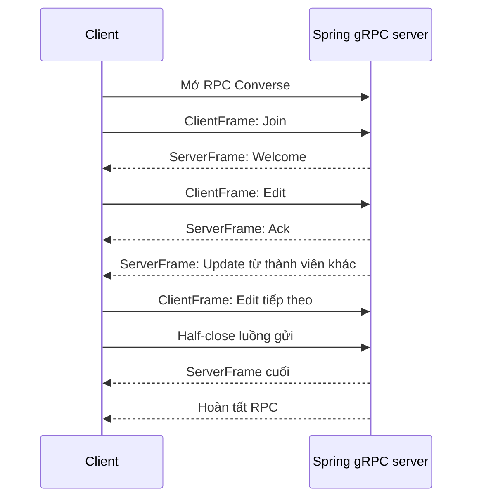
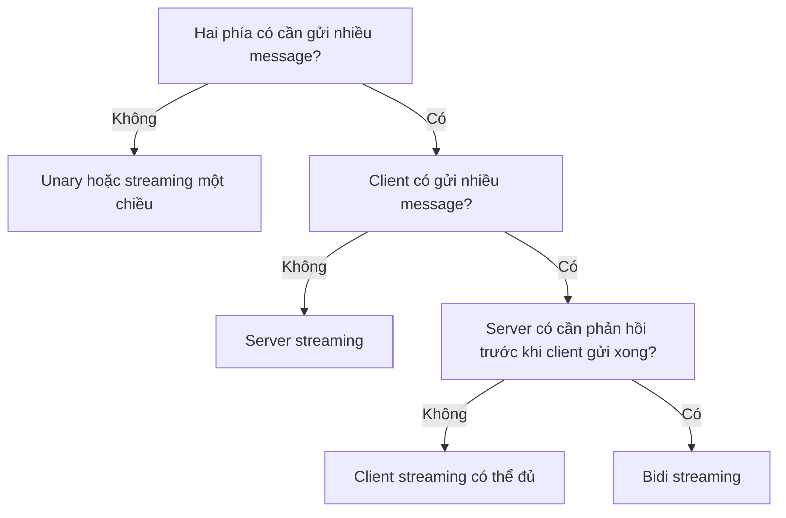

# Chọn bidi streaming cho tương tác hai chiều

Bidirectional streaming (bidi streaming) phù hợp khi client và server cần gửi nhiều message cho nhau trong cùng một RPC, đồng thời mỗi phía có thể tiếp tục gửi mà không phải chờ phía kia kết thúc lượt gửi. Đây là lựa chọn cho một phiên tương tác có trao đổi hai chiều liên tục, chẳng hạn cộng tác trực tuyến, điều khiển thiết bị, phiên hội thoại hoặc xử lý sự kiện tương tác.

Tuy nhiên, một stream làm tăng độ phức tạp về vòng đời, đồng bộ, hủy, retry và kiểm soát tải. Hãy chọn bidi khi luồng nghiệp vụ thực sự cần cả hai chiều hoạt động độc lập; nếu chỉ cần một request và một response, một phía phát nhiều message, hoặc một phía gửi cả lô dữ liệu rồi nhận kết quả, các kiểu RPC đơn giản hơn thường dễ vận hành hơn.

## 1. Bidi streaming hoạt động như thế nào?

Trong hợp đồng Protocol Buffers, một RPC bidi khai báo `stream` ở cả kiểu request và response:

```protobuf
service SessionService {
  rpc Converse (stream ClientFrame) returns (stream ServerFrame);
}
```

Client mở một RPC `Converse` và nhận một luồng response. Sau đó client có thể gửi nhiều `ClientFrame`; server có thể gửi nhiều `ServerFrame` trong khi vẫn tiếp tục nhận request. Hai luồng message hoạt động độc lập trong cùng một RPC.



Các điểm cần nhớ:

- Mỗi RPC có một luồng request và một luồng response. Server có thể phản hồi trước khi client gửi xong toàn bộ request.
- Thứ tự message được giữ trong từng chiều: server nhận các request theo thứ tự client gửi, và client nhận các response theo thứ tự server gửi. Không có một thứ tự tổng thể được đảm bảo giữa hai chiều.
- Client gọi `onCompleted()` trên request observer để báo rằng nó sẽ không gửi thêm request. Đây là *half-close*: server vẫn có thể gửi response còn lại rồi mới kết thúc luồng response.
- `onCompleted()` hoặc `onError()` kết thúc luồng tương ứng. Sau một terminal event, không gửi thêm message trên luồng đó.
- Một bidi RPC là một phiên RPC có thời điểm bắt đầu và kết thúc. Nó không tự trở thành phiên bền vững có thể khôi phục sau khi mạng đứt hoặc tiến trình khởi động lại.

## 2. So sánh bốn kiểu RPC trước khi chọn

Protocol Buffers hỗ trợ bốn kiểu giao tiếp chính. Chọn theo hướng di chuyển của message và cách hai phía phối hợp:

| Kiểu RPC | Luồng message | Khi phù hợp | Ví dụ |
| --- | --- | --- | --- |
| Unary | Một request, một response | Một thao tác độc lập có kết quả rõ ràng | Tra cứu hồ sơ, tạo đơn hàng |
| Server streaming | Một request, nhiều response | Client yêu cầu một lần rồi nhận dữ liệu liên tục | Theo dõi trạng thái, tải kết quả theo lô |
| Client streaming | Nhiều request, một response | Client gửi một chuỗi dữ liệu rồi server tổng hợp kết quả | Tải file theo chunk, gửi batch đo đạc |
| Bidirectional streaming | Nhiều request, nhiều response | Hai phía cần trao đổi nhiều lần trong cùng phiên, không phải đợi phía kia gửi xong | Cộng tác trực tuyến, điều khiển tương tác |

Một số quy tắc lựa chọn nhanh:

- Một thao tác tương ứng một kết quả: chọn unary.
- Client yêu cầu dữ liệu một lần, sau đó chỉ server phát sự kiện: chọn server streaming.
- Client gửi nhiều phần dữ liệu, server chỉ cần trả kết quả cuối cùng: chọn client streaming.
- Client và server đều cần phát message trong khi phiên vẫn đang diễn ra: cân nhắc bidi streaming.



Sơ đồ là cách sàng lọc ban đầu. Nếu client gửi nhiều message nhưng server cũng cần trả acknowledgement trong quá trình nhận, bidi thường phù hợp hơn client streaming. Ngược lại, nếu response chỉ có ý nghĩa sau khi toàn bộ input đã được gửi, client streaming có giao thức đơn giản hơn.

## 3. Khi nào nên chọn bidi streaming?

Chọn bidi khi nghiệp vụ có một phiên trao đổi kéo dài, hai phía đều có thể chủ động phát message, và các message ở hai chiều có quan hệ với nhau trong cùng phiên.

### Cộng tác trực tuyến

Nhiều người dùng cùng chỉnh sửa một tài liệu hoặc bảng điều khiển. Client gửi thao tác chỉnh sửa, vị trí con trỏ hoặc trạng thái hiện diện; server gửi acknowledgement, thay đổi từ người dùng khác và thông báo đồng bộ. Client không cần mở một RPC mới cho từng thao tác nhỏ.

### Điều khiển và giám sát tương tác

Client gửi lệnh thay đổi cấu hình hoặc điều khiển thiết bị; server gửi trạng thái, tiến độ và cảnh báo trong khi lệnh tiếp theo vẫn có thể được gửi. Cần thiết kế xác nhận lệnh và quyền thực thi rõ ràng, vì một message đã được gửi không đồng nghĩa thiết bị đã thực hiện thành công.

### Phiên hội thoại hoặc xử lý tương tác

Client gửi từng đoạn nội dung hoặc tín hiệu điều khiển; server trả về từng phần kết quả, trạng thái xử lý hoặc yêu cầu bổ sung. Bidi hữu ích khi client có thể điều chỉnh đầu vào dựa trên response đang nhận.

### Không nên chọn chỉ vì có nhiều message

- Nếu client chỉ tải lên một luồng dữ liệu rồi nhận một kết quả cuối cùng, client streaming đủ dùng.
- Nếu client chỉ đăng ký một lần và server phát sự kiện, server streaming đủ dùng.
- Nếu các thao tác độc lập và có thể xử lý riêng, nhiều unary RPC đồng thời thường dễ retry, phân quyền, quan sát và cân bằng tải hơn.
- Nếu cần phát sự kiện đến nhiều consumer, lưu giữ sự kiện, replay hoặc phân phối bền vững, hãy đánh giá message broker hoặc event log. Một bidi RPC không tự cung cấp khả năng lưu trữ và phát lại sự kiện.

## 4. Thiết kế hợp đồng message cho phiên hai chiều

Không nên tạo một message chung chứa nhiều chuỗi hoặc field tùy ý. Hãy định nghĩa các loại message và quy tắc chuyển trạng thái mà cả client lẫn server hiểu giống nhau.

Ví dụ một giao thức phiên cộng tác:

```protobuf
syntax = "proto3";

package acme.collaboration.v1;

service CollaborationService {
  rpc Connect (stream ClientFrame) returns (stream ServerFrame);
}

message ClientFrame {
  string session_id = 1;
  uint64 client_sequence = 2;

  oneof body {
    Join join = 10;
    Edit edit = 11;
    Ping ping = 12;
    Leave leave = 13;
  }
}

message ServerFrame {
  uint64 server_sequence = 1;
  uint64 acknowledged_client_sequence = 2;

  oneof body {
    Welcome welcome = 10;
    Ack ack = 11;
    Update update = 12;
    Notice notice = 13;
  }
}

message Join {
  string document_id = 1;
}

message Edit {
  string operation_id = 1;
  string content = 2;
}

message Ping {}
message Leave {}
message Welcome { string participant_id = 1; }
message Ack { string operation_id = 1; }
message Update { string operation_id = 1; string content = 2; }
message Notice { string message = 1; }
```

Trong hợp đồng này, `oneof` giúp mỗi frame biểu diễn một loại sự kiện rõ ràng. `client_sequence` và `server_sequence` minh họa cách đánh số thứ tự trong từng chiều; `acknowledged_client_sequence` cho biết server đã xử lý đến request nào. Đây là quy ước của ứng dụng, không phải trường mà gRPC tự thêm.

Khi thiết kế hợp đồng thực tế, cần thống nhất các quy tắc sau:

1. **Handshake:** message đầu tiên có thể là `Join`/`Open` để chọn tài nguyên hoặc phiên. Server xác thực metadata, kiểm tra quyền và trả `Welcome` hoặc kết thúc RPC bằng status phù hợp.
2. **Định danh phiên:** xác định session thuộc người dùng, tenant và tài nguyên nào. Không tin `session_id` trong payload như bằng chứng xác thực; phải đối chiếu với danh tính đã xác thực.
3. **Thứ tự và acknowledgement:** nếu thứ tự nghiệp vụ quan trọng, đánh số message và quy định rõ acknowledgement xác nhận đã nhận, đã kiểm tra hay đã commit.
4. **Message trùng:** client có thể gửi lại thao tác sau timeout hoặc reconnect. Dùng `operation_id`/idempotency key để phát hiện bản gửi trùng và tránh thực hiện tác động hai lần.
5. **Lỗi nghiệp vụ:** lỗi của một thao tác có thể là một frame `Notice`/`Error` để phiên tiếp tục. Lỗi giao thức, xác thực hoặc trạng thái không thể phục hồi có thể kết thúc toàn bộ RPC bằng gRPC status.
6. **Tương thích phiên bản:** thêm field mới với field number mới; không tái sử dụng field number đã xóa. Thay đổi ý nghĩa của message hoặc thứ tự sự kiện cần được xem là thay đổi hợp đồng.

Không phải mọi frame đều cần `session_id` hoặc sequence nếu RPC đã xác định duy nhất một phiên và thứ tự transport đã đủ. Chỉ thêm chúng khi ứng dụng cần định tuyến, acknowledgement, phát hiện trùng hoặc phục hồi sau gián đoạn.

## 5. Vòng đời và trạng thái của stream

Một bidi RPC có thể được mô hình hóa thành các trạng thái sau:

| Trạng thái | Điều gì xảy ra | Hành động của ứng dụng |
| --- | --- | --- |
| Mở phiên | Client tạo RPC; server bắt đầu xử lý | Xác thực, kiểm tra quyền, tạo context và tài nguyên phiên |
| Trao đổi | Hai phía gửi/nhận nhiều frame | Kiểm tra schema và trạng thái, xử lý message, phát response |
| Client half-close | Client báo không gửi thêm request | Server có thể hoàn tất công việc còn lại và gửi response cuối |
| Hoàn tất | Server kết thúc response bằng `onCompleted()` | Giải phóng subscription, timer, buffer và tài nguyên phiên |
| Lỗi hoặc hủy | Một phía gặp lỗi hoặc client hủy RPC | Dừng công việc liên quan, hủy tác vụ phụ và ghi nhận nguyên nhân |

`onCompleted()` ở client không có nghĩa server phải ngừng gửi response ngay lập tức. Ví dụ client gửi xong một tập lệnh nhưng server vẫn cần trả kết quả cho các lệnh đã nhận. Server chỉ hoàn tất response khi đã xử lý xong phần việc được chấp nhận.

Ngược lại, khi client hủy RPC hoặc kết nối bị ngắt, server cần dừng các công việc gắn với phiên nếu có thể. Một tác vụ nền không được tiếp tục vô hạn chỉ vì nó đã được đưa vào executor trước khi client rời đi.

## 6. Triển khai bidi service trong Spring gRPC

Code sinh từ `protoc` tạo base class cho service. Với service `CollaborationService`, lớp triển khai Java kế thừa `CollaborationServiceGrpc.CollaborationServiceImplBase`. Đăng ký lớp này bằng cơ chế service/bean của Spring gRPC starter đang sử dụng; annotation và cấu hình cụ thể phụ thuộc starter của dự án.

Phương thức bidi nhận `StreamObserver` cho response và trả về một `StreamObserver` để nhận request. Ví dụ rút gọn dưới đây xử lý đồng bộ từng frame:

```java
import io.grpc.Status;
import io.grpc.stub.ServerCallStreamObserver;
import io.grpc.stub.StreamObserver;

import java.util.concurrent.atomic.AtomicBoolean;
import java.util.concurrent.atomic.AtomicLong;

public class CollaborationServiceImpl
        extends CollaborationServiceGrpc.CollaborationServiceImplBase {

    @Override
    public StreamObserver<ClientFrame> connect(
            StreamObserver<ServerFrame> responseObserver) {

        ServerCallStreamObserver<ServerFrame> serverObserver =
                (ServerCallStreamObserver<ServerFrame>) responseObserver;
        AtomicBoolean closed = new AtomicBoolean(false);
        AtomicLong serverSequence = new AtomicLong(0);

        serverObserver.setOnCancelHandler(() -> {
            closed.set(true);
            // Hủy subscription hoặc tác vụ gắn với phiên tại đây.
        });

        return new StreamObserver<>() {
            @Override
            public void onNext(ClientFrame frame) {
                if (closed.get()) {
                    return;
                }

                try {
                    // Xác thực trạng thái phiên và xử lý frame.
                    ServerFrame reply = handle(
                            frame, serverSequence.incrementAndGet());
                    if (!closed.get()) {
                        serverObserver.onNext(reply);
                    }
                } catch (IllegalArgumentException ex) {
                    if (closed.compareAndSet(false, true)) {
                        serverObserver.onError(Status.INVALID_ARGUMENT
                                .withDescription("Invalid client frame")
                                .asRuntimeException());
                    }
                }
            }

            @Override
            public void onError(Throwable error) {
                closed.set(true);
                // Ghi nhận lỗi và giải phóng tài nguyên của phiên.
            }

            @Override
            public void onCompleted() {
                if (closed.compareAndSet(false, true)) {
                    // Ví dụ đồng bộ: không còn công việc đang chờ.
                    serverObserver.onCompleted();
                }
            }
        };
    }

    private ServerFrame handle(ClientFrame frame, long sequence) {
        // Thay bằng xử lý nghiệp vụ và tạo ServerFrame tương ứng.
        return ServerFrame.newBuilder()
                .setServerSequence(sequence)
                .setAcknowledgedClientSequence(frame.getClientSequence())
                .build();
    }
}
```

Đây là khung minh họa, cần bổ sung xác thực, kiểm tra trạng thái phiên, ánh xạ lỗi và cleanup theo nghiệp vụ. `onCompleted()` trong ví dụ kết thúc response ngay sau khi client half-close vì ví dụ xử lý đồng bộ. Nếu server đã đưa công việc vào hàng đợi hoặc đang chờ dependency, chỉ gọi `serverObserver.onCompleted()` sau khi các công việc được chấp nhận đã hoàn tất.

Một số nguyên tắc khi đưa vào ứng dụng:

- **Giữ callback ngắn:** không thực hiện truy vấn chậm hoặc chờ I/O lâu trực tiếp trong callback nếu điều đó làm nghẽn executor xử lý RPC. Có thể chuyển công việc sang executor hoặc pipeline bất đồng bộ phù hợp.
- **Tuần tự hóa chiều gửi:** `StreamObserver` không tự bảo đảm an toàn khi nhiều thread cùng gọi `onNext`, `onError` hoặc `onCompleted`. Nếu nhiều tác vụ có thể phát response, hãy đưa chúng qua một hàng đợi/serial executor hoặc khóa đồng bộ để bảo toàn thứ tự và chỉ phát một terminal event.
- **Theo dõi hủy:** `ServerCallStreamObserver.setOnCancelHandler` giúp nhận biết client đã hủy RPC. Hãy hủy subscription, timer và tác vụ nền liên quan; không chỉ đặt một cờ rồi để tài nguyên tiếp tục chạy.
- **Giới hạn tài nguyên phiên:** giới hạn số stream đồng thời, số message, kích thước message, tốc độ gửi, thời gian sống và buffer trên mỗi phiên.
- **Tách phạm vi Spring bean:** service bean thường sống lâu hơn một RPC. Dữ liệu mutable của từng phiên phải nằm trong context riêng của RPC, không đặt vào field dùng chung của singleton service nếu không có cơ chế đồng bộ và phân lập rõ ràng.

## 7. Flow control và client chậm

Một bidi stream có thể tạo ra nhiều response hơn tốc độ client tiêu thụ. Nếu server cứ thêm message vào một queue không giới hạn, bộ nhớ sẽ tăng theo thời gian và có thể làm sập tiến trình.

gRPC có flow control ở tầng transport để điều tiết việc gửi message. Ở phía server, `ServerCallStreamObserver` cung cấp `isReady()` và `setOnReadyHandler()` để kiểm tra khi nào có thể tiếp tục phát dữ liệu. Nếu cần kiểm soát inbound thủ công, API server hỗ trợ tắt auto inbound flow control và yêu cầu số message tiếp theo bằng `request(n)`.

Thiết kế nên tuân theo các nguyên tắc:

- Chỉ tạo hoặc lấy thêm dữ liệu khi phía nhận có khả năng tiêu thụ; tránh dựng sẵn một danh sách response lớn trong bộ nhớ.
- Dùng queue có giới hạn. Khi queue đầy, chọn chính sách rõ ràng: tạm dừng đọc, từ chối thao tác, gộp sự kiện, bỏ dữ liệu có thể bỏ hoặc kết thúc phiên.
- Phân biệt flow control của transport với acknowledgement nghiệp vụ. `isReady()` không có nghĩa ứng dụng client đã xử lý message; nếu cần xác nhận xử lý, định nghĩa ACK trong hợp đồng.
- Với dữ liệu trạng thái có thể thay thế, cân nhắc chỉ gửi snapshot mới nhất thay vì giữ mọi trạng thái trung gian. Với lệnh không được mất, cần ACK, lưu trữ hoặc cơ chế retry ở tầng ứng dụng.
- Đặt giới hạn kích thước message và tốc độ gửi ở cả hai chiều để một client lỗi không chiếm hết tài nguyên server.

Không nên gọi `onNext()` liên tục trong một vòng lặp tạo dữ liệu không giới hạn. Flow control cần được nối với cách ứng dụng đọc dữ liệu, không chỉ được xem là một tùy chọn của gRPC.

## 8. Lỗi, retry và phục hồi kết nối

gRPC status kết thúc một RPC. Khi stream đã kết thúc bằng `onError()`, không thể tiếp tục gửi message trên chính RPC đó. Vì vậy cần phân biệt lỗi của một message với lỗi làm hỏng cả phiên:

| Tình huống | Cách xử lý thường phù hợp |
| --- | --- |
| Một thao tác sai dữ liệu nhưng phiên còn hợp lệ | Trả frame lỗi/validation tương ứng; tiếp tục nhận message nếu hợp đồng cho phép |
| Không xác thực hoặc không có quyền mở phiên | Kết thúc RPC bằng `UNAUTHENTICATED` hoặc `PERMISSION_DENIED` |
| Client gửi message sai thứ tự hoặc sai trạng thái không thể phục hồi | Trả lỗi giao thức hoặc kết thúc bằng status được quy ước |
| Dependency tạm thời lỗi nhưng có thể thử lại | Áp dụng retry có giới hạn cho thao tác idempotent hoặc phát trạng thái tạm thời để client quyết định |
| Client mất kết nối | Hủy tài nguyên của RPC; client mở RPC mới nếu muốn kết nối lại |

Không nên giả định retry tự động có thể phát lại an toàn một bidi stream đã gửi nhiều message. Khi một RPC bị ngắt sau khi một số thao tác đã được xử lý, client có thể không biết chính xác thao tác cuối cùng đã commit hay chưa. Retry mù có thể tạo thao tác trùng.

Nếu nghiệp vụ cần tiếp tục sau reconnect, thiết kế phục hồi ở tầng ứng dụng:

1. Mỗi phiên có định danh ổn định hoặc resume token được server cấp và kiểm tra quyền.
2. Mỗi thao tác có `operation_id` hoặc sequence duy nhất để server nhận diện message đã xử lý.
3. Server lưu checkpoint/acknowledgement đủ để client biết vị trí đã được xác nhận.
4. Khi kết nối lại, client gửi cursor hoặc sequence cuối đã xác nhận; server xác thực và phát lại phần sự kiện còn thiếu nếu hệ thống có lưu giữ.
5. Client xử lý message có thể được phát lại theo cách idempotent.

Nếu không cần phục hồi, hãy định nghĩa reconnect là một phiên mới và yêu cầu client đồng bộ lại trạng thái ban đầu. Quy tắc này đơn giản hơn và tránh tạo kỳ vọng sai rằng transport tự lưu giữ phiên.

## 9. Deadline, heartbeat và thời gian sống

Deadline áp dụng cho toàn bộ RPC. Với bidi stream kéo dài, deadline quá ngắn sẽ đóng phiên đang hoạt động; deadline quá dài hoặc không có giới hạn có thể giữ tài nguyên lâu hơn dự kiến. Hãy chọn thời gian sống phù hợp với nghiệp vụ và giới hạn của hạ tầng.

Nếu cần phát hiện peer hoặc phiên đã mất liên lạc, có thể thiết kế heartbeat ở tầng ứng dụng, ví dụ message `Ping` và `Pong` có timestamp hoặc sequence. Quy định khoảng thời gian chờ và cách kết thúc phiên khi không nhận heartbeat.

HTTP/2 keepalive ping ở tầng transport và heartbeat nghiệp vụ có mục đích khác nhau. Keepalive giúp kiểm tra kết nối transport theo cấu hình; nó không chứng minh ứng dụng client vẫn xử lý message hoặc phiên nghiệp vụ còn hợp lệ. Proxy và load balancer cũng có thể áp dụng idle timeout riêng, vì vậy cần đối chiếu cấu hình timeout trên toàn đường đi.

Khi thiết kế phiên dài:

- Đặt giới hạn thời gian sống tối đa và chính sách gia hạn nếu cần.
- Xác định cách xử lý khi client im lặng, server im lặng hoặc chỉ một chiều còn hoạt động.
- Hủy timer và heartbeat khi RPC hoàn tất hoặc bị hủy.
- Tránh gửi heartbeat quá dày gây tải không cần thiết.
- Kiểm tra idle timeout của ingress, load balancer và proxy; không giả định kết nối sẽ tồn tại vô thời hạn.

## 10. Bảo mật và quan sát vận hành

Metadata gRPC thường được gửi khi mở RPC và phù hợp cho thông tin xác thực ở phạm vi lời gọi, như bearer token hoặc trace context. Metadata không phải một kênh để thay đổi danh tính tùy ý theo từng frame. Nếu mỗi thao tác cần context riêng, biểu diễn nó trong message và kiểm tra quyền cho từng thao tác.

Với bidi streaming, cần bảo vệ cả thời điểm mở phiên lẫn từng hành động trong phiên:

- Dùng TLS; dùng mTLS nếu hệ thống cần xác thực danh tính máy khách ở tầng kết nối.
- Kiểm tra quyền truy cập tài nguyên trong handshake và kiểm tra lại các hành động nhạy cảm theo chính sách nghiệp vụ.
- Giới hạn kích thước frame, số stream đồng thời, tốc độ message, số phiên trên một principal và dung lượng queue.
- Không đưa token, dữ liệu cá nhân hoặc payload nhạy cảm vào log đầy đủ.
- Khi quyền truy cập bị thu hồi hoặc phiên hết hạn, đóng hoặc giới hạn phiên theo chính sách đã định nghĩa.

Một RPC có thể tồn tại lâu và mang hàng nghìn message, vì vậy chỉ đo thời gian request tổng thể là chưa đủ. Nên theo dõi số stream đang mở, tuổi stream, số message vào/ra, byte vào/ra, status kết thúc, số lần reconnect, queue depth, thời gian xử lý từng loại frame và số lần client bị chậm. Gắn request/trace ID và session ID đã được làm mờ hoặc không định danh trực tiếp để liên kết log, metric và trace.

## 11. Kiểm thử bidi streaming

Một bài kiểm thử unary không chứng minh bidi hoạt động đúng. Cần kiểm tra tương tác giữa các message và vòng đời của cả hai chiều.

Các kịch bản nên có trong kiểm thử tích hợp:

1. Client gửi frame đầu tiên và nhận response tương ứng.
2. Server phát một notification khi client vẫn đang gửi request; client nhận đúng thứ tự response.
3. Client half-close; server hoàn tất các thao tác đã nhận và gửi response cuối trước khi hoàn tất RPC.
4. Client hủy stream giữa chừng; server dừng subscription, timer và tác vụ nền.
5. Server trả lỗi terminal; client nhận đúng status và không tiếp tục gửi trên stream đã đóng.
6. Client gửi sequence trùng hoặc sai thứ tự; server áp dụng đúng quy tắc deduplication/validation.
7. Client đọc chậm hoặc server phát nhanh; queue và flow control không làm bộ nhớ tăng không giới hạn.
8. Kết nối bị ngắt rồi mở lại; quy trình resume hoặc tạo phiên mới tuân theo hợp đồng.
9. Nhiều phiên đồng thời; dữ liệu và quyền của các phiên không rò rỉ qua nhau.

Có thể dùng grpcurl để thăm dò service và gửi một số message thủ công, nhưng các kịch bản tương tác hai chiều, race condition, cancellation và reconnect nên được kiểm thử bằng client gRPC sinh từ cùng hợp đồng trong integration test. Dùng test deadline có giới hạn để bài test không treo khi stream không kết thúc.

## 12. Checklist trước khi quyết định dùng bidi

Trước khi thêm một bidi RPC vào API, hãy trả lời được các câu hỏi sau:

- Client có cần gửi message mới trong lúc vẫn đang nhận response không?
- Server có cần chủ động gửi message trong lúc client vẫn đang gửi request không?
- Các message có thuộc cùng một phiên nghiệp vụ và cần giữ quan hệ thứ tự/acknowledgement không?
- Quy tắc handshake, half-close, hoàn tất, lỗi và cancellation đã rõ chưa?
- Có giới hạn cho stream đồng thời, tốc độ message, kích thước frame và buffer không?
- Nếu client reconnect, hệ thống bắt đầu phiên mới hay resume bằng checkpoint và deduplication?
- Deadline, heartbeat, idle timeout, TLS, authorization và quan sát vận hành đã được thiết kế chưa?
- Các yêu cầu đó có thể đáp ứng đơn giản hơn bằng unary hoặc streaming một chiều không?

Bidi streaming là lựa chọn phù hợp khi hai phía thực sự cần trao đổi message độc lập trong cùng một RPC. Hãy xem stream như một giao thức phiên có trạng thái: định nghĩa hợp đồng, vòng đời, flow control, lỗi và phục hồi ngay từ đầu. Khi chỉ cần trao đổi một chiều hoặc một kết quả cuối cùng, chọn kiểu RPC đơn giản hơn sẽ giúp client, server Spring và hệ thống vận hành dễ hiểu và dễ kiểm thử hơn.
