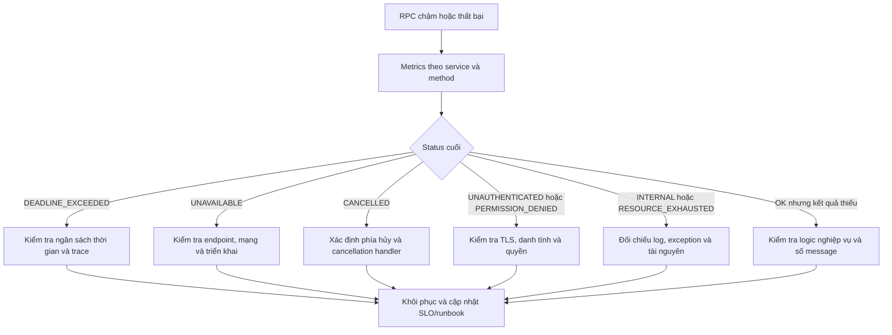

# Đánh giá observability và vận hành

Khi chọn cơ chế giao tiếp cho một hệ thống Spring, cần đánh giá khả năng quan sát và vận hành cùng với độ trễ, thông lượng và cấu trúc dữ liệu. Một API có tốc độ tốt nhưng khó tìm nguyên nhân khi lỗi, khó triển khai phiên bản mới hoặc không thể khôi phục sau khi mất kết nối sẽ làm tăng chi phí vận hành.

Spring gRPC phù hợp khi các dịch vụ cần hợp đồng Protocol Buffers, mã Java được sinh từ `.proto`, giao tiếp unary hoặc streaming và truyền dữ liệu qua HTTP/2. Để vận hành tốt, hệ thống cần quan sát được từng RPC, trạng thái kết thúc, thời gian xử lý, luồng message, lỗi mạng và tình trạng phụ thuộc. Cần kiểm tra những tín hiệu này từ client đến server và qua các thành phần trung gian.

## 1. Phân biệt observability và khả năng vận hành

**Observability** là khả năng suy ra trạng thái bên trong hệ thống từ telemetry mà hệ thống phát ra. Ba nhóm tín hiệu thường dùng là:

- **Metrics:** số liệu tổng hợp theo thời gian như số RPC, tỷ lệ lỗi, độ trễ, số stream đang hoạt động và mức sử dụng tài nguyên.
- **Logs:** sự kiện có ngữ cảnh, giúp xác định method, trạng thái gRPC, nguyên nhân lỗi và thời điểm xảy ra.
- **Traces:** đường đi của một request qua client, server và các dịch vụ phụ thuộc, giúp xác định đoạn xử lý gây chậm hoặc lỗi.

**Khả năng vận hành** rộng hơn việc thu thập telemetry. Nó bao gồm health check, readiness, cấu hình TLS, quản lý deadline, giới hạn tài nguyên, triển khai tương thích, mở rộng tải, graceful shutdown, cảnh báo và quy trình xử lý sự cố.

Hai khía cạnh này liên quan trực tiếp: health check cho biết instance có thể nhận traffic hay không; metrics và traces giúp giải thích tại sao instance chậm hoặc không khỏe; quy trình vận hành quyết định cách đưa instance ra khỏi tải và khôi phục dịch vụ.

## 2. Chọn các chỉ số có ý nghĩa với RPC

Với gRPC, nên đo ở cấp method và trạng thái RPC. Một bộ chỉ số nền tảng có thể gồm:

| Nhóm | Chỉ số nên theo dõi | Câu hỏi vận hành |
|---|---|---|
| Lưu lượng | Số RPC theo method và client/service | Method nào đang tăng tải? |
| Độ trễ | Histogram thời lượng RPC, phân vị p50/p95/p99 | Method nào chậm và chậm ở mức nào? |
| Lỗi | Số lượng và tỷ lệ theo gRPC status | Lỗi đến từ ứng dụng, xác thực, deadline hay mạng? |
| Streaming | Số stream đang mở, thời lượng stream, số message và byte gửi/nhận | Stream có bị giữ quá lâu hoặc ngừng phát dữ liệu không? |
| Tài nguyên | CPU, heap, GC, thread, hàng đợi và kết nối | Nút thắt nằm ở ứng dụng hay hạ tầng? |
| Khôi phục | Số lần retry, cancellation, reconnect và thời gian phục hồi | Dịch vụ có tự phục hồi sau lỗi tạm thời không? |

Đối với unary RPC, thời lượng và tỷ lệ lỗi theo method thường là điểm bắt đầu tốt. Với streaming RPC, chỉ đo tổng thời lượng là chưa đủ: một stream có thể mở hàng giờ nhưng không phát message, hoặc có thể gửi rất nhiều message trong thời gian ngắn. Nên theo dõi thêm số stream hoạt động, thời gian từ message gần nhất, số message, tổng byte và lý do kết thúc.

Phân loại theo gRPC status giúp khoanh vùng nhanh:

| Status | Cách diễn giải khi theo dõi |
|---|---|
| `OK` | RPC hoàn tất thành công; vẫn cần kiểm tra kết quả nghiệp vụ có đủ dữ liệu hay không |
| `CANCELLED` | Một phía hủy RPC; cần xác định phía khởi tạo cancellation |
| `DEADLINE_EXCEEDED` | RPC vượt quá deadline; đối chiếu độ trễ từng đoạn và thời gian chờ |
| `UNAVAILABLE` | Dịch vụ hoặc kết nối tạm thời không khả dụng; kiểm tra endpoint, restart và mạng |
| `UNAUTHENTICATED` / `PERMISSION_DENIED` | Kiểm tra danh tính, token, chứng thư và quyền truy cập |
| `RESOURCE_EXHAUSTED` | Kiểm tra quota, giới hạn message, bộ nhớ và năng lực xử lý |
| `INTERNAL` / `UNKNOWN` | Đối chiếu log server và exception gốc để tìm lỗi chưa được phân loại rõ |

Không nên gộp tất cả status khác `OK` thành một loại lỗi. `CANCELLED` có thể là hành vi bình thường khi người dùng rời màn hình; `DEADLINE_EXCEEDED` thường cần xem cùng latency; `UNAVAILABLE` có thể tăng trong lúc triển khai. Phân loại đúng giúp cảnh báo ít nhiễu hơn.

Metric label nên có cardinality thấp và ổn định, chẳng hạn service, method, status, phiên bản ứng dụng hoặc vùng triển khai. Không đưa user ID, request ID, trace ID, địa chỉ email hay giá trị metadata tùy ý vào label vì mỗi giá trị mới có thể tạo một time series riêng. Đưa các định danh cần truy vết vào log hoặc trace.

## 3. Thiết kế logs và traces có thể liên kết

Log của một RPC nên có các trường có cấu trúc như:

- Tên service và full method name.
- Thời điểm bắt đầu, thời lượng và status cuối cùng.
- Correlation ID hoặc trace ID.
- Số message và tổng byte nếu đó là RPC streaming.
- Deadline còn lại hoặc thông tin timeout có liên quan.
- Nhóm nguyên nhân lỗi và exception đã được xử lý an toàn.

Không ghi toàn bộ payload mặc định. Message có thể chứa thông tin cá nhân, token, dữ liệu nghiệp vụ hoặc dữ liệu lớn. Nếu cần xem payload để điều tra, hãy dùng cơ chế lấy mẫu, che dữ liệu nhạy cảm và giới hạn quyền truy cập.

Trace giúp nối các đoạn xử lý của cùng một request. Với một RPC đi qua API gateway, Spring gRPC server và một dịch vụ phụ thuộc, trace nên cho thấy thời gian ở từng đoạn và quan hệ cha-con giữa các span. Thư viện instrumentation OpenTelemetry có thể tự tạo span và truyền trace context qua gRPC metadata. Hãy ưu tiên instrumentation đã được kiểm chứng cho phiên bản thư viện đang dùng; chỉ tự truyền trace context khi chưa có cơ chế tương ứng, để tránh tạo hai trace hoặc mất quan hệ span.

Với stream dài hạn, không nên tạo một span con cho từng message nếu lưu lượng lớn. Có thể ghi số lượng message, byte, thời điểm message đầu/cuối và một số sự kiện quan trọng vào span của RPC; dùng log hoặc metric để quan sát chi tiết liên tục. Cần đặt giới hạn thời gian lưu và lấy mẫu trace để chi phí telemetry không tăng theo số message.

## 4. Dùng interceptor để bổ sung ngữ cảnh RPC

Interceptor là điểm mở rộng phù hợp để ghi nhận thông tin chung cho nhiều RPC mà không lặp logic trong từng service. Server interceptor có thể lấy tên method, thời điểm bắt đầu và status khi server đóng call. Client interceptor có thể bổ sung correlation metadata hoặc ghi nhận kết quả ở phía gọi.

Ví dụ sau minh họa cách đo thời lượng và status ở server bằng API gRPC Java. `RpcMetrics` là adapter của ứng dụng tới Micrometer hoặc hệ thống metrics đang dùng; tên metric và cấu hình export cần được thống nhất trong dự án.

```java
public final class RpcMetricsInterceptor implements ServerInterceptor {

    private final RpcMetrics rpcMetrics;

    public RpcMetricsInterceptor(RpcMetrics rpcMetrics) {
        this.rpcMetrics = rpcMetrics;
    }

    @Override
    public <ReqT, RespT> ServerCall.Listener<ReqT> interceptCall(
            ServerCall<ReqT, RespT> call,
            Metadata headers,
            ServerCallHandler<ReqT, RespT> next) {

        String method = call.getMethodDescriptor().getFullMethodName();
        long startedAt = System.nanoTime();

        ServerCall<ReqT, RespT> measuredCall =
                new ForwardingServerCall.SimpleForwardingServerCall<>(call) {
                    @Override
                    public void close(Status status, Metadata trailers) {
                        long elapsedNanos = System.nanoTime() - startedAt;
                        try {
                            rpcMetrics.record(method, status.getCode(), elapsedNanos);
                        } finally {
                            super.close(status, trailers);
                        }
                    }
                };

        return next.startCall(measuredCall, headers);
    }
}
```

Đây là ví dụ khung: cần bổ sung import, triển khai `RpcMetrics` và đăng ký interceptor theo cơ chế cấu hình của phiên bản Spring gRPC trong dự án. `System.nanoTime()` thích hợp để đo khoảng thời gian vì không phụ thuộc đồng hồ hệ thống. Hàm ghi metric cần nhẹ, không thực hiện I/O đồng bộ hoặc gọi dịch vụ từ xa trên thread xử lý RPC.

Interceptor không thay thế việc xử lý lỗi ở tầng nghiệp vụ. Service vẫn cần ánh xạ lỗi có chủ đích sang gRPC status, giữ exception gốc trong log nội bộ và trả mô tả an toàn cho client. Không đưa stack trace hoặc dữ liệu nhạy cảm vào status description.

## 5. Health check, readiness và khám phá dịch vụ

Một tiến trình đang chạy không đồng nghĩa nó sẵn sàng nhận request. Nên phân biệt:

- **Liveness:** tiến trình còn hoạt động và không rơi vào trạng thái cần khởi động lại.
- **Readiness:** instance đã khởi tạo xong, có thể nhận traffic và các phụ thuộc bắt buộc đang đáp ứng điều kiện phục vụ.
- **Startup:** ứng dụng đã hoàn tất giai đoạn khởi động ban đầu, tránh bị kiểm tra liveness quá sớm.

gRPC có Health Checking Protocol với service `grpc.health.v1.Health`. Client hoặc nền tảng triển khai có thể dùng trạng thái `SERVING` và `NOT_SERVING` để quyết định gửi request. Trong Spring gRPC, hãy kiểm tra khả năng tích hợp health service của phiên bản đang dùng hoặc đăng ký service tương ứng; đồng thời cấu hình readiness và liveness của nền tảng triển khai theo đúng ý nghĩa.

Readiness không nên đánh dấu `NOT_SERVING` chỉ vì một phụ thuộc tùy chọn tạm thời lỗi, nếu service vẫn có thể phục vụ phần lớn yêu cầu. Ngược lại, nếu cơ sở dữ liệu hoặc dịch vụ xác thực là phụ thuộc bắt buộc, readiness cần phản ánh việc không thể phục vụ an toàn. Tránh health check tạo tải lớn hoặc thực hiện truy vấn sâu liên tục.

gRPC reflection giúp công cụ phát hiện service và descriptor khi phát triển, kiểm thử hoặc chẩn đoán. Đây là bề mặt khám phá API; chỉ bật ở môi trường và mạng được kiểm soát. Không coi reflection là cơ chế xác thực hoặc phân quyền.

## 6. Deadline, cancellation và retry là một phần của vận hành

Client nên đặt deadline cho RPC theo ngân sách thời gian của nghiệp vụ. Nếu một request đi qua nhiều dịch vụ, ngân sách của các bước phía sau phải nằm trong deadline còn lại của request tổng. Không đặt deadline quá ngắn khiến request hợp lệ bị cắt; cũng không để request chờ vô hạn và chiếm thread, connection hoặc tài nguyên.

Khi client hủy RPC, server cần dừng công việc liên quan càng sớm càng tốt. Với streaming, cancellation cần được truyền đến truy vấn, subscription hoặc tác vụ nền. Nếu server tiếp tục xử lý sau khi client đã rời đi, hệ thống vẫn tiêu tốn tài nguyên cho kết quả không còn người nhận.

Retry có thể cải thiện độ tin cậy trước lỗi tạm thời, nhưng chỉ nên áp dụng khi có chính sách rõ ràng:

- Xác định method có an toàn để gọi lại hay không. Với thao tác tạo đơn, trừ tiền hoặc ghi dữ liệu, cần idempotency key hoặc cơ chế chống thực hiện lặp.
- Giới hạn số lần thử, dùng exponential backoff có jitter và ngân sách retry để tránh khuếch đại tải khi hệ thống đang lỗi.
- Chỉ retry các status và điều kiện phù hợp với hợp đồng của method.
- Theo dõi số lần retry và latency tổng, không chỉ latency của một lần thử.
- Thận trọng với streaming và các RPC đã phát message hoặc tạo side effect; một lần gọi mới không tự tiếp tục từ vị trí cũ.

Không dùng keepalive thay cho health check. Keepalive hỗ trợ phát hiện kết nối HTTP/2 không còn phản hồi; health check cho biết service có sẵn sàng nhận request không. Cấu hình keepalive cần phù hợp với chính sách của server, proxy và load balancer.

## 7. Vận hành streaming, flow control và graceful shutdown

Streaming tạo kết nối tồn tại lâu hơn unary RPC, do đó cần theo dõi số stream đồng thời, thời lượng, khoảng cách giữa các message và dung lượng dữ liệu. Một số vấn đề chỉ xuất hiện khi consumer chậm hoặc số stream tăng cao:

- Server phát nhanh hơn khả năng xử lý của client, làm tăng bộ đệm và áp lực bộ nhớ.
- Client không yêu cầu thêm message khi dùng manual inbound flow control, khiến stream có vẻ bị treo.
- Một stream không có hoạt động trong thời gian dài bị proxy hoặc load balancer đóng do idle timeout.
- Server restart trong lúc stream đang mở làm client phải kết nối lại và khôi phục trạng thái nghiệp vụ.

Hãy dùng flow control để giới hạn tốc độ phát và tránh giữ toàn bộ dữ liệu trong bộ nhớ. Với stream sự kiện cần khôi phục sau khi ngắt, thiết kế cursor hoặc sequence number ở tầng ứng dụng. Client lưu checkpoint sau khi xử lý message; khi mở lại stream, gửi cursor đã xác nhận và xử lý message trùng bằng quy tắc idempotent.

Khi triển khai phiên bản mới, server cần có thời gian drain hợp lý. Ngừng nhận RPC mới, cho các RPC đang chạy hoàn tất trong thời gian cho phép, sau đó đóng kết nối. Client cần xử lý lỗi kết nối và reconnect theo backoff. Với stream dài hạn, cần xác định rõ giới hạn tuổi thọ stream và quy tắc resume; không giữ instance cũ vô hạn chỉ để duy trì kết nối.

## 8. TLS, xác thực và bảo vệ telemetry

gRPC thường chạy trên HTTP/2 với TLS trong môi trường production. Khi dùng TLS hoặc mutual TLS, cần theo dõi:

- Thời hạn chứng thư, chuỗi tin cậy, hostname/SAN và quy trình xoay vòng chứng thư.
- Cấu hình ALPN và hỗ trợ HTTP/2 trên client, server và proxy.
- Danh tính client, quyền gọi từng service/method và cách thu hồi credential.
- Lỗi handshake, lỗi xác thực và tỷ lệ request bị từ chối.

Nếu TLS kết thúc tại proxy, cần xác định rõ đoạn nào được mã hóa và cách proxy xác thực với backend. Không mặc định metadata là dữ liệu đáng tin cậy: client có thể gửi metadata tùy ý. Chỉ đọc các key đã định nghĩa, kiểm tra định dạng và giới hạn kích thước. Không ghi access token, khóa bí mật hoặc dữ liệu nhạy cảm vào logs, traces hay metric labels.

Endpoint metrics, traces, health và reflection cũng cần được giới hạn truy cập theo môi trường. Telemetry thường chứa tên service, cấu trúc hệ thống, định danh request hoặc thông tin vận hành có giá trị đối với người tấn công.

## 9. Đảm bảo tương thích khi triển khai và thay đổi protobuf

Hợp đồng protobuf là một phần của khả năng vận hành. Thay đổi schema thiếu tương thích có thể làm client cũ lỗi sau khi server được triển khai hoặc ngược lại. Khi thay đổi message:

- Không tái sử dụng field number đã xóa; đánh dấu số field đã bỏ bằng `reserved`.
- Ưu tiên thêm field mới theo cách tương thích và xác định giá trị mặc định khi client cũ không gửi field đó.
- Không giả định client cũ hiểu enum value mới; xử lý giá trị chưa biết an toàn.
- Tránh đổi kiểu field hoặc thay đổi ý nghĩa field hiện có mà không có kế hoạch chuyển đổi.
- Kiểm thử client và server ở các tổ hợp phiên bản có thể cùng tồn tại trong rolling deployment.

Triển khai theo thứ tự tương thích: server mới vẫn phục vụ client cũ, sau đó mới phát hành client sử dụng field hoặc hành vi mới. Khi loại bỏ field cũ, chỉ làm sau khi đã xác minh không còn client phụ thuộc.

## 10. So sánh chi phí vận hành giữa gRPC, REST và message broker

Không có giao thức nào luôn dễ vận hành nhất. Cần đánh giá theo mô hình giao tiếp và năng lực quan sát sẵn có của tổ chức.

| Tiêu chí | Spring gRPC | REST/HTTP | Message broker |
|---|---|---|---|
| Hợp đồng | Protobuf, mã client/server sinh tự động | Thường dùng OpenAPI hoặc hợp đồng HTTP | Schema message và quy tắc event |
| Quan sát request | Method, status, latency, metadata và trace context | HTTP method, route, status code, latency | Publish/consume, queue/topic, consumer group |
| Quan sát độ trễ | RPC duration và thời gian xử lý từng hop | Request duration và thời gian xử lý từng hop | Publish latency, queue lag và thời gian xử lý message |
| Streaming/bất đồng bộ | Server, client và bidirectional streaming trên RPC | HTTP streaming hoặc cơ chế bổ sung tùy nền tảng | Lưu message, consumer độc lập và xử lý bất đồng bộ |
| Vận hành đặc thù | HTTP/2, deadline, flow control, channel và stream lifecycle | Gateway, HTTP timeout, cache và tương thích API | Broker cluster, partition, retention, retry và dead-letter |
| Chẩn đoán lỗi | gRPC status, interceptor, trace và log hai phía | HTTP status, access log và trace | Broker metrics, message ID, consumer log và dead-letter |
| Khả năng phục hồi | Client reconnect; resume cần thiết kế ở tầng ứng dụng | Retry theo semantics HTTP và idempotency | Message có thể được giữ và phát lại theo cấu hình broker |

gRPC thường phù hợp cho giao tiếp service-to-service có hợp đồng chặt, cần hiệu năng và streaming. REST có lợi thế về khả năng tiếp cận từ trình duyệt, công cụ HTTP phổ biến và tích hợp với hệ thống bên ngoài. Message broker phù hợp khi cần tách thời điểm gửi và xử lý, hấp thụ tải hoặc phát sự kiện cho nhiều consumer. Broker cũng thêm các thành phần phải vận hành như partition, retention, consumer lag và dead-letter queue.

Không nên chọn gRPC chỉ vì payload nhị phân hoặc HTTP/2 có vẻ nhanh hơn. Nếu đội vận hành chưa có công cụ quan sát HTTP/2, chưa đo được stream lifecycle hoặc chưa có quy trình xoay vòng chứng thư, chi phí triển khai có thể cao hơn lợi ích hiệu năng. Ngược lại, khi hệ thống đã có instrumentation gRPC, tracing xuyên dịch vụ và quy trình quản lý protobuf, gRPC có thể đem lại hợp đồng rõ ràng và vận hành nhất quán.

## 11. Kiểm thử khả năng quan sát và vận hành

Kiểm thử tích hợp cần xác minh cả hành vi giao tiếp lẫn tín hiệu vận hành được tạo ra:

| Kịch bản | Kết quả cần xác minh |
|---|---|
| Unary RPC thành công | Có metric request, latency, status `OK` và trace tương ứng |
| Service trả lỗi | Client nhận status phù hợp; log server giữ exception gốc |
| Deadline hết hạn | Client nhận `DEADLINE_EXCEEDED`; server dừng công việc khi có thể |
| Client hủy stream | Server nhận cancellation và giải phóng subscription/tác vụ nền |
| Consumer chậm | Flow control giới hạn tốc độ; bộ nhớ không tăng không kiểm soát |
| TLS sai hoặc chứng thư hết hạn | Kết nối thất bại rõ ràng; telemetry không làm lộ bí mật |
| Rolling deployment | Client cũ và server mới tương thích theo kế hoạch; stream được drain hoặc resume |
| Exporter telemetry lỗi | RPC nghiệp vụ vẫn được xử lý; lỗi telemetry được phát hiện riêng |

Ngoài kiểm thử chức năng, cần kiểm tra cảnh báo từ dữ liệu thực nghiệm: tỷ lệ lỗi theo method, p95/p99 latency, số stream đang mở, số deadline hết hạn và tài nguyên. Xác minh dashboard có thể lọc theo service, method, phiên bản và status mà không cần dùng định danh cá nhân làm metric label.

## 12. Quy trình xử lý sự cố

Khi một RPC chậm hoặc thất bại, thực hiện theo trình tự:

1. Xác định service, full method name, phiên bản client/server và thời điểm xảy ra.
2. Xem tỷ lệ request và latency theo method để biết lỗi ảnh hưởng toàn bộ dịch vụ hay chỉ một method.
3. Phân nhóm theo gRPC status; đối chiếu deadline, cancellation, xác thực và lỗi tài nguyên.
4. Mở trace của request đại diện để tìm đoạn xử lý chậm hoặc phụ thuộc bị lỗi.
5. Đối chiếu log hai phía bằng trace ID hoặc correlation ID; kiểm tra proxy, load balancer và TLS nếu server không thấy request tương ứng.
6. Với streaming, kiểm tra số stream đang mở, message cuối, khoảng idle, cancellation và tiến trình reconnect.
7. Sau khi khôi phục, xác định nguyên nhân gốc, cập nhật cảnh báo/runbook và bổ sung kiểm thử tái hiện.

Sơ đồ luồng điều tra:



## 13. Checklist trước khi chọn và đưa gRPC vào production

- [ ] Có metrics theo service, method, status và latency.
- [ ] Có log có cấu trúc, trace context xuyên các dịch vụ và chính sách che dữ liệu.
- [ ] Streaming được theo dõi bằng số stream, thời lượng, message và cancellation.
- [ ] Client đặt deadline; retry có giới hạn và tuân theo idempotency.
- [ ] Cancellation dừng được công việc nền và giải phóng tài nguyên.
- [ ] Có health check, readiness và graceful shutdown.
- [ ] TLS/mTLS, xác thực, phân quyền và xoay vòng chứng thư đã được kiểm thử.
- [ ] Có giới hạn message, flow control và kiểm thử tải.
- [ ] Thay đổi protobuf tương thích với rolling deployment.
- [ ] Có dashboard, cảnh báo và runbook cho các status phổ biến.

Chỉ nên đưa gRPC vào production khi nhóm phát triển và vận hành có thể trả lời được ba câu hỏi cho mỗi RPC quan trọng: request đi qua đâu, kết thúc vì lý do gì và hệ thống khôi phục như thế nào. Nếu chưa có câu trả lời, hãy bổ sung telemetry hoặc quy trình vận hành trước khi mở rộng phạm vi sử dụng.
