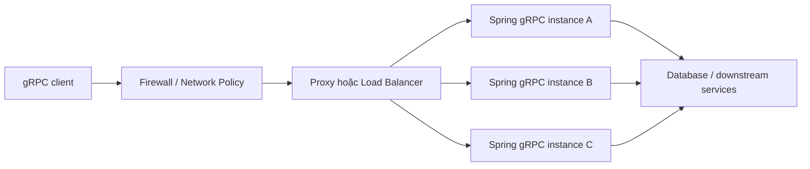
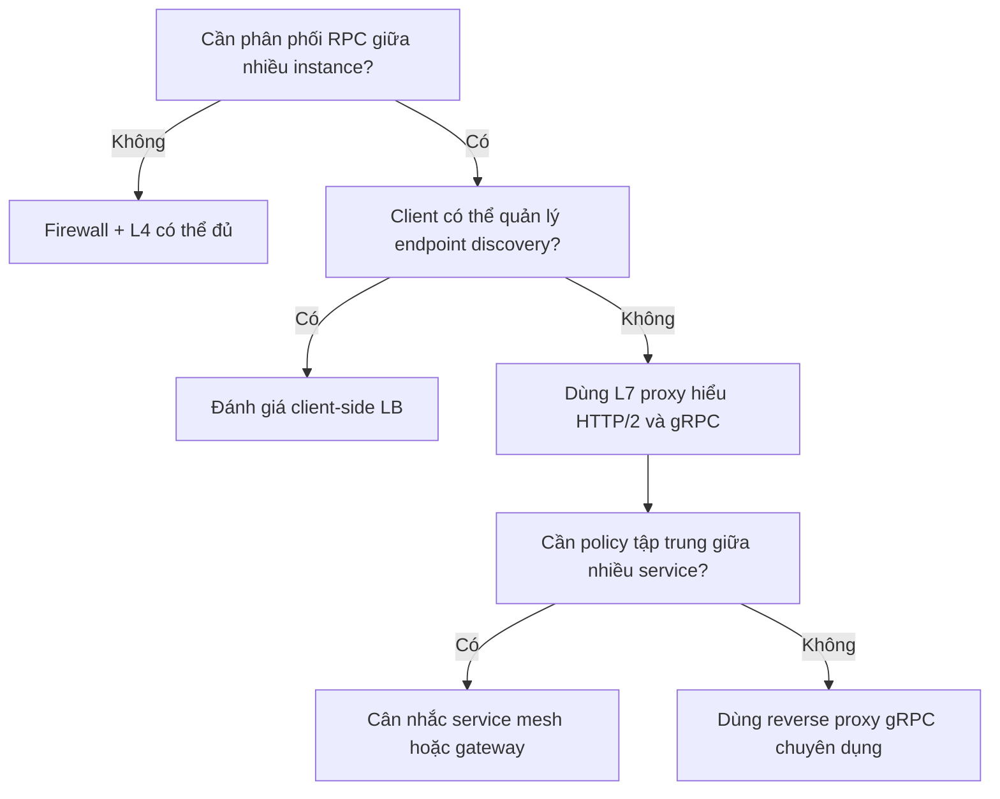
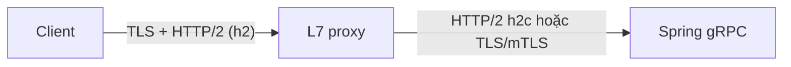

# Đánh giá firewall, proxy và load balancer

Khi triển khai dịch vụ Spring gRPC, firewall, proxy và load balancer cùng tham gia vào đường đi của một RPC nhưng đảm nhiệm các vai trò khác nhau. Firewall kiểm soát luồng mạng được phép đi qua. Proxy nhận kết nối rồi chuyển tiếp request đến backend. Load balancer chọn backend phục vụ request. Một sản phẩm có thể đảm nhiệm nhiều vai trò, nhưng cần đánh giá theo chức năng thực tế và cách nó xử lý HTTP/2.

Điểm quyết định của gRPC là HTTP/2 multiplexing: một kết nối TCP có thể mang nhiều RPC đồng thời. Vì vậy, load balancer phân phối kết nối ở tầng L4 có thể đưa toàn bộ RPC của một client đến cùng backend. Nếu cần phân phối từng RPC, định tuyến theo method hoặc áp dụng policy ở tầng ứng dụng, cần L7 proxy hiểu gRPC hoặc client-side load balancing.

## 1. Đặt đúng vai trò cho từng thành phần

### Firewall

Firewall áp dụng quy tắc ở tầng mạng hoặc tầng ứng dụng tùy sản phẩm. Firewall mạng thường kiểm soát địa chỉ nguồn/đích, giao thức và cổng TCP. Nó phù hợp để giới hạn ai có thể kết nối đến cổng gRPC, ai được phép truy cập cổng quản trị, và service nào được gọi backend nào.

Firewall mạng không đọc được ý nghĩa của từng RPC khi chỉ lọc TCP. Ví dụ, cho phép TCP đến cổng 9090 không có nghĩa là đã giới hạn client chỉ được gọi `OrderService/GetOrder`. Muốn giới hạn theo gRPC service, method hoặc metadata, cần policy ở L7 hoặc trong ứng dụng.

### Proxy

Proxy đứng giữa client và server. Tùy loại proxy, nó có thể chỉ chuyển tiếp byte của kết nối TCP, hoặc kết thúc HTTP/2, đọc từng request và mở kết nối upstream mới. Proxy L7 có thể hỗ trợ TLS termination, định tuyến theo authority/path, thêm hoặc xóa header, giới hạn request, kiểm tra health và ghi metrics.

Một proxy HTTP thông thường chỉ hỗ trợ HTTP/1.1 chưa chắc chuyển tiếp được gRPC. Proxy phải hỗ trợ HTTP/2 ở phía client và cấu hình HTTP/2 tương thích ở phía upstream. Cần xác nhận proxy giữ được gRPC trailers, status và hành vi streaming.

### Load balancer

Load balancer phân phối request hoặc kết nối đến các backend. Cách chọn backend phụ thuộc tầng hoạt động:

- L4 chọn backend khi thiết lập kết nối TCP.
- L7 chọn backend sau khi hiểu request HTTP/2/gRPC.
- Client-side load balancing chọn backend ngay trong gRPC channel của client dựa trên danh sách endpoint và policy.

Load balancer có thể nằm trong cloud, Kubernetes ingress/gateway, service mesh hoặc một thiết bị mạng riêng. Khi đánh giá, hãy xác định nó đang cân bằng theo kết nối, HTTP/2 stream hay từng RPC.



## 2. HTTP/2 làm thay đổi cách cân bằng tải

Trong HTTP/1.1, một client thường mở nhiều kết nối để thực hiện nhiều request đồng thời. Một L4 load balancer có thể phân phối các kết nối đó đến nhiều server. Với gRPC, client thường tái sử dụng một channel và kết nối HTTP/2. HTTP/2 cho phép nhiều RPC chạy trên các stream riêng biệt trong cùng một kết nối TCP.

Ví dụ, client mở một channel đến địa chỉ load balancer và thực hiện 100 RPC đồng thời. Nếu L4 load balancer chọn backend A khi TCP connection được tạo, tất cả 100 RPC trên connection đó có thể đi đến A. Khi nhiều client có số lượng kết nối khác nhau, tải có thể lệch đáng kể dù thuật toán L4 là round-robin.

| Cơ chế | Đơn vị phân phối | Hành vi với gRPC |
|---|---|---|
| L4 TCP load balancing | Kết nối TCP | Các RPC multiplex trên cùng connection thường cùng đến một backend |
| L7 gRPC-aware proxy | HTTP/2 stream/RPC | Có thể chọn backend cho từng RPC |
| Client-side load balancing | RPC do client khởi tạo | Client chọn endpoint cho mỗi RPC theo policy |
| Một stream đã thiết lập | Một RPC streaming | Toàn bộ message của stream ở lại backend đã nhận stream đó |

L4 vẫn hữu ích khi cần một điểm vào TCP đơn giản, giữ nguyên TLS end-to-end hoặc giảm chi phí proxy. Nhưng nếu yêu cầu là phân phối tải đều theo RPC ngắn, L4 đơn thuần có thể không đáp ứng.

L7 proxy có thể kết thúc HTTP/2 từ client, phân tích từng request và mở HTTP/2 stream đến backend phù hợp. Cách này thêm một chặng mạng và chi phí xử lý, nhưng cung cấp định tuyến theo method, health check ở tầng gRPC và các policy theo request.

Client-side load balancing loại bỏ hop proxy trung gian và có thể giảm latency. Đổi lại, client phải nhận được danh sách endpoint, phát hiện endpoint lỗi và áp dụng policy nhất quán. Hãy kiểm tra resolver và load-balancing policy thực sự được cấu hình trong gRPC channel; một channel chỉ trỏ tới một địa chỉ cố định không tự nhiên phân phối đến toàn bộ instance.

### Streaming và giới hạn của việc phân phối tải

Load balancer có thể chọn backend khi stream bắt đầu. Sau đó, stream là một RPC đang hoạt động và không thể chuyển nửa chừng sang instance khác. Nếu backend bị restart hoặc kết nối bị đứt, client có thể phải tạo RPC mới; ứng dụng cần xử lý trạng thái và khả năng tiếp tục từ checkpoint nếu nghiệp vụ yêu cầu.

Các stream dài cũng giữ tài nguyên của backend lâu hơn RPC unary. Một số ít client mở stream liên tục có thể làm phân phối tải mất cân bằng dù số lượng kết nối hoặc RPC ban đầu có vẻ nhỏ. Hãy đo số stream đang hoạt động, thời lượng stream, message rate và tài nguyên theo instance.

## 3. Chọn mô hình triển khai phù hợp

| Mô hình | Khi nên chọn | Đánh đổi chính |
|---|---|---|
| Firewall + L4 load balancer | Chuyển tiếp TCP đơn giản, TLS passthrough, ít cần định tuyến theo RPC | Không cân bằng từng RPC trên một HTTP/2 connection |
| L7 gRPC-aware proxy | Cần phân phối theo RPC, route theo method, health check gRPC hoặc policy tập trung | Thêm latency, cấu hình và điểm cần giám sát |
| Client-side load balancing | Client kiểm soát được resolver, endpoint discovery và policy; cần giảm hop trung gian | Mỗi loại client phải hỗ trợ và vận hành discovery/LB |
| API gateway | Cần một cổng vào có xác thực, quota, routing và quản trị API tập trung | Phải xác nhận gateway hỗ trợ native gRPC và streaming; một số tính năng chỉ hỗ trợ gRPC-Web |
| Service mesh | Nhiều service nội bộ cần mTLS, identity workload, routing và telemetry thống nhất | Tăng số proxy, cấu hình và chi phí vận hành |

Không chọn giải pháp chỉ dựa trên nhãn sản phẩm như “HTTP/2 supported”. Cần xác minh rõ sản phẩm hỗ trợ gRPC native, HTTP/2 upstream, trailers, streaming, health check và timeout theo cách ứng dụng yêu cầu.

### Cây quyết định



## 4. Thiết kế firewall và network policy

Firewall nên áp dụng nguyên tắc chỉ mở luồng cần thiết. Một cấu hình tham khảo:

| Luồng | Quy tắc gợi ý |
|---|---|
| Client bên ngoài → ingress/proxy | Chỉ mở cổng TLS công khai, thường là TCP 443 |
| Ingress/proxy → Spring gRPC | Chỉ cho phép từ subnet, security group hoặc workload identity của proxy đến cổng gRPC nội bộ |
| Client nội bộ → Spring gRPC | Chỉ mở nếu có use case gọi trực tiếp và có xác thực phù hợp |
| Spring gRPC → downstream | Chỉ cho phép đến các database/service và cổng thực sự cần dùng |
| Internet → cổng backend hoặc quản trị | Từ chối theo mặc định |
| Monitoring/health checker → endpoint kiểm tra | Chỉ cho phép nguồn health checker đã xác định |

Nếu Spring gRPC lắng nghe cổng 9090 phía sau ingress, thông thường không cần public cổng này ra Internet. Firewall hoặc Kubernetes NetworkPolicy nên giới hạn nguồn truy cập đến cổng đó. Client ngoài Internet chỉ nhìn thấy cổng ingress.

Ví dụ, ứng dụng có thể khai báo cổng server:

```yaml
spring:
  grpc:
    server:
      port: 9090
```

Trong Spring Boot dùng native gRPC server, `spring.grpc.server.port` cấu hình cổng gRPC. Nếu ứng dụng chạy qua servlet server tích hợp, thuộc tính này có thể bị bỏ qua và cổng web server `server.port` được sử dụng. Hãy xác nhận server factory đang chạy trước khi viết firewall rule.

Với Kubernetes, NetworkPolicy có thể giới hạn ingress đến pod chỉ từ namespace hoặc pod label của gateway. Ví dụ minh họa:

```yaml
apiVersion: networking.k8s.io/v1
kind: NetworkPolicy
metadata:
  name: orders-grpc-ingress
  namespace: applications
spec:
  podSelector:
    matchLabels:
      app: orders-grpc
  policyTypes:
    - Ingress
  ingress:
    - from:
        - namespaceSelector:
            matchLabels:
              kubernetes.io/metadata.name: edge
          podSelector:
            matchLabels:
              app: grpc-gateway
      ports:
        - protocol: TCP
          port: 9090
```

Selector trong ví dụ phải khớp label thực tế của cluster. NetworkPolicy chỉ có hiệu lực khi CNI của cluster hỗ trợ thực thi policy. Cũng cần kiểm tra egress policy: DNS, telemetry, database và các service downstream có thể bị chặn nếu namespace dùng default-deny.

Firewall L3/L4 không thay thế authentication của gRPC. Vẫn phải xác thực caller ở ứng dụng hoặc qua workload identity/mTLS và kiểm tra quyền trên từng method. Không dựa riêng vào địa chỉ IP để xác định người dùng cuối.

## 5. TLS termination và HTTP/2 ở từng hop

gRPC native chạy trên HTTP/2. Khi client dùng TLS, ALPN phải thương lượng được giao thức `h2`. Nếu proxy kết thúc TLS nhưng kết nối upstream lại dùng HTTP/1.1, request native gRPC có thể thất bại hoặc bị chuyển thành một giao thức khác.

Có ba mô hình phổ biến:

### TLS passthrough

Firewall hoặc L4 proxy chuyển tiếp TCP/TLS mà không giải mã. TLS được thiết lập trực tiếp giữa client và Spring gRPC server.

Ưu điểm là proxy không nhìn thấy token hoặc payload đã mã hóa, và server có thể xác thực chứng thư client trực tiếp khi dùng mTLS. Đổi lại, proxy không thể định tuyến theo gRPC method hoặc kiểm tra gRPC health. Nó thường chỉ chọn backend theo IP, port hoặc SNI nếu có thể đọc ClientHello mà không giải mã.

### TLS termination tại proxy, HTTP/2 nội bộ

Client thiết lập TLS/HTTP/2 đến proxy. Proxy giải mã request rồi tạo kết nối HTTP/2 đến Spring gRPC. Hop nội bộ có thể dùng HTTP/2 cleartext (h2c) trong mạng riêng hoặc TLS/mTLS.

Mô hình này cho phép proxy route theo path và thực hiện health check L7. Tuy nhiên, nếu hop nội bộ dùng h2c, dữ liệu đã giải mã không được mã hóa trên đoạn mạng đó. Chỉ dùng khi mạng nội bộ được bảo vệ và ranh giới tin cậy đã được đánh giá. Với môi trường nhiều node hoặc mạng dùng chung, nên mã hóa hop upstream và cân nhắc mTLS.

### TLS ở cả hai hop

Client dùng TLS đến proxy; proxy xác minh certificate của backend và thiết lập TLS mới đến Spring gRPC. Đây là mô hình phù hợp khi cần L7 routing nhưng vẫn muốn mã hóa dữ liệu trong mạng nội bộ. Nếu yêu cầu xác thực workload, bật mTLS và quản lý trust store/certificate rotation cho cả hai phía.



Với Spring gRPC dùng Netty, TLS/mTLS có thể được cấu hình qua SSL bundle và cấu hình server. Ví dụ:

```yaml
spring:
  grpc:
    server:
      port: 9090
      ssl:
        bundle: grpc-server
        client-auth: require
```

Tên `grpc-server` phải trỏ đến SSL bundle đã cấu hình trong Spring Boot. `client-auth: require` yêu cầu client trình bày certificate; trust material phải xác minh certificate client theo PKI của hệ thống. Khi proxy đã kết thúc TLS và kết nối upstream dùng h2c, không bật `client-auth: require` ở backend nếu proxy không gửi client certificate; thay vào đó cấu hình TLS/mTLS upstream phù hợp với kiến trúc.

## 6. Đánh giá proxy có hỗ trợ gRPC thật sự

Trước khi đưa proxy vào production, kiểm tra các khả năng sau:

- Nhận HTTP/2 qua TLS với ALPN `h2`.
- Gửi request đến upstream bằng HTTP/2, hoặc h2c nếu chủ đích dùng plaintext nội bộ.
- Giữ nguyên gRPC path dạng `/package.Service/Method`.
- Chuyển tiếp `content-type: application/grpc` và gRPC trailers, bao gồm `grpc-status` và `grpc-message`.
- Hỗ trợ unary, server streaming, client streaming và bidirectional streaming.
- Không buffer toàn bộ stream theo cách làm mất lợi ích streaming hoặc gây tăng độ trễ.
- Có cấu hình connect timeout, idle/read timeout, request deadline hoặc route timeout rõ ràng.
- Có health check gRPC hoặc cơ chế readiness phù hợp.
- Có giới hạn concurrent streams, header size, connection count và buffer.
- Có metrics theo upstream, method, status và thời gian xử lý.

gRPC thường trả HTTP status `200` ngay cả khi RPC kết thúc với trạng thái lỗi. Trạng thái nghiệp vụ gRPC nằm trong trailer `grpc-status`. Một proxy hoặc hệ thống giám sát chỉ nhìn HTTP status có thể báo request thành công dù RPC thực tế trả `UNAUTHENTICATED`, `PERMISSION_DENIED` hoặc `UNAVAILABLE`.

Một số API gateway chỉ hỗ trợ gRPC-Web. gRPC-Web là giao thức tương thích trình duyệt, thường cần proxy chuyển đổi sang gRPC native ở backend. Nó không đồng nghĩa gateway có thể nhận mọi loại native gRPC, đặc biệt là client streaming hoặc bidirectional streaming. Hãy kiểm tra ma trận tính năng và giới hạn của phiên bản đang triển khai.

## 7. Ví dụ reverse proxy với NGINX

NGINX có module `ngx_http_grpc_module` với directive `grpc_pass` để chuyển tiếp request gRPC. Ví dụ rút gọn sau nhận TLS/HTTP/2 ở cổng 443 rồi chuyển tiếp HTTP/2 cleartext đến các backend nội bộ:

```nginx
upstream spring_grpc_upstream {
    server 10.20.0.11:9090;
    server 10.20.0.12:9090;
    server 10.20.0.13:9090;
}

server {
    listen 443 ssl;
    http2 on;
    server_name grpc.example.com;

    ssl_certificate     /etc/nginx/tls/server.crt;
    ssl_certificate_key /etc/nginx/tls/server.key;

    location / {
        grpc_pass grpc://spring_grpc_upstream;
        grpc_read_timeout 75s;
        grpc_send_timeout 75s;
    }
}
```

Directive `http2 on` áp dụng cho các phiên bản NGINX mới; với phiên bản cũ hơn, cú pháp bật HTTP/2 có thể được khai báo trong `listen`. Kiểm tra tài liệu đúng phiên bản NGINX trước khi triển khai.

`grpc_pass grpc://` dùng kết nối HTTP/2 không TLS đến upstream. Nếu upstream yêu cầu TLS, dùng scheme `grpcs://` và cấu hình xác minh certificate upstream, tên server và trust certificate theo tài liệu NGINX. Không tắt xác minh certificate để né lỗi cấu hình.

`grpc_read_timeout` và `grpc_send_timeout` là khoảng thời gian tối đa giữa hai lần đọc hoặc ghi liên tiếp, không phải deadline tổng thể của toàn RPC. Nếu stream không gửi dữ liệu trong khoảng timeout, proxy có thể đóng kết nối dù RPC vẫn hợp lệ theo nghiệp vụ. Chọn timeout theo khoảng im lặng lớn nhất dự kiến của stream và kiểm thử bằng traffic thực tế.

NGINX có thể chuyển tiếp trailer từ upstream đến client. Tuy nhiên, cần kiểm thử gRPC status và lỗi khi upstream đóng kết nối. Khi proxy gặp timeout giữa lúc đang truyền response, nó không thể chuyển response đã gửi dở sang backend khác một cách trong suốt. Không cấu hình retry mù cho RPC có side effect hoặc stream đã bắt đầu phát dữ liệu.

## 8. Timeout, deadline và keepalive

Ba cơ chế này giải quyết các vấn đề khác nhau:

| Cơ chế | Ý nghĩa | Nơi cấu hình |
|---|---|---|
| gRPC deadline | Thời hạn tối đa client chờ một RPC hoàn tất | Client gRPC |
| Proxy timeout | Giới hạn kết nối, thời gian chờ upstream hoặc khoảng không có dữ liệu | Reverse proxy/load balancer |
| HTTP/2 keepalive | PING để kiểm tra kết nối còn hoạt động | gRPC client/server và một số proxy |
| Health check | Kiểm tra instance có sẵn sàng nhận RPC hay không | Load balancer/orchestrator và health service |

Deadline của client nên là giới hạn tổng thể của RPC. Timeout tại proxy phải đủ để không cắt request hợp lệ trước deadline dự kiến, có tính đến thời gian thiết lập kết nối và xử lý. Nếu proxy timeout ngắn hơn deadline, client có thể nhận lỗi do proxy đóng kết nối trước khi gRPC deadline hết hạn. Nếu proxy timeout quá dài, tài nguyên có thể bị giữ lâu khi backend treo.

Ví dụ, với unary RPC có deadline 5 giây, có thể đặt timeout upstream cao hơn một chút để chừa overhead, trong khi deadline client vẫn là giới hạn nghiệp vụ. Với streaming RPC có thể tồn tại nhiều phút hoặc nhiều giờ, timeout tổng thể ngắn cố định thường không phù hợp; cần timeout cho khoảng idle và cơ chế đóng stream có chủ đích.

Keepalive PING không thay thế health check và cũng không kéo dài deadline RPC. Một số proxy áp dụng idle timeout theo hoạt động HTTP/2 hoặc TCP; không giả định PING luôn được tính như response data. Kiểm tra cách proxy xử lý PING và idle connection bằng thử nghiệm.

Tránh cấu hình client gửi keepalive quá thường xuyên. Server hoặc proxy có thể giới hạn tần suất PING và từ chối connection nếu client vi phạm policy. Đồng bộ `keepalive time`, `keepalive timeout`, idle timeout và giới hạn connection age giữa các thành phần.

## 9. Health check, readiness và graceful draining

Một TCP connect thành công chỉ chứng minh cổng đang nhận kết nối. Nó không chứng minh service đã nạp cấu hình, kết nối database, sẵn sàng xử lý request hoặc có thể thực hiện nghiệp vụ.

Ưu tiên gRPC Health Checking Protocol (`grpc.health.v1.Health`) nếu load balancer hỗ trợ. Health service cung cấp trạng thái theo service name; proxy có thể gọi RPC health check thay vì chỉ mở TCP socket. Envoy hỗ trợ active health check bằng gRPC. Nếu dùng HTTP actuator endpoint, hãy xác nhận proxy thực sự kiểm tra HTTP endpoint đó và endpoint phản ánh readiness của ứng dụng.

Phân biệt các trạng thái:

- **Startup:** ứng dụng đã hoàn tất giai đoạn khởi động hay chưa.
- **Liveness:** tiến trình có còn hoạt động hay cần được khởi động lại.
- **Readiness:** instance có thể nhận request mới hay chưa.
- **gRPC health:** trạng thái service được công bố qua health protocol.

Không gắn liveness với một dependency tạm thời như database nếu việc restart liên tục không giúp phục hồi. Readiness có thể chuyển sang `NOT_SERVING` khi ứng dụng cần ngừng nhận RPC mới.

Khi triển khai phiên bản mới hoặc scale down, quy trình draining nên:

1. Đánh dấu instance không còn ready để load balancer ngừng gửi RPC mới.
2. Chờ thời gian cập nhật endpoint/health state lan truyền.
3. Ngừng nhận RPC mới và cho RPC đang chạy hoàn tất trong grace period.
4. Sau grace period, đóng các kết nối/stream còn lại theo policy.
5. Chỉ kết thúc tiến trình sau khi hoàn tất hoặc hết thời gian chờ.

Spring Boot gRPC có thuộc tính `spring.grpc.server.shutdown.grace-period` để cấu hình thời gian chờ shutdown của server. Giá trị grace period của server, `terminationGracePeriodSeconds` của Kubernetes và thời gian deregistration của load balancer phải được phối hợp. Một stream vô hạn không thể tự hoàn tất trong thời gian drain; client và server cần quy tắc reconnect hoặc giới hạn thời lượng stream.

## 10. Retry, failover và tính idempotent

Retry ở client, proxy và service mesh có thể cộng dồn. Ví dụ, client thử 3 lần và proxy cũng thử 3 backend có thể tạo nhiều lần thực thi hơn dự kiến. Điều này đặc biệt nguy hiểm khi RPC thực hiện thanh toán, tạo đơn hàng hoặc ghi dữ liệu.

Chỉ bật retry khi:

- Lỗi nằm trong nhóm có thể retry theo policy, ví dụ một số trường hợp `UNAVAILABLE`.
- Request chưa được xử lý hoặc thao tác có tính idempotent.
- Deadline còn đủ thời gian cho lần thử tiếp theo.
- Có backoff và jitter để tránh retry đồng loạt.
- Có giới hạn số lần thử và retry budget.

Với thao tác tạo tài nguyên hoặc ghi dữ liệu, thiết kế idempotency key hoặc cơ chế deduplication ở tầng nghiệp vụ. Không giả định proxy biết một RPC đã thực hiện side effect hay chưa.

Đối với streaming, không thể chuyển một stream đang chạy sang backend khác mà vẫn giữ nguyên trạng thái stream. Nếu connection bị ngắt, client phải khởi tạo RPC mới và ứng dụng cần xác định message nào đã được xử lý. Có thể dùng sequence number, checkpoint, resume token hoặc acknowledgment theo nghiệp vụ để tiếp tục an toàn.

Lỗi HTTP 502/503/504 ở proxy và gRPC status `UNAVAILABLE` không luôn có cùng ý nghĩa. Hãy kiểm tra status mà client nhận được, trailer `grpc-status`, log upstream và thời điểm lỗi trước khi thêm retry.

## 11. Giới hạn tài nguyên và bảo vệ proxy

Proxy và load balancer cũng có giới hạn tài nguyên. Khi đánh giá cấu hình, kiểm tra:

- Số kết nối TCP đồng thời và số HTTP/2 streams trên mỗi connection.
- Số RPC đồng thời trên mỗi backend và giới hạn concurrency.
- Kích thước request headers/metadata và kích thước message.
- Giới hạn buffer, memory và queue khi upstream chậm.
- Connection idle timeout, maximum connection age và keepalive.
- Circuit breaker, outlier detection và cách loại backend lỗi.
- Giới hạn tốc độ hoặc quota theo client/service nếu có yêu cầu.
- Cách proxy phản ứng khi backend quá tải hoặc trả `RESOURCE_EXHAUSTED`.

Không đặt giới hạn chỉ theo thông lượng trung bình. Một client có thể mở nhiều stream, gửi burst hoặc gửi metadata quá lớn. Dùng load test để đo peak concurrent RPC, stream duration, message size, latency và bộ nhớ của cả proxy lẫn Spring gRPC instance.

Firewall/WAF ở L7 cần được kiểm tra riêng về hỗ trợ gRPC. Một số rule HTTP giả định request có body hoàn chỉnh hoặc chỉ hiểu HTTP/1.1; chúng có thể làm hỏng streaming hoặc chặn nhầm frame gRPC. Nếu WAF không hiểu gRPC, dùng policy mạng và authentication trong ứng dụng thay vì bật rule HTTP chung một cách thiếu kiểm chứng.

## 12. Quan sát và chẩn đoán đường đi của RPC

Để tìm đúng thành phần gây lỗi, cần quan sát cả client, proxy và server. Nên thu thập:

| Tầng | Dữ liệu cần quan sát |
|---|---|
| Client | RPC method, deadline, gRPC status, retry count, channel state, latency |
| Firewall/network | Flow bị allow/deny, TCP reset, packet loss, connection timeout |
| Proxy/LB | Selected upstream, upstream connect time, response time, reset reason, active streams, retry |
| Spring gRPC | Method, gRPC status, request duration, active calls, queue/thread pool, lỗi ứng dụng |
| Downstream | Latency và lỗi database/service mà RPC phụ thuộc |

Propagate trace context qua các hop bằng thư viện tracing. Dùng request ID để đối chiếu log khi cần, nhưng không ghi bearer token hoặc metadata nhạy cảm. Đảm bảo proxy không xóa trace headers hoặc tự tạo giá trị xung đột mà không có policy rõ ràng.

Các dấu hiệu thường gặp:

- `UNAVAILABLE` xuất hiện cùng TCP reset: kiểm tra proxy, backend restart, network policy và connection age.
- `DEADLINE_EXCEEDED` tập trung ở một route: so sánh client deadline với proxy timeout và thời gian xử lý backend.
- HTTP 200 nhưng RPC báo lỗi: kiểm tra `grpc-status` trong trailers.
- Một instance quá tải dù tổng traffic thấp: kiểm tra HTTP/2 connection pinning, stream dài và cách LB chọn backend.
- Stream bị đóng sau một khoảng im lặng cố định: kiểm tra idle/read timeout ở từng hop.
- Client kết nối được nhưng RPC không đến service: kiểm tra HTTP/2 ALPN, upstream protocol, path routing và trailer handling.

## 13. Quy trình đánh giá trước khi chọn giải pháp

Thực hiện theo thứ tự để tránh chọn thiết bị rồi mới phát hiện giao thức không tương thích:

1. **Mô tả traffic:** tỷ lệ unary/streaming, số RPC đồng thời, thời lượng stream, kích thước message và yêu cầu latency.
2. **Xác định ranh giới mạng:** client ở đâu, proxy ở đâu, backend ở đâu, service nào được gọi trực tiếp.
3. **Chốt yêu cầu bảo mật:** TLS termination ở đâu, có cần mTLS không, ai được phép gọi method nào, metadata nào được tin cậy.
4. **Chọn tầng load balancing:** L4 nếu cân bằng connection là đủ; L7 nếu cần phân phối từng RPC; client-side nếu client quản lý được discovery.
5. **Kiểm tra protocol:** HTTP/2 và ALPN ở phía ngoài, HTTP/2/h2c/TLS ở upstream, gRPC trailers và streaming.
6. **Đặt timeout và health policy:** deadline, idle timeout, keepalive, health check, readiness và graceful drain.
7. **Kiểm thử lỗi:** backend restart, proxy reload, mất kết nối, timeout, stream idle, certificate hết hạn và backend quá tải.
8. **Đo dưới tải:** kiểm tra phân phối RPC theo instance, p95/p99 latency, active streams, reset, retry và tài nguyên proxy.

### Ma trận kiểm thử nghiệm thu

| Bài kiểm thử | Kết quả cần đạt |
|---|---|
| Unary qua proxy | Client nhận response và đúng gRPC status |
| Server/client/bidirectional streaming | Message đi hai chiều đúng thứ tự; stream không bị buffer hoặc cắt sớm |
| Nhiều RPC trên một HTTP/2 connection | L7/client-side LB phân phối theo policy đã chọn |
| Backend bị đánh dấu unhealthy | RPC mới không được gửi đến backend đó |
| Backend restart khi đang có stream | Client nhận lỗi phù hợp và có thể reconnect theo thiết kế |
| TLS và mTLS | Certificate, hostname, ALPN và trust chain được xác minh |
| RPC chạm deadline | Client nhận `DEADLINE_EXCEEDED` theo budget đã đặt |
| Proxy idle timeout | Hành vi đóng stream đúng policy, không gây timeout ngoài dự kiến |
| Backend rolling update | Instance drain request mới và xử lý request đang chạy trong grace period |
| Backend trả gRPC error | `grpc-status` được giữ nguyên qua proxy |
| Backend quá tải | Circuit breaker/limit hoạt động; không tạo retry storm |

Có thể dùng `grpcurl` để kiểm tra kết nối và method ở môi trường staging:

```bash
grpcurl -v grpc.example.com:443 list

grpcurl -v \
  -H 'authorization: Bearer <access-token>' \
  -d '{"orderId":"A-100"}' \
  grpc.example.com:443 \
  orders.v1.OrderService/GetOrder
```

Lệnh `list` yêu cầu reflection được bật và được phép truy cập. Nếu production tắt reflection, dùng descriptor set hoặc file `.proto` tương ứng. Không đặt token thật vào shell history hoặc log CI.

## 14. Checklist triển khai

- [ ] Chỉ public cổng ingress cần thiết; giới hạn truy cập đến cổng backend.
- [ ] Firewall/NetworkPolicy cho phép đúng nguồn và đích.
- [ ] Xác định rõ LB đang cân bằng TCP connection hay từng RPC.
- [ ] Proxy hỗ trợ native gRPC, HTTP/2 upstream, trailers và loại streaming đang dùng.
- [ ] ALPN `h2`, SNI, hostname và certificate được xác minh đúng.
- [ ] Chọn rõ TLS passthrough, TLS termination hoặc TLS/mTLS trên cả hai hop.
- [ ] Đặt deadline, timeout và idle timeout nhất quán.
- [ ] Health check phản ánh readiness của gRPC service.
- [ ] Có graceful draining khi scale down hoặc rolling update.
- [ ] Retry chỉ áp dụng cho thao tác an toàn và có giới hạn.
- [ ] Giám sát gRPC status, active streams, upstream reset và phân phối tải.
- [ ] Kiểm thử unary, streaming, lỗi mạng và failover trước production.

## 15. Tài liệu tham khảo

- [gRPC Load Balancing](https://grpc.io/blog/grpc-load-balancing/) — so sánh L3/L4 proxy, L7 proxy và client-side load balancing.
- [gRPC Load Balancing trong gRPC Core](https://grpc.github.io/grpc/core/md_doc_load-balancing.html) — mô hình chọn subchannel theo từng RPC và các policy phía client.
- [gRPC Performance Best Practices](https://grpc.io/docs/guides/performance/) — tái sử dụng channel, keepalive và giới hạn phân phối tải của stream.
- [gRPC Core Concepts](https://grpc.io/docs/what-is-grpc/core-concepts/) — vòng đời RPC và deadline.
- [NGINX gRPC Module](https://nginx.org/en/docs/http/ngx_http_grpc_module.html) — `grpc_pass`, timeout, upstream và trailer forwarding.
- [Envoy Health Checking](https://www.envoyproxy.io/docs/envoy/latest/intro/arch_overview/upstream/health_checking) — active health check HTTP, gRPC và L3/L4.
- [Spring gRPC Server Reference](https://docs.spring.io/spring-grpc/reference/server.html) — cấu hình server và TLS/mTLS.
- [Spring Boot gRPC Properties](https://docs.spring.io/spring-boot/appendix/application-properties/) — các thuộc tính `spring.grpc.server.*`, port và SSL bundle.
