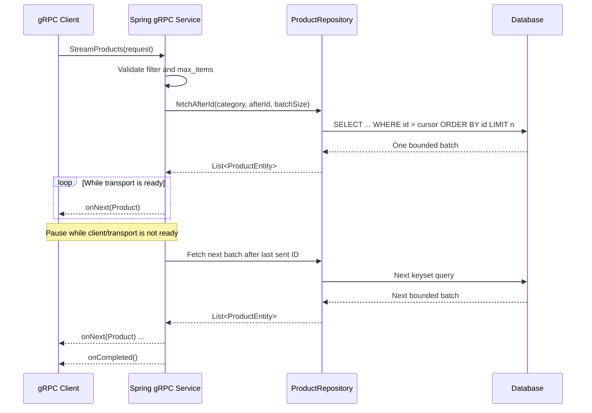

# Tạo server streaming cho danh sách lớn

Trong dự án này, bạn xây dựng một RPC server streaming để trả về danh sách sản phẩm lớn từ dịch vụ Spring gRPC. Client gửi một yêu cầu có bộ lọc và giới hạn số bản ghi; server đọc dữ liệu theo từng lô nhỏ, gửi từng message qua HTTP/2 và dừng khi hoàn tất, hết giới hạn hoặc client hủy call.

Mục tiêu không chỉ là thay `repeated Product` bằng `stream Product` trong Protocol Buffers. Một luồng có thể tồn tại lâu, client có thể đọc chậm hoặc ngắt kết nối, còn dữ liệu có thể lớn hơn nhiều lần bộ nhớ của tiến trình. Thiết kế cần kết hợp truy vấn phân trang theo khóa, flow control, deadline, cancellation, xử lý lỗi và kiểm thử với dữ liệu đủ lớn.

## 1. Mục tiêu và yêu cầu đầu ra

Xây dựng chức năng `StreamProducts` với các yêu cầu sau:

1. Client có thể lọc sản phẩm theo danh mục và chỉ định vị trí bắt đầu cùng số lượng tối đa cần nhận.
2. Server gửi từng `Product` qua server streaming RPC, theo thứ tự ID tăng dần.
3. Server đọc dữ liệu theo lô có kích thước giới hạn; không tải toàn bộ danh sách vào heap.
4. Server tôn trọng trạng thái sẵn sàng gửi của gRPC và dừng đọc database khi client không nhận kịp.
5. Server dừng công việc khi client hủy call hoặc deadline hết hạn.
6. Lỗi đầu vào và lỗi nội bộ được ánh xạ sang gRPC status phù hợp, không đưa chi tiết nhạy cảm vào description.
7. Client có thể xử lý từng message, kiểm soát tốc độ nhận và tiếp tục từ ID cuối cùng đã xử lý khi cần.

**Kết quả cần bàn giao:**

- File `.proto` định nghĩa contract streaming.
- Repository truy vấn keyset theo từng lô.
- Spring gRPC service triển khai `StreamProducts`.
- Client nhận và xử lý từng message.
- Kiểm thử dữ liệu rỗng, nhiều lô, hủy call, deadline và client đọc chậm.
- Báo cáo đo thời gian, throughput và bộ nhớ khi chạy tập dữ liệu lớn.

## 2. Kiến trúc luồng dữ liệu

Client gửi một yêu cầu. Server xác thực và kiểm tra giới hạn, sau đó truy vấn một lô nhỏ. Khi gRPC báo có thể gửi (`isReady()`), server gửi message cho đến khi hết lô hoặc kênh không còn sẵn sàng. Khi lô hiện tại đã dùng hết, server mới đọc lô tiếp theo.



Mỗi lớp có một trách nhiệm:

| Thành phần | Trách nhiệm |
|---|---|
| Protocol Buffers | Mô tả request và từng message sản phẩm được gửi |
| Spring gRPC service | Kiểm tra request, điều phối luồng và ánh xạ entity sang protobuf |
| Repository | Truy vấn có thứ tự theo cursor, giới hạn số dòng mỗi lần đọc |
| gRPC flow control | Báo cho server khi có thể tiếp tục gửi message |
| Client | Xử lý từng message, áp dụng backpressure và hủy khi không còn cần dữ liệu |

## 3. Bước 1 — Định nghĩa contract Protocol Buffers

Tạo hoặc cập nhật file `src/main/proto/product_catalog.proto`:

```protobuf
syntax = "proto3";

package catalog.v1;

option java_multiple_files = true;
option java_package = "com.example.catalog.grpc";
option java_outer_classname = "ProductCatalogProto";

service ProductCatalogService {
  rpc StreamProducts(StreamProductsRequest) returns (stream Product);
}

message StreamProductsRequest {
  // Bộ lọc tùy chọn. Chuỗi rỗng nghĩa là không lọc theo category.
  string category = 1;

  // ID cuối cùng client đã xử lý. Chỉ trả về các ID lớn hơn giá trị này.
  // Ví dụ giả định ID là số dương và có thứ tự ổn định.
  int64 after_product_id = 2;

  // Số message tối đa cho một RPC; server áp dụng giới hạn cứng.
  int32 max_items = 3;
}

message Product {
  int64 id = 1;
  string sku = 2;
  string name = 3;
  int64 price_minor = 4;
  string currency = 5;
}
```

Điểm quan trọng của contract là `returns (stream Product)`: mỗi `onNext` tương ứng với một message sản phẩm. Client không phải đợi server tạo một message chứa hàng chục nghìn phần tử rồi mới nhận được kết quả.

`after_product_id` cho phép client tiếp tục sau một lần ngắt kết nối. Trong ví dụ học tập, ID là khóa tăng dần có thể dùng làm cursor. Với API công khai, nếu ID database là thông tin nội bộ, hãy thay trường này bằng cursor opaque được server ký hoặc mã hóa; không tin cậy cursor do client tự sửa. `max_items` giới hạn lượng công việc của một RPC và cần được server kiểm tra, không giao quyền đặt giới hạn vô hạn cho client.

Khi server gửi đủ `max_items`, RPC kết thúc. Client có thể mở RPC tiếp theo từ ID cuối cùng đã xử lý; nếu lần gọi trước vừa đúng giới hạn, lần gọi tiếp theo có thể trả về stream rỗng nếu không còn dữ liệu.

Sau khi thay đổi `.proto`, chạy task codegen của Gradle hoặc Maven trong dự án để sinh `ProductCatalogServiceGrpc`, `StreamProductsRequest` và `Product`. Không chỉnh sửa trực tiếp file Java được sinh.

## 4. Bước 2 — Truy vấn database theo keyset pagination

Không dùng `findAll()` hoặc tải toàn bộ kết quả vào `List<ProductEntity>` rồi mới gọi `onNext`. Cách đó khiến heap tăng theo kích thước dữ liệu, tạo nhiều object và làm thời gian phản hồi message đầu tiên kéo dài.

Dùng keyset pagination: mỗi truy vấn lấy các dòng có ID lớn hơn cursor gần nhất, sắp xếp theo cùng một khóa và giới hạn số dòng. Ví dụ SQL:

```sql
SELECT id, sku, name, price_minor, currency
FROM products
WHERE category = :category
  AND id > :after_id
ORDER BY id ASC
LIMIT :batch_size;
```

Khi `category` rỗng, repository nên dùng câu truy vấn riêng bỏ điều kiện `category` thay vì biểu thức `:category = '' OR ...`; hai dạng truy vấn riêng thường giúp database chọn index phù hợp hơn.

Trong ứng dụng thật, thêm điều kiện phạm vi tenant và quyền truy cập lấy từ danh tính đã xác thực, ví dụ `tenant_id = :authenticated_tenant_id`. Không lấy tenant ID đáng tin cậy trực tiếp từ một field request. Dùng parameter binding của repository để truyền category và cursor; không ghép chuỗi SQL từ dữ liệu client.

Một interface repository đơn giản:

```java
public interface ProductRepository {

    /**
     * Trả về tối đa limit dòng, có thứ tự id tăng dần,
     * chỉ gồm các dòng có id > afterId.
     */
    List<ProductEntity> fetchAfterId(
            String category,
            long afterId,
            int limit);
}
```

Ví dụ ánh xạ sang entity Java:

```java
public record ProductEntity(
        long id,
        String sku,
        String name,
        long priceMinor,
        String currency) {
}
```

Truy vấn cần có index phù hợp, tối thiểu xem xét index trên `(category, id)` hoặc tổ hợp theo thứ tự lọc thực tế của database. Kiểm tra execution plan bằng dữ liệu gần với production; một câu SQL có `LIMIT` vẫn có thể chậm nếu database phải quét và sort nhiều dòng.

**Vì sao dùng keyset thay vì OFFSET?** Với `OFFSET 500000 LIMIT 100`, database có thể phải đi qua lượng lớn dòng trước khi trả trang tiếp theo. Cursor `id > lastId` tận dụng index và không làm chi phí truy vấn tăng tuyến tính theo số trang. Điều kiện là thứ tự phải ổn định và khóa sắp xếp phải duy nhất hoặc có tie-breaker rõ ràng.

Trong ví dụ, ID tăng dần là khóa duy nhất. Nếu sắp xếp theo `created_at`, hãy dùng cặp `(created_at, id)` để xử lý các bản ghi có cùng timestamp. Nếu dữ liệu có thể bị thêm, sửa hoặc xóa trong lúc stream, hãy xác định semantics của snapshot. Một high-water mark có thể loại bản ghi mới được thêm sau thời điểm bắt đầu, nhưng không tự bảo đảm nội dung của các dòng cũ không đổi; cần snapshot/versioning nếu nghiệp vụ yêu cầu kết quả nhất quán tuyệt đối.

Không giữ một transaction database mở trong suốt thời gian sống của RPC nếu không có yêu cầu snapshot rõ ràng; stream dài có thể giữ connection và snapshot lâu, gây áp lực lên pool hoặc vacuum/version cleanup. Thông thường, mỗi lần lấy batch dùng một transaction ngắn. Nếu nghiệp vụ yêu cầu snapshot nhất quán xuyên suốt nhiều batch, hãy thiết kế cơ chế snapshot có giới hạn thời gian và tài nguyên riêng.

## 5. Bước 3 — Cài đặt server streaming có flow control

`StreamObserver` cung cấp `onNext`, `onError` và `onCompleted`. Ở phía server, ép kiểu observer sang `ServerCallStreamObserver` để sử dụng `isReady()`, `setOnReadyHandler()` và `setOnCancelHandler()`.

Nếu server gọi `onNext` liên tục trong khi client đọc chậm, thư viện transport có thể phải giữ nhiều message đang chờ gửi. Vì vậy, không chỉ chia truy vấn thành batch; còn phải dừng phát message khi `isReady()` trả về `false`. Khi transport sẵn sàng trở lại, `onReadyHandler` đánh thức vòng gửi tiếp tục.

Ví dụ service dưới đây dùng một executor riêng để thực hiện truy vấn blocking, đọc tối đa 128 dòng mỗi batch và chỉ giữ một batch trong bộ nhớ của mỗi RPC:

```java
import io.grpc.ServerCallStreamObserver;
import io.grpc.Status;
import io.grpc.stub.StreamObserver;
import org.springframework.beans.factory.annotation.Qualifier;
import org.springframework.grpc.server.service.GrpcService;

import java.util.Collections;
import java.util.Iterator;
import java.util.List;
import java.util.concurrent.Executor;
import java.util.concurrent.RejectedExecutionException;
import java.util.concurrent.atomic.AtomicBoolean;

@GrpcService
public final class ProductCatalogGrpcService
        extends ProductCatalogServiceGrpc.ProductCatalogServiceImplBase {

    private static final int BATCH_SIZE = 128;
    private static final int MAX_ITEMS_PER_CALL = 50_000;

    private final ProductRepository repository;
    private final Executor streamExecutor;

    public ProductCatalogGrpcService(
            ProductRepository repository,
            @Qualifier("grpcStreamExecutor") Executor streamExecutor) {
        this.repository = repository;
        this.streamExecutor = streamExecutor;
    }

    @Override
    public void streamProducts(
            StreamProductsRequest request,
            StreamObserver<Product> responseObserver) {

        if (request.getMaxItems() < 1
                || request.getMaxItems() > MAX_ITEMS_PER_CALL
                || request.getAfterProductId() < 0) {
            responseObserver.onError(
                    Status.INVALID_ARGUMENT
                            .withDescription("Invalid stream range")
                            .asRuntimeException());
            return;
        }

        @SuppressWarnings("unchecked")
        ServerCallStreamObserver<Product> serverObserver =
                (ServerCallStreamObserver<Product>) responseObserver;

        AtomicBoolean cancelled = new AtomicBoolean(false);
        AtomicBoolean draining = new AtomicBoolean(false);
        AtomicBoolean terminal = new AtomicBoolean(false);

        final class StreamPump {
            private long lastId = request.getAfterProductId();
            private int emitted = 0;
            private Iterator<ProductEntity> currentBatch =
                    Collections.emptyIterator();

            void schedule() {
                if (cancelled.get()
                        || terminal.get()
                        || !draining.compareAndSet(false, true)) {
                    return;
                }

                try {
                    streamExecutor.execute(this::drain);
                } catch (RejectedExecutionException rejected) {
                    draining.set(false);
                    fail(Status.RESOURCE_EXHAUSTED
                            .withDescription("Stream capacity is unavailable"));
                }
            }

            private void drain() {
                try {
                    while (!cancelled.get()
                            && !serverObserver.isCancelled()
                            && serverObserver.isReady()) {

                        if (!currentBatch.hasNext()) {
                            List<ProductEntity> nextBatch =
                                    repository.fetchAfterId(
                                            request.getCategory(),
                                            lastId,
                                            BATCH_SIZE);

                            if (nextBatch.isEmpty()) {
                                complete();
                                return;
                            }
                            currentBatch = nextBatch.iterator();
                        }

                        ProductEntity entity = currentBatch.next();
                        lastId = entity.id();
                        serverObserver.onNext(toProto(entity));
                        emitted++;

                        if (emitted >= request.getMaxItems()) {
                            complete();
                            return;
                        }
                    }
                } catch (Exception failure) {
                    // Không đưa SQL, input hoặc exception message ra client.
                    fail(Status.INTERNAL
                            .withDescription("Unable to stream products"));
                } finally {
                    draining.set(false);
                    if (!cancelled.get()
                            && !terminal.get()
                            && !serverObserver.isCancelled()
                            && serverObserver.isReady()) {
                        schedule();
                    }
                }
            }

            private void complete() {
                if (terminal.compareAndSet(false, true)
                        && !serverObserver.isCancelled()) {
                    serverObserver.onCompleted();
                }
            }

            private void fail(Status status) {
                if (terminal.compareAndSet(false, true)
                        && !serverObserver.isCancelled()) {
                    serverObserver.onError(status.asRuntimeException());
                }
            }
        }

        StreamPump pump = new StreamPump();
        serverObserver.setOnCancelHandler(() -> cancelled.set(true));
        serverObserver.setOnReadyHandler(pump::schedule);
        pump.schedule();
    }

    private static Product toProto(ProductEntity entity) {
        return Product.newBuilder()
                .setId(entity.id())
                .setSku(entity.sku())
                .setName(entity.name())
                .setPriceMinor(entity.priceMinor())
                .setCurrency(entity.currency())
                .build();
    }
}
```

Đây là mẫu tham khảo cho service đồng bộ với repository blocking. Import của `@GrpcService` phụ thuộc phiên bản Spring gRPC đang dùng; ví dụ dùng package `org.springframework.grpc.server.service.GrpcService`. Nếu starter của dự án cung cấp package hoặc cách đăng ký khác, dùng API đúng phiên bản đó. Generated class và kiểu entity cũng phải khớp với tên package trong `.proto` và model của dự án.

Một số quyết định trong vòng gửi cần được hiểu rõ:

- `BATCH_SIZE` giới hạn số entity được giữ từ database cho mỗi RPC. Đây là giới hạn bộ nhớ phía ứng dụng, không phải số message gRPC bắt buộc gửi trong một lần.
- `isReady()` kiểm tra khả năng nhận thêm message của transport. Khi trả về `false`, vòng lặp dừng; `onReadyHandler` sẽ gọi `schedule()` khi có thể tiếp tục.
- `draining` bảo đảm chỉ có một worker chạy vòng gửi tại một thời điểm, kể cả khi callback ready xuất hiện gần lúc worker kết thúc.
- `terminal` bảo đảm chỉ gửi một tín hiệu kết thúc (`onCompleted` hoặc `onError`).
- `setOnCancelHandler` đánh dấu call đã bị hủy. Vòng lặp kiểm tra cờ này trước khi đọc và gửi tiếp.
- Executor bị từ chối tác vụ được ánh xạ thành `RESOURCE_EXHAUSTED`, báo hiệu server đang hết năng lực phục vụ.

`ServerCallStreamObserver` chỉ điều khiển việc phát message qua gRPC; nó không tự hủy câu SQL đang chạy. Nếu truy vấn có thể kéo dài, repository/driver cần hỗ trợ query timeout hoặc cancellation và cần truyền tín hiệu hủy đến tầng data access. Không tạo một thread mới cho mỗi RPC; hãy dùng executor có số thread và queue hữu hạn để giới hạn tài nguyên toàn hệ thống.

### 5.1. Cấu hình executor có giới hạn

Có thể cung cấp executor riêng bằng Spring bean:

```java
import org.springframework.context.annotation.Bean;
import org.springframework.context.annotation.Configuration;
import org.springframework.scheduling.concurrent.ThreadPoolTaskExecutor;

import java.util.concurrent.Executor;

@Configuration
public class GrpcStreamingConfiguration {

    @Bean
    public ThreadPoolTaskExecutor grpcStreamExecutor() {
        ThreadPoolTaskExecutor executor = new ThreadPoolTaskExecutor();
        executor.setCorePoolSize(8);
        executor.setMaxPoolSize(16);
        executor.setQueueCapacity(100);
        executor.setThreadNamePrefix("grpc-stream-");
        return executor;
    }
}
```

Các con số trên chỉ là giá trị khởi đầu cho bài thực hành, không phải cấu hình production mặc định. Cần điều chỉnh theo số RPC đồng thời, thời gian truy vấn, kích thước message, giới hạn connection pool và khả năng của database. Queue quá lớn có thể chỉ biến quá tải thành độ trễ và bộ nhớ chờ; queue hữu hạn giúp hệ thống từ chối sớm khi hết năng lực.

### 5.2. Giới hạn và xác thực request

Ngoài `max_items`, production service cần kiểm tra:

- Người gọi có quyền xem danh mục và tenant tương ứng hay không.
- `category` có độ dài và định dạng hợp lệ hay không.
- `after_product_id` có hợp lệ trong phạm vi người gọi hay không.
- Giới hạn số message, kích thước message và thời gian stream có phù hợp quota hay không.
- Số RPC streaming đồng thời của một client/tenant có vượt quota hay không.

Không dựa vào `max_items` do client gửi để phân quyền hoặc bảo vệ database duy nhất. Cần có quota server-side, deadline, giới hạn kích thước message, pool database và giới hạn số luồng đang chạy.

## 6. Bước 4 — Xây dựng client nhận từng message

Server streaming dùng asynchronous stub hoặc blocking stub. Với danh sách lớn, asynchronous stub cho phép xử lý từng message mà không cần đợi một danh sách hoàn chỉnh.

Ví dụ client sử dụng manual inbound flow control:

```java
import io.grpc.stub.ClientCallStreamObserver;
import io.grpc.stub.ClientResponseObserver;

import java.util.concurrent.TimeUnit;

public final class ProductStreamConsumer
        implements ClientResponseObserver<StreamProductsRequest, Product> {

    private ClientCallStreamObserver<StreamProductsRequest> call;
    private long lastProcessedId;

    @Override
    public void beforeStart(
            ClientCallStreamObserver<StreamProductsRequest> requestStream) {
        this.call = requestStream;
        // Chỉ yêu cầu một message ban đầu; message kế tiếp được yêu cầu
        // sau khi message hiện tại đã được xử lý.
        requestStream.disableAutoRequestWithInitial(1);
    }

    @Override
    public void onNext(Product product) {
        try {
            processProduct(product);
            lastProcessedId = product.getId();
            call.request(1);
        } catch (RuntimeException failure) {
            call.cancel("Product processing failed", failure);
        }
    }

    @Override
    public void onError(Throwable error) {
        // Ghi status code và correlation ID đã được làm sạch.
        // Có thể khởi động lại từ lastProcessedId theo retry policy.
    }

    @Override
    public void onCompleted() {
        // Hoàn tất xử lý stream.
    }

    public void cancel() {
        if (call != null) {
            call.cancel("No longer needed", null);
        }
    }

    public long lastProcessedId() {
        return lastProcessedId;
    }

    private void processProduct(Product product) {
        // Xử lý một sản phẩm; không tích lũy toàn bộ stream vào List.
    }
}
```

Khởi chạy bằng stub có deadline:

```java
ProductStreamConsumer consumer = new ProductStreamConsumer();

ProductCatalogServiceGrpc.newStub(channel)
        .withDeadlineAfter(2, TimeUnit.MINUTES)
        .streamProducts(
                StreamProductsRequest.newBuilder()
                        .setCategory("books")
                        .setAfterProductId(0)
                        .setMaxItems(20_000)
                        .build(),
                consumer);
```

Với manual flow control, client chỉ yêu cầu message tiếp theo sau khi xử lý xong message hiện tại. Nếu xử lý tốn thời gian, có thể chuyển công việc sang consumer executor có giới hạn và chỉ gọi `request(1)` sau khi xử lý hoàn tất. Không đưa từng message vào queue không giới hạn, vì như vậy client lại tích lũy toàn bộ dữ liệu trong bộ nhớ.

`lastProcessedId` phải được cập nhật sau khi xử lý và lưu kết quả thành công. Nếu cập nhật cursor trước khi lưu dữ liệu, client có thể bỏ sót message khi process bị lỗi. Nếu cần đảm bảo exactly-once ở tầng nghiệp vụ, cần thiết kế idempotency hoặc transaction cho việc ghi kết quả; gRPC streaming tự nó không cung cấp exactly-once delivery.

## 7. Bước 5 — Deadline, cancellation và retry

### 7.1. Đặt deadline rõ ràng

Client nên đặt deadline dựa trên số lượng dữ liệu, tốc độ xử lý dự kiến và ngân sách latency của hệ thống:

```java
ProductCatalogServiceGrpc.newStub(channel)
        .withDeadlineAfter(2, TimeUnit.MINUTES)
        .streamProducts(request, consumer);
```

Không dùng deadline vô hạn cho stream lớn. Deadline là tổng ngân sách thời gian của RPC, không phải timeout riêng cho mỗi message. Nếu nghiệp vụ cần stream kéo dài hàng giờ, nên chia thành nhiều RPC có cursor và deadline hữu hạn thay vì giữ một call vô thời hạn.

### 7.2. Dừng công việc khi client hủy

Client có thể hủy call khi người dùng đóng màn hình, không cần dữ liệu nữa hoặc consumer gặp lỗi. Server nhận tín hiệu qua `setOnCancelHandler`; vòng gửi phải ngừng đọc batch tiếp theo và không gọi thêm `onNext`.

Nếu repository đang chạy một truy vấn blocking, cờ cancellation chỉ ngăn các vòng tiếp theo. Cần cấu hình query timeout và dùng API cancellation của JDBC/driver nếu muốn dừng truy vấn hiện tại. Kiểm tra cả việc giải phóng cursor, connection và tài nguyên khi call bị hủy.

### 7.3. Tiếp tục sau lỗi mạng

Client có thể tạo RPC mới với `after_product_id` bằng ID cuối cùng đã xử lý thành công. Cách tiếp tục này chỉ đáng tin cậy nếu:

- Thứ tự stream ổn định và cursor tạo thành một thứ tự toàn phần.
- Việc xử lý message có tính idempotent hoặc được bảo vệ bằng khóa duy nhất.
- Semantics khi bản ghi bị sửa/xóa trong lúc stream đã được xác định.
- Cursor được xác thực; API công khai nên dùng opaque token thay cho ID database nếu cần che giấu cấu trúc nội bộ.

Không tự động retry mọi status. `UNAVAILABLE` hoặc lỗi mạng tạm thời có thể retry với exponential backoff và jitter. `INVALID_ARGUMENT`, `PERMISSION_DENIED` và `UNAUTHENTICATED` thường cần sửa request hoặc xác thực lại. `DEADLINE_EXCEEDED` cần đánh giá liệu tiếp tục từ cursor có an toàn hay không. Luôn giới hạn số lần retry và tổng thời gian retry.

## 8. Bước 6 — Kiểm thử chức năng và độ tin cậy

### 8.1. Kiểm thử thứ tự, bộ lọc và ranh giới batch

Tạo dữ liệu test có số lượng lớn hơn nhiều lần `BATCH_SIZE`, ví dụ 1.000 hoặc 10.000 sản phẩm. Dùng in-process gRPC server để kiểm thử contract và mapping mà không cần mở cổng TCP:

```java
import io.grpc.ManagedChannel;
import io.grpc.Server;
import io.grpc.inprocess.InProcessChannelBuilder;
import io.grpc.inprocess.InProcessServerBuilder;

import java.util.Iterator;
import java.util.concurrent.TimeUnit;

import static org.junit.jupiter.api.Assertions.assertEquals;
import static org.junit.jupiter.api.Assertions.assertTrue;

String serverName = InProcessServerBuilder.generateName();

Server server = InProcessServerBuilder.forName(serverName)
        .directExecutor()
        .addService(productCatalogGrpcService)
        .build()
        .start();

ManagedChannel channel = InProcessChannelBuilder.forName(serverName)
        .directExecutor()
        .build();

try {
    Iterator<Product> products =
            ProductCatalogServiceGrpc.newBlockingStub(channel)
                    .withDeadlineAfter(10, TimeUnit.SECONDS)
                    .streamProducts(request);

    long previousId = request.getAfterProductId();
    int count = 0;

    while (products.hasNext()) {
        Product product = products.next();
        assertTrue(product.getId() > previousId);
        previousId = product.getId();
        count++;
    }

    assertEquals(expectedCount, count);
} finally {
    channel.shutdownNow();
    server.shutdownNow();
}
```

Đoạn test cần đặt trong test fixture có repository giả lập hoặc database test. `InProcessServerBuilder` và `InProcessChannelBuilder` thuộc gRPC in-process transport; thêm test dependency tương ứng theo phiên bản gRPC đang dùng. Đảm bảo đóng channel và server trong mọi trường hợp.

Các ca kiểm thử tối thiểu:

| Ca kiểm thử | Kết quả mong đợi |
|---|---|
| Không có sản phẩm phù hợp | Stream kết thúc bình thường, không có `onNext` |
| Ít hơn một batch | Nhận đủ sản phẩm và `onCompleted` |
| Nhiều hơn một batch | Không thiếu hoặc trùng ID tại ranh giới batch |
| Có category filter | Chỉ nhận bản ghi phù hợp |
| Có `after_product_id` | Không nhận ID nhỏ hơn hoặc bằng cursor |
| `max_items` bằng 0 hoặc vượt giới hạn | `INVALID_ARGUMENT` |
| Repository phát sinh lỗi | Client nhận status lỗi đã chuẩn hóa, không lộ SQL/message nội bộ |
| Client hủy giữa stream | Server ngừng phát và không đọc vô hạn các batch còn lại |
| Deadline hết hạn | Client nhận `DEADLINE_EXCEEDED`; server dọn tài nguyên |

### 8.2. Kiểm thử client đọc chậm và flow control

Kiểm thử flow control cần một transport thực hoặc test harness có thể điều khiển nhu cầu nhận. Dùng client manual flow control, chỉ gọi `request(1)` sau khi xác nhận message hiện tại đã xử lý. Tạm dừng yêu cầu message trong một khoảng thời gian và quan sát server:

- Không tiếp tục truy vấn database vô hạn khi client không nhận.
- Không tích lũy danh sách lớn trong bộ nhớ ứng dụng.
- Tiếp tục gửi khi client yêu cầu thêm message.
- Dừng nhanh khi client cancel.

In-process transport hữu ích cho kiểm thử logic nhưng không thay thế kiểm thử Netty/HTTP/2 thực tế về TLS, socket, window và hành vi mạng. Bổ sung integration test trên transport mà hệ thống triển khai sử dụng.

### 8.3. Kiểm thử tải và giới hạn tài nguyên

Chạy thử với nhiều kích thước dữ liệu, ví dụ 1.000, 10.000 và 50.000 bản ghi, đồng thời mô phỏng client có tốc độ xử lý khác nhau. Ghi nhận:

- Thời gian đến message đầu tiên (time to first message).
- Tổng thời gian hoàn tất và throughput (message/giây).
- Độ trễ truy vấn từng batch và số batch đã đọc.
- Heap sử dụng và GC pause khi tăng số bản ghi.
- Số RPC đồng thời, queue executor, số thread và connection pool database.
- Số call bị cancel, deadline exceeded và lỗi `RESOURCE_EXHAUSTED`.

Kỳ vọng bộ nhớ ứng dụng tăng theo batch size và số stream đồng thời, không tăng tuyến tính theo tổng số bản ghi của một stream. Nếu heap tăng gần tỷ lệ với tổng số message, kiểm tra xem client/server có đang tích lũy `List`, queue không giới hạn hoặc giữ reference đến entity đã gửi hay không.

## 9. Chạy thử theo thứ tự

1. Cập nhật `.proto` và chạy task generate source của build tool.
2. Cài đặt repository keyset query và xác nhận SQL dùng index mong đợi.
3. Đăng ký Spring gRPC service và executor có giới hạn.
4. Khởi động ứng dụng cùng database test có đủ dữ liệu.
5. Gọi `StreamProducts` bằng client asynchronous hoặc blocking để xác nhận thứ tự và bộ lọc.
6. Chạy client manual flow control, thử tạm dừng nhận rồi tiếp tục.
7. Hủy call giữa chừng và xác nhận server ngừng đọc batch mới.
8. Thử deadline ngắn, request sai và lỗi repository.
9. Chạy tải tăng dần và ghi lại các chỉ số ở mục 8.3.

Không đưa access token, payload nhạy cảm hoặc toàn bộ protobuf vào log khi chạy thử. Chỉ ghi method, status code, thời gian, batch count và correlation ID đã được kiểm tra.

## 10. Lỗi thường gặp và cách xử lý

| Triệu chứng | Nguyên nhân có thể | Cách kiểm tra hoặc khắc phục |
|---|---|---|
| Heap tăng theo số bản ghi | Gọi `findAll`, tích lũy `List`, hoặc client queue không giới hạn | Dùng keyset batch; xử lý từng message; giới hạn queue |
| Client nhận trùng hoặc thiếu sản phẩm | Cursor không cập nhật đúng, sort không ổn định hoặc điều kiện `>`/`>=` sai | Dùng khóa duy nhất, thứ tự rõ ràng và cập nhật cursor sau khi xử lý |
| Server vẫn truy vấn khi client đọc chậm | Không kiểm tra `isReady()` hoặc không nối `onReadyHandler` | Dừng pump khi not-ready và khởi động lại qua callback |
| Server tiếp tục làm việc sau cancel | Chỉ hủy phía client, không kiểm tra cancellation phía server | Đăng ký cancel handler, kiểm tra cờ trước mỗi lần fetch và cấu hình query timeout |
| RPC treo lâu | Deadline không được đặt hoặc công việc database không có timeout | Đặt deadline hữu hạn và timeout riêng cho data access |
| Nhiều stream làm cạn thread/DB | Executor hoặc queue không giới hạn, mỗi call tạo thread riêng | Dùng pool hữu hạn, quota và từ chối có kiểm soát |
| `RESOURCE_EXHAUSTED` xuất hiện thường xuyên | Server nhận nhiều stream hơn năng lực hoặc batch/queue không phù hợp | Đo tải, điều chỉnh quota và scale theo năng lực thực tế |
| Retry tạo bản ghi trùng ở client | Client đã xử lý message nhưng chưa lưu cursor hoặc thao tác không idempotent | Lưu kết quả và cursor theo transaction hoặc dùng idempotency key |

## 11. Checklist hoàn thành dự án

- [ ] Contract dùng server streaming `returns (stream Product)`.
- [ ] Request có filter, cursor và giới hạn số message được kiểm tra ở server.
- [ ] Repository dùng keyset pagination với thứ tự ổn định và batch size hữu hạn.
- [ ] Truy vấn có index phù hợp, parameter binding và kiểm soát phạm vi tenant.
- [ ] Service dùng `ServerCallStreamObserver.isReady()` và `setOnReadyHandler()`.
- [ ] Chỉ có một pump hoạt động cho mỗi call; trạng thái complete/error không bị gửi lặp.
- [ ] Client cancellation dừng vòng gửi và giải phóng tài nguyên data access.
- [ ] Executor, queue, database pool và số stream đồng thời đều có giới hạn.
- [ ] Client đặt deadline hữu hạn và có chiến lược retry/cursor phù hợp.
- [ ] Client không tích lũy toàn bộ message vào bộ nhớ; manual flow control được kiểm thử.
- [ ] Có test dữ liệu rỗng, nhiều batch, filter, cursor, lỗi, cancel và deadline.
- [ ] Có integration test trên transport thực và bài đo tải với client chậm.
- [ ] Log và metric không chứa payload hoặc credential.

## 12. Mở rộng sau bài thực hành

Khi phiên bản cơ bản hoạt động ổn định, có thể mở rộng theo các hướng sau:

1. Thay `after_product_id` bằng opaque cursor có chữ ký, gắn với filter và tenant để client không sửa được phạm vi truy vấn.
2. Dùng snapshot hoặc high-water mark để định nghĩa rõ dữ liệu nào thuộc một lần export.
3. Thêm quota theo user/tenant, giới hạn tổng byte và giới hạn thời gian stream.
4. Dùng cơ chế reactive hoặc database cursor nếu driver hỗ trợ backpressure end-to-end; vẫn cần kiểm soát tài nguyên và cancellation.
5. Thêm metric cho batch latency, số message, số byte, active streams và cancellation.
6. Kiểm thử TLS, xác thực metadata, deadline propagation và hoạt động qua proxy/service mesh.

Một server streaming tốt không chỉ gửi được nhiều message. Nó phải giữ bộ nhớ có giới hạn, phản ứng với tốc độ của client, dừng công việc khi không còn người nhận và cung cấp semantics rõ ràng khi client cần tiếp tục sau lỗi mạng.
