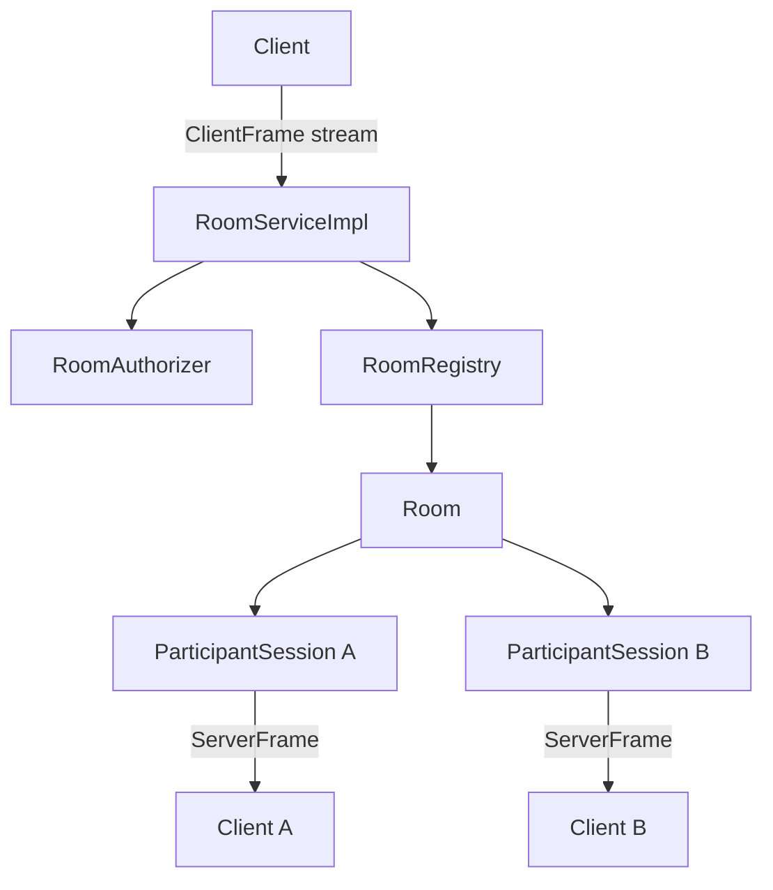

# Tạo bidi streaming cho phiên tương tác

Trong dự án này, bạn sẽ xây dựng một dịch vụ cộng tác đơn giản bằng Spring gRPC. Nhiều client có thể tham gia cùng một phòng, gửi thao tác trong khi vẫn nhận được acknowledgement và cập nhật từ những người tham gia khác. Mỗi client giữ một bidirectional streaming RPC mở trong suốt phiên.

Mục tiêu không chỉ là làm cho hai phía gửi được nhiều message. Bạn sẽ thiết kế hợp đồng protobuf, quản lý vòng đời stream, xử lý đồng thời, giới hạn hàng đợi gửi, xác thực metadata và kiểm thử các tình huống ngắt kết nối. Sau dự án, bạn có thể giải thích vì sao bidi streaming phù hợp với một phiên tương tác và những phần nào ứng dụng phải tự chịu trách nhiệm.

## 1. Kịch bản và phạm vi dự án

Xây dựng ứng dụng dòng lệnh mô phỏng một phòng cộng tác. Mỗi client kết nối đến server, tham gia một phòng bằng `room_id`, rồi có thể gửi nội dung. Server xác nhận thao tác cho người gửi và phát cập nhật đến các client khác trong cùng phòng.

Ví dụ luồng sử dụng:

1. Client A mở RPC `JoinRoom` và gửi frame `Join` chứa `room_id`.
2. Server xác thực danh tính từ metadata, kiểm tra quyền tham gia phòng và trả frame `Joined`.
3. Client B tham gia cùng phòng; server thông báo `MemberJoined` cho A và B.
4. A gửi `Publish` với một `operation_id` và nội dung. Server trả `Ack` cho A, đồng thời phát `MessageReceived` cho B.
5. B gửi tiếp một thao tác trong khi vẫn nhận được các message từ A.
6. Khi client rời phòng hoặc đóng request stream, server giải phóng thành viên và thông báo `MemberLeft` cho các client còn lại.

Phạm vi bản đầu tiên là một server instance và registry trong bộ nhớ. Khi server khởi động lại, các phòng và phiên đang mở bị mất. Dự án tập trung vào giao thức và vòng đời RPC; lưu trữ bền vững, đồng bộ nhiều server và giao diện đồ họa là phần mở rộng.

## 2. Mục tiêu học tập

Hoàn thành dự án sẽ giúp bạn:

- Định nghĩa RPC bidi trong Protocol Buffers và sinh mã Java.
- Triển khai server streaming hai chiều bằng `StreamObserver` trong một service Spring gRPC.
- Viết client giữ request observer để gửi nhiều frame và response observer để nhận message bất đồng bộ.
- Quản lý handshake, half-close, cancellation, lỗi terminal và cleanup tài nguyên.
- Định tuyến message đến đúng phòng và bảo đảm mỗi response stream được ghi tuần tự.
- Áp dụng backpressure với queue có giới hạn và trạng thái sẵn sàng của transport.
- Kiểm tra metadata xác thực, deadline, status và hành vi khi client mất kết nối.
- Viết integration test cho nhiều client cùng tương tác.

## 3. Yêu cầu chức năng

Server cần thực hiện các hành vi sau:

| Hành vi | Quy tắc |
| --- | --- |
| Tham gia phòng | Frame đầu tiên phải là `Join`; `room_id` không được rỗng và principal phải có quyền tham gia. |
| Gửi nội dung | Chỉ thành viên đã tham gia phòng mới được gửi `Publish`. Nội dung phải nằm trong giới hạn kích thước do ứng dụng đặt ra. |
| Xác nhận | Người gửi nhận `Ack` chứa `operation_id` và sequence đã được server chấp nhận. ACK phải có ý nghĩa rõ ràng: trong dự án này, ACK xác nhận server đã kiểm tra và chấp nhận thao tác vào luồng xử lý trong bộ nhớ. |
| Phát sự kiện | Các thành viên khác trong phòng nhận `MessageReceived` theo thứ tự server chấp nhận. Người gửi không nhận lại bản broadcast của chính mình nếu đã có ACK. |
| Heartbeat | Client có thể gửi `Ping`; server trả `Pong`. Heartbeat không thay thế xác thực hoặc kiểm tra quyền. |
| Rời phòng | Client gửi `Leave` hoặc half-close request stream. Server xóa thành viên và thông báo `MemberLeft`. |
| Hủy kết nối | Khi RPC bị cancel hoặc lỗi, server xóa thành viên, dừng tác vụ liên quan và không gửi thêm response trên stream đã đóng. |

Một client chưa gửi `Join` không được gửi `Publish`, `Ping` hoặc `Leave`. Một client đã tham gia không được `Join` lần thứ hai trên cùng RPC. Các vi phạm giao thức phải được xử lý nhất quán: lỗi frame có thể kết thúc RPC bằng status `INVALID_ARGUMENT` hoặc `FAILED_PRECONDITION` theo quy tắc bạn công bố.

## 4. Thiết kế hợp đồng Protocol Buffers

Tạo file `room.proto` trong thư mục proto của dự án. Hãy điều chỉnh vị trí file theo cấu hình sinh mã hiện có của ứng dụng.

```protobuf
syntax = "proto3";

package acme.collaboration.v1;

option java_multiple_files = true;
option java_package = "com.example.collaboration.grpc";

service RoomService {
  rpc JoinRoom (stream ClientFrame) returns (stream ServerFrame);
}

message ClientFrame {
  uint64 client_sequence = 1;
  oneof payload {
    Join join = 10;
    Publish publish = 11;
    Ping ping = 12;
    Leave leave = 13;
  }
}

message ServerFrame {
  uint64 server_sequence = 1;
  oneof payload {
    Joined joined = 10;
    Ack ack = 11;
    MessageReceived message_received = 12;
    MemberJoined member_joined = 13;
    MemberLeft member_left = 14;
    Pong pong = 15;
  }
}

message Join {
  string room_id = 1;
  string display_name = 2;
}

message Publish {
  string operation_id = 1;
  string text = 2;
}

message Ping {
  int64 sent_at_epoch_millis = 1;
}

message Leave {}

message Joined {
  string room_id = 1;
  string participant_id = 2;
}

message Ack {
  string operation_id = 1;
  uint64 accepted_sequence = 2;
}

message MessageReceived {
  string participant_id = 1;
  string display_name = 2;
  string operation_id = 3;
  uint64 room_sequence = 4;
  string text = 5;
}

message MemberJoined {
  string participant_id = 1;
  string display_name = 2;
}

message MemberLeft {
  string participant_id = 1;
}

message Pong {
  int64 server_time_epoch_millis = 1;
}
```

`oneof` đảm bảo mỗi frame chỉ biểu diễn một loại payload. `client_sequence` và `server_sequence` là sequence ở phạm vi kết nối; `room_sequence` là thứ tự message được chấp nhận trong một phòng. Chúng là quy ước nghiệp vụ do ứng dụng quản lý, không phải sequence tự động do gRPC cung cấp.

Trong bản đầu tiên, sequence có thể tăng trong bộ nhớ. Nếu cần bảo đảm thứ tự khi có nhiều client gửi đồng thời, việc cấp `room_sequence` và đưa sự kiện vào luồng phát phải được thực hiện trong một vùng đồng bộ của phòng. Không dùng timestamp của client làm thứ tự toàn cục.

## 5. Kiến trúc đề xuất

Chia trách nhiệm thành các thành phần sau. Tên class là gợi ý; bạn có thể dùng tên khác nếu giữ nguyên trách nhiệm.

| Thành phần | Trách nhiệm |
| --- | --- |
| `RoomServiceImpl` | Nhận RPC, tạo context của kết nối, chuyển frame đến logic phiên và kết thúc response stream. |
| `RoomRegistry` | Tìm hoặc tạo phòng, thêm/xóa thành viên và quản lý vòng đời phòng rỗng. |
| `Room` | Quản lý thành viên và sequence của phòng; điều phối broadcast theo thứ tự. |
| `ParticipantSession` | Giữ participant ID, principal, display name, response observer, trạng thái đóng và hàng đợi outbound. |
| `RoomAuthorizer` | Kiểm tra principal có được tham gia phòng hay thực hiện thao tác hay không. |
| `Client` | Gửi frame trên request observer và xử lý response bất đồng bộ. |

Luồng xử lý tổng quát:



Mỗi RPC tương ứng với một `ParticipantSession`. Registry không được giữ một response observer sau khi RPC kết thúc. Khi thành viên rời phòng, xóa tham chiếu observer khỏi registry để tránh rò rỉ bộ nhớ.

## 6. Các bước triển khai

### Bước 1: Sinh mã Java từ proto

Thêm `room.proto` vào source set proto được build của dự án và chạy tác vụ sinh mã tương ứng với plugin protobuf/gRPC đang dùng. Kiểm tra các class như `RoomServiceGrpc`, `ClientFrame`, `ServerFrame` và các message con đã được sinh.

Không tự tạo hoặc chỉnh sửa các class sinh mã. Khi thay đổi hợp đồng, sửa `.proto` rồi chạy lại code generation. Đảm bảo package Java và package protobuf được cấu hình nhất quán với cách import trong service.

### Bước 2: Xây dựng registry và room

`RoomRegistry` có thể dùng `ConcurrentHashMap<String, Room>` để tra cứu phòng theo `room_id`. Mỗi `Room` quản lý tập thành viên và sequence riêng. Bạn cần xác định thao tác nào phải atomic:

- Thêm thành viên và phát thông báo `MemberJoined`.
- Cấp sequence và chấp nhận một `Publish`.
- Phát cùng một message đến các thành viên còn lại theo đúng thứ tự.
- Xóa thành viên khi `Leave`, cancellation hoặc lỗi.
- Xóa phòng khi không còn thành viên và không còn công việc đang chờ.

Không giữ khóa của phòng trong lúc thực hiện I/O hoặc chờ một client tiêu thụ message. Hãy chụp danh sách đích cần gửi trong vùng đồng bộ ngắn, sau đó đưa message vào outbound queue của từng thành viên.

### Bước 3: Triển khai bidi service

Code sinh từ proto cung cấp base class `RoomServiceGrpc.RoomServiceImplBase`. Phương thức `joinRoom` nhận observer để gửi response và trả về observer để nhận request. Đoạn dưới đây thể hiện điểm vào của service; hãy nối các lời gọi TODO với registry và session của bạn.

```java
import io.grpc.Status;
import io.grpc.stub.ServerCallStreamObserver;
import io.grpc.stub.StreamObserver;

public final class RoomServiceImpl
        extends RoomServiceGrpc.RoomServiceImplBase {

    private final RoomRegistry roomRegistry;
    private final RoomAuthorizer authorizer;

    public RoomServiceImpl(
            RoomRegistry roomRegistry,
            RoomAuthorizer authorizer) {
        this.roomRegistry = roomRegistry;
        this.authorizer = authorizer;
    }

    @Override
    public StreamObserver<ClientFrame> joinRoom(
            StreamObserver<ServerFrame> responseObserver) {

        ServerCallStreamObserver<ServerFrame> serverObserver =
                (ServerCallStreamObserver<ServerFrame>) responseObserver;
        ParticipantSession session =
                new ParticipantSession(serverObserver);

        serverObserver.setOnCancelHandler(() -> {
            roomRegistry.remove(session);
            session.closeLocally();
        });

        return new StreamObserver<>() {
            @Override
            public void onNext(ClientFrame frame) {
                if (session.isClosed()) {
                    return;
                }
                try {
                    // TODO: kiểm tra frame và trạng thái phiên.
                    // TODO: xử lý Join/Publish/Ping/Leave.
                } catch (IllegalArgumentException ex) {
                    session.fail(Status.INVALID_ARGUMENT
                            .withDescription("Invalid client frame")
                            .asRuntimeException());
                } catch (SecurityException ex) {
                    session.fail(Status.PERMISSION_DENIED
                            .withDescription("Operation is not allowed")
                            .asRuntimeException());
                }
            }

            @Override
            public void onError(Throwable error) {
                roomRegistry.remove(session);
                session.closeLocally();
            }

            @Override
            public void onCompleted() {
                // Half-close: dọn phiên sau khi xử lý xong request đã nhận.
                roomRegistry.remove(session);
                session.completeResponse();
            }
        };
    }
}
```

Đây là skeleton để tổ chức điểm vào, không phải implementation hoàn chỉnh. Hãy bảo đảm `remove`, `fail`, `completeResponse` có tính idempotent để cancellation và callback kết thúc không giải phóng cùng tài nguyên hai lần. Nếu bạn xử lý frame bất đồng bộ, không gọi `completeResponse()` ngay khi nhận `onCompleted()`; hãy chờ các thao tác đã được chấp nhận hoàn tất rồi mới đóng response stream.

Đọc metadata xác thực từ `Context` hoặc interceptor theo cơ chế gRPC của ứng dụng. Không nhận danh tính từ `display_name` hay `room_id` trong payload. Metadata xác định principal; payload chỉ yêu cầu tài nguyên mà principal muốn truy cập.

### Bước 4: Xử lý các loại frame

Triển khai state machine cho mỗi `ParticipantSession`:

| Trạng thái hiện tại | Frame | Hành động |
| --- | --- | --- |
| `NEW` | `Join` hợp lệ | Xác thực quyền, đăng ký vào phòng, chuyển `JOINED`, gửi `Joined`. |
| `NEW` | `Publish`, `Ping` hoặc `Leave` | Kết thúc RPC bằng `FAILED_PRECONDITION` hoặc `INVALID_ARGUMENT`. |
| `JOINED` | `Publish` hợp lệ | Kiểm tra nội dung, deduplicate `operation_id`, cấp room sequence, gửi ACK và broadcast. |
| `JOINED` | `Ping` | Trả `Pong`. |
| `JOINED` | `Leave` | Xóa thành viên, phát `MemberLeft`, kết thúc response. |
| `JOINED` | `Join` lần nữa | Từ chối theo quy tắc giao thức. |
| `CLOSED` | Bất kỳ frame nào | Bỏ qua callback đến muộn và không phát thêm response. |

Đặt giới hạn cho `display_name`, `room_id`, `text` và số lần gửi trong một khoảng thời gian. Không dùng nội dung người dùng làm tên metric hoặc label có cardinality cao.

### Bước 5: Bảo đảm outbound an toàn và có giới hạn

Một phòng có thể phát message đến nhiều client. Các sự kiện có thể đến từ nhiều thread, vì vậy không gọi trực tiếp `responseObserver.onNext()` đồng thời từ nhiều luồng.

Mỗi `ParticipantSession` nên có một hàng đợi outbound có giới hạn và một đường gửi tuần tự. Dùng `ServerCallStreamObserver.isReady()` cùng `setOnReadyHandler()` để tiếp tục xả queue khi transport sẵn sàng. Khi queue đầy, áp dụng chính sách đã chọn, chẳng hạn từ chối thao tác mới, kết thúc phiên chậm hoặc gộp các thông báo trạng thái có thể thay thế. Không âm thầm bỏ các message nghiệp vụ cần được bảo toàn.

Phân biệt hai mức xác nhận:

- `isReady()` cho biết transport có thể nhận thêm dữ liệu ở thời điểm kiểm tra.
- `Ack` trong giao thức cho biết server đã chấp nhận thao tác theo quy tắc nghiệp vụ.

Không coi `isReady()` là bằng chứng client đã xử lý message. Nếu cần xác nhận đã lưu bền vững, ACK phải chỉ được phát sau khi thao tác đã được commit vào nơi lưu trữ bền vững; bản dự án trong bộ nhớ chỉ cam kết chấp nhận trong vòng đời server hiện tại.

### Bước 6: Hoàn thiện cấu hình Spring gRPC

Đăng ký `RoomServiceImpl` bằng cơ chế discovery/registration mà Spring gRPC starter của dự án yêu cầu. Cấu hình cổng, TLS và interceptor ở đúng lớp tích hợp. Vì tên thuộc tính và annotation khác nhau giữa các starter, hãy dùng cấu hình đang có trong dự án thay vì sao chép một tên thuộc tính từ ví dụ của starter khác.

Tạo interceptor hoặc cơ chế tương đương để:

- Đọc và xác thực bearer token hoặc danh tính client.
- Đưa principal vào gRPC `Context` cho service sử dụng.
- Gắn trace/request ID vào log.
- Ánh xạ lỗi xác thực sang `UNAUTHENTICATED`, lỗi quyền sang `PERMISSION_DENIED`.

Bật TLS cho môi trường triển khai. Nếu dùng mTLS, cấu hình trust material và kiểm tra danh tính client. Không đưa private key hoặc token vào repository.

## 7. Viết client tương tác

Client Java dùng async stub để mở bidi RPC. Một observer nhận response trong khi request observer được giữ lại để gửi frame tiếp theo:

```java
StreamObserver<ServerFrame> responseObserver = new StreamObserver<>() {
    @Override
    public void onNext(ServerFrame frame) {
        // In Joined, Ack, MessageReceived, MemberJoined, MemberLeft hoặc Pong.
    }

    @Override
    public void onError(Throwable error) {
        // Hiển thị status và kết thúc phiên ở phía client.
    }

    @Override
    public void onCompleted() {
        // Server đã hoàn tất response stream.
    }
};

StreamObserver<ClientFrame> requestObserver =
        asyncStub.joinRoom(responseObserver);

requestObserver.onNext(ClientFrame.newBuilder()
        .setJoin(Join.newBuilder()
                .setRoomId("engineering")
                .setDisplayName("An"))
        .build());

// Gửi Publish/Ping trong lúc response stream vẫn đang mở.
```

Đây là ví dụ khung; hãy bổ sung metadata xác thực vào call credentials hoặc interceptor phía client. Không gọi `onNext()` sau khi request observer đã được half-close hoặc RPC đã kết thúc. Nếu nhiều thread gửi request, tuần tự hóa thao tác ghi để bảo đảm thứ tự nghiệp vụ.

Tạo hai client độc lập, chẳng hạn `An` và `Binh`, cùng tham gia phòng `engineering`. Gửi message từ An và xác minh Binh nhận broadcast trong khi An vẫn có thể gửi message tiếp theo. Đây là phép thử thể hiện rõ đặc tính hai chiều của RPC.

## 8. Kiểm thử tích hợp

Viết integration test chạy server gRPC thật hoặc server in-process theo khả năng của cấu hình test. Tạo client stub sinh từ cùng proto. Dùng latch/future có timeout để đồng bộ test; không dùng `Thread.sleep()` làm cơ chế đồng bộ chính.

Các kịch bản bắt buộc:

| # | Kịch bản | Kết quả mong đợi |
| --- | --- | --- |
| 1 | Client gửi `Join` hợp lệ | Nhận đúng một `Joined` và được thêm vào phòng. |
| 2 | Client chưa `Join` đã gửi `Publish` | RPC kết thúc với status giao thức đã quy định. |
| 3 | Hai client vào cùng phòng; A gửi `Publish` | A nhận `Ack`, B nhận `MessageReceived` có cùng `operation_id`. |
| 4 | B vẫn gửi `Ping` trong khi nhận broadcast | B nhận `Pong` và message; hai chiều không phải đợi nhau kết thúc. |
| 5 | Client gửi `Leave` hoặc half-close | Thành viên bị xóa, client còn lại nhận `MemberLeft`, response stream kết thúc đúng quy tắc. |
| 6 | Client cancel RPC | Registry không còn giữ session; không có response mới sau cancellation. |
| 7 | Hai client gửi đồng thời | Không có concurrent write lỗi; sequence trong phòng không bị trùng và thứ tự được xác định. |
| 8 | Client tiêu thụ chậm | Outbound queue không tăng vô hạn; chính sách overflow được thực thi. |
| 9 | Token thiếu/sai hoặc principal không có quyền | Nhận `UNAUTHENTICATED` hoặc `PERMISSION_DENIED` tương ứng. |
| 10 | Deadline hết hạn hoặc server dừng | Client quan sát status phù hợp; server giải phóng tài nguyên phiên. |

Kiểm thử thêm việc gửi trùng `operation_id`. Nếu dự án chọn deduplication trong bộ nhớ, cùng một thao tác được gửi lại trong cùng phạm vi deduplication không được tạo hai broadcast. Nêu rõ thời gian lưu key và hành vi sau khi server restart.

## 9. Quan sát và xử lý lỗi

Ghi log có cấu trúc cho các sự kiện mở phiên, tham gia phòng, rời phòng, hủy, lỗi và kết thúc RPC. Có thể ghi `participant_id`, `room_id` đã được kiểm soát, trace ID, status và số lượng message; tránh ghi token hoặc toàn bộ nội dung chat.

Theo dõi tối thiểu:

- Số RPC bidi đang mở và thời gian sống của stream.
- Số client đang hoạt động theo phòng và tổng số phòng.
- Số frame vào/ra, số byte và số lần broadcast.
- Độ sâu outbound queue, số lần queue đầy và số client bị chậm.
- Số RPC kết thúc theo gRPC status.
- Số reconnect, lỗi xác thực và thao tác bị từ chối.

Khi debug, phân loại lỗi theo tầng:

| Dấu hiệu | Nơi điều tra |
| --- | --- |
| Không thiết lập được kết nối | Host/port, DNS, firewall, HTTP/2, TLS và proxy. |
| `UNIMPLEMENTED` | Service/method chưa đăng ký, sai tên RPC hoặc client/server dùng descriptor khác nhau. |
| `UNAUTHENTICATED` | Token, credentials và interceptor xác thực. |
| `PERMISSION_DENIED` | Quyền principal đối với room và hành động cụ thể. |
| `FAILED_PRECONDITION` | State machine của session, ví dụ Publish trước Join. |
| `RESOURCE_EXHAUSTED` | Giới hạn message, queue, stream đồng thời hoặc quota. |
| `CANCELLED` | Client đóng phiên, timeout phía trung gian hoặc thao tác hủy. |
| `DEADLINE_EXCEEDED` | Deadline RPC, dependency chậm hoặc idle timeout của hạ tầng. |

## 10. Tiêu chí nghiệm thu

Dự án được xem là hoàn thành khi:

- [ ] Proto khai báo một bidi RPC với `stream` ở cả request và response; mã Java được sinh từ proto.
- [ ] Spring gRPC đăng ký được `RoomServiceImpl` và client kết nối được đến endpoint cấu hình.
- [ ] Hai client tham gia cùng phòng và trao đổi message đồng thời trên các stream đang mở.
- [ ] Người gửi nhận ACK; thành viên khác nhận broadcast đúng phòng và đúng sequence.
- [ ] State machine từ chối frame sai thứ tự và xử lý Leave/half-close/cancellation.
- [ ] Mỗi response stream được ghi tuần tự; queue outbound có giới hạn và có chính sách overflow.
- [ ] Metadata xác thực và quyền truy cập được kiểm tra; TLS được cấu hình cho môi trường phù hợp.
- [ ] Integration test bao phủ các trường hợp bắt buộc ở mục 8 và kết thúc trong thời gian giới hạn.
- [ ] Log/metric đủ để xác định phiên, status kết thúc và tình trạng queue mà không làm lộ bí mật.
- [ ] README dự án mô tả cách chạy server, mở hai client, chạy test và các giới hạn của bản lưu trữ trong bộ nhớ.

## 11. Mở rộng sau khi hoàn thành

Khi bản cơ bản hoạt động ổn định, có thể mở rộng theo từng hướng:

1. **Resume sau reconnect:** lưu event log và cursor; client kết nối lại bằng resume token cùng sequence cuối đã xác nhận.
2. **Lưu trữ bền vững:** ghi thao tác vào database trước khi ACK nếu cam kết nghiệp vụ yêu cầu dữ liệu không mất khi server restart.
3. **Nhiều server instance:** chuyển registry và broadcast sang một hệ thống phân phối sự kiện dùng chung; xử lý định tuyến về node đang giữ stream.
4. **Phân quyền chi tiết:** kiểm tra quyền đọc/ghi theo room và theo loại thao tác, bao gồm thu hồi quyền trong phiên đang mở.
5. **Tải lớn:** benchmark nhiều stream đồng thời, nhiều message mỗi giây, client chậm và queue overflow; xác định giới hạn tài nguyên thực tế.
6. **Giao diện:** thay client dòng lệnh bằng ứng dụng có trạng thái kết nối, danh sách thành viên và lịch sử message.

Không thêm các phần mở rộng trước khi xác định được yêu cầu về thứ tự, độ bền, khả năng phục hồi và tải. Một bidi stream chỉ cung cấp kênh truyền hai chiều trong vòng đời RPC; các cam kết lưu trữ, replay, exactly-once hoặc phân phối đa node phải được thiết kế ở tầng ứng dụng.

## 12. Kết quả cần bàn giao

Khi nộp dự án, cung cấp:

- File `.proto` và cấu hình sinh mã.
- Mã service, registry/room/session và client thử nghiệm.
- Cấu hình Spring gRPC, interceptor/credentials và TLS mẫu không chứa secret.
- Integration test cho các tình huống ở mục 8.
- README với lệnh chạy, cách mở hai client, ví dụ trao đổi và giới hạn đã biết.
- Một ghi chú ngắn giải thích vì sao dự án chọn bidi streaming thay vì unary, server streaming hoặc client streaming.

Dự án đạt mục tiêu khi hai client có thể gửi và nhận message trong cùng một phiên, server quản lý đúng vòng đời của mỗi stream và hệ thống vẫn kiểm soát được tài nguyên khi client chậm, lỗi hoặc rời đi.
