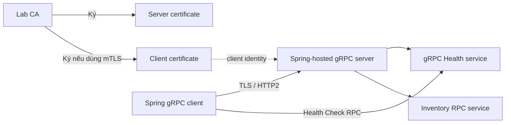

# Bật TLS và health check

Trong dự án thực hành này, bạn sẽ cấu hình một dịch vụ **SPRING_GRPC** để mã hóa kết nối bằng TLS và công bố trạng thái phục vụ qua gRPC Health Checking Protocol. Kết quả cần đạt là client xác minh được danh tính server, RPC health trả về `SERVING` khi service sẵn sàng, chuyển sang `NOT_SERVING` khi service bắt đầu dừng và có thể bật xác thực chứng thư client bằng mutual TLS (mTLS).

TLS và health check giải quyết hai câu hỏi khác nhau. TLS bảo vệ kênh truyền và xác minh danh tính peer theo trust chain. Health check cho biết một service có sẵn sàng nhận request hay không. Một kết nối TLS hợp lệ không có nghĩa ứng dụng đã sẵn sàng; ngược lại, health endpoint báo `SERVING` cũng không mã hóa dữ liệu nếu transport không dùng TLS. Cần cấu hình và kiểm thử cả hai.

## 1. Mục tiêu và kiến trúc lab

Sau khi hoàn thành, bạn có thể:

- Tạo CA dùng trong môi trường local và ký chứng thư server có Subject Alternative Name (SAN).
- Cấu hình gRPC Java server dùng TLS với certificate chain và private key.
- Đăng ký `HealthStatusManager` để công bố trạng thái tổng thể và trạng thái của service.
- Cấu hình client tin cậy CA, kiểm tra hostname và gọi health RPC có deadline.
- Bật mTLS để server yêu cầu chứng thư client đã được CA tin cậy ký.
- Chuyển health status sang `NOT_SERVING` trước khi drain và dừng server.
- Kiểm thử các trường hợp chứng thư hợp lệ, CA không tin cậy, hostname sai và thiếu client certificate.

Mô hình triển khai:



Trong lab, một Spring Boot application khởi tạo gRPC Netty server do ứng dụng quản lý. Nếu dự án đang dùng Spring gRPC starter hoặc integration tự quản lý server, hãy đăng ký service và cấu hình TLS bằng extension chính thức của starter đó. Không tạo thêm một `Server` độc lập cho cùng port khi starter đã sở hữu lifecycle. API cấu hình khác nhau theo starter và phiên bản; phần code dưới đây minh họa lớp gRPC Java bên dưới để bạn hiểu các thành phần TLS và health.

## 2. Chuẩn bị dependency

Ví dụ Gradle dùng gRPC Java Netty transport không shaded để có thể tham chiếu trực tiếp kiểu `io.netty.handler.ssl.ClientAuth` trong phần mTLS:

```groovy
dependencies {
    implementation("org.springframework.boot:spring-boot-starter")

    implementation(platform("io.grpc:grpc-bom:${grpcVersion}"))
    implementation("io.grpc:grpc-netty")
    implementation("io.grpc:grpc-services")
    implementation("io.grpc:grpc-protobuf")
    implementation("io.grpc:grpc-stub")
}
```

`grpcVersion` cần được quản lý tập trung theo phiên bản tương thích của dự án. Nếu ứng dụng dùng `grpc-netty-shaded`, các lớp Netty đã được relocate; không trộn import Netty thường với transport shaded. Hãy dùng đúng API SSL của transport mà ứng dụng đã chọn.

`grpc-services` cung cấp implementation health service. Các class message/stub của Health Checking Protocol nằm trong package `io.grpc.health.v1`. Dự án cũng cần bước sinh mã Protobuf cho service nghiệp vụ của mình. Ví dụ trong bài dùng `InventoryServiceGrpc.InventoryServiceImplBase` và `GetItemRequest` được sinh từ file `.proto` của ứng dụng.

## 3. Tạo CA và chứng thư server

Trong môi trường local, tạo thư mục `certs` ở thư mục dự án. Các lệnh sau dùng OpenSSL và minh họa một CA lab riêng. Không dùng private key lab trong production, không commit private key vào Git và không đưa CA private key vào container ứng dụng.

### 3.1 Tạo CA lab

```bash
mkdir -p certs

openssl req -x509 -newkey rsa:4096 \
  -keyout certs/ca-key.pem \
  -out certs/ca.pem \
  -days 365 \
  -nodes \
  -addext "basicConstraints=critical,CA:TRUE" \
  -addext "keyUsage=critical,keyCertSign,cRLSign" \
  -subj "/CN=Spring gRPC Lab CA"
```

`ca.pem` là chứng thư CA public mà client có thể dùng làm trust anchor. `ca-key.pem` là private key của CA; chỉ dùng để ký chứng thư trong lab và cần được bảo vệ.

### 3.2 Tạo private key và CSR cho server

```bash
openssl genpkey -algorithm RSA \
  -out certs/server-key.pem \
  -pkeyopt rsa_keygen_bits:3072

openssl req -new \
  -key certs/server-key.pem \
  -out certs/server.csr \
  -subj "/CN=localhost"
```

Tạo file `certs/server.ext`:

```ini
basicConstraints=CA:FALSE
keyUsage=digitalSignature,keyEncipherment
extendedKeyUsage=serverAuth
subjectAltName=@alt_names

[alt_names]
DNS.1=localhost
DNS.2=grpc.inventory.local
IP.1=127.0.0.1
```

SAN là thông tin quan trọng để client xác minh hostname. Nếu client kết nối tới `localhost`, chứng thư phải có `DNS:localhost`; nếu client kết nối tới `grpc.inventory.local`, SAN phải có tên DNS đó. Không giải quyết lỗi hostname bằng cách tắt xác minh hostname trong client.

Ký CSR bằng CA lab:

```bash
openssl x509 -req \
  -in certs/server.csr \
  -CA certs/ca.pem \
  -CAkey certs/ca-key.pem \
  -CAcreateserial \
  -out certs/server.pem \
  -days 90 \
  -sha256 \
  -extfile certs/server.ext
```

Kết quả cần có `server.pem` (certificate), `server-key.pem` (private key) và `ca.pem` (CA certificate). Có thể kiểm tra nội dung SAN và chain:

```bash
openssl x509 -in certs/server.pem -noout -subject -issuer -dates -ext subjectAltName
openssl verify -CAfile certs/ca.pem certs/server.pem
```

Lệnh `openssl verify` phải trả về `OK`. Kiểm tra thời hạn chứng thư và tên SAN trước khi chạy server.

## 4. Khai báo cấu hình ứng dụng

Ví dụ `application.yml`:

```yaml
grpc:
  server:
    port: 8443
    tls:
      certificate-chain: ${GRPC_CERT_CHAIN:./certs/server.pem}
      private-key: ${GRPC_PRIVATE_KEY:./certs/server-key.pem}
      client-auth: ${GRPC_CLIENT_AUTH:false}
      client-ca: ${GRPC_CLIENT_CA:./certs/ca.pem}
    shutdown:
      grace-period-seconds: 20
      force-wait-seconds: 5
```

Trong lab ban đầu, `client-auth` để `false` để kiểm tra TLS một chiều. Khi bật mTLS, đặt `GRPC_CLIENT_AUTH=true`; server sẽ yêu cầu client certificate được ký bởi CA trong `client-ca`. Đường dẫn certificate và key được truyền qua cấu hình hoặc secret mount. Không ghi private key hay password vào source code.

Nếu Spring Boot cũng mở HTTP management port cho Actuator, hãy cấu hình port và quyền truy cập riêng. HTTP readiness của Actuator và gRPC Health service là hai endpoint khác nhau; cần đảm bảo mỗi endpoint phản ánh đúng trạng thái mà thành phần định tuyến sử dụng.

## 5. Tạo gRPC Health service

Health Checking Protocol chuẩn định nghĩa service `grpc.health.v1.Health` với các RPC `Check` và `Watch`. `Check` trả trạng thái tức thời; `Watch` cho phép client theo dõi thay đổi trạng thái. Trong gRPC Java, `HealthStatusManager` cung cấp implementation có thể đăng ký trực tiếp vào server.

Ví dụ service name phải khớp tên service trong `.proto`, gồm package và service, không phải tên class Java:

```java
private static final String INVENTORY_SERVICE =
        "inventory.v1.InventoryService";

private final HealthStatusManager healthStatusManager =
        new HealthStatusManager();

private void markReady() {
    healthStatusManager.setStatus(
            "",
            HealthCheckResponse.ServingStatus.SERVING);
    healthStatusManager.setStatus(
            INVENTORY_SERVICE,
            HealthCheckResponse.ServingStatus.SERVING);
}
```

Tên service rỗng (`""`) biểu thị trạng thái tổng thể của server. Một service cụ thể có thể có trạng thái riêng. Chỉ chuyển sang `SERVING` sau khi các dependency bắt buộc và service implementation đã sẵn sàng. Nếu database quan trọng chưa kết nối, không nên báo `SERVING` chỉ vì socket gRPC đã mở.

## 6. Khởi tạo TLS server trong Spring lifecycle

Ví dụ sau minh họa một component Spring quản lý gRPC server Netty, đăng ký service nghiệp vụ và health service. `InventoryGrpcService` là bean triển khai service đã sinh mã từ `.proto`.

```java
import io.grpc.Server;
import io.grpc.netty.GrpcSslContexts;
import io.grpc.netty.NettyServerBuilder;
import io.grpc.protobuf.services.HealthStatusManager;
import io.grpc.health.v1.HealthCheckResponse;
import io.netty.handler.ssl.ClientAuth;
import io.netty.handler.ssl.SslContextBuilder;
import org.springframework.beans.factory.annotation.Value;
import org.springframework.context.SmartLifecycle;
import org.springframework.stereotype.Component;

import java.io.File;
import java.io.IOException;
import java.util.concurrent.TimeUnit;
import java.util.logging.Level;
import java.util.logging.Logger;

@Component
public final class SecureGrpcServerLifecycle implements SmartLifecycle {
    private static final Logger LOGGER =
            Logger.getLogger(SecureGrpcServerLifecycle.class.getName());
    private static final String INVENTORY_SERVICE =
            "inventory.v1.InventoryService";

    private final InventoryGrpcService inventoryService;
    private final HealthStatusManager health = new HealthStatusManager();
    private final int port;
    private final File certificateChain;
    private final File privateKey;
    private final boolean clientAuthRequired;
    private final File clientCa;
    private final long gracePeriodSeconds;
    private final long forceWaitSeconds;

    private volatile Server server;
    private volatile boolean running;

    public SecureGrpcServerLifecycle(
            InventoryGrpcService inventoryService,
            @Value("${grpc.server.port:8443}") int port,
            @Value("${grpc.server.tls.certificate-chain}") File certificateChain,
            @Value("${grpc.server.tls.private-key}") File privateKey,
            @Value("${grpc.server.tls.client-auth:false}") boolean clientAuthRequired,
            @Value("${grpc.server.tls.client-ca:}") String clientCaPath,
            @Value("${grpc.server.shutdown.grace-period-seconds:20}") long gracePeriodSeconds,
            @Value("${grpc.server.shutdown.force-wait-seconds:5}") long forceWaitSeconds) {
        this.inventoryService = inventoryService;
        this.port = port;
        this.certificateChain = certificateChain;
        this.privateKey = privateKey;
        this.clientAuthRequired = clientAuthRequired;
        this.clientCa = clientCaPath.isBlank() ? null : new File(clientCaPath);
        this.gracePeriodSeconds = gracePeriodSeconds;
        this.forceWaitSeconds = forceWaitSeconds;
    }

    @Override
    public synchronized void start() {
        if (running) {
            return;
        }

        try {
            SslContextBuilder tls =
                    GrpcSslContexts.forServer(certificateChain, privateKey);

            if (clientAuthRequired) {
                if (clientCa == null || !clientCa.isFile()) {
                    throw new IllegalStateException(
                            "A readable client CA is required when mTLS is enabled");
                }
                tls.trustManager(clientCa).clientAuth(ClientAuth.REQUIRE);
            }

            health.setStatus("", HealthCheckResponse.ServingStatus.NOT_SERVING);
            health.setStatus(
                    INVENTORY_SERVICE,
                    HealthCheckResponse.ServingStatus.NOT_SERVING);

            server = NettyServerBuilder.forPort(port)
                    .sslContext(tls.build())
                    .addService(inventoryService)
                    .addService(health.getHealthService())
                    .build()
                    .start();

            // Mark ready only after the listener has started and required dependencies are ready.
            health.setStatus("", HealthCheckResponse.ServingStatus.SERVING);
            health.setStatus(
                    INVENTORY_SERVICE,
                    HealthCheckResponse.ServingStatus.SERVING);
            running = true;
            LOGGER.info("Secure gRPC server started on port " + port);
        } catch (IOException ex) {
            throw new IllegalStateException("Unable to start secure gRPC server", ex);
        }
    }

    @Override
    public void stop() {
        stop(() -> { });
    }

    @Override
    public void stop(Runnable callback) {
        Server current;
        synchronized (this) {
            current = server;
            if (current != null) {
                running = false;
                health.enterTerminalState();
                current.shutdown();
            }
        }
        if (current == null) {
            callback.run();
            return;
        }

        try {
            if (!current.awaitTermination(gracePeriodSeconds, TimeUnit.SECONDS)) {
                LOGGER.warning("gRPC drain timed out; forcing shutdown");
                current.shutdownNow();
                if (!current.awaitTermination(forceWaitSeconds, TimeUnit.SECONDS)) {
                    LOGGER.severe("gRPC server did not terminate after force shutdown");
                }
            }
        } catch (InterruptedException ex) {
            LOGGER.log(Level.WARNING, "Interrupted during gRPC shutdown", ex);
            current.shutdownNow();
            Thread.currentThread().interrupt();
        } finally {
            synchronized (this) {
                server = null;
            }
            callback.run();
        }
    }

    @Override
    public boolean isRunning() {
        return running;
    }

    @Override
    public boolean isAutoStartup() {
        return true;
    }

    @Override
    public int getPhase() {
        return Integer.MAX_VALUE;
    }
}
```

Các điểm cần chú ý:

- `GrpcSslContexts.forServer(certificateChain, privateKey)` tạo cấu hình TLS server từ certificate và private key.
- Khi bật mTLS, `trustManager(clientCa)` chỉ định CA dùng để xác minh chứng thư client; `ClientAuth.REQUIRE` bắt buộc client trình chứng thư.
- `health.getHealthService()` đăng ký RPC health trên cùng server và cùng transport TLS.
- `health.enterTerminalState()` chuyển service sang trạng thái không phục vụ khi bắt đầu dừng. Sau đó server gọi `shutdown()` để drain, chỉ gọi `shutdownNow()` khi hết thời gian chờ.
- `SmartLifecycle` để Spring điều phối start/stop cùng ApplicationContext. Phase cao làm server khởi động muộn và dừng sớm so với các component phase thấp hơn; hãy điều chỉnh phase nếu thứ tự dependency của ứng dụng khác.

Đây là ví dụ quản lý server tự tạo. Nếu starter đang quản lý server, giữ lại ý tưởng TLS, health service và trạng thái nhưng chuyển chúng sang cơ chế đăng ký/configuration của starter. Không đăng ký `SecureGrpcServerLifecycle` đồng thời với một server auto-configured trên cùng port. Comment tại vị trí cập nhật `SERVING` là điểm tích hợp để kiểm tra readiness thực tế; trong production, hãy thay bằng kết quả kiểm tra các dependency bắt buộc thay vì chỉ dựa vào việc listener đã khởi động.

## 7. Tạo client TLS và gọi health check

Client cần tin cậy CA đã ký server certificate và kết nối bằng hostname có trong SAN. Ví dụ sau dùng `NettyChannelBuilder` và `grpc-services` health stub:

```java
import io.grpc.ManagedChannel;
import io.grpc.health.v1.HealthCheckRequest;
import io.grpc.health.v1.HealthCheckResponse;
import io.grpc.health.v1.HealthGrpc;
import io.grpc.netty.GrpcSslContexts;
import io.grpc.netty.NettyChannelBuilder;

import java.io.File;
import java.util.concurrent.TimeUnit;

public final class GrpcHealthProbe {
    public static void main(String[] args) throws Exception {
        File caCertificate = new File("certs/ca.pem");

        ManagedChannel channel = NettyChannelBuilder
                .forAddress("localhost", 8443)
                .sslContext(GrpcSslContexts.forClient()
                        .trustManager(caCertificate)
                        .build())
                .build();

        try {
            HealthCheckResponse response = HealthGrpc.newBlockingStub(channel)
                    .withDeadlineAfter(3, TimeUnit.SECONDS)
                    .check(HealthCheckRequest.newBuilder()
                            .setService("inventory.v1.InventoryService")
                            .build());

            if (response.getStatus()
                    != HealthCheckResponse.ServingStatus.SERVING) {
                throw new IllegalStateException(
                        "Inventory service is not serving: " + response.getStatus());
            }

            System.out.println("Inventory gRPC service is SERVING over TLS");
        } finally {
            channel.shutdown();
            if (!channel.awaitTermination(3, TimeUnit.SECONDS)) {
                channel.shutdownNow();
            }
        }
    }
}
```

Địa chỉ `localhost` phải khớp `DNS:localhost` trong SAN của chứng thư server. Trong môi trường khác, dùng DNS name thật mà client truy cập và cấp chứng thư có SAN tương ứng. Không dùng `usePlaintext()` để “sửa” lỗi handshake và không vô hiệu hóa hostname verification.

Để kiểm tra trạng thái tổng thể thay vì service cụ thể, gửi `setService("")`. Client có thể dùng `HealthGrpc.newStub(channel).watch(...)` nếu muốn nhận thay đổi trạng thái liên tục; cần xử lý stream và deadline/cancellation như các RPC streaming khác.

## 8. Bật mutual TLS

TLS một chiều xác minh server với client. mTLS bổ sung xác minh client certificate ở server. Trong lab, tạo client key và CSR:

```bash
openssl genpkey -algorithm RSA \
  -out certs/client-key.pem \
  -pkeyopt rsa_keygen_bits:3072

openssl req -new \
  -key certs/client-key.pem \
  -out certs/client.csr \
  -subj "/CN=inventory-lab-client"
```

Tạo `certs/client.ext`:

```ini
basicConstraints=CA:FALSE
keyUsage=digitalSignature,keyEncipherment
extendedKeyUsage=clientAuth
```

Ký client certificate:

```bash
openssl x509 -req \
  -in certs/client.csr \
  -CA certs/ca.pem \
  -CAkey certs/ca-key.pem \
  -CAcreateserial \
  -out certs/client.pem \
  -days 90 \
  -sha256 \
  -extfile certs/client.ext
```

Khởi động server với `GRPC_CLIENT_AUTH=true` và `GRPC_CLIENT_CA=./certs/ca.pem`. Client thêm certificate/key của mình vào SSL context:

```java
import io.netty.handler.ssl.SslContext;
import io.grpc.ManagedChannel;
import io.grpc.netty.GrpcSslContexts;
import io.grpc.netty.NettyChannelBuilder;
import java.io.File;

SslContext clientTls = GrpcSslContexts.forClient()
        .trustManager(new File("certs/ca.pem"))
        .keyManager(
                new File("certs/client.pem"),
                new File("certs/client-key.pem"))
        .build();

ManagedChannel channel = NettyChannelBuilder.forAddress("localhost", 8443)
        .sslContext(clientTls)
        .build();
```

Server xác minh client certificate dựa trên `client-ca`; client vẫn xác minh server certificate dựa trên CA mà client trust. Trong lab hai phía dùng cùng một CA để đơn giản hóa. Production có thể dùng các CA/intermediate khác nhau cho server và client theo chính sách PKI. mTLS xác minh danh tính ở tầng transport; ứng dụng vẫn cần authorization theo principal và phương thức RPC.

## 9. Kiểm thử và xác minh

Thực hiện các trường hợp sau và ghi lại kết quả:

| Kịch bản | Cách thực hiện | Kết quả mong đợi |
| --- | --- | --- |
| TLS hợp lệ | Client tin cậy `ca.pem`, kết nối hostname đúng SAN | Handshake thành công, health trả `SERVING` |
| CA không tin cậy | Client dùng CA khác hoặc trust store không có CA lab | Handshake thất bại với lỗi xác minh certificate |
| Hostname sai | Kết nối bằng hostname không nằm trong SAN | Client từ chối xác minh danh tính server |
| Health service cụ thể | Gọi `Check` với `inventory.v1.InventoryService` | Trả `SERVING` khi service sẵn sàng |
| Service chưa sẵn sàng | Đặt status service thành `NOT_SERVING` | Health trả `NOT_SERVING` |
| Shutdown | Gửi tín hiệu dừng Spring context | Health chuyển `NOT_SERVING`, RPC mới không được nhận, RPC đang chạy được drain trong grace period |
| mTLS thiếu client cert | Bật `client-auth`, client không cài certificate | TLS handshake bị từ chối |
| mTLS hợp lệ | Client trình certificate do CA tin cậy ký | Handshake thành công, health trả `SERVING` |
| Client cert không tin cậy | Client trình certificate do CA khác ký | Server từ chối handshake |

Có thể xác minh TLS handshake và ALPN bằng OpenSSL:

```bash
openssl s_client \
  -connect localhost:8443 \
  -servername localhost \
  -alpn h2 \
  -CAfile certs/ca.pem \
  -verify_return_error
```

Kết quả cần cho thấy xác minh certificate thành công và ALPN thương lượng `h2`. Với mTLS, thêm `-cert certs/client.pem -key certs/client-key.pem`. Lệnh này xác minh handshake TLS; hãy dùng Java health probe ở phần trước để xác minh RPC health thực sự hoạt động.

Nếu dùng `grpcurl`, server cần bật reflection hoặc bạn phải cung cấp định nghĩa proto của health service cho grpcurl. Ví dụ khi đã có reflection:

```bash
grpcurl -cacert certs/ca.pem \
  -d '{"service":"inventory.v1.InventoryService"}' \
  localhost:8443 grpc.health.v1.Health/Check
```

Khi bật mTLS, bổ sung client certificate và key theo tùy chọn của phiên bản grpcurl đang dùng. Không bật reflection trong production chỉ để tiện kiểm thử nếu chính sách API không cho phép công bố service descriptors.

## 10. Tích hợp với readiness và orchestration

Health status cần phản ánh trạng thái thực tế của service:

- Khi ứng dụng khởi động, giữ `NOT_SERVING` cho tới khi listener, cấu hình, dependency bắt buộc và service implementation sẵn sàng.
- Khi service hoạt động bình thường, đặt service cụ thể và trạng thái tổng thể thành `SERVING`.
- Khi dependency bắt buộc mất kết nối, đánh giá xem service có còn khả năng đáp ứng hợp đồng hay cần chuyển `NOT_SERVING`.
- Khi shutdown bắt đầu, gọi `enterTerminalState()` để thông báo không nhận công việc mới, sau đó drain RPC hiện tại.
- Nếu có nhiều service trên một gRPC server, quản lý status từng service; không dùng một trạng thái tổng thể duy nhất nếu các service có readiness khác nhau.

Kubernetes hỗ trợ gRPC probe cho service health. Probe cần gọi đúng port và service name. Lưu ý kubelet gRPC probe tích hợp không cấu hình được TLS hoặc client certificate; nó không thể probe trực tiếp một listener chỉ nhận TLS/mTLS. Với server TLS-only, có thể dùng HTTP readiness endpoint của Spring Boot Actuator hoặc một health listener nội bộ riêng được giới hạn truy cập, đồng thời giữ gRPC Health cho client gRPC. Nếu dùng HTTP Actuator probe, đó là một đường health riêng; hãy xác định thành phần nào dùng probe nào để tránh trường hợp pod được đánh dấu ready dù gRPC service chưa sẵn sàng. Readiness probe quyết định nhận traffic; liveness probe chỉ nên phát hiện tiến trình không còn hoạt động đúng và không nên restart service chỉ vì một dependency tạm thời chậm nếu chính sách phục hồi không yêu cầu.

Health check không thay thế metrics và alerting. Nó trả lời “có phục vụ được không?” chứ không giải thích vì sao p99 latency tăng, TLS certificate sắp hết hạn hay số RPC bị lỗi tăng. Hãy giám sát expiry của certificate, handshake failures, RPC status, latency và health transitions.

## 11. Bảo mật certificate và vận hành production

Lab CA đơn giản hóa quá trình học; production cần quy trình quản lý vòng đời certificate:

- Lưu private key trong secret manager, HSM hoặc cơ chế bảo vệ tương đương; mount với quyền đọc tối thiểu.
- Không ghi private key vào log, image container, source control hoặc artifact build.
- Dùng CA và quy trình cấp phát phù hợp với môi trường; phân biệt trust của server và client nếu chính sách yêu cầu.
- Theo dõi `notBefore`, `notAfter`, issuer và serial; cảnh báo trước ngày hết hạn.
- Xây dựng quy trình rotate certificate có overlap để client/server cập nhật trust bundle và leaf certificate mà không gây gián đoạn.
- Thu hồi hoặc thay thế certificate bị lộ; xác định cách phân phối CRL/OCSP hoặc trust bundle theo khả năng của transport/hạ tầng.
- Giới hạn quyền truy cập health service nếu health endpoint tiết lộ thông tin nội bộ hoặc hạ tầng không nên công khai.
- Không xem mTLS là thay thế authorization. Ánh xạ client certificate identity sang principal và kiểm tra quyền trên từng phương thức.

Khi rotate certificate, cần kiểm thử cả giai đoạn trust bundle chứa CA cũ và mới, rollout client/server theo thứ tự phù hợp và hành vi channel lâu dài. Một channel đã mở có thể giữ kết nối cũ; chính sách reconnect hoặc drain channel cần được xem xét để certificate mới thực sự được sử dụng.

## 12. Lỗi thường gặp và cách xử lý

| Triệu chứng | Nguyên nhân có thể | Cách kiểm tra/sửa |
| --- | --- | --- |
| `UNAVAILABLE: io exception` khi kết nối | Server chưa mở TLS, sai port hoặc lỗi handshake | Kiểm tra server log, port, transport và TLS handshake |
| `PKIX path building failed` hoặc unknown CA | Client không tin CA ký server certificate | Cấu hình đúng CA trust store; kiểm tra chain và issuer |
| Hostname verification failed | SAN không chứa hostname client dùng | Cấp lại certificate với SAN chính xác |
| `handshake_failure` khi bật mTLS | Client thiếu certificate, EKU sai hoặc CA không được server tin | Kiểm tra client chain, `clientAuth`, trust CA và extended key usage |
| Health trả `SERVICE_UNKNOWN` | Service name gửi trong Check không được đăng ký | So khớp package/service name và `setStatus()` |
| Health luôn `SERVING` dù dependency lỗi | Status không gắn với readiness thực tế | Cập nhật status theo dependency bắt buộc và vòng đời ứng dụng |
| Health không trả lời khi shutdown | Health service bị dừng trước khi trạng thái được cập nhật | Đặt `NOT_SERVING`/terminal state trước `shutdown()` |
| Chỉ HTTP probe hoạt động | HTTP Actuator và gRPC Health là hai endpoint khác nhau | Cấu hình đúng probe/port/service name cho gRPC |
| Certificate hết hạn sau một thời gian | Chưa có rotation và expiry alert | Theo dõi thời hạn và tự động hóa cấp phát/rotation |

Không khắc phục TLS bằng cách bỏ trust validation, chấp nhận mọi certificate hoặc tắt hostname verification. Những cách đó làm mất mục tiêu xác thực peer của TLS và có thể che giấu cấu hình sai.

## 13. Bàn giao kết quả dự án

Khi hoàn thành lab, chuẩn bị các bằng chứng sau:

1. Cấu hình TLS server và client, trong đó đường dẫn private key được đưa qua cấu hình ngoài source code.
2. Log khởi động thể hiện gRPC server mở cổng TLS thành công.
3. Kết quả `openssl verify` và TLS handshake có ALPN `h2`.
4. Kết quả health `SERVING` cho service name chính xác.
5. Kết quả âm tính khi CA không tin cậy hoặc hostname không khớp.
6. Kết quả shutdown chuyển health sang `NOT_SERVING` và drain có giới hạn.
7. Nếu bật mTLS, bằng chứng client hợp lệ kết nối thành công và client không có/không tin cậy certificate bị từ chối.
8. Ghi chú cách triển khai certificate rotation và cách probe của môi trường chạy thật.

## 14. Checklist hoàn thành

- [ ] Server certificate có chain hợp lệ và SAN khớp DNS/IP client sử dụng.
- [ ] gRPC server chỉ nhận kết nối TLS trên cổng đã cấu hình.
- [ ] Client xác minh CA và hostname; không tắt certificate validation.
- [ ] Health service được đăng ký trên cùng gRPC server.
- [ ] Trạng thái tổng thể và service cụ thể được đặt đúng.
- [ ] Health trả `SERVING` sau khi dependency bắt buộc sẵn sàng.
- [ ] Health chuyển `NOT_SERVING` trước khi server bắt đầu drain/shutdown.
- [ ] Client health probe có deadline và đóng channel đúng cách.
- [ ] Đã kiểm thử CA sai, hostname sai và certificate hết hạn/không hợp lệ.
- [ ] Nếu bật mTLS, server yêu cầu client certificate và xác minh đúng CA.
- [ ] Private key được bảo vệ, có kế hoạch rotation và cảnh báo expiry.
- [ ] Readiness/liveness của orchestration được phân biệt và kiểm thử độc lập.

Hoàn thành lab khi client chỉ kết nối được với server có danh tính hợp lệ, health service phản ánh đúng khả năng phục vụ và quá trình shutdown công bố `NOT_SERVING` trước khi dừng. TLS bảo vệ kênh truyền; health check giúp hệ thống định tuyến tránh instance chưa sẵn sàng. Cả hai cần được quản lý như một phần của vòng đời Spring gRPC service, từ khởi động, vận hành, rotation certificate cho tới shutdown.
