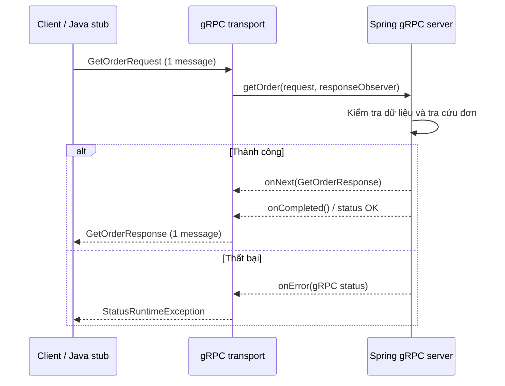

# Một request và một response trong unary call

## 1. Unary RPC là gì?

Trong gRPC, **unary RPC** là lời gọi mà **client gửi đúng một thông điệp request và nhận tối đa một thông điệp response**. Khi xử lý thành công, server trả về một response cùng trạng thái kết thúc `OK`. Nếu thất bại, server kết thúc lời gọi bằng một **gRPC status lỗi**, không có response nghiệp vụ thành công.

Kiểu trao đổi này phù hợp với các thao tác như xem thông tin đơn hàng, tra cứu người dùng, kiểm tra hạn mức hoặc tạo một bản ghi khi mỗi lần gọi có một đầu vào và một kết quả. Hợp đồng được khai báo trong **Protocol Buffers (`.proto`)**; công cụ sinh mã tạo message và Java stub để client/server gọi nhau mà không phải tự đóng gói byte hoặc định tuyến HTTP/2.

Ví dụ xuyên suốt bài: một dịch vụ Spring gRPC cho phép client truy vấn đơn hàng theo `order_id`:

| Thành phần | Vai trò trong ví dụ |
| --- | --- |
| `GetOrderRequest` | Một request chứa mã đơn hàng. |
| `OrderQueryService/GetOrder` | Một phương thức unary được định nghĩa trong `.proto`. |
| `GetOrderResponse` | Một response chứa mã đơn, trạng thái và tổng tiền, tính bằng đơn vị nhỏ nhất. |
| `OrderQueryServiceGrpc` | Lớp Java được sinh mã, chứa base class phía server và các loại stub phía client. |
| Spring gRPC | Tích hợp triển khai service gRPC vào ứng dụng Spring và quản lý channel/client theo cấu hình. |

### Điều gì được đếm là “một request, một response”?

Đây là **số lượng message ở tầng ứng dụng**, không có nghĩa là chỉ có một gói tin mạng. gRPC thường chạy trên HTTP/2; việc tạo kết nối, gửi header/metadata, truyền body đã mã hóa, nhận trailer/status có thể liên quan đến nhiều frame. Client không cần thao tác trực tiếp với những frame này.



Unary được xác định bởi **khai báo phương thức trong `.proto`**, không phụ thuộc client gọi bằng blocking stub hay async stub. Với blocking stub, luồng gọi phía client chờ kết quả; với async stub, kết quả được báo qua callback, nhưng số lượng request/response nghiệp vụ vẫn như nhau.

## 2. Khai báo hợp đồng unary bằng Protocol Buffers

Tạo `src/main/proto/order_query.proto`:

```proto
syntax = "proto3";

package checkout.v1;

option java_package = "com.example.checkout.grpc";
option java_multiple_files = true;
option java_outer_classname = "OrderQueryProto";

service OrderQueryService {
  rpc GetOrder (GetOrderRequest) returns (GetOrderResponse);
}

message GetOrderRequest {
  string order_id = 1;
}

message GetOrderResponse {
  string order_id = 1;
  string status = 2;
  int64 total_cents = 3;
}
```

Dòng quan trọng nhất là:

```proto
rpc GetOrder (GetOrderRequest) returns (GetOrderResponse);
```

Không có từ khóa `stream` ở hai phía nên đây là **unary RPC**. Nếu thêm `stream` vào request hoặc response, hợp đồng sẽ chuyển sang một kiểu streaming RPC khác.

Một số điểm cần hiểu trước khi sinh mã:

- `package checkout.v1` định danh không gian tên của service ở giao thức; tên đầy đủ của phương thức là `checkout.v1.OrderQueryService/GetOrder` (trên wire thường có dấu `/` đứng đầu).
- `java_package` đặt package Java cho mã sinh; nó độc lập với package giao thức.
- Các số `= 1`, `= 2`, `= 3` là **field number** dùng trong dữ liệu mã hóa, không phải giá trị mặc định. Khi cập nhật schema đã sử dụng, không tùy tiện đổi số hoặc tái sử dụng số của field bị xóa; nên dùng `reserved` khi loại bỏ field cũ.
- Với `proto3`, `string` không được gán có giá trị mặc định là chuỗi rỗng. Vì vậy server vẫn phải xác thực `order_id`, thay vì giả định field này luôn có dữ liệu.
- `total_cents` dùng số nguyên để tránh sai số khi biểu diễn số tiền bằng dấu phẩy động. Trong hệ thống thật, cần thống nhất cả **đơn vị tiền tệ** và đơn vị nhỏ nhất của số tiền.

Khi build đã cấu hình `protoc` cùng plugin gRPC Java, mã sinh điển hình gồm `GetOrderRequest`, `GetOrderResponse` và `OrderQueryServiceGrpc`. Không chỉnh sửa trực tiếp các lớp được sinh: thay đổi hợp đồng trong `.proto`, sau đó chạy bước sinh mã của dự án.

## 3. Xây dựng server unary trong Spring

Ví dụ dưới đây giả định ứng dụng đã tích hợp **Spring gRPC**, có bước sinh Java từ `.proto` và đăng ký được service gRPC. Với API Spring gRPC sử dụng annotation `@GrpcService`, lớp triển khai kế thừa base class được sinh:

```java
package com.example.checkout.server;

import com.example.checkout.grpc.GetOrderRequest;
import com.example.checkout.grpc.GetOrderResponse;
import com.example.checkout.grpc.OrderQueryServiceGrpc;
import io.grpc.Status;
import io.grpc.stub.StreamObserver;
import org.springframework.grpc.server.service.GrpcService;

import java.util.Optional;

@GrpcService
public class OrderQueryGrpcService
        extends OrderQueryServiceGrpc.OrderQueryServiceImplBase {

    private final OrderCatalog orderCatalog;

    public OrderQueryGrpcService(OrderCatalog orderCatalog) {
        this.orderCatalog = orderCatalog;
    }

    @Override
    public void getOrder(
            GetOrderRequest request,
            StreamObserver<GetOrderResponse> responseObserver) {

        String orderId = request.getOrderId().trim();
        if (orderId.isEmpty()) {
            responseObserver.onError(Status.INVALID_ARGUMENT
                    .withDescription("order_id không được để trống")
                    .asRuntimeException());
            return;
        }

        Optional<OrderRecord> found;
        try {
            found = orderCatalog.findById(orderId);
        } catch (RuntimeException exception) {
            // Ghi log lỗi nội bộ ở đây; tránh trả chi tiết nhạy cảm cho client.
            responseObserver.onError(Status.INTERNAL
                    .withDescription("Không thể truy vấn đơn hàng")
                    .asRuntimeException());
            return;
        }

        if (found.isEmpty()) {
            responseObserver.onError(Status.NOT_FOUND
                    .withDescription("Không tìm thấy đơn hàng")
                    .asRuntimeException());
            return;
        }

        OrderRecord order = found.get();
        GetOrderResponse response = GetOrderResponse.newBuilder()
                .setOrderId(order.id())
                .setStatus(order.status())
                .setTotalCents(order.totalCents())
                .build();

        responseObserver.onNext(response);       // Một response nghiệp vụ
        responseObserver.onCompleted();          // Kết thúc thành công
    }
}
```

`OrderCatalog` là thành phần nghiệp vụ do ứng dụng tự định nghĩa, không phải API của gRPC. Ví dụ có thể đặt hai khai báo sau trong hai file Java tương ứng:

```java
// OrderRecord.java
public record OrderRecord(String id, String status, long totalCents) {}

// OrderCatalog.java (cùng package với OrderRecord)
public interface OrderCatalog {
    java.util.Optional<OrderRecord> findById(String orderId);
}
```

Trong ứng dụng thực tế, một Spring bean triển khai `OrderCatalog` sẽ đọc database hoặc gọi service nghiệp vụ. Tách phần này ra khỏi handler giúp kiểm thử mapping request/response mà không phụ thuộc kho dữ liệu.

### Vì sao server dùng `StreamObserver` dù đây là unary?

API server của gRPC Java dùng `StreamObserver<T>` để thông báo kết quả. Đối với một lời gọi unary, quy tắc là:

| Trường hợp | Chuỗi thao tác hợp lệ trên `responseObserver` |
| --- | --- |
| Thành công | `onNext(response)` **một lần**, sau đó `onCompleted()` **một lần**. |
| Request không hợp lệ | `onError(Status.INVALID_ARGUMENT...)` và kết thúc. |
| Không tìm thấy tài nguyên | `onError(Status.NOT_FOUND...)` và kết thúc. |
| Lỗi hệ thống | `onError(Status.INTERNAL...)` hoặc status phù hợp khác, rồi kết thúc. |

`onCompleted()` và `onError()` là **hai kiểu kết thúc loại trừ nhau**. Không gọi `onNext()` lần hai trong unary; không gọi `onCompleted()` sau `onError()`; và luôn `return` sau nhánh lỗi để tránh thực hiện tiếp đường thành công. Một lỗi nghiệp vụ được chuyển thành gRPC status, không phải một `GetOrderResponse` giả mang chuỗi `"error"` khi hợp đồng không định nghĩa cách đó.

## 4. Gọi unary RPC từ Java client

Sau khi đã sinh mã, client dùng generated stub. Trong Spring, có thể đăng ký blocking stub làm bean và nhận channel từ `GrpcChannelFactory` của Spring gRPC:

```java
package com.example.checkout.client;

import com.example.checkout.grpc.OrderQueryServiceGrpc;
import org.springframework.context.annotation.Bean;
import org.springframework.context.annotation.Configuration;
import org.springframework.grpc.client.GrpcChannelFactory;

@Configuration
public class OrderGrpcClientConfig {

    @Bean
    OrderQueryServiceGrpc.OrderQueryServiceBlockingStub orderQueryStub(
            GrpcChannelFactory channelFactory) {
        return OrderQueryServiceGrpc.newBlockingStub(
                channelFactory.createChannel("orders"));
    }
}
```

Ví dụ cấu hình channel đặt tên `orders` trong `application.properties`:

```properties
spring.grpc.client.channels.orders.address=static://localhost:9090
```

Port `9090` chỉ là giá trị minh họa: phải khớp với cổng server thực tế. Cấu hình cơ chế bảo mật của channel cần phù hợp môi trường triển khai; kết nối tới server có TLS phải dùng cấu hình TLS tương ứng, thay vì mặc định giả định plaintext.

Code nghiệp vụ phía client gọi phương thức `getOrder(...)`:

```java
package com.example.checkout.client;

import com.example.checkout.grpc.GetOrderRequest;
import com.example.checkout.grpc.GetOrderResponse;
import com.example.checkout.grpc.OrderQueryServiceGrpc;
import io.grpc.StatusRuntimeException;
import org.springframework.stereotype.Service;

import java.util.concurrent.TimeUnit;

@Service
public class OrderQueryClient {

    private final OrderQueryServiceGrpc.OrderQueryServiceBlockingStub stub;

    public OrderQueryClient(
            OrderQueryServiceGrpc.OrderQueryServiceBlockingStub stub) {
        this.stub = stub;
    }

    public GetOrderResponse findOrder(String orderId) {
        GetOrderRequest request = GetOrderRequest.newBuilder()
                .setOrderId(orderId)
                .build();

        try {
            return stub.withDeadlineAfter(1500, TimeUnit.MILLISECONDS)
                    .getOrder(request);
        } catch (StatusRuntimeException exception) {
            // Tầng gọi phía trên có thể chuyển status thành lỗi nghiệp vụ phù hợp.
            throw exception;
        }
    }
}
```

Trong đoạn này, `getOrder(request)` là **một lời gọi mạng**, không phải truy cập method Java trực tiếp trên server. Blocking stub trả về `GetOrderResponse` nếu kết thúc với `OK`; với status khác `OK`, nó ném `StatusRuntimeException`.

`withDeadlineAfter(...)` tạo **một stub mới có cấu hình deadline**, không thay đổi stub được tiêm vào Spring bean. Deadline 1.500 ms là ví dụ, cần điều chỉnh theo ngân sách độ trễ thực tế của luồng nghiệp vụ. Có thể sử dụng async/future stub cho client không muốn chặn luồng; hợp đồng unary vẫn không đổi.

## 5. Vòng đời một unary call và cách xử lý lỗi

Xét hai đường đi khi client gửi request `order_id = "A-100"`:

**Đường thành công:** client tạo `GetOrderRequest`, stub mã hóa thông điệp và gửi qua channel, server gọi `getOrder`, tra cứu được bản ghi, tạo `GetOrderResponse`, gọi `onNext` rồi `onCompleted`. Client nhận đúng một response và thấy status `OK`.

**Đường không tìm thấy:** server xác thực mã đơn hợp lệ nhưng không có bản ghi, gọi `onError(Status.NOT_FOUND...)`. Blocking client nhận exception có `Status.Code.NOT_FOUND`. Không có đối tượng `GetOrderResponse` được trả về ở đường này.

Các status thường gặp trong unary RPC:

| Status | Khi nên dùng hoặc có thể gặp |
| --- | --- |
| `OK` | Hoàn tất thành công, có một response hợp lệ. |
| `INVALID_ARGUMENT` | Request sai quy tắc, ví dụ `order_id` rỗng. |
| `NOT_FOUND` | Mã đơn hợp lệ nhưng không tồn tại. |
| `PERMISSION_DENIED` | Client đã được xác thực nhưng không có quyền đối với tài nguyên. |
| `UNAUTHENTICATED` | Thiếu hoặc sai thông tin xác thực. |
| `DEADLINE_EXCEEDED` | Hết thời gian chờ được đặt cho lời gọi. |
| `UNAVAILABLE` | Kết nối hoặc service tạm thời không sẵn sàng. |
| `INTERNAL` | Lỗi không mong đợi phía server. |
| `CANCELLED` | Lời gọi bị hủy, ví dụ do client hủy request. |

Client có thể phân nhánh dựa trên **mã status**, thay vì phân tích chuỗi mô tả lỗi:

```java
try {
    GetOrderResponse response = orderQueryClient.findOrder("A-100");
    System.out.println(response.getStatus());
} catch (io.grpc.StatusRuntimeException exception) {
    switch (exception.getStatus().getCode()) {
        case NOT_FOUND -> System.out.println("Đơn hàng không tồn tại");
        case DEADLINE_EXCEEDED -> System.out.println("Truy vấn quá thời hạn");
        case UNAVAILABLE -> System.out.println("Dịch vụ tạm thời gián đoạn");
        default -> throw exception;
    }
}
```

Trong hệ thống thật, cần ghi log có ngữ cảnh và chuyển đổi lỗi phù hợp với giao diện gọi phía trên. Không trả stack trace hoặc thông tin database cho client qua `withDescription(...)`.

### Deadline, hủy và retry

Deadline giới hạn thời gian lời gọi được phép sử dụng. Khi deadline hết, client có thể nhận `DEADLINE_EXCEEDED`; **điều đó không chứng minh công việc server đã tự dừng hoặc giao dịch đã được hoàn tác**. Với tác vụ tốn thời gian, server cần quan tâm đến cancellation và khả năng dừng những xử lý còn lại.

Unary cũng **không đồng nghĩa idempotent**. Truy vấn đơn hàng thông thường có thể retry nếu chính sách cho phép, nhưng unary `CreateOrder` hoặc `ChargePayment` có thể tạo tác dụng phụ. Chỉ tự động retry khi đã đánh giá mã lỗi, tính idempotent, thời hạn còn lại và nguy cơ xử lý lặp; với thao tác ghi thường cần idempotency key nếu muốn retry an toàn.

## 6. Metadata, bảo mật và quan sát lời gọi

Ngoài request/response của protobuf, gRPC còn truyền **metadata** ở header/trailer. Ví dụ metadata có thể chứa bearer token hoặc correlation ID. Metadata không thay thế cho dữ liệu nghiệp vụ đã định nghĩa trong `.proto`; server nên lấy thông tin xác thực từ cơ chế bảo mật/interceptor, không trộn token vào `GetOrderRequest` như một field thông thường.

Trong hệ sinh thái Spring gRPC, interceptor là nơi phù hợp cho các xử lý xuyên suốt nhiều phương thức như kiểm tra metadata, gắn trace ID, đo latency hoặc ánh xạ lỗi. Handler `getOrder` nên chủ yếu xác thực request nghiệp vụ và gọi `OrderCatalog`. Khi triển khai thực tế:

- Dùng **TLS** cho kết nối vượt ranh giới tin cậy; bật mTLS khi cả client và server cần xác thực lẫn nhau.
- Ghi nhận tên service/method, mã status, độ trễ, số lượng lời gọi và lỗi theo công cụ quan sát của ứng dụng; tránh đưa mã đơn hàng hoặc token vào nhãn metric gây lộ dữ liệu hoặc tăng cardinality.
- Đặt deadline có chủ đích ở client, đồng thời cấu hình timeout cho truy vấn database hay các lời gọi downstream, vì deadline của gRPC không tự giới hạn tất cả tài nguyên bên dưới.
- Nếu service có chặn thread để truy cập database, theo dõi số thread bận, độ trễ và tải để tránh làm nghẽn executor khi lưu lượng unary tăng.

## 7. Kiểm thử và tự đối chiếu kết quả

Một bộ kiểm thử cho handler `GetOrder` nên bao phủ các trường hợp sau:

| Input / tình huống | Kết quả mong đợi |
| --- | --- |
| `order_id = "A-100"` và catalog có dữ liệu | Một `GetOrderResponse` đúng field, status kết thúc `OK`. |
| `order_id = ""` hoặc chỉ có khoảng trắng | Không có response nghiệp vụ; `INVALID_ARGUMENT`. |
| `order_id = "UNKNOWN"` | Không có response nghiệp vụ; `NOT_FOUND`. |
| Catalog phát sinh lỗi ngoài dự kiến | Không lộ chi tiết nội bộ; `INTERNAL`. |
| Server xử lý chậm hơn deadline có kiểm soát | Client nhận lỗi deadline phù hợp; xác minh cách server xử lý hủy. |

Có thể kiểm thử tích hợp bằng gRPC in-process server/client hoặc server trên cổng ngẫu nhiên, kết hợp một triển khai `OrderCatalog` giả. Mục tiêu là xác minh **cả payload lẫn terminal status**, không chỉ so sánh chuỗi response.

Khi có server đang chạy và biết file `.proto`, có thể gọi thủ công bằng `grpcurl` mà không phụ thuộc server reflection:

```bash
grpcurl -plaintext \
  -import-path src/main/proto \
  -proto order_query.proto \
  -d '{"orderId":"A-100"}' \
  localhost:9090 \
  checkout.v1.OrderQueryService/GetOrder
```

Lệnh `-plaintext` chỉ phù hợp với server local không bật TLS; khi server dùng TLS phải bỏ cờ này và thiết lập chứng chỉ/xác thực phù hợp. Kết quả minh họa nếu `OrderCatalog` trả về đơn `A-100` có trạng thái `PAID` và tổng tiền 129.900 đơn vị nhỏ nhất:

```json
{
  "orderId": "A-100",
  "status": "PAID",
  "totalCents": "129900"
}
```

Lưu ý `int64` trong định dạng JSON chuẩn của Protocol Buffers thường được biểu diễn dưới dạng **chuỗi thập phân** để bảo toàn độ chính xác; trong Java vẫn truy cập bằng `long`. Nếu catalog không có bản ghi, lệnh sẽ hiển thị gRPC status `NOT_FOUND`, thay vì JSON response như trên.

## 8. Những nhầm lẫn thường gặp

1. **Nhầm unary với REST GET:** unary có thể tra cứu hoặc ghi dữ liệu; định nghĩa unary chỉ nói về **một request và một response**, không quyết định tính an toàn hoặc idempotent của nghiệp vụ.
2. **Gọi `onNext()` nhưng quên `onCompleted()`:** client có thể tiếp tục chờ đến khi timeout, vì chưa nhận tín hiệu kết thúc thành công.
3. **Trả response lỗi rồi kết thúc `OK`:** làm client hiểu lời gọi thành công dù thao tác thất bại. Hãy dùng gRPC status phù hợp, hoặc thiết kế rõ business-result trong hợp đồng nếu thật sự cần.
4. **Dùng default field như dữ liệu hợp lệ:** `string order_id` vắng mặt có thể đọc thành `""`; luôn xác thực request và phân biệt lỗi đầu vào với tài nguyên không tồn tại.
5. **Quên deadline và xử lý hủy:** một client chờ vô hạn có thể làm tích tụ lời gọi khi downstream chậm; deadline cần đi cùng timeout và quản lý tài nguyên của server.
6. **Tự động retry mọi unary call:** thao tác ghi có thể bị thực hiện hai lần khi client không biết server đã hoàn tất trước khi mất kết nối.

## 9. Bài luyện tập nhỏ

Hãy thêm phương thức unary `GetOrderSummary(GetOrderRequest) returns (GetOrderSummaryResponse)` vào `.proto`, trong đó response chỉ gồm `order_id` và `total_cents`. Sau khi sinh lại mã Java, triển khai handler bằng Spring gRPC và viết ba kiểm thử: mã đơn hợp lệ, mã đơn rỗng và mã đơn không tồn tại. Quan sát số lần `onNext`, thao tác kết thúc và status cuối cùng trong từng trường hợp.

**Tự kiểm tra:** một unary call thành công cần đúng **một request protobuf**, đúng **một response protobuf** và **một tín hiệu kết thúc thành công**. Nếu lỗi, lời gọi kết thúc bằng gRPC status lỗi; code phía client phải xử lý trường hợp đó mà không kỳ vọng có response nghiệp vụ.
