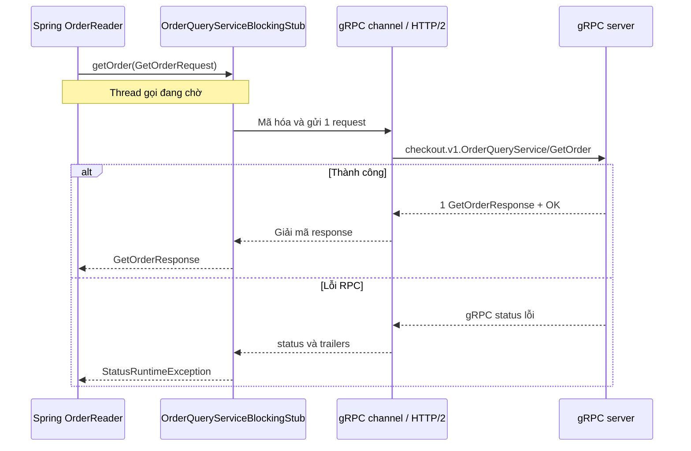

# Blocking stub cho unary RPC

## 1. Mục tiêu và tình huống sử dụng

Trong **Spring gRPC**, client thường không tự tạo HTTP/2 request hay giải mã Protocol Buffers. Thay vào đó, client gọi một phương thức Java trên **stub được sinh từ hợp đồng `.proto`**. Đối với **unary RPC** — một request và một response khi thành công — **blocking stub** là lựa chọn dễ hiểu khi luồng xử lý cần đợi kết quả rồi mới thực hiện bước kế tiếp.

Sau bài này, bạn có thể:

- Nhận diện `*BlockingStub` và phân biệt nó với async/future stub.
- Tạo, cấu hình và tái sử dụng blocking stub trong ứng dụng Spring.
- Gửi một request protobuf, nhận một response hoặc xử lý `StatusRuntimeException`.
- Đặt deadline **cho từng lời gọi**, quản lý tải và nhận biết khi nào không nên chặn thread.
- Viết kiểm thử tích hợp chứng minh hành vi thành công và thất bại của client unary.

**Tình huống xuyên suốt:** Một thành phần Spring cần tra cứu đơn hàng `A-100` từ gRPC service `OrderQueryService`. Sau khi nhận kết quả, thành phần đó dùng trạng thái đơn hàng để đưa ra quyết định nghiệp vụ.



Từ **blocking** nói về *cách client đợi kết quả*, không nói rằng server nhất thiết chạy trên cùng thread hoặc giao thức gRPC ngừng hoạt động bất đồng bộ ở tầng vận chuyển. Trong thời gian chờ, thread gọi `stub.getOrder(...)` bị chiếm dụng. Khi thành công, method trả về **một** response; khi không thành công, nó thường ném một ngoại lệ chứa gRPC status.

## 2. Từ hợp đồng unary đến blocking stub Java

Ví dụ file `src/main/proto/order_query.proto`:

```proto
syntax = "proto3";

package checkout.v1;

option java_package = "com.example.checkout.grpc";
option java_multiple_files = true;

service OrderQueryService {
  rpc GetOrder(GetOrderRequest) returns (GetOrderResponse);
}

message GetOrderRequest {
  string order_id = 1;
}

message GetOrderResponse {
  string order_id = 1;
  string state = 2;
  int64 total_cents = 3;
}
```

Phương thức `GetOrder` là **unary** vì cả request và response đều không có từ khóa `stream`. Với `protoc` và plugin sinh mã gRPC Java đã được cấu hình trong dự án, các lớp đáng chú ý gồm:

| Mã được sinh | Chức năng |
| --- | --- |
| `GetOrderRequest`, `GetOrderResponse` | Kiểu message protobuf bất biến; tạo dữ liệu bằng `newBuilder()`. |
| `OrderQueryServiceGrpc.OrderQueryServiceImplBase` | Lớp cơ sở phía server để triển khai phương thức RPC. |
| `OrderQueryServiceGrpc.OrderQueryServiceBlockingStub` | Stub phía client; gọi `getOrder(request)` và **đợi** kết quả. |
| `OrderQueryServiceGrpc.OrderQueryServiceStub` | Stub bất đồng bộ, nhận kết quả qua `StreamObserver`. |
| `OrderQueryServiceGrpc.OrderQueryServiceFutureStub` | Stub unary trả về future dạng `ListenableFuture`. |

Tạo blocking stub với factory được sinh mã:

```java
OrderQueryServiceGrpc.OrderQueryServiceBlockingStub stub =
        OrderQueryServiceGrpc.newBlockingStub(channel);
```

`channel` là một `io.grpc.Channel` (thường được cấp bởi một `ManagedChannel`), đại diện cho đích và cấu hình vận chuyển. **Stub không phải kết nối mạng mới cho mỗi request**: nhiều lời gọi và nhiều stub có thể dùng chung channel. Trong ứng dụng Spring, nên quản lý vòng đời channel tập trung thay vì tạo rồi đóng channel trong từng phương thức nghiệp vụ.

> Ghi nhớ: Chọn kiểu stub không làm thay đổi kiểu RPC đã khai báo trong `.proto`. Một phương thức unary vẫn chỉ có một request và tối đa một response dù client dùng blocking, async hay future stub.

## 3. Server mẫu để quan sát lời gọi

Để hiểu kết quả mà blocking stub nhận được, xét server Spring gRPC đơn giản dưới đây. Ví dụ giả định dự án đã cấu hình Spring gRPC và sinh mã Java từ `.proto`.

```java
package com.example.checkout.server;

import com.example.checkout.grpc.GetOrderRequest;
import com.example.checkout.grpc.GetOrderResponse;
import com.example.checkout.grpc.OrderQueryServiceGrpc;
import io.grpc.Status;
import io.grpc.stub.StreamObserver;
import org.springframework.grpc.server.service.GrpcService;

@GrpcService
public class DemoOrderGrpcService
        extends OrderQueryServiceGrpc.OrderQueryServiceImplBase {

    @Override
    public void getOrder(GetOrderRequest request,
                         StreamObserver<GetOrderResponse> observer) {
        String orderId = request.getOrderId().trim();

        if (orderId.isEmpty()) {
            observer.onError(Status.INVALID_ARGUMENT
                    .withDescription("order_id không được rỗng")
                    .asRuntimeException());
            return;
        }

        if (!"A-100".equals(orderId)) {
            observer.onError(Status.NOT_FOUND
                    .withDescription("Không tìm thấy đơn hàng")
                    .asRuntimeException());
            return;
        }

        observer.onNext(GetOrderResponse.newBuilder()
                .setOrderId(orderId)
                .setState("PAID")
                .setTotalCents(129_900L)
                .build());
        observer.onCompleted();
    }
}
```

Khi client gửi `A-100`, server gọi `onNext` đúng một lần rồi `onCompleted`; blocking stub nhận `GetOrderResponse`. Nếu `order_id` rỗng hoặc đơn hàng không tồn tại, server gọi `onError`, và blocking stub ném `StatusRuntimeException` có mã `INVALID_ARGUMENT` hoặc `NOT_FOUND` tương ứng. Đây là server minh họa với dữ liệu cố định; sản phẩm thật sẽ gọi lớp nghiệp vụ hay kho dữ liệu.

## 4. Đăng ký blocking stub dưới dạng Spring bean

Spring gRPC cung cấp `GrpcChannelFactory` để tạo channel từ cấu hình. Giả sử service nằm ở `localhost:9090` và client đặt tên channel là `orders`:

```properties
# application.properties của ứng dụng client
spring.grpc.client.channels.orders.address=static://localhost:9090
```

Đăng ký bean để các thành phần khác có thể tiêm vào qua constructor:

```java
package com.example.checkout.client;

import com.example.checkout.grpc.OrderQueryServiceGrpc;
import org.springframework.context.annotation.Bean;
import org.springframework.context.annotation.Configuration;
import org.springframework.grpc.client.GrpcChannelFactory;

@Configuration
public class GrpcClientConfig {

    @Bean
    OrderQueryServiceGrpc.OrderQueryServiceBlockingStub orderQueryBlockingStub(
            GrpcChannelFactory channelFactory) {
        return OrderQueryServiceGrpc.newBlockingStub(
                channelFactory.createChannel("orders"));
    }
}
```

Lưu ý khi vận hành:

- Giá trị `orders` trong `createChannel("orders")` phải khớp khóa cấu hình `spring.grpc.client.channels.orders`.
- Địa chỉ và cấu hình **TLS/credentials** của channel phải khớp server. Ví dụ `localhost:9090` là địa chỉ phát triển; trong môi trường thực tế thường sử dụng tên service hoặc cơ chế discovery được hỗ trợ.
- Các lớp proto/stub phải được sinh trong quá trình build. Khai báo `@Bean` không thay thế bước sinh mã từ Protocol Buffers.
- `GrpcChannelFactory` giúp Spring quản lý và tái sử dụng hạ tầng channel theo cấu hình; tránh tự đóng một channel dùng chung sau mỗi cuộc gọi.

`OrderQueryServiceBlockingStub` là đối tượng cấu hình **bất biến**: những phương thức như `withDeadlineAfter(...)`, `withInterceptors(...)`, `withCallCredentials(...)` trả về stub mới. Có thể dùng chung bean stub cơ sở giữa nhiều luồng gọi, rồi tạo stub dẫn xuất cho cấu hình của từng RPC.

## 5. Thực hiện unary call đồng bộ

Một Spring service sử dụng blocking stub có thể viết như sau:

```java
package com.example.checkout.client;

import com.example.checkout.grpc.GetOrderRequest;
import com.example.checkout.grpc.GetOrderResponse;
import com.example.checkout.grpc.OrderQueryServiceGrpc;
import io.grpc.Status;
import io.grpc.StatusRuntimeException;
import org.springframework.stereotype.Service;

import java.util.NoSuchElementException;
import java.util.concurrent.TimeUnit;

@Service
public class OrderReader {

    private final OrderQueryServiceGrpc.OrderQueryServiceBlockingStub stub;

    public OrderReader(OrderQueryServiceGrpc.OrderQueryServiceBlockingStub stub) {
        this.stub = stub;
    }

    public GetOrderResponse findById(String orderId) {
        if (orderId == null || orderId.isBlank()) {
            throw new IllegalArgumentException("orderId không được rỗng");
        }

        GetOrderRequest request = GetOrderRequest.newBuilder()
                .setOrderId(orderId)
                .build();

        try {
            // Tạo deadline mới cho lần gọi này, không gắn vào singleton bean.
            return stub.withDeadlineAfter(1500, TimeUnit.MILLISECONDS)
                    .getOrder(request);
        } catch (StatusRuntimeException error) {
            Status.Code code = error.getStatus().getCode();

            if (code == Status.Code.NOT_FOUND) {
                throw new NoSuchElementException("Không tìm thấy đơn: " + orderId);
            }
            if (code == Status.Code.DEADLINE_EXCEEDED
                    || code == Status.Code.UNAVAILABLE) {
                throw new IllegalStateException(
                        "Không thể lấy thông tin đơn hàng lúc này", error);
            }
            // Những status khác cần được xử lý tại biên ứng dụng phù hợp.
            throw error;
        }
    }
}
```

Từ góc nhìn của `OrderReader`, có ba giai đoạn:

1. **Trước lời gọi:** Validate đầu vào và tạo `GetOrderRequest` từ builder.
2. **Trong lời gọi:** `getOrder(request)` chặn thread hiện tại trong lúc chờ gRPC trả kết quả hoặc kết thúc lỗi/deadline.
3. **Sau lời gọi:** Client nhận `GetOrderResponse` để xử lý tiếp, hoặc bắt `StatusRuntimeException` và chuyển sang lỗi nghiệp vụ phù hợp.

Ví dụ dùng service ở một điểm gọi khác:

```java
GetOrderResponse order = orderReader.findById("A-100");
boolean paid = "PAID".equals(order.getState());
long totalCents = order.getTotalCents();
```

Không cần gọi `onNext` hoặc `onCompleted` từ blocking client: hai thao tác đó thuộc API `StreamObserver` của server/async client. Phía blocking client chỉ nhận đối tượng kết quả hoặc ngoại lệ.

### Deadline phải được tạo cho **từng RPC**

`withDeadlineAfter(1500, TimeUnit.MILLISECONDS)` đặt hạn 1,5 giây tính từ lúc tạo deadline. Đây là lý do đoạn code đặt nó **ngay trước `getOrder`**. Không nên cấu hình deadline cố định ngay khi khởi tạo bean singleton:

```java
// Tránh: deadline được tính từ khi tạo bean, rồi có thể hết hạn trước lời gọi.
@Bean
OrderQueryServiceGrpc.OrderQueryServiceBlockingStub shortLivedStub(
        GrpcChannelFactory factory) {
    return OrderQueryServiceGrpc.newBlockingStub(factory.createChannel("orders"))
            .withDeadlineAfter(1500, TimeUnit.MILLISECONDS);
}
```

**Vì sao nguy hiểm?** Bean Spring tồn tại lâu, còn deadline là thời điểm giới hạn cụ thể. Sau thời hạn, nhiều lời gọi về sau có thể thất bại ngay lập tức. Hãy giữ một **stub cơ sở**, sau đó dẫn xuất bằng `withDeadlineAfter` ngay tại nơi phát sinh mỗi lần gọi. Deadline thực tế nên dựa vào ngân sách độ trễ của API gọi phía trên, tốc độ downstream và mục tiêu chất lượng dịch vụ; con số 1,5 giây ở đây chỉ để minh họa.

Nếu timeout xảy ra, client có thể nhận `DEADLINE_EXCEEDED`. Điều đó **không đảm bảo** server đã dừng ngay công việc đang làm hoặc tác dụng phụ trước đó đã được hoàn tác. Với thao tác ghi, cần thiết kế idempotency và kiểm soát retry riêng.

## 6. Xử lý status và những điều blocking stub không bảo đảm

Blocking stub cung cấp cách viết tuần tự nhưng không xóa bỏ sự không chắc chắn của mạng. Một số kết quả cần phân biệt:

| Trạng thái | Ý nghĩa tại client | Hướng xử lý gợi ý |
| --- | --- | --- |
| `OK` | Nhận được response hợp lệ; `getOrder` trả về đối tượng. | Xử lý dữ liệu nghiệp vụ. |
| `INVALID_ARGUMENT` | Đầu vào không hợp lệ theo hợp đồng của server. | Sửa/validate request; thông thường không retry nguyên request. |
| `NOT_FOUND` | Đơn hàng được hỏi không tồn tại. | Hiển thị hoặc chuyển thành kết quả "không tìm thấy". |
| `UNAUTHENTICATED` | Thiếu hoặc sai xác thực. | Kiểm tra credentials hoặc cơ chế làm mới token. |
| `PERMISSION_DENIED` | Không được cấp quyền cho thao tác. | Kiểm tra phân quyền; không retry mù. |
| `DEADLINE_EXCEEDED` | Lời gọi vượt deadline. | Ghi nhận timeout và đánh giá khả năng retry an toàn. |
| `UNAVAILABLE` | Service hoặc đường truyền tạm thời không sẵn sàng. | Cân nhắc retry có giới hạn và backoff, khi thao tác idempotent. |
| `INTERNAL` | Lỗi hệ thống/server không mong đợi. | Ghi log theo mã, correlation ID và điều tra nguyên nhân. |
| `CANCELLED` | Lời gọi bị hủy, chẳng hạn tác vụ phía client bị hủy. | Kiểm tra ngữ cảnh hủy. |

Mã lỗi nên được đọc từ `error.getStatus().getCode()`; chuỗi `getDescription()` chỉ nên dùng để hỗ trợ chẩn đoán, không làm hợp đồng phân nhánh nghiệp vụ vì nội dung có thể thay đổi hoặc bị lược bỏ.

Một vài hiểu lầm quan trọng:

- **Blocking không có nghĩa là chắc chắn thành công.** Server có thể trả lỗi, channel mất kết nối hoặc deadline hết hạn.
- **Unary không mặc định idempotent.** `GetOrder` có thể đọc lại an toàn, nhưng `ChargeCard` hoặc `CreateOrder` cũng có thể là unary và có tác dụng phụ. Không tự động retry mọi unary RPC.
- **`withWaitForReady()` không thay thế deadline.** Nó có thể cho phép lời gọi chờ channel sẵn sàng thay vì thất bại ngay ở một số tình huống kết nối tạm thời; nếu không có deadline phù hợp, thời gian chờ có thể quá dài.
- **Response ứng dụng khác với gRPC status.** Server trả `onError(Status.NOT_FOUND...)` thì blocking client nhận exception, không nhận một response protobuf "trống" đại diện cho lỗi.

Nếu cần gửi authentication token hoặc correlation ID, sử dụng cơ chế **metadata**, client interceptor hoặc `CallCredentials` thích hợp; không đưa credential nhạy cảm vào message nghiệp vụ hay log. Các interceptor có thể đo thời gian, gắn trace và chuyển metadata qua nhiều RPC. Channel phải cấu hình TLS khi kết nối cần mã hóa và xác thực; bảo vệ dữ liệu không phải trách nhiệm của blocking stub riêng lẻ.

## 7. Blocking, async và future stub: chọn đúng ngữ cảnh

| Kiểu client | Cách nhận kết quả unary | Sử dụng khi |
| --- | --- | --- |
| **Blocking stub** | `GetOrderResponse value = stub.getOrder(request);` | Luồng đồng bộ, cần kết quả ngay để đi tiếp; số thread/tải được kiểm soát. |
| **Async stub** | `stub.getOrder(request, responseObserver);` | Không muốn chặn thread gọi; cần callback, phối hợp bất đồng bộ hoặc streaming. |
| **Future stub** | `ListenableFuture<GetOrderResponse> future = stub.getOrder(request);` | Muốn biểu diễn kết quả đến sau bằng future, kết hợp nhiều tác vụ. |

Trong ứng dụng Spring MVC đồng bộ, dùng blocking stub từ thread xử lý request có thể hợp lý nếu có timeout và đủ công suất. Trong Spring WebFlux hoặc code chạy trên event-loop, **không gọi blocking stub trực tiếp trên event-loop**: nó giữ thread phục vụ nhiều kết nối và làm chậm request khác. Có thể dùng async stub hoặc chuyển thao tác blocking sang executor/scheduler chuyên dụng, kèm giới hạn đồng thời.

Ví dụ minh họa khi ứng dụng **đã dùng Reactor**:

```java
// Chạy thao tác blocking trên boundedElastic, không giữ thread event-loop.
Mono<GetOrderResponse> result = Mono
        .fromCallable(() -> orderReader.findById("A-100"))
        .subscribeOn(Schedulers.boundedElastic());
```

Đoạn này cần `reactor-core` và các import `reactor.core.publisher.Mono`, `reactor.core.scheduler.Schedulers`. Chuyển scheduler giúp không chặn event-loop nhưng **không làm RPC trở thành async native**, cũng không loại bỏ nhu cầu giới hạn tải và deadline.

Để hình dung sức chứa: nếu có 100 lời gọi/giây và mỗi lời gọi blocking chiếm thread trung bình 200 ms, tải ổn định có khoảng `100 × 0,2 = 20` lời gọi đang chờ đồng thời. Nếu độ trễ tăng gấp năm lần, số thread bị chiếm cũng có thể tăng tương ứng. Cần theo dõi số RPC đang xử lý, độ trễ theo percentile và tình trạng thread pool khi lựa chọn blocking stub.

## 8. Kiểm thử blocking unary call

Kiểm thử client không chỉ xác minh dữ liệu trả về mà còn phải xác minh **gRPC status trong đường lỗi**. Với gRPC Java, `InProcessServerBuilder` và `InProcessChannelBuilder` cho phép dựng server/client trong cùng tiến trình để thử stub mà không mở cổng TCP. Ví dụ JUnit 5 bên dưới dùng server `DemoOrderGrpcService` ở mục 3:

```java
package com.example.checkout.client;

import com.example.checkout.grpc.GetOrderRequest;
import com.example.checkout.grpc.GetOrderResponse;
import com.example.checkout.grpc.OrderQueryServiceGrpc;
import com.example.checkout.server.DemoOrderGrpcService;
import io.grpc.ManagedChannel;
import io.grpc.Server;
import io.grpc.Status;
import io.grpc.StatusRuntimeException;
import io.grpc.inprocess.InProcessChannelBuilder;
import io.grpc.inprocess.InProcessServerBuilder;
import org.junit.jupiter.api.AfterEach;
import org.junit.jupiter.api.BeforeEach;
import org.junit.jupiter.api.Test;

import java.io.IOException;
import java.util.concurrent.TimeUnit;

import static org.junit.jupiter.api.Assertions.assertEquals;
import static org.junit.jupiter.api.Assertions.assertThrows;

class OrderBlockingStubTest {

    private Server server;
    private ManagedChannel channel;
    private OrderQueryServiceGrpc.OrderQueryServiceBlockingStub stub;

    @BeforeEach
    void setUp() throws IOException {
        String name = InProcessServerBuilder.generateName();
        server = InProcessServerBuilder.forName(name)
                .directExecutor()
                .addService(new DemoOrderGrpcService())
                .build()
                .start();
        channel = InProcessChannelBuilder.forName(name)
                .directExecutor()
                .build();
        stub = OrderQueryServiceGrpc.newBlockingStub(channel);
    }

    @AfterEach
    void tearDown() {
        channel.shutdownNow();
        server.shutdownNow();
    }

    @Test
    void returnsResponseForKnownOrder() {
        GetOrderResponse response = stub
                .withDeadlineAfter(1, TimeUnit.SECONDS)
                .getOrder(GetOrderRequest.newBuilder()
                        .setOrderId("A-100")
                        .build());

        assertEquals("A-100", response.getOrderId());
        assertEquals("PAID", response.getState());
        assertEquals(129_900L, response.getTotalCents());
    }

    @Test
    void returnsNotFoundStatusForUnknownOrder() {
        StatusRuntimeException error = assertThrows(
                StatusRuntimeException.class,
                () -> stub.withDeadlineAfter(1, TimeUnit.SECONDS)
                        .getOrder(GetOrderRequest.newBuilder()
                                .setOrderId("UNKNOWN")
                                .build()));

        assertEquals(Status.Code.NOT_FOUND, error.getStatus().getCode());
    }

    @Test
    void returnsInvalidArgumentForEmptyOrderId() {
        StatusRuntimeException error = assertThrows(
                StatusRuntimeException.class,
                () -> stub.withDeadlineAfter(1, TimeUnit.SECONDS)
                        .getOrder(GetOrderRequest.newBuilder().build()));

        assertEquals(Status.Code.INVALID_ARGUMENT, error.getStatus().getCode());
    }
}
```

Kiểm thử này cần thư viện `grpc-inprocess` (cùng phiên bản tương thích với các thành phần gRPC Java) và JUnit Jupiter. Nó xác minh hành vi stub/server ở mức RPC nhưng **không kiểm tra TLS, HTTP/2 trên TCP, cấu hình Spring channel factory hoặc hệ thống xác thực**. Với các phần đó, cần thêm kiểm thử tích hợp khởi chạy ứng dụng và server trên transport thực, dùng chứng chỉ và cấu hình tương ứng môi trường.

Một ma trận kiểm thử thực tế nên bổ sung các tình huống:

| Kiểm thử | Kỳ vọng |
| --- | --- |
| Server chậm quá deadline | Blocking call kết thúc bằng `DEADLINE_EXCEEDED`; không treo vô hạn. |
| Server tạm dừng/không kết nối được | Client xử lý `UNAVAILABLE` hoặc kết quả deadline tùy trạng thái kết nối. |
| Thiếu metadata xác thực | Nhận status xác thực phù hợp từ server/interceptor. |
| Nhiều lời gọi đồng thời trên một bean stub | Kết quả độc lập, không lẫn request hoặc deadline giữa các cuộc gọi. |
| Hệ thống có bật TLS | Handshake thành công với chứng chỉ tin cậy và thất bại khi cấu hình không hợp lệ. |

## 9. Lỗi thường gặp và cách khắc phục

1. **Tạo channel mới bên trong mỗi lần `findById`.** Điều này gây lãng phí kết nối/tài nguyên. Hãy dùng channel được Spring quản lý và tái sử dụng stub cơ sở.
2. **Đặt `withDeadlineAfter(...)` khi tạo singleton stub.** Deadline được tính quá sớm và có thể hết hạn trước khi có request. Hãy dẫn xuất stub gần ngay lệnh gọi.
3. **Gọi RPC blocking trong event-loop hoặc luồng có yêu cầu không chặn.** Dễ gây nghẽn và giảm thông lượng; chuyển sang async stub hoặc executor phù hợp.
4. **Bắt mọi `StatusRuntimeException` rồi trả response rỗng.** Che khuất lỗi kết nối và làm hỏng ngữ nghĩa nghiệp vụ. Phân biệt status và chuyển đổi lỗi có chủ đích.
5. **Không đặt deadline hoặc retry vô hạn.** Dễ khiến thread bị giữ lâu và tải tăng theo lỗi downstream. Cần ngân sách thời gian, retry có giới hạn và chỉ retry khi an toàn.
6. **Nhầm blocking stub với server streaming.** Blocking stub có thể cung cấp `Iterator` cho server-streaming RPC trong một số hợp đồng, nhưng `GetOrder` trong bài này là unary: gọi một lần, nhận một đối tượng hoặc một status lỗi.

## 10. Bài thực hành

Từ contract và code mẫu trong bài, hãy triển khai `OrderReader` trả về thông tin đơn `A-100` và viết thêm một phương thức `isPaid(String orderId)`. Phương thức này cần gọi unary RPC bằng blocking stub, trả `true` nếu `state = "PAID"`, trả `false` cho trạng thái khác và **không đánh đồng** `NOT_FOUND`, `DEADLINE_EXCEEDED` hay `UNAVAILABLE` với trạng thái chưa thanh toán. Đặt deadline trên từng RPC và ghi nhận mã status khi xảy ra lỗi.

Sau đó chạy thử đồng thời nhiều lời gọi dùng cùng bean `OrderQueryServiceBlockingStub`. Kiểm tra chúng có response độc lập và xác nhận việc thay đổi deadline ở một stub dẫn xuất không làm thay đổi stub cơ sở.

**Điểm cần nhớ:** Blocking stub giúp gọi unary RPC bằng cú pháp Java tuần tự: `response = stub.getOrder(request)`. Để sử dụng an toàn trong Spring gRPC, hãy **tái sử dụng channel và stub cơ sở, đặt deadline cho từng cuộc gọi, phân biệt status lỗi và bố trí thread phù hợp tải thực tế**.
