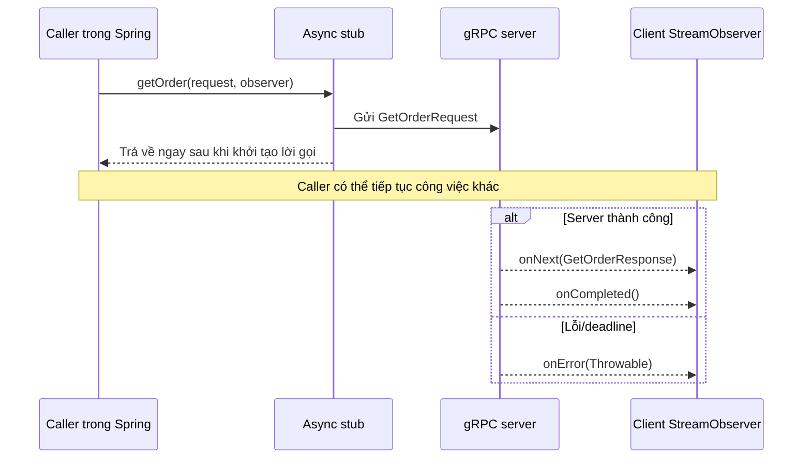

# Async stub cho unary RPC

## 1. Async stub giải quyết vấn đề gì?

Trong hệ sinh thái **Spring gRPC**, một phương thức **unary RPC** gửi đúng một thông điệp request và, khi thành công, nhận một thông điệp response. Tuy nhiên, client có thể chọn **cách chờ kết quả**. Với blocking stub, thread gọi phương thức chờ cho đến khi RPC hoàn tất. Với **async stub**, lời gọi khởi tạo RPC rồi trả quyền điều khiển cho caller; kết quả hoặc lỗi được thông báo sau qua các callback `StreamObserver`.

Điều này hữu ích khi một dịch vụ Spring cần gọi gRPC trong lúc vẫn xử lý các công việc khác: một API gateway tổng hợp dữ liệu từ nhiều dịch vụ, ứng dụng có luồng xử lý bất đồng bộ hoặc một hệ thống có nhiều cuộc gọi đang chờ I/O. Async stub giúp tránh **giữ thread gọi chỉ để đợi phản hồi**; nó không làm server xử lý nhanh hơn một cách tự động và không loại bỏ nhu cầu quản lý tải.

Mục tiêu của bài:

- Nhận diện và tạo `*Stub` bất đồng bộ được sinh từ file `.proto` cho một unary RPC.
- Hiểu vai trò và thứ tự các callback `onNext`, `onError`, `onCompleted` của `StreamObserver`.
- Tích hợp async stub vào Spring, xây dựng API `CompletableFuture` và xử lý gRPC status có kiểm soát.
- Áp dụng deadline, cancellation, metadata, TLS và các nguyên tắc về thread, tài nguyên, retry.
- Kiểm thử được cả kết quả thành công lẫn lỗi của một lời gọi unary bất đồng bộ.

**Tình huống minh họa:** một dịch vụ Spring nhận mã đơn `A-100`, gọi `OrderQueryService/GetOrder` để lấy trạng thái và tổng tiền. Việc tra cứu diễn ra qua mạng, nhưng thread tạo request không bị chặn để chờ phản hồi.

## 2. Hợp đồng Protocol Buffers và mã được sinh

Ví dụ `src/main/proto/order_query.proto`:

```proto
syntax = "proto3";

package checkout.v1;

option java_package = "com.example.checkout.grpc";
option java_multiple_files = true;

service OrderQueryService {
  rpc GetOrder(GetOrderRequest) returns (GetOrderResponse);
}

message GetOrderRequest {
  string order_id = 1;
}

message GetOrderResponse {
  string order_id = 1;
  string state = 2;
  int64 total_cents = 3;
}
```

Không có `stream` ở phía tham số hoặc kết quả của `GetOrder`: đây là **unary RPC**. Khi dự án đã cấu hình `protoc` cùng plugin gRPC Java, build sinh ra các lớp `GetOrderRequest`, `GetOrderResponse` và `OrderQueryServiceGrpc`. Trong số đó, hai factory thường gặp là:

```java
// channel có kiểu io.grpc.Channel.
OrderQueryServiceGrpc.OrderQueryServiceBlockingStub blocking =
        OrderQueryServiceGrpc.newBlockingStub(channel);

OrderQueryServiceGrpc.OrderQueryServiceStub async =
        OrderQueryServiceGrpc.newStub(channel);
```

Khác biệt cốt lõi nằm ở chữ ký của phương thức Java được sinh:

```java
// Blocking unary: trả một response hoặc ném lỗi.
GetOrderResponse result = blocking.getOrder(request);

// Async unary: trả void; kết quả được đẩy vào observer.
async.getOrder(request, responseObserver);
```

Không tự sửa lớp mã sinh, vì lần build sau có thể ghi đè thay đổi. Khi muốn đổi trường dữ liệu hay hình thức RPC, hãy chỉnh hợp đồng `.proto` và sinh lại mã.

## 3. Vòng đời callback của một lời gọi unary

Phía client, `StreamObserver<GetOrderResponse>` nhận ba loại sự kiện:

| Callback | Khi nào xảy ra | Ý nghĩa đối với unary |
| --- | --- | --- |
| `onNext(GetOrderResponse value)` | Có một thông điệp response gửi đến. | Tối đa một response nghiệp vụ trên lời gọi unary hợp lệ. |
| `onCompleted()` | Stream kết thúc **thành công**. | Cho biết RPC đã hoàn tất với trạng thái thành công. |
| `onError(Throwable error)` | RPC kết thúc **thất bại**. | Chứa lỗi gRPC; không có `onCompleted()` sau đó. |

Trên một lời gọi hoàn tất bình thường, thứ tự là `onNext(response)` rồi `onCompleted()`. Nếu lỗi xảy ra trước response, observer có thể chỉ nhận `onError(error)`. Hai terminal callback `onCompleted` và `onError` **loại trừ nhau** và chỉ một trong hai được gọi cho một RPC.



“Trả về ngay” ở đây nghĩa là **không chờ phản hồi mạng**. Việc thiết lập lời gọi vẫn cần một ít thao tác cục bộ; với server in-process hoặc phản hồi rất nhanh, callback *có thể* xảy ra trước khi dòng code kế tiếp của caller chạy. Không dựa vào giả định rằng callback luôn chạy trễ hơn một khoảng thời gian cố định.

### Ví dụ trực tiếp với `StreamObserver`

```java
GetOrderRequest request = GetOrderRequest.newBuilder()
        .setOrderId("A-100")
        .build();

stub.withDeadlineAfter(2, TimeUnit.SECONDS)
        .getOrder(request, new StreamObserver<GetOrderResponse>() {
            @Override
            public void onNext(GetOrderResponse response) {
                System.out.println("Đơn: " + response.getOrderId());
                System.out.println("Trạng thái: " + response.getState());
            }

            @Override
            public void onError(Throwable error) {
                Status status = Status.fromThrowable(error);
                System.err.println("RPC lỗi: " + status.getCode());
            }

            @Override
            public void onCompleted() {
                System.out.println("RPC hoàn thành");
            }
        });

// Luồng gọi tiếp tục; không có response để return đồng bộ ở đây.
```

Các import tương ứng gồm `io.grpc.Status`, `io.grpc.stub.StreamObserver` và `java.util.concurrent.TimeUnit`. Trong code ứng dụng, tránh thực hiện xử lý lâu hoặc thao tác I/O blocking bên trong callback, vì nó có thể giữ các thread dùng để dispatch callback. Nếu cần tính toán nặng hoặc gọi một hệ thống khác, chuyển công việc sang executor phù hợp.

**Lưu ý quan trọng:** `onNext` mới báo rằng client nhận được payload, chưa phải bằng chứng toàn bộ RPC đã kết thúc với `OK`. Nếu đang chuyển kết quả sang future hoặc một tác vụ tiếp theo cần **kết quả cuối cùng đã xác nhận**, chỉ hoàn thành future thành công sau khi nhận `onCompleted`.

## 4. Triển khai server mẫu để thử client async

Để có một server thống nhất cho các ví dụ bên dưới, giả sử ứng dụng server đã bật tích hợp Spring gRPC và sử dụng annotation `@GrpcService`:

```java
package com.example.checkout.server;

import com.example.checkout.grpc.GetOrderRequest;
import com.example.checkout.grpc.GetOrderResponse;
import com.example.checkout.grpc.OrderQueryServiceGrpc;
import io.grpc.Status;
import io.grpc.stub.StreamObserver;
import org.springframework.grpc.server.service.GrpcService;

@GrpcService
public class DemoOrderGrpcService
        extends OrderQueryServiceGrpc.OrderQueryServiceImplBase {

    @Override
    public void getOrder(GetOrderRequest request,
                         StreamObserver<GetOrderResponse> observer) {
        String id = request.getOrderId().trim();

        if (id.isEmpty()) {
            observer.onError(Status.INVALID_ARGUMENT
                    .withDescription("order_id không được rỗng")
                    .asRuntimeException());
            return;
        }

        if (!"A-100".equals(id)) {
            observer.onError(Status.NOT_FOUND
                    .withDescription("Không tìm thấy đơn hàng")
                    .asRuntimeException());
            return;
        }

        observer.onNext(GetOrderResponse.newBuilder()
                .setOrderId(id)
                .setState("PAID")
                .setTotalCents(129_900L)
                .build());
        observer.onCompleted();
    }
}
```

Server mẫu xử lý đồng bộ với dữ liệu cố định để dễ kiểm chứng. **Async stub phía client không buộc server phải có kiểu xử lý bất đồng bộ**; hai đầu trao đổi với nhau qua cùng một hợp đồng gRPC. Trong dịch vụ thật, thay dữ liệu cố định bằng tầng nghiệp vụ và xử lý lỗi phù hợp.

## 5. Tạo và cấu hình async stub trong Spring

Ví dụ client sử dụng channel đặt tên `orders`. Trong `application.properties`:

```properties
spring.grpc.client.channels.orders.address=static://localhost:9090
```

Port `9090` chỉ là ví dụ; cần trùng với cổng server. Với kết nối ngoài môi trường phát triển, cấu hình transport credentials/TLS, xác thực và endpoint theo môi trường thay vì dựa vào cấu hình plaintext mặc định.

Đăng ký `OrderQueryServiceStub` dạng bean:

```java
package com.example.checkout.client;

import com.example.checkout.grpc.OrderQueryServiceGrpc;
import org.springframework.context.annotation.Bean;
import org.springframework.context.annotation.Configuration;
import org.springframework.grpc.client.GrpcChannelFactory;

@Configuration
public class OrderGrpcClientConfig {

    @Bean
    OrderQueryServiceGrpc.OrderQueryServiceStub orderAsyncStub(
            GrpcChannelFactory channelFactory) {
        return OrderQueryServiceGrpc.newStub(
                channelFactory.createChannel("orders"));
    }
}
```

Một `Channel` là hạ tầng giao tiếp mà nhiều RPC có thể dùng chung; **tạo async stub không đồng nghĩa mở một kết nối mới cho từng lần gọi**. Trong Spring, hãy sử dụng channel do ứng dụng quản lý, tránh tạo và đóng `ManagedChannel` mỗi lần gửi request.

Các stub của gRPC Java lưu cấu hình theo kiểu bất biến. Vì vậy:

```java
OrderQueryServiceGrpc.OrderQueryServiceStub perCallStub =
        stub.withDeadlineAfter(2, TimeUnit.SECONDS);
```

`perCallStub` là một đối tượng mới, còn bean `stub` ban đầu không thay đổi. Cách này cho phép tái sử dụng stub cơ sở giữa các request đồng thời và thiết lập deadline độc lập cho từng lời gọi.

## 6. Đóng gói callback thành `CompletableFuture`

Trong Java, `CompletableFuture` thuận tiện hơn callback lồng nhau khi phải phối hợp nhiều hoạt động. Ta có thể bọc lời gọi `getOrder` async để trả về một future **mà không chặn thread đang gọi**:

```java
package com.example.checkout.client;

import com.example.checkout.grpc.GetOrderRequest;
import com.example.checkout.grpc.GetOrderResponse;
import com.example.checkout.grpc.OrderQueryServiceGrpc;
import io.grpc.Status;
import io.grpc.stub.StreamObserver;
import org.springframework.stereotype.Service;

import java.util.concurrent.CompletableFuture;
import java.util.concurrent.TimeUnit;

@Service
public class OrderAsyncGateway {

    private final OrderQueryServiceGrpc.OrderQueryServiceStub stub;

    public OrderAsyncGateway(OrderQueryServiceGrpc.OrderQueryServiceStub stub) {
        this.stub = stub;
    }

    public CompletableFuture<GetOrderResponse> findById(String orderId) {
        if (orderId == null || orderId.isBlank()) {
            return CompletableFuture.failedFuture(
                    new IllegalArgumentException("orderId không được rỗng"));
        }

        GetOrderRequest request = GetOrderRequest.newBuilder()
                .setOrderId(orderId)
                .build();
        CompletableFuture<GetOrderResponse> result = new CompletableFuture<>();

        try {
            stub.withDeadlineAfter(2, TimeUnit.SECONDS)
                    .getOrder(request, new StreamObserver<GetOrderResponse>() {
                        private GetOrderResponse response;

                        @Override
                        public void onNext(GetOrderResponse value) {
                            // Unary chỉ có một response; chưa kết luận thành công.
                            response = value;
                        }

                        @Override
                        public void onError(Throwable error) {
                            result.completeExceptionally(error);
                        }

                        @Override
                        public void onCompleted() {
                            if (response == null) {
                                result.completeExceptionally(Status.INTERNAL
                                        .withDescription("Unary RPC không có response")
                                        .asRuntimeException());
                            } else {
                                result.complete(response);
                            }
                        }
                    });
        } catch (RuntimeException startError) {
            // Bắt cả lỗi đồng bộ trong lúc chuẩn bị/khởi tạo RPC.
            result.completeExceptionally(startError);
        }

        return result;
    }
}
```

Ở đây `findById` trả `CompletableFuture<GetOrderResponse>` gần như ngay sau khi khởi tạo RPC. Nếu server gửi `onNext(response)` rồi `onCompleted()`, future hoàn tất thành công. Nếu server trả `onError`, future hoàn tất với ngoại lệ. Với unary, gRPC Java đã kiểm soát số lượng response ở tầng lời gọi; đoạn mã giữ response cho đến khi terminal event được nhận để biểu diễn rõ thời điểm hoàn thành.

Phía sử dụng có thể tiếp tục chuỗi công việc:

```java
CompletableFuture<Boolean> isPaid = gateway.findById("A-100")
        .thenApply(order -> "PAID".equals(order.getState()));

isPaid.whenComplete((paid, error) -> {
    if (error != null) {
        System.err.println("Không đọc được đơn hàng: " + error);
    } else {
        System.out.println("Đã thanh toán? " + paid);
    }
});
```

Đừng gọi `join()` hoặc `get()` ngay sau khi tạo future trong đường xử lý cần giữ tính bất đồng bộ: hai method đó sẽ chặn thread. `join()`/`get()` hữu ích ở test, chương trình dòng lệnh hoặc điểm biên được thiết kế để đợi kết quả, nhưng cần hạn chờ rõ ràng.

### Callback và continuation chạy trên thread nào?

Async stub **không bảo đảm callback chạy trên một “UI thread” hay thread của request Spring**. Callback có thể được dispatch bởi executor của gRPC. `thenApply` và `whenComplete` của `CompletableFuture` có thể chạy ngay trên thread hoàn thành future; vì vậy không nên đặt xử lý nặng, truy cập database blocking hay tác vụ kéo dài trong continuation mặc định.

Khi cần tách công việc tính toán khỏi thread callback, dùng executor do ứng dụng quản lý:

```java
Executor businessExecutor = /* Executor được cấu hình trong Spring */;

CompletableFuture<Boolean> result = gateway.findById("A-100")
        .thenApplyAsync(
                order -> "PAID".equals(order.getState()),
                businessExecutor);
```

Đoạn trên minh họa cú pháp; cần import `java.util.concurrent.Executor` và cấp bean executor thực tế. Việc chuyển tác vụ sang executor giúp kiểm soát nơi chạy xử lý tiếp theo; nó **không biến thao tác nghiệp vụ blocking thành non-blocking** và vẫn cần giới hạn hàng đợi, số luồng.

## 7. Xử lý gRPC status trong luồng bất đồng bộ

Trong callback `onError(Throwable)`, nguyên nhân thường là `StatusRuntimeException`, nhưng code tổng quát nên trích xuất status qua `Status.fromThrowable(error)`. Khi bọc qua `CompletableFuture`, ngoại lệ có thể xuất hiện trong `CompletionException` hoặc `ExecutionException` tùy API chờ/ghép future. Nên phân nhánh theo **mã status**, không dựa vào chuỗi description.

```java
gateway.findById("UNKNOWN").whenComplete((order, error) -> {
    if (error == null) {
        System.out.println(order.getState());
        return;
    }

    Throwable cause = error;
    if (cause instanceof java.util.concurrent.CompletionException
            && cause.getCause() != null) {
        cause = cause.getCause();
    }

    Status.Code code = Status.fromThrowable(cause).getCode();
    switch (code) {
        case NOT_FOUND -> System.out.println("Đơn hàng không tồn tại");
        case DEADLINE_EXCEEDED -> System.out.println("Tra cứu quá hạn");
        case UNAVAILABLE -> System.out.println("Dịch vụ tạm thời không sẵn sàng");
        default -> System.err.println("RPC lỗi: " + code);
    }
});
```

Một số mã cần nhận diện:

| Mã status | Nguyên nhân thường gặp | Hành động phù hợp |
| --- | --- | --- |
| `OK` | RPC hoàn thành và có response. | Dùng payload đã nhận. |
| `INVALID_ARGUMENT` | Thiếu/sai dữ liệu request. | Sửa dữ liệu; không retry nguyên request. |
| `NOT_FOUND` | Không có tài nguyên được hỏi. | Trả trạng thái không tìm thấy cho tầng gọi. |
| `UNAUTHENTICATED` | Thiếu hoặc sai thông tin xác thực. | Kiểm tra metadata/credentials. |
| `PERMISSION_DENIED` | Không có quyền thực hiện. | Kiểm tra phân quyền. |
| `DEADLINE_EXCEEDED` | Hết ngân sách thời gian. | Ghi nhận timeout; đánh giá retry an toàn. |
| `UNAVAILABLE` | Mất kết nối hoặc service tạm thời không sẵn sàng. | Cân nhắc backoff, retry có giới hạn. |
| `INTERNAL` | Lỗi bất thường ở hệ thống. | Ghi log và điều tra, tránh lộ thông tin nội bộ. |
| `CANCELLED` | Lời gọi bị hủy. | Ngừng xử lý liên quan nếu thích hợp. |

Với các lỗi như `IllegalArgumentException` được tạo ngay trong gateway trước khi bắt đầu RPC, đây là lỗi Java cục bộ: `Status.fromThrowable` có thể cho `UNKNOWN`. Vì vậy tầng sử dụng cần phân biệt lỗi kiểm tra đầu vào với lỗi gRPC nếu muốn tạo phản hồi nghiệp vụ chính xác.

## 8. Deadline, cancellation và retry

### Deadline luôn gắn với mỗi lần gọi

`withDeadlineAfter(2, TimeUnit.SECONDS)` tạo stub có deadline tính từ **thời điểm gọi phương thức cấu hình**. Vì thế hãy tạo stub dẫn xuất ngay trước `getOrder(...)`, thay vì đặt deadline cho singleton bean lúc ứng dụng khởi động; nếu không, deadline có thể hết hạn từ rất lâu trước RPC tiếp theo.

Khi deadline hết, gRPC kết thúc lời gọi phía client với trạng thái như `DEADLINE_EXCEEDED`, cho phép observer nhận `onError`. Việc này giúp client không chờ vô hạn, nhưng **không chứng minh** tác vụ phía server đã dừng ngay hoặc mọi side effect đều được hoàn tác. Server và các lời gọi downstream cần xử lý hủy, timeout và giới hạn tài nguyên tương ứng.

### `CompletableFuture.cancel()` chưa chắc hủy RPC

Trong ví dụ gateway ở trên, `CompletableFuture` là đối tượng do ta tự tạo để đại diện cho kết quả; nó **không phải** đối tượng trực tiếp điều khiển `ClientCall` của gRPC. Do đó:

```java
CompletableFuture<GetOrderResponse> result = gateway.findById("A-100");
result.cancel(true); // Chỉ hủy future của gateway mẫu.
```

Hành động này không tự động gửi cancellation xuống RPC đang chạy. Nếu hệ thống yêu cầu ngừng request khi người dùng hủy, cần nối tín hiệu hủy với **gRPC `Context.CancellableContext`** hoặc dùng **`ClientResponseObserver` / `ClientCallStreamObserver`** để gọi `cancel(...)` trên lời gọi nền. Việc nối cancellation cần xử lý cả trường hợp future bị hủy trước khi call được thiết lập, và chỉ được hủy tài nguyên thuộc **đúng RPC**. Deadline vẫn nên được cấu hình ngay cả khi đã hỗ trợ hủy chủ động.

### Retry cần dựa vào tính chất nghiệp vụ

Một unary RPC không mặc nhiên idempotent: `GetOrder` thường có thể gọi lại, nhưng unary `CreateOrder` hoặc `ChargePayment` có thể gây tác dụng phụ. Khi xảy ra `UNAVAILABLE` hay `DEADLINE_EXCEEDED`, không thể suy ra chắc chắn server đã xử lý request hay chưa. Chỉ retry khi hợp đồng và nghiệp vụ cho phép; sử dụng backoff, giới hạn số lần thử, giữ tổng deadline và, với thao tác ghi cần retry, thiết kế **idempotency key** thích hợp.

## 9. Tích hợp Spring WebFlux, metadata và quan sát hệ thống

Với Spring MVC, async stub có thể được gọi từ một controller trả `CompletableFuture` nếu cơ chế async của web stack được cấu hình phù hợp. Với Spring WebFlux, có thể chuyển future sang `Mono` bằng Reactor mà không gọi `block()`:

```java
// Khi dự án sử dụng Reactor và đã có OrderAsyncGateway gateway:
Mono<GetOrderResponse> mono =
        Mono.fromFuture(gateway.findById("A-100"));
```

Cần import `reactor.core.publisher.Mono`. Tuy nhiên, vì gateway mẫu chưa gắn cancellation với cuộc gọi gRPC, việc subscriber hủy `Mono` hoặc future bị cancel **không đảm bảo** RPC thực sự bị hủy. Khi dùng reactive end-to-end, hãy triển khai cầu nối cancellation một cách tường minh.

Trong gRPC, header/trailer **metadata** được truyền riêng với message protobuf. Client có thể truyền token xác thực và correlation ID bằng credentials hoặc client interceptor; server kiểm tra qua interceptor hoặc cơ chế bảo mật tương ứng. Không đưa access token vào `GetOrderRequest`, không ghi token vào log và không giả định async stub tự bật TLS. Channel cần mã hóa và xác thực kết nối khi triển khai trên mạng không tin cậy; bảo mật phải được cấu hình ở tầng transport và ứng dụng.

Các chỉ số nên quan sát: số RPC đang xử lý, số lời gọi theo service/method và status, tỷ lệ timeout, p95/p99 latency, mức độ đầy của executor, lỗi `UNAVAILABLE` và số lần retry. Metadata như correlation ID giúp nối log/traces giữa các service. Tránh đặt mã đơn hàng hoặc token thành nhãn metric vì dễ tạo cardinality lớn hoặc lộ thông tin.

**Không giữ toàn bộ trạng thái request trong các biến dùng chung của singleton bean.** Mỗi RPC nên có observer/future riêng; biến `response` trong ví dụ là trường của observer **mới được tạo cho từng lời gọi**. Tái sử dụng stub cơ sở thường phù hợp, nhưng chia sẻ một observer có state giữa nhiều RPC sẽ dễ trộn lẫn kết quả.

## 10. Kiểm thử async unary RPC không phụ thuộc cổng mạng

Có thể kiểm thử `OrderAsyncGateway` qua gRPC **in-process**: vẫn dùng stub thật, protobuf thật và status thật, nhưng bỏ tầng socket/TLS. Ví dụ JUnit 5 sau sử dụng `DemoOrderGrpcService` ở mục 4 và cần thư viện `grpc-inprocess` tương thích với phiên bản gRPC Java:

```java
package com.example.checkout.client;

import com.example.checkout.grpc.GetOrderResponse;
import com.example.checkout.grpc.OrderQueryServiceGrpc;
import com.example.checkout.server.DemoOrderGrpcService;
import io.grpc.ManagedChannel;
import io.grpc.Server;
import io.grpc.Status;
import io.grpc.inprocess.InProcessChannelBuilder;
import io.grpc.inprocess.InProcessServerBuilder;
import org.junit.jupiter.api.AfterEach;
import org.junit.jupiter.api.BeforeEach;
import org.junit.jupiter.api.Test;

import java.io.IOException;
import java.util.concurrent.ExecutionException;
import java.util.concurrent.TimeUnit;

import static org.junit.jupiter.api.Assertions.assertEquals;
import static org.junit.jupiter.api.Assertions.assertThrows;

class OrderAsyncGatewayTest {

    private Server server;
    private ManagedChannel channel;
    private OrderAsyncGateway gateway;

    @BeforeEach
    void setUp() throws IOException {
        String name = InProcessServerBuilder.generateName();
        server = InProcessServerBuilder.forName(name)
                .directExecutor()
                .addService(new DemoOrderGrpcService())
                .build()
                .start();

        channel = InProcessChannelBuilder.forName(name)
                .directExecutor()
                .build();

        OrderQueryServiceGrpc.OrderQueryServiceStub stub =
                OrderQueryServiceGrpc.newStub(channel);
        gateway = new OrderAsyncGateway(stub);
    }

    @AfterEach
    void tearDown() {
        channel.shutdownNow();
        server.shutdownNow();
    }

    @Test
    void successfulUnaryCallCompletesFuture() throws Exception {
        GetOrderResponse response = gateway.findById("A-100")
                .get(3, TimeUnit.SECONDS);

        assertEquals("A-100", response.getOrderId());
        assertEquals("PAID", response.getState());
        assertEquals(129_900L, response.getTotalCents());
    }

    @Test
    void notFoundCompletesFutureExceptionally() {
        ExecutionException exception = assertThrows(
                ExecutionException.class,
                () -> gateway.findById("UNKNOWN").get(3, TimeUnit.SECONDS));

        assertEquals(Status.Code.NOT_FOUND,
                Status.fromThrowable(exception.getCause()).getCode());
    }

    @Test
    void emptyIdFailsLocallyBeforeCallingServer() {
        ExecutionException exception = assertThrows(
                ExecutionException.class,
                () -> gateway.findById(" ").get(3, TimeUnit.SECONDS));

        assertEquals(IllegalArgumentException.class,
                exception.getCause().getClass());
    }
}
```

`get(3, TimeUnit.SECONDS)` chỉ được dùng tại **điểm kiểm thử** để chờ kết quả có giới hạn thời gian. Còn API `findById` vẫn khởi tạo RPC bất đồng bộ. `directExecutor()` hợp lý với server giả đơn giản trong test; không nên suy ra có thể chạy các thao tác blocking nặng trên executor trực tiếp trong sản phẩm.

Các tình huống cần mở rộng khi kiểm thử dịch vụ thật:

| Tình huống | Điều cần xác minh |
| --- | --- |
| Trả response hợp lệ | Có đúng payload, future chỉ hoàn tất thành công khi RPC hoàn thành. |
| Server trả `INVALID_ARGUMENT`, `NOT_FOUND` | Future hoàn tất với lỗi có status tương ứng. |
| Deadline hết hạn | Observer nhận lỗi thích hợp và không có future treo vô hạn. |
| Nhiều RPC đồng thời cùng stub | Mỗi callback/future gắn với một request; không trộn dữ liệu. |
| Client hủy tác vụ | Nếu đã thiết kế cancellation, RPC nền cũng được hủy. |
| TLS, credentials, interceptor | Kiểm thử tích hợp có kết nối thật, kiểm tra chứng chỉ và metadata. |

Kiểm thử in-process không xác nhận cấu hình channel Spring, TLS hay vận chuyển HTTP/2 qua mạng. Cần bài test tích hợp riêng khi muốn kiểm chứng những phần đó.

## 11. Những lỗi thiết kế thường gặp

1. **Chờ `future.join()` ngay sau khi gọi async stub.** Hành vi này lại chặn thread và làm mất phần lớn lợi ích của mô hình callback.
2. **Đánh dấu thành công ngay trong `onNext`.** `onNext` cung cấp response, còn `onCompleted` xác nhận kết thúc thành công; nếu đã công bố kết quả trước terminal event, lỗi cuối stream có thể bị bỏ qua.
3. **Không cài `onError`.** Client mất kênh báo lỗi hoặc bị treo ở trạng thái chờ kết quả mà tầng sử dụng không thể chẩn đoán.
4. **Đặt deadline trên singleton stub lúc khởi động.** Deadline sẽ tính từ lúc tạo stub và có thể hết hạn trước RPC tiếp theo; hãy tạo stub dẫn xuất tại mỗi cuộc gọi.
5. **Xử lý blocking hoặc CPU nặng trong callback.** Điều này giữ thread dispatch và làm tăng độ trễ của nhiều lời gọi; dùng executor chuyên dụng có giới hạn tải.
6. **Dùng chung observer có state giữa nhiều cuộc gọi.** Dễ trộn response và callback; tạo observer riêng cho từng RPC, dùng chung channel/stub cơ sở khi phù hợp.
7. **Nghĩ rằng hủy `CompletableFuture` tự động hủy call.** Với bridge tự viết, cần liên kết cancellation xuống `ClientCall` hoặc gRPC `Context`.
8. **Retry mọi unary call.** Unary là hình dạng request/response, không nói lên tính idempotent; retry có thể lặp tác dụng phụ.

## 12. Bài thực hành

1. Từ hợp đồng `OrderQueryService`, triển khai `findById` bằng `OrderQueryServiceStub` để trả `CompletableFuture<GetOrderResponse>`. Tạo observer riêng cho từng request, đặt deadline hai giây ngay trước lúc gọi.
2. Viết hàm `isPaidAsync(String orderId)` trả về `CompletableFuture<Boolean>` bằng `thenApply` và không gọi `get()` hoặc `join()` trong logic nghiệp vụ.
3. Viết kiểm thử cho đơn `A-100`, mã không tồn tại, mã rỗng và server cố ý trả lỗi. Chứng minh future thành công chỉ sau terminal callback, và lỗi đi qua nhánh exception.
4. Mở rộng thử nghiệm gọi đồng thời 20 RPC qua cùng bean stub; theo dõi số RPC đang xử lý, thời gian hoàn tất và sự độc lập của callback từng lời gọi.

**Tự kiểm tra kiến thức:** `OrderQueryServiceGrpc.newStub(channel)` tạo **async stub**; `stub.getOrder(request, observer)` bắt đầu một unary RPC mà không chờ phản hồi mạng. Với lời gọi thành công, observer nhận một response qua `onNext` và tín hiệu kết thúc `onCompleted`; với lời gọi lỗi, nhận `onError`. Khi tích hợp với Spring, cần quản lý channel, deadline theo từng RPC, thread callback, bảo mật và cancellation để cách gọi bất đồng bộ có thể vận hành tin cậy.
