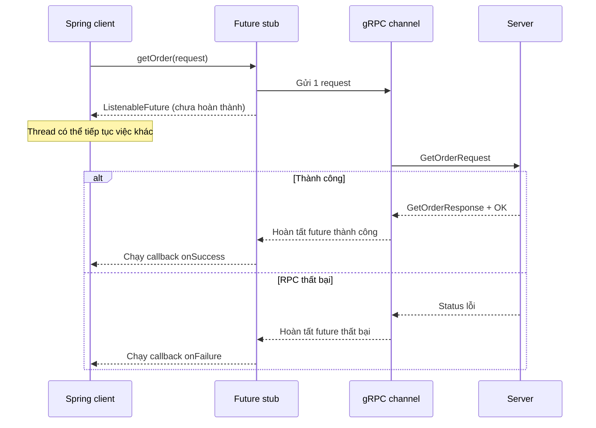

# Future stub và kết quả bất đồng bộ

## 1. Future stub giải quyết vấn đề gì?

Trong hệ sinh thái **Spring gRPC**, một phương thức **unary RPC** nhận đúng một thông điệp request và, nếu thành công, trả về một thông điệp response. Khi gọi bằng **blocking stub**, thread của client đợi response rồi mới chạy tiếp. **Future stub** cho phép client khởi tạo RPC và **nhận ngay một đối tượng biểu diễn kết quả sẽ có trong tương lai**; thread gọi có thể làm công việc khác trong lúc mạng và server xử lý request.

Ví dụ một dịch vụ tổng hợp thông tin thanh toán cần hỏi gRPC server về đơn hàng. Thay vì giữ thread chờ kết quả của `GetOrder`, client có thể nhận `ListenableFuture<GetOrderResponse>`, đăng ký callback để xử lý lúc RPC hoàn tất, hoặc phối hợp future với công việc khác. Future stub được sinh từ hợp đồng Protocol Buffers; không cần tự xây dựng tầng HTTP/2.

Kết thúc bài này, người học có thể:

- Nhận diện kiểu `OrderQueryServiceFutureStub` và phương thức trả về `ListenableFuture`.
- Tích hợp future stub vào Spring bằng channel được quản lý chung.
- Đặt deadline riêng cho từng lời gọi unary và xử lý kết quả theo callback mà không gọi `get()` trên thread phục vụ request.
- Phân biệt kết quả thành công, gRPC status lỗi, hủy lời gọi và timeout khi chờ future.
- Ghép kết quả bất đồng bộ, chuyển sang `CompletableFuture` khi cần và kiểm thử bằng server gRPC in-process.

### Bất đồng bộ ở đâu?

`futureStub.getOrder(request)` **trả về nhanh một future**; nó không đợi dữ liệu nghiệp vụ từ server. Khi lời gọi kết thúc, future được hoàn thành:

| Kết quả của RPC | Trạng thái future | Điều client quan sát |
| --- | --- | --- |
| Server gửi một response và kết thúc với `OK` | Thành công | Nhận một `GetOrderResponse`. |
| Server trả `NOT_FOUND`, `INVALID_ARGUMENT` hoặc status lỗi khác | Thất bại | Future chứa nguyên nhân lỗi gRPC, thường là `StatusRuntimeException`. |
| Client hoặc tác vụ chủ động hủy | Bị hủy | Có thể quan sát `CancellationException`; cơ chế hủy được truyền xuống RPC ở mức có thể. |
| Deadline gRPC hết hạn | Thất bại | Thường nhận `DEADLINE_EXCEEDED`. |

`ListenableFuture` không làm cho **server** có nhiều response hơn; hợp đồng vẫn là unary. Nó chỉ thay đổi cách **client** nhận kết quả.



## 2. Hợp đồng Protocol Buffers và mã Java sinh ra

Giả sử dự án có file `src/main/proto/order_query.proto`:

```proto
syntax = "proto3";

package checkout.v1;

option java_package = "com.example.checkout.grpc";
option java_multiple_files = true;

service OrderQueryService {
  rpc GetOrder (GetOrderRequest) returns (GetOrderResponse);
}

message GetOrderRequest {
  string order_id = 1;
}

message GetOrderResponse {
  string order_id = 1;
  string state = 2;
  int64 total_cents = 3;
}
```

Do không có từ khóa `stream` trong khai báo, `GetOrder` là unary RPC. Sau khi cấu hình và chạy `protoc` cùng plugin gRPC Java, những lớp liên quan có thể gồm:

| Lớp | Ý nghĩa |
| --- | --- |
| `GetOrderRequest`, `GetOrderResponse` | Các message Java được sinh từ protobuf. |
| `OrderQueryServiceGrpc.OrderQueryServiceImplBase` | Lớp cơ sở để server triển khai handler. |
| `OrderQueryServiceGrpc.OrderQueryServiceBlockingStub` | Client gọi unary và chờ kết quả đồng bộ. |
| `OrderQueryServiceGrpc.OrderQueryServiceStub` | Client nhận kết quả qua `StreamObserver`. |
| `OrderQueryServiceGrpc.OrderQueryServiceFutureStub` | Client unary nhận kết quả kiểu `ListenableFuture`. |

Tạo future stub từ một channel:

```java
OrderQueryServiceGrpc.OrderQueryServiceFutureStub futureStub =
        OrderQueryServiceGrpc.newFutureStub(channel);

ListenableFuture<GetOrderResponse> result =
        futureStub.getOrder(GetOrderRequest.newBuilder()
                .setOrderId("A-100")
                .build());
```

`ListenableFuture` thuộc thư viện **Guava** (`com.google.common.util.concurrent.ListenableFuture`), được sử dụng trong API future stub của gRPC Java. Khác với `java.util.concurrent.CompletableFuture`, nó cung cấp cơ chế đăng ký listener và được tích hợp trực tiếp vào generated future stub. Có thể dùng `Futures.addCallback(...)` để nhận thông báo khi hoàn tất.

> **Phạm vi:** Future stub của gRPC Java phục vụ các phương thức unary. Với client streaming hoặc bidirectional streaming, thường dùng async stub và `StreamObserver`; không xem future stub là công cụ thay thế toàn bộ các kiểu streaming.

## 3. Tạo future stub trong ứng dụng Spring

Trong Spring gRPC, `GrpcChannelFactory` cung cấp channel theo tên từ cấu hình. Ví dụ ứng dụng client gọi server thử nghiệm trên cổng `9090`:

```properties
# application.properties của ứng dụng client
spring.grpc.client.channels.orders.address=static://localhost:9090
```

Tạo bean singleton giữ **stub cơ sở**:

```java
package com.example.checkout.client;

import com.example.checkout.grpc.OrderQueryServiceGrpc;
import org.springframework.context.annotation.Bean;
import org.springframework.context.annotation.Configuration;
import org.springframework.grpc.client.GrpcChannelFactory;

@Configuration
public class OrderGrpcClientConfiguration {

    @Bean
    OrderQueryServiceGrpc.OrderQueryServiceFutureStub orderFutureStub(
            GrpcChannelFactory channelFactory) {
        return OrderQueryServiceGrpc.newFutureStub(
                channelFactory.createChannel("orders"));
    }
}
```

Ví dụ giả định dự án đã khai báo dependency của Spring gRPC, gRPC Java và plugin sinh mã tương thích. Spring gRPC chịu trách nhiệm tích hợp và quản lý channel theo cấu hình của phiên bản đang dùng; **stub chỉ là wrapper cấu hình quanh channel**, không tương ứng với một kết nối TCP mới ở mỗi lời gọi.

Hai lưu ý quan trọng:

1. Tên `orders` trong `createChannel("orders")` phải khớp cấu hình channel. Khi triển khai thực tế, địa chỉ, name resolution và bảo mật TLS phải được thiết lập đúng với server.
2. `AbstractStub` và các stub được sinh mã có thiết kế **bất biến**. Các phép `withDeadlineAfter(...)`, `withCallCredentials(...)` hoặc `withInterceptors(...)` trả về **stub mới**. Có thể dùng chung bean gốc rồi dẫn xuất stub cho từng RPC mà không ghi đè cấu hình của lời gọi khác.

## 4. Thực hiện một unary call bằng future stub

Tạo Spring service trả trực tiếp `ListenableFuture` để tầng trên quyết định cách phối hợp kết quả:

```java
package com.example.checkout.client;

import com.example.checkout.grpc.GetOrderRequest;
import com.example.checkout.grpc.GetOrderResponse;
import com.example.checkout.grpc.OrderQueryServiceGrpc;
import com.google.common.util.concurrent.ListenableFuture;
import org.springframework.stereotype.Service;

import java.util.concurrent.TimeUnit;

@Service
public class AsyncOrderReader {

    private final OrderQueryServiceGrpc.OrderQueryServiceFutureStub stub;

    public AsyncOrderReader(
            OrderQueryServiceGrpc.OrderQueryServiceFutureStub stub) {
        this.stub = stub;
    }

    public ListenableFuture<GetOrderResponse> findById(String orderId) {
        if (orderId == null || orderId.isBlank()) {
            throw new IllegalArgumentException("orderId không được rỗng");
        }

        GetOrderRequest request = GetOrderRequest.newBuilder()
                .setOrderId(orderId)
                .build();

        // Deadline được đặt ngay trước mỗi RPC; bean stub gốc không đổi.
        return stub.withDeadlineAfter(1500, TimeUnit.MILLISECONDS)
                .getOrder(request);
    }
}
```

Gọi `findById("A-100")` trả về future mà **không đợi** phản hồi nghiệp vụ. Tuy vậy, việc tạo request, chọn channel và khởi tạo lời gọi vẫn diễn ra đồng bộ trong thời gian rất ngắn; không nên diễn giải future stub là cam kết rằng mỗi dòng lệnh đều không thể tốn thời gian.

### Nhận kết quả bằng callback

Guava cung cấp `Futures.addCallback`:

```java
import com.example.checkout.grpc.GetOrderResponse;
import com.google.common.util.concurrent.FutureCallback;
import com.google.common.util.concurrent.Futures;
import com.google.common.util.concurrent.ListenableFuture;
import io.grpc.Status;

import java.util.concurrent.Executor;

// asyncOrderReader: bean AsyncOrderReader từ ví dụ trên.
// callbackExecutor: executor được quản lý riêng cho xử lý kết quả.
ListenableFuture<GetOrderResponse> pending =
        asyncOrderReader.findById("A-100");

Futures.addCallback(pending, new FutureCallback<GetOrderResponse>() {
    @Override
    public void onSuccess(GetOrderResponse response) {
        System.out.println("Đơn hàng: " + response.getOrderId());
        System.out.println("Trạng thái: " + response.getState());
    }

    @Override
    public void onFailure(Throwable failure) {
        Status status = Status.fromThrowable(failure);
        System.err.println("RPC thất bại: " + status.getCode());
    }
}, callbackExecutor);
```

Kết quả được chuyển vào đúng **một** nhánh callback: `onSuccess` nếu future hoàn thành thành công, `onFailure` nếu future thất bại (trong đó có thể có hủy). `Status.fromThrowable(...)` tìm gRPC status trong nguyên nhân lỗi khi có; nếu không có status, nó trả về mã tổng quát `UNKNOWN`. Với hủy cục bộ, hãy kiểm tra trạng thái hủy của future trước khi kết luận đó là lỗi server.

**Executor quyết định callback chạy ở đâu.** Guava không mặc nhiên đảm bảo callback chạy trên thread người gọi. Nếu dùng `MoreExecutors.directExecutor()`, callback có thể chạy ngay trên thread hoàn tất RPC, hoặc chạy tức thì khi future đã xong lúc đăng ký. Chỉ dùng direct executor cho các thao tác thật ngắn, không blocking. Với logic phức tạp, hãy dùng executor được Spring quản lý, giới hạn tài nguyên và đặt chính sách xử lý quá tải.

Không nên đặt đọc database, gọi HTTP đồng bộ, ghi file lớn hay `future.get()` bên trong callback chạy trên luồng hoàn tất RPC. Những thao tác này có thể làm chậm xử lý các lời gọi khác.

## 5. Biến đổi future để phối hợp logic nghiệp vụ

Không phải mọi nơi đều cần trực tiếp xử lý toàn bộ protobuf response. Guava `Futures.transform` chuyển kết quả một future thành kết quả future khác:

```java
import com.google.common.util.concurrent.Futures;
import com.google.common.util.concurrent.ListenableFuture;
import com.google.common.util.concurrent.MoreExecutors;

public ListenableFuture<Boolean> isPaidAsync(String orderId) {
    return Futures.transform(
            asyncOrderReader.findById(orderId),
            response -> "PAID".equals(response.getState()),
            MoreExecutors.directExecutor()
    );
}
```

Hàm ánh xạ ở đây chỉ so sánh một chuỗi ngắn nên phù hợp direct executor. Nếu future gốc thất bại với `NOT_FOUND` hoặc `UNAVAILABLE`, future kết quả cũng thất bại; nó **không** tự biến lỗi RPC thành `false`. Đây là tính chất quan trọng: “đơn chưa thanh toán” khác “không truy vấn được đơn”.

Muốn chuỗi hóa các RPC phụ thuộc nhau mà vẫn bất đồng bộ, có thể dùng `Futures.transformAsync` và trả về một `ListenableFuture` khác. Ví dụ: lấy thông tin đơn hàng rồi dựa trên `customer_id` để gọi một unary RPC tra cứu khách hàng. Khi thiết kế chuỗi như vậy, cần suy nghĩ về deadline tổng và việc hủy dây chuyền; đừng cấp lại thời hạn đầy đủ cho từng bước khiến tổng thời gian vượt ngân sách của request cha.

### Phối hợp hai lời gọi độc lập

Giả sử cần đồng thời lấy đơn `A-100` và `B-200`:

```java
ListenableFuture<GetOrderResponse> first =
        asyncOrderReader.findById("A-100");
ListenableFuture<GetOrderResponse> second =
        asyncOrderReader.findById("B-200");

ListenableFuture<java.util.List<GetOrderResponse>> both =
        Futures.allAsList(first, second);
```

Hai RPC được khởi tạo riêng; `both` hoàn thành thành công khi cả hai thành công, và hoàn thành thất bại nếu một lời gọi lỗi. Cách này thuận lợi khi các request độc lập nhưng **không thay thế quản lý concurrency**: nếu quạt ra hàng nghìn RPC cùng lúc, cần giới hạn số lượng lời gọi đang thực hiện, số connection và tải ở service đích. Lưu ý `allAsList` không mặc định hủy mọi RPC còn lại chỉ vì một RPC thất bại; quản lý hủy theo chính sách của hệ thống.

## 6. Deadline, timeout khi chờ và cancellation

Future tạo ra hai loại thời gian chờ dễ nhầm:

| Khái niệm | Đặt ở đâu | Điều gì xảy ra |
| --- | --- | --- |
| **Deadline của gRPC call** | `stub.withDeadlineAfter(1500, TimeUnit.MILLISECONDS)` | Giới hạn thời gian RPC; khi hết hạn lời gọi thường thất bại với `DEADLINE_EXCEEDED` và cơ chế hủy được kích hoạt. |
| **Timeout của thao tác đợi future** | `future.get(2, TimeUnit.SECONDS)` | Chỉ giới hạn khoảng thời gian **thread gọi `get` được phép chờ**; bản thân thao tác hết thời gian đợi không mặc nhiên hủy RPC. |

Trong đường xử lý bất đồng bộ, ưu tiên **deadline của RPC và callback**, thay vì gọi `get` chỉ để chờ. Với mã đồng bộ tại một ranh giới bắt buộc phải lấy kết quả, có thể dùng `get(timeout, unit)` và xử lý:

```java
ListenableFuture<GetOrderResponse> future =
        asyncOrderReader.findById("A-100");

try {
    GetOrderResponse response = future.get(2, TimeUnit.SECONDS);
    System.out.println(response.getState());
} catch (java.util.concurrent.TimeoutException timeout) {
    future.cancel(true); // Chủ động yêu cầu hủy RPC vẫn đang chờ.
    throw new IllegalStateException("Hết thời gian đợi kết quả", timeout);
} catch (InterruptedException interrupted) {
    future.cancel(true);
    Thread.currentThread().interrupt(); // Giữ trạng thái interrupted.
    throw new IllegalStateException("Thread bị ngắt", interrupted);
} catch (java.util.concurrent.ExecutionException failed) {
    io.grpc.Status status = io.grpc.Status.fromThrowable(failed.getCause());
    throw new IllegalStateException(
            "RPC thất bại: " + status.getCode(), failed.getCause());
}
```

Đoạn trên **có blocking** tại `get` nên chỉ minh họa một ranh giới đồng bộ hoặc code kiểm thử, không phải cách dùng lý tưởng ở event-loop Spring WebFlux. `ExecutionException` là wrapper của `Future#get()`; khi dùng callback, nguyên nhân lỗi thường đến trực tiếp qua `onFailure(Throwable)`.

Nếu client gọi `future.cancel(true)`, future sẽ được đánh dấu hủy khi lệnh hủy thành công và gRPC Java cố gắng hủy RPC tương ứng. Tham số `true` là gợi ý cho cơ chế `Future`; nó **không đảm bảo** thread server lập tức bị ngắt, hoạt động database đã dừng hoặc giao dịch đã rollback. Server xử lý tác vụ dài cần kiểm tra ngữ cảnh hủy phù hợp và dừng việc không cần thiết.

**Không nên áp dụng retry mù quáng** chỉ vì RPC là unary. Với thao tác `CreateOrder` hay thanh toán, server có thể đã ghi dữ liệu dù client nhận `DEADLINE_EXCEEDED` hoặc `UNAVAILABLE`. Muốn retry an toàn cần phân loại status, kiểm soát số lần/thời gian và dùng khóa idempotency khi nghiệp vụ có tác dụng phụ.

## 7. Chuyển sang CompletableFuture khi hệ thống cần API JDK

Nhiều thành phần Java/Spring dùng `CompletionStage` hoặc `CompletableFuture`, trong khi gRPC future stub cung cấp `ListenableFuture` của Guava. Có thể chuyển đổi bằng callback:

```java
package com.example.checkout.client;

import com.google.common.util.concurrent.FutureCallback;
import com.google.common.util.concurrent.Futures;
import com.google.common.util.concurrent.ListenableFuture;

import java.util.concurrent.CancellationException;
import java.util.concurrent.CompletableFuture;
import java.util.concurrent.Executor;

public final class FutureAdapters {

    private FutureAdapters() {}

    public static <T> CompletableFuture<T> toCompletableFuture(
            ListenableFuture<T> source, Executor callbackExecutor) {

        CompletableFuture<T> target = new CompletableFuture<>();

        Futures.addCallback(source, new FutureCallback<T>() {
            @Override
            public void onSuccess(T value) {
                target.complete(value);
            }

            @Override
            public void onFailure(Throwable failure) {
                if (failure instanceof CancellationException) {
                    target.cancel(false);
                } else {
                    target.completeExceptionally(failure);
                }
            }
        }, callbackExecutor);

        // Hủy CompletableFuture thì cũng yêu cầu hủy RPC gốc.
        target.whenComplete((value, failure) -> {
            if (target.isCancelled()) {
                source.cancel(true);
            }
        });

        return target;
    }
}
```

Sử dụng:

```java
CompletableFuture<GetOrderResponse> response =
        FutureAdapters.toCompletableFuture(
                asyncOrderReader.findById("A-100"),
                callbackExecutor);

CompletableFuture<String> state =
        response.thenApply(GetOrderResponse::getState);
```

Trong adapter này, xử lý chuyển đổi kết quả vẫn không chặn thread. Khi `target` bị hủy, nó yêu cầu hủy future gRPC gốc. Việc lan truyền hủy về các future **phái sinh** khác như `state` phụ thuộc vào cách chuỗi `CompletableFuture` được cấu trúc; không mặc định giả định rằng hủy bất kỳ stage nào cũng hủy RPC. Chọn executor theo tính chất callback để tránh chạy nghiệp vụ nặng trên thread hoàn tất transport.

### Future stub và Spring WebFlux

Future stub đặc biệt hữu ích khi ứng dụng cần giữ thread event-loop thông thoáng. Tuy nhiên, để trả về `Mono` trong Reactor, cần **cầu nối và xử lý hủy** rõ ràng; không gọi `future.get()` bên trong controller WebFlux. Có thể dùng adapter phía trên rồi `Mono.fromFuture(...)` khi ứng dụng có Reactor và phiên bản API phù hợp. Cần kiểm tra propagation của cancellation, trace context và callback executor qua các lớp chuyển đổi, nhất là khi client ngắt kết nối sớm.

## 8. Server minh họa và kiểm thử hành vi bất đồng bộ

Để kiểm tra end-to-end tại lớp gRPC Java, dùng một server đơn giản có hai nhánh thành công/lỗi:

```java
package com.example.checkout.server;

import com.example.checkout.grpc.GetOrderRequest;
import com.example.checkout.grpc.GetOrderResponse;
import com.example.checkout.grpc.OrderQueryServiceGrpc;
import io.grpc.Status;
import io.grpc.stub.StreamObserver;

public class DemoOrderService
        extends OrderQueryServiceGrpc.OrderQueryServiceImplBase {

    @Override
    public void getOrder(GetOrderRequest request,
                         StreamObserver<GetOrderResponse> observer) {
        if (request.getOrderId().isBlank()) {
            observer.onError(Status.INVALID_ARGUMENT
                    .withDescription("order_id không hợp lệ")
                    .asRuntimeException());
            return;
        }
        if (!"A-100".equals(request.getOrderId())) {
            observer.onError(Status.NOT_FOUND
                    .withDescription("Không thấy đơn hàng")
                    .asRuntimeException());
            return;
        }

        observer.onNext(GetOrderResponse.newBuilder()
                .setOrderId("A-100")
                .setState("PAID")
                .setTotalCents(129_900L)
                .build());
        observer.onCompleted();
    }
}
```

Kiểm thử với `InProcessServerBuilder` và `InProcessChannelBuilder` không cần mở cổng TCP. Trong **test**, gọi `get(timeout)` là phù hợp để giới hạn thời gian chờ và xác minh kết quả; đường chạy nghiệp vụ chính vẫn nên dùng callback hoặc composition khi cần bất đồng bộ:

```java
package com.example.checkout.client;

import com.example.checkout.grpc.GetOrderRequest;
import com.example.checkout.grpc.GetOrderResponse;
import com.example.checkout.grpc.OrderQueryServiceGrpc;
import com.example.checkout.server.DemoOrderService;
import com.google.common.util.concurrent.ListenableFuture;
import io.grpc.ManagedChannel;
import io.grpc.Server;
import io.grpc.Status;
import io.grpc.StatusRuntimeException;
import io.grpc.inprocess.InProcessChannelBuilder;
import io.grpc.inprocess.InProcessServerBuilder;
import org.junit.jupiter.api.AfterEach;
import org.junit.jupiter.api.BeforeEach;
import org.junit.jupiter.api.Test;

import java.io.IOException;
import java.util.concurrent.ExecutionException;
import java.util.concurrent.TimeUnit;

import static org.junit.jupiter.api.Assertions.assertEquals;
import static org.junit.jupiter.api.Assertions.assertThrows;

class FutureUnaryRpcTest {

    private Server server;
    private ManagedChannel channel;
    private OrderQueryServiceGrpc.OrderQueryServiceFutureStub stub;

    @BeforeEach
    void setUp() throws IOException {
        String name = InProcessServerBuilder.generateName();
        server = InProcessServerBuilder.forName(name)
                .directExecutor()
                .addService(new DemoOrderService())
                .build()
                .start();
        channel = InProcessChannelBuilder.forName(name)
                .directExecutor()
                .build();
        stub = OrderQueryServiceGrpc.newFutureStub(channel);
    }

    @AfterEach
    void tearDown() {
        channel.shutdownNow();
        server.shutdownNow();
    }

    @Test
    void returnsOneResponseForKnownOrder() throws Exception {
        ListenableFuture<GetOrderResponse> future =
                stub.withDeadlineAfter(1, TimeUnit.SECONDS)
                        .getOrder(GetOrderRequest.newBuilder()
                                .setOrderId("A-100")
                                .build());

        GetOrderResponse response = future.get(2, TimeUnit.SECONDS);
        assertEquals("A-100", response.getOrderId());
        assertEquals("PAID", response.getState());
        assertEquals(129_900L, response.getTotalCents());
    }

    @Test
    void propagatesNotFoundStatus() {
        ListenableFuture<GetOrderResponse> future =
                stub.withDeadlineAfter(1, TimeUnit.SECONDS)
                        .getOrder(GetOrderRequest.newBuilder()
                                .setOrderId("UNKNOWN")
                                .build());

        ExecutionException failure = assertThrows(
                ExecutionException.class,
                () -> future.get(2, TimeUnit.SECONDS));

        assertEquals(Status.Code.NOT_FOUND,
                Status.fromThrowable(failure.getCause()).getCode());
    }

    @Test
    void propagatesInvalidArgumentStatus() {
        ListenableFuture<GetOrderResponse> future =
                stub.withDeadlineAfter(1, TimeUnit.SECONDS)
                        .getOrder(GetOrderRequest.newBuilder().build());

        ExecutionException failure = assertThrows(
                ExecutionException.class,
                () -> future.get(2, TimeUnit.SECONDS));

        assertEquals(Status.Code.INVALID_ARGUMENT,
                Status.fromThrowable(failure.getCause()).getCode());
    }
}
```

Ví dụ cần JUnit Jupiter và `grpc-inprocess` có phiên bản tương thích với gRPC Java của dự án. Dù test chạy nội bộ và nhanh, **không nên giả định future chưa hoàn tất ngay sau khi phương thức trả về**: server có thể trả kết quả trước khi test kiểm tra `isDone()`. Muốn kiểm chứng tính bất đồng bộ/cancellation chắc chắn, hãy dùng server giả kiểm soát thời điểm hoàn tất bằng đồng bộ hóa hoặc scheduler có thể điều khiển, tránh phụ thuộc `Thread.sleep(...)` và thời gian ngẫu nhiên.

Kiểm thử in-process xác nhận payload, status và future completion, nhưng chưa kiểm tra TLS, TCP, HTTP/2 thực tế hay cấu hình `GrpcChannelFactory` của Spring. Những phần đó cần integration test khởi động ứng dụng và gRPC transport thực.

### Các kịch bản nên thử thêm

| Tình huống | Kết quả mong đợi |
| --- | --- |
| Server trả kết quả sau một khoảng trễ có kiểm soát | `getOrder` trả future ngay; callback chỉ được chạy sau khi hoàn tất. |
| Server trả `NOT_FOUND` | Callback `onFailure` hoặc `Future#get` nhận đúng mã status. |
| Deadline hết trước khi server trả response | Future hoàn tất lỗi với `DEADLINE_EXCEEDED`. |
| Client hủy future trước khi server trả | Future chuyển sang trạng thái hủy và RPC nhận yêu cầu hủy; không yêu cầu server tự rollback. |
| Nhiều RPC trên cùng bean future stub | Các request, response, deadline và callback không bị lẫn nhau. |
| Thiếu metadata xác thực hoặc TLS sai | Kiểm thử tích hợp trả status/handshake error phù hợp, không lộ token nhạy cảm. |

## 9. Độ tin cậy, bảo mật và quan sát

Sử dụng future stub không tự động giải quyết các vấn đề vận hành của hệ thống phân tán:

- **Metadata và credentials:** Gửi token, correlation ID hoặc tenant context thông qua metadata/`CallCredentials` hay interceptor theo thiết kế hệ thống. Tránh nhét access token vào protobuf message nghiệp vụ hoặc in token ra log.
- **TLS:** Cấu hình channel và chứng chỉ phù hợp với server. Một future hoàn tất lỗi cũng có thể do thất bại khi thiết lập kết nối bảo mật, không chỉ do logic `GetOrder`.
- **Deadline và retry:** Đặt deadline gần lúc gửi RPC, xem xét ngân sách thời gian của request cha, và chỉ retry lỗi tạm thời khi thao tác idempotent hoặc có bảo vệ chống trùng.
- **Tải đồng thời:** Future stub không chiếm một application thread để đợi từng kết quả, nhưng hàng nghìn future vẫn tạo tải lên channel, server, bộ nhớ và hàng đợi callback. Dùng cơ chế giới hạn số RPC in-flight và backpressure ở tầng điều phối.
- **Observability:** Ghi metric về số RPC, status code, latency, số lời gọi đang xử lý và timeout; dùng tracing/interceptor để nối chuỗi request giữa các service. Không đưa mã đơn hàng hoặc token vào nhãn metric có cardinality quá cao.
- **Callback executor:** Bố trí executor đủ năng lực, theo dõi hàng đợi và lỗi tác vụ; tránh chặn thread transport, cũng tránh tạo executor mới cho từng RPC rồi bỏ quên việc đóng nó.

## 10. Future stub khác blocking và async stub thế nào?

| Tiêu chí | Blocking stub | Future stub | Async stub |
| --- | --- | --- | --- |
| Gọi unary | `GetOrderResponse r = stub.getOrder(req)` | `ListenableFuture<GetOrderResponse> f = stub.getOrder(req)` | `stub.getOrder(req, observer)` |
| Thread gọi đợi kết quả? | Có, đến khi hoàn tất/lỗi. | Không, trừ khi chủ động gọi `get()`. | Không; nhận qua observer. |
| Cách xử lý kết quả | Return/exception | Callback, listener, future composition | `onNext`, `onError`, `onCompleted` |
| Phù hợp streaming hai chiều? | Không | Không | Có |
| Điểm phải chú ý | Thread pool, thời hạn chờ | Executor, cancellation, chuỗi future | Vòng đời observer, backpressure/flow control |

Future stub đặc biệt hợp với **unary RPC** khi kết quả cần được phối hợp bất đồng bộ bằng callback hoặc future. Nếu luồng xử lý vốn đồng bộ và nhỏ, blocking stub có thể dễ bảo trì hơn. Nếu cần streaming, async stub là lựa chọn thích hợp.

## 11. Thực hành tự kiểm tra

Hãy tạo một Spring service dùng `OrderQueryServiceFutureStub` có hai phương thức:

1. `findById(String id)` trả `ListenableFuture<GetOrderResponse>`, đặt deadline 1,5 giây ngay trước mỗi RPC.
2. `isPaidAsync(String id)` trả `ListenableFuture<Boolean>` qua `Futures.transform`; khi lỗi `NOT_FOUND` hoặc `UNAVAILABLE` phải giữ nguyên nhánh lỗi để tầng gọi quyết định, không trả `false` như thể đơn chưa thanh toán.

Viết kiểm thử cho request hợp lệ, mã rỗng, mã không tồn tại và một server giả cố tình hoàn tất sau deadline. Tiếp tục kiểm tra hành vi `cancel` cùng khả năng sử dụng một bean stub trên nhiều lời gọi đồng thời. Với mỗi kiểm thử, xác minh **nội dung response hoặc mã status cuối cùng**, không dựa vào thứ tự thread chạy một cách ngẫu nhiên.

**Ghi nhớ:** `newFutureStub(channel)` tạo client unary trả về `ListenableFuture`. Gọi RPC, đăng ký callback hoặc biến đổi future để xử lý sau; dùng `get()` chỉ ở ranh giới thật sự cần blocking. Trong Spring gRPC, hãy tái sử dụng channel, đặt deadline theo từng lời gọi, quản lý cancellation và tài nguyên callback, đồng thời giữ lỗi RPC tách biệt với kết quả nghiệp vụ.
