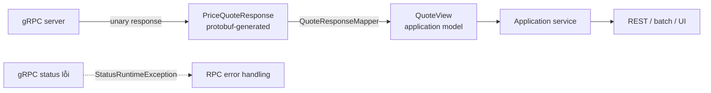

# Mapping response về application model

## 1. Mục tiêu: trả dữ liệu nghiệp vụ thay vì protobuf message

Trong **Spring gRPC**, một **unary RPC** gửi một request và, khi thành công, nhận một response do Protocol Buffers định nghĩa. Generated Java stub trả về lớp như `PriceQuoteResponse`; lớp này phù hợp để truyền trên mạng nhưng chưa chắc phù hợp để dùng trực tiếp trong tầng nghiệp vụ.

Chẳng hạn, phía server trả tổng tiền dưới dạng `int64 total_minor_units` và mã tiền tệ dưới dạng `string currency_code`. Ứng dụng Java muốn xử lý hai giá trị đó như một đối tượng `Money` có kiểu `Currency`, muốn nhận thời hạn hiệu lực báo giá dưới dạng `Instant` và trạng thái dưới dạng enum nội bộ. **Response mapper** thực hiện phép biến đổi có kiểm tra này tại biên client.



Mapper chỉ chạy sau khi client nhận được một response unary **thành công**. Nếu gRPC trả status lỗi như `NOT_FOUND`, `UNAVAILABLE` hay `DEADLINE_EXCEEDED`, blocking stub ném `StatusRuntimeException`; đó là một nhánh khác, không phải “response rỗng cần mapping”.

Sau bài này, người học có thể:

- Thiết kế application model tách biệt generated protobuf class.
- Chuyển `string` sang `UUID`/`Currency`, `int64` sang giá trị tiền có đơn vị, enum proto sang enum nghiệp vụ và `Timestamp` sang `Instant`.
- Giữ chính xác **presence** của field `optional`, field kiểu message và danh sách `repeated`.
- Xử lý response thiếu/sai dữ liệu hoặc enum chưa biết bằng lỗi có ý nghĩa, không tự gán giá trị nghiệp vụ gây hiểu nhầm.
- Tích hợp mapper vào Spring gRPC client, phân biệt lỗi mapping với gRPC status, kiểm thử và đo lường độ tin cậy.

**Nguyên tắc xuyên suốt:** application layer nên nhận một kiểu dữ liệu có ý nghĩa nghiệp vụ; thông tin trên wire phải được giải thích và kiểm tra trước khi đi vào phần còn lại của ứng dụng.

## 2. Hợp đồng protobuf của unary RPC

Giả sử dịch vụ báo giá có hợp đồng trong `src/main/proto/pricing.proto`:

```proto
syntax = "proto3";

package pricing.v1;

option java_package = "com.example.pricing.grpc";
option java_multiple_files = true;

import "google/protobuf/timestamp.proto";

service PricingService {
  rpc GetQuote (PriceQuoteRequest) returns (PriceQuoteResponse);
}

message PriceQuoteRequest {
  string product_id = 1;
  int32 quantity = 2;
  string currency_code = 3;
}

enum QuoteStateProto {
  QUOTE_STATE_UNSPECIFIED = 0;
  QUOTE_STATE_AVAILABLE = 1;
  QUOTE_STATE_EXPIRED = 2;
}

message PriceQuoteLine {
  string sku = 1;
  int32 quantity = 2;
  int64 subtotal_minor_units = 3;
}

message PriceQuoteResponse {
  string quote_id = 1;
  string product_id = 2;
  int64 total_minor_units = 3;
  string currency_code = 4;
  QuoteStateProto state = 5;
  google.protobuf.Timestamp valid_until = 6;
  repeated PriceQuoteLine lines = 7;
  optional string notice = 8;
}
```

`GetQuote` là **unary** vì hai phía đều không khai báo từ khóa `stream`. Sau khi `protoc` và plugin gRPC Java sinh mã, client có thể dùng:

```java
PriceQuoteResponse response = blockingStub
        .getQuote(request);
```

Trong mã Java sinh ra, response có những phương thức đặc trưng:

| Field protobuf | Cách đọc | Ý nghĩa khi chuyển thành application model |
| --- | --- | --- |
| `quote_id`, `product_id` | `getQuoteId()`, `getProductId()` | Parse chuỗi chuẩn sang `UUID`; báo lỗi nếu không hợp lệ. |
| `total_minor_units` | `getTotalMinorUnits()` | Trả `long`, giữ đơn vị nhỏ nhất và currency đi kèm. |
| `currency_code` | `getCurrencyCode()` | Kiểm tra và chuyển mã sang `java.util.Currency`. |
| `state` | `getState()` / `getStateValue()` | Ánh xạ enum tường minh; xử lý `UNSPECIFIED` và giá trị mới chưa biết. |
| `valid_until` | `hasValidUntil()` / `getValidUntil()` | Có hoặc không có timestamp; chuyển `Timestamp` sang `Instant`. |
| `lines` | `getLinesList()` / `getLinesCount()` | Chuyển từng phần tử, trả danh sách immutable. |
| `notice` | `hasNotice()` / `getNotice()` | Giữ phân biệt không có field và field có chuỗi rỗng. |

Protobuf cho phép message hợp lệ về **cú pháp** nhưng chứa giá trị không phù hợp với ứng dụng, ví dụ `quote_id = ""`, `state = QUOTE_STATE_UNSPECIFIED` hoặc `currency_code = "???"`. Vì thế **parse được message không đồng nghĩa đã có dữ liệu nghiệp vụ hợp lệ**.

## 3. Thiết kế application model cho dữ liệu sau mapping

Ở tầng ứng dụng, chúng ta muốn:

- Mã định danh bằng `UUID` để code nghiệp vụ không phải parse lại chuỗi.
- Tiền được biểu diễn cùng `Currency` để tránh nhầm đơn vị.
- Trạng thái là enum nghiệp vụ, không phụ thuộc enum protobuf.
- Thời hạn hiệu lực và ghi chú có thể vắng mặt, được biểu diễn bằng `Optional`.
- Các dòng chi tiết là một `List` bất biến.

Ví dụ từng kiểu Java trong package `com.example.pricing.application`:

```java
// QuoteState.java
package com.example.pricing.application;

public enum QuoteState {
    AVAILABLE,
    EXPIRED
}
```

```java
// Money.java
package com.example.pricing.application;

import java.util.Currency;
import java.util.Objects;

public record Money(long minorUnits, Currency currency) {
    public Money {
        Objects.requireNonNull(currency, "currency");
    }
}
```

```java
// QuoteLineView.java
package com.example.pricing.application;

public record QuoteLineView(
        String sku,
        int quantity,
        long subtotalMinorUnits
) {}
```

```java
// QuoteView.java
package com.example.pricing.application;

import java.time.Instant;
import java.util.List;
import java.util.Objects;
import java.util.Optional;
import java.util.UUID;

public record QuoteView(
        UUID quoteId,
        UUID productId,
        Money total,
        QuoteState state,
        Optional<Instant> validUntil,
        List<QuoteLineView> lines,
        Optional<String> notice
) {
    public QuoteView {
        Objects.requireNonNull(quoteId, "quoteId");
        Objects.requireNonNull(productId, "productId");
        Objects.requireNonNull(total, "total");
        Objects.requireNonNull(state, "state");
        Objects.requireNonNull(validUntil, "validUntil");
        Objects.requireNonNull(lines, "lines");
        Objects.requireNonNull(notice, "notice");
        lines = List.copyOf(lines);
    }
}
```

`Money` giữ **số nguyên đơn vị nhỏ nhất**. Ví dụ trong một quy ước có hai chữ số thập phân, `1234` đơn vị nhỏ nhất biểu diễn `12.34` đơn vị tiền lớn. Không nên chuyển sớm sang `double` để tính toán hoặc hiển thị: lỗi biểu diễn số thực nhị phân có thể làm sai tiền. Cách xử lý số chữ số thập phân phải dựa trên contract và quy tắc tiền tệ; đừng mặc định mọi currency có hai chữ số.

Chúng ta cố tình chọn `Optional<String> notice`. `Optional.empty()` nghĩa là server **không gửi field**; `Optional.of("")` nghĩa là server **gửi chuỗi rỗng**. Nếu nghiệp vụ không cần phân biệt hai trường hợp, có thể chuẩn hóa ở mapper, nhưng quyết định phải được ghi rõ để tránh mất ngữ nghĩa ngoài ý muốn.

Các record trên không import `com.example.pricing.grpc.*`. Nhờ vậy thay đổi cơ chế truyền tin ít ảnh hưởng đến logic nghiệp vụ và các thành phần giao diện.

## 4. Triển khai response mapper với chuyển đổi tường minh

Mapper hoạt động như một hàm thuần: nhận `PriceQuoteResponse`, kiểm tra những bất biến cần thiết rồi tạo `QuoteView`. Nếu dữ liệu trả về vi phạm contract ứng dụng, nó ném ngoại lệ riêng để phân biệt với lỗi RPC.

Tạo `InvalidRemoteResponseException.java`:

```java
package com.example.pricing.client;

public class InvalidRemoteResponseException extends RuntimeException {
    public InvalidRemoteResponseException(String message) {
        super(message);
    }

    public InvalidRemoteResponseException(
            String message, Throwable cause) {
        super(message, cause);
    }
}
```

Tạo `QuoteResponseMapper.java`:

```java
package com.example.pricing.client;

import com.example.pricing.application.Money;
import com.example.pricing.application.QuoteLineView;
import com.example.pricing.application.QuoteState;
import com.example.pricing.application.QuoteView;
import com.example.pricing.grpc.PriceQuoteLine;
import com.example.pricing.grpc.PriceQuoteResponse;
import com.example.pricing.grpc.QuoteStateProto;
import com.google.protobuf.Timestamp;
import com.google.protobuf.util.Timestamps;
import org.springframework.stereotype.Component;

import java.time.Instant;
import java.util.ArrayList;
import java.util.Currency;
import java.util.List;
import java.util.Objects;
import java.util.Optional;
import java.util.UUID;

@Component
public class QuoteResponseMapper {

    private static final int MAX_LINES = 500;

    public QuoteView toApplication(PriceQuoteResponse response) {
        Objects.requireNonNull(response, "response");

        UUID quoteId = parseUuid(response.getQuoteId(), "quote_id");
        UUID productId = parseUuid(response.getProductId(), "product_id");

        Currency currency = parseCurrency(response.getCurrencyCode());
        long totalMinorUnits = response.getTotalMinorUnits();
        if (totalMinorUnits < 0) {
            throw new InvalidRemoteResponseException(
                    "total_minor_units không được âm với báo giá");
        }

        QuoteState state = mapState(response.getState());

        Optional<Instant> validUntil = response.hasValidUntil()
                ? Optional.of(mapTimestamp(response.getValidUntil()))
                : Optional.empty();

        if (response.getLinesCount() > MAX_LINES) {
            throw new InvalidRemoteResponseException(
                    "Response có quá nhiều dòng báo giá");
        }

        List<QuoteLineView> lines = new ArrayList<>(
                response.getLinesCount());
        for (PriceQuoteLine line : response.getLinesList()) {
            if (line.getSku().isBlank()) {
                throw new InvalidRemoteResponseException(
                        "lines.sku không được rỗng");
            }
            if (line.getQuantity() <= 0) {
                throw new InvalidRemoteResponseException(
                        "lines.quantity phải lớn hơn 0");
            }
            if (line.getSubtotalMinorUnits() < 0) {
                throw new InvalidRemoteResponseException(
                        "lines.subtotal_minor_units không được âm");
            }

            lines.add(new QuoteLineView(
                    line.getSku(),
                    line.getQuantity(),
                    line.getSubtotalMinorUnits()));
        }

        Optional<String> notice = response.hasNotice()
                ? Optional.of(response.getNotice())
                : Optional.empty();

        return new QuoteView(
                quoteId,
                productId,
                new Money(totalMinorUnits, currency),
                state,
                validUntil,
                lines,
                notice);
    }

    private static UUID parseUuid(String value, String field) {
        try {
            return UUID.fromString(value);
        } catch (IllegalArgumentException exception) {
            throw new InvalidRemoteResponseException(
                    "Field " + field + " không phải UUID hợp lệ",
                    exception);
        }
    }

    private static Currency parseCurrency(String code) {
        try {
            return Currency.getInstance(code);
        } catch (IllegalArgumentException | NullPointerException exception) {
            throw new InvalidRemoteResponseException(
                    "currency_code không hợp lệ", exception);
        }
    }

    private static QuoteState mapState(QuoteStateProto state) {
        return switch (state) {
            case QUOTE_STATE_AVAILABLE -> QuoteState.AVAILABLE;
            case QUOTE_STATE_EXPIRED -> QuoteState.EXPIRED;
            case QUOTE_STATE_UNSPECIFIED, UNRECOGNIZED ->
                    throw new InvalidRemoteResponseException(
                            "state chưa được ứng dụng hỗ trợ: " + state);
        };
    }

    private static Instant mapTimestamp(Timestamp timestamp) {
        try {
            Timestamps.checkValid(timestamp);
            return Instant.ofEpochSecond(
                    timestamp.getSeconds(), timestamp.getNanos());
        } catch (IllegalArgumentException exception) {
            throw new InvalidRemoteResponseException(
                    "valid_until không nằm trong khoảng Timestamp hợp lệ",
                    exception);
        }
    }
}
```

Mã trên sử dụng `com.google.protobuf.util.Timestamps` từ dependency `protobuf-java-util` tương thích phiên bản protobuf dự án. `Timestamps.checkValid(...)` đảm bảo `seconds` và `nanos` thuộc miền giá trị của `google.protobuf.Timestamp`; bước tạo `Instant` giữ cả phần nano giây. Nếu server không gửi `valid_until`, mapper trả `Optional.empty()`, không dùng thời điểm epoch `1970-01-01T00:00:00Z` để giả vờ biểu thị vắng mặt.

### Vì sao ánh xạ enum bằng switch?

Generated protobuf enum có giá trị mặc định `QUOTE_STATE_UNSPECIFIED = 0`, đồng thời Java API có thể trả `UNRECOGNIZED` nếu message nhận giá trị số mà phiên bản client hiện tại chưa biết. Để tránh đọc sai trạng thái:

```java
private static QuoteState mapState(QuoteStateProto state) {
    return switch (state) {
        case QUOTE_STATE_AVAILABLE -> QuoteState.AVAILABLE;
        case QUOTE_STATE_EXPIRED -> QuoteState.EXPIRED;
        case QUOTE_STATE_UNSPECIFIED, UNRECOGNIZED ->
                throw new InvalidRemoteResponseException(
                        "Trạng thái không được hỗ trợ: " + state);
    };
}
```

Không dùng `QuoteState.valueOf(response.getState().name())` hay số thứ tự enum để chuyển. Với yêu cầu tương thích tiến hóa schema, bạn cũng có thể thiết kế application enum có `UNKNOWN`; cách đó chỉ đúng khi nghiệp vụ cho phép hiển thị/truyền tiếp trạng thái chưa hiểu. Với báo giá có thể ảnh hưởng quyết định thanh toán, **từ chối trạng thái không hiểu** là lựa chọn an toàn hơn.

### Vì sao không cộng lại các line để so với total?

Trong hợp đồng ví dụ, `total_minor_units` có thể đã chứa chiết khấu hoặc thuế mà các `subtotal_minor_units` chưa phản ánh. Mapper chỉ nên kiểm tra **bất biến được hợp đồng cam kết**, chẳng hạn giá trị không âm và số lượng hợp lệ. Nếu contract quy định `total = sum(lineSubtotal) - discount + tax`, hãy thể hiện đầy đủ các thành phần đó rồi kiểm tra theo quy tắc công khai; không tự phát minh công thức trong mapper.

## 5. Các trường hợp khó khi ánh xạ response

### 5.1. Scalar mặc định không đồng nghĩa “không có”

Trong `proto3`, nếu server không gán `total_minor_units`, `getTotalMinorUnits()` vẫn trả `0L`. Với scalar không khai báo `optional`, client thường không phân biệt được “không gán” với “gán bằng 0”.

Nếu **0 là giá trị hợp lệ**, chẳng hạn báo giá miễn phí, mapper không nên mặc định coi đó là lỗi. Nhưng nếu tổng tiền **bắt buộc phải có mặt** ngay cả khi giá trị bằng 0, hợp đồng cần giải pháp biểu diễn presence như `optional int64` hoặc wrapper/message field; chỉ validation ở client không thể suy ra presence bị mất.

### 5.2. Chuỗi optional: không gửi khác với gửi rỗng

Ví dụ server trả `notice`:

| Trạng thái wire | API protobuf | Application model |
| --- | --- | --- |
| Không gửi field | `hasNotice() == false` | `Optional.empty()` |
| Gửi chuỗi rỗng | `hasNotice() == true` và `getNotice().equals("")` | `Optional.of("")` |
| Gửi văn bản | `hasNotice() == true` | `Optional.of(text)` |

Nếu bạn gọi `Optional.ofNullable(response.getNotice())` thì **sai về presence**: generated getter cho `string` trả `""` khi vắng mặt chứ không trả `null`. Cần kiểm tra `hasNotice()` như trong mapper.

### 5.3. Timestamp có thể vắng hoặc không hợp lệ

Field kiểu message như `valid_until` có `hasValidUntil()`. Với field được gán, `google.protobuf.Timestamp` có miền thời gian và quy tắc nano cụ thể. Phép chuyển:

```java
Instant value = Instant.ofEpochSecond(
        timestamp.getSeconds(),
        timestamp.getNanos());
```

chỉ nên thực hiện **sau khi** kiểm tra `Timestamps.checkValid(timestamp)`. Nếu timestamp là thời điểm trong quá khứ, đó không nhất thiết là response không hợp lệ: một báo giá **đã hết hạn** có thể cần được hiển thị. Quy tắc đánh giá còn hiệu lực thuộc nghiệp vụ, không phải lỗi parse thời gian.

### 5.4. Enum mới, số enum chưa biết và version skew

Client cũ có thể nhận số enum mới từ server mới. Generated `getState()` có thể trả `UNRECOGNIZED`, trong khi `getStateValue()` vẫn cho biết số trên wire. Đừng gọi `getNumber()` trên `UNRECOGNIZED`: API Java protobuf có thể ném `IllegalArgumentException`.

Nếu cần quan sát số lạ, hãy log **một giá trị số đã kiểm soát** qua `getStateValue()` trong metric/log chẩn đoán, không tạo một trạng thái nghiệp vụ giả. Cân nhắc giữ contract mở rộng bằng các field mới, test phiên bản cũ và áp dụng chính sách fallback riêng cho từng tính năng.

### 5.5. Danh sách repeated và tính bất biến

`getLinesList()` là view trên protobuf response. Application model không nên dựa vào collection nội bộ của generated message. Mapper tạo `ArrayList` rồi record dùng `List.copyOf(...)`, giúp kết quả không bị thay đổi bởi code gọi sau đó.

Trường hợp danh sách **rỗng** có thể hoàn toàn hợp lệ hoặc báo hiệu response thiếu dữ liệu tùy hợp đồng. Nếu báo giá bắt buộc có ít nhất một dòng, thêm kiểm tra `response.getLinesCount() == 0`; ví dụ này cố tình cho phép danh sách rỗng để nhấn mạnh quy tắc phải do nghiệp vụ quyết định.

### 5.6. Oneof cần được chuyển theo nhánh hiện diện

Một response khác có thể cho phép chỉ một kiểu ưu đãi:

```proto
message DiscountInfo {
  oneof kind {
    string promotion_code = 1;
    int64 amount_minor_units = 2;
  }
}
```

Generated Java API cho phép `getKindCase()` để biết nhánh nào đã được đặt. Mapper nên ánh xạ `PROMOTION_CODE`, `AMOUNT_MINOR_UNITS`, `KIND_NOT_SET` một cách tường minh thành một kiểu ứng dụng như sealed interface `Discount`. Không được chỉ đọc cả hai getter rồi dùng giá trị mặc định: như vậy có thể nhầm `amount_minor_units = 0` đã được gửi với nhánh chưa đặt. Đây là minh họa schema mở rộng, không phải field của `PriceQuoteResponse` đã nêu ở trên.

## 6. Gắn mapper vào Spring gRPC client

Một Spring gRPC client có thể dùng `GrpcChannelFactory` để lấy channel đã cấu hình và tạo generated stub. Giả sử service báo giá chạy ở `localhost:9090` trong môi trường phát triển:

```properties
# application.properties của client
spring.grpc.client.channels.pricing.address=static://localhost:9090
```

Đăng ký bean:

```java
package com.example.pricing.client;

import com.example.pricing.grpc.PricingServiceGrpc;
import org.springframework.context.annotation.Bean;
import org.springframework.context.annotation.Configuration;
import org.springframework.grpc.client.GrpcChannelFactory;

@Configuration
public class PricingClientConfiguration {

    @Bean
    PricingServiceGrpc.PricingServiceBlockingStub pricingStub(
            GrpcChannelFactory channelFactory) {
        return PricingServiceGrpc.newBlockingStub(
                channelFactory.createChannel("pricing"));
    }
}
```

Sử dụng mapper trong client adapter, giúp application service nhận `QuoteView` thay vì `PriceQuoteResponse`:

```java
package com.example.pricing.client;

import com.example.pricing.application.QuoteView;
import com.example.pricing.grpc.PriceQuoteRequest;
import com.example.pricing.grpc.PriceQuoteResponse;
import com.example.pricing.grpc.PricingServiceGrpc;
import org.springframework.stereotype.Service;

import java.util.Currency;
import java.util.UUID;
import java.util.concurrent.TimeUnit;

@Service
public class PricingClient {

    private final PricingServiceGrpc.PricingServiceBlockingStub stub;
    private final QuoteResponseMapper responseMapper;

    public PricingClient(
            PricingServiceGrpc.PricingServiceBlockingStub stub,
            QuoteResponseMapper responseMapper) {
        this.stub = stub;
        this.responseMapper = responseMapper;
    }

    public QuoteView getQuote(
            UUID productId, int quantity, Currency currency) {
        if (productId == null || currency == null || quantity <= 0) {
            throw new IllegalArgumentException(
                    "Yêu cầu báo giá không hợp lệ");
        }

        PriceQuoteRequest request = PriceQuoteRequest.newBuilder()
                .setProductId(productId.toString())
                .setQuantity(quantity)
                .setCurrencyCode(currency.getCurrencyCode())
                .build();

        PriceQuoteResponse response =
                stub.withDeadlineAfter(1500, TimeUnit.MILLISECONDS)
                        .getQuote(request);

        return responseMapper.toApplication(response);
    }
}
```

Trong thực tế, bước tạo request nên tách ra một **request mapper** nếu request phức tạp. Ở bài này request được xây đơn giản để tập trung vào **response mapper**.

Luồng thực thi:

1. Client kiểm tra tham số, tạo `PriceQuoteRequest`.
2. Blocking stub gửi một unary call với deadline đặt **ngay trước lời gọi**.
3. Nếu status gRPC là `OK`, stub trả `PriceQuoteResponse`; mapper kiểm tra và tạo `QuoteView`.
4. Nếu RPC thất bại, stub ném `StatusRuntimeException`; mapper không chạy.
5. Nếu response thành công ở tầng transport nhưng dữ liệu trái contract, mapper ném `InvalidRemoteResponseException`.

Không đặt deadline lúc tạo bean singleton: `withDeadlineAfter(...)` trả stub dẫn xuất với thời hạn cụ thể, có thể hết hạn trước lần gọi tương lai nếu tạo quá sớm. Channel được Spring quản lý và có thể được chia sẻ; không tạo/đóng channel riêng cho từng request.

### Dùng future stub hoặc async stub

Mapper này hoạt động như nhau bất kể client nhận response bằng blocking, future hay async stub. Với future stub:

```java
// futureStub: PricingServiceGrpc.PricingServiceFutureStub.
ListenableFuture<PriceQuoteResponse> pending =
        futureStub.withDeadlineAfter(1500, TimeUnit.MILLISECONDS)
                .getQuote(request);

ListenableFuture<QuoteView> mapped =
        Futures.transform(
                pending,
                responseMapper::toApplication,
                MoreExecutors.directExecutor());
```

Các import Guava cần có: `com.google.common.util.concurrent.ListenableFuture`, `Futures`, `MoreExecutors`. Hàm mapping ở ví dụ là CPU-bound và nhanh với response nhỏ, nên `directExecutor()` chỉ thích hợp khi giới hạn kích thước dữ liệu và việc mapping luôn nhẹ. Nếu mapping nặng, chọn executor riêng được quản lý để không kéo dài thread hoàn tất RPC.

Với async stub, mapper chạy trong `onNext(PriceQuoteResponse response)`, còn `onError(Throwable error)` xử lý riêng gRPC status. Unary thành công có một `onNext` rồi `onCompleted`; không được biến lỗi mapper thành một response nghiệp vụ “trống”.

## 7. Phân biệt lỗi RPC, lỗi dữ liệu và lỗi nghiệp vụ

Ba loại tình huống cần xử lý ở các lớp khác nhau:

| Tình huống | Xuất hiện ở đâu | Ví dụ xử lý |
| --- | --- | --- |
| **gRPC transport/server status lỗi** | Stub ném `StatusRuntimeException` | Phân loại `NOT_FOUND`, `INVALID_ARGUMENT`, `UNAVAILABLE`, `DEADLINE_EXCEEDED`. |
| **Response không thể ánh xạ** | Mapper ném `InvalidRemoteResponseException` | Ghi nhận lỗi contract hoặc version skew; điều tra server/schema, tránh retry mù quáng. |
| **Dữ liệu hợp lệ nhưng không thỏa nghiệp vụ** | Application service xử lý `QuoteView` | `QuoteState.EXPIRED`: báo giá hết hạn, hiển thị lại hoặc yêu cầu lấy báo giá mới. |

Ví dụ xử lý tại biên một API đồng bộ:

```java
try {
    QuoteView quote = pricingClient.getQuote(
            productId, quantity, currency);
    return quote;
} catch (io.grpc.StatusRuntimeException rpcFailure) {
    switch (rpcFailure.getStatus().getCode()) {
        case NOT_FOUND ->
                throw new IllegalArgumentException(
                        "Không tìm thấy sản phẩm", rpcFailure);
        case DEADLINE_EXCEEDED, UNAVAILABLE ->
                throw new IllegalStateException(
                        "Dịch vụ báo giá tạm thời gián đoạn", rpcFailure);
        default -> throw rpcFailure;
    }
} catch (InvalidRemoteResponseException invalidResponse) {
    // Response ở transport hợp lệ nhưng không tuân theo contract ứng dụng.
    // Ghi log/metric có kiểm soát và chuyển thành lỗi nội bộ phù hợp.
    throw new IllegalStateException(
            "Response từ dịch vụ báo giá không hợp lệ",
            invalidResponse);
}
```

Ví dụ trên chỉ là cách phân loại; ứng dụng sản xuất thường có exception riêng và error handler của REST/GraphQL/message consumer. Tránh gửi nguyên chuỗi mô tả gRPC, payload chứa dữ liệu nhạy cảm hoặc stack trace nội bộ về người dùng cuối.

**Retry không giải quyết được mọi lỗi mapping.** Nếu server liên tục trả currency sai hoặc enum mới chưa được client hỗ trợ, retry có thể chỉ tăng tải. Với `UNAVAILABLE` hoặc deadline, retry phải xét tính idempotent, giới hạn số lần, backoff và thời gian còn lại. Unary không mặc định là read-only; những RPC ghi dữ liệu cần thiết kế chống thao tác lặp.

## 8. Kiểm thử response mapper bằng JUnit 5

Mapper không tạo network call, nên có thể kiểm thử độc lập với Spring context bằng generated protobuf builder. Các test dưới đây tập trung vào **ý nghĩa của từng field**, không chỉ kiểm tra rằng mapper không ném exception.

```java
package com.example.pricing.client;

import com.example.pricing.application.QuoteState;
import com.example.pricing.application.QuoteView;
import com.example.pricing.grpc.PriceQuoteLine;
import com.example.pricing.grpc.PriceQuoteResponse;
import com.example.pricing.grpc.QuoteStateProto;
import com.google.protobuf.Timestamp;
import org.junit.jupiter.api.Test;

import java.time.Instant;
import java.util.List;

import static org.junit.jupiter.api.Assertions.*;

class QuoteResponseMapperTest {

    private final QuoteResponseMapper mapper = new QuoteResponseMapper();

    private PriceQuoteResponse.Builder validResponse() {
        return PriceQuoteResponse.newBuilder()
                .setQuoteId("d95043c0-965a-4ba7-8f72-c695f5ccb9ee")
                .setProductId("a14b04af-13b1-40a8-a76d-4c171e481b76")
                .setTotalMinorUnits(129_900L)
                .setCurrencyCode("USD")
                .setState(QuoteStateProto.QUOTE_STATE_AVAILABLE)
                .addLines(PriceQuoteLine.newBuilder()
                        .setSku("SKU-100")
                        .setQuantity(2)
                        .setSubtotalMinorUnits(129_900L)
                        .build())
                .setValidUntil(Timestamp.newBuilder()
                        .setSeconds(1_800_000_000L)
                        .setNanos(123_456_789)
                        .build());
    }

    @Test
    void mapsFieldsAndKeepsNanoseconds() {
        QuoteView quote = mapper.toApplication(
                validResponse().build());

        assertEquals("d95043c0-965a-4ba7-8f72-c695f5ccb9ee",
                quote.quoteId().toString());
        assertEquals("USD", quote.total().currency().getCurrencyCode());
        assertEquals(129_900L, quote.total().minorUnits());
        assertEquals(QuoteState.AVAILABLE, quote.state());
        assertEquals(
                Instant.ofEpochSecond(1_800_000_000L, 123_456_789),
                quote.validUntil().orElseThrow());
        assertEquals(List.of("SKU-100"),
                quote.lines().stream().map(line -> line.sku()).toList());
        assertTrue(quote.notice().isEmpty());
    }

    @Test
    void keepsExplicitlyEmptyNoticeDifferentFromAbsentNotice() {
        QuoteView absent = mapper.toApplication(
                validResponse().clearNotice().build());
        QuoteView empty = mapper.toApplication(
                validResponse().setNotice("").build());

        assertTrue(absent.notice().isEmpty());
        assertTrue(empty.notice().isPresent());
        assertEquals("", empty.notice().orElseThrow());
    }

    @Test
    void rejectsUnknownEnumValue() {
        PriceQuoteResponse invalid = validResponse()
                .setStateValue(999)
                .build();

        assertThrows(InvalidRemoteResponseException.class,
                () -> mapper.toApplication(invalid));
    }

    @Test
    void rejectsInvalidCurrency() {
        PriceQuoteResponse invalid = validResponse()
                .setCurrencyCode("???")
                .build();

        assertThrows(InvalidRemoteResponseException.class,
                () -> mapper.toApplication(invalid));
    }

    @Test
    void rejectsOutOfRangeTimestamp() {
        PriceQuoteResponse invalid = validResponse()
                .setValidUntil(Timestamp.newBuilder()
                        .setSeconds(253_402_300_800L)
                        .build())
                .build();

        assertThrows(InvalidRemoteResponseException.class,
                () -> mapper.toApplication(invalid));
    }

    @Test
    void rejectsInvalidLineQuantity() {
        PriceQuoteResponse invalid = validResponse()
                .clearLines()
                .addLines(PriceQuoteLine.newBuilder()
                        .setSku("SKU-100")
                        .setQuantity(0)
                        .setSubtotalMinorUnits(100L)
                        .build())
                .build();

        assertThrows(InvalidRemoteResponseException.class,
                () -> mapper.toApplication(invalid));
    }
}
```

Cũng nên thử response thiếu `quote_id`/`product_id`, `total_minor_units` âm, enum `UNSPECIFIED`, danh sách vượt giới hạn, thiếu `valid_until` và tiền tệ không được phép theo nghiệp vụ. Viết test theo **hợp đồng thực tế**, vì một field bị cấm vắng mặt ở service A có thể tùy chọn ở service B.

### Kiểm thử tích hợp ở ranh giới gRPC

Để kiểm tra cả stub và mapper, dùng `InProcessServerBuilder` và `InProcessChannelBuilder` của gRPC Java với service thử nghiệm trả response hợp lệ hoặc cố tình lỗi. Những tình huống quan trọng:

| Kịch bản | Điều cần xác nhận |
| --- | --- |
| Server trả `OK` với response hợp lệ | Client trả đúng `QuoteView`; mã tiền tệ, UUID, lines và timestamp không bị đổi nghĩa. |
| Server trả `NOT_FOUND` | Stub báo `StatusRuntimeException`; mapper không chạy. |
| Server trả `OK` nhưng `state` không hỗ trợ | Mapper ném `InvalidRemoteResponseException`; client không coi đó là `QuoteState.AVAILABLE`. |
| Response thiếu `notice` | Application model nhận `Optional.empty()`. |
| Server phản hồi chậm hơn deadline | Client nhận `DEADLINE_EXCEEDED`; không trả `QuoteView` chưa hoàn chỉnh. |
| Gọi nhiều request trên cùng stub | Không lẫn dữ liệu response hay deadline của các lời gọi. |

In-process test xác minh contract và xử lý dữ liệu, nhưng không kiểm tra đầy đủ TLS, HTTP/2 trên TCP hay cấu hình Spring channel. Với bảo mật và name resolution, cần integration test chạy transport thực, cấu hình chứng chỉ và interceptor đúng môi trường.

## 9. Hiệu năng, an toàn dữ liệu và tương thích phiên bản

Một unary response thường nhỏ nhưng mapping vẫn có chi phí cấp phát đối tượng. Khi dịch vụ có lưu lượng cao, cần cân nhắc:

- **Giới hạn số phần tử và kích thước message:** đặt giới hạn inbound message phù hợp ở gRPC channel/server, đồng thời kiểm tra collection trong mapper. Kiểm tra sau giải mã **không thay thế** giới hạn kích thước byte trước giải mã.
- **Chỉ chuyển kiểu cần thiết:** đừng chuyển qua JSON hoặc Map trung gian chỉ để đọc protobuf field; dùng trực tiếp generated getter và builder/model Java.
- **Giữ immutable:** `QuoteView` dùng record, `List.copyOf` và kiểu giá trị; tránh trả về đối tượng có thể bị thay đổi ngoài ý muốn giữa các luồng.
- **Đồng bộ schema:** khi đổi field number hoặc tái sử dụng field cũ, client có thể giải mã sai; dùng `reserved` với số field đã xóa và kiểm tra tính tương thích ngược.
- **Theo dõi lỗi mapping riêng:** gRPC status của lời gọi có thể đã là `OK` dù mapper phía client thất bại. Ghi metric/trace cho lỗi contract để không bị che bởi tỷ lệ RPC `OK`.
- **Không ghi dữ liệu nhạy cảm:** response có thể chứa thông tin khách hàng hoặc giá; log mã status, tên method và trace ID thay vì toàn bộ protobuf. Dữ liệu trong request/response phải truyền qua channel có TLS khi môi trường yêu cầu.
- **Metadata và interceptor:** xác thực, trace context, correlation ID và deadline được xử lý ở call/interceptor/channel. Mapper chỉ phụ trách dữ liệu nghiệp vụ, không tự đọc token hay thiết lập TLS.
- **Tránh biến sai dữ liệu thành thành công:** một enum không hiểu hoặc money thiếu currency không nên bị thay bằng `AVAILABLE`/`USD` mặc định chỉ để UI tiếp tục hoạt động.

Để quan sát hiệu năng, theo dõi latency end-to-end của unary RPC, latency mapping riêng khi cần, tỷ lệ gRPC status lỗi, tỷ lệ response không hợp lệ và kích thước response. Tối ưu mapper dựa trên số liệu thay vì tối ưu sớm bằng cách bỏ kiểm tra dữ liệu quan trọng.

## 10. Những lỗi thường gặp

1. **Trả generated `PriceQuoteResponse` trực tiếp ra mọi application service.** Nghiệp vụ bị phụ thuộc vào wire schema và phải lặp logic parse UUID, currency, enum. Hãy đặt mapper tại client adapter.
2. **Chỉ gọi getter cho optional string rồi dùng `ofNullable`.** Getter trả chuỗi rỗng khi vắng mặt; cần kiểm tra `hasNotice()`.
3. **Map enum theo `name()` hoặc `ordinal()`.** Phiên bản mới có thể thêm enum value; hãy dùng `switch` và nhánh cho `UNRECOGNIZED`.
4. **Coi `0` luôn là “không gửi”.** Với scalar proto3 không optional, zero có thể là giá trị hợp lệ. Presence phải được thiết kế trong schema khi cần phân biệt.
5. **Ép `int64` tiền sang `double`.** Có thể mất chính xác; giữ `long` đơn vị nhỏ nhất cùng `Currency` hoặc dùng decimal contract có quy tắc rõ.
6. **Bỏ qua giới hạn `Timestamp`.** `Instant` và protobuf Timestamp không có phạm vi giá trị giống hệt; kiểm tra range và nano.
7. **Nuốt lỗi mapping, trả model rỗng.** Khi server thay đổi contract hoặc trả dữ liệu sai, lỗi bị che khuất và application có thể ra quyết định sai.
8. **Retry mọi lỗi.** `InvalidRemoteResponseException` thường là lỗi contract/dữ liệu, retry thường không có ích. Với lỗi gRPC tạm thời vẫn phải xét idempotency và deadline.
9. **Thực hiện network call trong mapper.** Mapper khó test, có tác dụng phụ và làm mờ trách nhiệm. Giữ mapper là phép chuyển đổi dữ liệu có kiểm tra.
10. **Nhầm trạng thái báo giá hết hạn với lỗi kỹ thuật.** `QuoteState.EXPIRED` là một kết quả nghiệp vụ hợp lệ, còn `Status.DEADLINE_EXCEEDED` là lỗi thời gian thực thi RPC.

## 11. Bài thực hành

Bổ sung vào `PriceQuoteResponse` một field `optional string discount_label = 9;` và một message `TaxBreakdown` có danh sách thành phần thuế. Sau đó:

1. Mở rộng `QuoteView` để biểu diễn sự vắng mặt của `discount_label`, giữ phân biệt **không gửi field** và **gửi chuỗi rỗng**.
2. Viết mapper cho các dòng thuế có đơn vị tiền và currency đã thống nhất; đặt quy tắc kiểm tra nếu tổng thuế cần khớp tổng tiền.
3. Viết unit test cho response đầy đủ, response thiếu optional field, enum chưa biết, currency sai và Timestamp vượt range.
4. Tạo gRPC server in-process trả một `PriceQuoteResponse`, rồi xác minh client nhận `QuoteView` đúng dữ liệu. Thêm nhánh server trả `NOT_FOUND` để chứng minh mapper không chạy khi RPC lỗi.
5. Đo thời gian từ lúc gọi unary stub đến khi tạo xong `QuoteView`, phân biệt độ trễ mạng/server với chi phí chuyển đổi nếu hệ thống có metric/tracing.

**Tự kiểm tra:** Một unary RPC thành công có **một protobuf response**. Response mapper đọc các field của message đó, xác thực hợp đồng và tạo **application model có kiểu rõ ràng, bất biến**. Lỗi status từ gRPC và lỗi biến đổi dữ liệu là hai loại thất bại khác nhau, cần được quản lý riêng để ứng dụng Spring gRPC chính xác, quan sát được và dễ bảo trì.

