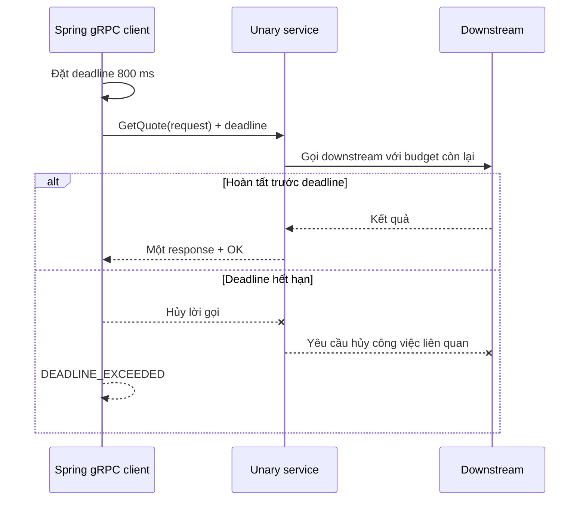
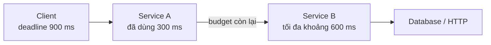

# Deadline cho unary call

## 1. Deadline là giới hạn thời gian của một RPC

Một **unary RPC** gửi một request và nhận một response khi thành công. Trong môi trường phân tán, client không thể chờ vô hạn: server có thể quá tải, truy vấn dữ liệu có thể chậm, mạng có thể gián đoạn hoặc một dịch vụ downstream có thể không phản hồi. **Deadline** xác định thời điểm muộn nhất mà client còn chấp nhận kết quả của lời gọi.

Trong gRPC, deadline là một **mốc thời gian tuyệt đối** được biểu diễn nội bộ bằng cơ chế đồng hồ phù hợp; khi lời gọi được thực hiện, gRPC tính thời gian còn lại và truyền ngân sách đó qua các hop. Client đặt deadline cho từng RPC bằng call options của stub. Khi hết hạn, lời gọi kết thúc với status `DEADLINE_EXCEEDED` ở phía client và gRPC yêu cầu hủy xử lý liên quan.

Deadline quan trọng vì nó:

- Giới hạn thời gian một request có thể giữ tài nguyên ở client và server.
- Ngăn các lời gọi chờ kéo dài vô hạn khi downstream gặp sự cố.
- Cho phép các service trong một chuỗi gọi biết phần thời gian còn lại.
- Tạo cơ sở để thiết kế timeout cho database, HTTP client và các tác vụ phụ thuộc.
- Giúp đo lường độ trễ, tỷ lệ timeout và độ tin cậy của hệ thống.



Deadline không phải một field nghiệp vụ trong protobuf request. Nó thuộc **ngữ cảnh thực thi RPC** và được gRPC xử lý cùng call options, context và metadata nội bộ.

## 2. Phân biệt deadline, timeout và thời gian xử lý

Các khái niệm này liên quan nhưng không đồng nghĩa:

| Khái niệm | Ý nghĩa | Phạm vi |
| --- | --- | --- |
| **Deadline** | Thời điểm cuối cùng mà lời gọi còn được phép chạy. | Một RPC, có thể được truyền qua nhiều service. |
| **Timeout** | Khoảng thời gian tối đa một thao tác được phép chờ hoặc chạy. | Có thể là timeout của RPC, database, HTTP client, future hoặc thread. |
| **Latency** | Thời gian thực tế từ lúc bắt đầu đến khi nhận kết quả. | Được đo bằng metric/tracing. |
| **Cancellation** | Tín hiệu yêu cầu dừng một lời gọi đang thực hiện. | Có thể phát sinh do deadline, client chủ động hủy hoặc context cha bị hủy. |

Ví dụ, client đặt deadline 800 ms. Server mất 500 ms xử lý, downstream mất thêm 250 ms, response cần 100 ms để quay về. Tổng thời gian vượt ngân sách; client có thể nhận `DEADLINE_EXCEEDED` dù server đã gần hoàn tất công việc.

Một timeout cục bộ như `future.get(800, MILLISECONDS)` chỉ giới hạn **thread đang chờ future**. Nó không tự động trở thành deadline của RPC và việc thread ngừng chờ không đảm bảo RPC đã bị hủy. Muốn giới hạn RPC, hãy đặt deadline trên stub; muốn dừng RPC khi người gọi không còn cần kết quả, hãy chủ động hủy future/call tương ứng.

## 3. Đặt deadline trên blocking stub trong Spring gRPC

Giả sử client gọi unary method `GetQuote` của `PricingService`. Spring gRPC cung cấp channel thông qua `GrpcChannelFactory`. Cấu hình địa chỉ channel trong `application.properties`:

```properties
spring.grpc.client.channels.pricing.address=static://localhost:9090
```

Đăng ký blocking stub làm bean dùng chung:

```java
package com.example.pricing.client;

import com.example.pricing.grpc.PricingServiceGrpc;
import org.springframework.context.annotation.Bean;
import org.springframework.context.annotation.Configuration;
import org.springframework.grpc.client.GrpcChannelFactory;

@Configuration
public class PricingClientConfiguration {

    @Bean
    PricingServiceGrpc.PricingServiceBlockingStub pricingStub(
            GrpcChannelFactory channelFactory) {
        return PricingServiceGrpc.newBlockingStub(
                channelFactory.createChannel("pricing"));
    }
}
```

Đặt deadline ngay tại nơi phát sinh **mỗi lần gọi**:

```java
package com.example.pricing.client;

import com.example.pricing.grpc.PriceQuoteRequest;
import com.example.pricing.grpc.PriceQuoteResponse;
import com.example.pricing.grpc.PricingServiceGrpc;
import io.grpc.Status;
import io.grpc.StatusRuntimeException;
import org.springframework.stereotype.Service;

import java.util.concurrent.TimeUnit;

@Service
public class PricingClient {

    private final PricingServiceGrpc.PricingServiceBlockingStub stub;

    public PricingClient(
            PricingServiceGrpc.PricingServiceBlockingStub stub) {
        this.stub = stub;
    }

    public PriceQuoteResponse getQuote(PriceQuoteRequest request) {
        try {
            return stub.withDeadlineAfter(800, TimeUnit.MILLISECONDS)
                    .getQuote(request);
        } catch (StatusRuntimeException exception) {
            if (exception.getStatus().getCode()
                    == Status.Code.DEADLINE_EXCEEDED) {
                throw new QuoteServiceTimeoutException(
                        "Dịch vụ báo giá không phản hồi trong thời hạn",
                        exception);
            }
            throw exception;
        }
    }
}
```

`withDeadlineAfter(800, TimeUnit.MILLISECONDS)` trả về một **stub mới có deadline riêng**; nó không sửa bean stub ban đầu. Stub được sinh từ gRPC Java là đối tượng cấu hình bất biến, vì vậy có thể dùng chung stub cơ sở và dẫn xuất stub với deadline khác nhau cho từng RPC.

Không nên đặt `withDeadlineAfter(...)` ngay khi khởi tạo singleton bean. Deadline được tính từ thời điểm tạo call options; nếu bean sống lâu, deadline có thể hết hạn trước khi một request thực sự được gửi. Cũng không nên dùng một con số timeout giống nhau cho mọi thao tác: truy vấn cache, đọc database và tính toán báo giá có ngân sách khác nhau.

`QuoteServiceTimeoutException` là exception ứng dụng do dự án định nghĩa. Ví dụ:

```java
package com.example.pricing.client;

public class QuoteServiceTimeoutException extends RuntimeException {
    public QuoteServiceTimeoutException(String message, Throwable cause) {
        super(message, cause);
    }
}
```

### Xử lý status khi deadline hết hạn

Một số status liên quan đến thời gian và khả năng sẵn sàng:

| Status | Diễn giải thường gặp | Hướng xử lý |
| --- | --- | --- |
| `DEADLINE_EXCEEDED` | Deadline của RPC đã hết trước khi client nhận kết quả. | Xem lại ngân sách, latency và tình trạng downstream. |
| `UNAVAILABLE` | Service hoặc kết nối tạm thời không sẵn sàng. | Có thể retry có giới hạn nếu thao tác an toàn. |
| `CANCELLED` | Lời gọi bị hủy bởi client hoặc context cha. | Kiểm tra người gọi đã hủy vì lý do gì. |
| `RESOURCE_EXHAUSTED` | Tài nguyên hoặc quota bị vượt giới hạn. | Giảm tải, điều chỉnh quota/backpressure. |
| `OK` | RPC hoàn tất thành công trong ngân sách. | Xử lý response nghiệp vụ. |

Client nên phân nhánh theo `Status.Code`, không phân tích chuỗi mô tả lỗi. `DEADLINE_EXCEEDED` cũng không chứng minh server chưa thực hiện tác dụng phụ: server có thể đã ghi dữ liệu trước khi response bị trễ hoặc bị mất trên đường về.

## 4. Thiết kế ngân sách thời gian cho chuỗi service

Deadline cần được chọn từ **ngân sách của request cấp trên**, không phải chọn tùy ý cho từng RPC. Giả sử API nhận request có ngân sách 1.200 ms:

| Công đoạn | Ngân sách minh họa |
| --- | ---: |
| Parse input, authorization và xử lý cục bộ | 100 ms |
| Gọi gRPC Pricing | 650 ms |
| Chuyển đổi response và xử lý nghiệp vụ | 100 ms |
| Trả response qua HTTP và dự phòng | 200 ms |
| Dự phòng biến động | 150 ms |
| **Tổng** | **1.200 ms** |

Con số này chỉ minh họa cách chia budget. Hãy dùng dữ liệu latency thực tế, percentile như p95/p99, mục tiêu SLO và chi phí của từng downstream để chọn giá trị phù hợp.

Nếu một request gọi tuần tự ba service, không nên cấp 1.200 ms cho **mỗi** RPC. Nếu làm vậy, thời gian tổng có thể vượt xa ngân sách mà người dùng chấp nhận. Mỗi bước phải sử dụng phần thời gian còn lại của request cha hoặc một ngân sách con ngắn hơn.

Với các RPC độc lập chạy song song, tổng thời gian thường bị chi phối bởi lời gọi chậm nhất cộng thời gian điều phối, nhưng số lời gọi đồng thời vẫn tiêu thụ tài nguyên. Deadline của request cha nên bao phủ cả thời gian chờ, điều phối và tổng hợp kết quả.

### Dùng deadline còn lại ở server

gRPC Java đưa deadline của incoming call vào `io.grpc.Context` hiện tại. Server có thể đọc deadline và thời gian còn lại:

```java
import io.grpc.Context;
import io.grpc.Deadline;

import java.util.concurrent.TimeUnit;

Context callContext = Context.current();
Deadline deadline = callContext.getDeadline();

if (deadline == null) {
    // Client không đặt deadline; áp dụng chính sách của service.
} else {
    long remainingNanos =
            deadline.timeRemaining(TimeUnit.NANOSECONDS);

    if (remainingNanos <= 0) {
        // Không khởi chạy thêm công việc đã quá hạn.
    }
}
```

`Deadline.timeRemaining(...)` trả về thời gian còn lại tại thời điểm đọc; giá trị có thể bằng hoặc nhỏ hơn 0 khi đã hết hạn. Nếu cần gọi một downstream khác, hãy giữ ngân sách tổng và chỉ cấp một deadline con không vượt quá deadline cha. Đừng khởi tạo lại toàn bộ thời hạn ban đầu cho mỗi hop.

Khi gRPC Java thực hiện downstream call trong context của incoming RPC, deadline hiện tại có thể được truyền tiếp qua context. Nếu ứng dụng tách công việc sang executor riêng hoặc dùng thư viện không tích hợp gRPC Context, cần đảm bảo context được truyền đúng cách hoặc chuyển thời gian còn lại thành timeout tương ứng cho thao tác đó.

## 5. Deadline propagation và timeout cho downstream

Xét service A nhận unary request rồi gọi service B để lấy dữ liệu. Nếu client đặt deadline 900 ms, A đã dùng 300 ms trước khi gọi B, thì B chỉ còn khoảng 600 ms, trừ phần thời gian cần cho response quay về và xử lý tiếp.



Trong gRPC Java, outgoing call được tạo trong context đang hoạt động sẽ sử dụng deadline của context nếu có. Ví dụ service A gọi service B:

```java
package com.example.pricing.server;

import com.example.inventory.grpc.InventoryServiceGrpc;
import com.example.inventory.grpc.StockRequest;
import com.example.inventory.grpc.StockResponse;
import io.grpc.Deadline;
import io.grpc.Status;
import io.grpc.StatusRuntimeException;
import org.springframework.stereotype.Service;

import java.util.concurrent.TimeUnit;

@Service
public class InventoryLookup {

    private final InventoryServiceGrpc.InventoryServiceBlockingStub stub;

    public InventoryLookup(
            InventoryServiceGrpc.InventoryServiceBlockingStub stub) {
        this.stub = stub;
    }

    public StockResponse getStock(String productId) {
        Deadline parentDeadline = io.grpc.Context.current().getDeadline();

        if (parentDeadline != null
                && parentDeadline.timeRemaining(TimeUnit.MILLISECONDS) <= 0) {
            throw Status.DEADLINE_EXCEEDED
                    .withDescription("Hết thời gian trước khi gọi Inventory")
                    .asRuntimeException();
        }

        // Context của incoming RPC đang hoạt động sẽ mang deadline cha.
        // Nếu cần giới hạn riêng, deadline con phải ngắn hơn deadline cha.
        try {
            return stub.getStock(StockRequest.newBuilder()
                    .setProductId(productId)
                    .build());
        } catch (StatusRuntimeException exception) {
            throw exception;
        }
    }
}
```

Ví dụ này giả định `InventoryServiceBlockingStub` được tạo từ channel Spring và call chạy trong context gRPC hiện tại. Không gọi `Context.ROOT` hoặc chủ động tách khỏi context nếu muốn giữ deadline/cancellation của request cha.

### Deadline cho database và HTTP client

Deadline gRPC **không tự động cấu hình timeout cho mọi thư viện bên dưới**. Nếu server A gọi JDBC, HTTP client, Redis hoặc một SDK không đọc gRPC Context, hãy truyền phần thời gian còn lại sang API timeout của thành phần đó.

Ví dụ khái niệm:

```java
long remainingNanos = Context.current().getDeadline()
        .timeRemaining(TimeUnit.NANOSECONDS);

if (remainingNanos <= 0) {
    throw new IllegalStateException("Request đã hết deadline");
}

// Application-defined repository API: timeout được truyền tường minh.
Quote quote = quoteRepository.findQuote(
        productId, remainingNanos);
```

`quoteRepository.findQuote(productId, remainingNanos)` là API ứng dụng minh họa, không phải method có sẵn của Spring hoặc gRPC. Repository phải chuyển ngân sách đó sang timeout thực tế của driver/database. Với JDBC, có thể cấu hình query timeout hoặc hủy `Statement`; với HTTP client, đặt request timeout/call timeout phù hợp. Cần tính đơn vị và làm tròn thận trọng để timeout của downstream **không dài hơn** thời gian còn lại của request cha.

Nếu một thao tác blocking không hỗ trợ cancellation, hết deadline chỉ giúp client ngừng đợi; công việc bên dưới có thể vẫn chiếm thread hoặc connection. Hãy cấu hình timeout của chính driver, pool và SDK, đồng thời thiết kế giới hạn concurrency.

## 6. Cancellation khi deadline hết hạn

Khi deadline hết hạn, gRPC hủy RPC và `Context` của server chuyển sang trạng thái cancelled. Server có thể kiểm tra:

```java
Context context = Context.current();

if (context.isCancelled()) {
    // Request đã bị hủy hoặc deadline đã hết.
}
```

Để phản ứng khi cancellation xảy ra, có thể đăng ký listener:

```java
Context callContext = Context.current();

Context.CancellationListener listener = cancelledContext -> {
    // Callback cần ngắn và không blocking.
    // Yêu cầu hủy tác vụ downstream nếu ứng dụng có handle tương ứng.
    queryHandle.cancel();
};

callContext.addListener(listener, cancellationExecutor);

try {
    // Thực hiện hoặc điều phối tác vụ có thể hủy.
} finally {
    callContext.removeListener(listener);
}
```

`queryHandle` và `cancellationExecutor` trong ví dụ là đối tượng do ứng dụng quản lý. Listener phải được gỡ khi tác vụ kết thúc để tránh giữ tham chiếu lâu hơn cần thiết. Callback cancellation nên nhanh; không thực hiện truy vấn blocking hoặc thao tác tốn thời gian ngay trong listener.

Một số nguyên tắc:

- Kiểm tra context trước khi bắt đầu công việc tốn kém nếu request có thể đã hết hạn.
- Truyền tín hiệu cancellation đến future, HTTP call, query handle hoặc tác vụ nền khi API hỗ trợ.
- Dừng các bước tiếp theo sau khi biết request đã bị hủy.
- Không giả định cancellation đồng nghĩa với rollback transaction.
- Không gửi một response thành công sau khi client đã hết thời gian chờ và hủy call; kết quả đó có thể không còn người nhận.
- Với công việc không thể dừng ngay, đảm bảo tài nguyên có giới hạn và kết quả muộn không tạo tác dụng phụ ngoài dự kiến.

### Deadline không bảo đảm server dừng ngay lập tức

Client có thể nhận `DEADLINE_EXCEEDED` nhưng server vẫn tiếp tục một đoạn xử lý nếu code không quan sát cancellation. Ví dụ, một câu SQL đang chạy có thể không dừng chỉ vì gRPC Context bị cancel. Vì vậy cần phối hợp ba lớp:

1. **gRPC cancellation:** thông báo lời gọi không còn cần kết quả.
2. **Downstream timeout/cancel:** yêu cầu driver hoặc client library dừng công việc.
3. **Business consistency:** dùng transaction, idempotency key hoặc cơ chế đối soát để xử lý trường hợp tác dụng phụ đã xảy ra trước khi cancellation đến.

## 7. Retry và wait-for-ready dưới deadline

Retry có thể hữu ích khi lỗi là tạm thời, nhưng **không tạo thêm thời gian ngoài deadline ban đầu**. Các lần thử lại, backoff và thời gian chờ channel đều tiêu thụ cùng ngân sách. Nếu deadline còn rất ít, retry chỉ làm tăng tải mà không đủ thời gian nhận kết quả.

Một chính sách retry cần xác định:

- Những status nào được retry, ví dụ một số trường hợp `UNAVAILABLE`.
- Số lần thử tối đa và backoff có giới hạn.
- Deadline còn lại tối thiểu trước khi bắt đầu lần thử mới.
- RPC có idempotent hay cần idempotency key.
- Retry được cấu hình ở client, service config hay tầng application; tránh nhiều lớp retry chồng lên nhau.

**Unary không mặc định an toàn để retry.** `GetQuote` có thể là thao tác đọc, nhưng `CreateOrder` hoặc `ChargePayment` cũng có thể là unary và tạo tác dụng phụ. Nếu client nhận timeout, không thể kết luận server chưa ghi dữ liệu. Với thao tác ghi, server cần nhận diện idempotency key hoặc có cơ chế chống xử lý lặp.

`withWaitForReady()` cho phép lời gọi chờ channel sẵn sàng trong một số trạng thái kết nối thay vì thất bại ngay. Nó không thay thế deadline: nếu channel không sẵn sàng, deadline vẫn kết thúc lời gọi. Dùng wait-for-ready mà không có deadline hữu hạn có thể khiến request chờ quá lâu.

## 8. Kiểm thử deadline cho unary RPC

Kiểm thử deadline nên chứng minh ít nhất ba hành vi:

1. RPC hoàn tất trước deadline thì client nhận response.
2. RPC chậm quá deadline thì client nhận `DEADLINE_EXCEEDED`.
3. Server nhận cancellation và tác vụ có thể hủy được yêu cầu dừng.

Có thể dùng `InProcessServerBuilder` và `InProcessChannelBuilder` để kiểm thử gRPC Java trong cùng tiến trình. Ví dụ dưới đây tạo server trì hoãn response bằng scheduler; test chỉ đợi tối đa một khoảng ngắn:

```java
package com.example.pricing.client;

import com.example.pricing.grpc.PriceQuoteRequest;
import com.example.pricing.grpc.PriceQuoteResponse;
import com.example.pricing.grpc.PricingServiceGrpc;
import com.example.pricing.server.DelayedPricingService;
import io.grpc.ManagedChannel;
import io.grpc.Server;
import io.grpc.Status;
import io.grpc.StatusRuntimeException;
import io.grpc.inprocess.InProcessChannelBuilder;
import io.grpc.inprocess.InProcessServerBuilder;
import org.junit.jupiter.api.AfterEach;
import org.junit.jupiter.api.BeforeEach;
import org.junit.jupiter.api.Test;

import java.io.IOException;
import java.util.concurrent.TimeUnit;

import static org.junit.jupiter.api.Assertions.assertEquals;
import static org.junit.jupiter.api.Assertions.assertThrows;

class UnaryDeadlineTest {

    private Server server;
    private ManagedChannel channel;
    private PricingServiceGrpc.PricingServiceBlockingStub stub;
    private DelayedPricingService service;

    @BeforeEach
    void setUp() throws IOException {
        String name = InProcessServerBuilder.generateName();
        service = new DelayedPricingService(250);

        server = InProcessServerBuilder.forName(name)
                .directExecutor()
                .addService(service)
                .build()
                .start();

        channel = InProcessChannelBuilder.forName(name)
                .directExecutor()
                .build();

        stub = PricingServiceGrpc.newBlockingStub(channel);
    }

    @AfterEach
    void tearDown() {
        channel.shutdownNow();
        server.shutdownNow();
        service.close();
    }

    @Test
    void returnsDeadlineExceededWhenServerIsTooSlow() {
        StatusRuntimeException error = assertThrows(
                StatusRuntimeException.class,
                () -> stub.withDeadlineAfter(30, TimeUnit.MILLISECONDS)
                        .getQuote(PriceQuoteRequest.newBuilder()
                                .setProductId("SKU-1")
                                .setQuantity(1)
                                .setCurrencyCode("USD")
                                .build()));

        assertEquals(Status.Code.DEADLINE_EXCEEDED,
                error.getStatus().getCode());
    }

    @Test
    void returnsResponseWhenDeadlineIsLongEnough() {
        PriceQuoteResponse response =
                stub.withDeadlineAfter(2, TimeUnit.SECONDS)
                        .getQuote(PriceQuoteRequest.newBuilder()
                                .setProductId("SKU-1")
                                .setQuantity(1)
                                .setCurrencyCode("USD")
                                .build());

        assertEquals("SKU-1", response.getProductId());
    }
}
```

`DelayedPricingService` là service test do dự án tự định nghĩa, dùng một `ScheduledExecutorService` để gửi response sau 250 ms và đóng scheduler trong `close()`. Đây là lớp giả lập có chủ đích, không phải API Spring gRPC. Khi triển khai test thực tế, cần đảm bảo scheduler được đóng, không dựa vào `Thread.sleep` để đồng bộ và dùng deadline đủ chênh lệch để tránh test chập chờn trên máy tải cao.

### Kiểm tra cancellation ở server

Ngoài việc xác nhận status phía client, test nên dùng một `CountDownLatch` hoặc tín hiệu đồng bộ trong service giả để xác nhận cancellation listener đã chạy. Không nên kiểm tra bằng cách đoán rằng server chắc chắn đã dừng trong đúng một số mili giây; cancellation là tín hiệu hợp tác, còn việc dừng phụ thuộc API downstream.

### Kiểm thử chuỗi service

Với service A gọi service B, hãy tạo test trong đó B chậm có kiểm soát. Gửi request tới A với deadline ngắn và xác minh:

- A không cấp một deadline mới dài hơn deadline cha.
- B nhận được phần thời gian còn lại hoặc timeout con tương ứng.
- Khi request cha bị hủy, A không tiếp tục các bước không cần thiết.
- Nếu B đã tạo tác dụng phụ, logic idempotency/đối soát giữ dữ liệu nhất quán.

In-process test hữu ích để xác minh semantics của gRPC, nhưng không thay thế kiểm thử TCP/HTTP/2, TLS, load balancing, service discovery hoặc timeout thực của database/HTTP client.

## 9. Quan sát và vận hành deadline

Deadline là một tín hiệu quan trọng về chất lượng dịch vụ. Nên theo dõi:

| Chỉ số | Điều cần quan sát |
| --- | --- |
| RPC latency p50/p95/p99 | Phân bố thời gian thực tế so với deadline. |
| Tỷ lệ `DEADLINE_EXCEEDED` | Timeout theo service/method và theo client. |
| Tỷ lệ `UNAVAILABLE` | Vấn đề kết nối hoặc service không sẵn sàng. |
| Số RPC đang xử lý | Tải in-flight và nguy cơ tích tụ công việc. |
| Thời gian downstream | Database, HTTP và service phụ thuộc có tiêu thụ hết budget không. |
| Cancellation được quan sát | Tỷ lệ tác vụ dừng sau khi client hủy. |

Log nên có service, method, status code, deadline budget và trace ID. Không log token, payload nhạy cảm hoặc dữ liệu khách hàng không cần thiết. Metric label nên có cardinality thấp; không dùng request ID, product ID hay deadline timestamp riêng lẻ làm label.

Khi tỷ lệ timeout tăng, hãy xem trace theo từng hop để tìm nơi tiêu thụ budget. Tăng deadline một cách máy móc có thể làm request giữ thread, connection và memory lâu hơn, khiến quá tải nghiêm trọng hơn. Đôi khi giải pháp đúng là giới hạn concurrency, tối ưu query, cache, backpressure hoặc giảm fan-out.

## 10. Những lỗi thường gặp

1. **Không đặt deadline cho RPC.** Lời gọi có thể chờ vô hạn khi service hoặc mạng gặp vấn đề. Đặt deadline hữu hạn theo SLO và ngữ cảnh nghiệp vụ.
2. **Đặt deadline trên singleton stub từ lúc khởi động ứng dụng.** Deadline có thể hết trước khi RPC bắt đầu. Dẫn xuất stub ngay trước mỗi call.
3. **Cấp lại toàn bộ timeout cho từng downstream.** Tổng thời gian chuỗi service vượt ngân sách request cha. Dùng deadline propagation hoặc timeout con dựa trên thời gian còn lại.
4. **Nhầm timeout của `Future#get()` với deadline gRPC.** Thread ngừng chờ không đồng nghĩa RPC đã bị hủy. Đặt deadline trên stub và xử lý cancellation riêng.
5. **Nghĩ rằng `DEADLINE_EXCEEDED` nghĩa server chưa làm gì.** Server có thể đã thực hiện tác dụng phụ. Dùng idempotency và đối soát cho thao tác ghi.
6. **Cho rằng deadline tự dừng JDBC hoặc HTTP client.** Chỉ thư viện biết deadline/cancellation mới dừng công việc. Truyền timeout còn lại vào downstream.
7. **Retry không giới hạn sau timeout.** Retry tiêu thụ thêm tài nguyên và có thể lặp tác dụng phụ. Giới hạn attempt, backoff và chỉ retry khi an toàn.
8. **Dùng wait-for-ready mà không có deadline.** Lời gọi có thể chờ channel quá lâu. Luôn kết hợp với deadline hữu hạn.
9. **Chỉ đo latency thành công.** Timeout cũng là một phần của trải nghiệm và SLO. Theo dõi status và phân vị latency cùng nhau.

## 11. Bài thực hành

Một API báo giá có ngân sách 1.000 ms. Nó gọi `PricingService.GetQuote`, sau đó gọi `InventoryService.GetStock` nếu báo giá hợp lệ. Hãy thiết kế deadline cho hai unary call và thực hiện:

- Đặt deadline cho RPC đầu tiên theo ngân sách sau khi trừ thời gian xử lý cục bộ.
- Đảm bảo RPC thứ hai dùng phần thời gian còn lại, không bắt đầu nếu budget đã hết.
- Cấu hình timeout cho repository hoặc HTTP client mà service gọi, sao cho không vượt deadline cha.
- Thêm cancellation listener để yêu cầu dừng một truy vấn downstream có thể hủy.
- Viết test cho trường hợp cả hai RPC thành công, Pricing chậm, Inventory chậm và client chủ động hủy.
- Với một RPC tạo tác dụng phụ, mô tả cách idempotency key xử lý trường hợp server hoàn tất nhưng client đã nhận `DEADLINE_EXCEEDED`.

**Tự kiểm tra:** Deadline là giới hạn thời gian của **toàn bộ lời gọi unary**. Đặt deadline tại client, truyền ngân sách qua các service, chuyển thời gian còn lại sang database/HTTP client, phản ứng với cancellation và chỉ retry khi thao tác an toàn. Một client nhận `DEADLINE_EXCEEDED` có thể đã hết thời gian chờ dù server vẫn đang hoàn tất tác dụng phụ; hệ thống cần được thiết kế để xử lý trường hợp đó nhất quán.

