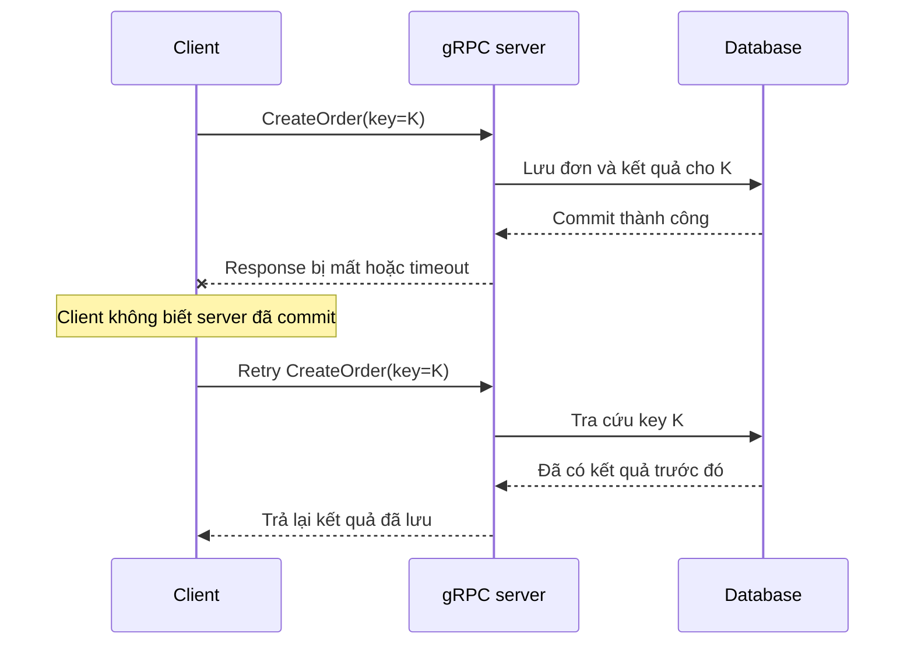
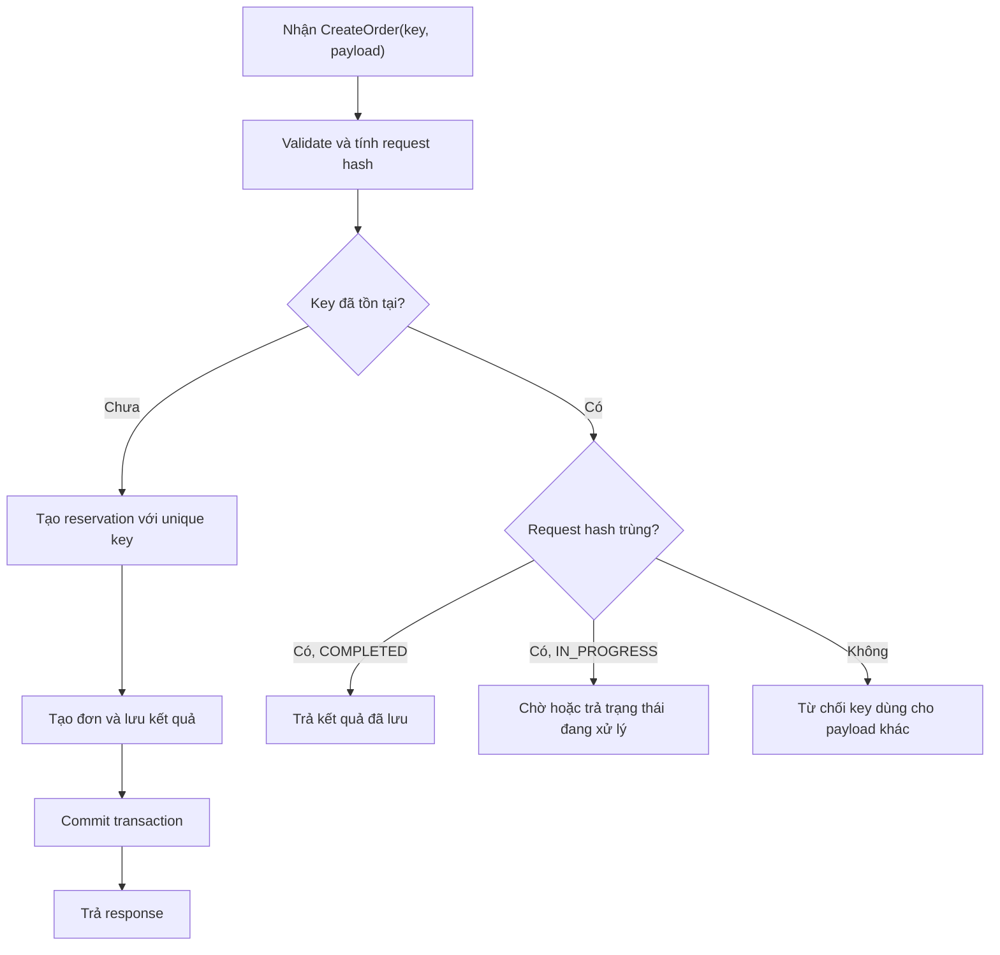

# Retry unary call và idempotency

## 1. Vì sao retry cần đi cùng idempotency?

Một **unary RPC** gửi một request và nhận một response khi thành công. Khi kết nối tạm thời gián đoạn hoặc server chưa sẵn sàng, client có thể thử lại. **Retry** giúp phục hồi một số lỗi ngắn hạn, nhưng mỗi lần thử lại có thể gửi cùng yêu cầu thêm lần nữa.

Điều này nguy hiểm với RPC tạo tác dụng phụ. Ví dụ client gọi `CreateOrder`, server đã lưu đơn hàng nhưng response bị mất trên đường về. Client chỉ thấy timeout hoặc `UNAVAILABLE`. Nếu gửi lại request như một thao tác mới, server có thể tạo đơn thứ hai.

- **Retry policy** quyết định khi nào, bao nhiêu lần và chờ bao lâu trước khi thử lại.
- **Idempotency** bảo đảm nhiều lần nhận cùng một yêu cầu logic không tạo thêm tác dụng phụ ngoài dự kiến.

Retry không tạo ra bảo đảm exactly-once. Mạng có thể mất response sau khi server đã commit. Idempotency key giúp server nhận diện các lần thử lại của **cùng một thao tác nghiệp vụ** và trả lại kết quả đã ghi nhận.



## 2. Chọn status nào có thể retry?

Không phải mọi gRPC status đều nên retry. Phải xét **nguyên nhân lỗi, tính chất thao tác và deadline còn lại**.

| gRPC status | Chính sách thường gặp | Lý do |
| --- | --- | --- |
| `UNAVAILABLE` | Có thể retry có giới hạn | Service hoặc kết nối có thể tạm thời không sẵn sàng. |
| `RESOURCE_EXHAUSTED` | Chỉ retry theo backoff phù hợp | Server có thể quá tải hoặc quota đã hết; retry ngay làm tăng tải. |
| `ABORTED` | Có thể retry toàn bộ transaction ở tầng nghiệp vụ | Một chuỗi thao tác có thể cần chạy lại sau xung đột. |
| `DEADLINE_EXCEEDED` | Chỉ retry nếu thao tác an toàn và còn ngân sách | Server có thể đã hoàn tất tác dụng phụ dù client hết thời gian chờ. |
| `CANCELLED` | Thường không retry tự động | Người gọi có thể đã chủ động hủy. |
| `INVALID_ARGUMENT` | Không retry | Request sai; gửi lại cùng dữ liệu vẫn sai. |
| `PERMISSION_DENIED` / `UNAUTHENTICATED` | Không retry mù quáng | Cần sửa quyền hoặc credentials. |
| `NOT_FOUND` | Thường không retry | Tài nguyên không tồn tại theo trạng thái hiện tại. |
| `FAILED_PRECONDITION` | Không retry đến khi điều kiện được sửa | Cần thay đổi trạng thái trước. |
| `INTERNAL` | Không mặc định retry | Cần đánh giá lỗi cụ thể; retry rộng có thể khuếch đại sự cố. |

Đây là hướng dẫn thiết kế, không phải quy tắc tuyệt đối cho mọi service. Ví dụ `NOT_FOUND` có thể tạm thời trong một workflow eventual consistency, nhưng retry khi đó phải xuất phát từ ngữ nghĩa nghiệp vụ đã được xác nhận.

Client phân loại bằng `Status.Code`, không dùng chuỗi `Status.getDescription()` để quyết định:

```java
private boolean isRetryable(Status.Code code) {
    return code == Status.Code.UNAVAILABLE
            || code == Status.Code.RESOURCE_EXHAUSTED;
}
```

Description phục vụ chẩn đoán; mã status mới là phần ổn định để phân nhánh.

## 3. Một retry policy cần những gì?

Một chính sách retry tối thiểu cần có:

1. **Maximum attempts:** giới hạn tổng số lần gửi, tính cả lần đầu.
2. **Retryable status codes:** chỉ định rõ mã lỗi được thử lại.
3. **Backoff:** tăng thời gian chờ giữa các lần thử để tránh dồn tải.
4. **Jitter:** thêm độ ngẫu nhiên để nhiều client không retry cùng thời điểm.
5. **Deadline tổng:** mọi lần thử và thời gian backoff dùng chung một ngân sách.
6. **Điều kiện idempotency:** không replay thao tác có tác dụng phụ nếu chưa có cơ chế chống trùng.

Ví dụ chính sách minh họa:

| Tham số | Giá trị |
| --- | ---: |
| Số lần thử tối đa | 3, gồm lần đầu |
| Backoff ban đầu | 50 ms |
| Backoff tối đa | 200 ms |
| Hệ số tăng | 2 |
| Jitter | Ngẫu nhiên từ 0 đến backoff cap |
| Deadline tổng | 1.500 ms |

Backoff tăng theo cấp số nhân: `delay = min(maxBackoff, initialBackoff × multiplier^(attempt - 1))`, sau đó áp dụng jitter. Không retry liên tục vì có thể tạo **retry storm** khi server đang quá tải.

### Retry bằng blocking stub ở tầng application

Ví dụ sau minh họa retry có giới hạn cho thao tác đã được bảo vệ bằng idempotency key. Cùng một deadline tuyệt đối được dùng cho tất cả attempt:

```java
@Service
public class OrderCommandClient {

    private static final int MAX_ATTEMPTS = 3;
    private static final long INITIAL_BACKOFF_MS = 50;
    private static final long MAX_BACKOFF_MS = 200;
    private static final long MIN_ATTEMPT_BUDGET_MS = 100;

    private final OrderCommandServiceGrpc.OrderCommandServiceBlockingStub stub;

    public OrderCommandClient(
            OrderCommandServiceGrpc.OrderCommandServiceBlockingStub stub) {
        this.stub = stub;
    }

    public CreateOrderResponse create(CreateOrderRequest request) {
        Deadline deadline = Deadline.after(1500, TimeUnit.MILLISECONDS);
        OrderCommandServiceGrpc.OrderCommandServiceBlockingStub callStub =
                stub.withDeadline(deadline);

        for (int attempt = 1; attempt <= MAX_ATTEMPTS; attempt++) {
            try {
                return callStub.createOrder(request);
            } catch (StatusRuntimeException failure) {
                if (!isRetryable(failure.getStatus().getCode())
                        || attempt == MAX_ATTEMPTS) {
                    throw failure;
                }

                long remainingMs =
                        deadline.timeRemaining(TimeUnit.MILLISECONDS);
                long backoffCap = Math.min(
                        MAX_BACKOFF_MS,
                        INITIAL_BACKOFF_MS * (1L << (attempt - 1)));
                long backoffMs =
                        ThreadLocalRandom.current().nextLong(backoffCap + 1);

                if (remainingMs <= backoffMs + MIN_ATTEMPT_BUDGET_MS) {
                    throw failure;
                }

                try {
                    TimeUnit.MILLISECONDS.sleep(backoffMs);
                } catch (InterruptedException interrupted) {
                    Thread.currentThread().interrupt();
                    throw new IllegalStateException(
                            "Retry bị ngắt", interrupted);
                }
            }
        }

        throw new IllegalStateException("Không thể hoàn tất CreateOrder");
    }

    private boolean isRetryable(Status.Code code) {
        return code == Status.Code.UNAVAILABLE
                || code == Status.Code.RESOURCE_EXHAUSTED;
    }
}
```

Điểm quan trọng:

- `Deadline.after(...)` tạo deadline cho **toàn bộ thao tác logic**, không tạo deadline mới sau mỗi lỗi.
- `stub.withDeadline(deadline)` tạo stub dẫn xuất; các lần gọi dùng chung mốc kết thúc.
- Trước khi retry, client kiểm tra thời gian còn lại đủ cho backoff và một attempt tiếp theo.
- Jitter phân tán thời điểm retry giữa các client.
- `Thread.sleep` giữ thread, nên ví dụ phù hợp với luồng blocking có kiểm soát. Với ứng dụng reactive hoặc tải đồng thời lớn, dùng retry bất đồng bộ và scheduler phù hợp.
- Request được gửi lại nguyên vẹn, bao gồm **cùng idempotency key**. Không tạo key mới trong vòng lặp.

Đây là retry ở application layer. Nếu channel đã bật retry policy của gRPC, không thêm một vòng retry rộng ở application mà chưa tính tổng số attempt và deadline. Hai tầng retry có thể nhân số lần gọi và làm tải tăng ngoài dự kiến.

## 4. Retry của gRPC và retry ở application

gRPC Java có thể thực hiện retry theo service config khi channel được cấu hình retry policy. Policy thường khai báo số attempt tối đa, backoff ban đầu/tối đa, hệ số tăng và tập status có thể retry. Cấu hình cụ thể phụ thuộc cách ứng dụng Spring gRPC tạo channel và phiên bản thư viện.

| Cách retry | Đặc điểm | Khi phù hợp |
| --- | --- | --- |
| **gRPC service-config retry** | Nằm trong tầng channel; gRPC quản lý attempt và backoff theo policy. | Retry transport/RPC theo chính sách tập trung. |
| **Application retry** | Code nghiệp vụ quyết định status, điều kiện, backoff và cách xử lý kết quả. | Cần kết hợp điều kiện nghiệp vụ và idempotency. |
| **Retry ở nhiều tầng** | Mỗi tầng có thể gửi lại độc lập. | Chỉ dùng khi đã tính tổng attempt, deadline và phối hợp chính sách. |

Không bật retry policy mù quáng cho mọi method. Một số RPC đọc có thể idempotent, nhưng RPC ghi cần cơ chế idempotency ở server. Ngay cả khi gRPC quản lý attempt, server vẫn có thể nhận cùng một request nhiều lần.

## 5. Idempotency là gì?

Một thao tác **idempotent** là thao tác mà thực hiện nhiều lần với cùng ý định và cùng dữ liệu không làm thay đổi kết quả nghiệp vụ cuối cùng sau lần đầu.

Ví dụ:

- `GetOrder(orderId)` thường idempotent vì nhiều lần đọc không tạo thêm đơn hàng.
- `SetShippingAddress(orderId, address)` có thể idempotent nếu ghi lại cùng địa chỉ không tạo tác dụng phụ khác.
- `CreateOrder(items)` thường không idempotent nếu mỗi lần gọi đều tạo một đơn mới.
- `ChargePayment(amount)` không an toàn để retry nếu mỗi lần gọi đều trừ tiền.

Idempotency không có nghĩa server chỉ nhận request một lần. Server có thể nhận nhiều attempt, nhưng phải nhận diện chúng thuộc **cùng một thao tác logic** và bảo đảm chỉ tạo tác dụng phụ nghiệp vụ một lần.

## 6. Thiết kế idempotency key trong protobuf

Client tạo một key duy nhất cho mỗi thao tác logic, chẳng hạn UUID, và truyền trong request:

```proto
syntax = "proto3";

package orders.v1;

option java_package = "com.example.orders.grpc";
option java_multiple_files = true;

service OrderCommandService {
  rpc CreateOrder(CreateOrderRequest) returns (CreateOrderResponse);
}

message CreateOrderRequest {
  string idempotency_key = 1;
  string customer_id = 2;
  repeated OrderItem items = 3;
}

message OrderItem {
  string product_id = 1;
  int32 quantity = 2;
}

message CreateOrderResponse {
  string order_id = 1;
  string state = 2;
}
```

Client tạo key **trước lần thử đầu tiên**:

```java
String operationKey = UUID.randomUUID().toString();

CreateOrderRequest request = CreateOrderRequest.newBuilder()
        .setIdempotencyKey(operationKey)
        .setCustomerId(customerId)
        .addAllItems(items)
        .build();

// Retry phải gửi lại cùng request và cùng operationKey.
CreateOrderResponse response = orderCommandClient.create(request);
```

Nếu người dùng nhấn nút tạo đơn hai lần cho hai ý định khác nhau, mỗi ý định cần một key khác nhau. Nếu cùng một ý định được retry do timeout, client phải giữ key cũ. Không tạo key mới cho từng attempt, nếu không server không thể nhận diện request trùng.

Key nên được scope theo tenant/khách hàng và loại thao tác. Không dùng idempotency key làm credential; key không thay thế authentication hoặc authorization.

## 7. Lưu key và kết quả một cách nguyên tử

Server cần lưu idempotency key cùng dấu vết của request và kết quả đã xử lý. Một bản ghi thường có:

| Trường | Mục đích |
| --- | --- |
| `scope` | Phạm vi tenant/account và operation. |
| `idempotency_key` | Key do client cấp. |
| `request_hash` | Hash của nội dung nghiệp vụ đã chuẩn hóa. |
| `state` | Trạng thái, ví dụ IN_PROGRESS hoặc COMPLETED. |
| `resource_id` | ID đơn hàng hoặc tài nguyên đã tạo. |
| `response_payload` | Kết quả cần trả lại hoặc dữ liệu đủ để dựng response. |
| `created_at`, `expires_at` | Thời điểm tạo và thời hạn lưu key. |

Tạo unique constraint trên tổ hợp scope và idempotency key. Khi nhận request:

1. Xác thực caller và kiểm tra request.
2. Chuẩn hóa field nghiệp vụ và tính request hash; không đưa chính idempotency key vào hash payload.
3. Tìm key trong scope hiện tại.
4. Nếu key đã hoàn tất và hash trùng, trả lại kết quả đã lưu.
5. Nếu key tồn tại nhưng hash khác, từ chối vì cùng key đang được dùng cho nội dung khác.
6. Nếu key chưa tồn tại, ghi nhận key và thực hiện tác dụng phụ trong một transaction nhất quán.
7. Lưu kết quả có thể replay cùng thay đổi nghiệp vụ trước khi commit.

### Luồng xử lý phía server



Pseudo-code minh họa:

```java
@Transactional
public CreateOrderResponse create(CreateOrderRequest request) {
    validate(request);

    String scope = currentTenant() + ":CreateOrder";
    String key = request.getIdempotencyKey();
    String hash = canonicalRequestHash(request);

    IdempotencyRecord existing =
            repository.findByScopeAndKeyForUpdate(scope, key);

    if (existing != null) {
        if (!existing.requestHash().equals(hash)) {
            throw Status.ALREADY_EXISTS
                    .withDescription(
                            "Idempotency key đã dùng với request khác")
                    .asRuntimeException();
        }

        if (existing.isCompleted()) {
            return existing.savedResponse();
        }

        throw Status.ABORTED
                .withDescription("Thao tác đang được xử lý")
                .asRuntimeException();
    }

    // Trong transaction: tạo đơn và lưu kết quả cho cùng key.
    Order order = orderRepository.insert(request);
    CreateOrderResponse response = toResponse(order);

    repository.insertCompleted(
            scope, key, hash, order.id(), response);

    return response;
}
```

`IdempotencyRecord`, `repository`, `Order` và `canonicalRequestHash` là thành phần ứng dụng minh họa, không phải API gRPC. Pseudo-code diễn tả nguyên tắc; implementation cần xử lý race condition khi hai request cùng key đến đồng thời.

### Xử lý request trùng đồng thời

Chỉ làm “tìm key, nếu chưa có thì tạo” có thể bị race: hai transaction cùng đọc thấy chưa có key và cùng tạo hai đơn. Unique constraint ở database là lớp bảo vệ cuối cùng. Khi insert key bị xung đột, transaction thua cuộc cần đọc lại bản ghi do transaction kia tạo và trả kết quả hoặc trạng thái đang xử lý.

Một thiết kế khác là ghi reservation với trạng thái `IN_PROGRESS` trước rồi xử lý. Khi đó phải có quy tắc lease/timeout và recovery cho reservation bị bỏ dở; nếu không, key có thể bị kẹt mãi ở trạng thái đang xử lý.

Tác dụng phụ và bản ghi idempotency nên nằm trong **cùng transaction** nếu cùng database. Nếu tác dụng phụ xảy ra ở hệ thống ngoài (ví dụ payment provider), cần outbox, saga hoặc idempotency key được truyền tiếp tới provider. Bản ghi key nội bộ không tự bảo đảm exactly-once ở hệ thống ngoài.

## 8. Cùng key nhưng payload khác

Idempotency key đại diện cho **một ý định**, vì vậy cùng key phải gắn với cùng payload nghiệp vụ đã chuẩn hóa.

Ví dụ:

- Lần đầu: key `K-123`, customer `C-10`, items `[SKU-A x 2]`.
- Retry: key `K-123`, cùng customer và items — trả kết quả đơn đã tạo.
- Request sai: key `K-123`, customer `C-10`, items `[SKU-A x 5]` — từ chối vì nội dung khác.

Hash nên được tính từ biểu diễn canonical của các field nghiệp vụ. Cần quyết định rõ thứ tự repeated field có ý nghĩa hay không, chuẩn hóa chuỗi, đơn vị số lượng và giá trị mặc định trước khi hash. Không hash JSON tùy ý nếu thứ tự key hoặc cách serialize có thể thay đổi giữa phiên bản.

Với cùng key nhưng hash khác, server có thể trả `ALREADY_EXISTS` theo contract. Client phải nhận biết đây là lỗi sử dụng key, không retry cùng payload sai.

## 9. Deadline và kết quả không chắc chắn

Retry luôn tiêu thụ thời gian của **deadline tổng**. Ví dụ thao tác có deadline 1.500 ms và tối đa ba attempt: thời gian attempt đầu, backoff và các attempt sau đều nằm trong 1.500 ms đó.

Client nên tạo deadline một lần cho thao tác logic và dùng lại khi thử lại. Không đặt lại 1.500 ms sau mỗi lỗi, vì tổng thời gian có thể tăng theo số attempt.

Một tình huống quan trọng:

1. Client gửi `CreateOrder` với key `K-123`.
2. Server ghi đơn và kết quả, transaction commit.
3. Response bị mất; client nhận `DEADLINE_EXCEEDED`.
4. Client retry cùng request và key `K-123`.
5. Server tìm thấy bản ghi đã hoàn tất và trả response cũ.
6. Chỉ có một đơn được tạo.

Nếu client tạo key mới ở bước 4, server xem đó là thao tác mới và có thể tạo đơn thứ hai.

### Không phải timeout nào cũng nên retry

- Nếu deadline đã hết, không còn ngân sách cho attempt mới trong cùng thao tác.
- Nếu status là `INVALID_ARGUMENT`, sửa request trước khi gửi lại.
- Nếu status là `UNAUTHENTICATED`, xử lý credentials trước.
- Nếu status là `UNAVAILABLE`, có thể retry khi còn budget và request an toàn.
- Nếu status là `DEADLINE_EXCEEDED` với thao tác ghi, dùng cùng idempotency key để server tra cứu kết quả đã commit.
- Nếu client chủ động hủy vì người dùng rời trang, thường không nên tiếp tục retry ở background trừ khi nghiệp vụ yêu cầu hoàn tất.

## 10. Kiểm thử retry và idempotency

Bộ test cần xác minh **số tác dụng phụ**, không chỉ response cuối cùng.

| Kịch bản | Kết quả mong đợi |
| --- | --- |
| Lần đầu thành công | Một đơn được tạo; response có order ID. |
| Lần đầu trả UNAVAILABLE trước khi xử lý, lần sau thành công | Client retry trong budget; một đơn được tạo. |
| Server commit nhưng response bị mất, client retry cùng key | Server trả response đã lưu; vẫn chỉ một đơn. |
| Cùng key, payload khác | Server từ chối; không tạo đơn thứ hai. |
| Hai request đồng thời cùng key và payload | Một tác dụng phụ; cả hai nhận cùng kết quả hoặc một bên nhận trạng thái đang xử lý theo contract. |
| Deadline hết trước attempt tiếp theo | Không bắt đầu attempt mới. |
| Key hết hạn khỏi kho lưu trữ | Hành vi theo chính sách retention đã công bố. |

### Test phía client: giữ nguyên key qua retry

Có thể kiểm thử bằng stub giả hoặc gRPC in-process server. Dùng service thử nghiệm đếm số lần nhận request và ghi các idempotency key:

```java
@Test
void retriesWithTheSameIdempotencyKey() {
    String key = UUID.randomUUID().toString();

    CreateOrderRequest request = CreateOrderRequest.newBuilder()
            .setIdempotencyKey(key)
            .setCustomerId("C-10")
            .addItems(OrderItem.newBuilder()
                    .setProductId("SKU-A")
                    .setQuantity(2)
                    .build())
            .build();

    CreateOrderResponse response = client.create(request);

    assertEquals("ORDER-1", response.getOrderId());
    assertEquals(List.of(key, key), service.receivedKeys());
    assertEquals(1, service.createdOrderCount());
}
```

`client` và `service` là fixture kiểm thử: lần gọi đầu mô phỏng lỗi tạm thời hoặc response bị mất sau commit; lần tiếp theo tra cứu cùng key. Test xác minh key không bị tạo mới giữa các attempt.

### Test phía server: duplicate request

Với repository thật hoặc database test:

- Gửi cùng key và cùng payload hai lần; kiểm tra cùng order ID được trả lại.
- Gửi cùng key với payload khác; kiểm tra status từ chối.
- Gửi đồng thời nhiều request cùng key; kiểm tra unique constraint và số bản ghi nghiệp vụ.
- Mô phỏng lỗi giữa lúc tạo reservation và hoàn tất; xác minh transaction/lease recovery không để key kẹt vô hạn.
- Kiểm tra retention của key dài hơn khoảng thời gian client có thể retry hoặc gửi lại cùng ý định.

Unit test với repository giả hữu ích để kiểm tra nhánh logic, nhưng không chứng minh tính nguyên tử của database. Race condition cần integration test với database có unique constraint thực tế.

## 11. Vận hành retry và idempotency

Theo dõi các chỉ số:

- Số attempt trên mỗi logical operation và tỷ lệ request cần retry.
- Retry theo status code, service và method.
- Tổng latency bao gồm cả backoff.
- Số key đang `IN_PROGRESS`, số duplicate được deduplicate và số conflict do payload khác.
- Số reservation quá hạn hoặc cần recovery.
- Số tác dụng phụ được tạo so với số logical operation thành công.

Log nên có method, status, attempt number và correlation ID. Không log toàn bộ request hoặc dữ liệu nhạy cảm chỉ để theo dõi retry. Tránh dùng idempotency key làm metric label vì cardinality cao.

Retention của idempotency record phải dài hơn **cửa sổ retry** và khoảng thời gian client có thể gửi lại cùng ý định. Xóa record quá sớm có thể khiến retry muộn tạo tác dụng phụ lần nữa. Giữ quá lâu làm tăng dung lượng; cần TTL và quy trình dọn dẹp rõ ràng.

## 12. Lỗi thường gặp

1. **Retry mọi status.** Lỗi dữ liệu, quyền hoặc trạng thái nghiệp vụ không tự biến mất. Chọn mã retryable rõ ràng.
2. **Tạo idempotency key mới cho từng attempt.** Server không nhận ra các request thuộc cùng thao tác. Tạo một key trước lần gửi đầu và giữ nguyên.
3. **Tạo key ở server sau khi nhận request.** Mỗi lần retry có thể nhận key khác nhau. Key phải được client giữ ổn định qua các attempt.
4. **Lưu key và tác dụng phụ ở hai transaction độc lập.** Có thể ghi đơn nhưng mất bản ghi key, hoặc ngược lại. Dùng transaction chung hoặc mô hình outbox/saga cho hệ thống ngoài.
5. **Không kiểm tra request hash.** Cùng key nhưng payload khác có thể bị trả nhầm kết quả. So sánh nội dung đã chuẩn hóa.
6. **Không xử lý request trùng đồng thời.** Hai transaction có thể cùng tạo tài nguyên. Dùng unique constraint và xử lý xung đột.
7. **Reset deadline ở mỗi lần retry.** Tổng thời gian vượt budget của caller. Dùng một deadline tổng cho logical operation.
8. **Retry ở nhiều tầng mà không tính tổng attempt.** Các policy nhân số request và gây retry storm. Chọn một tầng điều phối chính hoặc tính rõ ngân sách chung.
9. **Cho rằng idempotency key tạo exactly-once cho mọi hệ thống.** Tác dụng phụ bên ngoài cần truyền key tiếp hoặc dùng outbox/saga và đối soát.
10. **Xóa key quá sớm.** Retry muộn có thể tạo tác dụng phụ lần nữa. Thiết kế retention theo cửa sổ nghiệp vụ.

## 13. Bài thực hành

Triển khai unary method `CreateOrder` với idempotency key:

- Sinh một key ở client trước lần gọi đầu và giữ nguyên key trong toàn bộ retry.
- Chỉ retry status đã chọn, tối đa ba attempt, exponential backoff có jitter và một deadline tổng.
- Lưu scope, key, request hash và kết quả cùng transaction tạo đơn.
- Cùng key và cùng payload phải trả lại cùng order ID; cùng key nhưng payload khác phải bị từ chối.
- Viết integration test cho hai request đồng thời cùng key, và tình huống server commit nhưng client mất response rồi retry.
- Xác định TTL của key dài hơn retry window và mô tả cách xử lý reservation `IN_PROGRESS` bị bỏ dở.

**Tự kiểm tra:** Retry là cơ chế gửi lại khi lỗi có thể phục hồi; idempotency là cơ chế bảo vệ tác dụng phụ khi request được nhận nhiều lần. Với unary RPC tạo dữ liệu, hãy **giữ nguyên idempotency key qua mọi attempt, lưu key cùng kết quả một cách nguyên tử, giới hạn retry bằng một deadline tổng và chỉ retry status phù hợp**.

