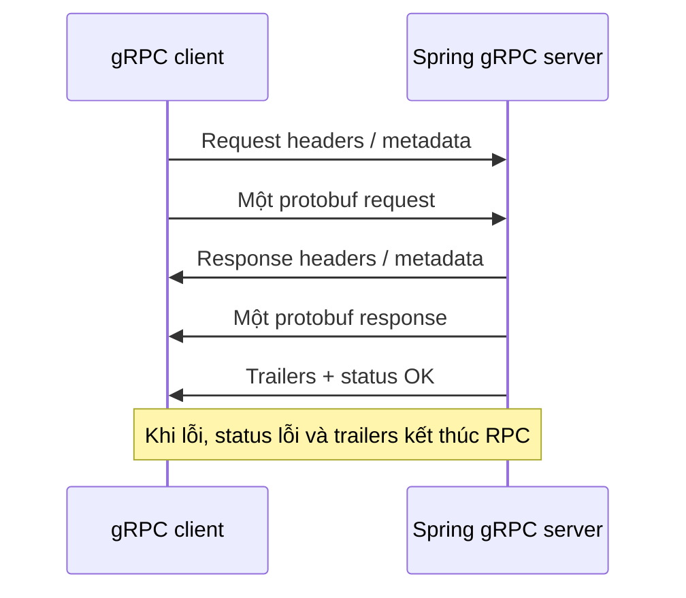

# Metadata request và response

## 1. Metadata mang thông tin điều khiển bên cạnh protobuf message

Trong **unary RPC**, client gửi một protobuf request và server trả một protobuf response khi thành công. Ngoài hai message này, gRPC hỗ trợ **metadata** để truyền thông tin phụ trợ trong header và trailer của HTTP/2.

Metadata thường dùng cho authentication, correlation ID, trace context, tên client, thông tin service và mã lỗi chẩn đoán. Metadata không thay thế protobuf: `product_id`, `quantity` hay `order_id` là dữ liệu nghiệp vụ nên nằm trong message; request ID và trace context phù hợp hơn với metadata.



Một lời gọi unary có ba điểm metadata:

| Vị trí | Chiều truyền | Thời điểm | Mục đích |
| --- | --- | --- | --- |
| Request metadata | Client → server | Khi bắt đầu RPC | Credentials, correlation ID, trace context. |
| Response headers | Server → client | Trước hoặc cùng lúc response đầu tiên | Tên service, phiên bản hoặc thông tin xử lý. |
| Response trailers | Server → client | Khi RPC kết thúc | Status và thông tin chẩn đoán bổ sung. |

Trong gRPC Java, lớp chính là io.grpc.Metadata. Metadata được gửi riêng với protobuf payload và thường được xử lý ở tầng transport hoặc interceptor.

## 2. Tạo metadata key đúng kiểu

Mỗi key có tên và marshaller xác định cách chuyển giá trị Java thành bytes trên wire. Tên key phải viết thường. Với giá trị văn bản, dùng ASCII_STRING_MARSHALLER; với dữ liệu nhị phân, tên key phải kết thúc bằng -bin và dùng BINARY_BYTE_MARSHALLER.

```java
import io.grpc.Metadata;

public final class RpcMetadata {

    private RpcMetadata() {}

    public static final Metadata.Key<String> REQUEST_ID =
            Metadata.Key.of(
                    "x-request-id",
                    Metadata.ASCII_STRING_MARSHALLER);

    public static final Metadata.Key<String> CLIENT_NAME =
            Metadata.Key.of(
                    "x-client-name",
                    Metadata.ASCII_STRING_MARSHALLER);

    public static final Metadata.Key<String> SERVER_COMPONENT =
            Metadata.Key.of(
                    "x-server-component",
                    Metadata.ASCII_STRING_MARSHALLER);

    public static final Metadata.Key<String> ERROR_ID =
            Metadata.Key.of(
                    "x-error-id",
                    Metadata.ASCII_STRING_MARSHALLER);

    public static final Metadata.Key<byte[]> SIGNATURE =
            Metadata.Key.of(
                    "x-payload-signature-bin",
                    Metadata.BINARY_BYTE_MARSHALLER);
}
```

Các quy tắc cần nhớ:

- Tên key là chữ thường ASCII; không tự đặt tên trùng header nội bộ hoặc dùng tiền tố grpc- dành cho giao thức.
- Key văn bản dùng ASCII_STRING_MARSHALLER; không giả định mọi chuỗi Unicode đều hợp lệ trong metadata ASCII.
- Key nhị phân kết thúc bằng -bin; truyền byte[] trực tiếp, không tự base64 hóa nếu contract không yêu cầu.
- Metadata có thể chứa nhiều giá trị cho cùng key. Nếu contract chỉ cho phép một giá trị, hãy quy định cách xử lý khi nhận nhiều giá trị.
- Không chia sẻ một đối tượng Metadata mutable giữa nhiều RPC. Tạo metadata riêng cho từng call để tránh rò rỉ dữ liệu giữa request.
- Giữ metadata nhỏ. Server và proxy thường có giới hạn kích thước header; metadata lớn có thể làm RPC bị từ chối.

Ví dụ tạo metadata cho một lời gọi:

```java
Metadata metadata = new Metadata();
metadata.put(RpcMetadata.REQUEST_ID, UUID.randomUUID().toString());
metadata.put(RpcMetadata.CLIENT_NAME, "checkout-api");

byte[] signature = calculateSignature(payload);
metadata.put(RpcMetadata.SIGNATURE, signature);
```

Không đưa payload lớn vào metadata. Dữ liệu nghiệp vụ nên nằm trong protobuf message; dữ liệu nhị phân lớn cần được mô hình hóa trong message hoặc lưu ở một hệ thống chuyên dụng.

## 3. Gửi request metadata từ client

Với gRPC Java, ClientInterceptor là điểm thích hợp để gắn metadata áp dụng cho nhiều RPC. Ví dụ interceptor thêm request ID và tên ứng dụng:

```java
package com.example.checkout.grpc;

import io.grpc.CallOptions;
import io.grpc.Channel;
import io.grpc.ClientCall;
import io.grpc.ClientInterceptor;
import io.grpc.ForwardingClientCall;
import io.grpc.Metadata;
import io.grpc.MethodDescriptor;

import java.util.function.Supplier;

public final class RequestMetadataClientInterceptor
        implements ClientInterceptor {

    private final Supplier<String> requestIdSupplier;

    public RequestMetadataClientInterceptor(
            Supplier<String> requestIdSupplier) {
        this.requestIdSupplier = requestIdSupplier;
    }

    @Override
    public <ReqT, RespT> ClientCall<ReqT, RespT> interceptCall(
            MethodDescriptor<ReqT, RespT> method,
            CallOptions callOptions,
            Channel next) {

        ClientCall<ReqT, RespT> delegate =
                next.newCall(method, callOptions);

        return new ForwardingClientCall
                .SimpleForwardingClientCall<ReqT, RespT>(delegate) {

            @Override
            public void start(
                    Listener<RespT> responseListener,
                    Metadata headers) {

                if (headers.get(RpcMetadata.REQUEST_ID) == null) {
                    headers.put(
                            RpcMetadata.REQUEST_ID,
                            requestIdSupplier.get());
                }

                if (headers.get(RpcMetadata.CLIENT_NAME) == null) {
                    headers.put(RpcMetadata.CLIENT_NAME, "checkout-api");
                }

                super.start(responseListener, headers);
            }
        };
    }
}
```

requestIdSupplier nên lấy ID từ request context hiện tại nếu hệ thống đã có correlation ID; chỉ sinh UUID mới khi chưa có. Như vậy nhiều service có thể ghi cùng một ID trong log. Tránh dùng ThreadLocal tùy tiện trong luồng bất đồng bộ nếu chưa có cơ chế truyền context đáng tin cậy.

Gắn interceptor vào generated stub:

```java
PricingServiceGrpc.PricingServiceBlockingStub callStub =
        baseStub.withInterceptors(
                new RequestMetadataClientInterceptor(
                        requestContext::requestId));

PriceQuoteResponse response = callStub.getQuote(request);
```

withInterceptors(...) trả về stub dẫn xuất; stub cơ sở không bị sửa. Nếu interceptor cần áp dụng cho toàn bộ channel, hãy đăng ký qua cơ chế global client interceptor của phiên bản Spring gRPC đang dùng. Với metadata chỉ cần cho một số method, gắn interceptor tại adapter tương ứng sẽ giới hạn phạm vi rõ ràng hơn.

Authentication thường nên dùng CallCredentials hoặc tích hợp security phù hợp để cấp credentials theo từng call và hỗ trợ refresh; không hard-code bearer token trong interceptor singleton.

## 4. Đọc request metadata ở server

Server thường đọc metadata trong ServerInterceptor, trước khi handler nghiệp vụ chạy. Interceptor có thể kiểm tra cấu trúc metadata, đưa correlation ID vào io.grpc.Context, rồi handler đọc nó mà không cần thêm field vào protobuf.

```java
package com.example.checkout.server;

import com.example.checkout.grpc.RpcMetadata;
import io.grpc.Context;
import io.grpc.Contexts;
import io.grpc.Metadata;
import io.grpc.ServerCall;
import io.grpc.ServerCallHandler;
import io.grpc.ServerInterceptor;
import io.grpc.Status;

public final class RequestMetadataServerInterceptor
        implements ServerInterceptor {

    public static final Context.Key<String> REQUEST_ID_CONTEXT =
            Context.key("request-id");

    @Override
    public <ReqT, RespT> ServerCall.Listener<ReqT> interceptCall(
            ServerCall<ReqT, RespT> call,
            Metadata requestHeaders,
            ServerCallHandler<ReqT, RespT> next) {

        String requestId =
                requestHeaders.get(RpcMetadata.REQUEST_ID);

        if (requestId != null && requestId.length() > 100) {
            call.close(
                    Status.INVALID_ARGUMENT
                            .withDescription("request ID không hợp lệ"),
                    new Metadata());
            return new ServerCall.Listener<>() {};
        }

        Context context = Context.current();
        if (requestId != null) {
            context = context.withValue(REQUEST_ID_CONTEXT, requestId);
        }

        return Contexts.interceptCall(
                context, call, requestHeaders, next);
    }
}
```

Contexts.interceptCall(...) gắn context trong suốt vòng đời callback của server call. Trong handler, có thể đọc request ID:

```java
String requestId =
        RequestMetadataServerInterceptor.REQUEST_ID_CONTEXT.get();

log.info("Handling GetQuote, requestId={}", requestId);
```

Không coi metadata do client gửi là dữ liệu đáng tin chỉ vì nó đã đến server. Request ID có thể dùng để tương quan log, nhưng không thay thế authentication hoặc authorization. Nếu client gửi tenant ID, role hay user ID, server vẫn phải lấy principal từ cơ chế xác thực đáng tin và tự kiểm tra quyền.

Trong Spring gRPC, đăng ký interceptor theo cơ chế global hoặc service-specific interceptor của phiên bản framework đang dùng. Các phiên bản cung cấp annotation @GrpcGlobalServerInterceptor có thể dùng annotation đó cho interceptor bean. Nếu cấu hình bằng Java, hãy đăng ký interceptor trong server configuration tương ứng; không mặc định rằng mọi bean ServerInterceptor đều tự động được gắn vào mọi service.

## 5. Gửi response headers và trailers

Server có thể gửi metadata ở hai giai đoạn:

- **Initial headers:** được gửi trước response message đầu tiên. Dùng cho thông tin nhỏ như tên component hoặc phiên bản service.
- **Trailers:** được gửi khi RPC kết thúc. Dùng cho status và metadata kết thúc, ví dụ error ID để đối chiếu log.

Ở gRPC Java, ServerCall cung cấp sendHeaders(...) và close(status, trailers). Một server interceptor có thể bọc ServerCall để thêm metadata nhất quán:

```java
package com.example.checkout.server;

import com.example.checkout.grpc.RpcMetadata;
import io.grpc.ForwardingServerCall;
import io.grpc.Metadata;
import io.grpc.ServerCall;
import io.grpc.ServerCallHandler;
import io.grpc.ServerInterceptor;
import io.grpc.Status;

public final class ResponseMetadataServerInterceptor
        implements ServerInterceptor {

    @Override
    public <ReqT, RespT> ServerCall.Listener<ReqT> interceptCall(
            ServerCall<ReqT, RespT> call,
            Metadata requestHeaders,
            ServerCallHandler<ReqT, RespT> next) {

        String requestId =
                requestHeaders.get(RpcMetadata.REQUEST_ID);

        ServerCall<ReqT, RespT> decoratedCall =
                new ForwardingServerCall
                        .SimpleForwardingServerCall<ReqT, RespT>(call) {

            @Override
            public void sendHeaders(Metadata headers) {
                Metadata outgoing = new Metadata();
                outgoing.merge(headers);

                if (outgoing.get(RpcMetadata.SERVER_COMPONENT) == null) {
                    outgoing.put(
                            RpcMetadata.SERVER_COMPONENT, "pricing-service");
                }

                super.sendHeaders(outgoing);
            }

            @Override
            public void close(Status status, Metadata trailers) {
                Metadata outgoing = new Metadata();
                if (trailers != null) {
                    outgoing.merge(trailers);
                }

                if (requestId != null
                        && outgoing.get(RpcMetadata.REQUEST_ID) == null) {
                    outgoing.put(RpcMetadata.REQUEST_ID, requestId);
                }

                if (status.getCode() != Status.Code.OK
                        && outgoing.get(RpcMetadata.ERROR_ID) == null) {
                    outgoing.put(
                            RpcMetadata.ERROR_ID, "PRICING_RPC_ERROR");
                }

                super.close(status, outgoing);
            }
        };

        return next.startCall(decoratedCall, requestHeaders);
    }
}
```

Interceptor trên bổ sung metadata ở điểm gửi headers và trailers. sendHeaders(...) được gọi khi server phát initial headers; nếu service chưa chủ động gửi headers, runtime có thể phát headers mặc định khi bắt đầu gửi response. Trailers được truyền cùng terminal status trong close(...).

Nếu cần tự gửi initial headers từ logic service, hãy làm ở tầng có quyền truy cập ServerCall; không thêm field vào PriceQuoteResponse chỉ để thay thế metadata. Với lỗi, close(status, trailers) giữ status là kết quả kết thúc RPC và trailers chỉ mang dữ liệu bổ sung.

## 6. Đọc response headers và trailers ở client

Client quan sát response metadata trong ClientInterceptor qua hai callback:

- ClientCall.Listener.onHeaders(...) nhận initial response headers.
- ClientCall.Listener.onClose(status, trailers) nhận status cuối và trailers.

Ví dụ mở rộng start(...) trong client interceptor:

```java
ClientCall.Listener<RespT> wrappedListener =
        new ForwardingClientCallListener
                .SimpleForwardingClientCallListener<RespT>(
                        responseListener) {

    @Override
    public void onHeaders(Metadata responseHeaders) {
        String component =
                responseHeaders.get(RpcMetadata.SERVER_COMPONENT);

        if (component != null) {
            log.debug("gRPC response component={}", component);
        }

        super.onHeaders(responseHeaders);
    }

    @Override
    public void onClose(Status status, Metadata trailers) {
        String errorId = trailers == null
                ? null
                : trailers.get(RpcMetadata.ERROR_ID);

        if (errorId != null) {
            log.warn("gRPC call ended: status={}, errorId={}",
                    status.getCode(), errorId);
        }

        super.onClose(status, trailers);
    }
};
```

Đoạn này nằm trong start(...) của ClientInterceptor; cần import ForwardingClientCallListener, Status và ClientCall. Luôn gọi super.onHeaders(...) và super.onClose(...) để callback gốc của stub tiếp tục nhận sự kiện.

Với blocking stub, method thường chỉ trả protobuf response hoặc ném StatusRuntimeException; nó không trả tuple chứa response headers/trailers. Interceptor là điểm phù hợp để quan sát metadata. Nếu ứng dụng cần đưa metadata vào kết quả nghiệp vụ, hãy thiết kế holder theo **từng call** hoặc adapter có context rõ ràng; không lưu metadata response vào field mutable của singleton client vì nhiều RPC có thể chạy đồng thời.

Khi RPC lỗi, client có thể đọc trailers trực tiếp từ StatusRuntimeException:

```java
try {
    return stub.getQuote(request);
} catch (StatusRuntimeException failure) {
    Metadata trailers = failure.getTrailers();

    String errorId = trailers == null
            ? null
            : trailers.get(RpcMetadata.ERROR_ID);

    log.warn("Pricing RPC failed: status={}, errorId={}",
            failure.getStatus().getCode(), errorId);

    throw failure;
}
```

Trailers có thể là null; luôn kiểm tra trước khi đọc. Status code vẫn là tín hiệu chính để phân loại lỗi, còn error ID chỉ dùng để tìm log hoặc chẩn đoán.

## 7. Authentication, tracing và dữ liệu nhạy cảm

Metadata thường chứa thông tin quan trọng, vì vậy cần đặt ranh giới rõ ràng:

- **Authentication:** ưu tiên CallCredentials hoặc tích hợp security phù hợp để cấp credentials theo từng call và hỗ trợ refresh. Không hard-code bearer token trong interceptor singleton.
- **Authorization:** server xác thực token rồi kiểm tra quyền trên principal đáng tin. Không tin user-id, role hoặc tenant-id do client tự khai báo.
- **Tracing:** nếu dùng OpenTelemetry, ưu tiên instrumentation/propagator chuẩn để truyền trace context. Không tự tạo header trùng chuẩn trace đang dùng.
- **TLS:** metadata đi qua cùng kết nối gRPC. Dùng TLS khi cần bảo vệ trên đường truyền; không xem metadata là nơi lưu bí mật lâu dài.
- **Log:** chỉ ghi request ID, tên method, status và metadata đã được cho phép. Không log authorization token, cookie, session ID hoặc dữ liệu cá nhân nhạy cảm.
- **Kích thước:** metadata được gửi ở mọi RPC tương ứng; giữ nhỏ để tránh vượt giới hạn header của client, server hoặc proxy.

Không đưa dữ liệu nghiệp vụ lớn vào metadata và không dựa vào metadata để truyền thông tin cần validation schema nghiêm ngặt. Dữ liệu cần versioning và tương thích đa ngôn ngữ nên nằm trong protobuf message.

## 8. Kiểm thử request metadata, response headers và trailers

Kiểm thử nên xác minh cả ba hướng: request metadata đến server, response headers đến client và trailers khi RPC kết thúc. Có thể dùng InProcessServerBuilder và InProcessChannelBuilder để kiểm tra mà không mở cổng TCP.

| Kịch bản | Kết quả mong đợi |
| --- | --- |
| Client gửi request ID | Server interceptor đọc đúng giá trị và context của handler chứa ID đó. |
| Client không gửi request ID | Server áp dụng chính sách: tạo ID mới hoặc chấp nhận vắng mặt. |
| Request ID vượt giới hạn | Server kết thúc bằng INVALID_ARGUMENT, không chạy handler nghiệp vụ. |
| Server gửi response headers | Client interceptor nhận SERVER_COMPONENT trong onHeaders. |
| Server kết thúc lỗi | Client nhận status lỗi và ERROR_ID trong trailers. |
| Hai RPC chạy đồng thời | Metadata của từng call không bị trộn lẫn. |
| Metadata key không đúng kiểu | Test xác minh marshaller và quy ước key; không ép binary thành string. |

Ví dụ khung kiểm thử interceptor bằng in-process transport:

```java
String name = InProcessServerBuilder.generateName();

Server server = InProcessServerBuilder.forName(name)
        .directExecutor()
        .intercept(requestMetadataServerInterceptor)
        .intercept(responseMetadataServerInterceptor)
        .addService(testProductService)
        .build()
        .start();

ManagedChannel channel = InProcessChannelBuilder.forName(name)
        .directExecutor()
        .build();

try {
    ProductQueryServiceGrpc.ProductQueryServiceBlockingStub stub =
            ProductQueryServiceGrpc.newBlockingStub(channel)
                    .withInterceptors(clientMetadataInterceptor);

    // Gọi RPC và assert response/status theo từng kịch bản.
} finally {
    channel.shutdownNow();
    server.shutdownNow();
}
```

testProductService và các interceptor là fixture do test cung cấp. Cần JUnit Jupiter và grpc-inprocess tương thích với phiên bản gRPC Java của dự án. Với response headers/trailers, kiểm thử client interceptor hoặc StatusRuntimeException.getTrailers() thay vì mong blocking stub trả metadata trực tiếp cùng response.

In-process test xác minh hành vi metadata ở tầng gRPC nhưng không kiểm tra TLS, HTTP/2 qua TCP, proxy header limits hoặc cấu hình triển khai Spring đầy đủ. Những phần đó cần integration test trên transport thực.

## 9. Lỗi thường gặp

1. **Đưa field nghiệp vụ vào metadata.** Dữ liệu cần schema và validation nên ở protobuf request/response.
2. **Dùng key viết hoa hoặc tiền tố grpc-.** Không tuân thủ quy tắc metadata key và có thể xung đột header giao thức.
3. **Dùng string marshaller cho dữ liệu nhị phân.** Dùng key hậu tố -bin và BINARY_BYTE_MARSHALLER.
4. **Chia sẻ một Metadata mutable giữa nhiều RPC.** Có thể làm lộ request ID hoặc credentials giữa các call. Tạo metadata theo từng call.
5. **Cho rằng blocking stub trả response headers/trailers trực tiếp.** Quan sát bằng client interceptor; khi lỗi có thể đọc trailers từ StatusRuntimeException.
6. **Tin request ID hoặc tenant ID do client gửi.** Metadata không phải bằng chứng xác thực. Server phải xác thực và phân quyền độc lập.
7. **Gửi token hoặc payload lớn trong trailers.** Dễ rò rỉ và vượt giới hạn header. Chỉ gửi mã chẩn đoán nhỏ, không nhạy cảm.
8. **Quên gọi callback gốc trong client interceptor.** Không gọi super.onHeaders hoặc super.onClose có thể làm hỏng vòng đời callback của stub.
9. **Dùng field mutable singleton để giữ response metadata.** Các RPC đồng thời có thể ghi đè dữ liệu của nhau. Giữ dữ liệu trong scope của từng call.

## 10. Bài thực hành

Mở rộng client ProductQueryService để gửi x-request-id và x-client-name qua request metadata. Phía server:

- Đọc request ID trong interceptor và đặt vào io.grpc.Context.
- Trả x-server-component trong response headers.
- Khi lỗi, trả x-error-id trong trailers cùng status phù hợp.
- Kiểm tra request ID thiếu hoặc quá dài theo chính sách của service.

Viết in-process test cho request thành công, request thiếu metadata, request ID không hợp lệ và lỗi NOT_FOUND. Chạy hai RPC đồng thời với hai request ID khác nhau để xác minh metadata không bị chia sẻ. Cuối cùng, ghi rõ metadata nào được phép log và metadata nào phải được che hoặc loại bỏ.

**Tự kiểm tra:** Request metadata được gửi cùng lúc bắt đầu RPC; server đọc nó qua interceptor/context. Response headers đến trước hoặc cùng response đầu tiên; trailers đi cùng status kết thúc. Dùng metadata cho context và thông tin điều khiển nhỏ, giữ dữ liệu nghiệp vụ trong protobuf, xác thực mọi giá trị từ client và cô lập metadata theo từng call.

