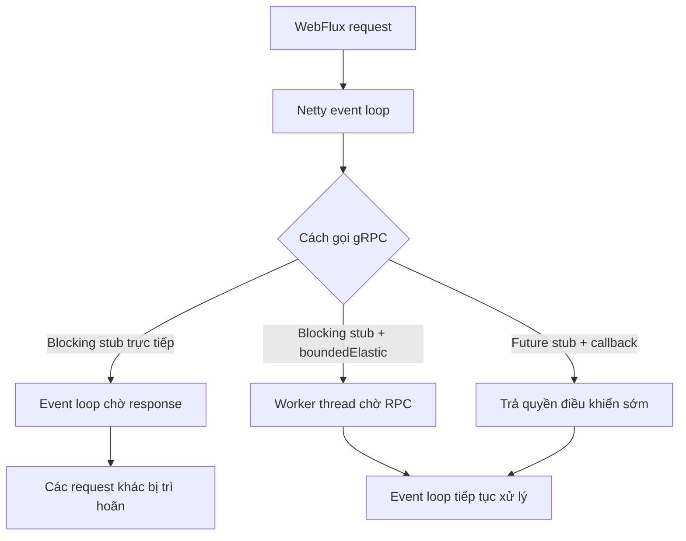

# Không chặn event loop ngoài ý muốn

## 1. Vì sao event loop phải luôn sẵn sàng?

Trong ứng dụng Spring WebFlux, Netty thường dùng một số lượng nhỏ **event loop thread** để nhận kết nối, đọc/ghi dữ liệu và điều phối callback cho nhiều request. Một thread có thể phục vụ nhiều kết nối. Nếu handler chạy thao tác blocking trên thread này, event loop không thể xử lý các sự kiện khác trong thời gian bị giữ lại.

Với gRPC Java, lời gọi qua **blocking stub** chờ response ngay trên thread gọi. Nếu gọi blocking stub trực tiếp trong WebFlux controller hoặc service đang chạy trên event loop, một RPC chậm có thể làm chậm nhiều request HTTP không liên quan. Khi tải tăng, độ trễ lan rộng và số request đang chờ có thể tích tụ.

Các thao tác dễ vô tình chặn event loop gồm:

- Gọi BlockingStub và chờ unary response.
- Gọi Future.get(), CompletableFuture.join() hoặc CountDownLatch.await().
- Chạy JDBC/JPA, file I/O, Thread.sleep() hoặc HTTP client blocking.
- Thực hiện xử lý CPU nặng, vòng lặp dài hoặc khóa đồng bộ bị tranh chấp.
- Gọi Mono.block() hoặc Flux.blockFirst() trong luồng reactive.

Nguyên tắc là **không chờ một kết quả blocking trên event loop**. Hãy dùng API bất đồng bộ hoặc chuyển riêng phần blocking sang scheduler dành cho tác vụ đó.



## 2. Nhận diện ranh giới thread trong Spring gRPC

Một ứng dụng có thể có nhiều loại thread:

| Thread / nơi chạy | Công việc phù hợp | Điều cần tránh |
| --- | --- | --- |
| WebFlux Netty event loop | Điều phối I/O non-blocking, callback ngắn | Blocking stub, JDBC blocking, block() |
| gRPC transport/event loop | Vận chuyển HTTP/2 và callback nội bộ | Tự chạy logic chậm hoặc chờ I/O |
| boundedElastic | Tương thích API blocking có giới hạn | Tạo tác vụ không giới hạn hoặc giữ thread quá lâu |
| Executor callback riêng | Hoàn tất future và chuyển kết quả nhẹ | Chạy query blocking hoặc xử lý CPU nặng kéo dài |
| parallel / CPU scheduler | Biến đổi CPU-bound ngắn, có giới hạn | Chờ I/O blocking |

Một controller trả Mono<T> chưa bảo đảm mọi dòng code bên trong tự động chạy bất đồng bộ. Reactor điều phối luồng theo cách source và scheduler được cấu hình.

## 3. Cách đơn giản khi phải dùng blocking stub

Nếu dự án đang dùng blocking stub và chưa thể đổi client, hãy bọc lời gọi trong Mono.fromCallable(...) rồi chuyển source sang Schedulers.boundedElastic():

```java
@Service
public class BlockingPricingAdapter {

    private final PricingServiceGrpc.PricingServiceBlockingStub stub;

    public BlockingPricingAdapter(
            PricingServiceGrpc.PricingServiceBlockingStub stub) {
        this.stub = stub;
    }

    public Mono<PriceQuoteResponse> getQuote(
            PriceQuoteRequest request) {

        return Mono.fromCallable(() ->
                stub.withDeadlineAfter(700, TimeUnit.MILLISECONDS)
                        .getQuote(request))
                .subscribeOn(Schedulers.boundedElastic());
    }
}
```

Mono.fromCallable trì hoãn việc gọi cho đến khi có subscription. subscribeOn chuyển việc thực thi source và lời gọi blocking sang worker thread thuộc bounded elastic scheduler. Event loop không phải chờ response.

**Vì sao dùng subscribeOn, không chỉ publishOn?**

- subscribeOn ảnh hưởng nơi source bắt đầu thực thi; phù hợp khi chính lời gọi gRPC là blocking.
- publishOn chuyển các operator phía sau nó sang scheduler khác. Nếu đặt publishOn sau một source blocking, lời gọi đã có thể chạy trên event loop trước khi luồng được chuyển.

Ví dụ dưới đây không an toàn nếu getQuoteBlocking() chặn ngay khi được gọi trước khi trả Mono:

```java
// Sai: lời gọi blocking diễn ra trước khi Mono được tạo.
PriceQuoteResponse response = blockingStub.getQuote(request);
return Mono.just(response);
```

Cũng không gọi block() để lấy response trong WebFlux controller. Hãy trả Mono<PriceQuoteResponse> cho framework tiếp tục điều phối.

### Deadline vẫn cần thiết

Chuyển sang bounded elastic chỉ bảo vệ event loop; nó không làm RPC nhanh hơn hoặc tự giới hạn thời gian chờ. Vẫn đặt deadline hữu hạn theo ngân sách request. Nếu cần tính cả thời gian request đã chờ trong hàng đợi, hãy ghi nhận deadline ở ranh giới đầu vào và tính thời gian còn lại ngay trước RPC, thay vì bắt đầu lại toàn bộ budget khi worker thread được chạy.

Schedulers.boundedElastic() có giới hạn tài nguyên và hàng đợi theo cấu hình Reactor. Khi downstream chậm, số tác vụ blocking có thể tăng. Theo dõi số worker hoạt động, queue và thời gian chờ; không coi bounded elastic là tài nguyên vô hạn.

## 4. Ưu tiên future stub cho unary RPC

Future stub phù hợp khi muốn khởi tạo unary RPC mà không giữ thread gọi để chờ response. Generated gRPC Java stub trả về ListenableFuture<Response>:

```java
OrderQueryServiceGrpc.OrderQueryServiceFutureStub futureStub =
        OrderQueryServiceGrpc.newFutureStub(channel);

ListenableFuture<GetOrderResponse> pending =
        futureStub.withDeadlineAfter(700, TimeUnit.MILLISECONDS)
                .getOrder(request);
```

Lời gọi getOrder(...) trả về future; không gọi pending.get() trên event loop. Đăng ký callback để nhận kết quả khi RPC hoàn tất. Guava cung cấp Futures.addCallback(...):

```java
Futures.addCallback(
        pending,
        new FutureCallback<GetOrderResponse>() {
            @Override
            public void onSuccess(GetOrderResponse response) {
                // Chuyển kết quả sang tầng tiếp theo.
            }

            @Override
            public void onFailure(Throwable failure) {
                // Phân loại status hoặc lỗi hủy.
            }
        },
        callbackExecutor);
```

callbackExecutor nên là executor được quản lý và có giới hạn phù hợp. Không dùng callback để chạy truy vấn blocking hoặc xử lý CPU kéo dài. MoreExecutors.directExecutor() có thể chạy callback ngay trên thread hoàn tất RPC hoặc thread đăng ký listener nếu future đã hoàn tất; chỉ dùng khi callback thực sự ngắn và đã kiểm soát nơi downstream tiếp tục chạy.

## 5. Nối ListenableFuture với Reactor và hỗ trợ cancellation

WebFlux thường muốn trả Mono<T>. Có thể chuyển ListenableFuture thành Mono bằng Mono.create, đăng ký callback và nối cancellation của subscriber với cancellation của RPC:

```java
@Service
public class ReactivePricingAdapter {

    private final PricingServiceGrpc.PricingServiceFutureStub stub;
    private final Executor callbackExecutor;

    public ReactivePricingAdapter(
            PricingServiceGrpc.PricingServiceFutureStub stub,
            @Qualifier("grpcCallbackExecutor") Executor callbackExecutor) {
        this.stub = stub;
        this.callbackExecutor = callbackExecutor;
    }

    public Mono<PriceQuoteResponse> getQuote(
            PriceQuoteRequest request) {

        return Mono.defer(() -> {
            ListenableFuture<PriceQuoteResponse> pending =
                    stub.withDeadlineAfter(700, TimeUnit.MILLISECONDS)
                            .getQuote(request);

            return Mono.<PriceQuoteResponse>create(sink -> {
                sink.onCancel(() -> pending.cancel(true));

                Futures.addCallback(
                        pending,
                        new FutureCallback<PriceQuoteResponse>() {
                            @Override
                            public void onSuccess(
                                    PriceQuoteResponse response) {
                                sink.success(response);
                            }

                            @Override
                            public void onFailure(Throwable failure) {
                                sink.error(failure);
                            }
                        },
                        callbackExecutor);
            });
        });
    }
}
```

Các chi tiết quan trọng:

- Mono.defer(...) tạo một RPC mới cho mỗi subscription; không chia sẻ cùng một future giữa nhiều subscriber.
- ListenableFuture cho phép client nhận kết quả sau mà không gọi get() để chờ.
- Futures.addCallback(...) dùng executor riêng để callback không chiếm event loop hoặc thread transport trong lúc xử lý.
- sink.onCancel(...) yêu cầu hủy future khi subscriber hủy subscription. Với future do gRPC Java tạo, cancel(true) yêu cầu hủy call tương ứng.
- sink.success(...) và sink.error(...) phát kết quả hoặc lỗi vào Reactor. Nếu subscription đã bị hủy, tín hiệu muộn không còn được tiêu thụ.

Cancellation là tín hiệu hợp tác: server nhận yêu cầu hủy nhưng database hoặc tác vụ ngoài có thể không dừng ngay. Không giả định hủy subscription đồng nghĩa transaction đã rollback hoặc tác dụng phụ chưa xảy ra.

callbackExecutor nên là executor do Spring quản lý, có giới hạn thread và queue, chính sách từ chối phù hợp và được đóng theo vòng đời ứng dụng. Callback nên chỉ chuyển kết quả/lỗi; nếu có xử lý CPU hoặc I/O blocking tiếp theo, hãy đặt ranh giới scheduler riêng.

### Tránh làm việc nặng trên callback thread

Sau khi sink.success(response) được gọi, một số operator downstream có thể chạy ngay trên thread phát tín hiệu. Nếu cần chuyển phần xử lý CPU sang scheduler phù hợp, đặt publishOn tại ranh giới đó:

```java
return reactivePricingAdapter.getQuote(request)
        .publishOn(Schedulers.parallel())
        .map(this::calculateDisplayPrice);
```

Nếu operator tiếp theo thực hiện blocking I/O, dùng scheduler dành cho blocking thay vì parallel. publishOn chỉ chuyển các operator phía sau nó; nó không thay thế việc bảo vệ source blocking bằng subscribeOn.

## 6. Context, metadata và trace khi đổi thread

Trong hệ thống reactive, Reactor Context, ThreadLocal và io.grpc.Context là những cơ chế khác nhau. Chuyển thread không tự động bảo đảm mọi thông tin xác thực, trace hoặc correlation ID được truyền đúng.

- Dùng cơ chế context propagation đã cấu hình trong ứng dụng để giữ trace/MDC khi chuyển scheduler.
- Đưa request ID hoặc trace context vào gRPC metadata bằng interceptor hoặc instrumentation phù hợp.
- Không lấy tenant hoặc quyền truy cập từ ThreadLocal có thể đã mất khi chuyển thread.
- Với server gRPC, giữ io.grpc.Context trong callback và công việc downstream bằng cơ chế wrap/context executor khi cần.
- Không lưu request metadata vào field mutable của singleton adapter; nhiều RPC có thể chạy đồng thời.

Client adapter nên nhận request và context rõ ràng, tạo metadata riêng cho call và không phụ thuộc thread đang thực thi.

## 7. Giới hạn concurrency và cô lập tác vụ blocking

Chuyển blocking stub sang bounded elastic tránh giữ event loop, nhưng nếu service nhận quá nhiều RPC chậm thì worker và connection vẫn có thể cạn. Cần kiểm soát tải:

1. Đặt deadline cho mỗi RPC để giới hạn thời gian chờ.
2. Giới hạn số lời gọi đồng thời theo khả năng của service đích.
3. Dùng bulkhead hoặc semaphore khi một downstream có thể gây ảnh hưởng dây chuyền.
4. Đặt timeout riêng cho JDBC/HTTP client; gRPC deadline không tự cấu hình timeout của thư viện khác.
5. Không tạo scheduler hoặc executor mới cho từng request.
6. Theo dõi queue, active worker, số RPC in-flight và tỷ lệ timeout.

Ví dụ giới hạn concurrency ở tầng reactive:

```java
return requests.flatMap(
        request -> reactivePricingAdapter.getQuote(request),
        32);
```

Tham số 32 giới hạn số inner publisher được subscribe đồng thời trong ví dụ này. Chọn giới hạn theo tải thử nghiệm, connection pool và năng lực server; đây không phải con số mặc định cho mọi ứng dụng.

Nếu dùng Spring MVC với servlet thread pool thay vì WebFlux, blocking không giữ Netty event loop, nhưng vẫn có thể làm cạn servlet threads. Cần quản lý thread pool và concurrency ở đó; nguyên tắc tránh chờ không giới hạn vẫn áp dụng.

## 8. Kiểm thử để phát hiện blocking và xác minh cancellation

Kiểm thử nên xác nhận ba đặc tính:

- WebFlux pipeline không gọi blocking stub trực tiếp trên event loop.
- RPC bất đồng bộ hoàn tất thành Mono đúng response hoặc status lỗi.
- Khi subscriber hủy, client yêu cầu hủy future/RPC.

Có thể dùng Reactor StepVerifier để kiểm tra kết quả:

```java
@Test
void emitsQuoteWithoutBlockingCaller() {
    StepVerifier.create(adapter.getQuote(validRequest))
            .assertNext(response ->
                    assertEquals("SKU-1", response.getProductId()))
            .verifyComplete();
}
```

Để kiểm tra cancellation, dùng service in-process có thể quan sát Context.current().isCancelled() hoặc đăng ký cancellation listener. Subscribe rồi hủy subscription; xác minh server nhận cancellation bằng CountDownLatch, không dựa vào Thread.sleep(...) để đoán thời điểm.

Có thể tích hợp **BlockHound** trong test để phát hiện thao tác blocking trên thread được đánh dấu non-blocking. BlockHound giúp bắt lỗi như Thread.sleep, blocking I/O hoặc một số lời gọi chặn trong event loop. Nó không thay thế kiểm tra kiến trúc: hãy xác minh blocking stub luôn nằm trong fromCallable(...).subscribeOn(boundedElastic()) nếu còn sử dụng.

In-process test kiểm tra semantics gRPC và Reactor nhưng không chứng minh hiệu năng transport thật. Cần kiểm tra thêm dưới tải với Netty, connection pool, timeout downstream và cấu hình triển khai thực tế.

## 9. Những lỗi thường gặp

1. **Gọi blocking stub trực tiếp trong WebFlux handler.** Event loop phải chờ response. Chuyển source sang bounded elastic hoặc dùng future/async API.
2. **Dùng publishOn sau source blocking để mong chuyển lời gọi đi.** Source có thể đã chạy trên event loop. Dùng subscribeOn tại source blocking.
3. **Gọi Future.get(), join() hoặc Mono.block().** Thread hiện tại bị giữ lại. Dùng callback và composition reactive.
4. **Cho rằng trả Mono là tự động non-blocking.** Code tạo source có thể đã thực hiện blocking trước khi trả Mono. Dùng defer/fromCallable đúng vị trí.
5. **Dùng direct executor cho callback dài.** Callback có thể chạy trên thread hoàn tất RPC. Dùng executor được quản lý và giới hạn.
6. **Không truyền cancellation xuống future.** Client disconnect nhưng RPC vẫn tiếp tục không cần thiết. Nối sink.onCancel với future.cancel(true).
7. **Chuyển thread nhưng mất trace/security context.** Dùng context propagation và metadata interceptor có chủ đích.
8. **Tạo executor hoặc channel cho từng request.** Tăng chi phí và khó quản lý vòng đời. Tái sử dụng channel/stub và executor được quản lý.
9. **Không giới hạn số RPC in-flight.** Bounded elastic hoặc callback queue vẫn có thể quá tải. Áp dụng concurrency limit và theo dõi queue.

## 10. Bài thực hành

Một WebFlux controller gọi PricingService.GetQuote và trả Mono<PriceQuoteResponse>. Hãy triển khai hai phương án:

- Giữ blocking stub nhưng chuyển lời gọi bằng Mono.fromCallable(...).subscribeOn(Schedulers.boundedElastic()).
- Dùng future stub, nối ListenableFuture với Mono.create, chọn callback executor có giới hạn và truyền cancellation về future.

Dùng deadline hợp lý cho mỗi RPC. Viết test StepVerifier cho kết quả thành công và status lỗi; thêm test hủy subscription để xác minh gRPC call nhận cancellation. Dùng BlockHound hoặc kiểm tra thread name để phát hiện blocking trên event loop. Cuối cùng, thử tải đồng thời và theo dõi số worker, queue, RPC in-flight cùng latency.

**Tự kiểm tra:** Blocking stub có thể dùng trong WebFlux nếu lời gọi được chuyển khỏi event loop bằng subscribeOn(boundedElastic()). Với future stub, không gọi get(); nối completion thành Mono, dùng callback executor có giới hạn và truyền cancellation về RPC. Giữ event loop cho điều phối I/O, còn blocking, CPU nặng và callback dài phải chạy ở scheduler/executor phù hợp.

