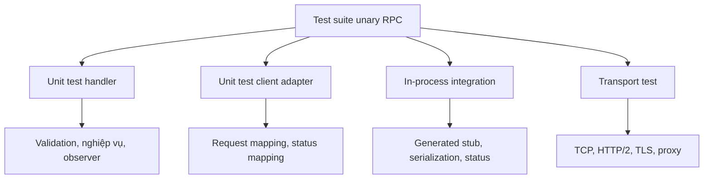

# Kiểm thử unary service và client

## 1. Kiểm thử điều gì trong một unary RPC?

Một unary RPC nhận một request protobuf và trả một response protobuf khi thành công. Khi thất bại, lời gọi kết thúc bằng gRPC status khác `OK`. Vì vậy, kiểm thử cần xác minh cả **dữ liệu** lẫn **cách lời gọi kết thúc**.

Với Spring gRPC, nên kiểm tra ba ranh giới:

1. **Handler/service:** request được kiểm tra đúng, nghiệp vụ được gọi đúng và observer chỉ phát một kết quả terminal.
2. **Client adapter:** request được tạo đúng, generated stub được gọi và status gRPC được chuyển thành lỗi ứng dụng phù hợp.
3. **Tích hợp gRPC:** request đi qua generated stub, server nhận đúng message, response/status quay về client đúng hợp đồng.

Không phải test nào cũng cần khởi động Spring ApplicationContext hoặc mở TCP port. Unit test handler nhanh và cô lập; in-process integration test kiểm tra giao tiếp gRPC thật trong cùng tiến trình; test transport thật dành cho TLS, HTTP/2, proxy và cấu hình triển khai.



## 2. Hợp đồng và service dùng trong ví dụ

Giả sử service tra cứu sản phẩm có một method unary:

```proto
syntax = "proto3";

package catalog.v1;

option java_package = "com.example.catalog.grpc";
option java_multiple_files = true;

service ProductQueryService {
  rpc GetProduct(GetProductRequest) returns (GetProductResponse);
}

message GetProductRequest {
  string product_id = 1;
}

message GetProductResponse {
  string product_id = 1;
  string name = 2;
}
```

Generated Java code cung cấp `ProductQueryServiceGrpc`, `GetProductRequest` và `GetProductResponse`. Service Spring có thể triển khai generated base class:

```java
@GrpcService
public class ProductQueryGrpcService
        extends ProductQueryServiceGrpc.ProductQueryServiceImplBase {

    private final ProductCatalog catalog;

    public ProductQueryGrpcService(ProductCatalog catalog) {
        this.catalog = catalog;
    }

    @Override
    public void getProduct(
            GetProductRequest request,
            StreamObserver<GetProductResponse> observer) {

        String productId = request.getProductId().trim();

        if (productId.isEmpty()) {
            observer.onError(Status.INVALID_ARGUMENT
                    .withDescription("product_id không được để trống")
                    .asRuntimeException());
            return;
        }

        try {
            Product product = catalog.findById(productId)
                    .orElseThrow(() -> Status.NOT_FOUND
                            .withDescription("Không tìm thấy sản phẩm")
                            .asRuntimeException());

            observer.onNext(GetProductResponse.newBuilder()
                    .setProductId(product.id())
                    .setName(product.name())
                    .build());
            observer.onCompleted();

        } catch (StatusRuntimeException expected) {
            observer.onError(expected);

        } catch (RuntimeException unexpected) {
            observer.onError(Status.INTERNAL
                    .withDescription("Không thể xử lý yêu cầu")
                    .asRuntimeException());
        }
    }
}
```

`ProductCatalog` và `Product` là kiểu ứng dụng minh họa. Trong code production, nên phân biệt exception nghiệp vụ đã biết với lỗi ngoài dự kiến; ví dụ trên chỉ làm rõ các nhánh `INVALID_ARGUMENT`, `NOT_FOUND` và `INTERNAL`.

Vòng đời của `StreamObserver` là một phần quan trọng của contract:

- Thành công: `onNext(response)` đúng một lần, sau đó `onCompleted()`.
- Thất bại: `onError(error)` và kết thúc.
- Không gửi response sau `onError`, không gọi nhiều terminal signal.
- Không giả định lỗi nghiệp vụ sẽ được trả như response có field `error`; gRPC status là kết quả kết thúc của RPC.

## 3. Unit test handler không cần server

Unit test gọi trực tiếp method của service và quan sát `StreamObserver`. Cách này kiểm tra logic handler mà không cần channel, transport hoặc Spring context.

Tạo observer ghi nhận các tín hiệu:

```java
final class RecordingObserver<T> implements StreamObserver<T> {

    private final List<T> values = new ArrayList<>();
    private Throwable error;
    private boolean completed;

    @Override
    public void onNext(T value) {
        values.add(value);
    }

    @Override
    public void onError(Throwable failure) {
        error = failure;
    }

    @Override
    public void onCompleted() {
        completed = true;
    }

    List<T> values() {
        return values;
    }

    Throwable error() {
        return error;
    }

    boolean completed() {
        return completed;
    }
}
```

Dùng fake catalog xác định trước dữ liệu:

```java
class ProductQueryGrpcServiceTest {

    private ProductQueryGrpcService service;

    @BeforeEach
    void setUp() {
        ProductCatalog catalog = id -> {
            if (id.equals("P-100")) {
                return Optional.of(new Product("P-100", "Keyboard"));
            }
            return Optional.empty();
        };

        service = new ProductQueryGrpcService(catalog);
    }

    @Test
    void emitsOneResponseAndCompletes() {
        RecordingObserver<GetProductResponse> observer =
                new RecordingObserver<>();

        service.getProduct(
                GetProductRequest.newBuilder()
                        .setProductId("P-100")
                        .build(),
                observer);

        assertEquals(1, observer.values().size());
        assertEquals("P-100", observer.values().get(0).getProductId());
        assertEquals("Keyboard", observer.values().get(0).getName());
        assertTrue(observer.completed());
        assertNull(observer.error());
    }

    @Test
    void rejectsBlankProductId() {
        RecordingObserver<GetProductResponse> observer =
                new RecordingObserver<>();

        service.getProduct(
                GetProductRequest.newBuilder()
                        .setProductId("   ")
                        .build(),
                observer);

        assertTrue(observer.values().isEmpty());
        assertFalse(observer.completed());
        assertEquals(
                Status.Code.INVALID_ARGUMENT,
                Status.fromThrowable(observer.error()).getCode());
    }

    @Test
    void returnsNotFoundForUnknownProduct() {
        RecordingObserver<GetProductResponse> observer =
                new RecordingObserver<>();

        service.getProduct(
                GetProductRequest.newBuilder()
                        .setProductId("missing")
                        .build(),
                observer);

        assertTrue(observer.values().isEmpty());
        assertFalse(observer.completed());
        assertEquals(
                Status.Code.NOT_FOUND,
                Status.fromThrowable(observer.error()).getCode());
    }
}
```

Các test này không kiểm tra serialization protobuf qua transport, interceptor hoặc Spring bean registration. Đổi lại, chúng chạy nhanh và xác định chính xác handler sai ở nhánh nào. Có thể bổ sung test khi catalog ném exception để xác minh lỗi ngoài dự kiến được chuyển thành `INTERNAL` và không làm lộ thông tin nội bộ.

## 4. In-process integration test cho generated stub

Unit test handler không chứng minh client và server giao tiếp đúng qua gRPC. `InProcessServerBuilder` và `InProcessChannelBuilder` cung cấp transport trong cùng tiến trình, phù hợp để kiểm tra generated stub, request/response và status mà không mở cổng TCP.

Ví dụ fixture JUnit 5:

```java
class ProductQueryGrpcIntegrationTest {

    private Server server;
    private ManagedChannel channel;
    private ProductQueryServiceGrpc.ProductQueryServiceBlockingStub stub;

    @BeforeEach
    void startServer() throws IOException {
        ProductCatalog catalog = id -> id.equals("P-100")
                ? Optional.of(new Product("P-100", "Keyboard"))
                : Optional.empty();

        ProductQueryGrpcService service =
                new ProductQueryGrpcService(catalog);

        String serverName = InProcessServerBuilder.generateName();

        server = InProcessServerBuilder.forName(serverName)
                .directExecutor()
                .addService(service)
                .build()
                .start();

        channel = InProcessChannelBuilder.forName(serverName)
                .directExecutor()
                .build();

        stub = ProductQueryServiceGrpc.newBlockingStub(channel);
    }

    @AfterEach
    void stopServer() {
        if (channel != null) {
            channel.shutdownNow();
        }
        if (server != null) {
            server.shutdownNow();
        }
    }

    @Test
    void clientReceivesProductResponse() {
        GetProductResponse response = stub.getProduct(
                GetProductRequest.newBuilder()
                        .setProductId("P-100")
                        .build());

        assertEquals("P-100", response.getProductId());
        assertEquals("Keyboard", response.getName());
    }

    @Test
    void clientReceivesNotFoundStatus() {
        StatusRuntimeException error = assertThrows(
                StatusRuntimeException.class,
                () -> stub.getProduct(GetProductRequest.newBuilder()
                        .setProductId("missing")
                        .build()));

        assertEquals(
                Status.Code.NOT_FOUND,
                error.getStatus().getCode());
    }
}
```

`ProductCatalog`, `Product`, `ProductQueryGrpcService` và các generated class là thành phần ví dụ của dự án. Test cần JUnit Jupiter và dependency `grpc-inprocess` tương thích với phiên bản gRPC Java đang dùng.

`directExecutor()` hữu ích cho test nhỏ, có tính xác định, nhưng không mô phỏng scheduling hoặc contention của transport production. Nếu service phụ thuộc executor, callback bất đồng bộ hoặc cancellation, hãy dùng executor phù hợp và đồng bộ test bằng latch/future thay vì giả định mọi callback chạy ngay.

## 5. Kiểm thử client adapter và status mapping

Trong ứng dụng thực tế, tầng application thường không muốn phụ thuộc trực tiếp vào `StatusRuntimeException`. Client adapter là nơi gọi stub và chuyển status sang exception hoặc result của ứng dụng.

Ví dụ adapter:

```java
@Service
public class ProductQueryClient {

    private final ProductQueryServiceGrpc.ProductQueryServiceBlockingStub stub;

    public ProductQueryClient(
            ProductQueryServiceGrpc.ProductQueryServiceBlockingStub stub) {
        this.stub = stub;
    }

    public ProductView getProduct(String productId) {
        try {
            GetProductResponse response = stub.getProduct(
                    GetProductRequest.newBuilder()
                            .setProductId(productId)
                            .build());

            return new ProductView(
                    response.getProductId(), response.getName());

        } catch (StatusRuntimeException failure) {
            if (failure.getStatus().getCode() == Status.Code.NOT_FOUND) {
                throw new ProductNotFoundException(productId, failure);
            }
            throw failure;
        }
    }
}
```

`ProductView` và `ProductNotFoundException` là kiểu ứng dụng do dự án định nghĩa. Có thể kiểm tra adapter bằng in-process server như phần trước, sau đó inject adapter và gọi `getProduct(...)`. Khi sản phẩm không tồn tại, test xác nhận adapter ném `ProductNotFoundException`; khi thành công, test xác nhận dữ liệu được chuyển đúng.

Một test client tốt nên xác minh:

- Request builder nhận đúng ID và các field cần thiết.
- Response được chuyển thành kiểu ứng dụng đúng.
- `NOT_FOUND`, `INVALID_ARGUMENT`, `UNAVAILABLE` và `DEADLINE_EXCEEDED` được xử lý theo contract.
- Lỗi không nhận diện được vẫn được giữ lại hoặc chuyển thành lỗi nội bộ phù hợp; không trả object mặc định giả thành công.
- Retry, nếu có, được kiểm tra riêng theo chính sách và tính idempotent của method.

## 6. Kiểm thử deadline và cancellation mà không dùng sleep

Deadline là một phần của hành vi unary client. Để kiểm tra client không chờ vô hạn, có thể tạo test service phản hồi chậm bằng scheduler hoặc future, sau đó đặt deadline ngắn hơn thời gian hoàn tất.

Không nên dùng `Thread.sleep(...)` trong test để phỏng đoán server đã xử lý tới đâu. Dùng `CountDownLatch`, `CompletableFuture` hoặc tín hiệu đồng bộ để xác nhận:

1. Server đã nhận request.
2. Client nhận `DEADLINE_EXCEEDED`.
3. Server quan sát cancellation nếu handler hoặc downstream hỗ trợ.
4. Tác vụ được yêu cầu dừng và không phát response muộn.

Cancellation là hợp tác. Một truy vấn database hoặc tác dụng phụ đã commit có thể không dừng chỉ vì client hủy RPC. Test cần kiểm tra điều hệ thống cam kết thực sự: tín hiệu hủy được truyền, tài nguyên được giải phóng khi API hỗ trợ, và nghiệp vụ giữ nhất quán.

Với RPC tạo tác dụng phụ, timeout không chứng minh server chưa thực hiện thao tác. Kiểm thử retry phải giữ cùng idempotency key và xác minh không tạo bản ghi trùng.

## 7. Kiểm thử metadata và interceptor khi chúng thuộc contract

Nếu service sử dụng request metadata, response headers hoặc trailers, integration test nên xác minh chúng qua interceptor. Không chỉ kiểm tra handler nhận đúng protobuf request.

Một ma trận hữu ích:

| Thành phần | Điều cần xác minh |
| --- | --- |
| Client interceptor | Request ID hoặc trace metadata được thêm vào đúng call. |
| Server interceptor | Metadata được đọc và đưa vào context của handler. |
| Response headers | Client interceptor nhận header mong đợi. |
| Trailers | Client đọc được error ID cùng status kết thúc. |
| Concurrent calls | Metadata của hai RPC không bị trộn lẫn. |

Không dùng metadata nhạy cảm thật trong test. Dùng token giả hoặc credentials test, và xác minh log không ghi giá trị bí mật.

## 8. Khi nào cần test transport thật?

In-process test không đi qua TCP socket, TLS handshake, HTTP/2 network stack hoặc proxy. Vì vậy, cần bổ sung test chạy server/channel thật khi mục tiêu kiểm tra bao gồm:

- TLS certificate, trust chain, hostname verification và mutual TLS.
- HTTP/2, load balancer, name resolver hoặc service discovery.
- Header size limits và hành vi của reverse proxy.
- Spring configuration, interceptor registration và lifecycle channel thực.
- Timeout/cancellation của database hoặc HTTP client bên ngoài.

Không cần đưa toàn bộ các kiểm tra này vào mỗi unit test. Đặt chúng ở integration/system test phù hợp để test nhanh vẫn tập trung vào logic unary service/client.

## 9. Các nguyên tắc làm test ổn định

- **Dữ liệu xác định:** fake catalog hoặc fixture database có trạng thái rõ ràng; không phụ thuộc dịch vụ bên ngoài trong unit test.
- **Không chia sẻ trạng thái mutable giữa test:** mỗi test tạo service, channel và observer riêng hoặc reset fixture rõ ràng.
- **Đóng tài nguyên:** shutdown channel/server và đóng scheduler/executor do test tạo.
- **Không kiểm tra chi tiết implementation không thuộc contract:** ưu tiên response, status, side effect và observer lifecycle.
- **Đồng bộ rõ ràng:** dùng latch/future hoặc StepVerifier; tránh sleep và timeout quá sát.
- **Kiểm tra status code:** không assert description tự do nếu description không phải contract.
- **Phân biệt test layers:** unit test cho logic; in-process cho gRPC contract; transport test cho network/security.

## 10. Bài thực hành

Tạo một unary method `GetProduct` và triển khai test theo ba lớp:

1. Unit test handler cho request hợp lệ, ID rỗng, không tìm thấy sản phẩm và lỗi repository.
2. In-process integration test gọi generated blocking stub, xác minh response và status code.
3. Client adapter test xác minh response mapping và chuyển `NOT_FOUND` thành exception ứng dụng.

Bổ sung một test deadline với service phản hồi chậm và dùng tín hiệu đồng bộ để xác minh cancellation. Nếu method sử dụng metadata, kiểm tra request ID ở server interceptor và error ID trong trailers. Chạy test độc lập nhiều lần để phát hiện phụ thuộc thứ tự hoặc trạng thái dùng chung.

**Tự kiểm tra:** Unit test chứng minh handler xử lý đúng; in-process integration test chứng minh generated client/server tuân thủ contract unary; client adapter test chứng minh status và response được chuyển đúng vào application. Dùng transport test riêng cho TLS, HTTP/2 và proxy. Mỗi test cần kiểm tra cả response thành công lẫn đường lỗi phù hợp, đồng thời giải phóng channel, server và executor sau khi chạy.

