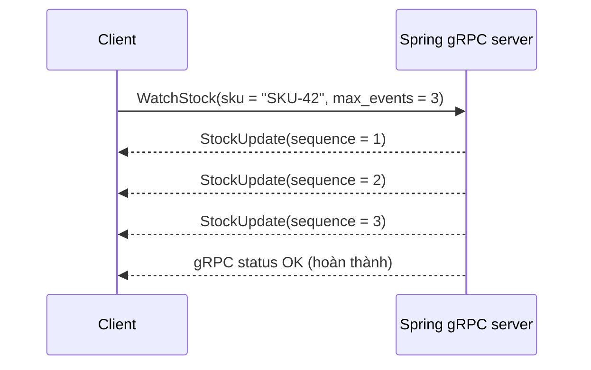

# Server streaming trả nhiều response

## 1. Bài toán và vị trí của server streaming

Trong module **SPRING_GRPC**, ta phát triển dịch vụ gRPC trong hệ sinh thái Spring: định nghĩa hợp đồng bằng Protocol Buffers, sinh mã Java, triển khai client/server và xử lý metadata, deadline, status, interceptor, TLS, kiểm thử cùng giám sát vận hành. Chương **Server streaming** tập trung vào một khả năng cụ thể: **client gửi một request, server trả về nhiều response trên cùng một RPC**.

Ví dụ: màn hình quản lý kho yêu cầu theo dõi mã hàng `SKU-42`. Thay vì cứ mỗi giây gọi một RPC unary để hỏi số lượng tồn kho, client mở một RPC `WatchStock`. Server lần lượt gửi các bản cập nhật khi còn phiên theo dõi; client nhận và hiển thị ngay từng bản cập nhật.

Đặc điểm cốt lõi:

- **Một request đầu vào:** client chỉ gửi một thông điệp yêu cầu để bắt đầu RPC.
- **Nhiều response đầu ra:** server gọi `onNext(...)` nhiều lần, theo đúng thứ tự gửi trong **cùng một RPC**.
- **Có điểm kết thúc:** server hoàn thành bằng `onCompleted()` hoặc kết thúc lỗi bằng `onError(...)`; client cũng có thể hủy RPC. Hai tín hiệu kết thúc này không được gửi cùng nhau.
- **Đọc theo tiến độ:** client có thể xử lý từng response mà không phải chờ server tạo đủ cả danh sách.

| Kiểu RPC | Request từ client | Response từ server | Ví dụ |
|---|---|---|---|
| Unary | Một | Một | Tra cứu một sản phẩm |
| **Server streaming** | **Một** | **Nhiều** | Theo dõi cập nhật tồn kho |
| Client streaming | Nhiều | Một | Gửi nhiều mẫu đo để tổng hợp |
| Bidirectional streaming | Nhiều | Nhiều | Trao đổi sự kiện hai chiều |

Luồng trao đổi điển hình:



Đường truyền là HTTP/2 với cơ chế framing và flow control của gRPC. Mỗi `StockUpdate` vẫn là một thông điệp Protocol Buffers riêng. **Server streaming không đồng nghĩa với việc trả một `repeated` field trong một response unary:** `repeated` chỉ tạo một thông điệp chứa danh sách, còn streaming truyền dần nhiều thông điệp trong vòng đời một RPC.

## 2. Khai báo hợp đồng Protocol Buffers

Giả sử ứng dụng dùng file `src/main/proto/inventory.proto`:

```proto
syntax = "proto3";

package inventory.v1;

option java_multiple_files = true;
option java_package = "com.example.inventory.rpc";
option java_outer_classname = "InventoryProto";

service InventoryService {
  // Client gửi một WatchStockRequest; server phát nhiều StockUpdate.
  rpc WatchStock(WatchStockRequest) returns (stream StockUpdate);
}

message WatchStockRequest {
  string sku = 1;
  int32 max_events = 2; // Giới hạn số sự kiện trong ví dụ hữu hạn.
}

message StockUpdate {
  string sku = 1;
  int64 quantity = 2;
  int64 sequence = 3;
  int64 observed_at_epoch_ms = 4;
}
```

Từ khóa **`stream` đứng trước kiểu response** là yếu tố quyết định. Nếu bỏ `stream`, phương thức trở thành unary. `max_events` giúp bài thực hành kết thúc một cách xác định; trong hệ thống thực, một phiên theo dõi có thể tồn tại lâu và dừng khi client hủy, deadline hết hoặc server đóng stream.

Quá trình build sử dụng `protoc`, bộ sinh Java của protobuf và plugin `protoc-gen-grpc-java` tương thích với phiên bản gRPC Java của dự án. Các lớp sinh ra thường bao gồm:

- `WatchStockRequest` và `StockUpdate`: message immutable có `newBuilder()` để tạo giá trị.
- `InventoryServiceGrpc.InventoryServiceImplBase`: lớp nền để cài đặt service phía server.
- `InventoryServiceGrpc.newBlockingStub(channel)` và `newStub(channel)`: hai cách tiêu thụ luồng phía client.

Mã Java dưới đây giả định dự án Spring Boot đã tích hợp **Spring gRPC server**, đã bật sinh mã từ `.proto` và đăng ký các Spring bean triển khai gRPC service. Cách khai báo plugin build, starter và cấu hình cổng phụ thuộc phiên bản Spring gRPC đang dùng trong dự án; không cần viết tay những lớp đã được sinh từ hợp đồng.

## 3. Triển khai server stream trong Spring

Với gRPC Java, server nhận một `StreamObserver<StockUpdate>`. Mỗi lần gọi `onNext(event)` gửi một response mới; `onCompleted()` phát tín hiệu kết thúc thành công. Ví dụ sau tạo tối đa 100 bản cập nhật giả lập, mỗi giây một bản cập nhật, dùng scheduler để tránh chặn luồng xử lý RPC trong lúc chờ.

```java
package com.example.inventory;

import com.example.inventory.rpc.InventoryServiceGrpc;
import com.example.inventory.rpc.StockUpdate;
import com.example.inventory.rpc.WatchStockRequest;
import io.grpc.Status;
import io.grpc.stub.ServerCallStreamObserver;
import io.grpc.stub.StreamObserver;
import jakarta.annotation.PreDestroy;
import org.springframework.stereotype.Service;

import java.util.concurrent.Executors;
import java.util.concurrent.ScheduledExecutorService;
import java.util.concurrent.ScheduledFuture;
import java.util.concurrent.TimeUnit;
import java.util.concurrent.atomic.AtomicBoolean;
import java.util.concurrent.atomic.AtomicInteger;
import java.util.concurrent.atomic.AtomicReference;

@Service
public class InventoryStreamingService
        extends InventoryServiceGrpc.InventoryServiceImplBase {

    // Executor dùng chung cho demo; không tạo một thread mới cho mỗi RPC.
    private final ScheduledExecutorService scheduler =
            Executors.newScheduledThreadPool(4);

    @Override
    public void watchStock(WatchStockRequest request,
                           StreamObserver<StockUpdate> responseObserver) {
        String sku = request.getSku().trim();
        int maxEvents = request.getMaxEvents();

        if (sku.isEmpty() || maxEvents < 1 || maxEvents > 100) {
            responseObserver.onError(Status.INVALID_ARGUMENT
                    .withDescription("sku must be non-empty; max_events must be 1..100")
                    .asRuntimeException());
            return;
        }

        ServerCallStreamObserver<StockUpdate> out =
                (ServerCallStreamObserver<StockUpdate>) responseObserver;
        AtomicBoolean stopped = new AtomicBoolean(false);
        AtomicInteger sent = new AtomicInteger(0);
        AtomicReference<ScheduledFuture<?>> task = new AtomicReference<>();

        // Khi client hủy hoặc hết deadline: dừng công việc nền của RPC này.
        out.setOnCancelHandler(() -> {
            stopped.set(true);
            cancel(task.get());
        });

        Runnable emit = () -> {
            if (stopped.get() || out.isCancelled()) {
                stopped.set(true);
                cancel(task.get());
                return;
            }

            // Với producer giả lập, có thể bỏ qua nhịp khi client chưa sẵn sàng.
            if (!out.isReady()) {
                return;
            }

            try {
                int sequence = sent.incrementAndGet();
                StockUpdate update = StockUpdate.newBuilder()
                        .setSku(sku)
                        .setQuantity(100 - sequence) // Dữ liệu demo, không phải kho thật.
                        .setSequence(sequence)
                        .setObservedAtEpochMs(System.currentTimeMillis())
                        .build();

                out.onNext(update);

                if (sequence == maxEvents && stopped.compareAndSet(false, true)) {
                    out.onCompleted();
                    cancel(task.get());
                }
            } catch (RuntimeException ex) {
                if (stopped.compareAndSet(false, true)) {
                    out.onError(Status.INTERNAL
                            .withDescription("Cannot produce stock update")
                            .asRuntimeException());
                }
                cancel(task.get());
            }
        };

        ScheduledFuture<?> future = scheduler.scheduleAtFixedRate(
                emit, 0, 1, TimeUnit.SECONDS);
        task.set(future);
        // Xử lý trường hợp RPC bị hủy ngay trước khi lưu future.
        if (stopped.get()) {
            future.cancel(false);
        }
    }

    private static void cancel(ScheduledFuture<?> future) {
        if (future != null) {
            future.cancel(false);
        }
    }

    @PreDestroy
    public void stop() {
        scheduler.shutdownNow();
    }
}
```

Trong một ứng dụng Spring gRPC có cơ chế tự đăng ký `BindableService` từ Spring context, `@Service` giúp lớp triển khai được Spring quản lý và đưa vào gRPC server. Nếu dự án dùng bộ tích hợp gRPC Spring khác, cần áp dụng đúng quy tắc đăng ký service của bộ tích hợp đó. Phần `StreamObserver` và hợp đồng `.proto` vẫn giữ nguyên.

Các điểm cần đọc kỹ:

1. **Validate trước khi phát dữ liệu.** Request sai được kết thúc bằng `Status.INVALID_ARGUMENT`, không tiếp tục `onNext` hoặc `onCompleted`.
2. **Một đường ghi tuần tự.** Các lần `onNext`, `onCompleted` và `onError` đều đi qua một tác vụ scheduler cho mỗi RPC. Không gọi đồng thời `onNext` trên cùng observer từ nhiều worker nếu chưa tự tuần tự hóa; `StreamObserver` không mặc định an toàn cho các lời gọi ghi song song.
3. **Chỉ có một tín hiệu kết thúc.** `AtomicBoolean stopped` bảo vệ đường kết thúc khi sự kiện hủy và tác vụ định kỳ cùng xảy ra.
4. **Chăm sóc vòng đời.** `setOnCancelHandler` dừng tác vụ khi client hủy; `@PreDestroy` giải phóng executor dùng chung lúc ứng dụng Spring dừng.
5. **Tôn trọng khả năng nhận.** `isReady()` là tín hiệu flow control hữu ích, nhưng không phải giải pháp hàng đợi bền vững. Ví dụ bỏ qua một nhịp phát khi chưa ready vì dữ liệu là giả lập. Với sự kiện thật, phải chọn chính sách buffer, coalescing, replay hoặc ngắt stream sao cho không âm thầm làm mất sự kiện bắt buộc.

Mã minh họa được cố ý giới hạn ở một stream hữu hạn và nguồn dữ liệu giả lập. Khi đọc cập nhật từ database, Kafka hay một event bus, nên có cơ chế subscribe/unsubscribe theo vòng đời RPC, executor hoặc publisher dùng chung, giới hạn số phiên theo dõi, và chính sách backpressure rõ ràng.

## 4. Client Java nhận từng response

### 4.1. Blocking stub: tiêu thụ bằng `Iterator`

Phù hợp cho tác vụ đồng bộ hoặc đoạn code demo, nơi thread gọi chấp nhận chờ bản cập nhật tiếp theo:

```java
import com.example.inventory.rpc.InventoryServiceGrpc;
import com.example.inventory.rpc.StockUpdate;
import com.example.inventory.rpc.WatchStockRequest;
import io.grpc.ManagedChannel;
import io.grpc.ManagedChannelBuilder;
import io.grpc.StatusRuntimeException;

import java.util.Iterator;
import java.util.concurrent.TimeUnit;

public class InventoryBlockingClient {
    public static void main(String[] args) {
        // Chỉ dùng plaintext cho môi trường phát triển được tin cậy.
        ManagedChannel channel = ManagedChannelBuilder
                .forAddress("localhost", 9090)
                .usePlaintext()
                .build();

        try {
            WatchStockRequest request = WatchStockRequest.newBuilder()
                    .setSku("SKU-42")
                    .setMaxEvents(3)
                    .build();

            Iterator<StockUpdate> updates = InventoryServiceGrpc
                    .newBlockingStub(channel)
                    .withDeadlineAfter(10, TimeUnit.SECONDS)
                    .watchStock(request);

            while (updates.hasNext()) { // Có thể block khi chờ message mới.
                StockUpdate update = updates.next();
                System.out.printf("#%d %s: %d%n",
                        update.getSequence(), update.getSku(), update.getQuantity());
            }
            System.out.println("Stream completed successfully");
        } catch (StatusRuntimeException ex) {
            System.err.println("RPC failed: " + ex.getStatus());
        } finally {
            channel.shutdownNow();
        }
    }
}
```

Đầu ra minh họa (khi stream kết thúc trước deadline):

```text
#1 SKU-42: 99
#2 SKU-42: 98
#3 SKU-42: 97
Stream completed successfully
```

Ở client blocking, `hasNext()` hoặc `next()` có thể ném `StatusRuntimeException` nếu stream bị lỗi hoặc deadline hết. Việc `Iterator` đã trả về một vài event không chứng minh toàn RPC thành công; chỉ khi iteration hoàn tất bình thường thì stream mới được coi là thành công.

Đoạn trên dùng cổng `9090` **làm ví dụ**. Hãy trỏ đến cổng thực tế của Spring gRPC server. Trong hệ thống Spring, nên tái sử dụng channel do ứng dụng quản lý thay vì tạo channel mới cho mỗi request.

### 4.2. Async stub: xử lý theo callback

Với tác vụ xử lý sự kiện không muốn chặn thread gọi, dùng asynchronous stub và nhận từng message qua `StreamObserver`:

```java
WatchStockRequest request = WatchStockRequest.newBuilder()
        .setSku("SKU-42")
        .setMaxEvents(3)
        .build();

InventoryServiceGrpc.newStub(channel)
        .withDeadlineAfter(10, TimeUnit.SECONDS)
        .watchStock(request, new StreamObserver<StockUpdate>() {
            @Override
            public void onNext(StockUpdate update) {
                System.out.println("Received sequence " + update.getSequence());
            }

            @Override
            public void onError(Throwable error) {
                System.err.println("Stream failed: " +
                        Status.fromThrowable(error));
            }

            @Override
            public void onCompleted() {
                System.out.println("Stream completed");
            }
        });
```

Đoạn async giả định `channel`, `StreamObserver`, `StockUpdate`, `WatchStockRequest`, `InventoryServiceGrpc`, `TimeUnit` và `Status` đã được import. Lời gọi `watchStock(...)` trả về ngay; vì vậy ứng dụng phải giữ channel và tài nguyên xử lý còn sống cho đến khi `onCompleted` hoặc `onError`. Trong dịch vụ Spring, điều này thường được thực hiện bằng bean có vòng đời do Spring quản lý.

## 5. Vòng đời RPC: hoàn thành, lỗi, deadline và hủy

| Tình huống | Phía server | Phía client |
|---|---|---|
| Đã gửi đủ response | `onCompleted()` một lần | `Iterator` hết phần tử hoặc callback `onCompleted()` |
| Request sai | `onError(Status.INVALID_ARGUMENT...)` | Nhận mã `INVALID_ARGUMENT` |
| Lỗi nội bộ khi phát | `onError(Status.INTERNAL...)` | Có thể đã nhận vài event, sau đó `onError` |
| Client hủy | Tác vụ nhận tín hiệu cancel, dừng phát và giải phóng tài nguyên | Nhận kết thúc do hủy, thường là `CANCELLED` |
| Deadline hết | Runtime hủy RPC; server nên phát hiện và dừng công việc | Thường nhận `DEADLINE_EXCEEDED` |
| Mất kết nối | Không thể bảo đảm các response cuối đã tới client | Thường nhận `UNAVAILABLE` hoặc lỗi kết nối tương ứng |

**Deadline áp dụng cho toàn RPC**, không tự được làm mới sau mỗi message. Ví dụ `withDeadlineAfter(10, SECONDS)` giới hạn tổng thời gian từ lúc bắt đầu lời gọi đến khi kết thúc; nếu muốn một stream chạy hàng giờ, cần thiết kế thời hạn, tái kết nối và checkpoint thích hợp. Đừng giữ stream vô hạn mà không có chiến lược lifecycle.

**Cancellation là điều kiện dừng, không phải một bản cập nhật nghiệp vụ.** Khi client hủy hoặc hết deadline, server phải ngừng listener/subscription/timer liên quan. Không nên cố `onCompleted()` sau khi client đã hủy. Với client async, có thể hủy RPC thông qua `ClientCallStreamObserver` hoặc gRPC `Context`/API hủy phù hợp với cách khởi tạo call.

**Không tự động replay.** Nếu stream bị ngắt sau `sequence = 7`, client muốn tiếp tục chính xác từ 8 cần một hợp đồng hỗ trợ cursor/offset, lưu trạng thái hoặc cơ chế snapshot + delta. gRPC không tự cung cấp khả năng khôi phục các message nghiệp vụ đã mất.

## 6. Metadata, bảo mật và khả năng vận hành

Server streaming dùng cùng cơ chế metadata của gRPC: request headers do client gửi, response headers có thể gửi trước message đầu tiên, trailers và status ở cuối RPC. Metadata phù hợp cho access token, correlation ID hoặc thông tin điều khiển; dữ liệu nghiệp vụ thay đổi liên tục nên nằm trong `StockUpdate`, không đặt vào headers cho từng event.

Trong ứng dụng Spring gRPC, thường dùng **server/client interceptor** để xác thực, ghi trace ID, log thời điểm mở/đóng RPC và ghi nhận mã kết thúc. Interceptor nên nhận biết đây là một RPC tồn tại lâu: thời lượng stream, số message, lỗi và hủy phải được theo dõi tách biệt để dễ chẩn đoán. Tránh ghi token, PII hoặc payload nhạy cảm vào log.

Về kết nối, `.usePlaintext()` trong ví dụ chỉ hợp lý với môi trường dev nội bộ đáng tin cậy. Khi triển khai thật, cấu hình **TLS** cho server và channel client, xác minh chứng chỉ/hostname; nếu cần xác thực hai chiều có thể dùng mTLS. Dùng thông tin xác thực của client trong metadata theo chính sách của hệ thống, đồng thời phân quyền `sku` trước khi mở stream dữ liệu.

Các tín hiệu nên giám sát cho một server streaming service:

| Chỉ số | Ý nghĩa |
|---|---|
| Số RPC đang mở | Dự báo tải, giới hạn concurrent streams |
| Thời lượng RPC và mã kết thúc | Nhận biết deadline, cancel, lỗi hệ thống |
| Số response và bytes gửi trên mỗi RPC | Theo dõi lưu lượng, các client quá chậm |
| Độ trễ từ sự kiện gốc đến lúc phát | Đánh giá tính thời gian thực của luồng |
| Độ sâu buffer hoặc số lần không `isReady()` | Phát hiện backpressure và nguy cơ tràn bộ nhớ |
| Số tác vụ/listener sau khi client rời đi | Phát hiện rò rỉ tài nguyên |

Hệ thống có nhiều client theo dõi cùng một chủ đề nên chia sẻ nguồn phát và quản lý subscription, thay vì mở một poll database và một thread cho mỗi kết nối. Cần đặt giới hạn số stream đồng thời, tốc độ phát, kích thước thông điệp và buffer theo năng lực hạ tầng.

## 7. Kiểm thử server streaming

Có thể kiểm thử đúng hợp đồng gRPC mà không phải mở cổng mạng bằng **in-process transport** của gRPC Java. Ví dụ JUnit 5 dưới đây sử dụng service ở mục 3, bộ sinh stub từ `.proto` và các module gRPC in-process tương thích với phiên bản gRPC Java trong dự án:

```java
import com.example.inventory.InventoryStreamingService;
import com.example.inventory.rpc.InventoryServiceGrpc;
import com.example.inventory.rpc.StockUpdate;
import com.example.inventory.rpc.WatchStockRequest;
import io.grpc.ManagedChannel;
import io.grpc.Server;
import io.grpc.inprocess.InProcessChannelBuilder;
import io.grpc.inprocess.InProcessServerBuilder;
import org.junit.jupiter.api.Test;

import java.util.ArrayList;
import java.util.List;
import java.util.concurrent.TimeUnit;

import static org.junit.jupiter.api.Assertions.assertEquals;

class InventoryStreamingServiceTest {
    @Test
    void emitsOrderedUpdatesAndCompletes() throws Exception {
        String name = InProcessServerBuilder.generateName();
        InventoryStreamingService service = new InventoryStreamingService();
        Server server = InProcessServerBuilder.forName(name)
                .directExecutor()
                .addService(service)
                .build()
                .start();
        ManagedChannel channel = InProcessChannelBuilder.forName(name)
                .directExecutor()
                .build();

        try {
            WatchStockRequest request = WatchStockRequest.newBuilder()
                    .setSku("SKU-42")
                    .setMaxEvents(3)
                    .build();

            List<StockUpdate> received = new ArrayList<>();
            InventoryServiceGrpc.newBlockingStub(channel)
                    .withDeadlineAfter(5, TimeUnit.SECONDS)
                    .watchStock(request)
                    .forEachRemaining(received::add);

            assertEquals(3, received.size());
            assertEquals(List.of(1L, 2L, 3L),
                    received.stream().map(StockUpdate::getSequence).toList());
            assertEquals("SKU-42", received.get(0).getSku());
        } finally {
            channel.shutdownNow();
            server.shutdownNow();
            service.stop();
        }
    }
}
```

Đây là **kiểm thử tích hợp ở tầng gRPC transport**: sử dụng proto, stub, serialization và status thật, nhưng không tự khởi động toàn bộ Spring Boot context. Nên có thêm kiểm thử `@SpringBootTest` ở dự án thực để xác minh việc Spring đăng ký `BindableService`, interceptor, TLS và cấu hình cổng theo starter đang dùng.

Những ca kiểm thử thiết yếu tiếp theo:

1. Gửi `sku` rỗng hoặc `max_events = 0`; xác nhận mã `INVALID_ARGUMENT` và không nhận sự kiện hợp lệ.
2. Dùng deadline ngắn hơn thời lượng stream; xác nhận client thấy `DEADLINE_EXCEEDED`, tác vụ phát được dừng.
3. Hủy sau event đầu tiên; xác nhận không còn subscription/timer hoạt động cho RPC đã hủy.
4. Cho client đọc chậm; đo memory/buffer và xác minh chính sách backpressure.
5. Chèn lỗi sau một vài event; xác minh client không coi stream là thành công và không có tín hiệu `onCompleted` sau `onError`.

## 8. Lỗi thường gặp và cách lựa chọn server streaming

| Lỗi | Hậu quả | Cách xử lý |
|---|---|---|
| Khai báo `returns (StockUpdate)` thay vì `returns (stream StockUpdate)` | RPC bị sinh thành unary | Đặt `stream` tại response trong proto |
| Gom tất cả dữ liệu vào `repeated` rồi trả một lần | Client phải đợi cả tập dữ liệu | Dùng nhiều `onNext` khi cần cập nhật dần |
| Gọi `onNext` từ nhiều thread lên cùng observer | Thứ tự/race không bảo đảm | Tuần tự hóa việc ghi từng RPC |
| Vừa `onError` vừa `onCompleted` | Giao thức kết thúc không hợp lệ | Chỉ một terminal signal |
| Bỏ qua cancel/deadline | Rò rỉ worker, listener hoặc kết nối | Gỡ subscription, hủy tác vụ ngay khi RPC đóng |
| Phát liên tục dù client chậm | Buffer tăng, độ trễ và RAM tăng | Theo dõi readiness và áp dụng backpressure |
| Tự động retry mà không có sequence/cursor | Bỏ sót hoặc trùng dữ liệu | Thiết kế resume và deduplication |

**Chọn server streaming** khi một request có thể tạo ra nhiều kết quả lần lượt theo thời gian hoặc khi kết quả lớn có thể được xử lý từng phần: theo dõi tiến trình xử lý, cập nhật trạng thái đơn hàng, truyền các đoạn log hoặc phân trang liên tục từ server. Nếu chỉ cần đúng một kết quả và không hưởng lợi từ việc nhận dần, unary đơn giản hơn. Nếu client cũng cần gửi nhiều thông điệp trong cùng RPC, hãy cân nhắc client streaming hoặc bidirectional streaming.

### Tự kiểm tra kiến thức

- Trong proto, điều gì phân biệt `returns (stream StockUpdate)` và `returns (StockUpdate)`?
- Vì sao client có thể đã nhận ba message nhưng RPC vẫn kết thúc lỗi?
- Khi client hủy giữa chừng, server phải giải phóng những tài nguyên nào?
- Vì sao `isReady()` chỉ là một phần của chiến lược backpressure?
- Muốn tiếp tục từ event thứ 8 sau khi rớt mạng, cần bổ sung gì vào hợp đồng?

**Ghi nhớ:** Một RPC server streaming có một request, nhiều response theo thứ tự và đúng một kết cục. Triển khai tốt trong Spring gRPC phải quản lý được cả **dữ liệu được phát** lẫn **vòng đời của luồng**: validation, flow control, cancel, deadline, status, bảo mật, kiểm thử và giám sát.
