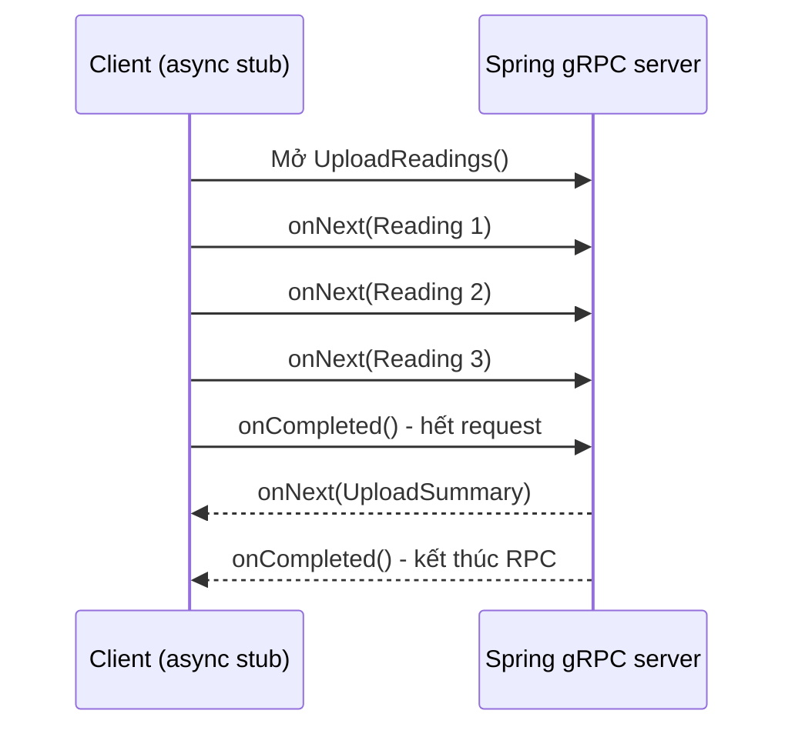

# Client streaming nhận nhiều request

**Chương:** Client streaming  
**Bối cảnh:** Spring gRPC cho phép xây dựng dịch vụ Java dựa trên hợp đồng Protocol Buffers, dùng mã sinh tự động để trao đổi dữ liệu giữa client và server. Bài này tập trung vào trường hợp **client gửi nhiều request trong một RPC**, còn server tổng hợp kết quả và trả **một response**.

## 1. Mục tiêu học tập

Sau bài học, bạn có thể:

- Phân biệt client streaming với unary, server streaming và bidirectional streaming.
- Định nghĩa RPC nhận một luồng request bằng cú pháp `stream` trong `.proto`.
- Triển khai server Spring gRPC nhận từng thông điệp qua `StreamObserver.onNext()`, xử lý kết thúc và lỗi luồng.
- Dùng **asynchronous stub** để gửi nhiều request qua cùng một RPC và nhận một kết quả cuối.
- Giải thích tác động của deadline, status, flow control, hủy RPC và lỗi giữa luồng; viết kiểm thử gRPC in-process.

## 2. Một RPC, nhiều request, một response

Trong **client streaming RPC**, client mở một lời gọi, đẩy lần lượt **0..N** thông điệp cùng kiểu lên server, rồi đánh dấu đã gửi hết. Server nhận các thông điệp theo thứ tự trong luồng, có thể cập nhật trạng thái tổng hợp sau mỗi thông điệp, và chỉ phát **một** phản hồi thành công khi việc nhận kết thúc. Nếu có lỗi, RPC kết thúc bằng gRPC status thay cho phản hồi thành công.

| Kiểu RPC | Request | Response | Ví dụ |
| --- | --- | --- | --- |
| Unary | Một thông điệp | Một thông điệp | Tra cứu chi tiết đơn hàng |
| Server streaming | Một thông điệp | Nhiều thông điệp | Theo dõi sự kiện |
| **Client streaming** | **Nhiều thông điệp** | **Một thông điệp** | Gửi một lô số đo cảm biến |
| Bidirectional streaming | Nhiều thông điệp | Nhiều thông điệp | Trò chuyện hai chiều |

Ví dụ: thiết bị thu thập ba số đo nhiệt độ `21.5`, `22.0`, `20.8`. Thay vì gọi unary RPC ba lần, client mở `UploadReadings` một lần và gửi ba thông điệp `Reading`. Server đếm số bản ghi, tính tổng và trả `UploadSummary(accepted_count = 3, sum_values = 64.3)`.



Thông điệp gRPC đi qua HTTP/2 trên cùng một stream. **Thứ tự thông điệp trong một luồng được giữ nguyên**, nhưng tổng số request không phải xác định trước trong protobuf. Gọi `onCompleted()` ở phía gửi chỉ có nghĩa là **không gửi thêm request**; nó không tự động đồng nghĩa với việc client đã nhận response.

## 3. Định nghĩa hợp đồng Protocol Buffers

Đặt file `src/main/proto/telemetry.proto`:

```proto
syntax = "proto3";

package telemetry.v1;
option java_package = "com.example.telemetry.grpc";
option java_multiple_files = true;

service TelemetryService {
  // Client gửi nhiều Reading; server trả một UploadSummary.
  rpc UploadReadings(stream Reading) returns (UploadSummary);
}

message Reading {
  string sensor_id = 1;
  int64 recorded_at_epoch_ms = 2;
  double value = 3;
}

message UploadSummary {
  int32 accepted_count = 1;
  double sum_values = 2;
}
```

Điểm quyết định là `stream Reading` **ở phía tham số** của RPC. `returns (UploadSummary)` không có `stream`, vì server chỉ trả một response thành công. Nếu đổi thành `returns (stream UploadSummary)`, đó sẽ là **bidirectional streaming**, một hợp đồng khác.

Khi cấu hình plugin Protocol Buffers và `protoc-gen-grpc-java` trong dự án, quá trình build sinh các lớp `Reading`, `UploadSummary` và `TelemetryServiceGrpc` vào thư mục mã được sinh. Ta **không viết tay** các lớp này. Phương thức server sinh ra có dạng:

```java
StreamObserver<Reading> uploadReadings(
    StreamObserver<UploadSummary> responseObserver);
```

Trong đó `responseObserver` là đường **server gửi kết quả về client**; giá trị trả về `StreamObserver<Reading>` là đường **server tiếp nhận từng request**. Hai observer có vai trò khác nhau, dù đều dùng giao diện `StreamObserver`.

## 4. Xử lý luồng trên server Spring gRPC

Ví dụ dưới đây dùng `@GrpcService` để Spring đăng ký implementation với gRPC server. Khi mỗi lời gọi `UploadReadings` bắt đầu, phương thức tạo một observer **riêng cho lời gọi đó**. Biến `count` và `sum` không được dùng chung giữa các client.

```java
package com.example.telemetry.server;

import com.example.telemetry.grpc.Reading;
import com.example.telemetry.grpc.TelemetryServiceGrpc;
import com.example.telemetry.grpc.UploadSummary;
import io.grpc.Status;
import io.grpc.stub.StreamObserver;
import org.springframework.grpc.server.service.GrpcService;

@GrpcService
public class TelemetryGrpcService
        extends TelemetryServiceGrpc.TelemetryServiceImplBase {

    private static final int MAX_READINGS = 10_000;

    @Override
    public StreamObserver<Reading> uploadReadings(
            StreamObserver<UploadSummary> responseObserver) {

        return new StreamObserver<>() {
            private int count;
            private double sum;
            private boolean closed;

            @Override
            public void onNext(Reading reading) {
                if (closed) {
                    return;
                }

                if (reading.getSensorId().isBlank()
                        || reading.getRecordedAtEpochMs() <= 0
                        || !Double.isFinite(reading.getValue())) {
                    fail(Status.INVALID_ARGUMENT, "Reading không hợp lệ");
                    return;
                }

                if (count >= MAX_READINGS) {
                    fail(Status.RESOURCE_EXHAUSTED,
                            "Luồng vượt giới hạn 10.000 bản ghi");
                    return;
                }

                count++;
                sum += reading.getValue();
            }

            @Override
            public void onError(Throwable error) {
                // Client hủy hoặc transport thất bại:
                // dừng xử lý trạng thái, không gửi response thành công.
                closed = true;
            }

            @Override
            public void onCompleted() {
                if (closed) {
                    return;
                }

                closed = true;
                UploadSummary summary = UploadSummary.newBuilder()
                        .setAcceptedCount(count)
                        .setSumValues(sum)
                        .build();
                responseObserver.onNext(summary);
                responseObserver.onCompleted();
            }

            private void fail(Status status, String description) {
                closed = true;
                responseObserver.onError(
                        status.withDescription(description).asRuntimeException());
            }
        };
    }
}
```

Luồng xử lý có ba callback quan trọng:

| Callback trên observer nhận request của server | Ý nghĩa | Hành động điển hình |
| --- | --- | --- |
| `onNext(reading)` | Nhận thêm một request | Kiểm tra dữ liệu, cập nhật số đếm/tổng |
| `onCompleted()` | Client đã gửi xong request | Phát đúng một `UploadSummary`, sau đó hoàn tất response |
| `onError(error)` | Client hủy hoặc luồng đầu vào gặp lỗi | Dừng xử lý, giải phóng tài nguyên, ghi log phù hợp |

Nếu dữ liệu sai, server gọi `responseObserver.onError(Status.INVALID_ARGUMENT...)`; đây là **kết thúc RPC bằng lỗi**, vì vậy không gọi tiếp `responseObserver.onNext()` hoặc `onCompleted()`. Sau khi một observer đã kết thúc bằng `onCompleted` hoặc `onError`, không gửi thêm sự kiện lên observer đó.

Ví dụ giới hạn 10.000 bản ghi minh họa một nguyên tắc quan trọng: dù server chỉ giữ `count` và `sum` với bộ nhớ hằng số, **thời gian xử lý và tài nguyên của một luồng vẫn phải được giới hạn**. Nếu nghiệp vụ phải giữ cả lô trong RAM, cần đặt giới hạn tổng dung lượng, không chỉ giới hạn kích thước từng thông điệp.

## 5. Cấu hình client và gửi nhiều request

Trong ứng dụng Spring gRPC đã có starter và mã Java sinh từ protobuf, có thể cấu hình một channel có tên `telemetry` trỏ tới server chạy cục bộ:

```yaml
# application.yml của client (ví dụ môi trường phát triển)
spring:
  grpc:
    client:
      channels:
        telemetry:
          address: static://localhost:9090
```

Tạo **asynchronous stub** từ channel. Client streaming trong gRPC Java dùng async stub, vì lời gọi cần trả về một observer để client liên tiếp gửi request.

```java
package com.example.telemetry.client;

import com.example.telemetry.grpc.TelemetryServiceGrpc;
import org.springframework.context.annotation.Bean;
import org.springframework.context.annotation.Configuration;
import org.springframework.grpc.client.GrpcChannelFactory;

@Configuration(proxyBeanMethods = false)
public class TelemetryClientConfig {

    @Bean
    TelemetryServiceGrpc.TelemetryServiceStub telemetryStub(
            GrpcChannelFactory channelFactory) {
        return TelemetryServiceGrpc.newStub(
                channelFactory.createChannel("telemetry"));
    }
}
```

Để có thể lấy response khi server hoàn tất, client bọc callback vào `CompletableFuture`. Ví dụ nhận một danh sách nhỏ, hữu hạn; phần **flow control cho nguồn dữ liệu lớn** được nói ở mục 7.

```java
package com.example.telemetry.client;

import com.example.telemetry.grpc.Reading;
import com.example.telemetry.grpc.TelemetryServiceGrpc;
import com.example.telemetry.grpc.UploadSummary;
import io.grpc.stub.StreamObserver;
import java.util.List;
import java.util.Objects;
import java.util.concurrent.CompletableFuture;
import java.util.concurrent.TimeUnit;
import org.springframework.stereotype.Service;

@Service
public class TelemetryUploadClient {

    private final TelemetryServiceGrpc.TelemetryServiceStub stub;

    public TelemetryUploadClient(
            TelemetryServiceGrpc.TelemetryServiceStub stub) {
        this.stub = stub;
    }

    public CompletableFuture<UploadSummary> upload(List<Reading> readings) {
        Objects.requireNonNull(readings, "readings");
        CompletableFuture<UploadSummary> result = new CompletableFuture<>();

        StreamObserver<UploadSummary> responseObserver =
                new StreamObserver<>() {
                    private UploadSummary summary;
                    private int responseCount;

                    @Override
                    public void onNext(UploadSummary value) {
                        summary = value;
                        responseCount++;
                    }

                    @Override
                    public void onError(Throwable error) {
                        result.completeExceptionally(error);
                    }

                    @Override
                    public void onCompleted() {
                        if (responseCount != 1) {
                            result.completeExceptionally(
                                    new IllegalStateException(
                                            "Cần đúng một UploadSummary"));
                        } else {
                            result.complete(summary);
                        }
                    }
                };

        // Deadline áp dụng cho toàn bộ RPC, gồm cả thời gian gửi.
        StreamObserver<Reading> requestObserver = stub
                .withDeadlineAfter(5, TimeUnit.SECONDS)
                .uploadReadings(responseObserver);

        try {
            for (Reading reading : readings) {
                requestObserver.onNext(reading);
            }
            // Không còn Reading nào; server có thể kết toán.
            requestObserver.onCompleted();
        } catch (RuntimeException sendError) {
            result.completeExceptionally(sendError);
            try {
                requestObserver.onError(sendError);
            } catch (RuntimeException ignored) {
                // Luồng có thể đã kết thúc do server/deadline.
            }
        }

        return result;
    }
}
```

Sử dụng client với ba số đo:

```java
List<Reading> batch = List.of(
        Reading.newBuilder()
                .setSensorId("sensor-01")
                .setRecordedAtEpochMs(1_700_000_000_000L)
                .setValue(21.5)
                .build(),
        Reading.newBuilder()
                .setSensorId("sensor-01")
                .setRecordedAtEpochMs(1_700_000_001_000L)
                .setValue(22.0)
                .build(),
        Reading.newBuilder()
                .setSensorId("sensor-01")
                .setRecordedAtEpochMs(1_700_000_002_000L)
                .setValue(20.8)
                .build()
);

UploadSummary summary = client.upload(batch)
        .get(6, TimeUnit.SECONDS); // Chỉ block để minh họa/test.

System.out.println(summary.getAcceptedCount()); // 3
System.out.println(summary.getSumValues());      // xấp xỉ 64.3
```

`client.upload(batch)` tạo **một** RPC. Mỗi `requestObserver.onNext(reading)` gửi thêm một thông điệp **trên RPC ấy**. `requestObserver.onCompleted()` là thao tác rất dễ quên: nếu client giữ stream mở mãi, server trong ví dụ không có tín hiệu để trả kết quả thành công.

Ở ứng dụng không đồng bộ, nên nối tiếp bằng `thenApply`, `thenAccept` hoặc ánh xạ future sang kiểu trả về của tầng web; `get()` chỉ phù hợp trong demo/test hoặc tại ranh giới chủ động chặn luồng. Khi `responseObserver.onError()` xảy ra, future hoàn tất ngoại lệ; có thể dùng `Status.fromThrowable(cause)` sau khi gỡ lớp `CompletionException`/`ExecutionException` để phân loại gRPC status.

## 6. Vòng đời, lỗi và ý nghĩa của việc kết thúc luồng

| Tình huống | Điều client/server quan sát được | Kết quả |
| --- | --- | --- |
| Gửi 3 request rồi client `onCompleted()` | Server nhận 3 `onNext`, rồi `onCompleted` | Server trả một `UploadSummary` |
| Gửi 0 request rồi client `onCompleted()` | Server không nhận `onNext`, vẫn nhận `onCompleted` | Ví dụ trả `accepted_count = 0` |
| Request sai định dạng nghiệp vụ | Server trả `INVALID_ARGUMENT` qua `onError` | Client không nhận summary thành công |
| Vượt giới hạn bản ghi | Server trả `RESOURCE_EXHAUSTED` | RPC bị chấm dứt |
| Deadline hết trước khi hoàn tất | Client thường quan sát `DEADLINE_EXCEEDED` | Không được giả định đã có kết quả |
| Client hủy hoặc kết nối đứt | Server thấy hủy/lỗi của call khi được thông báo | Dọn tài nguyên, không trả thành công |

Một số quy tắc cần nhớ:

1. **`onCompleted` của request và của response khác nhau.** Client đóng nửa gửi để server biết đã hết dữ liệu; server chỉ đóng nửa trả sau khi phát summary.
2. **`onError` là sự kiện kết thúc.** Không tiếp tục gửi dữ liệu hoặc coi như lô đã được xác nhận thành công.
3. **Một lỗi giữa chừng có thể để lại tác dụng phụ.** Nếu server ghi cơ sở dữ liệu ngay trong `onNext`, một phần bản ghi có thể đã lưu trước khi client bị timeout. Cần chủ động thiết kế giao dịch, cơ chế ghi tạm, khóa idempotency hoặc kết quả xử lý một phần theo yêu cầu nghiệp vụ.
4. **Retry không mặc nhiên an toàn.** Với thao tác ghi, timeout không chứng minh server chưa xử lý. Dùng định danh lô duy nhất và cơ chế chống ghi trùng nếu muốn thử lại.
5. **Deadline bao trùm cả luồng RPC.** Deadline 5 giây trên stub không có nghĩa mỗi lần `onNext` được thêm 5 giây; thời gian gửi, xử lý và nhận kết quả cùng chia sẻ ngân sách ấy.

## 7. Vận hành với nguồn dữ liệu lớn

Ví dụ `List<Reading>` ở trên phù hợp với lô nhỏ đã có sẵn trong bộ nhớ. Khi truyền dữ liệu từ file lớn, thiết bị hoặc hàng đợi, cần chú ý:

- **Flow control / backpressure:** Không đẩy hàng triệu `onNext` liên tiếp mà không quan tâm khả năng gửi. Trong gRPC Java, client có thể dùng `ClientResponseObserver` để lấy `ClientCallStreamObserver`, theo dõi `isReady()` và đăng ký `setOnReadyHandler(...)` để phát thêm dữ liệu khi transport sẵn sàng. `isReady()` là tín hiệu khả năng đệm/gửi, **không phải ACK nghiệp vụ**.
- **Đồng bộ hóa phía gửi:** `StreamObserver` không được bảo đảm an toàn khi nhiều thread cùng gọi `onNext`. Nếu nhiều luồng tạo dữ liệu, hãy tuần tự hóa lời gọi ghi lên cùng một request observer hoặc dùng một hàng đợi và một tác vụ phát.
- **Giới hạn tài nguyên:** Giới hạn số request, tổng byte, thời lượng RPC và bộ nhớ tích lũy. Cấu hình giới hạn kích thước từng thông điệp riêng với giới hạn tổng cả luồng; streaming không tự loại bỏ nguy cơ quá tải.
- **Bảo mật:** Dùng TLS để bảo vệ dữ liệu trên mạng triển khai thật. Truyền định danh/xác thực qua gRPC `Metadata` và interceptor khi phù hợp, thay vì nhét token vào mỗi `Reading`. Không ghi log token hay toàn bộ dữ liệu nhạy cảm.
- **Quan sát:** Theo dõi số luồng đang hoạt động, số bản ghi/lô, kích thước lô, thời lượng RPC, gRPC status và tỷ lệ deadline/cancel. Interceptor và hệ thống metrics/tracing của Spring có thể giúp quan sát theo từng phương thức RPC.

Nếu nghiệp vụ cần server thông báo kết quả sau **từng** request ngay khi đang nhận, client streaming **không đáp ứng** vì chỉ có một response thành công. Khi đó cần cân nhắc **bidirectional streaming** hoặc chia thành nhiều RPC.

## 8. Kiểm thử gRPC in-process

Kiểm thử dưới đây chạy một gRPC server và channel trong cùng tiến trình, gọi trực tiếp implementation đã viết, nhưng vẫn đi qua mã stub và cơ chế streaming của gRPC. Trong phạm vi test cần có thư viện `grpc-inprocess` và JUnit 5 cùng các dependency gRPC/protobuf của dự án.

```java
package com.example.telemetry;

import com.example.telemetry.client.TelemetryUploadClient;
import com.example.telemetry.grpc.Reading;
import com.example.telemetry.grpc.TelemetryServiceGrpc;
import com.example.telemetry.grpc.UploadSummary;
import com.example.telemetry.server.TelemetryGrpcService;
import io.grpc.ManagedChannel;
import io.grpc.Server;
import io.grpc.inprocess.InProcessChannelBuilder;
import io.grpc.inprocess.InProcessServerBuilder;
import java.util.List;
import java.util.concurrent.TimeUnit;
import org.junit.jupiter.api.Test;

import static org.junit.jupiter.api.Assertions.assertEquals;

class TelemetryStreamingTest {

    @Test
    void sendThreeRequestsReceiveOneSummary() throws Exception {
        String name = InProcessServerBuilder.generateName();
        Server server = InProcessServerBuilder.forName(name)
                .directExecutor()
                .addService(new TelemetryGrpcService())
                .build()
                .start();
        ManagedChannel channel = InProcessChannelBuilder.forName(name)
                .directExecutor()
                .build();

        try {
            TelemetryUploadClient client = new TelemetryUploadClient(
                    TelemetryServiceGrpc.newStub(channel));

            UploadSummary result = client.upload(List.of(
                    reading(21.5), reading(22.0), reading(20.8)))
                    .get(3, TimeUnit.SECONDS);

            assertEquals(3, result.getAcceptedCount());
            assertEquals(64.3, result.getSumValues(), 1e-9);
        } finally {
            channel.shutdownNow();
            server.shutdownNow();
        }
    }

    private static Reading reading(double value) {
        return Reading.newBuilder()
                .setSensorId("sensor-01")
                .setRecordedAtEpochMs(1_700_000_000_000L)
                .setValue(value)
                .build();
    }
}
```

Nên bổ sung các ca kiểm thử sau để xác nhận **ngữ nghĩa luồng**, không chỉ phép cộng:

| Ca kiểm thử | Kỳ vọng |
| --- | --- |
| Stream rỗng, client vẫn `onCompleted()` | Một response với số lượng 0 |
| `sensor_id` rỗng hoặc thời điểm không hợp lệ | Status `INVALID_ARGUMENT` |
| Hơn 10.000 bản ghi trong một stream | Status `RESOURCE_EXHAUSTED` |
| Client hủy trước `onCompleted()` | Không báo thành công; server giải phóng tài nguyên |
| Deadline hết trong khi gửi | Client nhận lỗi thời hạn và xử lý khả năng kết quả chưa rõ |
| Hai client gọi đồng thời | Mỗi cuộc gọi giữ số đếm và tổng **độc lập** |

Kiểm thử in-process xác nhận đường truyền gRPC và callback; để kiểm tra cấu hình Spring, TLS, interceptor, port, cân bằng tải hay vận hành thực tế, cần thêm bài kiểm thử tích hợp với **Spring context và server chạy qua transport thật**.

## 9. Những lỗi thường gặp

| Biểu hiện | Nguyên nhân có thể | Cách xử lý |
| --- | --- | --- |
| Server không trả summary | Client quên `requestObserver.onCompleted()` | Kết thúc nửa gửi khi đã hết request |
| Không thấy phương thức stream trên blocking stub | Client streaming được thiết kế qua async stub của gRPC Java | Dùng `TelemetryServiceGrpc.newStub(channel)` |
| Gửi thêm thông điệp rồi gặp lỗi | RPC đã bị đóng/hủy hoặc đã gọi `onCompleted` | Dừng producer và theo dõi `onError` |
| Dữ liệu lớn khiến bộ nhớ tăng | Gửi quá nhanh hoặc giữ toàn bộ dữ liệu trong RAM | Dùng flow control và giới hạn tài nguyên |
| Retry làm nhân đôi bản ghi | Server đã ghi một phần hoặc toàn bộ lô trước timeout | Thiết kế idempotency/giao dịch |
| Kết quả hai client bị trộn | Đặt biến tổng hợp ở field dùng chung của singleton service | Tạo trạng thái riêng trong observer của mỗi RPC |

## 10. Tự luyện tập

1. Bổ sung vào `UploadSummary` trường `average_value`. Với lô rỗng, quyết định và ghi rõ quy ước giá trị trung bình (ví dụ `0` kèm `accepted_count = 0`), sau đó sửa server và test.
2. Thay danh sách cố định bằng luồng dữ liệu có kích thước lớn. Thiết kế bộ phát tôn trọng `isReady()`, giới hạn số bản ghi và hủy RPC khi nguồn đọc lỗi.
3. Mô phỏng request sai ở giữa lô; quan sát status nhận về và giải thích điều gì xảy ra nếu server đã ghi các bản ghi trước đó xuống cơ sở dữ liệu.

**Ghi nhớ:** Trong client streaming, **một lần gọi RPC** chứa **nhiều request**, kết thúc luồng gửi bằng `onCompleted()`, và server trả **một response thành công hoặc một gRPC error status**. Thành công của toàn lô phải được xác định ở phản hồi cuối, không suy ra từ việc client đã gọi `onNext()`.
