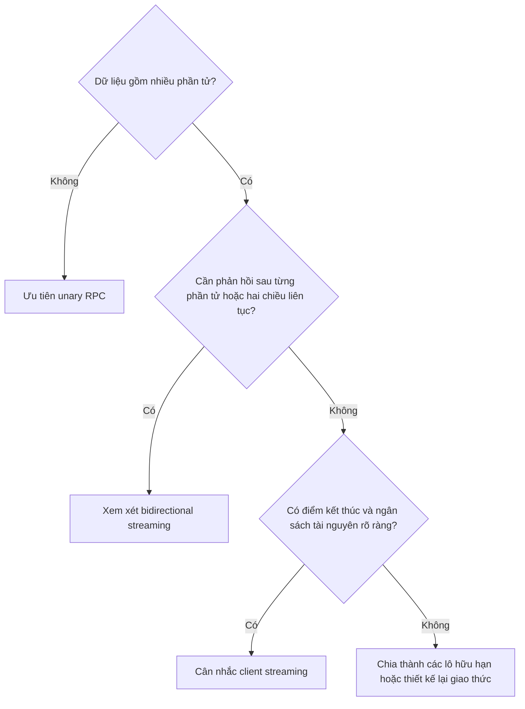

# Khi client streaming phù hợp

**Chương:** Client streaming  
**Phạm vi:** Spring gRPC (`SPRING_GRPC`) — phát triển dịch vụ Java từ hợp đồng Protocol Buffers, mã sinh tự động và các kiểu RPC của gRPC.

## 1. Vấn đề cần giải quyết

Hãy hình dung một ứng dụng gửi 5.000 số đo cảm biến lên dịch vụ Spring. Mỗi số đo là một bản tin nhỏ; server phải kiểm tra và tổng hợp cả lô trước khi báo số lượng đã nhận. Nếu gửi 5.000 unary RPC, client tạo 5.000 lời gọi riêng, mỗi lời gọi có metadata, kết quả và vòng đời độc lập. Nếu gom 5.000 phần tử vào **một** request unary, client phải tạo một thông điệp có thể rất lớn trong bộ nhớ.

**Client streaming** là lựa chọn đáng cân nhắc ở giữa hai cách đó: client mở **một RPC**, gửi nhiều thông điệp request nối tiếp nhau, báo đã gửi xong và nhận **một** phản hồi kết quả từ server. Mô hình này đặc biệt phù hợp khi dữ liệu được tạo dần, thuộc cùng một công việc hữu hạn, và phía gọi chỉ cần biết kết quả cuối cùng.

```text
Client                                              Server Spring gRPC
  |--- mở RPC UploadMetrics -------------------------->|
  |--- MetricPoint #1 -------------------------------->|
  |--- MetricPoint #2 -------------------------------->|
  |--- MetricPoint #3 -------------------------------->|
  |                ...                                 |
  |--- onCompleted() (hết request) ------------------->|
  |<-------------------------------- BatchReceipt -----|
  |<-------------------- RPC kết thúc thành công ------|
```

Hai điều dễ nhầm:

- **Nhiều request** ở đây là nhiều *message* bên trong **cùng một lời gọi RPC**, không phải nhiều RPC riêng biệt.
- `onNext(request)` ở client **không xác nhận server đã lưu thành công** request đó. Chỉ phản hồi cuối và trạng thái RPC mới cho biết kết quả mà giao thức/ứng dụng công bố.

## 2. Tiêu chí quyết định: khi nào nên dùng?

Client streaming thường hợp lý khi thỏa phần lớn các tiêu chí sau:

| Tiêu chí | Dấu hiệu phù hợp | Câu hỏi cần đặt ra |
| --- | --- | --- |
| **Đầu vào có nhiều phần tử** | Số đo, log, chunk dữ liệu hay hàng bản ghi đến lần lượt | Dữ liệu có tạo thành một lô/công việc chung không? |
| **Chỉ cần một kết quả tổng hợp** | Server trả số bản ghi, checksum, trạng thái import hoặc báo cáo | Có cần ACK hoặc dữ liệu phản hồi **sau từng phần tử** không? |
| **Nguồn dữ liệu có thể phát dần** | Đọc file, hàng đợi, nguồn phát sinh theo thời gian | Có muốn tránh xây một request unary rất lớn trong RAM không? |
| **Có ranh giới kết thúc rõ ràng** | Đủ N bản ghi, hết file, hết cửa sổ thời gian | Khi nào client gọi `onCompleted()` để lấy kết quả? |
| **Chấp nhận vòng đời chung của một RPC** | Một deadline, một status kết thúc, một đợt retry ở cấp công việc | Nếu một phần tử lỗi thì có thể xử lý cả luồng theo chính sách đã chọn không? |

**Câu hỏi quyết định quan trọng nhất:** *Client có cần server trả thông tin nghiệp vụ trong khi vẫn tiếp tục gửi không?* Nếu cần, mô hình một phản hồi của client streaming có thể không đủ; hãy xem xét **bidirectional streaming** hoặc các lời gọi unary nhỏ hơn.



Sơ đồ là **hướng dẫn lựa chọn**, không phải luật cứng. Với dữ liệu đã có sẵn, ít phần tử và giới hạn kích thước cho phép, một **unary RPC chứa repeated field** có thể đơn giản hơn client streaming.

## 3. So sánh bốn kiểu RPC trước khi chọn

Hợp đồng Protocol Buffers thể hiện sự khác biệt ngay ở từ khóa `stream`:

```proto
syntax = "proto3";

package telemetry.v1;

service TelemetryService {
  rpc CheckMetric(MetricPoint) returns (MetricResult);                  // unary
  rpc WatchMetrics(WatchRequest) returns (stream MetricResult);        // server streaming
  rpc UploadMetrics(stream MetricPoint) returns (BatchReceipt);        // client streaming
  rpc ExchangeMetrics(stream MetricPoint) returns (stream MetricResult);// bidirectional
}

message MetricPoint {
  string batch_id = 1;
  string event_id = 2;
  int64 occurred_at_epoch_ms = 3;
  double value = 4;
}

message MetricResult {
  bool accepted = 1;
}

message BatchReceipt {
  string batch_id = 1;
  int64 accepted_count = 2;
}

message WatchRequest {}
```

| Nhu cầu ứng dụng | Kiểu phù hợp hơn | Vì sao |
| --- | --- | --- |
| Gửi một bản ghi rồi nhận xác nhận của bản ghi đó | **Unary** | Hợp đồng ngắn gọn, kết quả gắn trực tiếp với một request |
| Gửi 10.000 sự kiện trong một lô và chỉ cần biên nhận cuối | **Client streaming** | Gửi dần các message, tổng hợp một kết quả |
| Yêu cầu xem dữ liệu thay đổi từ server | **Server streaming** | Client gửi một yêu cầu; server tiếp tục đẩy cập nhật |
| Vừa gửi dữ liệu vừa nhận kết quả theo từng phần hoặc theo thời gian thực | **Bidirectional streaming** | Cả hai phía có luồng message độc lập |
| Gửi một danh sách 5 phần tử nhỏ đã có sẵn và nhận một kết quả | **Unary với `repeated`** | Ít cơ chế bất đồng bộ hơn, dễ triển khai và kiểm thử |

**Không có kiểu RPC nào luôn nhanh hơn.** Client streaming có thể giảm số lượt mở RPC so với nhiều unary call và tránh gom toàn bộ lô thành một message. Đổi lại, nó tăng yêu cầu về vòng đời luồng, deadline, kiểm soát tốc độ gửi và cách xử lý lỗi khi đã truyền một phần.

## 4. Tình huống phù hợp trong thực tế

### 4.1. Tải một lô số đo IoT hoặc dữ liệu quan sát

Nhiều điểm đo phát sinh liên tiếp, server chỉ cần trả biên nhận có số lượng đã xử lý. Client có thể đọc từ hàng đợi hoặc bộ nhớ đệm rồi gửi từng `MetricPoint`.

**Điểm thiết kế:** chia dữ liệu thành các **cửa sổ hữu hạn** (ví dụ một khoảng thời gian hoặc một số bản ghi tối đa). Nếu thiết bị gửi liên tục nhiều ngày mà không `onCompleted()`, client streaming một RPC kéo dài sẽ không bao giờ nhận được biên nhận cuối theo hợp đồng trên. Cần kết thúc từng cửa sổ và bắt đầu RPC mới.

### 4.2. Nhập dữ liệu từ file hoặc hệ thống khác

Ứng dụng đọc lần lượt các dòng CSV, chuyển thành thông điệp protobuf và gửi cho server để kiểm tra, tính tổng hoặc chuẩn bị giao dịch nhập dữ liệu.

**Điểm thiết kế:** quyết định trước cách xử lý lỗi. Nếu dòng thứ 8.000 sai, sẽ từ chối **cả lô**, bỏ qua dòng sai và báo số lượng, hay trả danh sách lỗi trong một biên nhận? Một response cuối không thể mặc nhiên cho biết kết quả chi tiết của từng dòng; cần thiết kế các trường kết quả đủ rõ hoặc tách thành các lô nhỏ.

### 4.3. Gửi file dạng nhiều chunk

Một tệp có thể được chia thành các message `FileChunk` nhỏ, server ghép theo thứ tự và trả checksum hoặc mã định danh tệp khi đã nhận đủ.

**Điểm thiết kế:** xác định kích thước chunk, tổng dung lượng tối đa, checksum, nơi lưu tạm và cách dọn dữ liệu sau hủy/timeout. **Streaming không cho phép vượt qua mọi giới hạn gRPC**: mỗi message vẫn chịu giới hạn kích thước và toàn bộ công việc vẫn tiêu tốn băng thông, bộ nhớ đệm, ổ đĩa. Với các tệp rất lớn, nên so sánh với phương án tải trực tiếp lên object storage bằng URL có quyền truy cập giới hạn.

### 4.4. Tổng hợp chỉ số theo một đợt

Client gửi nhiều mẫu `MetricPoint`, server cập nhật `count`, `sum`, `min`, `max` và trả thống kê một lần. Nếu không cần lưu toàn bộ mẫu, server có thể chỉ giữ trạng thái cộng dồn **theo từng RPC**, có độ phức tạp bộ nhớ thấp.

**Điểm thiết kế:** tránh đặt biến tổng hợp vào field dùng chung của singleton `@GrpcService`, vì các client đồng thời có thể làm trộn kết quả. Khởi tạo bộ cộng dồn mới mỗi lần phương thức RPC được gọi.

## 5. Các trường hợp nên tránh client streaming

1. **Cần xác nhận cho từng phần tử:** Hệ thống thanh toán yêu cầu biết trạng thái của từng giao dịch ngay khi gửi. Dùng unary cho từng giao dịch hoặc bidirectional streaming nếu thực sự cần luồng hai chiều.
2. **Server là phía chủ động phát dữ liệu:** Client yêu cầu xem cập nhật giá hoặc thông báo. Dùng server streaming.
3. **Trao đổi hai chiều liên tục:** Client phát âm thanh và server trả bản chép lời từng phần trong lúc client vẫn gửi. Dùng bidirectional streaming.
4. **Đầu vào nhỏ, có sẵn:** Một request unary chứa danh sách `repeated` thường dễ bảo trì hơn; việc tạo observer và theo dõi kết thúc stream có thể là chi phí phức tạp không cần thiết.
5. **Không thể giới hạn một phiên gửi:** Nguồn phát liên tục, không có ranh giới lô hay chính sách giới hạn. Cần thiết kế cửa sổ/batch trước hoặc dùng giao thức thích hợp hơn với luồng dài.
6. **Muốn xác nhận bền vững cho từng dữ liệu ngay khi gọi `onNext`:** gRPC không định nghĩa `onNext` là ACK ghi xuống cơ sở dữ liệu. Hợp đồng và cơ chế lưu bền phải được thiết kế rõ ràng.

Một lỗi thiết kế phổ biến là đổi nhiều unary RPC sang một client streaming RPC chỉ với mục tiêu “tăng tốc”. Hãy xác định **ngữ nghĩa kết quả**, **mức lỗi chấp nhận được**, **giới hạn tài nguyên** và **hành vi retry** trước khi tối ưu số lần gọi.

## 6. Thiết kế một lô dữ liệu bằng Spring gRPC

Giả sử ứng dụng thu thập số đo theo một `batch_id`, dùng định nghĩa `TelemetryService.UploadMetrics` ở mục 3. Mã Java `MetricPoint`, `BatchReceipt` và `TelemetryServiceGrpc` được sinh từ `.proto` thông qua protobuf compiler và plugin gRPC Java.

Phương thức server nhận một `responseObserver` để gửi **biên nhận cuối**, đồng thời trả về một `StreamObserver<MetricPoint>` để gRPC chuyển từng message vào `onNext`. Ví dụ sau **chỉ tổng hợp trong bộ nhớ**, không mô phỏng việc lưu bền hay xử lý trùng lặp:

```java
package com.example.telemetry.server;

import com.example.telemetry.grpc.BatchReceipt;
import com.example.telemetry.grpc.MetricPoint;
import com.example.telemetry.grpc.TelemetryServiceGrpc;
import io.grpc.Status;
import io.grpc.stub.StreamObserver;
import org.springframework.grpc.server.service.GrpcService;

@GrpcService
public class TelemetryServiceImpl
        extends TelemetryServiceGrpc.TelemetryServiceImplBase {

    private static final long MAX_POINTS = 10_000;

    @Override
    public StreamObserver<MetricPoint> uploadMetrics(
            StreamObserver<BatchReceipt> responseObserver) {

        return new StreamObserver<>() {
            private String batchId;
            private long count;
            private boolean ended;

            @Override
            public void onNext(MetricPoint point) {
                if (ended) return;

                if (point.getBatchId().isBlank()
                        || point.getEventId().isBlank()
                        || point.getOccurredAtEpochMs() <= 0
                        || !Double.isFinite(point.getValue())) {
                    fail(Status.INVALID_ARGUMENT, "MetricPoint không hợp lệ");
                    return;
                }

                if (batchId != null && !batchId.equals(point.getBatchId())) {
                    fail(Status.INVALID_ARGUMENT, "Không trộn các batch_id");
                    return;
                }
                if (count >= MAX_POINTS) {
                    fail(Status.RESOURCE_EXHAUSTED, "Vượt giới hạn lô");
                    return;
                }

                batchId = point.getBatchId();
                count++;
            }

            @Override
            public void onError(Throwable error) {
                // Luồng request lỗi/hủy: dọn tài nguyên nếu có.
                ended = true;
            }

            @Override
            public void onCompleted() {
                if (ended) return;
                ended = true;
                BatchReceipt receipt = BatchReceipt.newBuilder()
                        .setBatchId(batchId == null ? "" : batchId)
                        .setAcceptedCount(count)
                        .build();
                responseObserver.onNext(receipt);
                responseObserver.onCompleted();
            }

            private void fail(Status status, String description) {
                ended = true;
                responseObserver.onError(
                        status.withDescription(description).asRuntimeException());
            }
        };
    }
}
```

Server này có chủ ý **chấp nhận một luồng rỗng** và trả biên nhận với số lượng 0, `batch_id` rỗng. Trong sản phẩm thực, tùy hợp đồng có thể coi lô rỗng là `INVALID_ARGUMENT`; quan trọng là **thống nhất quy tắc và viết test**.

Ở phía client, dùng **asynchronous stub** (không phải blocking stub) và giữ request observer để gửi các phần tử:

```java
// channel: ManagedChannel/Channel đã được ứng dụng cấu hình.
TelemetryServiceGrpc.TelemetryServiceStub asyncStub =
        TelemetryServiceGrpc.newStub(channel);

StreamObserver<BatchReceipt> responseObserver = new StreamObserver<>() {
    @Override
    public void onNext(BatchReceipt receipt) {
        System.out.println("Đã nhận: " + receipt.getAcceptedCount());
    }

    @Override
    public void onError(Throwable error) {
        System.err.println("RPC lỗi: " + io.grpc.Status.fromThrowable(error));
    }

    @Override
    public void onCompleted() {
        System.out.println("RPC hoàn tất");
    }
};

StreamObserver<MetricPoint> requests = asyncStub
        .withDeadlineAfter(15, java.util.concurrent.TimeUnit.SECONDS)
        .uploadMetrics(responseObserver);

for (MetricPoint point : finiteBatch) {
    requests.onNext(point);
}
requests.onCompleted(); // Tín hiệu server có thể kết toán và trả biên nhận.
```

Đoạn client giả định `channel` và `finiteBatch` đã được chuẩn bị, lô đủ nhỏ và producer không gặp lỗi. Trong Spring gRPC, channel có thể được tạo qua `GrpcChannelFactory`; cấu hình tên channel, địa chỉ và TLS theo môi trường triển khai. Khi cần phát lượng lớn dữ liệu, không chạy vòng lặp gửi vô hạn như trên: hãy tích hợp **flow control** và xử lý hủy.

Lưu ý về contract: `BatchReceipt.accepted_count` trong ví dụ chỉ là số **message đã qua kiểm tra trong bộ nhớ**. Nó **không chứng minh đã ghi bền dữ liệu**. Nếu API cần đảm bảo lưu thành công, chỉ trả biên nhận sau khi server đã thực hiện bước commit tương ứng.

## 7. Các quyết định kiến trúc phải làm rõ

### 7.1. Ranh giới lô và giới hạn tài nguyên

Client streaming không có số lượng request cố định trong khai báo `.proto`. Vì vậy, hệ thống nên thống nhất:

- Số phần tử và tổng byte tối đa cho mỗi RPC; không chỉ giới hạn byte của **một** protobuf message.
- Thời gian tối đa cho cả lời gọi và quy tắc kết thúc lô (đủ N bản ghi, hết tệp, hết cửa sổ thời gian).
- Cách lưu/chứa dữ liệu ở server: cộng dồn trong RAM, ghi tạm vào đĩa, hoặc đẩy sang kho dữ liệu.
- Cách trả biên nhận: tổng số thành công, số bị từ chối, mã lô, checksum và/hoặc định danh giao dịch.

Một lô quá lớn khiến việc retry tốn kém và thời gian chờ kết quả dài. **Chia thành các RPC hữu hạn** thường giúp khống chế chi phí khôi phục khi mạng chập chờn.

### 7.2. Backpressure và producer

HTTP/2/gRPC có **flow control**, nhưng không có nghĩa gọi `requestObserver.onNext()` liên tục sẽ không tạo áp lực lên bộ đệm. Trong gRPC Java, khi cần điều tiết phát dữ liệu, có thể dùng `ClientResponseObserver` để lấy `ClientCallStreamObserver`, quan sát `isReady()` và đăng ký `setOnReadyHandler(...)`. Đây là tín hiệu sẵn sàng ghi của transport, **không phải biên nhận nghiệp vụ**.

Các phương thức ghi trên một `StreamObserver` không được bảo đảm an toàn khi nhiều thread gửi đồng thời. Nếu dữ liệu từ nhiều producer, cần hàng đợi hoặc cơ chế tuần tự hóa lời gọi `onNext`. Khi server trả lỗi, producer phải ngừng gửi và giải phóng nguồn đọc.

### 7.3. Deadline, hủy, status và retry

Một client streaming RPC có **một deadline cho toàn lời gọi**. Deadline gồm thời gian mở stream, gửi các message, xử lý và nhận phản hồi cuối. Ví dụ deadline 15 giây không được tự động làm mới sau mỗi `onNext`.

| Sự kiện | gRPC status/vòng đời điển hình | Điều cần xử lý |
| --- | --- | --- |
| Gửi đủ, client `onCompleted`, server xử lý xong | `OK` với một `BatchReceipt` | Kiểm tra số liệu biên nhận trước khi đánh dấu lô xong |
| Message sai quy tắc | `INVALID_ARGUMENT` | Dừng gửi, sửa dữ liệu/hợp đồng |
| Vượt quota/lô quá lớn | `RESOURCE_EXHAUSTED` | Thu nhỏ lô, kiểm soát tốc độ, xem chính sách quota |
| Server quá hạn hoặc phía gọi hết deadline | Thường quan sát `DEADLINE_EXCEEDED` ở client | Kết quả xử lý có thể chưa rõ; không retry mù |
| Client chủ động hủy | Thường quan sát `CANCELLED` | Dọn tài nguyên, xác định tác dụng phụ có thể còn tồn tại |
| Mất kết nối | Có thể thấy `UNAVAILABLE` hoặc status liên quan | Xem retry/idempotency và sức khỏe đường truyền |

Không có cơ chế “exactly once” tự động cho dữ liệu nghiệp vụ. Nếu server lưu 500 bản ghi rồi mất kết nối trước khi trả biên nhận, client không thể suy ra 500 bản ghi đó đã/ chưa được lưu từ status đơn thuần. Có thể dùng:

1. **`batch_id` ổn định** giữa các lần thử lại.
2. **`event_id` ổn định** cho từng phần tử, server chống trùng theo khóa được quy định.
3. **Staging + commit** nếu yêu cầu “cả lô hoặc không bản ghi nào”.
4. API tra cứu trạng thái lô để giải quyết trường hợp client không nhận được biên nhận, dù server đã hoàn tất.

Không nên tự động retry một client stream chứa dữ liệu ghi mà chưa xác định được tính idempotent và ngữ nghĩa kết quả.

### 7.4. Metadata, bảo mật và quan sát

Metadata gRPC (ví dụ bearer token, correlation ID) được gửi **theo RPC**, nên phù hợp với thông tin chung của cả lô. Nó không phải channel để gửi metadata riêng cho từng `MetricPoint`: thuộc tính của từng sự kiện vẫn nên nằm trong message protobuf. Server có thể dùng **interceptor** để xác thực, gắn ngữ cảnh truy vết và ghi metrics nhất quán.

Khi triển khai qua mạng, dùng **TLS** và kiểm tra quyền truy cập thay vì giả định một stream dài là kênh đáng tin cậy. Tránh ghi token hoặc nội dung bản ghi nhạy cảm vào log. Những chỉ số cần quan sát bao gồm số RPC đang mở, thời lượng từ message đầu tới biên nhận cuối, số phần tử/lô, số byte/lô, tỷ lệ `OK`, `INVALID_ARGUMENT`, `RESOURCE_EXHAUSTED`, `DEADLINE_EXCEEDED`, `CANCELLED` và tốc độ xử lý.

## 8. Ví dụ ra quyết định: dịch vụ thu thập dữ liệu

**Yêu cầu:** Một thiết bị tạo số đo liên tục, có thể mất mạng, cần xác nhận số đo đã được lưu. Server không phải gửi lệnh điều khiển ngay trong lúc nhận. Có hai phương án:

**Phương án A — một stream mở nhiều giờ:** thiết bị cứ `onNext` vô hạn và chỉ nhận biên nhận sau khi đóng stream. Nếu mạng rớt, thiết bị không biết chắc dữ liệu nào đã lưu và phải cân nhắc retry cho toàn thời gian đã phát.

**Phương án B — các lô hữu hạn có định danh:** thiết bị gom dữ liệu theo cửa sổ (ví dụ tối đa 1.000 mẫu hoặc 30 giây — chỉ là mức minh họa), mở một RPC cho mỗi lô, gửi các mẫu, `onCompleted`, chờ `BatchReceipt` sau khi server commit. Khi thất bại, thiết bị có thể tra cứu/đẩy lại cùng `batch_id`, `event_id` theo chính sách chống trùng.

Với các yêu cầu đã nêu, **phương án B hợp lý hơn**: client streaming hữu hạn giúp gửi dữ liệu phát sinh dần, còn biên nhận cuối cho biết kết quả của một đơn vị công việc rõ ràng. Đổi lại, ứng dụng phải quản lý trạng thái từng lô.

Nếu yêu cầu đổi thành *“server phải cảnh báo lỗi của từng số đo tức thì, đồng thời vẫn tiếp tục nhận các số đo tiếp theo”*, cần đánh giá lại **bidirectional streaming** vì một `BatchReceipt` cuối không đáp ứng được phản hồi tức thời.

## 9. Kiểm thử nên chứng minh điều gì?

Trong Spring gRPC, có thể dùng server/channel **in-process** để kiểm tra observer và RPC, rồi bổ sung kiểm thử tích hợp với Spring context và kết nối thực để xác minh TLS, interceptor, cấu hình channel và timeout.

| Ca kiểm thử | Tiêu chí đạt |
| --- | --- |
| Lô 3 message hợp lệ | Server nhận cả 3, trả **một** `BatchReceipt`, RPC thành công |
| Client gửi xong nhưng quên `onCompleted()` | Không giả định sẽ có biên nhận cuối; test chủ động hủy hoặc đặt deadline |
| Lô rỗng | Xác nhận chính sách biên nhận 0 phần tử hoặc lỗi đã công bố |
| Hai `batch_id` khác nhau trong một stream | Server trả `INVALID_ARGUMENT`, không trả biên nhận thành công |
| Vượt giới hạn số phần tử | Server trả `RESOURCE_EXHAUSTED` |
| Client hủy/timeout giữa chừng | Producer ngừng, server giải phóng tài nguyên, không xác nhận thành công sai |
| Hai client gửi đồng thời | Bộ đếm và dữ liệu tổng hợp không lẫn giữa hai RPC |
| Thử lại cùng `batch_id` sau khi mất biên nhận | Không tạo dữ liệu trùng nếu ứng dụng công bố bảo đảm idempotency |

Kiểm thử cuối cùng chỉ có ý nghĩa khi server **thật sự có lớp lưu trữ và chống trùng**; ví dụ đếm trong bộ nhớ ở mục 6 chưa triển khai điều đó.

## 10. Câu hỏi tự kiểm tra

1. Một file CSV có 100.000 dòng, server chỉ cần báo số dòng nhập thành công cuối lô. Vì sao client streaming có thể phù hợp hơn một unary request lớn? Bạn sẽ giới hạn lô ra sao?
2. Một ứng dụng gửi dữ liệu hội thoại và phải nhận từng bản dịch trong lúc tiếp tục gửi âm thanh. Vì sao client streaming không đáp ứng đúng hợp đồng?
3. Client gửi xong 800 message rồi hết deadline trước khi nhận `BatchReceipt`. Có thể khẳng định server không lưu dữ liệu nào không? Thiết kế nào giúp xử lý retry an toàn?
4. Khi client gọi `onNext()`, điều gì được đảm bảo và điều gì **không** được đảm bảo về việc đã commit dữ liệu?
5. Những metrics nào giúp phân biệt quá tải, đầu vào sai và mạng không ổn định trong quá trình nhận nhiều request?

**Ghi nhớ:** Chọn **client streaming** khi **nhiều phần dữ liệu cùng thuộc một công việc**, **client có thể tuyên bố kết thúc luồng**, và **chỉ cần một phản hồi cuối**. Trong Spring gRPC, hiệu quả của lựa chọn này phụ thuộc vào hợp đồng Protocol Buffers, ranh giới lô, flow control, deadline, status, metadata, TLS và chiến lược phục hồi khi RPC kết thúc không rõ kết quả.
