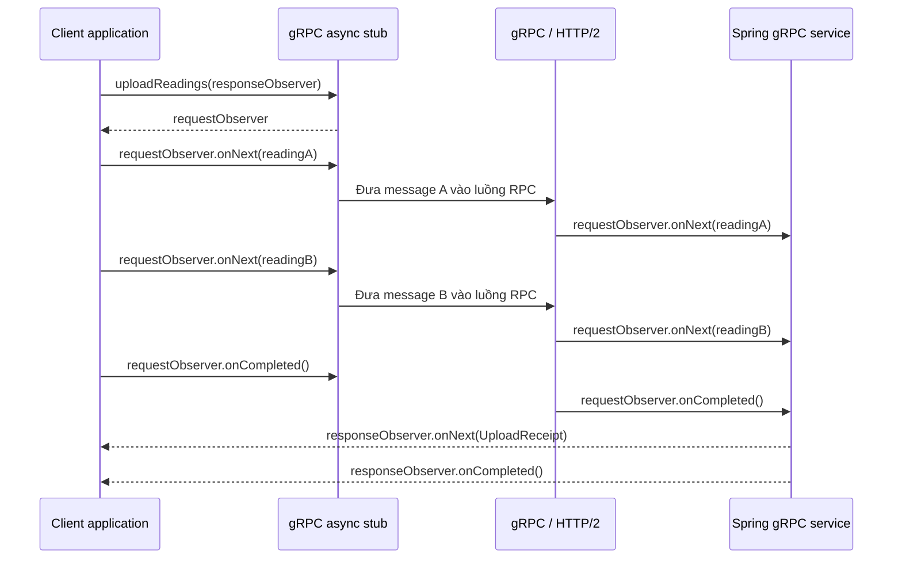

# onNext từ client đến server

**Chương:** Client streaming  
**Phạm vi:** Spring gRPC (`SPRING_GRPC`) với hợp đồng Protocol Buffers, mã Java được sinh và mô hình `StreamObserver` của gRPC Java.

## 1. Mục tiêu bài học

Trong **client streaming RPC**, client gửi **nhiều message request** trên **một RPC**, server nhận các message lần lượt và trả **một response thành công** sau khi luồng request kết thúc. Giao diện `StreamObserver` là cầu nối lập trình giữa các message đó và mã Java.

Sau khi học, bạn sẽ:

- Giải thích điều gì xảy ra khi client gọi `requestObserver.onNext(request)`.
- Xác định đúng observer nhận request ở server và observer nhận response ở client.
- Phân biệt **đã gọi `onNext`**, **server đã nhận `onNext`** và **nghiệp vụ đã commit**.
- Triển khai phương thức client streaming trong Spring gRPC, nhận nhiều request và gửi một response.
- Gửi nhiều request bằng **asynchronous stub**, kết thúc bằng `onCompleted()` và xử lý `onError()`.
- Áp dụng các quy tắc thứ tự, thread safety, flow control, deadline, hủy RPC và kiểm thử.

## 2. `onNext` diễn ra ở hai đầu RPC như thế nào?

Giả sử ứng dụng theo dõi nhiệt độ cần tải ba số đo lên server. Hợp đồng sẽ có dạng:

```proto
rpc UploadReadings(stream Reading) returns (UploadReceipt);
```

Từ khóa `stream` ở **đầu vào** có nghĩa là một lời gọi `UploadReadings` chứa nhiều message `Reading`. Đầu ra `UploadReceipt` không có `stream`: server chỉ gửi một response nếu RPC thành công.



Sơ đồ mô tả **thứ tự logic**; việc ghi xuống mạng, nhận tại server và gọi callback diễn ra bất đồng bộ. Chính xác hơn:

1. Client nhận `StreamObserver<Reading>` từ lời gọi qua **async stub**. Đây là **request observer** dùng để gửi dữ liệu.
2. Mỗi lần client gọi `requestObserver.onNext(reading)`, gRPC Java tiếp nhận một message cần truyền trên RPC hiện tại.
3. Transport gRPC chuyển các message theo thứ tự trong cùng một stream. Khi server nhận và giải mã một message, gRPC gọi `onNext(reading)` trên **observer do phương thức server trả về**.
4. Client gọi `requestObserver.onCompleted()` khi đã gửi hết dữ liệu. Server sẽ nhận callback `onCompleted()` tương ứng nếu phía nhận kết thúc bình thường.
5. Server gửi một `UploadReceipt` qua **response observer** rồi kết thúc response bằng `onCompleted()`. Callback nhận response chạy ở phía client.

**Điểm quan trọng:** Việc lời gọi `requestObserver.onNext()` ở client trả về **không phải xác nhận đã truyền tới server, đã kiểm tra hợp lệ, hay đã lưu bền dữ liệu**. Message có thể đang nằm trong bộ đệm gửi. Kể cả khi `onNext()` phía server đã chạy, nghiệp vụ vẫn có thể chưa ghi vào cơ sở dữ liệu.

## 3. Hai `StreamObserver` và hướng dữ liệu

Tên `onNext` giống nhau, nhưng ý nghĩa phụ thuộc **observer nào đang được gọi**:

| Thành phần | Nằm ở đâu? | `onNext` dùng để làm gì? |
| --- | --- | --- |
| `StreamObserver<Reading> requestObserver` | **Client**, trả về từ async stub | Client **gửi thêm một request** |
| `StreamObserver<Reading>` do `uploadReadings(...)` trả về | **Server** | gRPC **giao một request đã nhận** cho mã server |
| `StreamObserver<UploadReceipt> responseObserver` | **Server**, tham số của method | Server **gửi response cuối** |
| `StreamObserver<UploadReceipt> responseObserver` | **Client**, truyền vào lời gọi stub | gRPC **giao response từ server** cho client |

Không phải client gọi trực tiếp phương thức `onNext()` của đối tượng observer đang ở server. Client gọi observer **cục bộ** được stub cung cấp; gRPC truyền qua HTTP/2 rồi gọi callback phía server khi dữ liệu đến.

Trong client streaming, server không nên gửi nhiều `UploadReceipt` thành công: contract chỉ khai báo **một** response. Nếu cần phản hồi liên tục trong lúc client vẫn gửi, hãy chọn **bidirectional streaming**.

## 4. Hợp đồng protobuf hoàn chỉnh

Tạo `src/main/proto/readings.proto`:

```proto
syntax = "proto3";

package readings.v1;

option java_package = "com.example.readings.grpc";
option java_multiple_files = true;

service ReadingService {
  // N request Reading -> 1 UploadReceipt.
  rpc UploadReadings(stream Reading) returns (UploadReceipt);
}

message Reading {
  string batch_id = 1;
  string sensor_id = 2;
  int64 captured_at_epoch_ms = 3;
  double temperature = 4;
}

message UploadReceipt {
  string batch_id = 1;
  int32 received_count = 2;
  double temperature_sum = 3;
}
```

Sau khi cấu hình protobuf compiler và gRPC Java code generation trong dự án, các lớp `Reading`, `UploadReceipt` và `ReadingServiceGrpc` được sinh tự động. Phần server cần override chữ ký phương thức:

```java
@Override
public StreamObserver<Reading> uploadReadings(
        StreamObserver<UploadReceipt> responseObserver);
```

Đọc chữ ký theo **hai chiều dữ liệu**: method **nhận `responseObserver` để gửi kết quả ra**, còn **trả về `StreamObserver<Reading>` để nhận request vào**. Đây là mẫu đặc trưng của client streaming trong gRPC Java.

## 5. Server Spring gRPC: xử lý từng lần `onNext`

Ví dụ triển khai một dịch vụ đếm số đo và tính tổng nhiệt độ. Mỗi RPC có bộ đếm và tổng độc lập; do đó hai client gửi đồng thời không dùng chung trạng thái.

```java
package com.example.readings.server;

import com.example.readings.grpc.Reading;
import com.example.readings.grpc.ReadingServiceGrpc;
import com.example.readings.grpc.UploadReceipt;
import io.grpc.Status;
import io.grpc.stub.StreamObserver;
import org.springframework.grpc.server.service.GrpcService;

@GrpcService
public class ReadingGrpcService
        extends ReadingServiceGrpc.ReadingServiceImplBase {

    private static final int MAX_READINGS = 10_000;

    @Override
    public StreamObserver<Reading> uploadReadings(
            StreamObserver<UploadReceipt> responseObserver) {

        return new StreamObserver<>() {
            private String batchId;
            private int count;
            private double sum;
            private boolean finished;

            @Override
            public void onNext(Reading reading) {
                if (finished) {
                    return;
                }

                if (reading.getBatchId().isBlank()
                        || reading.getSensorId().isBlank()
                        || reading.getCapturedAtEpochMs() <= 0
                        || !Double.isFinite(reading.getTemperature())) {
                    fail(Status.INVALID_ARGUMENT, "Reading không hợp lệ");
                    return;
                }

                if (batchId != null
                        && !batchId.equals(reading.getBatchId())) {
                    fail(Status.INVALID_ARGUMENT,
                            "Các Reading phải cùng batch_id");
                    return;
                }

                if (count >= MAX_READINGS) {
                    fail(Status.RESOURCE_EXHAUSTED,
                            "Vượt giới hạn Reading trong một RPC");
                    return;
                }

                batchId = reading.getBatchId();
                count++;
                sum += reading.getTemperature();
            }

            @Override
            public void onError(Throwable error) {
                // Client hủy hoặc luồng inbound lỗi.
                // Nếu có file/buffer/transaction đang mở, giải phóng tại đây.
                finished = true;
            }

            @Override
            public void onCompleted() {
                if (finished) {
                    return;
                }

                finished = true;
                UploadReceipt receipt = UploadReceipt.newBuilder()
                        .setBatchId(batchId == null ? "" : batchId)
                        .setReceivedCount(count)
                        .setTemperatureSum(sum)
                        .build();

                responseObserver.onNext(receipt);
                responseObserver.onCompleted();
            }

            private void fail(Status status, String message) {
                finished = true;
                responseObserver.onError(
                        status.withDescription(message).asRuntimeException());
            }
        };
    }
}
```

**Diễn giải từng callback trên server:**

- `onNext(Reading)` được gọi **mỗi khi gRPC giao thêm một request message**. Kiểm tra dữ liệu rồi cập nhật trạng thái của RPC đang chạy. Trong ví dụ, `onNext` không gửi response.
- `onCompleted()` đánh dấu **server đã được báo hết request**. Đây là lúc ví dụ tạo biên nhận duy nhất qua `responseObserver.onNext(receipt)` và đóng luồng response bằng `responseObserver.onCompleted()`.
- `onError(Throwable)` báo **luồng inbound không hoàn tất bình thường**, chẳng hạn do hủy hoặc lỗi truyền. Dừng xử lý và dọn tài nguyên; không tự phát biên nhận thành công.

Khi server phát `responseObserver.onError(...)` do dữ liệu không hợp lệ, đó là **trạng thái kết thúc RPC**. Không gọi tiếp `responseObserver.onNext` hoặc `onCompleted`. Phía client có thể biết lỗi trước khi đã gửi xong mọi message; producer phải ngừng gửi khi call bị kết thúc.

Trong ví dụ, `received_count` là **số message hợp lệ đã được xử lý trong bộ nhớ**, không phải bằng chứng đã commit xuống kho lưu trữ. Nếu nghiệp vụ cần bảo đảm lưu thành công, hãy chỉ phát biên nhận tương ứng sau khi commit.

## 6. Client Java: nhiều `onNext` trên cùng một RPC

Trong Spring gRPC, client có thể tạo channel bằng `GrpcChannelFactory` và dựng async stub từ channel đó. Đoạn sau sử dụng `ReadingServiceGrpc.ReadingServiceStub` đã được khởi tạo và tiêm vào service; mỗi lời gọi `upload` dùng một request observer mới.

```java
package com.example.readings.client;

import com.example.readings.grpc.Reading;
import com.example.readings.grpc.ReadingServiceGrpc;
import com.example.readings.grpc.UploadReceipt;
import io.grpc.stub.StreamObserver;
import java.util.List;
import java.util.Objects;
import java.util.concurrent.CompletableFuture;
import java.util.concurrent.TimeUnit;
import org.springframework.stereotype.Service;

@Service
public class ReadingUploadClient {

    private final ReadingServiceGrpc.ReadingServiceStub asyncStub;

    public ReadingUploadClient(
            ReadingServiceGrpc.ReadingServiceStub asyncStub) {
        this.asyncStub = asyncStub;
    }

    public CompletableFuture<UploadReceipt> upload(List<Reading> readings) {
        Objects.requireNonNull(readings, "readings");
        CompletableFuture<UploadReceipt> result = new CompletableFuture<>();

        StreamObserver<UploadReceipt> responseObserver =
                new StreamObserver<>() {
                    private UploadReceipt receipt;
                    private int responseCount;

                    @Override
                    public void onNext(UploadReceipt value) {
                        receipt = value;
                        responseCount++;
                    }

                    @Override
                    public void onError(Throwable error) {
                        result.completeExceptionally(error);
                    }

                    @Override
                    public void onCompleted() {
                        if (responseCount == 1) {
                            result.complete(receipt);
                        } else {
                            result.completeExceptionally(
                                    new IllegalStateException(
                                            "Cần đúng một UploadReceipt"));
                        }
                    }
                };

        StreamObserver<Reading> requests = asyncStub
                .withDeadlineAfter(10, TimeUnit.SECONDS)
                .uploadReadings(responseObserver);

        try {
            for (Reading reading : readings) {
                requests.onNext(reading);
            }
            requests.onCompleted(); // Đánh dấu hết request.
        } catch (RuntimeException writeFailure) {
            result.completeExceptionally(writeFailure);
            try {
                requests.onError(writeFailure); // Hủy luồng gửi nếu còn mở.
            } catch (RuntimeException ignored) {
                // RPC có thể đã kết thúc.
            }
        }

        return result;
    }
}
```

Để có async stub dạng bean trong ứng dụng Spring, có thể cấu hình:

```java
import com.example.readings.grpc.ReadingServiceGrpc;
import org.springframework.context.annotation.Bean;
import org.springframework.context.annotation.Configuration;
import org.springframework.grpc.client.GrpcChannelFactory;

@Configuration(proxyBeanMethods = false)
class ReadingClientConfiguration {
    @Bean
    ReadingServiceGrpc.ReadingServiceStub readingStub(
            GrpcChannelFactory channels) {
        return ReadingServiceGrpc.newStub(
                channels.createChannel("readings"));
    }
}
```

Channel `readings` cần được cấu hình trỏ tới địa chỉ dịch vụ phù hợp; khi chạy qua mạng thực tế, cấu hình TLS/xác thực tương ứng. Ví dụ gọi phương thức:

```java
List<Reading> batch = List.of(
    Reading.newBuilder()
        .setBatchId("batch-42")
        .setSensorId("sensor-a")
        .setCapturedAtEpochMs(1_700_000_001_000L)
        .setTemperature(20.5)
        .build(),
    Reading.newBuilder()
        .setBatchId("batch-42")
        .setSensorId("sensor-a")
        .setCapturedAtEpochMs(1_700_000_002_000L)
        .setTemperature(21.0)
        .build()
);

client.upload(batch)
    .thenAccept(receipt -> System.out.printf(
        "batch=%s, count=%d, sum=%.1f%n",
        receipt.getBatchId(),
        receipt.getReceivedCount(),
        receipt.getTemperatureSum()
    ))
    .exceptionally(error -> {
        System.err.println("Upload thất bại: " + error);
        return null;
    });
```

Với dữ liệu hợp lệ và RPC kết thúc thành công, biên nhận có `received_count = 2` và `temperature_sum = 41.5`. `CompletableFuture` chỉ hoàn tất thành công **sau callback response `onCompleted()`**, không phải sau lần gọi `requests.onNext()`.

Đây là ví dụ **lô nhỏ đã có sẵn trong `List`**. Nó không phải mẫu phát hàng triệu message: các lô lớn cần điều tiết tốc độ gửi theo khả năng sẵn sàng của transport.

## 7. Thứ tự message, luồng thực thi và flow control

### 7.1. Thứ tự gửi và thứ tự nhận

Trong **cùng một gRPC stream**, message được nhận theo thứ tự đã gửi thành công. Nếu client lần lượt gọi `onNext(A)`, `onNext(B)`, `onNext(C)` theo đúng một trình tự phát, server sẽ không nhận `C` trước `A` khi luồng bình thường.

Tuy nhiên, **lệnh gọi trên client không đảm bảo server đã xử lý xong** message trước đó: `onNext(B)` có thể chạy trước khi callback `onNext(A)` phía server hoàn thành. Server gRPC sẽ phân phối các callback theo mô hình của nó; không giả định các callback mạng là lời gọi hàm đồng bộ xuyên máy.

### 7.2. Không gọi `onNext` đồng thời trên một request observer

`StreamObserver` **không có bảo đảm thread-safe cho các lời gọi ghi đồng thời**. Ví dụ sau có rủi ro khi nhiều tác vụ cùng ghi vào một observer:

```java
// Không nên: các tác vụ có thể gọi cùng requestObserver.onNext
// tại cùng thời điểm và làm thứ tự gửi không xác định.
executor.submit(() -> requests.onNext(readingA));
executor.submit(() -> requests.onNext(readingB));
```

Với nhiều producer, đưa message vào một hàng đợi có giới hạn rồi dùng **một luồng phát** để gọi `onNext()` tuần tự; hoặc đồng bộ hóa tất cả lời gọi ghi, kể cả `onCompleted()` và `onError()`. Đừng gọi `onCompleted()` trong khi một producer khác vẫn đang gọi `onNext()`.

### 7.3. `onNext()` không có nghĩa là downstream đã sẵn sàng

gRPC trên HTTP/2 có **flow control**, nhưng việc gọi `onNext` liên tục vẫn có thể khiến dữ liệu tích tụ trong bộ đệm. `ClientCallStreamObserver.isReady()` cho biết transport có đủ khả năng tiếp nhận thêm dữ liệu mà không vượt áp lực đệm theo cơ chế hiện tại; nó **không xác nhận server đã commit**.

Với client streaming có producer lớn, gRPC Java hỗ trợ `ClientResponseObserver<RequestT, ResponseT>` và callback `beforeStart(ClientCallStreamObserver<RequestT>)`. Trong `beforeStart`, client có thể đăng ký `setOnReadyHandler(...)` và thực hiện logic phát theo `isReady()`. Phần logic cần được thiết kế để chỉ có **một producer ghi**, đánh dấu `onCompleted()` đúng **một lần**, dừng khi RPC lỗi/hủy, và không busy-loop khi `isReady() == false`.

Luồng xử lý thường là:

```text
Nguồn Reading (file/hàng đợi)
     |
     v
Producer tuần tự ---- kiểm tra readiness ----> requestObserver.onNext()
     |                                             |
     |                                     gRPC transport/HTTP2
     |                                             |
     +---- hết nguồn --> requestObserver.onCompleted()
                                                   |
                                        server StreamObserver.onNext()
```

Ở đầu **server**, nếu xử lý một message rất chậm hoặc cần tài nguyên bên ngoài, có thể cần tách khâu đọc message khỏi khâu xử lý qua hàng đợi có giới hạn và cơ chế **inbound flow control** phù hợp. Tránh vô tình giữ toàn bộ request trong RAM chỉ vì thấy API là streaming.

## 8. `onNext`, `onCompleted` và `onError`: trạng thái nào được phép?

| Trạng thái | Client được làm gì? | Server quan sát hoặc làm gì? |
| --- | --- | --- |
| RPC vừa mở | Có thể gửi `onNext` đầu tiên hoặc `onCompleted` nếu luồng rỗng | Chờ message |
| Đang gửi | Gửi các `onNext` **tuần tự** | Nhận `onNext` tương ứng; kiểm tra/xử lý |
| Client gọi `onCompleted()` | **Không gửi request mới** trên observer đó | Khi nhận hết message, server `onCompleted()` |
| Client gọi `onError(error)` | Kết thúc/cancel phía gửi; không ghi thêm | RPC thường kết thúc lỗi/hủy |
| Server gọi `responseObserver.onError(...)` | Dừng producer, nhận status lỗi qua response callback | Không gửi biên nhận thành công sau lỗi |
| Response `onNext(receipt)` rồi `onCompleted()` | Xử lý biên nhận và kết thúc RPC | Server đã kết thúc response bình thường |

Một observer đã kết thúc bằng `onCompleted` hoặc `onError` **không được nhận thêm `onNext`**. Client **không** gọi `onCompleted` sau khi đã gọi `onError`, và server không vừa trả lỗi vừa trả response thành công.

**Deadline** áp dụng cho toàn bộ RPC: mở stream, gửi nhiều message, xử lý và nhận biên nhận. Deadline 10 giây không được làm mới mỗi khi gọi `onNext`. Nếu RPC hết hạn giữa lô, client thường nhận `DEADLINE_EXCEEDED`; một số message có thể đã đến và được server xử lý.

## 9. Xử lý lỗi giữa luồng mà không nhận nhầm thành công

| Tình huống | Điều xảy ra | Cách xử lý |
| --- | --- | --- |
| `Reading` thiếu `sensor_id` | Server báo `INVALID_ARGUMENT` | Ngừng gửi, sửa dữ liệu rồi phát một RPC mới |
| Gửi quá 10.000 message | Server báo `RESOURCE_EXHAUSTED` | Chia thành các lô nhỏ hơn và đặt quota |
| Client quên `onCompleted()` | Server có thể tiếp tục chờ message và không phát biên nhận | Gửi tín hiệu hoàn tất khi hết nguồn |
| Network đứt giữa lô | Client có thể thấy `UNAVAILABLE` | Xác định lô đã xử lý tới đâu trước retry |
| Deadline hết giữa lô | Client thường thấy `DEADLINE_EXCEEDED` | Không suy ra rằng server chưa lưu bản ghi nào |
| Client chủ động cancel | RPC kết thúc/hủy; server cần dọn tài nguyên | Ngừng producer và giải phóng nguồn đọc |
| Client gọi nhiều `onNext` đồng thời | Có thể sai thứ tự mong đợi hoặc vi phạm thread safety | Tuần tự hóa việc phát message |

**Mối liên hệ giữa message và giao dịch nghiệp vụ:** trong ví dụ đếm ở trên, số đếm chỉ tồn tại trong bộ nhớ của một call. Nhưng nếu server gọi database ngay trong `onNext`, một số bản ghi có thể đã commit trước lúc RPC hủy. `onNext` vì thế **không thể được dùng như biên nhận “đã lưu”**.

Để hỗ trợ retry có kiểm soát với thao tác ghi, bổ sung `batch_id` cố định cho mỗi lô và `event_id` cho từng bản ghi, duy trì cơ chế **idempotency** phía server, hoặc ghi tạm rồi commit toàn lô. Chỉ coi lô hoàn thành khi biên nhận cuối xác nhận đúng ngữ nghĩa đã công bố. Trường `received_count` của ví dụ chưa giải quyết bảo đảm lưu bền hoặc chống trùng.

Metadata, xác thực và tracing cũng cần nhìn ở **phạm vi RPC**: token, correlation ID có thể được xử lý bằng gRPC `Metadata` và interceptor; dữ liệu riêng của từng `Reading` nên nằm trong protobuf message. Khi chạy qua mạng, cấu hình TLS và giới hạn tài nguyên phù hợp; không ghi log dữ liệu nhạy cảm chỉ để theo dõi `onNext`.

## 10. Kiểm thử chuỗi `onNext` thực tế

Kiểm thử in-process cho phép chạy transport gRPC và stub trong cùng tiến trình. Nó xác nhận cơ chế chuyển message giữa client và server mà không cần mở cổng mạng. Ví dụ sử dụng JUnit 5 và `grpc-inprocess` trong test dependencies:

```java
package com.example.readings;

import com.example.readings.client.ReadingUploadClient;
import com.example.readings.grpc.Reading;
import com.example.readings.grpc.ReadingServiceGrpc;
import com.example.readings.grpc.UploadReceipt;
import com.example.readings.server.ReadingGrpcService;
import io.grpc.ManagedChannel;
import io.grpc.Server;
import io.grpc.inprocess.InProcessChannelBuilder;
import io.grpc.inprocess.InProcessServerBuilder;
import java.util.List;
import java.util.concurrent.TimeUnit;
import org.junit.jupiter.api.Test;

import static org.junit.jupiter.api.Assertions.assertEquals;

class ReadingStreamingTest {

    @Test
    void twoClientOnNextCallsProduceOneReceipt() throws Exception {
        String name = InProcessServerBuilder.generateName();
        Server server = InProcessServerBuilder.forName(name)
                .directExecutor()
                .addService(new ReadingGrpcService())
                .build()
                .start();

        ManagedChannel channel = InProcessChannelBuilder.forName(name)
                .directExecutor()
                .build();
        try {
            ReadingUploadClient client = new ReadingUploadClient(
                    ReadingServiceGrpc.newStub(channel));

            UploadReceipt receipt = client.upload(List.of(
                    reading(20.5), reading(21.0)))
                    .get(3, TimeUnit.SECONDS);

            assertEquals("batch-42", receipt.getBatchId());
            assertEquals(2, receipt.getReceivedCount());
            assertEquals(41.5, receipt.getTemperatureSum(), 1e-9);
        } finally {
            channel.shutdownNow();
            server.shutdownNow();
        }
    }

    private static Reading reading(double temperature) {
        return Reading.newBuilder()
                .setBatchId("batch-42")
                .setSensorId("sensor-a")
                .setCapturedAtEpochMs(1_700_000_001_000L)
                .setTemperature(temperature)
                .build();
    }
}
```

Các ca quan trọng khác:

1. **Ba lần `onNext`, một lần `onCompleted`:** server đếm đúng ba message và response trả về đúng một lần.
2. **Không có `onNext`:** client `onCompleted` ngay; kiểm tra chính sách đã định cho lô rỗng (`received_count = 0` trong ví dụ).
3. **Dữ liệu sai giữa luồng:** server trả `INVALID_ARGUMENT`; client nhận `onError`, không nhận biên nhận thành công.
4. **Khác `batch_id` ở request thứ hai:** server từ chối cả RPC theo hợp đồng.
5. **Đạt/ngay sau giới hạn 10.000 phần tử:** phần tử thứ 10.001 gây `RESOURCE_EXHAUSTED`.
6. **Hai RPC đồng thời:** mỗi RPC có `count` và `sum` riêng, không trộn kết quả.
7. **Client hủy hoặc hết deadline:** producer ngừng gửi, server dọn tài nguyên, không khẳng định chưa có tác dụng phụ nếu từng `onNext` đã ghi dữ liệu.

Kiểm thử in-process chưa kiểm tra cấu hình Spring context, TLS, interceptors, mạng thật hay khả năng chịu tải. Các đặc tính này cần kiểm thử tích hợp và đo hiệu năng riêng.

## 11. Lỗi thường gặp và cách suy luận

| Hiện tượng | Giải thích | Cách sửa |
| --- | --- | --- |
| Đã gọi `onNext` nhưng không có receipt | Client chưa `onCompleted`, RPC lỗi hoặc chưa xử lý xong | Đảm bảo kết thúc request và theo dõi response `onError/onCompleted` |
| `onNext` phía client chạy nhanh nhưng server nhận chậm | Call phía client có thể chỉ xếp vào bộ đệm; server còn bị giới hạn bởi mạng/CPU | Điều tiết qua flow control, đặt giới hạn kích thước lô |
| Response lỗi trước khi client gửi hết | Server có thể từ chối một message giữa luồng | Dừng gửi, xử lý status |
| Server đếm dữ liệu của nhiều client chung một lần | Đặt biến tổng hợp ở singleton service thay vì mỗi RPC | Khởi tạo trạng thái trong observer được trả về cho từng lời gọi |
| Retry tạo bản ghi trùng | Client không biết chắc tác dụng phụ của `onNext` trước timeout | Thiết kế idempotency và trạng thái lô |
| Không biên dịch được `uploadReadings` với blocking stub | Streaming request của gRPC Java dùng async stub | Dùng `ReadingServiceGrpc.newStub(channel)` |

## 12. Tự luyện tập

1. Vẽ lại hai hướng `StreamObserver` và chỉ ra **observer nào** nhận `onNext` trên client, observer nào nhận `onNext` trên server.
2. Chỉnh server để tính thêm `min_temperature` và `max_temperature`. Chọn quy ước rõ ràng cho luồng rỗng và bổ sung test.
3. Gửi ba `Reading`, trong đó request thứ hai có `sensor_id` rỗng. Dự đoán callback ở hai đầu và status trước khi chạy test.
4. Với nguồn dữ liệu phát song song từ ba thread, thiết kế một hàng đợi và producer tuần tự để giữ thứ tự gọi `onNext`.
5. Nếu client hết deadline sau khi gọi `onNext` cho 500 bản ghi, bạn có biết server đã commit bao nhiêu bản ghi không? Đề xuất cách xác nhận mà không tạo dữ liệu trùng.

**Ghi nhớ:** Trong client streaming, `requestObserver.onNext()` ở client **phát thêm một message request** vào RPC hiện tại; `onNext()` phía server **nhận message** tương ứng; `onCompleted()` của client **đánh dấu hết request**; và response cuối xác định kết quả RPC. **Gọi `onNext` không phải ACK nghiệp vụ**, vì vậy luôn thiết kế kết thúc luồng, xử lý lỗi, điều tiết tốc độ và quy tắc retry rõ ràng.
