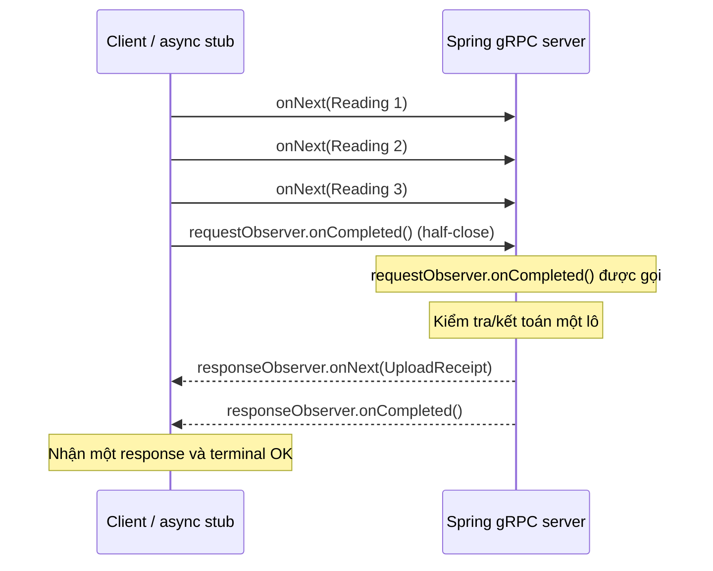
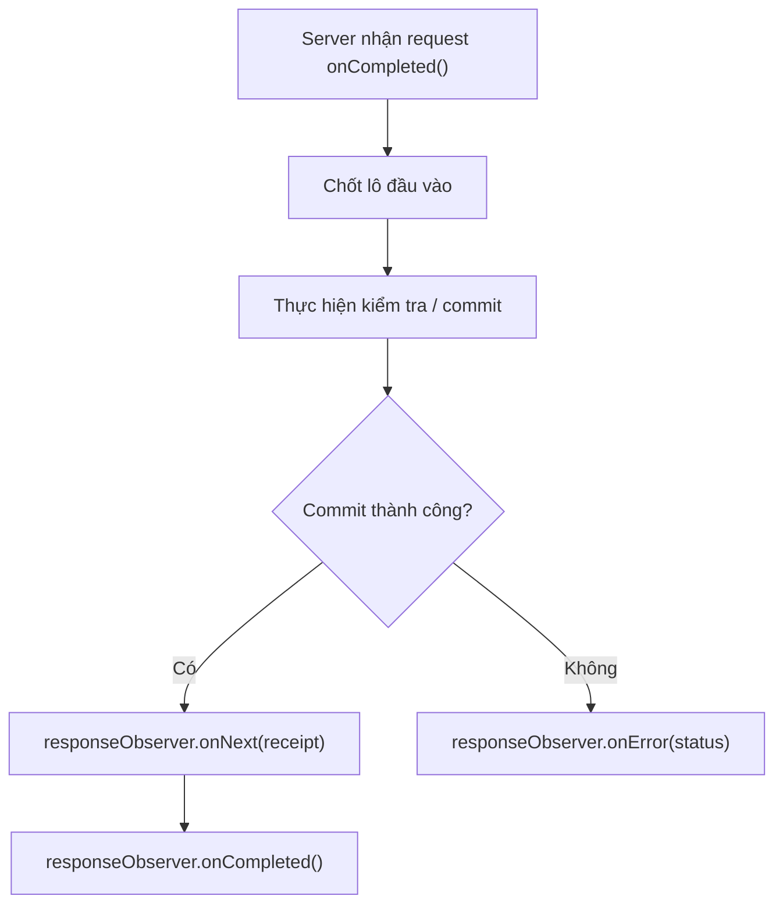

# Server hoàn tất bằng onCompleted

**Chương:** Client streaming  
**Bối cảnh:** Trong Spring gRPC (`SPRING_GRPC`), dịch vụ được định nghĩa bằng Protocol Buffers, sinh mã Java cho client/server và trao đổi qua các kiểu RPC unary hoặc streaming. Bài này tập trung vào **cách server kết thúc một client streaming RPC thành công**: nhận tín hiệu đã hết request, tạo đúng một response và gọi `responseObserver.onCompleted()`.

## 1. Mục tiêu học tập

Sau bài học, bạn có thể:

- Phân biệt `onCompleted()` trên **observer nhận request của server** với `onCompleted()` trên **observer gửi response của server**.
- Giải thích tại sao client streaming cần tín hiệu kết thúc luồng gửi để server tổng hợp kết quả cuối.
- Triển khai server Spring gRPC trả **một response thành công** và kết thúc RPC đúng thứ tự.
- Xử lý luồng rỗng, request sai, deadline, hủy RPC và lỗi xử lý trước khi phản hồi.
- Tránh gọi `onNext()` hoặc callback kết thúc nhiều lần; thiết kế trường hợp xử lý bất đồng bộ và kiểm thử vòng đời RPC.

## 2. Hai lần `onCompleted()` mang ý nghĩa khác nhau

Với client streaming, hợp đồng điển hình là:

```proto
rpc UploadReadings(stream Reading) returns (UploadReceipt);
```

Client gửi nhiều `Reading` trên cùng một RPC; server chỉ trả **một** `UploadReceipt` khi thành công. Trong gRPC Java có hai `StreamObserver` ở phía server:

| Observer | Server lấy từ đâu? | Vai trò của `onCompleted()` |
| --- | --- | --- |
| `StreamObserver<Reading>` **nhận request** | Đối tượng được phương thức `uploadReadings(...)` **trả về** | **Callback do gRPC gọi** khi phía client đã kết thúc luồng gửi bình thường; server biết không còn request mới từ luồng ấy |
| `StreamObserver<UploadReceipt>` **gửi response** | Tham số `responseObserver` được truyền **vào** phương thức `uploadReadings(...)` | **Phương thức do server gọi** sau khi gửi response cuối, thông báo không còn response nào nữa và kết thúc phía gửi bình thường |

Hai thời điểm đó có liên hệ, nhưng **không phải cùng một lời gọi**. Client gọi `requestObserver.onCompleted()` để khép nửa gửi request. Sau khi gRPC chuyển hết các message trước đó, server nhận callback `onCompleted()` trên observer request. Server có thể kết toán dữ liệu và gọi `responseObserver.onNext(receipt)`, rồi `responseObserver.onCompleted()` để hoàn tất response.



Sơ đồ mô tả luồng **thành công theo ví dụ**. `onCompleted()` của request là **tín hiệu hết dữ liệu**, không phải xác nhận giao dịch đã commit. `onCompleted()` của response là **kết thúc bình thường**, không thể thay thế cho việc gửi message kết quả. Với hợp đồng chỉ trả một `UploadReceipt`, server gửi **đúng một** `onNext(receipt)` trước khi gọi `onCompleted()`.

> **Phân biệt:** `onCompleted()` mà server **nhận** là callback của luồng request. `onCompleted()` mà server **gọi** là hành động hoàn tất luồng response. Không gọi `onCompleted()` lên observer request mà server đã trả về: observer đó thuộc vai trò nhận dữ liệu.

## 3. Vòng đời của một client streaming RPC

Trong trường hợp xử lý thông thường:

1. **Mở lời gọi:** Client tạo `responseObserver` và gọi phương thức qua async stub. Stub trả về `requestObserver` cho client.
2. **Nhận từng message:** Mỗi `requestObserver.onNext(reading)` ở client dẫn tới `onNext(reading)` của observer request ở server khi message được giao đến.
3. **Client gửi hết:** Client gọi `requestObserver.onCompleted()` **một lần**. Sau đó không gửi thêm `onNext()`.
4. **Server biết đầu vào đã hết:** gRPC gọi `onCompleted()` trên observer nhận request. Server thực hiện bước tổng hợp hoặc commit theo yêu cầu nghiệp vụ.
5. **Server phản hồi:** Server gọi `responseObserver.onNext(receipt)` **một lần**, sau đó `responseObserver.onCompleted()` **một lần**.
6. **Client hoàn tất:** `responseObserver` ở client nhận `onNext(receipt)`, rồi `onCompleted()`; RPC kết thúc thành công với trạng thái gRPC `OK`.

Một RPC còn có thể kết thúc bằng lỗi tại nhiều thời điểm: validation thất bại ở `onNext`, client hủy trước khi gửi hết, deadline hết hạn hoặc commit thất bại sau khi đã nhận `onCompleted`. Khi đã kết thúc bằng `onError`, **không gọi `onCompleted`** trên cùng response observer.

### Client half-close không đồng nghĩa RPC đã kết thúc

HTTP/2 hỗ trợ hai chiều truyền riêng trong cùng một stream. Khi client gọi `requestObserver.onCompleted()`, đó là **half-close chiều gửi request**; client vẫn chờ response/status từ server. Nếu server cần thêm thời gian để lưu hoặc kiểm tra lô, RPC có thể vẫn đang mở sau khi phía client đã gửi xong.

Điều ngược lại cũng cần nhớ: server **có thể kết thúc sớm bằng status lỗi** khi gặp dữ liệu sai hoặc giới hạn tài nguyên, ngay cả khi client còn định gửi thêm request. Client phải theo dõi response `onError` và dừng producer; không nên mặc định rằng server luôn chờ đủ `onCompleted`.

## 4. Hợp đồng Protocol Buffers cho ví dụ

Giả sử một thiết bị gửi các số đo về Spring gRPC server. File `src/main/proto/reading.proto`:

```proto
syntax = "proto3";

package telemetry.v1;
option java_package = "com.example.telemetry.grpc";
option java_multiple_files = true;

service ReadingService {
  // N Reading request -> 1 UploadReceipt response.
  rpc UploadReadings(stream Reading) returns (UploadReceipt);
}

message Reading {
  string batch_id = 1;
  string sensor_id = 2;
  int64 captured_at_epoch_ms = 3;
  double value = 4;
}

message UploadReceipt {
  string batch_id = 1;
  int32 accepted_count = 2;
  double sum_values = 3;
}
```

Từ `.proto`, plugin protobuf và gRPC Java sinh các lớp `Reading`, `UploadReceipt`, `ReadingServiceGrpc`. Chữ ký cần override trong implementation:

```java
@Override
public StreamObserver<Reading> uploadReadings(
        StreamObserver<UploadReceipt> responseObserver);
```

Chữ ký này thường gây nhầm lẫn: **tham số** `responseObserver` là đường gửi từ server về client; **giá trị trả về** `StreamObserver<Reading>` là đường nhận từ client vào server. Bên trong object được trả về, `onCompleted()` có thể kích hoạt việc tạo biên nhận cuối.

## 5. Triển khai Spring gRPC server và hoàn tất đúng một lần

Ví dụ dưới đây giới hạn tối đa 10.000 message mỗi RPC, kiểm tra dữ liệu và tính tổng trong bộ nhớ. Nó **chưa lưu xuống cơ sở dữ liệu**, nên biên nhận chỉ chứng minh kết quả tính toán của ví dụ.

```java
package com.example.telemetry.server;

import com.example.telemetry.grpc.Reading;
import com.example.telemetry.grpc.ReadingServiceGrpc;
import com.example.telemetry.grpc.UploadReceipt;
import io.grpc.Status;
import io.grpc.stub.StreamObserver;
import org.springframework.grpc.server.service.GrpcService;

@GrpcService
public class ReadingGrpcService
        extends ReadingServiceGrpc.ReadingServiceImplBase {

    private static final int MAX_READINGS = 10_000;

    @Override
    public StreamObserver<Reading> uploadReadings(
            StreamObserver<UploadReceipt> responseObserver) {

        // Một object mới cho MỖI RPC: không trộn lẫn trạng thái client.
        return new StreamObserver<>() {
            private String batchId;
            private int count;
            private double sum;
            private boolean terminated;

            @Override
            public void onNext(Reading reading) {
                if (terminated) return;

                if (reading.getBatchId().isBlank()
                        || reading.getSensorId().isBlank()
                        || reading.getCapturedAtEpochMs() <= 0
                        || !Double.isFinite(reading.getValue())) {
                    reject(Status.INVALID_ARGUMENT, "Reading không hợp lệ");
                    return;
                }

                if (batchId != null
                        && !batchId.equals(reading.getBatchId())) {
                    reject(Status.INVALID_ARGUMENT,
                            "Không được trộn các batch_id");
                    return;
                }

                if (count >= MAX_READINGS) {
                    reject(Status.RESOURCE_EXHAUSTED, "Lô vượt giới hạn");
                    return;
                }

                batchId = reading.getBatchId();
                count++;
                sum += reading.getValue();
            }

            @Override
            public void onError(Throwable error) {
                // Đầu vào hủy/lỗi: dừng và dọn tài nguyên nếu có.
                terminated = true;
                // Không phát receipt thành công từ đây.
            }

            @Override
            public void onCompleted() {
                if (terminated) return;

                // Hợp đồng của ví dụ quy định lô rỗng là không hợp lệ.
                if (count == 0) {
                    reject(Status.INVALID_ARGUMENT, "Lô không có Reading");
                    return;
                }

                UploadReceipt receipt = UploadReceipt.newBuilder()
                        .setBatchId(batchId)
                        .setAcceptedCount(count)
                        .setSumValues(sum)
                        .build();

                // Chỉ kết thúc thành công sau khi có kết quả cuối.
                terminated = true;
                responseObserver.onNext(receipt);
                responseObserver.onCompleted();
            }

            private void reject(Status status, String message) {
                if (terminated) return;

                terminated = true;
                responseObserver.onError(
                        status.withDescription(message).asRuntimeException());
            }
        };
    }
}
```

### Vì sao thứ tự trong `onCompleted()` quan trọng?

```java
// Thành công: gửi một response rồi đóng luồng response.
responseObserver.onNext(receipt);
responseObserver.onCompleted();
```

Nếu server gọi `onCompleted()` **trước** `onNext(receipt)`, response observer đã kết thúc, không được gửi message nào nữa. Với client streaming gRPC, phía client mong đợi một response. Gọi `onCompleted()` mà không gửi response sẽ không đáp ứng hợp đồng và có thể dẫn tới lỗi phía stub.

Trường `terminated` trong ví dụ là chốt trạng thái **trong phạm vi một RPC** để tránh phát response thành công sau khi đã trả lỗi. Các callback request của một stream thông thường được gRPC tuần tự hóa; nếu sau này thêm các tác vụ bất đồng bộ chạy từ thread khác, một `boolean` đơn giản **không đủ** để điều phối các callback phản hồi cạnh tranh. Phải dùng cơ chế đồng bộ/điều phối để chỉ một nhánh được phép kết thúc response.

### Lô rỗng phải được quy định rõ

Vì `stream Reading` cho phép client gọi `onCompleted()` mà chưa gửi `onNext()`, server phải xác định chính sách:

- **Từ chối:** Ví dụ này trả `INVALID_ARGUMENT` nếu `count == 0`.
- **Chấp nhận:** Nếu nghiệp vụ cho phép, server có thể trả một `UploadReceipt` với số lượng 0 rồi `onCompleted()`.

Hai lựa chọn đều có thể hợp lý; **hợp đồng API, implementation và test** phải thống nhất.

## 6. Client gửi xong và chờ server hoàn tất

Trong Spring gRPC, async stub có thể được tạo từ channel của `GrpcChannelFactory` hoặc từ một `Channel` đã được cấu hình. Ví dụ dưới giả sử `ReadingServiceGrpc.ReadingServiceStub asyncStub` đã sẵn sàng:

```java
import com.example.telemetry.grpc.Reading;
import com.example.telemetry.grpc.ReadingServiceGrpc;
import com.example.telemetry.grpc.UploadReceipt;
import io.grpc.stub.StreamObserver;
import java.util.List;
import java.util.concurrent.CompletableFuture;
import java.util.concurrent.TimeUnit;

public class UploadClient {
    private final ReadingServiceGrpc.ReadingServiceStub asyncStub;

    public UploadClient(ReadingServiceGrpc.ReadingServiceStub asyncStub) {
        this.asyncStub = asyncStub;
    }

    public CompletableFuture<UploadReceipt> send(List<Reading> readings) {
        CompletableFuture<UploadReceipt> done = new CompletableFuture<>();

        StreamObserver<UploadReceipt> responseObserver =
                new StreamObserver<>() {
                    private UploadReceipt last;
                    private int responseCount;

                    @Override
                    public void onNext(UploadReceipt receipt) {
                        last = receipt;
                        responseCount++;
                    }

                    @Override
                    public void onError(Throwable error) {
                        done.completeExceptionally(error);
                    }

                    @Override
                    public void onCompleted() {
                        if (responseCount == 1) {
                            done.complete(last);
                        } else {
                            done.completeExceptionally(
                                    new IllegalStateException(
                                            "Cần đúng một UploadReceipt"));
                        }
                    }
                };

        StreamObserver<Reading> requestObserver = asyncStub
                .withDeadlineAfter(10, TimeUnit.SECONDS)
                .uploadReadings(responseObserver);

        try {
            for (Reading reading : readings) {
                requestObserver.onNext(reading);
            }
            // Đóng chiều gửi. KHÔNG đồng nghĩa đã có receipt.
            requestObserver.onCompleted();
        } catch (RuntimeException failure) {
            done.completeExceptionally(failure);
            // Nếu RPC còn sống, kết thúc chiều gửi bằng lỗi/hủy.
            try {
                requestObserver.onError(failure);
            } catch (RuntimeException ignored) {
                // RPC có thể đã đóng.
            }
        }

        return done;
    }
}
```

Ví dụ sử dụng:

```java
List<Reading> readings = List.of(
    Reading.newBuilder()
        .setBatchId("batch-24")
        .setSensorId("sensor-a")
        .setCapturedAtEpochMs(1_700_000_001_000L)
        .setValue(21.5)
        .build(),
    Reading.newBuilder()
        .setBatchId("batch-24")
        .setSensorId("sensor-a")
        .setCapturedAtEpochMs(1_700_000_002_000L)
        .setValue(22.0)
        .build()
);

client.send(readings)
    .thenAccept(receipt -> System.out.printf(
        "Nhận biên nhận: batch=%s, count=%d, sum=%.1f%n",
        receipt.getBatchId(),
        receipt.getAcceptedCount(),
        receipt.getSumValues()))
    .exceptionally(error -> {
        System.err.println("RPC không thành công: " + error);
        return null;
    });
```

Nếu luồng hợp lệ, kết quả là `batch-24`, `accepted_count = 2`, `sum_values = 43.5`. `CompletableFuture` chỉ hoàn tất thành công **khi client nhận callback response `onCompleted()`**, không phải ngay sau `requestObserver.onCompleted()`.

**Chú ý:** Mẫu `for` phù hợp với lô nhỏ hữu hạn; với nguồn lớn, cần xử lý flow control và tín hiệu dừng từ server. Một `CompletableFuture.cancel()` đơn thuần không nhất thiết hủy RPC gRPC bên dưới; khi thiết kế API hủy, hãy điều phối việc cancel lên call/observer phù hợp.

## 7. Server hoàn tất sau xử lý bất đồng bộ

Đôi khi nhận đủ message rồi vẫn cần **ghi cơ sở dữ liệu**, gọi dịch vụ khác hoặc xác nhận commit. Khi đó không nên gọi `responseObserver.onCompleted()` ngay khi observer request nhận `onCompleted()` nếu nghiệp vụ chưa xong.



Nếu xử lý bất đồng bộ bằng `CompletableFuture`, trình tự đúng về mặt ý tưởng là:

```java
// Trong callback inbound onCompleted():
// 1) Không nhận thêm request; chụp trạng thái lô cần commit.
// 2) Khởi chạy Future/async task lưu bền dữ liệu.
// 3) Khi Future hoàn tất thành công (và call vẫn hợp lệ):
//      responseObserver.onNext(receipt);
//      responseObserver.onCompleted();
// 4) Khi Future thất bại (và call vẫn hợp lệ):
//      responseObserver.onError(mappedStatusException);
// 5) Nếu deadline/hủy đã xảy ra: dừng/hủy việc còn lại nếu có thể,
//    không gửi thêm terminal callback trên call đã kết thúc.
```

Điều này đòi hỏi cơ chế giữ trạng thái kết thúc **an toàn giữa các thread**. Cần đảm bảo chỉ một nhánh thắng giữa “commit thành công”, “commit lỗi” và “RPC bị hủy”; việc gửi trên cùng `responseObserver` cũng phải được tuần tự hóa. Việc call bị hủy **không tự động rollback** dữ liệu đã commit; nếu cần tính nguyên tử, phải thiết kế giao dịch hoặc lưu tạm/commit theo lô ở tầng nghiệp vụ.

Không thực hiện công việc blocking kéo dài trực tiếp trong callback gRPC nếu nó làm nghẽn tài nguyên thực thi của server. Nếu chuyển sang tác vụ bất đồng bộ, giữ deadline, trạng thái hủy và vùng nhớ đệm dưới kiểm soát.

## 8. Khi nào `onCompleted()` không được gọi?

Phía server có **hai con đường kết thúc response** loại trừ nhau:

```text
THÀNH CÔNG
responseObserver.onNext(receipt)
responseObserver.onCompleted()    // Kết thúc OK

THẤT BẠI
responseObserver.onError(statusException) // Kết thúc bằng status lỗi
```

Không gửi `onCompleted()` sau `onError()` hoặc `onError()` sau `onCompleted()`. Các callback kết thúc là **terminal event**. Nếu server đã trả `INVALID_ARGUMENT` trong `onNext()`, callback inbound `onCompleted()` sau đó (nếu có) không được gửi tiếp response thành công.

| Trường hợp | Server xử lý | Kết quả phía client |
| --- | --- | --- |
| Nhận đủ message hợp lệ và kết toán thành công | Một `onNext(receipt)`, tiếp theo `onCompleted()` | Nhận receipt, kết thúc `OK` |
| Client gửi lô rỗng trong hợp đồng ví dụ | `onError(INVALID_ARGUMENT)` | Không có receipt thành công |
| Message sai `batch_id` hoặc thiếu dữ liệu | `onError(INVALID_ARGUMENT)` | Nhận status lỗi |
| Vượt số request tối đa | `onError(RESOURCE_EXHAUSTED)` | Nhận status lỗi |
| Commit ở server thất bại | Ánh xạ lỗi sang gRPC `Status` thích hợp rồi `onError()` | Không đánh dấu lô hoàn tất |
| Client hủy hoặc deadline hết | Dừng phần việc có thể hủy, dọn tài nguyên | Thường gặp `CANCELLED` hoặc `DEADLINE_EXCEEDED` tùy phía quan sát |
| Client quên kết thúc chiều gửi | Server tiếp tục chờ theo hợp đồng này | Có thể chờ tới deadline, không nhận receipt |

Các status là tín hiệu quan sát phía RPC; chúng **không đủ để kết luận** những thao tác nghiệp vụ đã lưu hay chưa. Ví dụ client thấy `DEADLINE_EXCEEDED` sau khi server commit nhưng trước khi biên nhận đến: việc tự gửi lại toàn bộ lô có thể gây bản ghi trùng.

## 9. Metadata, deadline, TLS và khả năng phục hồi

Trong hệ sinh thái Spring gRPC, các thành phần bên ngoài thân message cũng ảnh hưởng đến việc hoàn tất:

- **Deadline:** Một deadline bao phủ **toàn bộ** luồng, gồm thời gian client gửi request, server xử lý và gửi response. Nó không được gia hạn sau mỗi `onNext()`. Để tránh RPC treo khi client không gọi `onCompleted()`, cần đặt deadline phù hợp.
- **Hủy RPC:** Khi client hủy, server nên theo dõi dấu hiệu hủy trong context/callback, dừng các công việc còn lại khi có thể và giải phóng tài nguyên. Hủy call không phải bằng chứng rollback đã thành công.
- **Metadata và interceptor:** Thông tin xác thực, correlation ID, tracing thường áp dụng cho **cả RPC**. Interceptor có thể kiểm tra quyền truy cập, ghi trạng thái kết thúc, thời lượng RPC và metrics nhất quán. Không gửi token lặp lại trong từng `Reading`.
- **TLS:** Bảo vệ thông tin xác thực và dữ liệu trên đường truyền thực tế bằng TLS, đồng thời cấu hình identity của server/client theo yêu cầu vận hành.
- **Idempotency:** Nếu RPC có tác dụng ghi dữ liệu, dùng `batch_id` cố định, event ID hoặc cơ chế ghi tạm/commit để retry không tạo trùng. Có thể bổ sung một unary RPC tra cứu trạng thái lô khi client không nhận được receipt cuối.
- **Giám sát:** Theo dõi RPC đang mở, thời gian từ message đầu đến receipt, số request/lô, số byte/lô và tỷ lệ `OK`, `INVALID_ARGUMENT`, `RESOURCE_EXHAUSTED`, `CANCELLED`, `DEADLINE_EXCEEDED`. Một stream đóng sớm vì lỗi khác về mặt nghiệp vụ với một stream hoàn tất thành công.

Nhận message `onNext()`, nhận tín hiệu inbound `onCompleted()` và phát outbound `onCompleted()` là **ba mốc khác nhau** cần được đo và phân tích riêng khi tối ưu hiệu năng và độ tin cậy.

## 10. Kiểm thử chính xác thời điểm hoàn tất

Kiểm thử in-process dùng server/channel gRPC chạy trong cùng tiến trình, giúp xác minh chuyển message và callback mà không cần mở cổng TCP. Đoạn dưới dùng JUnit 5 và thư viện `grpc-inprocess` trong test dependencies:

```java
package com.example.telemetry;

import com.example.telemetry.grpc.Reading;
import com.example.telemetry.grpc.ReadingServiceGrpc;
import com.example.telemetry.grpc.UploadReceipt;
import com.example.telemetry.server.ReadingGrpcService;
import io.grpc.ManagedChannel;
import io.grpc.Server;
import io.grpc.inprocess.InProcessChannelBuilder;
import io.grpc.inprocess.InProcessServerBuilder;
import io.grpc.stub.StreamObserver;
import java.util.concurrent.CompletableFuture;
import java.util.concurrent.TimeUnit;
import java.util.concurrent.atomic.AtomicInteger;
import org.junit.jupiter.api.Test;

import static org.junit.jupiter.api.Assertions.assertEquals;

class ReadingCompletionTest {

    @Test
    void receiptArrivesAfterClientCompletesRequestStream() throws Exception {
        String name = InProcessServerBuilder.generateName();
        Server server = InProcessServerBuilder.forName(name)
                .directExecutor()
                .addService(new ReadingGrpcService())
                .build()
                .start();
        ManagedChannel channel = InProcessChannelBuilder.forName(name)
                .directExecutor()
                .build();

        try {
            CompletableFuture<UploadReceipt> completed =
                    new CompletableFuture<>();
            AtomicInteger responseMessages = new AtomicInteger();
            AtomicInteger responseCompletions = new AtomicInteger();

            StreamObserver<UploadReceipt> responseObserver =
                    new StreamObserver<>() {
                        private UploadReceipt receipt;

                        @Override
                        public void onNext(UploadReceipt value) {
                            responseMessages.incrementAndGet();
                            receipt = value;
                        }

                        @Override
                        public void onError(Throwable error) {
                            completed.completeExceptionally(error);
                        }

                        @Override
                        public void onCompleted() {
                            responseCompletions.incrementAndGet();
                            completed.complete(receipt);
                        }
                    };

            StreamObserver<Reading> requests =
                    ReadingServiceGrpc.newStub(channel)
                            .uploadReadings(responseObserver);

            requests.onNext(reading(21.5));
            requests.onNext(reading(22.0));
            requests.onCompleted();

            UploadReceipt receipt = completed.get(3, TimeUnit.SECONDS);
            assertEquals("batch-24", receipt.getBatchId());
            assertEquals(2, receipt.getAcceptedCount());
            assertEquals(43.5, receipt.getSumValues(), 1e-9);
            assertEquals(1, responseMessages.get());
            assertEquals(1, responseCompletions.get());
        } finally {
            channel.shutdownNow();
            server.shutdownNow();
        }
    }

    private static Reading reading(double value) {
        return Reading.newBuilder()
                .setBatchId("batch-24")
                .setSensorId("sensor-a")
                .setCapturedAtEpochMs(1_700_000_001_000L)
                .setValue(value)
                .build();
    }
}
```

Bài test trên xác minh đúng **một response message và một callback hoàn tất thành công** cho lô hợp lệ. Nó chưa kiểm tra timing trước khi client half-close. Muốn kiểm chứng điều đó, hãy giữ stream mở bằng cơ chế đồng bộ có timeout ngắn, bảo đảm chưa có biên nhận cho tới khi client gọi `onCompleted()`, rồi xác nhận callback cuối. Không dùng `Thread.sleep` tùy ý làm bằng chứng duy nhất cho tính đúng đắn bất đồng bộ.

Nên bổ sung các ca sau:

| Test case | Kỳ vọng |
| --- | --- |
| Một lô hợp lệ, nhiều `onNext`, một client `onCompleted` | Một receipt, một server response `onCompleted`, status `OK` |
| Client half-close ngay, không gửi request | `INVALID_ARGUMENT` theo chính sách của ví dụ |
| Message thứ hai có `batch_id` khác | `INVALID_ARGUMENT`, không trả receipt thành công |
| 10.001 message hợp lệ | `RESOURCE_EXHAUSTED`, không gọi success `onCompleted` |
| Server commit thất bại sau inbound `onCompleted` | `onError` với status phù hợp, không đồng thời hoàn tất `OK` |
| Client hủy hoặc deadline hết trong khi đang xử lý | Không gửi thêm response lên call đã kết thúc, tài nguyên được giải phóng |
| Hai client đồng thời | Mỗi RPC có state và receipt riêng, không lẫn dữ liệu |

Kiểm thử in-process chủ yếu xác nhận ngữ nghĩa streaming. Để kiểm tra channel Spring, interceptor, TLS, mạng, database và hành vi khi timeout thực tế, cần kiểm thử tích hợp đầy đủ.

## 11. Lỗi thường gặp

| Hiện tượng | Nguyên nhân | Cách khắc phục |
| --- | --- | --- |
| Server không bao giờ trả receipt | Client quên `requestObserver.onCompleted()` | Half-close chiều gửi khi hết dữ liệu; dùng deadline |
| Client tưởng đã thành công ngay sau khi `onCompleted()` | Nhầm kết thúc chiều gửi với kết thúc RPC | Chỉ công nhận thành công sau response và status `OK` |
| Server gọi `responseObserver.onCompleted()` mà không gửi message | Thiếu biên nhận bắt buộc | Gửi đúng một `onNext(receipt)` trước khi hoàn tất |
| Server vừa `onError` vừa `onCompleted` | Nhiều nhánh xử lý cùng kết thúc call | Chốt trạng thái terminal và đồng bộ nhánh async |
| Đã gọi `onCompleted()` nhưng không còn được `onNext()` | Observer đã kết thúc | Không tái sử dụng observer của RPC cũ |
| Response báo thành công dù commit thất bại | Đóng response trước khi biết kết quả lưu bền | Chỉ phản hồi sau khi nghiệp vụ hoàn thành |
| Timeout rồi retry làm nhân đôi dữ liệu | Không có khóa idempotency cho lô | Gắn ID ổn định và kiểm tra trạng thái lô |

## 12. Tự luyện tập

1. Vẽ rõ **ba** vị trí: client `requestObserver.onCompleted()`, server inbound `onCompleted()` và server outbound `responseObserver.onCompleted()`. Vị trí nào thông báo hết request, vị trí nào thông báo hết response?
2. Nếu client gửi hai `Reading` rồi giữ luồng mở mãi, server trong ví dụ trả receipt ở thời điểm nào? Deadline tác động ra sao?
3. Chỉnh chính sách để lô rỗng được chấp nhận. Hãy bảo đảm server vẫn gửi **một** `UploadReceipt` trước `onCompleted()`.
4. Mô phỏng commit database bằng một `CompletableFuture` thất bại sau inbound `onCompleted()`. Nhánh nào phải gọi `responseObserver.onError()`, và làm gì để không có hai terminal callback?
5. Client gửi xong, server đã commit nhưng response bị mất do mạng. Vì sao không thể suy luận rằng server chưa lưu? Thiết kế idempotency/tra cứu trạng thái lô nào giúp retry an toàn?

**Ghi nhớ:** Với client streaming, **client kết thúc request** bằng `requestObserver.onCompleted()`; **server nhận tín hiệu đó** ở callback `onCompleted()` của observer request; sau khi xử lý thành công, **server gửi đúng một response** bằng `responseObserver.onNext(receipt)` rồi **hoàn tất RPC bình thường** bằng `responseObserver.onCompleted()`. Nếu thất bại, kết thúc bằng `responseObserver.onError(status)`, tuyệt đối không phát cả hai kiểu kết thúc.
