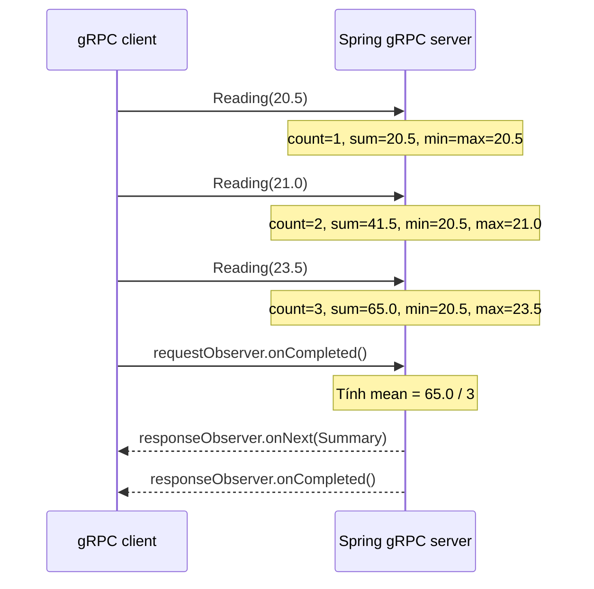

# Tổng hợp request stream thành một kết quả

**Chương:** Client streaming  
**Phạm vi:** Spring gRPC (`SPRING_GRPC`) — xây dựng RPC từ hợp đồng Protocol Buffers và mã Java được sinh, xử lý luồng request bằng gRPC Java `StreamObserver`, kết hợp deadline, status, bảo mật và kiểm thử tích hợp.

## 1. Bài toán: nhiều bản ghi nhưng chỉ cần một kết quả

Một hệ thống thu thập số liệu nhận các giá trị nhiệt độ `20.5`, `21.0` và `23.5` từ thiết bị. Client muốn gửi lần lượt từng giá trị, trong khi server chỉ cần trả về **một bản tổng hợp** gồm số mẫu, tổng, trung bình, nhỏ nhất và lớn nhất.

**Client streaming RPC** phù hợp với mô hình này: nhiều request message thuộc cùng một RPC, một response message khi thành công. Ở server, mỗi `onNext(reading)` cập nhật trạng thái tổng hợp; khi nhận `onCompleted()` của luồng request, server tạo một `Summary`, gọi `responseObserver.onNext(summary)` rồi `responseObserver.onCompleted()`.



Kết quả của ví dụ là:

| Trường | Giá trị |
| --- | ---: |
| `accepted_count` | `3` |
| `total` | `65.0` |
| `mean` | `21.666666...` |
| `minimum` | `20.5` |
| `maximum` | `23.5` |

Đây là **một** RPC `Summarize`, không phải ba unary RPC. Server không cần chờ có đủ danh sách trong bộ nhớ để tính các đại lượng nói trên.

## 2. Mục tiêu học tập

Hoàn thành bài này, bạn sẽ có thể:

1. Thiết kế hợp đồng protobuf cho **luồng nhiều request và một response tổng hợp**.
2. Xây bộ tích lũy (*accumulator*) thay đổi sau từng `onNext()`, với trạng thái riêng cho mỗi RPC.
3. Biết khi nào phép tổng hợp có thể dùng **bộ nhớ O(1)** và khi nào cần lưu thêm dữ liệu.
4. Xác định chính sách cho luồng rỗng, dữ liệu sai, lỗi số học và giới hạn số phần tử.
5. Trả kết quả đúng lúc qua `responseObserver.onNext()` và `onCompleted()`; trả status lỗi qua `onError()`.
6. Gửi luồng từ async client và kiểm thử bằng server/channel gRPC in-process.

## 3. Tư duy accumulator: cập nhật, không tích trữ cả lô

Một phép tổng hợp phù hợp với streaming có thể cập nhật trạng thái sau mỗi request:

```text
Trạng thái ban đầu:
  count = 0
  sum   = 0
  min/max chưa xác định

onNext(20.5) -> count=1, sum=20.5, min=20.5, max=20.5
onNext(21.0) -> count=2, sum=41.5, min=20.5, max=21.0
onNext(23.5) -> count=3, sum=65.0, min=20.5, max=23.5

onCompleted() -> mean=sum/count -> một Summary -> kết thúc OK
```

Với mỗi giá trị hợp lệ \(x\):

\[
\begin{aligned}
n_{\text{mới}} &= n_{\text{cũ}} + 1 \\
S_{\text{mới}} &= S_{\text{cũ}} + x \\
\min_{\text{mới}} &= \min(\min_{\text{cũ}}, x) \\
\max_{\text{mới}} &= \max(\max_{\text{cũ}}, x) \\
\overline{x} &= S / n \quad (n > 0)
\end{aligned}
\]

Với bài toán này, trạng thái chỉ gồm một số trường nên bộ nhớ tích lũy **O(1)** theo số lượng request; thời gian xử lý tổng cộng **O(n)**. Dữ liệu vẫn đi qua bộ đệm của gRPC và tài nguyên network/transport, nên không thể kết luận toàn hệ thống dùng bộ nhớ tuyệt đối hằng số trong mọi tình huống.

| Phép tổng hợp | Trạng thái cần giữ | Đặc điểm |
| --- | --- | --- |
| Số lượng, tổng | `count`, `sum` | Cập nhật đơn giản, bộ nhớ hằng số |
| Trung bình | `count` và `sum`, hoặc trung bình chạy | Không chia cho 0 nếu lô rỗng |
| Min, max | Giá trị min/max và cờ đã có mẫu | Không nên mặc định min/max bằng 0 |
| Phương sai/độ lệch chuẩn | `count`, trung bình chạy, `M2` (Welford) | Có thể tính online, tránh cách cộng bình phương dễ mất chính xác |
| Số lượng theo từng nhóm | Bản đồ `key -> accumulator` | Bộ nhớ tăng theo số nhóm; phải giới hạn số nhóm |
| Trung vị chính xác | Thông tin về phân bố hoặc dữ liệu đã lưu | Thường cần nhiều bộ nhớ hơn O(1); có thể dùng thuật toán xấp xỉ nếu chấp nhận sai số |
| Danh sách lỗi theo từng bản ghi | Vị trí/thông tin lỗi | Bộ nhớ hoặc response có thể tăng theo số lỗi; cần phân trang/giới hạn hoặc lưu riêng |

**Chọn accumulator theo nghĩa nghiệp vụ.** Nếu cần tổng tiền, `double` không phải lựa chọn thích hợp để bảo đảm tính chính xác thập phân. Hãy dùng số nguyên theo đơn vị nhỏ nhất (khi phạm vi giá trị cho phép) hoặc `BigDecimal` trong mã Java và kiểu protobuf có quy ước biểu diễn tương ứng. Ví dụ của bài này dùng `double` cho **số đo cảm biến**, nơi sai số dấu phẩy động được chấp nhận trong giới hạn xác định.

## 4. Hợp đồng Protocol Buffers

Tạo file `src/main/proto/sensor_aggregation.proto`:

```proto
syntax = "proto3";

package sensors.v1;

option java_package = "com.example.sensors.grpc";
option java_multiple_files = true;

service SensorAggregationService {
  // N số đo của một batch -> 1 Summary cuối cùng.
  rpc Summarize(stream SensorReading) returns (SensorSummary);
}

message SensorReading {
  string batch_id = 1;
  string sensor_id = 2;
  int64 measured_at_epoch_ms = 3;
  double value = 4;
}

message SensorSummary {
  string batch_id = 1;
  int64 accepted_count = 2;
  double total = 3;
  double mean = 4;
  double minimum = 5;
  double maximum = 6;
}
```

`stream SensorReading` khai báo **nhiều request message**; `returns (SensorSummary)` không có từ khóa `stream` vì phía server chỉ trả **một response thành công**. Thông qua plugin `protoc-gen-grpc-java` và protobuf compiler, dự án sinh các lớp `SensorReading`, `SensorSummary` và `SensorAggregationServiceGrpc`. Trong Spring gRPC, server kế thừa lớp base được sinh:

```java
public StreamObserver<SensorReading> summarize(
        StreamObserver<SensorSummary> responseObserver);
```

Giá trị trả về là **observer nhận request** tại server; tham số `responseObserver` là **observer gửi kết quả** từ server. Không đặt trường `accepted_count`, `total` hay `mean` vào từng request nếu các giá trị đó phải do server tính từ cả luồng.

## 5. Triển khai bộ tích lũy trong Spring gRPC server

Đoạn mã dưới đây tạo một accumulator mới mỗi khi có RPC `Summarize`. Các biến `batchId`, `count`, `sum`, `min`, `max` thuộc **một lời gọi**, tránh trộn số liệu của các client chạy đồng thời.

```java
package com.example.sensors.server;

import com.example.sensors.grpc.SensorAggregationServiceGrpc;
import com.example.sensors.grpc.SensorReading;
import com.example.sensors.grpc.SensorSummary;
import io.grpc.Status;
import io.grpc.stub.StreamObserver;
import org.springframework.grpc.server.service.GrpcService;

@GrpcService
public class SensorAggregationGrpcService
        extends SensorAggregationServiceGrpc.SensorAggregationServiceImplBase {

    private static final long MAX_READINGS = 100_000L;

    @Override
    public StreamObserver<SensorReading> summarize(
            StreamObserver<SensorSummary> responseObserver) {

        return new StreamObserver<>() {
            private String batchId;
            private long count;
            private double sum;
            private double min;
            private double max;
            private boolean terminated;

            @Override
            public void onNext(SensorReading reading) {
                if (terminated) {
                    return;
                }

                // Kiểm tra từng thông điệp trước khi cập nhật state.
                if (reading.getBatchId().isBlank()
                        || reading.getSensorId().isBlank()
                        || reading.getMeasuredAtEpochMs() <= 0L
                        || !Double.isFinite(reading.getValue())) {
                    fail(Status.INVALID_ARGUMENT, "Số đo không hợp lệ");
                    return;
                }

                if (batchId != null
                        && !batchId.equals(reading.getBatchId())) {
                    fail(Status.INVALID_ARGUMENT,
                            "Mọi message phải cùng batch_id");
                    return;
                }

                if (count >= MAX_READINGS) {
                    fail(Status.RESOURCE_EXHAUSTED, "Lô quá lớn");
                    return;
                }

                double value = reading.getValue();
                double nextSum = sum + value;
                if (!Double.isFinite(nextSum)) {
                    fail(Status.OUT_OF_RANGE, "Tổng số đo vượt phạm vi");
                    return;
                }

                // Đặt min/max bằng mẫu ĐẦU TIÊN, không đặt bằng 0.
                if (count == 0) {
                    batchId = reading.getBatchId();
                    min = value;
                    max = value;
                } else {
                    min = Math.min(min, value);
                    max = Math.max(max, value);
                }

                sum = nextSum;
                count++;
            }

            @Override
            public void onError(Throwable cause) {
                // Luồng request bị hủy/lỗi: dừng, giải phóng tài nguyên.
                terminated = true;
            }

            @Override
            public void onCompleted() {
                if (terminated) {
                    return;
                }
                if (count == 0) {
                    fail(Status.INVALID_ARGUMENT, "Lô không có số đo");
                    return;
                }

                SensorSummary result = SensorSummary.newBuilder()
                        .setBatchId(batchId)
                        .setAcceptedCount(count)
                        .setTotal(sum)
                        .setMean(sum / count)
                        .setMinimum(min)
                        .setMaximum(max)
                        .build();

                // Một response rồi một terminal callback thành công.
                terminated = true;
                responseObserver.onNext(result);
                responseObserver.onCompleted();
            }

            private void fail(Status status, String reason) {
                if (terminated) {
                    return;
                }
                terminated = true;
                responseObserver.onError(
                        status.withDescription(reason).asRuntimeException());
            }
        };
    }
}
```

### Giải thích theo vòng đời luồng

1. `summarize(...)` được gRPC gọi khi RPC bắt đầu. Hàm trả về một `StreamObserver<SensorReading>` mới với trạng thái `count = 0`.
2. Với mỗi `onNext(reading)`, server xác thực thông điệp, giới hạn số request và cập nhật `sum`, `min`, `max`, `count`. **Không gửi `SensorSummary` ở đây.**
3. Khi client gọi `requestObserver.onCompleted()`, server nhận callback `onCompleted()` của observer request sau khi đã nhận hết các message bình thường. Server tính `mean` và đóng response bằng `responseObserver.onNext(result)` rồi `responseObserver.onCompleted()`.
4. Nếu có lỗi validation, quá giới hạn hoặc tràn số, server **trả status lỗi** bằng `responseObserver.onError(...)`, không gửi response thành công.
5. Nếu client hủy hoặc luồng request gặp lỗi, `onError(Throwable)` phía nhận request được dùng để dừng công việc, giải phóng tài nguyên và **không phát summary thành công**.

`terminated` minh họa cách ngăn phát hai terminal callback trong xử lý tuần tự của một RPC. Nếu triển khai thêm các tác vụ xử lý song song, cần cơ chế đồng bộ và bảo đảm các lời gọi vào `responseObserver` được tuần tự hóa; một biến `boolean` đơn giản không đủ cho nhiều thread cạnh tranh.

### Quy tắc khi lô rỗng

Hợp đồng `stream` cho phép client đóng luồng request mà chưa gửi message nào. Ví dụ chọn **từ chối lô rỗng** với `INVALID_ARGUMENT` vì min/max/mean không xác định. Một API khác có thể chấp nhận lô rỗng, trả `accepted_count = 0` kèm cờ `has_data = false`. Phải mô tả rõ cách diễn giải các trường không xác định, và kiểm thử cho cả client/server.

### Phân biệt số request đã nhận và đã lưu thành công

`accepted_count` ở đây nghĩa là **số message hợp lệ đã vào accumulator trong RAM**. Nếu cần bảo đảm “đã ghi bền vào cơ sở dữ liệu”, server phải lưu/commit trước khi trả biên nhận, hoặc đổi tên và tài liệu API cho đúng ý nghĩa. Gọi `onNext()` không phải xác nhận lưu bền dữ liệu.

## 6. Client dùng async stub để gửi nhiều phần tử

Trong ứng dụng Spring gRPC, `SensorAggregationServiceGrpc.SensorAggregationServiceStub` có thể được tạo từ channel do `GrpcChannelFactory` cung cấp. Ví dụ cấu hình bean:

```java
package com.example.sensors.client;

import com.example.sensors.grpc.SensorAggregationServiceGrpc;
import org.springframework.context.annotation.Bean;
import org.springframework.context.annotation.Configuration;
import org.springframework.grpc.client.GrpcChannelFactory;

@Configuration(proxyBeanMethods = false)
public class SensorClientConfiguration {

    @Bean
    SensorAggregationServiceGrpc.SensorAggregationServiceStub summaryStub(
            GrpcChannelFactory channelFactory) {
        return SensorAggregationServiceGrpc.newStub(
                channelFactory.createChannel("sensor-aggregation"));
    }
}
```

Channel tên `sensor-aggregation` phải được cấu hình trỏ tới server, có TLS và thông tin xác thực phù hợp môi trường. Mã client sau minh họa **lô nhỏ đã có trong `List`**; với lô rất lớn cần phát dần và điều tiết bằng flow control.

```java
package com.example.sensors.client;

import com.example.sensors.grpc.SensorAggregationServiceGrpc;
import com.example.sensors.grpc.SensorReading;
import com.example.sensors.grpc.SensorSummary;
import io.grpc.stub.StreamObserver;
import java.util.List;
import java.util.Objects;
import java.util.concurrent.CompletableFuture;
import java.util.concurrent.TimeUnit;
import org.springframework.stereotype.Service;

@Service
public class SensorSummaryClient {

    private final SensorAggregationServiceGrpc.SensorAggregationServiceStub stub;

    public SensorSummaryClient(
            SensorAggregationServiceGrpc.SensorAggregationServiceStub stub) {
        this.stub = stub;
    }

    public CompletableFuture<SensorSummary> summarize(
            List<SensorReading> batch) {
        Objects.requireNonNull(batch, "batch");
        CompletableFuture<SensorSummary> future = new CompletableFuture<>();

        StreamObserver<SensorSummary> responses = new StreamObserver<>() {
            private SensorSummary summary;
            private int received;

            @Override
            public void onNext(SensorSummary value) {
                summary = value;
                received++;
            }

            @Override
            public void onError(Throwable error) {
                future.completeExceptionally(error);
            }

            @Override
            public void onCompleted() {
                if (received == 1) {
                    future.complete(summary);
                } else {
                    future.completeExceptionally(
                            new IllegalStateException(
                                    "Phải nhận đúng một SensorSummary"));
                }
            }
        };

        StreamObserver<SensorReading> requests = stub
                .withDeadlineAfter(10, TimeUnit.SECONDS)
                .summarize(responses);

        try {
            for (SensorReading reading : batch) {
                requests.onNext(reading);
            }
            // Báo hết request để server phát kết quả tổng hợp.
            requests.onCompleted();
        } catch (RuntimeException sendFailure) {
            future.completeExceptionally(sendFailure);
            try {
                requests.onError(sendFailure);
            } catch (RuntimeException ignored) {
                // RPC có thể đã hoàn tất hoặc bị hủy.
            }
        }
        return future;
    }
}
```

Gọi thử:

```java
List<SensorReading> data = List.of(
    SensorReading.newBuilder()
        .setBatchId("batch-7")
        .setSensorId("sensor-a")
        .setMeasuredAtEpochMs(1_700_000_001_000L)
        .setValue(20.5).build(),
    SensorReading.newBuilder()
        .setBatchId("batch-7")
        .setSensorId("sensor-a")
        .setMeasuredAtEpochMs(1_700_000_002_000L)
        .setValue(21.0).build(),
    SensorReading.newBuilder()
        .setBatchId("batch-7")
        .setSensorId("sensor-a")
        .setMeasuredAtEpochMs(1_700_000_003_000L)
        .setValue(23.5).build()
);

client.summarize(data)
    .thenAccept(summary -> System.out.printf(
        "count=%d, total=%.1f, mean=%.3f, min=%.1f, max=%.1f%n",
        summary.getAcceptedCount(),
        summary.getTotal(),
        summary.getMean(),
        summary.getMinimum(),
        summary.getMaximum()))
    .exceptionally(error -> {
        System.err.println("RPC thất bại: " + error);
        return null;
    });
```

Ở client, `requests.onCompleted()` chỉ **đóng chiều gửi request**. Kết quả chỉ có thể coi là thành công khi observer nhận response có `onNext(summary)` và `onCompleted()` bình thường. Nếu server gọi `onError()`, `future` hoàn tất ngoại lệ.

## 7. Những vấn đề tính toán thường bị bỏ qua

### 7.1. Số thực và độ chính xác

Trong máy tính, `double` lưu số thực theo dạng nhị phân nên tổng như `0.1 + 0.2` có thể không bằng chính xác `0.3`. Với cảm biến, thường đặt **dung sai** khi so sánh, ví dụ trong test `assertEquals(expected, actual, 1e-9)`. Với tiền, không dùng `double` chỉ vì protobuf hỗ trợ sẵn kiểu này.

Nếu lô có rất nhiều giá trị chênh lệch lớn về độ lớn, cộng `double` thông thường có thể tích lũy sai số. Cân nhắc **Kahan summation** (thêm một biến bù sai số), thuật toán tính trung bình chạy hoặc thuật toán phù hợp với miền dữ liệu. Những thay đổi đó không làm thay đổi hợp đồng client streaming: vẫn cập nhật accumulator trên `onNext` và xuất một kết quả khi kết thúc.

### 7.2. Tràn số và đầu vào không hữu hạn

`Double.NaN`, `Double.POSITIVE_INFINITY` và `Double.NEGATIVE_INFINITY` không phải giá trị số đo thông thường. `Double.isFinite(value)` từ chối chúng. Hai số hữu hạn rất lớn khi cộng vẫn có thể thành vô cực, nên ví dụ kiểm tra cả `nextSum` trước khi ghi vào accumulator.

Nếu đổi `count` thành `int` và cho phép số request rất lớn, `count++` có nguy cơ tràn số nguyên. Ở đây dùng `long` cùng giới hạn `MAX_READINGS`, và protobuf dùng `int64 accepted_count`.

### 7.3. Min/max phải khởi tạo đúng

Không viết:

```java
double min = 0;
double max = 0;
```

Nếu toàn bộ giá trị dương, `min` sẽ sai vì vẫn bằng 0; nếu toàn bộ giá trị âm, `max` cũng sai. Hãy dùng mẫu hợp lệ đầu tiên để khởi tạo `min` và `max`, hoặc theo dõi cờ `hasData`.

### 7.4. Trung bình online và số liệu bất thường

Nếu chỉ cần trung bình, có thể cập nhật:

\[
\mu_n = \mu_{n-1} + \frac{x_n - \mu_{n-1}}{n}
\]

Công thức trung bình chạy có thể hữu ích khi `sum` dễ quá lớn, nhưng vẫn cần kiểm tra độ ổn định và độ chính xác theo tập dữ liệu. Để tính **phương sai** online, dùng thuật toán Welford với các trạng thái `n`, `mean`, `M2`, tránh lấy trung bình bình phương rồi trừ bình phương trung bình trong dữ liệu có độ lớn cao.

Với phép tổng hợp phức tạp hơn (median, percentile, distinct count), quyết định sớm liệu cần **chính xác tuyệt đối** hay chấp nhận **xấp xỉ với sai số đo được**. Một RPC streaming không biến một phép toán cần nhiều dữ liệu thành O(1) bộ nhớ.

## 8. Ranh giới lô, lỗi và độ tin cậy của kết quả

| Tình huống | Cách server phản hồi trong ví dụ | Ý nghĩa với kết quả |
| --- | --- | --- |
| 3 message hợp lệ, client kết thúc | Một `SensorSummary` rồi `onCompleted()` | Kết quả có `count = 3`, `total = 65.0` |
| Luồng rỗng | `INVALID_ARGUMENT` | Không có min/max/mean hợp lệ |
| Một message có `batch_id` khác | `INVALID_ARGUMENT` | Không phát tổng hợp giả như lô hợp lệ |
| `NaN` hoặc giá trị không hữu hạn | `INVALID_ARGUMENT` | Ngăn dữ liệu làm hỏng accumulator |
| Tổng số thực tràn phạm vi | `OUT_OF_RANGE` | Không trả tổng vô cực như một kết quả hợp lệ |
| Vượt 100.000 message | `RESOURCE_EXHAUSTED` | Buộc client chia lô theo quota |
| Client hết deadline hoặc hủy | Thường thấy `DEADLINE_EXCEEDED` hoặc `CANCELLED` theo phía quan sát | Không thể suy ra nghiệp vụ đã/ chưa commit |

Không có cơ chế xác nhận thành công **cho từng `SensorReading`** trong hợp đồng này. Nếu muốn biết mỗi message được chấp nhận hay không ngay khi gửi, có thể dùng các unary RPC nhỏ hoặc thiết kế lại thành bidirectional streaming.

### Giới hạn dung lượng và tốc độ

Việc accumulator chỉ giữ vài biến **không** có nghĩa client được gửi vô hạn:

- Đặt giới hạn **số message**, **tổng byte**, **kích thước mỗi message** và **thời lượng RPC**. Giới hạn số message ở ví dụ là một chính sách mẫu, cần chỉnh theo năng lực server.
- Với nguồn lớn, dùng flow control của gRPC Java: `ClientResponseObserver` và `ClientCallStreamObserver` hỗ trợ `isReady()`, `setOnReadyHandler(...)`. `isReady()` phản ánh khả năng tiếp nhận từ transport, **không phải ACK đã commit**.
- Các lệnh gọi `onNext` tới cùng một request observer cần được **tuần tự hóa** nếu dữ liệu đến từ nhiều producer/thread; `StreamObserver` không bảo đảm thread-safe cho ghi đồng thời.
- Một luồng kéo dài quá lâu có thể không có kết quả cuối trước deadline. Chia nguồn liên tục thành **các lô hữu hạn** và dùng định danh lô ổn định.

### Khi server phải ghi dữ liệu thay vì chỉ cộng dồn

Nếu `onNext()` đồng thời ghi mỗi bản ghi vào database, kết quả sau lỗi có thể là **một phần lô đã commit**. Deadline hoặc mất mạng không chứng minh toàn bộ lô đã thất bại. Cần quy định trước:

1. Lô **all-or-nothing**: giữ dữ liệu ở staging, chỉ commit khi đầu vào hoàn tất và được kiểm tra.
2. Lô **chấp nhận một phần**: biên nhận có số đã lưu/số bị từ chối theo hợp đồng rõ ràng; giới hạn kích thước thông tin lỗi.
3. Retry an toàn: có `batch_id` và `event_id` ổn định, kiểm tra trùng ở server hoặc API truy vấn trạng thái lô để giải quyết trường hợp **đã commit nhưng mất biên nhận**.

Chỉ gửi response `OK` sau khi điều kiện thành công của nghiệp vụ thật sự được đáp ứng. Nếu việc lưu bền diễn ra bất đồng bộ sau inbound `onCompleted()`, server cần chờ commit rồi mới gọi `responseObserver.onNext(result)` và `onCompleted()`; nếu commit lỗi thì gọi `onError(status)`. Giữ một đường kết thúc duy nhất ngay cả khi các callback async và hủy RPC xảy ra gần nhau.

### Metadata, TLS và giám sát

Trong Spring gRPC, **metadata** và interceptor có thể mang thông tin xác thực, correlation ID và tracing cho **toàn RPC**; thông tin riêng mỗi reading nằm trong message protobuf. Dùng **TLS** cho truyền tải qua mạng theo chính sách hệ thống. Quan sát số RPC đang mở, thời gian xử lý, số message/lô, lỗi validation, `RESOURCE_EXHAUSTED`, `DEADLINE_EXCEEDED`, `CANCELLED` và `OK` để hiểu sức khỏe dịch vụ.

Không log token hoặc toàn bộ dữ liệu cảm biến nhạy cảm; ưu tiên số liệu tổng hợp, định danh truy vết và status đã được kiểm soát.

## 9. Kiểm thử tích hợp gRPC in-process

Ta có thể kiểm tra hợp đồng thực tế bằng một server và channel gRPC chạy trong cùng tiến trình, thông qua stub được sinh từ protobuf. Đoạn test dưới giả định dự án đã có JUnit 5, `grpc-inprocess` và dependency gRPC/protobuf tương ứng.

```java
package com.example.sensors;

import com.example.sensors.client.SensorSummaryClient;
import com.example.sensors.grpc.SensorAggregationServiceGrpc;
import com.example.sensors.grpc.SensorReading;
import com.example.sensors.grpc.SensorSummary;
import com.example.sensors.server.SensorAggregationGrpcService;
import io.grpc.ManagedChannel;
import io.grpc.Server;
import io.grpc.Status;
import io.grpc.inprocess.InProcessChannelBuilder;
import io.grpc.inprocess.InProcessServerBuilder;
import java.util.List;
import java.util.concurrent.ExecutionException;
import java.util.concurrent.TimeUnit;
import org.junit.jupiter.api.AfterEach;
import org.junit.jupiter.api.BeforeEach;
import org.junit.jupiter.api.Test;

import static org.junit.jupiter.api.Assertions.assertEquals;
import static org.junit.jupiter.api.Assertions.assertThrows;

class SensorAggregationTest {

    private Server server;
    private ManagedChannel channel;
    private SensorSummaryClient client;

    @BeforeEach
    void startServer() throws Exception {
        String name = InProcessServerBuilder.generateName();
        server = InProcessServerBuilder.forName(name)
                .directExecutor()
                .addService(new SensorAggregationGrpcService())
                .build()
                .start();
        channel = InProcessChannelBuilder.forName(name)
                .directExecutor()
                .build();
        client = new SensorSummaryClient(
                SensorAggregationServiceGrpc.newStub(channel));
    }

    @AfterEach
    void stopServer() {
        channel.shutdownNow();
        server.shutdownNow();
    }

    @Test
    void aggregatesThreeMessagesIntoOneSummary() throws Exception {
        SensorSummary result = client.summarize(List.of(
                reading(20.5), reading(21.0), reading(23.5)))
                .get(3, TimeUnit.SECONDS);

        assertEquals("batch-7", result.getBatchId());
        assertEquals(3L, result.getAcceptedCount());
        assertEquals(65.0, result.getTotal(), 1e-9);
        assertEquals(65.0 / 3.0, result.getMean(), 1e-9);
        assertEquals(20.5, result.getMinimum(), 1e-9);
        assertEquals(23.5, result.getMaximum(), 1e-9);
    }

    @Test
    void rejectsEmptyStream() {
        ExecutionException error = assertThrows(
                ExecutionException.class,
                () -> client.summarize(List.of())
                        .get(3, TimeUnit.SECONDS));
        assertEquals(
                Status.Code.INVALID_ARGUMENT,
                Status.fromThrowable(error.getCause()).getCode());
    }

    private static SensorReading reading(double value) {
        return SensorReading.newBuilder()
                .setBatchId("batch-7")
                .setSensorId("sensor-a")
                .setMeasuredAtEpochMs(1_700_000_001_000L)
                .setValue(value)
                .build();
    }
}
```

Hai test xác nhận **nhiều message -> một summary** và chính sách lô rỗng. Các trường hợp nên bổ sung:

| Test case | Kỳ vọng |
| --- | --- |
| Toàn giá trị dương hoặc toàn giá trị âm | Min/max chính xác, không bị ảnh hưởng bởi giá trị khởi tạo 0 |
| Hai `batch_id` trong cùng luồng | `INVALID_ARGUMENT` |
| Request có `NaN` hoặc `Infinity` | `INVALID_ARGUMENT` |
| Quá số lượng tối đa | `RESOURCE_EXHAUSTED` |
| Tổng vượt phạm vi `double` | `OUT_OF_RANGE` |
| Client gửi dần nhưng chưa `onCompleted()` | Chưa có summary cuối cho hợp đồng ví dụ |
| Hai RPC chạy đồng thời | Mỗi RPC có accumulator riêng |
| Client hủy hoặc hết deadline giữa luồng | Không coi lô thành công; không rò rỉ trạng thái/tài nguyên |
| Retry sau khi mất biên nhận trong bản có lưu database | Không ghi trùng dữ liệu nếu API cam kết idempotency |

Kiểm thử in-process xác nhận logic streaming và gRPC status. Để kiểm tra cấu hình Spring context, interceptor, TLS, channel qua mạng và tính bền vững ở database, cần thêm kiểm thử tích hợp ở tầng tương ứng.

## 10. Bài tập thực hành

1. **Đếm và trung bình:** Mở rộng protobuf và server để tính thêm trung bình giá trị bình phương. Hãy đánh giá rủi ro tràn số thực khi giá trị đầu vào lớn.
2. **Bộ dữ liệu âm:** Gửi `-5.0`, `-2.0`, `-8.0`. Tính trước `min`, `max`, `mean`, sau đó viết test để phát hiện lỗi khởi tạo min/max bằng 0.
3. **Nhiều nhóm:** Muốn trả số lượng và trung bình theo `sensor_id`, hãy thiết kế message response chứa `repeated SensorGroupSummary` và map accumulator. Bạn sẽ giới hạn số nhóm và kích thước response như thế nào?
4. **Luồng bất hợp lệ:** Gửi ba message, trong đó message thứ hai có `batch_id` khác. Dự đoán status và giải thích vì sao server không được phát `SensorSummary` thành công.
5. **Độ tin cậy:** Thiết kế một API nhập dữ liệu có lưu bền. Phân biệt `accepted_count` (đã kiểm tra) với `committed_count` (đã lưu), đưa ra cách khôi phục an toàn nếu client mất kết nối trước khi nhận summary.

**Ghi nhớ:** Trong client streaming, server có thể **tổng hợp từng request ngay trong `onNext()`** bằng accumulator riêng cho từng RPC, rồi **trả đúng một kết quả** khi nhận inbound `onCompleted()`. Độ chính xác và độ tin cậy phụ thuộc vào cách xác thực giá trị, giới hạn tài nguyên, xử lý lô rỗng, chính sách lỗi, thời điểm commit và việc chỉ công nhận thành công sau response/status kết thúc RPC.
