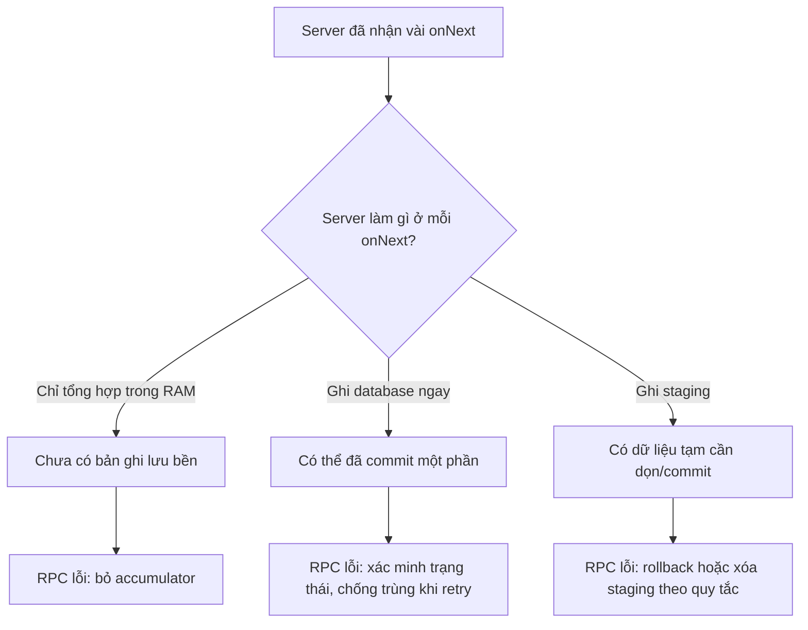

# Lỗi khi stream chưa hoàn tất

**Chương:** Client streaming  
**Ngữ cảnh:** Trong Spring gRPC (`SPRING_GRPC`), client và server trao đổi thông điệp theo hợp đồng Protocol Buffers; mã Java được sinh từ `.proto` cung cấp các stub và `StreamObserver`. Bài này tập trung vào **lỗi xảy ra khi client đang gửi nhiều request nhưng chưa kết thúc luồng**, cùng cách xử lý status, hủy, deadline và tác dụng phụ ở server.

## 1. Vấn đề: gửi được một phần rồi RPC thất bại

Giả sử client dự định gửi 1.000 mẫu đo trong một client streaming RPC. Server đã nhận 400 mẫu thì kết nối đứt, client hủy, deadline hết hoặc server phát hiện mẫu không hợp lệ. **Chưa nhận được response cuối** nên client không thể mặc định rằng toàn bộ lô đã thành công. Nếu server ghi dữ liệu ngay trong mỗi `onNext()`, một phần dữ liệu thậm chí có thể đã được lưu.

Đây là khác biệt cần quan tâm giữa client streaming và một phép gọi unary đơn giản: nhiều message nằm trong **một RPC có chung trạng thái kết thúc**. Khi RPC thất bại giữa luồng, gRPC cho biết *lời gọi không hoàn tất thành công*, nhưng không tự định nghĩa giao dịch nghiệp vụ phải rollback thế nào.

```mermaid
sequenceDiagram
    participant C as Client
    participant S as Spring gRPC server
    C->>S: onNext(request 1)
    C->>S: onNext(request 2)
    C->>S: onNext(request 3 sai dữ liệu)
    S-->>C: onError(INVALID_ARGUMENT)
    Note over C,S: RPC kết thúc lỗi; không có response thành công
    Note over C: Ngừng gửi các request còn lại
```

Ở nhánh khác, nếu client chủ động hủy hoặc mất mạng sau request thứ hai, server cần ngừng xử lý khi biết call bị hủy và giải phóng tài nguyên. Không được giả định rằng mọi callback đều tới được phía đối diện sau lỗi transport.

### Mục tiêu

Sau bài này bạn có thể:

1. Phân biệt `onError()`, `onCompleted()`, deadline và cancellation trong client streaming.
2. Biết khi nào server nên trả `INVALID_ARGUMENT`, `RESOURCE_EXHAUSTED`, `INTERNAL` hoặc một status phù hợp khác.
3. Triển khai server Spring gRPC xử lý lỗi giữa `onNext()` mà không gửi response thành công sau lỗi.
4. Viết client dừng gửi, nhận lỗi bất đồng bộ, giới hạn thời gian và không đánh dấu lô hoàn thành quá sớm.
5. Giải quyết dữ liệu đã xử lý một phần, retry và idempotency; kiểm thử lỗi **trước khi** client gọi `onCompleted()`.

## 2. Một client streaming RPC kết thúc theo cách nào?

Hợp đồng protobuf dạng:

```proto
rpc UploadSamples(stream Sample) returns (UploadReceipt);
```

Client có thể gọi `requestObserver.onNext(sample)` nhiều lần. Server trả **một** `UploadReceipt` nếu RPC thành công. Vòng đời điển hình:

```text
Client                               Server
  | -- onNext(Sample A) -------------> |  onNext(A)
  | -- onNext(Sample B) -------------> |  onNext(B)
  | -- requestObserver.onCompleted() ->|  onCompleted()
  | <- onNext(UploadReceipt) --------- |  responseObserver.onNext()
  | <- onCompleted() ----------------- |  responseObserver.onCompleted()
                 OK
```

Khi có lỗi giữa luồng, một trong những nhánh có thể xảy ra:

| Sự kiện | Phía phát hiện / phát sinh | Kết quả |
| --- | --- | --- |
| Client gửi xong bình thường | Client gọi `requestObserver.onCompleted()` | **Half-close chiều request**; RPC vẫn chờ kết quả server |
| Server phát hiện request sai | Server gọi `responseObserver.onError(statusException)` | RPC kết thúc bằng **status lỗi**, không có receipt thành công |
| Nguồn dữ liệu phía client gặp lỗi | Client hủy luồng gửi, thường qua `requestObserver.onError(cause)` | RPC không hoàn tất bình thường; callback response phía client được thông báo lỗi khi call kết thúc |
| Client chủ động hủy | Hủy call/request stream từ phía client | Thường thấy `CANCELLED` tại phía quan sát phù hợp |
| Deadline hết | gRPC tự xử lý thời hạn của call | Client thường thấy `DEADLINE_EXCEEDED` |
| Kết nối đứt hoặc server không sẵn sàng | Transport | Client có thể thấy `UNAVAILABLE` |

**Hai quy tắc cốt lõi:** `requestObserver.onCompleted()` ở client *không đồng nghĩa* RPC thành công; và `onError()`/`onCompleted()` trên **cùng một observer** là hai kiểu kết thúc loại trừ nhau. Sau callback kết thúc, không gọi `onNext()` tiếp.

### Không đồng nhất ba trạng thái

1. **Client đã gọi `onNext()`:** gRPC nhận yêu cầu phát message tại tiến trình client, nhưng message có thể vẫn đang ở bộ đệm.
2. **Server đã chạy `onNext()`:** một message đã được giao tới mã server. Việc validate, xử lý và lưu bền tùy thuộc implementation.
3. **Ứng dụng đã commit:** dữ liệu đã đạt bảo đảm lưu trữ mà ứng dụng công bố. Chỉ tầng nghiệp vụ mới có thể xác nhận điều này.

Không thể suy ra trạng thái thứ ba từ hai trạng thái đầu, hoặc từ việc client đã gọi `onCompleted()`.

## 3. Định nghĩa hợp đồng Protocol Buffers

Ví dụ một lô mẫu đo được gửi từ thiết bị lên Spring gRPC server. Tạo `src/main/proto/sample_ingest.proto`:

```proto
syntax = "proto3";

package ingest.v1;
option java_package = "com.example.ingest.grpc";
option java_multiple_files = true;

service SampleIngestService {
  // Client gửi nhiều Sample; server chỉ trả một UploadReceipt.
  rpc UploadSamples(stream Sample) returns (UploadReceipt);
}

message Sample {
  string batch_id = 1;
  string event_id = 2;
  int64 recorded_at_epoch_ms = 3;
  double value = 4;
}

message UploadReceipt {
  string batch_id = 1;
  int64 accepted_count = 2;
}
```

Từ khóa `stream` ở phía `Sample` cho phép nhiều request. `returns (UploadReceipt)` chỉ có một response thành công. Khi cấu hình protobuf compiler và plugin gRPC Java, dự án sinh `Sample`, `UploadReceipt` và `SampleIngestServiceGrpc`; các lớp này **không viết tay**.

`batch_id` định danh một lần tải lô, `event_id` là định danh phần tử. Chúng chưa tự bảo đảm không ghi trùng; để retry an toàn, server phải lưu và thực thi cơ chế idempotency theo các định danh này.

## 4. Server Spring gRPC từ chối dữ liệu lỗi giữa luồng

Một server nhận nhiều request qua `StreamObserver<Sample>`; nếu thấy message không hợp lệ hoặc vượt quota, server kết thúc RPC **ngay** bằng `responseObserver.onError()`. Không chờ client gửi hết lô để báo lỗi.

```java
package com.example.ingest.server;

import com.example.ingest.grpc.Sample;
import com.example.ingest.grpc.SampleIngestServiceGrpc;
import com.example.ingest.grpc.UploadReceipt;
import io.grpc.Status;
import io.grpc.stub.StreamObserver;
import org.springframework.grpc.server.service.GrpcService;

@GrpcService
public class SampleIngestGrpcService
        extends SampleIngestServiceGrpc.SampleIngestServiceImplBase {

    private static final long MAX_SAMPLES = 10_000L;

    @Override
    public StreamObserver<Sample> uploadSamples(
            StreamObserver<UploadReceipt> responseObserver) {

        // Trạng thái dành riêng cho MỘT RPC.
        return new StreamObserver<>() {
            private String batchId;
            private long count;
            private boolean terminated;

            @Override
            public void onNext(Sample sample) {
                if (terminated) return;

                if (sample.getBatchId().isBlank()
                        || sample.getEventId().isBlank()
                        || sample.getRecordedAtEpochMs() <= 0
                        || !Double.isFinite(sample.getValue())) {
                    fail(Status.INVALID_ARGUMENT, "Sample không hợp lệ");
                    return;
                }

                if (batchId != null
                        && !batchId.equals(sample.getBatchId())) {
                    fail(Status.INVALID_ARGUMENT, "batch_id không nhất quán");
                    return;
                }

                if (count >= MAX_SAMPLES) {
                    fail(Status.RESOURCE_EXHAUSTED, "Lô vượt quota");
                    return;
                }

                batchId = sample.getBatchId();
                count++;
                // Chỉ đếm trong RAM, chưa lưu database.
            }

            @Override
            public void onError(Throwable error) {
                // Client hủy hoặc inbound stream lỗi:
                // dọn file tạm, bộ đệm, transaction... nếu có.
                terminated = true;
                // Không gửi UploadReceipt thành công.
            }

            @Override
            public void onCompleted() {
                if (terminated) return;
                if (count == 0) {
                    fail(Status.INVALID_ARGUMENT, "Lô rỗng");
                    return;
                }

                UploadReceipt receipt = UploadReceipt.newBuilder()
                        .setBatchId(batchId)
                        .setAcceptedCount(count)
                        .build();

                terminated = true;
                responseObserver.onNext(receipt);
                responseObserver.onCompleted();
            }

            private void fail(Status status, String description) {
                if (terminated) return;
                terminated = true;
                responseObserver.onError(
                        status.withDescription(description).asRuntimeException());
            }
        };
    }
}
```

Trong ví dụ này, `onNext()` chỉ tăng bộ đếm, nên khi luồng hỏng trước `onCompleted()` sẽ **không có bản ghi nào được commit**. Đó là đặc tính của implementation minh họa, **không phải bảo đảm mặc định** của client streaming.

Các điểm cần nhớ:

- Server **nhận** `onError(Throwable)` trên request observer khi đầu vào lỗi/hủy và có thể dọn tài nguyên tại đây. Không giả định server luôn được gọi callback này ngay lập tức khi phía xa mất mạng; việc phát hiện còn phụ thuộc transport.
- Server **gọi** `responseObserver.onError(statusException)` khi chủ động từ chối message. Đó là cách trả gRPC status lỗi về client; không gọi tiếp `responseObserver.onNext()` hoặc `onCompleted()`.
- Server chỉ gọi `responseObserver.onNext(receipt)` rồi `responseObserver.onCompleted()` khi client đã half-close bình thường và quy tắc nghiệp vụ cho phép thành công.
- `terminated` giúp tránh hai terminal callback trong xử lý tuần tự. Nếu xử lý bất đồng bộ trên nhiều thread hoặc đăng ký cancellation callback đồng thời, phải bảo vệ trạng thái kết thúc bằng cơ chế đồng bộ thích hợp.
- Mỗi lời gọi tạo một observer và bộ đếm riêng. Không giữ `count` trong field mutable chung của singleton Spring service, vì nhiều client có thể gọi đồng thời.

### Không dùng ngoại lệ Java làm protocol lỗi một cách tùy tiện

Thay vì để `IllegalArgumentException` hoặc lỗi hạ tầng thoát khỏi `onNext()` không kiểm soát, hãy ánh xạ lỗi thành gRPC `Status` có ý nghĩa. Không đưa stack trace, SQL query, token hoặc chi tiết nội bộ vào phần mô tả lỗi trả cho client.

Ví dụ `INVALID_ARGUMENT` dùng cho trường hợp dữ liệu khách hàng sai; `RESOURCE_EXHAUSTED` cho lô quá quota; lỗi database không mong muốn thường cần log nội bộ và trả `INTERNAL` hoặc status khác phù hợp tình huống, chứ không mặc định `INVALID_ARGUMENT`.

## 5. Client nhận lỗi khi chưa gửi xong

Client streaming trong gRPC Java sử dụng **asynchronous stub**. Ở client cần theo dõi cả hai chiều: `requestObserver` để gửi và `responseObserver` để nhận status/biên nhận. Callback phản hồi có thể chạy ngay khi server từ chối request, **trước** khi producer kịp gọi `onCompleted()`.

Đoạn client dưới đây dành cho một lô nhỏ, hữu hạn; dự án có thể tạo async stub từ `GrpcChannelFactory` của Spring gRPC:

```java
package com.example.ingest.client;

import com.example.ingest.grpc.Sample;
import com.example.ingest.grpc.SampleIngestServiceGrpc;
import com.example.ingest.grpc.UploadReceipt;
import io.grpc.stub.StreamObserver;
import java.util.List;
import java.util.Objects;
import java.util.concurrent.CompletableFuture;
import java.util.concurrent.TimeUnit;
import java.util.concurrent.atomic.AtomicBoolean;

public class SampleUploadClient {

    private final SampleIngestServiceGrpc.SampleIngestServiceStub stub;

    public SampleUploadClient(
            SampleIngestServiceGrpc.SampleIngestServiceStub stub) {
        this.stub = stub;
    }

    public CompletableFuture<UploadReceipt> upload(List<Sample> samples) {
        Objects.requireNonNull(samples, "samples");
        CompletableFuture<UploadReceipt> result = new CompletableFuture<>();
        AtomicBoolean responseEnded = new AtomicBoolean();

        StreamObserver<UploadReceipt> responses = new StreamObserver<>() {
            private int responseCount;
            private UploadReceipt receipt;

            @Override
            public void onNext(UploadReceipt value) {
                receipt = value;
                responseCount++;
            }

            @Override
            public void onError(Throwable error) {
                responseEnded.set(true);
                result.completeExceptionally(error);
            }

            @Override
            public void onCompleted() {
                responseEnded.set(true);
                if (responseCount == 1) {
                    result.complete(receipt);
                } else {
                    result.completeExceptionally(
                            new IllegalStateException(
                                    "Phải nhận đúng một UploadReceipt"));
                }
            }
        };

        StreamObserver<Sample> requests = stub
                .withDeadlineAfter(5, TimeUnit.SECONDS)
                .uploadSamples(responses);

        try {
            for (Sample sample : samples) {
                // Khi đã biết response kết thúc, không tiếp tục phát.
                if (responseEnded.get()) break;
                requests.onNext(sample);
            }
            if (!responseEnded.get()) {
                requests.onCompleted();
            }
        } catch (RuntimeException failure) {
            result.completeExceptionally(failure);
            if (!responseEnded.get()) {
                try {
                    requests.onError(failure); // Hủy stream nếu còn mở.
                } catch (RuntimeException ignored) {
                    // Có thể RPC đã bị đóng bởi lỗi trước đó.
                }
            }
        }

        return result;
    }
}
```

Ví dụ trên minh họa cách **ngừng một producer tuần tự khi đã quan sát thấy lỗi phản hồi**. `responseEnded` chỉ là tín hiệu phối hợp ở tầng ứng dụng: status có thể đến giữa hai lần kiểm tra và việc gửi bất đồng bộ vẫn có thể phát sinh lỗi. Với lô lớn hoặc producer trên nhiều thread, cần một bộ điều phối duy nhất cho `onNext/onCompleted/onError`, hàng đợi có giới hạn, xử lý flow control và cơ chế cancel call rõ ràng.

Không dùng `result.isDone()` hoặc `onNext()` trả về để suy luận server đã lưu xong dữ liệu. Một kết quả thành công được xác định sau khi client nhận **một receipt hợp lệ** và callback response kết thúc bình thường.

### Nguồn dữ liệu local bị lỗi giữa lúc đang gửi

Giả sử client đọc file và gửi từng `Sample`. Đọc file có thể phát sinh `IOException` trước khi đến cuối file. Trong trường hợp này, **không gọi `requestObserver.onCompleted()`**, vì làm vậy dễ khiến server hiểu đây là một lô đã gửi đủ và trả thành công.

Ý tưởng:

```java
// Biến requests là request observer của RPC đang mở.
try {
    // Đọc và gửi nhiều Sample hợp lệ...
    // Nếu nguồn đã hết bình thường:
    requests.onCompleted();
} catch (java.io.IOException sourceFailure) {
    // Đánh dấu upload thất bại và hủy RPC thay vì half-close thành công.
    requests.onError(sourceFailure);
}
```

Lưu ý: đây là đoạn minh họa nhánh kết thúc của một **producer duy nhất**; trong ứng dụng thực phải bảo đảm observer chưa kết thúc và không có tác vụ khác đang ghi đồng thời. Ở phía client, `requests.onError(...)` thường hủy call; nó **không phải** cách gửi một status nghiệp vụ tùy ý đến server qua HTTP/2.

### Hủy RPC chủ động

Khi người dùng dừng tải hoặc nguồn dữ liệu không còn hợp lệ, cần hủy lời gọi và ngừng producer. Với gRPC Java, có thể quản lý `ClientCallStreamObserver` và gọi `cancel(reason, cause)`, hoặc báo lỗi qua request observer khi phù hợp. Một `CompletableFuture.cancel()` ở tầng wrapper **không tự động bảo đảm** underlying gRPC call cũng được hủy; phải nối cơ chế hủy giữa hai tầng.

## 6. Các gRPC status thường gặp

| Status | Tình huống thường gặp | Cách phản ứng |
| --- | --- | --- |
| `INVALID_ARGUMENT` | Message có trường sai hoặc vi phạm hợp đồng lô | Sửa dữ liệu, không retry y nguyên |
| `RESOURCE_EXHAUSTED` | Quá quota số message, byte hoặc tài nguyên | Chia nhỏ lô, giảm tốc, tuân thủ quota |
| `DEADLINE_EXCEEDED` | Không kết thúc toàn bộ RPC trong thời hạn | Xử lý kết quả có thể chưa rõ; xác minh trước retry |
| `CANCELLED` | Call bị phía gọi hủy hoặc ngữ cảnh RPC bị hủy | Dừng producer, dọn tài nguyên |
| `UNAVAILABLE` | Đường truyền/server tạm thời không sẵn sàng | Retry có kiểm soát và idempotency |
| `INTERNAL` | Lỗi nội bộ ngoài dự kiến | Log trace nội bộ, điều tra, không làm lộ thông tin nhạy cảm |

Không thể khẳng định một status **luôn** xuất hiện theo cùng một cách ở cả hai đầu. Ví dụ deadline phía client có thể hiển thị `DEADLINE_EXCEEDED` dù server quan sát sự hủy của RPC. Khi mất kết nối đột ngột, callback phát hiện lỗi cũng có thể trễ.

Ánh xạ nguyên nhân về mã status:

```java
import io.grpc.Status;

void report(Throwable error) {
    Status status = Status.fromThrowable(error);
    switch (status.getCode()) {
        case INVALID_ARGUMENT ->
            System.out.println("Dữ liệu không hợp lệ");
        case RESOURCE_EXHAUSTED ->
            System.out.println("Giảm kích thước hoặc tốc độ tải");
        case DEADLINE_EXCEEDED, UNAVAILABLE ->
            System.out.println("Cần xác minh trạng thái lô trước khi retry");
        default ->
            System.out.println("RPC thất bại: " + status.getCode());
    }
}
```

Trong callback `CompletableFuture`, `error` có thể được bọc bằng `CompletionException` hoặc `ExecutionException`; hãy lấy `cause` thích hợp trước khi gọi `Status.fromThrowable` nếu cần phân loại chính xác.

## 7. Tác dụng phụ khi stream bị lỗi giữa chừng

Đây là điểm quyết định tính tin cậy: **gRPC không cung cấp giao dịch database cho toàn bộ stream**.



### Ba chiến lược phổ biến

| Chiến lược | Điều xảy ra nếu client mất kết nối sau 400/1.000 message | Đánh đổi |
| --- | --- | --- |
| **Tổng hợp RAM rồi trả một receipt** | Bỏ kết quả đang tính, không có dữ liệu lưu bền | Phù hợp thống kê; server vẫn cần giới hạn tài nguyên |
| **Ghi từng message** | Có thể đã lưu một phần, dù RPC thất bại | Cần xác nhận trạng thái, idempotency từng message |
| **Ghi staging rồi commit toàn lô** | Dữ liệu tạm cần rollback/xóa khi lỗi; chỉ công bố thành công sau commit | Phức tạp hơn, nhưng có thể đáp ứng all-or-nothing |

Không diễn giải `DEADLINE_EXCEEDED` hoặc `UNAVAILABLE` là “server chưa làm gì”. Server có thể đã commit thành công nhưng client mất response ngay trước khi nhận được nó.

### Mẫu thiết kế retry tránh ghi trùng

1. Client tạo một `batch_id` cố định và gắn `event_id` ổn định cho mỗi phần tử, **giữ nguyên khi thử lại**.
2. Server lưu trạng thái lô (`RECEIVING`, `COMMITTED`, `FAILED`, v.v.) và ràng buộc duy nhất/kiểm tra trùng theo ID được chọn. Trạng thái chỉ có ý nghĩa khi thật sự lưu bền ở hệ thống.
3. Server chỉ phát `UploadReceipt` sau khi đã đạt điều kiện thành công nghiệp vụ (ví dụ commit transaction).
4. Nếu client mất receipt, nó tra cứu trạng thái lô qua một unary RPC hoặc cơ chế tương đương trước khi phát lại. Nếu cần gửi lại, server xử lý trùng theo chính sách idempotency.
5. Với lô quá dài, chia thành nhiều lô hữu hạn để giới hạn chi phí phục hồi và thời gian chờ biên nhận.

Tính *exactly once* ở tầng nghiệp vụ không tự xuất hiện từ tính năng streaming; nó phải được thiết kế trên storage, khóa nghiệp vụ và quy tắc commit.

## 8. Cleanup, cancellation và các cuộc đua bất đồng bộ

Nếu server giữ file tạm, kết nối DB, bộ nhớ đệm hoặc tác vụ nền theo từng RPC, hãy giải phóng chúng khi **hoàn tất thành công, lỗi chủ động, hủy hoặc hết deadline**. `onError(Throwable)` của observer nhận request là nơi xử lý inbound error, nhưng khi có tác vụ async hoặc cancellation, chỉ dựa vào một callback có thể chưa đủ.

Trong gRPC Java, `ServerCallStreamObserver` cung cấp thông tin/callback về hủy:

```java
import io.grpc.stub.ServerCallStreamObserver;
import io.grpc.stub.StreamObserver;
import java.util.concurrent.atomic.AtomicBoolean;

// Bên trong method server, với responseObserver do gRPC truyền vào:
ServerCallStreamObserver<UploadReceipt> serverCall =
        (ServerCallStreamObserver<UploadReceipt>) responseObserver;
AtomicBoolean cancelled = new AtomicBoolean();
serverCall.setOnCancelHandler(() -> {
    cancelled.set(true);
    // Phát tín hiệu ngừng tác vụ nền; cleanup cần idempotent/thread-safe.
});
```

Đây chỉ là **đoạn minh họa bổ sung**, không cần dùng nếu server không có tài nguyên hoặc tác vụ nền để hủy. Với server gRPC Java thông thường, `responseObserver` là một `ServerCallStreamObserver`; khi triển khai adapter/mock đặc biệt cần xem xét giả định ép kiểu này. `setOnCancelHandler` nên được đăng ký ở thời điểm khởi tạo RPC; callback hủy có thể chạy từ thread khác, vì vậy không trực tiếp gọi chồng chéo `onNext/onCompleted/onError` mà thiếu điều phối.

Một mô hình an toàn là coi trạng thái terminal như một chuyển trạng thái **chỉ xảy ra một lần**: `ACTIVE -> SUCCESS`, `ACTIVE -> ERROR` hoặc `ACTIVE -> CANCELLED`. Đường chuyển thắng cuộc quyết định việc gửi response; các đường còn lại chỉ dọn tài nguyên. Với xử lý đa thread, dùng cơ chế đồng bộ/atomic và bảo đảm observer gửi được gọi theo thứ tự.

Deadline phải bao trùm **toàn bộ** RPC: từ mở luồng, gửi từng message, xử lý server đến lúc nhận biên nhận. Tránh để một stream mở vô hạn khi client quên `onCompleted()`; đồng thời không đặt deadline quá ngắn so với kích thước lô và tốc độ truyền.

## 9. Kiểm thử lỗi trước khi client half-close

Để kiểm tra server từ chối một request sai **khi client chưa gọi `onCompleted()`**, có thể dùng gRPC in-process. Test dưới đây không cần cổng mạng nhưng vẫn gọi qua async stub và callback gRPC thật. Dự án cần JUnit 5, `grpc-inprocess` cùng các dependency protobuf/gRPC.

```java
package com.example.ingest;

import com.example.ingest.grpc.Sample;
import com.example.ingest.grpc.SampleIngestServiceGrpc;
import com.example.ingest.grpc.UploadReceipt;
import com.example.ingest.server.SampleIngestGrpcService;
import io.grpc.ManagedChannel;
import io.grpc.Server;
import io.grpc.Status;
import io.grpc.inprocess.InProcessChannelBuilder;
import io.grpc.inprocess.InProcessServerBuilder;
import io.grpc.stub.StreamObserver;
import java.util.concurrent.CompletableFuture;
import java.util.concurrent.TimeUnit;
import org.junit.jupiter.api.Test;

import static org.junit.jupiter.api.Assertions.assertEquals;

class SampleErrorStreamingTest {

    @Test
    void invalidMessageTerminatesRpcBeforeClientHalfClose()
            throws Exception {
        String name = InProcessServerBuilder.generateName();
        Server server = InProcessServerBuilder.forName(name)
                .directExecutor()
                .addService(new SampleIngestGrpcService())
                .build()
                .start();
        ManagedChannel channel = InProcessChannelBuilder.forName(name)
                .directExecutor()
                .build();

        try {
            CompletableFuture<Status.Code> finished =
                    new CompletableFuture<>();

            StreamObserver<UploadReceipt> responseObserver =
                    new StreamObserver<>() {
                        @Override
                        public void onNext(UploadReceipt value) {
                            finished.completeExceptionally(
                                    new AssertionError(
                                            "Không được nhận success receipt"));
                        }

                        @Override
                        public void onError(Throwable error) {
                            finished.complete(
                                    Status.fromThrowable(error).getCode());
                        }

                        @Override
                        public void onCompleted() {
                            finished.completeExceptionally(
                                    new AssertionError(
                                            "Không được hoàn tất OK"));
                        }
                    };

            StreamObserver<Sample> requests =
                    SampleIngestServiceGrpc.newStub(channel)
                            .uploadSamples(responseObserver);

            requests.onNext(sample("event-1", 20.0));
            // Sample thứ hai sai event_id: server phải từ chối sớm.
            requests.onNext(sample("", 21.0));

            // CHỦ Ý không gọi requests.onCompleted().
            assertEquals(Status.Code.INVALID_ARGUMENT,
                    finished.get(3, TimeUnit.SECONDS));
        } finally {
            channel.shutdownNow();
            server.shutdownNow();
        }
    }

    private static Sample sample(String eventId, double value) {
        return Sample.newBuilder()
                .setBatchId("batch-1")
                .setEventId(eventId)
                .setRecordedAtEpochMs(1_700_000_000_000L)
                .setValue(value)
                .build();
    }
}
```

Test chứng minh server có thể phát status lỗi **trước** khi nhận tín hiệu hết request. Khi thêm lớp lưu database, cần kiểm tra tác dụng phụ trước/sau lỗi bằng fixture lưu trữ, không suy luận từ status đơn thuần.

Các ca kiểm thử khác:

| Ca | Kỳ vọng |
| --- | --- |
| Client gửi hợp lệ rồi gọi `onCompleted()` | Nhận đúng một `UploadReceipt`, response `onCompleted()`, status `OK` |
| Client hủy sau vài message | Không có receipt thành công; server dọn tài nguyên và dừng xử lý phần còn lại |
| Client không half-close | Deadline kết thúc RPC, không có thành công giả |
| Vượt giới hạn 10.000 message | `RESOURCE_EXHAUSTED` trước khi server trả receipt |
| Gửi hai `batch_id` khác nhau | `INVALID_ARGUMENT` |
| Mất kết nối sau khi đã lưu một phần | Trạng thái lưu trữ đúng với chính sách giao dịch; retry không ghi trùng |
| Tác vụ async hoàn thành cùng lúc với cancellation | Chỉ có **một** terminal result/cleanup, không gọi observer sau khi đóng |

Kiểm thử in-process không chứng minh cấu hình TLS, interceptor, độ trễ mạng hoặc khả năng chịu tải của Spring context thật. Cần thêm kiểm thử tích hợp qua transport thực và các bài đo hiệu năng/độ tin cậy.

## 10. Các lỗi triển khai phổ biến

| Biểu hiện | Nguyên nhân hay gặp | Cách giải quyết |
| --- | --- | --- |
| Client vẫn gửi sau khi server đã báo lỗi | Producer không theo dõi callback `onError` | Dừng producer, hủy nguồn đọc, điều phối trạng thái luồng |
| Server trả receipt dù file client chưa đọc xong | Client gọi `onCompleted()` sau lỗi nguồn đọc | Hủy RPC bằng `onError`/cancel thay vì half-close thành công |
| Client hết deadline nhưng hệ thống vẫn ghi trùng khi retry | Server đã commit một phần hoặc toàn bộ lô | Thêm idempotency và tra cứu trạng thái theo `batch_id` |
| Server gọi cả `onError()` và `onCompleted()` | Nhánh lỗi và async success chạy cạnh tranh | Dùng state terminal atomic/đồng bộ; một đường kết thúc |
| Server rò rỉ file tạm sau client hủy | Không có cleanup ở các nhánh abort | Dọn tài nguyên trong luồng kết thúc/hủy |
| Server thông báo `OK` dù commit DB thất bại | Phát receipt trước khi commit xong | Chờ điều kiện nghiệp vụ thành công thực sự |
| Luồng lớn gây tăng bộ nhớ | Client đẩy quá nhanh hoặc server giữ toàn bộ dữ liệu | Giới hạn tài nguyên và dùng flow control/backpressure |

## 11. Thực hành và câu hỏi tự kiểm tra

1. Client dự định gửi 500 message, mới gửi 120 thì file nguồn gặp `IOException`. Bạn sẽ gọi `onCompleted()` hay `onError()` ở request observer, và vì sao?
2. Server phát hiện request thứ 8 thiếu `event_id` trước khi client gửi đủ 20 request. Hãy vẽ callback tiếp theo ở client và giải thích vì sao không được phát receipt thành công.
3. Client gặp `DEADLINE_EXCEEDED` sau khi server đã ghi 400/500 bản ghi. Thiết kế `batch_id`, `event_id` và endpoint tra cứu nào giúp retry an toàn?
4. Bổ sung vào server một tài nguyên tạm giả lập và chứng minh bằng test rằng nó được giải phóng trên cả nhánh `OK`, validation error và cancellation.
5. Một tác vụ commit hoàn thành đúng lúc client hủy RPC. Hãy thiết kế state machine ngăn hai terminal callback và mô tả cách xử lý commit đã xong nhưng client chưa nhận response.

**Ghi nhớ:** Lỗi khi client streaming **chưa hoàn tất** khiến RPC kết thúc bằng gRPC status, thường **không có response thành công**. Hãy dừng producer, dọn tài nguyên, phân biệt message đã nhận với dữ liệu đã commit, dùng deadline và flow control hợp lý, đồng thời thiết kế idempotency để xử lý kết quả không chắc chắn khi mất kết nối.
