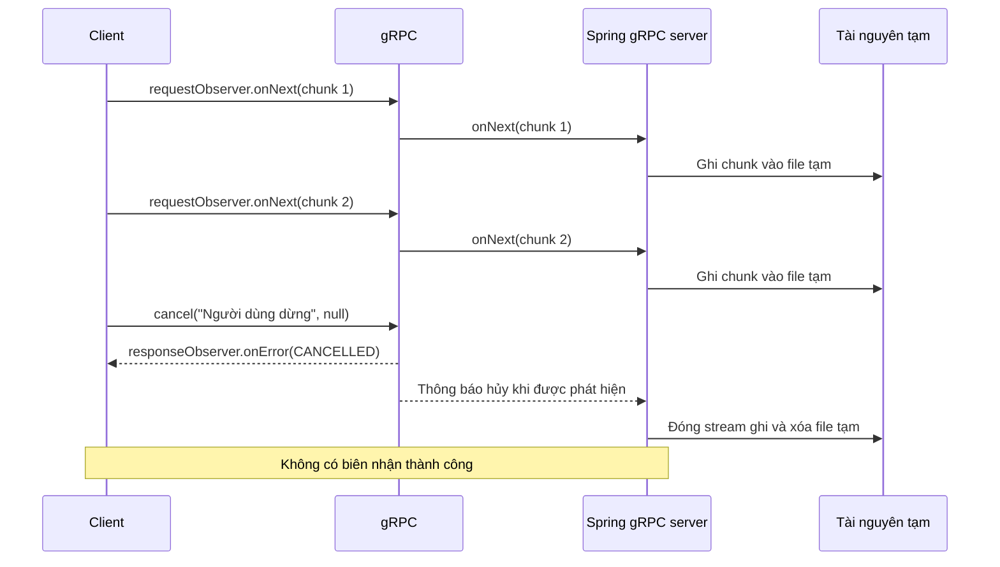

# Hủy client stream và giải phóng resource

**Chương:** Client streaming  
**Bối cảnh:** Trong Spring gRPC (`SPRING_GRPC`), hợp đồng Protocol Buffers định nghĩa các RPC, công cụ sinh mã Java tạo stub và lớp server, còn gRPC Java quản lý truyền thông điệp, deadline, status và vòng đời stream. Bài này tập trung vào **hủy một client streaming RPC đang chạy** và **giải phóng tài nguyên** khi luồng kết thúc thành công, gặp lỗi hoặc bị hủy.

## 1. Vì sao hủy stream cần được thiết kế chủ động?

Một thiết bị tải file theo từng phần lên server. Trong quá trình tải, server có thể mở file tạm, giữ bộ đệm, đặt trước dung lượng ổ đĩa hoặc bắt đầu tác vụ lưu dữ liệu. Nếu người dùng bấm **Dừng tải** ở phần thứ 40/100, hệ thống phải ngừng gửi, báo kết quả cuối là **không thành công**, ngừng công việc không còn cần thiết và dọn file tạm theo chính sách.

Hủy gRPC không tự động hoàn tác mọi thao tác nghiệp vụ. Chẳng hạn, nếu 40 phần dữ liệu đã được commit vào cơ sở dữ liệu trước khi hủy thì việc hủy RPC **không tự rollback** 40 phần đó. Do đó, cần phân biệt **hủy truyền thông**, **hủy công việc** và **hoàn tác tác dụng phụ**.



Sơ đồ cho thấy một luồng hủy điển hình; thứ tự chính xác giữa callback tại hai đầu phụ thuộc lịch thực thi và tình trạng mạng. Khi kết nối đứt, phía server có thể biết việc hủy muộn hơn phía client.

### Mục tiêu học tập

Sau bài này, bạn có thể:

1. Phân biệt `requestObserver.onCompleted()`, `requestObserver.onError()` và `ClientCallStreamObserver.cancel()`.
2. Phân biệt `CANCELLED`, `DEADLINE_EXCEEDED`, lỗi dữ liệu và kết thúc `OK` trong một client streaming RPC.
3. Dùng `ServerCallStreamObserver.setOnCancelHandler()` và `isCancelled()` để biết khi server không còn nên tiếp tục công việc.
4. Thiết kế hàm cleanup chạy **đúng một lần** dù nhiều đường kết thúc có thể cùng xảy ra.
5. Giải phóng file tạm, bộ đệm, transaction và tác vụ nền theo đúng ngữ nghĩa dữ liệu.
6. Viết client có khả năng hủy ngay cả khi đã gửi hết request nhưng vẫn đang chờ response.
7. Kiểm thử hủy trước khi half-close, hủy sau half-close và các cuộc đua giữa hủy với hoàn tất.

## 2. Phân biệt ba thao tác kết thúc ở phía client

Trong client streaming, một RPC chứa **nhiều request message** và server trả **một response thành công**. Phía client dùng `StreamObserver<Request>` do async stub trả về để gửi các request.

| Thao tác | Ý nghĩa | Server/Client quan sát được gì? |
| --- | --- | --- |
| `requestObserver.onNext(chunk)` | Yêu cầu gRPC gửi thêm một message | Server nhận `onNext(chunk)` khi message tới; đây không phải xác nhận lưu bền |
| `requestObserver.onCompleted()` | **Half-close** chiều gửi: client đã gửi hết request bình thường | Server có thể nhận inbound `onCompleted()`, xử lý rồi trả kết quả; client vẫn chờ response |
| `requestObserver.onError(cause)` | Kết thúc chiều gửi bằng lỗi; gRPC Java thường dùng để hủy RPC phía client | RPC không còn hoàn tất bình thường; không dùng làm kênh gửi status nghiệp vụ tùy ý đến server |
| `ClientCallStreamObserver.cancel(message, cause)` | **Chủ động hủy call** từ client | Client thường nhận `CANCELLED`, server nhận tín hiệu hủy khi gRPC phát hiện; cần dừng producer |

Không được gọi `onNext()` sau khi chính bạn đã gọi `onCompleted()` hoặc `onError()` trên cùng observer. **Half-close không phải cancel**: sau `onCompleted()`, client vẫn có thể cần hủy một RPC đang chờ server xử lý/commit. Chính vì vậy, client cần quản lý **trạng thái đã gửi xong** và **trạng thái RPC đã kết thúc** riêng biệt.

### Những trường hợp cần hủy

- Người dùng bấm dừng tải file, chuyển màn hình và tác vụ không còn cần thiết.
- Nguồn đọc file/thiết bị phát sinh lỗi giữa lô; gửi `onCompleted()` sẽ dễ khiến server hiểu lô đã hoàn chỉnh.
- Deadline hoặc giới hạn tài nguyên không còn cho phép tiếp tục xử lý.
- Ứng dụng phát hiện một điều kiện nghiệp vụ không thể khắc phục trong lô hiện tại.
- Client đã half-close nhưng phải dừng chờ kết quả do người dùng thay đổi yêu cầu.

Không hủy một RPC chỉ vì `onNext()` chưa trả kết quả: client streaming chỉ có **một response cuối**, vì vậy không có biên nhận trên mỗi lần gửi.

## 3. Hợp đồng Protocol Buffers cho ví dụ tải theo chunk

Tạo `src/main/proto/chunk_upload.proto`:

```proto
syntax = "proto3";

package upload.v1;
option java_package = "com.example.upload.grpc";
option java_multiple_files = true;

service ChunkUploadService {
  // Client gửi nhiều chunk, server trả một receipt khi thành công.
  rpc Upload(stream UploadChunk) returns (UploadReceipt);
}

message UploadChunk {
  string upload_id = 1;
  int32 sequence = 2; // Bắt đầu từ 0, tăng 1 theo từng chunk.
  bytes data = 3;
}

message UploadReceipt {
  string upload_id = 1;
  int64 received_bytes = 2;
}
```

Sau bước sinh mã protobuf và gRPC Java, dự án có `UploadChunk`, `UploadReceipt` và `ChunkUploadServiceGrpc`. Mẫu phương thức server:

```java
@Override
public StreamObserver<UploadChunk> upload(
        StreamObserver<UploadReceipt> responseObserver);
```

`StreamObserver<UploadChunk>` **được server trả về** dùng để nhận từng request. `responseObserver` **được server nhận làm tham số** dùng để gửi kết quả cuối hoặc status lỗi. Khi client chủ động hủy, server **không** tạo một `UploadReceipt` giả để báo thành công.

Ví dụ trong bài sẽ viết chunk vào **file tạm**, sau đó xóa file tạm cả khi thành công hoặc thất bại. Receipt chỉ cho biết số byte hợp lệ đã xử lý trong demo; **chưa có bước lưu file bền vững**. Ở hệ thống thật, cần thêm bước commit/di chuyển file vào kho lưu trữ trước khi gửi biên nhận thành công.

## 4. Những tài nguyên phải quản lý theo vòng đời RPC

| Resource | Khi mở stream | Khi thành công | Khi lỗi/hủy |
| --- | --- | --- | --- |
| File tạm / file descriptor | Tạo file và mở luồng ghi | Đóng và xử lý file theo hợp đồng (commit/xóa) | Đóng rồi xóa file tạm nếu chưa commit |
| Bộ đệm trong RAM | Dành dung lượng có giới hạn | Giải phóng | Xóa dữ liệu tạm và giải phóng |
| Tác vụ ghi/biến đổi dữ liệu | Khởi chạy theo yêu cầu | Chờ hoàn tất hoặc dừng đúng lúc | Phát tín hiệu hủy và thu hồi tác vụ nếu có thể |
| Transaction database | Bắt đầu theo chiến lược ghi | Commit trước khi báo thành công | Rollback nếu chưa commit; xác minh trạng thái nếu commit đã xảy ra |
| Dung lượng/quota mỗi lô | Giữ quota lúc nhận | Trả quota sau khi hoàn tất | Trả quota khi hủy/lỗi |
| Metadata/tracing | Gắn thông tin toàn RPC | Kết thúc span và ghi status | Ghi status hủy/lỗi, tránh lộ token |

Một API cleanup tốt có ba đặc điểm:

1. **Idempotent:** gọi nhiều lần vẫn chỉ giải phóng cùng một tài nguyên một lần.
2. **Không phá kết quả đã commit:** xóa file staging chưa hoàn tất khác với xóa tài liệu đã lưu thành công.
3. **Có thể quan sát:** lỗi xóa file, số luồng đang mở và tài nguyên chưa giải phóng phải có log/metric phù hợp.

Trong gRPC Java, callback nhận dữ liệu có thể nối tiếp nhau, nhưng **cancellation handler** và tác vụ bất đồng bộ có thể xuất hiện từ thread khác. Nếu cả `onNext()`, `onCompleted()`, `onError()` và `setOnCancelHandler()` đều có khả năng cleanup, cần điều phối để tránh vừa đóng file vừa ghi hoặc gửi hai terminal callback.

## 5. Server Spring gRPC: hủy và dọn file tạm đúng một lần

Ví dụ sau minh họa một server dùng `@GrpcService`, `ServerCallStreamObserver`, khóa điều phối theo RPC và cờ `AtomicBoolean`. Server ghi từng chunk vào file tạm, giới hạn byte/chunk và số chunk, sau đó dọn tài nguyên khi thành công, lỗi hoặc hủy.

```java
package com.example.upload.server;

import com.example.upload.grpc.ChunkUploadServiceGrpc;
import com.example.upload.grpc.UploadChunk;
import com.example.upload.grpc.UploadReceipt;
import com.google.protobuf.ByteString;
import io.grpc.Status;
import io.grpc.stub.ServerCallStreamObserver;
import io.grpc.stub.StreamObserver;
import java.io.IOException;
import java.io.OutputStream;
import java.nio.file.Files;
import java.nio.file.Path;
import java.util.concurrent.atomic.AtomicBoolean;
import org.slf4j.Logger;
import org.slf4j.LoggerFactory;
import org.springframework.grpc.server.service.GrpcService;

@GrpcService
public final class ChunkUploadGrpcService
        extends ChunkUploadServiceGrpc.ChunkUploadServiceImplBase {

    private static final Logger log =
            LoggerFactory.getLogger(ChunkUploadGrpcService.class);
    private static final int MAX_CHUNKS = 10_000;
    private static final int MAX_CHUNK_BYTES = 256 * 1024;
    private static final long MAX_TOTAL_BYTES = 16L * 1024 * 1024;

    @Override
    public StreamObserver<UploadChunk> upload(
            StreamObserver<UploadReceipt> responseObserver) {

        // Trong server RPC của grpc-java, observer truyền vào hỗ trợ
        // theo dõi cancellation và trạng thái hủy.
        ServerCallStreamObserver<UploadReceipt> call =
                (ServerCallStreamObserver<UploadReceipt>) responseObserver;

        final TempSink sink;
        try {
            sink = new TempSink();
        } catch (IOException openError) {
            log.warn("Không tạo được file tạm", openError);
            responseObserver.onError(Status.INTERNAL
                    .withDescription("Không thể chuẩn bị vùng tải lên")
                    .asRuntimeException());
            // RPC đã kết thúc lỗi; bỏ qua callback dữ liệu còn tới sau đó.
            return new StreamObserver<>() {
                @Override public void onNext(UploadChunk ignored) {}
                @Override public void onError(Throwable ignored) {}
                @Override public void onCompleted() {}
            };
        }

        Object guard = new Object(); // Khóa riêng cho một RPC.
        AtomicBoolean ended = new AtomicBoolean();
        AtomicBoolean cleaned = new AtomicBoolean();

        Runnable cleanup = () -> {
            if (cleaned.compareAndSet(false, true)) {
                try {
                    sink.close(); // Đóng output và xóa file tạm.
                } catch (IOException cleanupError) {
                    // Theo dõi để có thể dọn các file mồ côi sau sự cố.
                    log.warn("Không dọn được file tạm", cleanupError);
                }
            }
        };

        // Đăng ký ngay sau khi chuẩn bị state cho RPC.
        call.setOnCancelHandler(() -> {
            synchronized (guard) {
                ended.set(true);
                cleanup.run();
            }
        });

        return new StreamObserver<>() {
            private String uploadId;
            private int nextSequence;
            private long totalBytes;

            @Override
            public void onNext(UploadChunk chunk) {
                synchronized (guard) {
                    if (ended.get()) return;
                    if (call.isCancelled()) {
                        ended.set(true);
                        cleanup.run();
                        return;
                    }

                    if (chunk.getUploadId().isBlank()
                            || chunk.getData().isEmpty()
                            || chunk.getSequence() != nextSequence) {
                        fail(Status.INVALID_ARGUMENT, "Chunk không hợp lệ");
                        return;
                    }
                    if (uploadId != null
                            && !uploadId.equals(chunk.getUploadId())) {
                        fail(Status.INVALID_ARGUMENT,
                                "upload_id không nhất quán");
                        return;
                    }

                    int size = chunk.getData().size();
                    if (nextSequence >= MAX_CHUNKS
                            || size > MAX_CHUNK_BYTES
                            || size > MAX_TOTAL_BYTES - totalBytes) {
                        fail(Status.RESOURCE_EXHAUSTED, "Vượt giới hạn tải");
                        return;
                    }

                    try {
                        sink.write(chunk.getData());
                    } catch (IOException ioError) {
                        log.warn("Ghi chunk lỗi", ioError);
                        fail(Status.INTERNAL, "Không thể ghi dữ liệu");
                        return;
                    }

                    uploadId = chunk.getUploadId();
                    nextSequence++;
                    totalBytes += size;
                }
            }

            @Override
            public void onError(Throwable error) {
                // Inbound stream gặp lỗi hoặc bị hủy.
                // Cleanup lặp lại vẫn an toàn nhờ cleaned.
                synchronized (guard) {
                    ended.set(true);
                    cleanup.run();
                }
            }

            @Override
            public void onCompleted() {
                synchronized (guard) {
                    if (ended.get()) return;
                    if (call.isCancelled()) {
                        ended.set(true);
                        cleanup.run();
                        return;
                    }
                    if (nextSequence == 0) {
                        fail(Status.INVALID_ARGUMENT, "Lô rỗng");
                        return;
                    }

                    // DEMO: chỉ tính byte đã đọc, không có commit bền vững.
                    UploadReceipt receipt = UploadReceipt.newBuilder()
                            .setUploadId(uploadId)
                            .setReceivedBytes(totalBytes)
                            .build();

                    ended.set(true);
                    cleanup.run(); // Dọn tệp tạm trước khi phản hồi.
                    if (call.isCancelled()) return;

                    responseObserver.onNext(receipt);
                    responseObserver.onCompleted();
                }
            }

            private void fail(Status status, String message) {
                if (!ended.compareAndSet(false, true)) return;
                cleanup.run();
                if (!call.isCancelled()) {
                    responseObserver.onError(status
                            .withDescription(message)
                            .asRuntimeException());
                }
            }
        };
    }

    /**
     * Resource minh họa. Mỗi RPC dùng một file tạm độc lập.
     * Không dùng upload_id của client làm đường dẫn file.
     */
    private static final class TempSink implements AutoCloseable {
        private final Path path;
        private final OutputStream output;

        TempSink() throws IOException {
            Path created = Files.createTempFile("grpc-upload-", ".part");
            try {
                output = Files.newOutputStream(created);
            } catch (IOException error) {
                Files.deleteIfExists(created);
                throw error;
            }
            path = created;
        }

        void write(ByteString bytes) throws IOException {
            bytes.writeTo(output);
        }

        @Override
        public void close() throws IOException {
            try {
                output.close();
            } finally {
                Files.deleteIfExists(path);
            }
        }
    }
}
```

### Vì sao ví dụ có cả `setOnCancelHandler` và `onError`?

- `setOnCancelHandler` cung cấp tín hiệu rõ ràng khi call bị hủy. Callback có thể chạy trên thread khác với callback nhận request, vì vậy ví dụ dùng cùng một `guard` để ngăn đóng file khi đang ghi.
- `onError(Throwable)` xử lý lỗi trên luồng request khi callback đó được gRPC chuyển tới. **Không nên chỉ phụ thuộc vào một callback** để dọn các tài nguyên gắn với call.
- `cleaned.compareAndSet(false, true)` bảo đảm logic `sink.close()` chỉ chạy một lần, ngay cả khi nhiều đường kết thúc cùng yêu cầu cleanup.
- `call.isCancelled()` giúp tránh tiếp tục nhận/ghi hoặc cố gửi response khi đã biết call bị hủy.
- `responseObserver.onError(...)` dùng cho **lỗi chủ động phía server** như `INVALID_ARGUMENT` và `RESOURCE_EXHAUSTED`; server không gửi biên nhận thành công sau status lỗi.

Khóa trong ví dụ phù hợp để giải thích **quan hệ giữa ghi và đóng tài nguyên**; thực tế không nên giữ thread gRPC trong một thao tác I/O chậm. Với lưu trữ có độ trễ cao, chuyển I/O sang executor có giới hạn, đưa dữ liệu vào hàng đợi bounded và thực hiện cleanup có điều phối. Một cancellation handler không được để việc dọn file lớn hoặc chờ tác vụ nền chiếm thread transport lâu.

**Giới hạn quan trọng:** Ví dụ xóa file tạm khi thành công và trả số byte đã tiếp nhận; nó **không triển khai upload lưu bền**. Đối với upload thật, bước hoàn tất phải đóng và kiểm tra file, commit/đổi tên đến vị trí lưu trữ, rồi mới phản hồi thành công. Khi hủy, chỉ xóa phần staging chưa commit; không tự ý xóa dữ liệu đã được xác nhận.

## 6. Client Java: gửi, half-close và hủy ngay cả khi đang chờ response

Để chủ động cancel một client streaming RPC, gRPC Java cho phép dùng `ClientCallStreamObserver.cancel(reason, cause)`. Với **async stub**, `ClientResponseObserver` cung cấp `beforeStart(ClientCallStreamObserver<Request>)` để nắm giữ call và thiết lập flow control.

Đoạn mã sau gói request observer trong `UploadSession`. Phương thức `send`, `finish` và `cancel` dùng chung khóa để tránh nhiều thread ghi hoặc kết thúc stream đồng thời.

```java
package com.example.upload.client;

import com.example.upload.grpc.ChunkUploadServiceGrpc;
import com.example.upload.grpc.UploadChunk;
import com.example.upload.grpc.UploadReceipt;
import io.grpc.stub.ClientCallStreamObserver;
import io.grpc.stub.ClientResponseObserver;
import java.util.Objects;
import java.util.concurrent.CompletableFuture;
import java.util.concurrent.TimeUnit;
import java.util.concurrent.atomic.AtomicReference;

public final class ChunkUploadClient {

    private final ChunkUploadServiceGrpc.ChunkUploadServiceStub stub;

    public ChunkUploadClient(
            ChunkUploadServiceGrpc.ChunkUploadServiceStub stub) {
        this.stub = stub;
    }

    public UploadSession begin() {
        CompletableFuture<UploadReceipt> result = new CompletableFuture<>();
        AtomicReference<ClientCallStreamObserver<UploadChunk>> requestRef =
                new AtomicReference<>();

        ClientResponseObserver<UploadChunk, UploadReceipt> responses =
                new ClientResponseObserver<>() {
                    private UploadReceipt receipt;
                    private int responseCount;

                    @Override
                    public void beforeStart(
                            ClientCallStreamObserver<UploadChunk> request) {
                        requestRef.set(request);
                    }

                    @Override
                    public void onNext(UploadReceipt value) {
                        receipt = value;
                        responseCount++;
                    }

                    @Override
                    public void onError(Throwable error) {
                        result.completeExceptionally(error);
                    }

                    @Override
                    public void onCompleted() {
                        if (responseCount == 1) {
                            result.complete(receipt);
                        } else {
                            result.completeExceptionally(
                                    new IllegalStateException(
                                            "Cần đúng một UploadReceipt"));
                        }
                    }
                };

        stub.withDeadlineAfter(20, TimeUnit.SECONDS).upload(responses);
        return new UploadSession(
                Objects.requireNonNull(requestRef.get()), result);
    }

    public static final class UploadSession {
        private final ClientCallStreamObserver<UploadChunk> request;
        private final CompletableFuture<UploadReceipt> result;
        private final Object guard = new Object();
        private boolean halfClosed;
        private boolean cancelled;

        UploadSession(ClientCallStreamObserver<UploadChunk> request,
                CompletableFuture<UploadReceipt> result) {
            this.request = request;
            this.result = result;
        }

        public void send(UploadChunk chunk) {
            synchronized (guard) {
                if (halfClosed || cancelled || result.isDone()) {
                    throw new IllegalStateException("Upload đã dừng");
                }
                request.onNext(chunk);
            }
        }

        public void finish() {
            synchronized (guard) {
                if (!halfClosed && !cancelled && !result.isDone()) {
                    halfClosed = true;
                    request.onCompleted(); // Đã gửi đủ request.
                }
            }
        }

        public void cancel() {
            synchronized (guard) {
                // Vẫn cho phép cancel SAU half-close,
                // nếu server chưa trả response hoàn tất.
                if (!cancelled && !result.isDone()) {
                    cancelled = true;
                    request.cancel("Người dùng dừng upload", null);
                }
            }
        }

        public CompletableFuture<UploadReceipt> result() {
            return result;
        }
    }
}
```

Ví dụ sử dụng ở tầng ứng dụng:

```java
ChunkUploadClient.UploadSession session = client.begin();

session.send(UploadChunk.newBuilder()
        .setUploadId("upload-42")
        .setSequence(0)
        .setData(com.google.protobuf.ByteString.copyFromUtf8("abc"))
        .build());

// Người dùng chọn Dừng tải trước khi gửi hết lô:
session.cancel();

session.result().whenComplete((receipt, error) -> {
    if (error != null) {
        System.out.println("Upload không hoàn tất: " + error);
    } else {
        System.out.println("Số byte đã nhận: " + receipt.getReceivedBytes());
    }
});
```

Trường hợp người dùng **không hủy**, client gọi `session.finish()` sau khi đã gửi hết các chunk, rồi đợi `session.result()` hoàn tất bình thường. `finish()` chỉ đóng chiều gửi, không tự đánh dấu tác vụ thành công.

Đoạn trên minh họa lô nhỏ và một producer. Với file lớn, bổ sung tín hiệu dừng producer, đọc dữ liệu theo kích thước chunk giới hạn và cơ chế `isReady()/setOnReadyHandler()`. `isReady()` là tín hiệu của bộ đệm truyền, **không phải xác nhận server đã lưu dữ liệu**. Nếu nguồn đọc xảy ra lỗi, đóng nguồn đọc và gọi `cancel()` thay vì `finish()`.

### Hủy CompletableFuture có tự hủy gRPC không?

**Không có bảo đảm tự động.** Nếu ứng dụng chỉ gọi `session.result().cancel(true)`, future ở Java có thể đổi trạng thái nhưng underlying RPC vẫn đang chạy. Với wrapper này, hãy dùng **`session.cancel()`** để hủy call. Nếu muốn hỗ trợ hủy qua future, cần tự viết logic nối sự kiện hủy future với `ClientCallStreamObserver.cancel()`.

### Lưu ý đồng thời

`StreamObserver` không được gRPC Java bảo đảm an toàn nếu nhiều thread cùng ghi. Khóa trong `UploadSession` ngăn `send`, `finish` và `cancel` chen nhau ở phía gọi. Tuy nhiên, callback response chạy bất đồng bộ, nên kết quả lỗi/hủy có thể xuất hiện ngay sau một lần kiểm tra `result.isDone()`. Producer phải sẵn sàng ngừng nếu gRPC báo RPC đã đóng, và không coi lần gửi thành công tại client là ACK nghiệp vụ.

## 7. Cancellation, deadline và status lỗi

| Tình huống | Status phía client thường gặp | Hướng xử lý |
| --- | --- | --- |
| Người dùng gọi `cancel()` khi stream đang gửi | `CANCELLED` | Ngừng đọc nguồn, dọn file/buffer, cập nhật UI |
| Hủy sau `requestObserver.onCompleted()` nhưng trước response cuối | `CANCELLED` nếu hủy thắng cuộc đua với hoàn tất | Không tự coi là thành công; xác minh tác dụng phụ |
| Deadline kết thúc khi stream chưa hoàn tất | `DEADLINE_EXCEEDED` | Ngừng producer, kiểm tra trạng thái lô trước retry |
| Server từ chối dữ liệu | `INVALID_ARGUMENT` | Sửa message/hợp đồng, không retry y nguyên |
| Vượt quota hoặc tổng dung lượng | `RESOURCE_EXHAUSTED` | Chia nhỏ lô, giới hạn tốc độ hoặc kích thước |
| Mất mạng hoặc endpoint tạm thời không sẵn sàng | `UNAVAILABLE` | Retry có điều kiện và idempotency |
| Server xử lý xong, gửi biên nhận và kết thúc | `OK` | Kiểm tra biên nhận, xác nhận công việc hoàn thành |

**Status không phản ánh toàn bộ tác dụng phụ nghiệp vụ.** Nếu server đã commit file trước khi nhận được tín hiệu hủy, client vẫn có thể thấy `CANCELLED` và không nhận receipt. Điều đó không có nghĩa file chắc chắn chưa được lưu.

Một deadline áp dụng cho **toàn bộ RPC**, từ mở stream qua nhiều `onNext()` đến response cuối; nó không được tự động làm mới ở mỗi chunk. Đặt deadline theo kích thước lô và ngân sách thời gian thực tế, tránh stream kéo dài vô hạn.

### Phân loại lỗi từ callback client

```java
import io.grpc.Status;

void handleFailure(Throwable cause) {
    Status status = Status.fromThrowable(cause);
    switch (status.getCode()) {
        case CANCELLED ->
            System.out.println("Người dùng hoặc hệ thống đã hủy");
        case DEADLINE_EXCEEDED ->
            System.out.println("Hết thời gian; cần xác minh trạng thái");
        case RESOURCE_EXHAUSTED ->
            System.out.println("Vượt giới hạn; giảm kích thước lô");
        case INVALID_ARGUMENT ->
            System.out.println("Request không hợp lệ");
        default ->
            System.out.println("RPC thất bại: " + status.getCode());
    }
}
```

Nếu đang xử lý ngoại lệ từ `CompletableFuture`, có thể cần bỏ lớp `CompletionException` hoặc `ExecutionException` trước khi gọi `Status.fromThrowable()`. Log và tracing cần giữ nguyên gRPC code phục vụ quan sát.

## 8. Khi server đã commit một phần: cleanup và rollback khác nhau

Với một lô 100 chunk, giả sử server nhận 40 chunk trước khi bị hủy:

| Cách xử lý ở server | Điều còn lại sau khi hủy | Cần làm gì? |
| --- | --- | --- |
| Chỉ tích lũy trong RAM | Bộ đệm tạm thời | Giải phóng RAM, trả quota |
| Ghi file staging | File chưa công bố | Đóng file, xóa staging hoặc đưa vào quy trình dọn sau |
| Ghi từng chunk vào kho bền vững | Có thể có dữ liệu đã commit một phần | Thiết kế kiểm tra trạng thái và chống trùng khi retry |
| Dùng transaction/staging rồi commit toàn lô | Có thể chưa commit hoặc đã commit xong | Rollback trước commit; nếu đã commit phải xác định trạng thái chính xác |
| Đẩy công việc vào hàng đợi | Job có thể vẫn đang chạy | Hủy/tombstone tác vụ nếu có thể, xử lý tranh chấp với job đã hoàn thành |

Để xử lý retry an toàn, một API upload thật thường cần:

- **`upload_id` ổn định** cho từng lô và định danh/sequence ổn định cho chunk.
- Trạng thái lưu bền như `RECEIVING`, `COMMITTED`, `ABORTED` được quản lý ở tầng nghiệp vụ.
- Ràng buộc chống ghi trùng khi nhận cùng upload/chunk nhiều lần.
- Một unary RPC hoặc API tra cứu trạng thái lô khi client mất kết quả cuối.
- Quy trình thu gom tài nguyên staging mồ côi sau sự cố bất thường, kể cả khi callback cleanup không chạy vì tiến trình chết.

**Không có exactly-once nghiệp vụ tự động** từ client streaming. Hủy ở tầng transport không thay thế cho quy tắc commit và chính sách rollback.

## 9. Kiểm thử hành vi hủy và cleanup

Kiểm thử bằng gRPC **in-process** giúp xác nhận callback `CANCELLED` mà không cần mở cổng TCP. Ví dụ sau sử dụng JUnit 5, `grpc-inprocess` và service ở mục 5. Ở đây dùng `ClientResponseObserver` để lấy `ClientCallStreamObserver`, gửi một chunk rồi hủy **trước** khi gọi `onCompleted()`.

```java
package com.example.upload;

import com.example.upload.grpc.ChunkUploadServiceGrpc;
import com.example.upload.grpc.UploadChunk;
import com.example.upload.grpc.UploadReceipt;
import com.example.upload.server.ChunkUploadGrpcService;
import com.google.protobuf.ByteString;
import io.grpc.ManagedChannel;
import io.grpc.Server;
import io.grpc.Status;
import io.grpc.inprocess.InProcessChannelBuilder;
import io.grpc.inprocess.InProcessServerBuilder;
import io.grpc.stub.ClientCallStreamObserver;
import io.grpc.stub.ClientResponseObserver;
import java.util.concurrent.CompletableFuture;
import java.util.concurrent.TimeUnit;
import java.util.concurrent.atomic.AtomicReference;
import org.junit.jupiter.api.Test;

import static org.junit.jupiter.api.Assertions.assertEquals;

class ChunkUploadCancellationTest {

    @Test
    void cancelBeforeHalfCloseEndsRpcWithoutSuccess() throws Exception {
        String name = InProcessServerBuilder.generateName();
        Server server = InProcessServerBuilder.forName(name)
                .directExecutor()
                .addService(new ChunkUploadGrpcService())
                .build()
                .start();
        ManagedChannel channel = InProcessChannelBuilder.forName(name)
                .directExecutor()
                .build();

        try {
            CompletableFuture<Status.Code> finished =
                    new CompletableFuture<>();
            AtomicReference<ClientCallStreamObserver<UploadChunk>> request =
                    new AtomicReference<>();

            ClientResponseObserver<UploadChunk, UploadReceipt> response =
                    new ClientResponseObserver<>() {
                        @Override
                        public void beforeStart(
                                ClientCallStreamObserver<UploadChunk> stream) {
                            request.set(stream);
                        }

                        @Override
                        public void onNext(UploadReceipt receipt) {
                            finished.completeExceptionally(
                                    new AssertionError(
                                            "Không được nhận receipt thành công"));
                        }

                        @Override
                        public void onError(Throwable error) {
                            finished.complete(
                                    Status.fromThrowable(error).getCode());
                        }

                        @Override
                        public void onCompleted() {
                            finished.completeExceptionally(
                                    new AssertionError(
                                            "Không được kết thúc OK"));
                        }
                    };

            ChunkUploadServiceGrpc.newStub(channel).upload(response);
            ClientCallStreamObserver<UploadChunk> outgoing = request.get();
            outgoing.onNext(UploadChunk.newBuilder()
                    .setUploadId("upload-42")
                    .setSequence(0)
                    .setData(ByteString.copyFromUtf8("abc"))
                    .build());

            // Không half-close, chủ động hủy lời gọi.
            outgoing.cancel("User cancelled test upload", null);

            assertEquals(Status.Code.CANCELLED,
                    finished.get(3, TimeUnit.SECONDS));
        } finally {
            channel.shutdownNow();
            server.shutdownNow();
        }
    }
}
```

Test này chứng minh **phía client kết thúc với `CANCELLED`**, chứ chưa trực tiếp chứng minh file tạm đã bị xóa. Để xác nhận cleanup thực sự, trong bản test của service nên tiêm một thư mục tạm riêng và một factory tạo `TempSink` có thể quan sát: đợi tín hiệu cancellation/cleanup bằng `CountDownLatch`, kiểm tra file staging không còn, rồi kiểm tra số lần `close()` là đúng một. Tránh kiểm tra bằng `Thread.sleep` tùy ý.

### Ma trận kiểm thử nên bổ sung

| Ca kiểm thử | Điều cần xác nhận |
| --- | --- |
| Client gửi hết chunk rồi `onCompleted()` | Một `UploadReceipt`, một response `onCompleted()`, cleanup một lần |
| Client cancel trước khi half-close | Client nhận `CANCELLED`; server ngừng ghi và xóa staging |
| Client cancel sau khi half-close nhưng đang chờ commit | Không đánh dấu thành công khi chưa có receipt; tác vụ được hủy nếu còn có thể |
| Server từ chối chunk sai sequence | `INVALID_ARGUMENT`; cleanup chạy; không có success receipt |
| Server nhận dữ liệu vượt quota | `RESOURCE_EXHAUSTED`; tài nguyên được thu hồi |
| Deadline hết giữa lúc gửi | Client nhận `DEADLINE_EXCEEDED`; nguồn đọc dừng; cleanup phía server |
| Cancellation trùng thời điểm commit/complete | Chỉ một đường terminal thắng, không đóng tài nguyên hai lần |
| Hai RPC đồng thời | File tạm và trạng thái riêng từng RPC; hủy một RPC không ảnh hưởng RPC kia |
| Tiến trình server dừng bất thường | Quy trình dọn file staging mồ côi khi khởi động/định kỳ |

Kiểm thử in-process chưa xác minh TLS, interceptor, transport mạng thật, latency hay mức độ bền vững của storage. Cần kiểm thử tích hợp với Spring context, kho lưu trữ và giám sát để xác định các bảo đảm ở môi trường triển khai.

## 10. Lỗi thường gặp và cách khắc phục

| Hiện tượng | Nguyên nhân | Cách khắc phục |
| --- | --- | --- |
| Người dùng bấm dừng nhưng server vẫn xử lý | Chỉ hủy future/UI, không cancel RPC | Gắn hành động dừng vào `ClientCallStreamObserver.cancel()`, dừng producer |
| Client gửi `onCompleted()` khi đọc file lỗi | Nhầm kết thúc bình thường với hủy | Cancel call hoặc kết thúc bằng `onError()`; không gửi biên nhận sai |
| File tạm còn lại sau hủy | Không cleanup ở nhánh cancellation, hoặc server chết | Dùng `setOnCancelHandler`, cleanup idempotent và job dọn staging |
| File bị đóng trong lúc thread khác đang ghi | Cancellation handler và `onNext` thiếu điều phối | Đồng bộ hóa truy cập resource, điều phối các tác vụ async |
| Server gọi cả `onError()` và `onCompleted()` | Hai nhánh cùng kết thúc | Terminal state một lần, không gọi callback sau kết thúc |
| Hủy nhưng dữ liệu đã commit vẫn tồn tại | Transport cancellation không rollback nghiệp vụ | Thiết kế transaction, trạng thái upload và idempotency |
| Stream lớn khiến bộ nhớ tăng | Producer gửi liên tục hoặc giữ tất cả chunk trong RAM | Flow control, bounded queue, quota, deadline |
| Log hủy thiếu ngữ cảnh | Không gắn correlation ID/metric cho mỗi RPC | Dùng metadata/interceptor và thống kê status có kiểm soát |

## 11. Tự luyện tập

1. Client đã gửi hết 500 chunk và gọi `onCompleted()` nhưng server đang kiểm tra checksum. Nếu người dùng bấm dừng lúc này, nên gọi `cancel()` hay bỏ qua? Vì sao cần phân biệt half-close và kết thúc RPC?
2. Một gRPC server đang ghi file tạm thì nhận cancellation handler trên thread khác. Hãy mô tả cách đồng bộ để không đóng file khi còn ghi, và vì sao `cleanup` phải idempotent.
3. Nếu server đã commit trước khi client nhận `CANCELLED`, bạn có thể khẳng định file chưa tồn tại không? Đề xuất `upload_id`, endpoint tra cứu và chiến lược retry.
4. Thiết kế kiểm thử xác minh file staging đã xóa trên nhánh success, validation error, client cancel và deadline. Làm thế nào kiểm tra mà không phụ thuộc vào `sleep`?
5. Một job chuyển đổi file chạy trên executor, nhưng bị client hủy. Hãy thiết kế tín hiệu dừng, cách giải phóng quota và xử lý trường hợp job đã commit thành công trước khi nhận tín hiệu.

**Ghi nhớ:** Hủy client streaming là **kết thúc một RPC trước khi nhận kết quả thành công**; cần dừng producer, báo cancellation qua gRPC, theo dõi `setOnCancelHandler()`/status phía server và **giải phóng resource đúng một lần**. Với dữ liệu đã commit, cancellation không tự rollback: phải có ranh giới staging/commit, idempotency, deadline, TLS và giám sát phù hợp để tránh rò rỉ tài nguyên và mất tính nhất quán.
