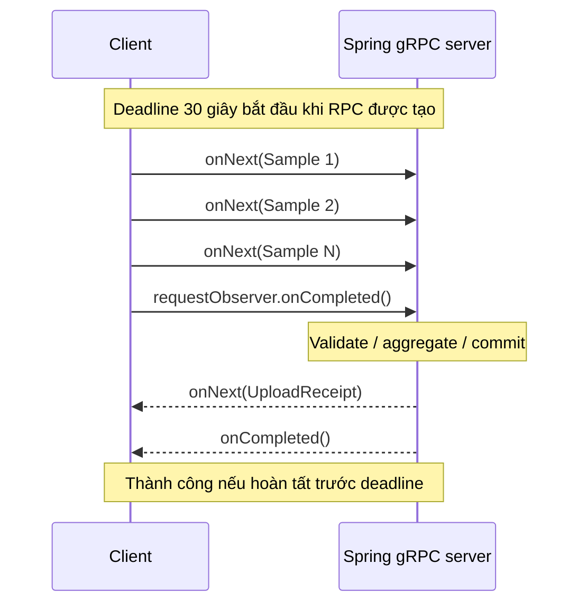

# Deadline cho toàn bộ stream

**Chương:** Client streaming  
**Phạm vi:** Spring gRPC (`SPRING_GRPC`) với RPC nhận nhiều request và trả một response. Bài này tập trung vào ngân sách thời gian của **toàn bộ một client streaming call**: từ lúc mở RPC, gửi message, xử lý phía server đến lúc client nhận kết quả cuối.

## 1. Deadline áp dụng cho điều gì?

Với hợp đồng:

```proto
rpc UploadSamples(stream Sample) returns (UploadReceipt);
```

client có thể gửi hàng trăm message bằng nhiều lần `requestObserver.onNext(sample)`. **Một deadline duy nhất** áp dụng cho cả lời gọi RPC đó. Nó không được đặt lại sau mỗi message.



Ngân sách thời gian bao gồm:

- Thời gian gửi request message qua mạng và chờ transport sẵn sàng.
- Thời gian server nhận, giải mã, xác thực và xử lý từng message.
- Thời gian chờ client half-close bằng `requestObserver.onCompleted()`.
- Thời gian tổng hợp hoặc commit dữ liệu ở server.
- Thời gian gửi response cuối và truyền kết quả về client.

Nếu deadline hết trước khi RPC hoàn tất, gRPC kết thúc call. Client thường nhận status `DEADLINE_EXCEEDED`; server được thông báo call đã bị hủy khi cancellation được phát hiện. Server phải dừng công việc còn có thể dừng và giải phóng tài nguyên.

**Deadline khác với timeout cho từng message.** Ví dụ deadline 30 giây không có nghĩa mỗi `onNext()` được cấp 30 giây riêng. Nếu 20 giây đã dùng để gửi dữ liệu, phần còn lại cho server xử lý và trả response chỉ còn khoảng 10 giây.

## 2. Đặt deadline trên client

gRPC Java cho phép tạo một bản stub có deadline bằng `withDeadlineAfter`. Đặt deadline **trước khi mở stream**:

```java
import com.example.upload.grpc.Sample;
import com.example.upload.grpc.SampleIngestServiceGrpc;
import com.example.upload.grpc.UploadReceipt;
import io.grpc.stub.StreamObserver;
import java.util.concurrent.TimeUnit;

SampleIngestServiceGrpc.SampleIngestServiceStub boundedStub =
        asyncStub.withDeadlineAfter(30, TimeUnit.SECONDS);

StreamObserver<UploadReceipt> responses = new StreamObserver<>() {
    @Override
    public void onNext(UploadReceipt receipt) {
        // Xử lý một receipt cuối.
    }

    @Override
    public void onError(Throwable error) {
        // Phân loại DEADLINE_EXCEEDED, CANCELLED, UNAVAILABLE...
    }

    @Override
    public void onCompleted() {
        // Response stream đã kết thúc bình thường.
    }
};

StreamObserver<Sample> requests =
        boundedStub.uploadSamples(responses);

for (Sample sample : finiteBatch) {
    requests.onNext(sample);
}
requests.onCompleted();
```

`withDeadlineAfter(30, SECONDS)` tạo stub cho **một lời gọi có ngân sách 30 giây**. Deadline bắt đầu khi RPC được tạo qua `uploadSamples(...)`, không phải khi client tạo danh sách dữ liệu trước đó. Nếu ứng dụng cần tính cả thời gian đọc file hoặc chuẩn bị payload, hãy bắt đầu đo ngân sách ở tầng ứng dụng và trừ thời gian đã dùng trước khi mở RPC.

Sau khi gọi `requests.onCompleted()`, client vẫn phải chờ callback response. Deadline tiếp tục chạy trong giai đoạn server tổng hợp/commit và gửi receipt. Half-close không dừng đồng hồ deadline.

Nếu không cấu hình deadline, RPC có thể chờ vô thời hạn khi client không half-close hoặc server không trả kết quả. Với client streaming, nên đặt deadline tường minh cho từng batch hữu hạn.

## 3. Chọn ngân sách phù hợp cho batch

Không nên chọn deadline chỉ theo thời gian xử lý trung bình. Một batch lớn có thể mất phần lớn thời gian để truyền trước khi server bắt đầu bước kết toán.

Có thể ước lượng ngân sách:

\[
T_{\text{RPC}} \geq
T_{\text{upload}} +
T_{\text{server}} +
T_{\text{response}} +
T_{\text{margin}}
\]

Trong đó:

- \(T_{\text{upload}}\): thời gian truyền toàn bộ message, chịu ảnh hưởng của tổng byte, băng thông và flow control.
- \(T_{\text{server}}\): giải mã, validate, tổng hợp và commit.
- \(T_{\text{response}}\): tạo và truyền response cuối.
- \(T_{\text{margin}}\): dự phòng cho biến động mạng, tải hệ thống và scheduling.

Ví dụ một batch 4 MiB, tốc độ truyền hữu hiệu 1 MiB/giây, xử lý và commit dự kiến 2 giây, response dưới 1 giây. Thời gian lý thuyết đã khoảng 7 giây; deadline 8 giây có thể quá sát khi mạng hoặc server biến động. Hãy dùng số đo thực tế ở tải dự kiến và chọn ngưỡng theo mục tiêu latency của dịch vụ.

| Đặc điểm batch | Cách chọn deadline |
| --- | --- |
| Ít message, payload nhỏ, xử lý nhanh | Ngân sách ngắn, nhưng vẫn có margin |
| Nhiều message hoặc payload lớn | Tính thời gian upload và xử lý toàn lô |
| Server cần ghi bền vững | Dành thời gian cho commit và xác nhận |
| Nguồn gửi không có điểm kết thúc rõ | Chia thành batch hữu hạn; không giữ một RPC vô hạn |
| Có nhiều tầng dịch vụ phía sau | Phân bổ ngân sách cho từng bước và giữ tổng thời gian dưới deadline đầu vào |

Deadline quá ngắn gây hủy hợp lệ trong khi server vẫn có khả năng hoàn tất; deadline quá dài giữ connection, state và tài nguyên lâu hơn cần thiết. Cần theo dõi phân vị latency (ví dụ p95/p99), kích thước batch và tỷ lệ timeout để điều chỉnh.

## 4. Server quan sát deadline còn lại

Trong gRPC Java, server có thể lấy `Context` hiện tại và deadline của RPC. Deadline là thời điểm tuyệt đối trong đồng hồ monotonic của gRPC; dùng `timeRemaining(...)` để biết ngân sách còn lại, không tự tính bằng đồng hồ wall-clock.

```java
import io.grpc.Context;
import io.grpc.Deadline;
import java.util.concurrent.TimeUnit;

Context rpcContext = Context.current();
Deadline deadline = rpcContext.getDeadline();

if (deadline != null) {
    long remainingNanos = deadline.timeRemaining(TimeUnit.NANOSECONDS);
    if (remainingNanos <= 0) {
        // Không bắt đầu thêm công việc cho RPC đã hết hạn.
        return;
    }
}
```

`deadline == null` nghĩa là call không mang deadline; server không nên hiểu null là “còn vô hạn thời gian nhưng an toàn”. Hãy yêu cầu client đặt deadline hoặc áp dụng giới hạn xử lý riêng ở server cho endpoint cần kiểm soát tài nguyên.

### Dùng thời gian còn lại cho downstream

Giả sử `onCompleted()` của request kích hoạt bước ghi database hoặc gọi một dịch vụ khác. Không nên cấp cho downstream một timeout mới dài hơn thời gian còn lại của RPC đầu vào. Nếu RPC còn 700 ms, đặt timeout database 5 giây có thể khiến công việc tiếp tục chạy sau khi client đã nhận `DEADLINE_EXCEEDED`.

Nguyên tắc:

1. Lấy `deadline.timeRemaining(...)` ngay trước khi bắt đầu bước downstream.
2. Trừ một phần ngân sách cho cleanup và trả response.
3. Giới hạn timeout của database/HTTP/gRPC downstream bởi ngân sách còn lại và giới hạn riêng của bước đó.
4. Nếu ngân sách đã cạn, dừng trước khi khởi tạo thêm công việc.

Nếu gọi một gRPC service khác, có thể truyền deadline còn lại sang stub downstream; nếu gọi JDBC hoặc HTTP client, chuyển phần thời gian còn lại thành timeout của client tương ứng. Không giả định mọi thư viện ngoài gRPC tự hiểu `io.grpc.Context`.

## 5. Dừng công việc phía server khi deadline hết

Khi deadline của call hết, gRPC hủy RPC. Với streaming service, dùng `ServerCallStreamObserver` để theo dõi cancellation:

```java
import io.grpc.Context;
import io.grpc.Deadline;
import io.grpc.stub.ServerCallStreamObserver;
import io.grpc.stub.StreamObserver;
import java.util.concurrent.atomic.AtomicBoolean;

Context rpcContext = Context.current();
Deadline deadline = rpcContext.getDeadline();
ServerCallStreamObserver<UploadReceipt> call =
        (ServerCallStreamObserver<UploadReceipt>) responseObserver;

AtomicBoolean stopped = new AtomicBoolean();

Runnable stopWork = () -> {
    if (stopped.compareAndSet(false, true)) {
        // Phát tín hiệu dừng producer/worker, đóng file tạm,
        // trả quota và giải phóng buffer theo chính sách.
    }
};

call.setOnCancelHandler(stopWork);

// Trong mỗi callback onNext hoặc trước khi bắt đầu commit:
if (stopped.get() || call.isCancelled()
        || (deadline != null && deadline.isExpired())) {
    stopWork.run();
    return;
}
```

`setOnCancelHandler` được đăng ký khi bắt đầu RPC để server nhận tín hiệu hủy. Cancellation handler có thể chạy trên thread khác với callback request; hàm cleanup cần thread-safe và idempotent. Với công việc bất đồng bộ, giữ tham chiếu tới task/future và phát tín hiệu cancel/interruption nếu tác vụ hỗ trợ.

**Không nên chỉ kiểm tra deadline một lần ở đầu stream.** Một RPC có thể còn hạn lúc nhận message đầu nhưng hết hạn trong lúc client gửi message thứ 500 hoặc khi server đang commit. Kiểm tra trạng thái ở các ranh giới công việc tốn thời gian và lắng nghe cancellation để dừng sớm.

### Không gửi response sau khi call đã bị hủy

Khi server biết call đã cancelled hoặc deadline đã hết, không cố gửi `responseObserver.onNext(receipt)` hay gọi terminal callback thứ hai. gRPC sẽ kết thúc call theo deadline/cancellation. Hãy tập trung dừng công việc và dọn tài nguyên.

Nếu deadline hết đúng lúc commit thành công, dữ liệu có thể đã được lưu nhưng client không nhận receipt. Việc kiểm tra `isCancelled()` trước khi gửi response không thể đảo ngược commit đã xảy ra.

## 6. Deadline và retry: kết quả có thể không rõ

`DEADLINE_EXCEEDED` có nghĩa client không nhận được kết quả trong ngân sách thời gian; nó **không chứng minh server chưa xử lý request**.

Ví dụ:

1. Client gửi 100 message và half-close.
2. Server ghi dữ liệu, commit thành công ở giây thứ 9.
3. Deadline client là 10 giây, nhưng response bị chậm/mất và client kết thúc call với `DEADLINE_EXCEEDED`.
4. Client thử lại toàn bộ lô mà không có idempotency.
5. Server có thể ghi trùng 100 message.

Với batch có tác dụng phụ, hãy:

- Dùng `batch_id` ổn định cho cùng một lô và `event_id` ổn định cho từng message.
- Lưu trạng thái batch có thể tra cứu (`RECEIVING`, `COMMITTED`, `FAILED`) tại tầng nghiệp vụ.
- Chỉ trả receipt sau điều kiện commit đã được đáp ứng.
- Nếu client không nhận được receipt, tra cứu trạng thái trước khi retry; xử lý message trùng theo khóa idempotency.
- Đặt deadline retry mới dựa trên ngân sách của lần gọi mới, nhưng không làm thay đổi ID nghiệp vụ.

Nếu server chỉ tổng hợp trong RAM và không có tác dụng phụ bền vững, retry có thể đơn giản hơn; tuy nhiên client vẫn không được coi một call đã hết hạn là đã có kết quả.

## 7. Những nhầm lẫn thường gặp

| Nhầm lẫn | Thực tế |
| --- | --- |
| Mỗi `onNext()` có một deadline riêng | Tất cả message thuộc cùng một deadline của RPC |
| Client gọi `onCompleted()` là deadline dừng | Đây chỉ là half-close; client vẫn chờ server response |
| Server bắt đầu xử lý sau khi client gửi hết | Server thường xử lý từng message ngay trong `onNext()`; deadline chạy trong suốt quá trình |
| Deadline chỉ tính thời gian server chạy handler | Nó bao gồm thời gian gửi, xử lý và nhận response |
| Client nhận `DEADLINE_EXCEEDED` nghĩa là server chưa commit | Server có thể đã commit trước khi response tới client |
| Tăng deadline giữa stream sẽ kéo dài call đang mở | Deadline gắn với RPC đã tạo; muốn ngân sách mới phải mở RPC mới |
| Hủy call tự động rollback database | Cancellation không thay thế transaction hoặc idempotency |

## 8. Kiểm thử deadline cho toàn stream

Nên kiểm thử theo các điểm thời gian khác nhau, không chỉ một test timeout tổng quát:

| Ca kiểm thử | Thiết lập | Kỳ vọng |
| --- | --- | --- |
| Stream hoàn tất trong ngân sách | Gửi đủ message, xử lý nhanh, nhận receipt trước deadline | Client nhận một response và `OK` |
| Gửi request kéo dài | Producer phát chậm đến khi deadline hết trước half-close | Client nhận `DEADLINE_EXCEEDED`, producer dừng |
| Server xử lý lâu sau half-close | Client gửi hết nhanh, server trì hoãn xử lý/commit | Deadline vẫn tiếp tục chạy; không có receipt thành công sau khi call hết hạn |
| Server bị hủy giữa xử lý | Hết deadline khi server có tác vụ nền | Cancellation handler chạy, task được yêu cầu dừng, cleanup đúng một lần |
| Commit xong nhưng response đến trễ | Hoàn tất commit gần deadline | Client có thể thấy timeout; tra cứu batch xác định trạng thái |
| Không đặt deadline | Cố ý bỏ deadline trong test có timeout bảo vệ | Xác nhận ứng dụng không để RPC treo vô hạn trong vận hành |

Với gRPC in-process, có thể tạo service test trì hoãn có kiểm soát và đặt deadline rất ngắn ở stub. Dùng `CountDownLatch`, future hoặc barrier để đồng bộ các bước; tránh dùng `Thread.sleep()` tùy ý làm bằng chứng duy nhất. Kiểm thử tích hợp qua transport thật giúp xác nhận cấu hình Spring, interceptor, mạng và hành vi cancellation trong môi trường gần production.

## 9. Quan sát deadline trong vận hành

Ghi nhận các chỉ số theo từng RPC:

- Deadline được cấu hình và thời gian còn lại khi bắt đầu bước commit.
- Thời gian upload từ message đầu đến inbound `onCompleted()`.
- Thời gian server xử lý sau half-close và thời gian gửi response.
- Số message/byte của batch tại thời điểm call kết thúc.
- Tỷ lệ `OK`, `DEADLINE_EXCEEDED`, `CANCELLED`, `RESOURCE_EXHAUSTED` và `UNAVAILABLE`.
- Số tác vụ bị yêu cầu hủy, số file/buffer staging còn tồn và số batch cần tra cứu sau timeout.

Metadata/correlation ID và interceptor có thể giúp liên kết log client-server của cùng một RPC. Không ghi token hoặc payload nhạy cảm vào log. Nếu nhiều timeout xảy ra ở giai đoạn upload, cần xem lại batch size, tốc độ phát và flow control; nếu timeout tập trung sau half-close, xem thời gian xử lý/commit phía server.

## 10. Tự luyện tập

1. Client đặt deadline 20 giây, mất 12 giây để gửi hết batch. Server còn bao nhiêu thời gian tối đa cho xử lý và response, trước khi tính phần dự phòng?
2. Vì sao `requestObserver.onCompleted()` không dừng deadline? Điều gì xảy ra nếu server cần 15 giây để commit nhưng client chỉ còn 5 giây?
3. Thiết kế cách truyền ngân sách còn lại tới một gRPC service downstream và một JDBC query. Vì sao không nên cấp lại timeout đầy đủ cho từng tầng?
4. Client nhận `DEADLINE_EXCEEDED` nhưng server đã commit. Bạn cần định danh và API tra cứu nào để retry an toàn?
5. Hãy thiết kế một test trong đó deadline hết sau inbound half-close nhưng trước khi server trả receipt; xác nhận producer/task dừng và không phát response thành công.

**Ghi nhớ:** Deadline của client streaming là **ngân sách thời gian cho toàn RPC**, không phải cho từng message. Nó chạy xuyên suốt lúc gửi, xử lý và chờ response; khi hết hạn, client thường nhận `DEADLINE_EXCEEDED`, server phải dừng công việc có thể dừng và cleanup. Với batch có tác dụng phụ, timeout không chứng minh dữ liệu chưa commit: cần idempotency và tra cứu trạng thái trước khi retry.
