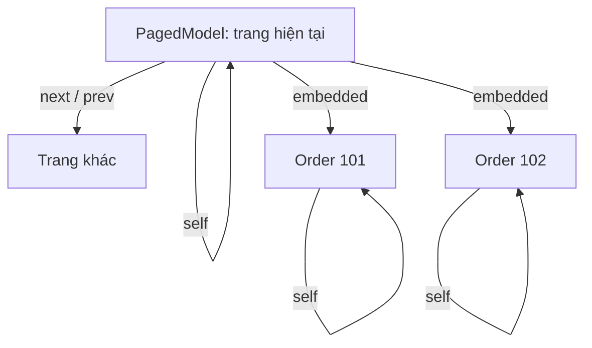

# Self link cho page

Trong REST API có phân trang, `self` link ở cấp page là liên kết trỏ đến **chính representation của trang hiện tại**. Nó cho client biết URI nào có thể được gọi lại để lấy cùng trang với các điều kiện truy vấn tương ứng. Với Spring HATEOAS, page thường được biểu diễn bằng `PagedModel`, nên `self` link được gắn ở cấp `PagedModel` cùng metadata trang và các liên kết điều hướng.

Điểm quan trọng là phân biệt `self` của page với `self` của từng phần tử. `self` ở cấp page trỏ đến collection trong một trạng thái truy vấn cụ thể; `self` của một order trỏ đến resource order riêng lẻ. Một response có thể và thường nên có cả hai loại liên kết này.

## 1. Self link của page có ý nghĩa gì?

Giả sử API trả về đơn hàng theo trang. Client gửi request:

```http
GET /orders?status=PAID&page=1&size=20&sort=createdAt,desc HTTP/1.1
Host: api.example.test
Accept: application/hal+json
```

Request này xác định một trang trong collection đơn hàng:

- `status=PAID` giới hạn tập kết quả vào đơn hàng đã thanh toán.
- `page=1` chọn trang thứ hai theo quy ước chỉ số bắt đầu từ `0`.
- `size=20` yêu cầu kích thước trang là 20 phần tử.
- `sort=createdAt,desc` sắp xếp theo thời gian tạo giảm dần.

Self link của page cần trỏ đến collection với trạng thái truy vấn đó. Ví dụ:

```text
https://api.example.test/orders?status=PAID&page=1&size=20&sort=createdAt,desc
```

Khi client theo link `self`, server có thể tái tạo trang tương ứng theo hợp đồng phân trang. Nếu self link chỉ trỏ đến `/orders` mà không giữ lại các tham số cần thiết, request tiếp theo có thể trả về trang mặc định hoặc một tập kết quả khác.

Self link không phải một bản sao dữ liệu của trang và cũng không bảo đảm dữ liệu sẽ bất biến. Nó định danh request/representation hiện tại theo URI và các tham số được công bố. Nếu dữ liệu thay đổi giữa hai lần gọi, kết quả tại cùng URI có thể thay đổi.

## 2. Phân biệt self link cấp page và cấp item

Một response paged thường có cấu trúc gồm link của collection page và link của từng resource nằm trong trang:



| Vị trí | Ví dụ URI | Ý nghĩa |
| --- | --- | --- |
| `self` của page | `/orders?status=PAID&page=1&size=20` | Truy cập lại trang thứ hai của collection đơn hàng đã thanh toán |
| `self` của item | `/orders/ORD-101` | Truy cập trực tiếp một đơn hàng cụ thể |
| `next` của page | `/orders?status=PAID&page=2&size=20` | Chuyển đến trang kế tiếp của cùng truy vấn |
| `prev` của page | `/orders?status=PAID&page=0&size=20` | Chuyển về trang trước của cùng truy vấn |

Trong HAL, self link của page nằm trong `_links.self` ở root object. Self link của mỗi phần tử nằm trong `_embedded` của phần tử tương ứng. Không nên dùng link `self` của item để thay thế link `self` của page, vì hai link đại diện cho hai resource khác nhau.

## 3. Self link trong response HAL

Ví dụ response cho trang thứ hai của collection đơn hàng:

```json
{
  "_embedded": {
    "orders": [
      {
        "id": "ORD-101",
        "status": "PAID",
        "_links": {
          "self": {
            "href": "https://api.example.test/orders/ORD-101"
          }
        }
      },
      {
        "id": "ORD-102",
        "status": "PAID",
        "_links": {
          "self": {
            "href": "https://api.example.test/orders/ORD-102"
          }
        }
      }
    ]
  },
  "_links": {
    "self": {
      "href": "https://api.example.test/orders?status=PAID&page=1&size=20&sort=createdAt,desc"
    },
    "prev": {
      "href": "https://api.example.test/orders?status=PAID&page=0&size=20&sort=createdAt,desc"
    },
    "next": {
      "href": "https://api.example.test/orders?status=PAID&page=2&size=20&sort=createdAt,desc"
    }
  },
  "page": {
    "size": 20,
    "totalElements": 43,
    "totalPages": 3,
    "number": 1
  }
}
```

Ở đây:

- Root `_links.self` đại diện cho trang hiện tại.
- Root `_links.prev` và `_links.next` điều hướng giữa các trang của cùng collection.
- Mỗi order có `_links.self` riêng để mở resource đơn hàng.
- `page.number` bằng `1` nghĩa là trang thứ hai, vì chỉ số bắt đầu từ `0`.

Query parameter trong các link điều hướng giữ nguyên filter và sort. Điều này giúp client tiếp tục duyệt cùng một tập kết quả. Thứ tự các query parameter trong URI không mang ý nghĩa; điều quan trọng là giá trị và ngữ nghĩa của chúng được giữ đúng.

## 4. Tạo self link bằng PagedResourcesAssembler

Khi ứng dụng dùng Spring Data, cách thuận tiện là lấy `Page<T>` từ service hoặc repository rồi chuyển nó thành `PagedModel` bằng `PagedResourcesAssembler`. Assembler có thể tạo page metadata và các liên kết phân trang, bao gồm `self`, dựa trên request hiện tại và cấu hình phân giải tham số phân trang.

```java
import org.springframework.data.domain.Page;
import org.springframework.data.domain.Pageable;
import org.springframework.data.web.PagedResourcesAssembler;
import org.springframework.hateoas.EntityModel;
import org.springframework.hateoas.PagedModel;
import org.springframework.web.bind.annotation.GetMapping;
import org.springframework.web.bind.annotation.RequestParam;
import org.springframework.web.bind.annotation.RestController;

@RestController
class OrderController {

    private final OrderService orderService;
    private final OrderModelAssembler orderAssembler;
    private final PagedResourcesAssembler<Order> pagedAssembler;

    OrderController(
            OrderService orderService,
            OrderModelAssembler orderAssembler,
            PagedResourcesAssembler<Order> pagedAssembler) {
        this.orderService = orderService;
        this.orderAssembler = orderAssembler;
        this.pagedAssembler = pagedAssembler;
    }

    @GetMapping("/orders")
    PagedModel<EntityModel<OrderRepresentation>> all(
            @RequestParam(required = false) OrderStatus status,
            Pageable pageable) {

        Page<Order> page = orderService.findAll(status, pageable);
        return pagedAssembler.toModel(page, orderAssembler);
    }
}
```

Trong ví dụ, `OrderService` trả về một `Page<Order>` theo filter và `Pageable`; `OrderModelAssembler` chuyển từng `Order` thành `EntityModel<OrderRepresentation>`. `pagedAssembler.toModel(page, orderAssembler)` tạo `PagedModel` cùng metadata và link điều hướng.

Khi dùng request context mặc định, `PagedResourcesAssembler` dựa trên URI request hiện tại để tạo các link. Cấu hình Spring Data Web và pageable resolver quyết định cách chuyển `Pageable` thành query parameter. Cần kiểm thử response thực tế để xác nhận `self` giữ được các điều kiện lọc như `status`, cũng như `page`, `size` và `sort`.

Nếu API có query parameter tùy chỉnh hoặc cách định tuyến đặc biệt, có thể truyền một base link rõ ràng qua overload `toModel(page, assembler, baseLink)`. Base link cần đại diện cho collection endpoint và giữ các điều kiện truy vấn cần thiết; pageable resolver sẽ được dùng để tạo các link trang phù hợp. Hãy xác nhận URI được sinh ra trong test để tránh lặp hoặc làm mất tham số.

## 5. Tạo self link thủ công cho PagedModel

Trong trường hợp không dùng `PagedResourcesAssembler`, ứng dụng có thể tự tạo nội dung, metadata và self link rồi ghép thành `PagedModel`:

```java
import java.util.List;

import org.springframework.data.domain.Page;
import org.springframework.data.domain.Pageable;
import org.springframework.hateoas.EntityModel;
import org.springframework.hateoas.Link;
import org.springframework.hateoas.PagedModel;

import static org.springframework.hateoas.server.mvc.WebMvcLinkBuilder.linkTo;
import static org.springframework.hateoas.server.mvc.WebMvcLinkBuilder.methodOn;

PagedModel<EntityModel<OrderRepresentation>> toPagedModel(
        Page<Order> page,
        OrderStatus status,
        Pageable pageable) {

    List<EntityModel<OrderRepresentation>> content = page.getContent().stream()
            .map(orderAssembler::toModel)
            .toList();

    PagedModel.PageMetadata metadata = new PagedModel.PageMetadata(
            page.getSize(),
            page.getNumber(),
            page.getTotalElements(),
            page.getTotalPages());

    Link self = linkTo(methodOn(OrderController.class)
            .all(status, pageable)).withSelfRel();

    return PagedModel.of(content, metadata, self);
}
```

Ví dụ giả định controller có handler `all(OrderStatus, Pageable)` tương ứng và `orderAssembler` đã được cung cấp cho thành phần dựng model. `methodOn(...)` mô tả lời gọi controller để tạo URI; nó không thực thi truy vấn hoặc logic nghiệp vụ.

Tự tạo `PagedModel` theo cách này chỉ thêm link `self`. Nếu muốn client điều hướng, ứng dụng cần tạo thêm `first`, `prev`, `next` và `last` dựa trên metadata và quy tắc phân trang. Cũng cần bảo đảm URI self giữ đúng filter, sort và các tham số khác của request. Với ứng dụng Spring Data thông thường, `PagedResourcesAssembler` giúp giảm công việc và nguy cơ tạo link không nhất quán.

## 6. Những thành phần cần giữ trong self link

Self link cần mô tả đúng truy vấn tạo ra trang hiện tại. Tùy API, nó có thể cần giữ các thành phần sau:

| Thành phần | Ví dụ | Lý do |
| --- | --- | --- |
| Path collection | `/orders` | Xác định collection được truy vấn |
| Page index | `page=1` | Xác định trang hiện tại |
| Page size | `size=20` | Giữ kích thước trang |
| Sort | `sort=createdAt,desc` | Giữ thứ tự phần tử |
| Filter | `status=PAID` | Giữ tập kết quả đã lọc |
| Search term | `q=invoice` | Giữ điều kiện tìm kiếm |
| Tenant hoặc scope công khai | `tenant=acme` | Chỉ giữ nếu đây là tham số API được công bố và cần cho truy vấn |

Không đưa access token, session ID, mật khẩu hoặc dữ liệu nhạy cảm vào query string của self link. Thông tin xác thực nên được gửi qua cơ chế xác thực HTTP phù hợp, chẳng hạn `Authorization` header hoặc cookie bảo mật theo thiết kế hệ thống. Self link định danh request, không phải nơi lưu thông tin bí mật.

## 7. Self link và base URI khi triển khai

Nếu ứng dụng chạy sau reverse proxy hoặc API gateway, địa chỉ công khai có thể khác địa chỉ mà ứng dụng nhìn thấy nội bộ. Ví dụ, bên ngoài client gọi `https://api.example.test/platform/orders`, nhưng proxy chuyển tiếp đến ứng dụng ở `http://orders-service:8080/orders`.

Khi Spring tạo link từ request context, cần cấu hình forwarded headers phù hợp để ứng dụng nhận diện đúng scheme, host, port và prefix công khai. Chỉ tin cậy forwarded headers từ proxy được quản lý. Nếu không, client có thể gửi header giả để tác động đến host trong link mà server phát ra.

Với tác vụ nền hoặc nơi không có request context, cần dùng base URI công khai từ cấu hình ứng dụng để xây link. Không hard-code host production trong assembler dùng chung cho mọi môi trường.

## 8. Self link không phải snapshot dữ liệu

Self link của page giúp truy cập lại cùng truy vấn và cùng vị trí trang, nhưng không nhất thiết trả lại đúng từng bản ghi như lần trước. Giả sử trang thứ hai chứa các đơn hàng từ vị trí 20 đến 39. Nếu một đơn hàng mới được thêm vào đầu collection, kết quả của `page=1` có thể dịch chuyển.

Vì vậy, self link theo offset pagination thường đại diện cho truy vấn tại thời điểm gọi, không phải snapshot bất biến. Nếu nghiệp vụ cần duyệt một tập dữ liệu ổn định qua nhiều request, có thể thiết kế cursor pagination, snapshot token hoặc một cơ chế phiên bản dữ liệu phù hợp. Không nên nhầm `self` link với cam kết về tính nhất quán lịch sử.

## 9. Kiểm thử self link cho page

Kiểm thử nên xác nhận root self link tồn tại và chứa trạng thái truy vấn cần thiết. Đồng thời, cần kiểm tra self link của từng phần tử vẫn trỏ đến resource riêng:

```java
mockMvc.perform(get("/orders")
        .param("status", "PAID")
        .param("page", "1")
        .param("size", "20")
        .param("sort", "createdAt,desc")
        .accept("application/hal+json"))
    .andExpect(status().isOk())
    .andExpect(jsonPath("$._links.self.href").exists())
    .andExpect(jsonPath("$._links.self.href")
            .value(org.hamcrest.Matchers.containsString("page=1")))
    .andExpect(jsonPath("$._links.self.href")
            .value(org.hamcrest.Matchers.containsString("status=PAID")))
    .andExpect(jsonPath("$._embedded.orders[0]._links.self.href").exists());
```

Đây là ví dụ minh họa; test thực tế cần dữ liệu, service và HAL configuration phù hợp. Không nên so sánh toàn bộ URI bằng một chuỗi cố định nếu thứ tự query parameter có thể thay đổi. Có thể parse URI và xác nhận từng query parameter riêng để test bền vững hơn.

Các trường hợp nên kiểm tra thêm:

- Trang đầu có self link trỏ đúng page index mặc định hoặc `page=0`.
- Trang giữa giữ filter, sort, page và size; có cả `prev` và `next` khi phù hợp.
- Trang cuối giữ self link đúng và không có `next` nếu không còn trang sau.
- Collection rỗng vẫn có self link ở cấp page.
- Mỗi item có self link riêng, không trùng với self link của collection.
- Link dùng đúng scheme, host, context path khi chạy sau proxy hoặc gateway.
- Các query parameter không chứa thông tin xác thực hoặc dữ liệu nhạy cảm.

## 10. Lỗi thường gặp

**Dùng self link của item cho page:** mỗi item và cả collection page là hai resource khác nhau. Cần tạo self link ở đúng cấp representation.

**Self link bỏ mất filter hoặc sort:** request theo link sẽ trả về tập kết quả khác. Giữ các query parameter ảnh hưởng đến truy vấn.

**Tự tạo page URL từ `number`:** client có thể làm mất tham số hoặc giả định cấu trúc URI. Hãy theo link được server công bố.

**Gắn self link trỏ về trang mặc định:** nếu response đang ở trang thứ hai nhưng self link trỏ về trang đầu, metadata và link không còn nhất quán.

**Tạo link thủ công nhưng quên các link điều hướng:** `PagedModel.of(...)` không tự suy ra tất cả link `next` và `prev` chỉ từ metadata. Hãy thêm chúng hoặc dùng `PagedResourcesAssembler`.

**Tin cậy host từ header không đáng tin:** link tuyệt đối có thể bị tạo với host do client kiểm soát. Chỉ xử lý forwarded headers từ proxy đáng tin cậy.

**Coi self link là snapshot:** cùng URI có thể trả dữ liệu khác khi collection thay đổi. Dùng cursor hoặc snapshot nếu nghiệp vụ cần tính ổn định cao hơn.

## 11. Checklist triển khai

- Đặt `self` ở root `PagedModel` để đại diện cho page hiện tại.
- Duy trì self link riêng cho từng item trong `_embedded` nếu item có URI độc lập.
- Self link page giữ page index, size, filter, sort và điều kiện tìm kiếm phù hợp.
- Dùng `PagedResourcesAssembler` khi tích hợp Spring Data để tạo metadata và link phân trang nhất quán.
- Nếu tự tạo `PagedModel`, thêm các link điều hướng cần thiết và kiểm tra chúng khớp metadata.
- Tạo URI từ request context hoặc base URI cấu hình đáng tin cậy.
- Không đưa token hay thông tin nhạy cảm vào query string.
- Kiểm thử cả root self link, item self link và các query parameter quan trọng.
- Xác định rõ liệu API cần offset pagination hay cursor/snapshot cho dữ liệu thay đổi liên tục.

Self link cho page cho client một điểm tham chiếu rõ ràng đến representation của collection tại trang hiện tại. Khi link giữ đúng các điều kiện truy vấn và được đặt ở cấp `PagedModel`, client có thể tải lại trang, tiếp tục điều hướng qua `next`/`prev` và phân biệt chính xác collection với từng resource được nhúng.
