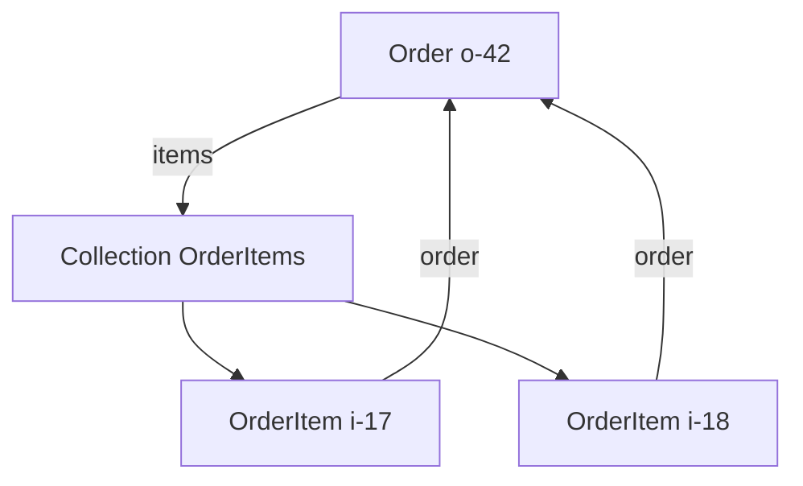

# Self link trong nested resource

Một tài nguyên có thể nằm trong ngữ cảnh của tài nguyên cha. Ví dụ, một đơn hàng (`Order`) chứa nhiều dòng hàng (`OrderItem`), một dự án chứa các tác vụ, hoặc một bài viết chứa các bình luận. Khi API biểu diễn một tài nguyên con, self link của nó phải nhận diện đúng tài nguyên con trong ngữ cảnh mà API đã công bố.

Với Spring HATEOAS, có thể tạo self link cho tài nguyên con bằng `linkTo(...)` và `methodOn(...)`, truyền cả định danh của tài nguyên cha lẫn tài nguyên con vào method controller. Nếu route là `/api/orders/{orderId}/items/{itemId}`, link của một dòng hàng cần chứa đúng `orderId` và `itemId`. Link đến collection `/api/orders/{orderId}/items` và link đến đơn hàng cha `/api/orders/{orderId}` là các quan hệ khác, không phải self link của dòng hàng.

## Nhận diện đúng từng cấp tài nguyên

Giả sử đơn hàng `o-42` chứa hai dòng hàng `i-17` và `i-18`. API có ba cấp địa chỉ:

| Tài nguyên | URI ví dụ | Relation khi được liên kết |
| --- | --- | --- |
| Đơn hàng cha | `/api/orders/o-42` | `order` hoặc `self` khi đang biểu diễn đơn hàng |
| Collection dòng hàng của đơn hàng | `/api/orders/o-42/items` | `items` khi liên kết từ đơn hàng; `self` khi biểu diễn collection |
| Một dòng hàng | `/api/orders/o-42/items/i-17` | `self` khi biểu diễn dòng hàng |

Sơ đồ điều hướng:



Self link thay đổi theo representation hiện tại. Trong response của đơn hàng, `self` trỏ đến đơn hàng; trong response của collection dòng hàng, `self` trỏ đến collection; trong representation của `i-17`, `self` trỏ đến chính dòng hàng `i-17`. Không dùng self link của cha hoặc collection làm self link của item con.

## Thiết kế route cho nested resource

Một route lồng nhau thể hiện rằng item con được truy cập trong phạm vi item cha:

```text
GET /api/orders/{orderId}/items/{itemId}
GET /api/orders/{orderId}/items
```

`orderId` xác định đơn hàng; `itemId` xác định dòng hàng trong đơn hàng đó. Cách thiết kế này hữu ích khi dòng hàng không có ý nghĩa độc lập ngoài đơn hàng hoặc khi ID dòng hàng chỉ duy nhất trong phạm vi một đơn hàng.

Controller có thể định nghĩa endpoint chi tiết như sau:

```java
import java.util.UUID;

import org.springframework.hateoas.MediaTypes;
import org.springframework.web.bind.annotation.GetMapping;
import org.springframework.web.bind.annotation.PathVariable;
import org.springframework.web.bind.annotation.RequestMapping;
import org.springframework.web.bind.annotation.RestController;

@RestController
@RequestMapping("/api/orders")
class OrderItemController {

    private final OrderItemService service;
    private final OrderItemResourceAssembler assembler;

    OrderItemController(
            OrderItemService service,
            OrderItemResourceAssembler assembler) {
        this.service = service;
        this.assembler = assembler;
    }

    @GetMapping(value = "/{orderId}/items/{itemId}",
            produces = MediaTypes.HAL_JSON_VALUE)
    OrderItemResource one(
            @PathVariable UUID orderId,
            @PathVariable UUID itemId) {
        OrderItem item = service.findItem(orderId, itemId);
        return assembler.toModel(orderId, item);
    }
}
```

Điểm quan trọng là `findItem(orderId, itemId)` phải truy xuất dòng hàng trong đúng đơn hàng. Ví dụ, tầng repository có thể truy vấn theo cả hai điều kiện `item.id = itemId` và `item.order.id = orderId`. Nếu dòng hàng tồn tại nhưng thuộc một đơn hàng khác, endpoint không được trả representation dưới URI của đơn hàng hiện tại.

Kiểm tra quan hệ cha-con trong tầng service bảo đảm URI nested có ý nghĩa nhất quán. Chỉ đưa cả hai ID vào link mà không kiểm tra quan hệ thực tế có thể tạo ra một self link dẫn đến tài nguyên không thuộc parent đã nêu.

## Tạo resource model cho item con

Resource model của dòng hàng mang dữ liệu công khai và link đến chính nó cùng đơn hàng cha:

```java
import java.util.UUID;

import org.springframework.hateoas.RepresentationModel;
import org.springframework.hateoas.server.core.Relation;

@Relation(itemRelation = "orderItem", collectionRelation = "orderItems")
public class OrderItemResource extends RepresentationModel<OrderItemResource> {

    private final UUID id;
    private final String productCode;
    private final int quantity;

    public OrderItemResource(UUID id, String productCode, int quantity) {
        this.id = id;
        this.productCode = productCode;
        this.quantity = quantity;
    }

    public UUID getId() {
        return id;
    }

    public String getProductCode() {
        return productCode;
    }

    public int getQuantity() {
        return quantity;
    }
}
```

`@Relation` đặt tên cho item và collection khi các dòng hàng được nhúng trong HAL. Nó không tạo self link; assembler chịu trách nhiệm thêm link vào resource model. `OrderItemResource` cũng không cần chứa toàn bộ đối tượng `Order` hoặc JPA relationship. Dữ liệu cần thiết có thể được chuyển từ domain object sang resource một cách tường minh.

## Tạo self link với cả parent ID và child ID

Assembler cần nhận `orderId` cùng `OrderItem`, vì route nested yêu cầu cả hai tham số. Ví dụ:

```java
import static org.springframework.hateoas.server.mvc.WebMvcLinkBuilder.linkTo;
import static org.springframework.hateoas.server.mvc.WebMvcLinkBuilder.methodOn;

import java.util.UUID;

import org.springframework.stereotype.Component;

@Component
class OrderItemResourceAssembler {

    OrderItemResource toModel(UUID orderId, OrderItem item) {
        OrderItemResource resource = new OrderItemResource(
                item.getId(), item.getProductCode(), item.getQuantity());

        resource.add(linkTo(methodOn(OrderItemController.class)
                .one(orderId, item.getId())).withSelfRel());

        resource.add(linkTo(methodOn(OrderController.class)
                .one(orderId)).withRel("order"));

        return resource;
    }
}
```

Trong ví dụ này:

- `one(orderId, item.getId())` là method controller đọc một dòng hàng trong phạm vi đơn hàng cha.
- `withSelfRel()` đánh dấu URI đó là self link của dòng hàng.
- `one(orderId)` của `OrderController` tạo link `order` để client quay lại đơn hàng cha.

Assembler nhận parent ID rõ ràng thay vì tự suy ra từ một URL hoặc ghép chuỗi. Nếu dùng `RepresentationModelAssembler<OrderItem, OrderItemResource>`, phương thức `toModel(item)` mặc định chỉ nhận item; có thể tạo assembler có method overload nhận thêm parent ID như trên, hoặc thiết kế model/service sao cho parent context được cung cấp rõ ràng. Không nên giấu parent ID trong biến toàn cục hay request state không tường minh.

## Trả collection con và self link cho từng item

Endpoint collection dùng route nested và trả về `CollectionModel<OrderItemResource>`:

```java
import static org.springframework.hateoas.server.mvc.WebMvcLinkBuilder.linkTo;
import static org.springframework.hateoas.server.mvc.WebMvcLinkBuilder.methodOn;

import java.util.List;
import java.util.UUID;

import org.springframework.hateoas.CollectionModel;
import org.springframework.hateoas.MediaTypes;
import org.springframework.web.bind.annotation.GetMapping;
import org.springframework.web.bind.annotation.PathVariable;

// Đặt trong OrderItemController đã khai báo ở trên.
@GetMapping(value = "/{orderId}/items", produces = MediaTypes.HAL_JSON_VALUE)
CollectionModel<OrderItemResource> items(@PathVariable UUID orderId) {
    List<OrderItemResource> resources = service.findItems(orderId).stream()
            .map(item -> assembler.toModel(orderId, item))
            .toList();

    return CollectionModel.of(resources,
            linkTo(methodOn(OrderItemController.class).items(orderId)).withSelfRel(),
            linkTo(methodOn(OrderController.class).one(orderId)).withRel("order"));
}
```

Collection có self link đến `/api/orders/{orderId}/items`. Mỗi phần tử trong collection có self link đến `/api/orders/{orderId}/items/{itemId}` và link `order` quay về parent. Vì vậy, client có thể đi từ đơn hàng đến collection dòng hàng, rồi từ collection đến một dòng hàng cụ thể.

Trong `OrderController`, có thể công bố link đến collection con ngay trong representation của đơn hàng:

```java
import static org.springframework.hateoas.server.mvc.WebMvcLinkBuilder.linkTo;
import static org.springframework.hateoas.server.mvc.WebMvcLinkBuilder.methodOn;

import java.util.UUID;

import org.springframework.hateoas.EntityModel;
import org.springframework.hateoas.MediaTypes;
import org.springframework.web.bind.annotation.GetMapping;
import org.springframework.web.bind.annotation.PathVariable;
import org.springframework.web.bind.annotation.RequestMapping;
import org.springframework.web.bind.annotation.RestController;

@RestController
@RequestMapping("/api/orders")
class OrderController {

    private final OrderService service;

    OrderController(OrderService service) {
        this.service = service;
    }

    @GetMapping(value = "/{orderId}", produces = MediaTypes.HAL_JSON_VALUE)
    EntityModel<OrderDto> one(@PathVariable UUID orderId) {
        Order order = service.findById(orderId);
        OrderDto dto = new OrderDto(order.getId(), order.getStatus().name());

        return EntityModel.of(dto,
                linkTo(methodOn(OrderController.class)
                        .one(orderId)).withSelfRel(),
                linkTo(methodOn(OrderItemController.class)
                        .items(orderId)).withRel("items"));
    }
}
```

Đoạn code trên minh họa link `items` từ resource cha đến collection con. `OrderDto` là DTO ví dụ gồm mã đơn và trạng thái; các kiểu `Order`, `OrderService`, `OrderItem`, `OrderItemService` đại diện cho domain và tầng nghiệp vụ của ứng dụng. Khi ghép vào dự án thực tế, controller và assembler cần dùng đúng service, DTO và constructor của dự án.

## Hình dạng HAL của nested resource

Response collection dòng hàng có thể có dạng:

```json
{
  "_embedded": {
    "orderItems": [
      {
        "id": "i-17",
        "productCode": "KB-100",
        "quantity": 2,
        "_links": {
          "self": {
            "href": "https://shop.example/api/orders/o-42/items/i-17"
          },
          "order": {
            "href": "https://shop.example/api/orders/o-42"
          }
        }
      }
    ]
  },
  "_links": {
    "self": {
      "href": "https://shop.example/api/orders/o-42/items"
    },
    "order": {
      "href": "https://shop.example/api/orders/o-42"
    }
  }
}
```

`_embedded.orderItems` chứa các dòng hàng. Self link trong từng item nhận diện chính item đó; self link ở cấp ngoài nhận diện collection. Link `order` cho phép client quay về tài nguyên cha. Ba loại link này có vai trò khác nhau và không nên dùng thay thế nhau.

## Nested URI hay canonical URI?

Không phải mọi tài nguyên con đều phải có self URI lồng trong URI của parent. Hãy chọn URI theo danh tính và vòng đời nghiệp vụ:

| Cách thiết kế | Ví dụ self URI của item | Phù hợp khi |
| --- | --- | --- |
| Nested URI | `/api/orders/{orderId}/items/{itemId}` | Item chỉ có ý nghĩa trong đơn hàng hoặc định danh item cần parent context. |
| Canonical URI | `/api/order-items/{itemId}` | Item có danh tính độc lập, được tham chiếu hoặc thao tác từ nhiều ngữ cảnh. |

Nếu dùng canonical URI, collection vẫn có thể được truy cập qua `/api/orders/{orderId}/items`, nhưng self link của mỗi item trỏ đến `/api/order-items/{itemId}`. Item vẫn có thể cung cấp link `order` để quay lại đơn hàng cha. Cách này hữu ích khi một tài nguyên có thể được liên kết từ nhiều parent hoặc có vòng đời riêng.

Nếu dùng nested URI, việc item chuyển sang parent khác có thể làm thay đổi URI nhận diện. Khi đó, client cần lấy self link mới từ representation sau khi chuyển. Nếu URI của item phải ổn định qua các thay đổi quan hệ cha-con, hãy cân nhắc canonical URI.

## Kiểm tra parent-child scope

Nested self link chỉ đúng khi item thật sự thuộc parent trong URI. Endpoint phải xác minh quan hệ này ở mỗi request. Ví dụ, service có thể truy vấn theo cả `orderId` và `itemId` rồi trả `NotFound` nếu không có kết quả trong phạm vi đơn hàng:

```java
OrderItem findItem(UUID orderId, UUID itemId) {
    return repository.findByIdAndOrderId(itemId, orderId)
            .orElseThrow(() -> new OrderItemNotFoundException(itemId));
}
```

Tên phương thức repository phụ thuộc vào cách ánh xạ dữ liệu. Điều cần bảo đảm là truy vấn áp dụng đồng thời hai điều kiện, hoặc service kiểm tra `item.getOrder().getId().equals(orderId)` trước khi trả dữ liệu. Không nên chỉ tìm item theo ID rồi tạo URL với một parent ID do client truyền lên.

Việc kiểm tra scope cũng tránh rò rỉ thông tin. Nếu item không thuộc parent hoặc người dùng không có quyền truy cập, server cần trả phản hồi phù hợp với chính sách bảo mật và không tạo link khiến client hiểu rằng item nằm trong parent đó.

## Kiểm thử self link trong nested resource

MockMvc có thể kiểm tra self link của collection, self link của từng item và link về parent:

```java
import static org.hamcrest.Matchers.endsWith;
import static org.springframework.test.web.servlet.request.MockMvcRequestBuilders.get;
import static org.springframework.test.web.servlet.result.MockMvcResultMatchers.content;
import static org.springframework.test.web.servlet.result.MockMvcResultMatchers.jsonPath;
import static org.springframework.test.web.servlet.result.MockMvcResultMatchers.status;

import org.junit.jupiter.api.Test;
import org.springframework.beans.factory.annotation.Autowired;
import org.springframework.boot.test.autoconfigure.web.servlet.AutoConfigureMockMvc;
import org.springframework.boot.test.context.SpringBootTest;
import org.springframework.hateoas.MediaTypes;
import org.springframework.test.web.servlet.MockMvc;

@SpringBootTest
@AutoConfigureMockMvc
class OrderItemControllerTest {

    @Autowired
    MockMvc mockMvc;

    @Test
    void nestedItemsHaveSelfLinksInParentScope() throws Exception {
        String orderId = "7d3d5f70-8fcb-4d5d-9b3c-7c52b2a10042";
        String itemId = "7d3d5f70-8fcb-4d5d-9b3c-7c52b2a10017";

        mockMvc.perform(get("/api/orders/{orderId}/items", orderId)
                        .accept(MediaTypes.HAL_JSON))
                .andExpect(status().isOk())
                .andExpect(content().contentTypeCompatibleWith(MediaTypes.HAL_JSON))
                .andExpect(jsonPath("$._links.self.href")
                        .value(endsWith("/api/orders/" + orderId + "/items")))
                .andExpect(jsonPath("$._embedded.orderItems[0]._links.self.href")
                        .value(endsWith("/api/orders/" + orderId + "/items/" + itemId)))
                .andExpect(jsonPath("$._embedded.orderItems[0]._links.order.href")
                        .value(endsWith("/api/orders/" + orderId)));
    }

    @Test
    void itemCannotBeReadThroughAnotherOrder() throws Exception {
        mockMvc.perform(get("/api/orders/{orderId}/items/{itemId}",
                        "7d3d5f70-8fcb-4d5d-9b3c-7c52b2a10099",
                        "7d3d5f70-8fcb-4d5d-9b3c-7c52b2a10017")
                        .accept(MediaTypes.HAL_JSON))
                .andExpect(status().isNotFound());
    }
}
```

Fixture cần chuẩn bị một đơn hàng có item ID đã nêu và một đơn hàng khác không chứa item đó. Test đầu kiểm tra cấu trúc link trong HAL; test thứ hai kiểm tra server thực thi đúng ranh giới parent-child. Nếu API dùng canonical URI, hãy thay assertion self href bằng URI canonical và kiểm tra link `order` vẫn dẫn về parent thích hợp.

Các lỗi thường gặp:

| Lỗi | Hệ quả | Cách xử lý |
| --- | --- | --- |
| Self link của item trỏ đến URI collection | Client không thể truy cập trực tiếp item. | Tạo link đến method chi tiết có cả parent ID và child ID. |
| Thiếu parent ID trong link nested | URI không thể xác định đúng ngữ cảnh của item. | Truyền parent ID tường minh vào assembler. |
| Chỉ tìm child theo ID | Item có thể bị truy cập qua parent không liên quan. | Truy vấn hoặc xác minh đồng thời parent-child. |
| Dùng self link của parent cho item | Client nhầm lẫn danh tính tài nguyên. | Tạo self link riêng cho mỗi representation. |
| Dùng nested URI cho item có vòng đời độc lập | URI item thay đổi khi chuyển parent. | Cân nhắc canonical URI và link quan hệ `order`. |

## Nguyên tắc thiết kế

- Xác định rõ nested resource có danh tính phụ thuộc parent hay có URI canonical riêng.
- Tạo self link của item từ method controller chi tiết, truyền đủ parent ID và child ID nếu route yêu cầu.
- Giữ link đến parent và link đến collection thành relation riêng.
- Đảm bảo service xác minh item thuộc parent trước khi trả representation.
- Tạo link trong assembler hoặc resource mapper với parent context rõ ràng.
- Kiểm thử cả href của nested item lẫn trường hợp item không thuộc parent.

Self link trong nested resource giúp client nhận diện đúng từng tài nguyên con trong cấu trúc phân cấp. Khi URI, relation và quy tắc parent-child được thiết kế nhất quán, client có thể đi từ tài nguyên cha đến collection con, mở từng item và quay lại parent mà không cần tự ghép URL.
