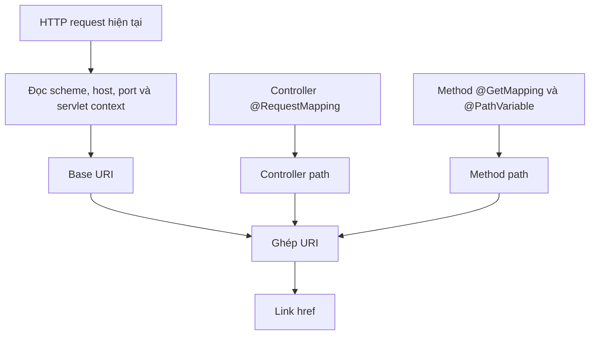

# Base URI

Khi tạo liên kết hypermedia, Spring HATEOAS cần biết phần gốc của địa chỉ mà client có thể truy cập. Phần gốc này thường gồm scheme (`https`), host (`api.example.com`), port nếu cần và context path của ứng dụng. Sau đó framework ghép mapping của controller và phương thức để tạo URI đầy đủ cho tài nguyên.

Ví dụ ứng dụng được công bố tại `https://api.example.com/store`, controller có mapping `/orders` và phương thức chi tiết có mapping `/{id}`. Link tới đơn hàng số `42` phải trỏ tới `https://api.example.com/store/orders/42`. `WebMvcLinkBuilder` có thể lấy thông tin base URI từ request hiện tại rồi ghép mapping Spring MVC, nhờ vậy mã nguồn không phải tự ghép scheme, host, port và path.

Bài học này thuộc chương **Link builder** trong module **SPRING_HATEOAS**, tập trung vào cách Spring HATEOAS xác định base URI, cách xử lý context path và reverse proxy, cách cung cấp base URI tường minh khi không có request hiện tại, và cách kiểm thử các liên kết được tạo.

Sau bài học, bạn có thể:

- Phân biệt base URI, origin, context path và mapping của controller.
- Hiểu cách `WebMvcLinkBuilder` lấy base URI từ request hiện tại.
- Tạo link từ controller bằng `linkTo(...)` và `methodOn(...)`.
- Dùng `ServletUriComponentsBuilder` để lấy base URL theo request hoặc context path.
- Dùng `MvcUriComponentsBuilder.relativeTo(...)` khi cần base URI tường minh hoặc tạo link ngoài request.
- Cấu hình forwarded headers để link phản ánh địa chỉ công khai sau reverse proxy.
- Kiểm thử scheme, host, port, prefix và đường dẫn trong link.

## 1. Base URI gồm những thành phần nào?

Một URI tuyệt đối thường có cấu trúc:

```text
https://api.example.com:8443/store/orders/42?view=summary
\___/   \_______________/ \___/ \___________/ \___________/
scheme        authority    base path  resource path  query
```

Trong ví dụ:

| Thành phần | Giá trị | Ý nghĩa |
|---|---|---|
| Scheme | `https` | Giao thức client dùng để kết nối. |
| Host | `api.example.com` | Tên máy chủ công khai. |
| Port | `8443` | Cổng kết nối; thường được lược khi dùng cổng mặc định 443 hoặc 80. |
| Context path | `/store` | Prefix mà ứng dụng được triển khai bên dưới. |
| Resource path | `/orders/42` | Đường dẫn do mapping controller và method tạo ra. |
| Query | `view=summary` | Tham số truy vấn của request nếu có. |

Trong bài này, **base URI** là phần gốc mà link builder dùng trước khi ghép mapping của tài nguyên. Tùy cấu hình ứng dụng, phần gốc có thể gồm origin cùng context path và servlet mapping. Nó không đồng nghĩa với URL của endpoint hiện tại.

Hãy phân biệt các khái niệm sau:

- **Origin:** scheme, host và port, ví dụ `https://api.example.com`.
- **Context path:** prefix triển khai ứng dụng, ví dụ `/store`.
- **Controller mapping:** mapping ở cấp lớp, ví dụ `@RequestMapping("/orders")`.
- **Method mapping:** mapping ở cấp phương thức, ví dụ `@GetMapping("/{id}")`.
- **Base URI:** phần gốc được dùng để ghép với mapping controller và method.

Nếu ứng dụng được triển khai tại root context, context path có thể rỗng. Nếu có gateway hoặc reverse proxy thêm prefix công khai, prefix đó cũng cần được phản ánh trong link trả về cho client.

## 2. WebMvcLinkBuilder tự lấy base URI từ request

Trong Spring MVC, `WebMvcLinkBuilder` dùng `ServletUriComponentsBuilder` của Spring Framework để lấy thông tin URI cơ bản từ request hiện tại. Sau đó nó đọc annotation mapping trên controller và phương thức để tạo phần đường dẫn còn lại.

Giả sử ứng dụng đang được client gọi tại:

```text
https://api.example.com/store/orders/42
```

Controller khai báo:

```java
import org.springframework.hateoas.EntityModel;
import org.springframework.web.bind.annotation.GetMapping;
import org.springframework.web.bind.annotation.PathVariable;
import org.springframework.web.bind.annotation.RequestMapping;
import org.springframework.web.bind.annotation.RestController;

@RestController
@RequestMapping("/orders")
public class OrderController {

    private final OrderService orderService;

    public OrderController(OrderService orderService) {
        this.orderService = orderService;
    }

    @GetMapping("/{id}")
    public EntityModel<OrderResponse> one(@PathVariable Long id) {
        return EntityModel.of(orderService.findResponseById(id));
    }
}
```

Tạo self link:

Giả sử `orderResponse` đã được lấy từ service và cần bọc vào một `EntityModel`:

```java
import org.springframework.hateoas.Link;

import static org.springframework.hateoas.server.mvc.WebMvcLinkBuilder.linkTo;
import static org.springframework.hateoas.server.mvc.WebMvcLinkBuilder.methodOn;

Long orderId = 42L;

Link self = linkTo(methodOn(OrderController.class).one(orderId))
        .withSelfRel();
```

Link được tạo dựa trên base URI của request và mapping `/orders/{id}`. Kết quả có thể là `https://api.example.com/store/orders/42`. Khi thay đổi mapping controller, framework đọc lại mapping mới; mã tạo link không cần chứa một chuỗi URL riêng để cập nhật thủ công.

`methodOn(...)` tạo proxy ghi nhận lời gọi phương thức để Spring HATEOAS phân tích mapping và các tham số đường dẫn. Nó không thực thi truy vấn hay logic nghiệp vụ của controller như một lời gọi Java thông thường.

## 3. Base URI và mapping được ghép như thế nào?

Quá trình tạo link có thể hình dung qua sơ đồ:



Ví dụ mapping:

| Nguồn | Giá trị |
|---|---|
| Base URI | `https://api.example.com/store` |
| Class mapping | `/orders` |
| Method mapping | `/{id}` |
| Path variable | `42` |
| URI kết quả | `https://api.example.com/store/orders/42` |

Không nên tự thêm `/store` vào link nếu context path đã được request cung cấp. Tương tự, không lặp `/orders` trong chuỗi URL khi nó đã có trong `@RequestMapping` của controller. Việc khai báo cùng một mapping ở nhiều nơi khiến các link dễ lỗi thời khi API được tổ chức lại.

## 4. Lấy base URI bằng ServletUriComponentsBuilder

Spring Framework cung cấp `ServletUriComponentsBuilder` để lấy URI dựa trên request Servlet. Các factory method thường dùng có phạm vi khác nhau:

| Phương thức | Phần thông tin được dùng |
|---|---|
| `fromCurrentRequest()` | Scheme, host, port, path và query của request hiện tại. |
| `fromCurrentRequestUri()` | Scheme, host, port và path của request hiện tại, không lấy query. |
| `fromCurrentContextPath()` | Scheme, host, port và context path. |
| `fromCurrentServletMapping()` | Scheme, host, port, context path và servlet mapping. |

Nếu cần base URI để thêm một resource path mới, `fromCurrentContextPath()` thường là điểm bắt đầu rõ ràng:

```java
import java.net.URI;

import org.springframework.web.servlet.support.ServletUriComponentsBuilder;

URI ordersUri = ServletUriComponentsBuilder
        .fromCurrentContextPath()
        .path("/orders")
        .build()
        .toUri();
```

Với request tại `https://api.example.com/store/orders/42`, kết quả có thể là `https://api.example.com/store/orders`. Nếu dùng `fromCurrentRequest()` rồi tiếp tục thêm `/orders`, rất dễ lặp lại phần path của endpoint hiện tại. Hãy chọn factory method theo đúng điểm gốc cần dùng.

Trong code Spring HATEOAS thông thường, không cần tự gọi `ServletUriComponentsBuilder` để tạo từng link. `WebMvcLinkBuilder` đã dùng cơ chế này. Các factory method hữu ích khi ứng dụng cần tạo URI cho một mục đích khác, chẳng hạn header `Location`, hoặc cần hiểu rõ nguồn gốc của base URI.

## 5. Tiếp tục chỉnh URI bằng WebMvcLinkBuilder

`WebMvcLinkBuilder` cung cấp `toUriComponentsBuilder()` để lấy `UriComponentsBuilder` từ URI đã được tạo theo mapping controller. Bạn có thể tiếp tục tinh chỉnh URI trước khi chuyển thành `Link` hoặc `URI`.

```java
import java.net.URI;

import org.springframework.web.util.UriComponentsBuilder;

import static org.springframework.hateoas.server.mvc.WebMvcLinkBuilder.linkTo;
import static org.springframework.hateoas.server.mvc.WebMvcLinkBuilder.methodOn;

UriComponentsBuilder builder = linkTo(
        methodOn(OrderController.class).one(orderId))
        .toUriComponentsBuilder();

URI uri = builder
        .queryParam("view", "summary")
        .build()
        .toUri();
```

Đoạn code bắt đầu từ mapping controller và thêm query parameter `view`. Hãy dùng cách này khi cần bổ sung tham số mà không muốn viết lại toàn bộ URI. Nếu query parameter đã được biểu diễn trong chữ ký controller bằng `@RequestParam`, có thể truyền giá trị vào lời gọi `methodOn(...)` để Spring HATEOAS tạo URI theo mapping và tham số tương ứng.

Không dùng `toUriComponentsBuilder()` như một cách thay thế tùy tiện cho việc cấu hình base URI của toàn ứng dụng. Builder này tiếp tục chỉnh URI đã được tạo từ request hiện tại; nếu cần base URI khác hoặc không có request, hãy xem phần tiếp theo.

## 6. Cung cấp base URI tường minh khi không có request

Một số tác vụ tạo link ngoài vòng đời HTTP request, ví dụ:

- Batch job chuẩn bị email hoặc báo cáo có link tới tài nguyên.
- Event listener tạo thông điệp chứa URL cho client.
- Tác vụ nền tạo dữ liệu xuất ra ngoài hệ thống.
- Ứng dụng cần thêm prefix công khai như `/v2`, `/store` hoặc `/en` vào mapping.

Trong các trường hợp này, `WebMvcLinkBuilder` không có request hiện tại để lấy scheme, host và context path. API `WebMvcLinkBuilder` hiện hành không cung cấp overload `linkTo(..., baseUri)` trực tiếp. Spring Framework có `MvcUriComponentsBuilder.relativeTo(...)` để tạo URI từ mapping controller với một base URL do ứng dụng cung cấp.

Ví dụ cấu hình base URI công khai:

```java
import java.net.URI;

import org.springframework.hateoas.Link;
import org.springframework.web.servlet.mvc.method.annotation.MvcUriComponentsBuilder;
import org.springframework.web.util.UriComponentsBuilder;

import static org.springframework.web.servlet.mvc.method.annotation.MvcUriComponentsBuilder.on;

URI uri = MvcUriComponentsBuilder
        .relativeTo(UriComponentsBuilder.fromUriString("https://api.example.com/store"))
        .withMethodCall(on(OrderController.class).one(42L))
        .build()
        .toUri();

Link self = Link.of(uri).withSelfRel();
```

Với controller có class mapping `/orders` và method mapping `/{id}`, URI được tạo dựa trên base đã cấu hình cùng mapping và ID `42`. `MvcUriComponentsBuilder` thuộc Spring Framework, không phải API riêng của Spring HATEOAS; kết quả `URI` được bọc thành `Link` để đưa vào representation model.

Base URI nên được đọc từ cấu hình theo môi trường, ví dụ `https://api.example.com/store` ở production và `http://localhost:8080` ở local. Không nên viết cố định một hostname production trong assembler dùng chung.

Nếu chỉ cần dựng URI tĩnh từ base URI và path đã được quản lý tập trung, có thể dùng `UriComponentsBuilder` trực tiếp:

```java
String publicBaseUri = "https://api.example.com/store";
Long orderId = 42L;

URI uri = UriComponentsBuilder
        .fromUriString(publicBaseUri)
        .pathSegment("orders", "{id}")
        .buildAndExpand(orderId)
        .toUri();

Link self = Link.of(uri).withSelfRel();
```

Trong cách này, ứng dụng tự chịu trách nhiệm giữ path đồng bộ với controller. Nếu cần bám theo annotation mapping, `MvcUriComponentsBuilder` phù hợp hơn.

## 7. Phân biệt base URI với context path và servlet path

Một ứng dụng có thể được triển khai ở nhiều cấu trúc khác nhau:

| Cấu hình | Ví dụ | Ảnh hưởng tới link |
|---|---|---|
| Root context | `/orders/42` | Không có context prefix. |
| Context path | `/store/orders/42` | Link phải giữ `/store`. |
| Servlet mapping | `/gateway/orders/42` | Link có thể cần prefix servlet mapping. |
| Public gateway prefix | `/platform/orders/42` | Link phải phản ánh prefix mà client bên ngoài nhìn thấy. |
| Locale prefix | `/en/orders/42` | Cần thêm locale nếu gateway hoặc routing đã loại prefix trước khi request vào controller. |

Ví dụ, cấu hình Spring Boot có thể đặt context path:

```yaml
server:
  servlet:
    context-path: /store
```

Controller vẫn có thể khai báo `@RequestMapping("/orders")`. Khi client truy cập qua context path, link được tạo từ request phải chứa `/store` trước mapping controller.

Nếu một gateway công bố ứng dụng tại `/platform/store` nhưng chuyển tiếp request nội bộ tới `/store`, server có thể chỉ nhìn thấy `/store/orders/42` trong khi client truy cập `/platform/store/orders/42`. Trong trường hợp đó, proxy cần cung cấp forwarded prefix công khai `/platform/store` và ứng dụng cần xử lý header này đúng cách.

Không nhầm `server.servlet.context-path` với `@RequestMapping`. Cái đầu là cấu hình triển khai ứng dụng; cái sau là hợp đồng route của controller. Chúng được ghép thành URI đầy đủ khi tạo link.

## 8. Tạo link đúng khi chạy sau reverse proxy

Khi ứng dụng chạy sau reverse proxy hoặc load balancer, request nội bộ có thể khác request mà client gửi tới địa chỉ công khai.

Ví dụ:

```text
Client -> https://api.example.com/platform/store/orders/42
Proxy  -> http://orders-service:8080/store/orders/42
```

Nếu ứng dụng chỉ nhìn thấy thông tin nội bộ, self link có thể bị tạo thành `http://orders-service:8080/store/orders/42`. Client bên ngoài không thể truy cập hostname nội bộ đó. Proxy có thể chuyển thông tin gốc qua các header:

| Header | Thông tin |
|---|---|
| `Forwarded` | Header chuẩn RFC 7239 chứa thông tin proxy như `proto` và `host`. |
| `X-Forwarded-Proto` | Scheme gốc, ví dụ `https`. |
| `X-Forwarded-Host` | Host công khai, ví dụ `api.example.com`. |
| `X-Forwarded-Port` | Port công khai nếu khác mặc định. |
| `X-Forwarded-Prefix` | Prefix path công khai thay thế prefix nội bộ mà proxy đã loại bỏ. |

Spring HATEOAS dựa trên thông tin request của Spring Framework để tạo base URI. Để các header forwarded có hiệu lực, cần bật xử lý forwarded header phù hợp với stack và phiên bản Spring đang dùng.

Với Spring MVC, có thể đăng ký `ForwardedHeaderFilter`:

```java
import org.springframework.context.annotation.Bean;
import org.springframework.context.annotation.Configuration;
import org.springframework.web.filter.ForwardedHeaderFilter;

@Configuration
class ForwardedHeaderConfiguration {

    @Bean
    ForwardedHeaderFilter forwardedHeaderFilter() {
        return new ForwardedHeaderFilter();
    }
}
```

Trong Spring Boot, cũng có thể cấu hình forwarded header strategy qua property của phiên bản Boot đang dùng. Với Spring Boot 3.x, property thường dùng là:

```yaml
server:
  forward-headers-strategy: framework
```

Với Spring Boot 4.x, cấu hình được nhóm dưới `server.request.header.forwarded`. Nếu proxy gửi `X-Forwarded-Prefix`, bật hỗ trợ prefix theo cấu hình của phiên bản này:

```yaml
server:
  request:
    header:
      forwarded:
        strategy: framework
        use-prefix: true
```

Tên property khác nhau giữa các thế hệ Spring Boot; hãy dùng đúng cấu hình của phiên bản dự án. Nếu web server hỗ trợ xử lý forwarded header native, có thể chọn cơ chế native theo tài liệu server thay vì đăng ký filter framework. Chỉ chọn một cơ chế phù hợp với hạ tầng, tránh xử lý trùng lặp.

Khi proxy gửi `X-Forwarded-Proto: https`, `X-Forwarded-Host: api.example.com` và `X-Forwarded-Prefix: /platform/store`, ứng dụng được cấu hình đúng có thể tạo link công khai dạng:

```text
https://api.example.com/platform/store/orders/42
```

### Ranh giới tin cậy của forwarded headers

Forwarded headers có thể thay đổi scheme, host và prefix được dùng để tạo URI. Vì vậy, chỉ tin các header do proxy đáng tin cậy thiết lập. Proxy ở ranh giới bên ngoài phải loại bỏ header forwarded do client tự gửi rồi ghi lại giá trị đúng trước khi chuyển request vào ứng dụng. Nếu để client tự kiểm soát `X-Forwarded-Host`, họ có thể khiến server tạo link chứa hostname không mong muốn.

Không nên bật forwarded header processing một cách tùy tiện khi ứng dụng có thể nhận request trực tiếp từ Internet. Hãy cấu hình proxy, danh sách proxy tin cậy và cơ chế lọc header phù hợp với kiến trúc triển khai.

## 9. Kiểm thử base URI

Kiểm thử link cần xác nhận cả mapping và base URI. Với MockMvc, có thể gửi request có Host header để kiểm tra host được dùng trong link:

```java
import org.junit.jupiter.api.Test;
import org.springframework.beans.factory.annotation.Autowired;
import org.springframework.boot.test.autoconfigure.web.servlet.AutoConfigureMockMvc;
import org.springframework.boot.test.context.SpringBootTest;
import org.springframework.hateoas.MediaTypes;
import org.springframework.test.web.servlet.MockMvc;

import static org.hamcrest.Matchers.containsString;
import static org.springframework.test.web.servlet.request.MockMvcRequestBuilders.get;
import static org.springframework.test.web.servlet.result.MockMvcResultMatchers.jsonPath;
import static org.springframework.test.web.servlet.result.MockMvcResultMatchers.status;

@SpringBootTest
@AutoConfigureMockMvc
class OrderBaseUriTest {

    @Autowired
    MockMvc mockMvc;

    @Test
    void selfLinkUsesRequestHostAndControllerMapping() throws Exception {
        mockMvc.perform(get("/orders/42")
                        .header("Host", "api.example.test")
                        .accept(MediaTypes.HAL_JSON))
                .andExpect(status().isOk())
                .andExpect(jsonPath("$._links.self.href",
                        containsString("api.example.test/orders/42")));
    }
}
```

Ví dụ giả định controller được triển khai ở root context và dữ liệu đơn hàng `42` tồn tại. Nếu ứng dụng dùng context path hoặc prefix công khai, hãy kiểm tra cả phần prefix đó trong href.

Với cấu hình forwarded header, bổ sung kiểm thử tích hợp có filter hoặc web server tương ứng. Có thể gửi các header `X-Forwarded-Proto`, `X-Forwarded-Host`, `X-Forwarded-Port` và `X-Forwarded-Prefix`, rồi xác nhận self link chứa địa chỉ công khai. Kiểm thử này giúp phát hiện lỗi tạo link nội bộ sau khi thay đổi proxy hoặc gateway.

Các trường hợp nên kiểm tra:

- Ứng dụng chạy ở root context.
- Ứng dụng chạy với `server.servlet.context-path`.
- Mapping controller thay đổi nhưng link vẫn bám theo annotation.
- Scheme, host và port phản ánh request hoặc proxy đã cấu hình.
- Prefix do gateway thêm được giữ trong link.
- Tác vụ nền dùng base URI cấu hình tường minh và không phụ thuộc request context.
- Host hoặc forwarded header không đáng tin cậy không thể tùy ý thay đổi URL công khai.

## 10. Lỗi thường gặp

| Lỗi | Hệ quả | Cách xử lý |
|---|---|---|
| Hard-code scheme, host và port trong assembler | Link sai khi chạy ở môi trường khác. | Dùng `WebMvcLinkBuilder` trong request hoặc base URI cấu hình theo môi trường. |
| Ghép context path thủ công dù request đã chứa nó | URL bị lặp prefix. | Để builder lấy base từ request hoặc xác định rõ base URI trước khi ghép mapping. |
| Dùng `fromCurrentRequest()` làm base rồi thêm lại controller path | Path endpoint hiện tại có thể bị lặp. | Dùng `fromCurrentContextPath()` hoặc `WebMvcLinkBuilder` theo mục tiêu. |
| Cho rằng WebMvcLinkBuilder có overload nhận base URI trực tiếp | Gọi API không tồn tại ở phiên bản hiện hành. | Dùng `MvcUriComponentsBuilder.relativeTo(...)` khi cần base tường minh. |
| Không xử lý forwarded headers sau proxy | Link chứa hostname, scheme hoặc prefix nội bộ. | Cấu hình forwarded header strategy/filter và proxy tin cậy. |
| Tin mọi forwarded header từ client | Có nguy cơ tạo link theo Host giả mạo. | Proxy phải loại bỏ header ngoài rồi ghi lại header tin cậy. |
| Tạo link nền mà không có request context | Không có thông tin base để dựng URI tuyệt đối. | Dùng `MvcUriComponentsBuilder` với base URI cấu hình. |
| Không kiểm thử host, context path và prefix | Link có thể đúng local nhưng sai production. | Thêm kiểm thử tích hợp theo từng kiểu triển khai. |

## 11. Quy trình chọn và cấu hình base URI

Khi xây link cho API Spring HATEOAS, hãy thực hiện theo trình tự:

1. Xác định địa chỉ công khai mà client sử dụng, gồm scheme, host, port và prefix.
2. Xác định context path và servlet mapping của ứng dụng.
3. Xác định controller mapping và method mapping sẽ được ghép vào base URI.
4. Nếu đang xử lý HTTP request, dùng `WebMvcLinkBuilder.linkTo(methodOn(...))` để framework lấy base từ request.
5. Nếu tạo link ngoài request hoặc dùng base riêng, cung cấp `UriComponentsBuilder` cho `MvcUriComponentsBuilder.relativeTo(...)`.
6. Nếu chạy sau proxy, cấu hình forwarded header theo phiên bản Spring và chỉ tin header do proxy đáng tin cậy ghi lại.
7. Kiểm thử href với host, scheme, context path và prefix thực tế của môi trường triển khai.

Base URI quyết định phần gốc của các liên kết hypermedia. Khi phần gốc được lấy từ request hoặc cấu hình đáng tin cậy, còn đường dẫn tài nguyên được suy ra từ mapping controller, ứng dụng có thể thay đổi host, context path và cấu trúc triển khai mà không phải rải các URL cố định khắp mã nguồn.

## Tài liệu tham khảo

- [Spring HATEOAS – Reference documentation, phần Server-side support](https://docs.spring.io/spring-hateoas/docs/current/reference/html/)
- [Spring HATEOAS – WebMvcLinkBuilder API](https://docs.spring.io/spring-hateoas/docs/current/api/org/springframework/hateoas/server/mvc/WebMvcLinkBuilder.html)
- [Spring Framework – URI links](https://docs.spring.io/spring-framework/reference/web/webmvc/mvc-uri-building.html)
- [Spring Boot – Running behind a front-end proxy server](https://docs.spring.io/spring-boot/how-to/webserver.html)
