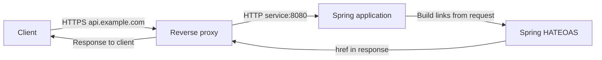

# Link builder và proxy

## Mục tiêu

Sau bài này, bạn có thể dùng link builder của Spring HATEOAS để tạo href theo mapping của controller và request hiện tại, giải thích vì sao link có thể sai host hoặc scheme khi ứng dụng chạy sau reverse proxy, cấu hình xử lý forwarded headers trong Spring MVC hoặc WebFlux và kiểm thử link theo địa chỉ công khai mà client thực sự sử dụng.

## 1. Link builder giải quyết vấn đề gì?

Một ứng dụng REST cần công bố các liên kết đến tài nguyên và thao tác liên quan. Nếu tự ghép URL bằng chuỗi, mã nguồn sẽ phụ thuộc vào cấu trúc đường dẫn:

```java
String href = "/orders/" + order.getId();
```

Cách này dễ sai khi mapping thay đổi, controller có context path hoặc endpoint có query parameter. Nó cũng không phản ánh host và scheme của request hiện tại.

Spring HATEOAS cung cấp link builder để tạo liên kết từ mapping của Spring MVC hoặc WebFlux. Với Spring MVC, API thường dùng là `WebMvcLinkBuilder`, đặc biệt là hai phương thức:

- `methodOn(...)` tạo tham chiếu đến phương thức controller để Spring HATEOAS đọc mapping và tham số.
- `linkTo(...)` tạo link builder từ mapping đó và ngữ cảnh request hiện tại.

Ví dụ:

```java
Link self = linkTo(methodOn(OrderController.class)
        .getOrder(order.getId()))
        .withSelfRel();
```

Href được xây dựng từ mapping của `getOrder` cùng ID của đơn hàng. Khi mapping được thay đổi, link builder sẽ sử dụng mapping mới khi ứng dụng được biên dịch và triển khai lại.

## 2. Tạo link từ controller mapping

Giả sử controller có mapping ở cấp lớp và cấp phương thức:

```java
@RestController
@RequestMapping("/orders")
public class OrderController {

    private final OrderService orderService;
    private final OrderModelAssembler assembler;

    public OrderController(
            OrderService orderService,
            OrderModelAssembler assembler) {
        this.orderService = orderService;
        this.assembler = assembler;
    }

    @GetMapping("/{id}")
    public EntityModel<Order> getOrder(@PathVariable UUID id) {
        return assembler.toModel(orderService.getRequired(id));
    }

    @GetMapping
    public CollectionModel<EntityModel<Order>> getOrders() {
        return assembler.toCollectionModel(orderService.findAll());
    }
}
```

Assembler tạo các link tương ứng:

```java
@Component
public class OrderModelAssembler
        implements RepresentationModelAssembler<Order, EntityModel<Order>> {

    @Override
    public EntityModel<Order> toModel(Order order) {
        Link self = linkTo(methodOn(OrderController.class)
                .getOrder(order.getId()))
                .withSelfRel();

        Link collection = linkTo(methodOn(OrderController.class)
                .getOrders())
                .withRel(IanaLinkRelations.COLLECTION);

        return EntityModel.of(order, self, collection);
    }
}
```

Các import chính:

```java
import java.util.UUID;

import org.springframework.hateoas.CollectionModel;
import org.springframework.hateoas.EntityModel;
import org.springframework.hateoas.IanaLinkRelations;
import org.springframework.hateoas.Link;
import org.springframework.hateoas.server.RepresentationModelAssembler;

import static org.springframework.hateoas.server.mvc.WebMvcLinkBuilder.linkTo;
import static org.springframework.hateoas.server.mvc.WebMvcLinkBuilder.methodOn;
```

Trong ví dụ, `self` trỏ đến một đơn hàng, còn `collection` trỏ đến danh sách đơn hàng. Các link được tạo từ mapping controller thay vì từ những chuỗi URL cố định.

Lời gọi `methodOn(...)` là một cơ chế tham chiếu phương thức để xây link; nó không thực thi request HTTP và không chạy logic nghiệp vụ của endpoint như một lời gọi từ client.

## 3. Link builder sử dụng ngữ cảnh request

Khi tạo absolute href, Spring HATEOAS cần biết scheme, host, port và context path của request. Trong ứng dụng Servlet, link builder dựa vào thông tin request hiện tại để tạo URI.

Ví dụ client gọi:

```http
GET https://api.example.com/orders/42
```

Response có thể chứa:

```json
{
  "_links": {
    "self": {
      "href": "https://api.example.com/orders/42"
    }
  }
}
```

Điều này giúp link được công bố theo địa chỉ mà client dùng để truy cập API. Khi ứng dụng chạy trực tiếp, request thường đã mang host và scheme công khai. Khi ứng dụng chạy phía sau reverse proxy, request mà ứng dụng nhận có thể khác với request ban đầu của client.

## 4. Vì sao reverse proxy có thể làm sai href?

Trong môi trường production, kiến trúc triển khai thường có proxy hoặc load balancer đứng trước ứng dụng:



Client có thể truy cập bằng HTTPS và host công khai:

```text
https://api.example.com/orders/42
```

Trong khi proxy chuyển tiếp đến ứng dụng bằng HTTP và host nội bộ:

```text
http://orders-service:8080/orders/42
```

Nếu Spring chỉ nhìn thấy request nội bộ, link builder có thể tạo href như:

```text
http://orders-service:8080/orders/42
```

Client bên ngoài không truy cập được địa chỉ này. Một số hệ quả thường gặp:

- Link có scheme `http` dù client đang dùng `https`.
- Href chứa hostname hoặc port nội bộ.
- Link thiếu public context path nếu proxy thêm prefix trước khi chuyển request.
- Client bị chuyển hướng sang địa chỉ backend hoặc gặp lỗi khi theo link.

Đây không phải lỗi riêng của `linkTo`. Link builder sử dụng request context mà Spring cung cấp; nếu request context không phản ánh địa chỉ công khai thì href được tạo ra cũng có thể sai.

## 5. Forwarded headers truyền thông tin public

Reverse proxy có thể gửi metadata về request ban đầu qua các forwarded headers. Hai nhóm thường gặp là:

**Header chuẩn `Forwarded`:**

```http
Forwarded: proto=https;host=api.example.com
```

**Các header dạng `X-Forwarded-*`:**

```http
X-Forwarded-Proto: https
X-Forwarded-Host: api.example.com
X-Forwarded-Port: 443
X-Forwarded-Prefix: /gateway
```

Các giá trị này cho ứng dụng biết scheme, host, port và có thể cả prefix công khai mà client đã sử dụng. Header cụ thể được gửi phụ thuộc cấu hình reverse proxy và nền tảng triển khai. Không phải hệ thống nào cũng gửi tất cả các header.

Khi được cấu hình xử lý forwarded headers, Spring có thể điều chỉnh request context để các thành phần tạo URI, bao gồm Spring HATEOAS, nhìn thấy thông tin bên ngoài thay vì thông tin kết nối nội bộ.

Nếu proxy công bố API tại `https://api.example.com/gateway` rồi chuyển request đến ứng dụng tại `http://orders-service:8080`, thông tin prefix cũng cần được chuyển tiếp và xử lý nếu href cần chứa `/gateway`.

## 6. Cấu hình xử lý forwarded headers trong Spring MVC

Trong ứng dụng Servlet, Spring Framework cung cấp `ForwardedHeaderFilter`. Filter này xử lý các header như `Forwarded` và `X-Forwarded-*`, rồi điều chỉnh thông tin request mà ứng dụng nhìn thấy.

Với ứng dụng Spring Boot, có thể cấu hình chiến lược xử lý forwarded headers qua thuộc tính cấu hình của server. Ví dụ với YAML:

```yaml
server:
  forward-headers-strategy: framework
```

Chiến lược `framework` yêu cầu Spring Framework xử lý forwarded headers. Tùy phiên bản Spring Boot, servlet container và môi trường triển khai, có thể có lựa chọn để container xử lý native hoặc tắt việc xử lý. Hãy đối chiếu tài liệu phiên bản đang dùng và bảo đảm chỉ có một lớp chịu trách nhiệm xử lý các header đó.

Nếu tự cấu hình Spring MVC mà không dựa vào auto-configuration của Boot, đăng ký `ForwardedHeaderFilter` trong filter chain và đặt nó trước những filter hoặc thành phần cần sử dụng URL đã được điều chỉnh. Tránh đăng ký trùng filter nếu Boot hoặc container đã cấu hình xử lý forwarded headers.

Sau khi cấu hình, assembler có thể tiếp tục dùng link builder như bình thường:

```java
Link self = linkTo(methodOn(OrderController.class)
        .getOrder(order.getId()))
        .withSelfRel();
```

Không cần ghép thêm host public vào mỗi link. Link builder sử dụng request context đã được xử lý để tạo href phù hợp.

## 7. Cấu hình trong Spring WebFlux

Ứng dụng WebFlux có cơ chế xử lý forwarded headers riêng thông qua `ForwardedHeaderTransformer`. Khi dùng Spring Boot WebFlux, cấu hình server và auto-configuration có thể đăng ký transformer phù hợp theo chiến lược forwarded headers.

Về cách sử dụng link, hãy chọn API link builder đúng với stack ứng dụng:

- Spring MVC dùng `WebMvcLinkBuilder`.
- Spring WebFlux dùng `WebFluxLinkBuilder` và cách xử lý bất đồng bộ tương ứng.

Không nên dùng `WebMvcLinkBuilder` trong ứng dụng WebFlux chỉ vì tên API tương tự. Cả hai stack cần được cấu hình để URI cơ sở phản ánh scheme, host và prefix mà proxy công bố.

## 8. Ranh giới tin cậy của forwarded headers

Forwarded headers có thể ảnh hưởng đến host và scheme trong href. Vì vậy, chỉ nên tin các giá trị do reverse proxy đáng tin cậy thiết lập.

Nếu ứng dụng nhận trực tiếp header do client gửi và sử dụng nó để tạo absolute href, kẻ tấn công có thể cung cấp host giả. Response khi đó có thể chứa link trỏ đến một domain không mong muốn. Các link này có thể gây nhầm lẫn, tạo nguy cơ phishing hoặc ảnh hưởng đến các luồng xử lý dựa trên URL.

Ở biên mạng, reverse proxy cần:

1. Xóa hoặc ghi đè forwarded headers do client bên ngoài gửi vào.
2. Tự thiết lập giá trị `Forwarded` hoặc `X-Forwarded-*` dựa trên request thực tế.
3. Chỉ cho phép ứng dụng nhận traffic từ proxy đáng tin cậy nếu kiến trúc yêu cầu.
4. Đồng bộ cách xử lý scheme, host, port và prefix với cấu hình ứng dụng.

`ForwardedHeaderFilter` và `ForwardedHeaderTransformer` xử lý header; chúng không tự xác minh rằng người gửi header là proxy đáng tin cậy. Việc thiết lập ranh giới tin cậy phải được thực hiện trong cấu hình mạng và proxy.

## 9. Kiểm thử link sau proxy

Một unit test chỉ gọi assembler có thể không mô phỏng đầy đủ request context và forwarded headers. Nên có integration test qua filter chain để kiểm tra href cuối cùng trong response.

Ví dụ với MockMvc, khi ứng dụng đã đăng ký `ForwardedHeaderFilter`:

```java
mockMvc.perform(get("/orders/{id}", orderId)
        .header("Forwarded", "proto=https;host=api.example.com")
        .accept(MediaTypes.HAL_JSON))
    .andExpect(status().isOk())
    .andExpect(jsonPath("$._links.self.href")
            .value("https://api.example.com/orders/" + orderId));
```

Kết quả mong đợi là href dùng scheme và host công khai. Nếu ứng dụng được công bố dưới prefix, hãy kiểm thử thêm header prefix theo cấu hình proxy và xác nhận link chứa đúng prefix.

Cần lưu ý rằng test này chỉ xác minh cách ứng dụng xử lý header khi filter được cài trong test. Nó không thay thế việc kiểm tra cấu hình reverse proxy thực tế. Trong môi trường staging hoặc production, hãy xác nhận proxy gửi đúng header và loại bỏ header giả do client cung cấp.

Các tình huống nên kiểm thử:

- Request trực tiếp trong môi trường phát triển tạo link phù hợp với host và port phát triển.
- Request qua proxy tạo absolute href với HTTPS và hostname công khai.
- Context path hoặc forwarded prefix được giữ đúng nếu ứng dụng được public dưới một prefix.
- Header không hợp lệ hoặc không đáng tin cậy không được phép điều khiển host public của link.
- Link `self`, link collection và link hành động đều dùng cùng một base URI đúng.

## 10. Các lỗi cấu hình thường gặp

**Không bật forwarded header processing.** Link builder nhìn thấy host và scheme nội bộ, khiến href không truy cập được từ client bên ngoài.

**Proxy không ghi đè header đầu vào.** Client có thể giả mạo `Forwarded` hoặc `X-Forwarded-Host`. Proxy cần xóa và thiết lập lại các giá trị này.

**Thiếu forwarded prefix.** Nếu proxy public API dưới `/gateway`, nhưng ứng dụng không nhận hoặc không xử lý prefix, link có thể bỏ mất phần đường dẫn công khai.

**Cấu hình xử lý trùng lặp.** Nếu proxy, container và Spring cùng chỉnh sửa forwarded headers theo cách không thống nhất, scheme, host hoặc prefix có thể bị nhân đôi hoặc sai.

**Hard-code host trong assembler.** Địa chỉ cố định hoạt động ở một môi trường nhưng sai ở môi trường khác. Hãy để link builder dựa trên request context đã được cấu hình đúng.

**Chỉ kiểm tra URL trên máy local.** Link có thể đúng khi chạy trực tiếp nhưng sai sau ingress, load balancer hoặc API gateway. Cần kiểm thử qua đúng đường đi triển khai.

## 11. Nguyên tắc triển khai

- Dùng `linkTo(methodOn(...))` cho endpoint được quản lý bởi controller.
- Giữ logic tạo link trong assembler khi nhiều response cùng dùng một representation.
- Cấu hình forwarded headers theo đúng stack MVC hoặc WebFlux và phiên bản Spring đang dùng.
- Chỉ tin forwarded headers từ proxy được quản lý và tin cậy.
- Đưa public scheme, host và prefix vào kiểm thử integration.
- Không gắn cứng URL nội bộ hoặc URL của một môi trường vào mã nguồn tạo link.

## Kết luận

Spring HATEOAS tạo link dựa trên mapping controller và request context. Khi ứng dụng chạy sau reverse proxy, request nội bộ có thể mang HTTP và hostname backend dù client truy cập bằng HTTPS và hostname public. Cấu hình xử lý `Forwarded` hoặc `X-Forwarded-*` trong Spring MVC/WebFlux giúp request context phản ánh địa chỉ công khai để link builder tạo href đúng. Hãy cấu hình proxy ghi đè header từ client, chỉ tin nguồn chuyển tiếp đáng tin cậy và kiểm thử link qua toàn bộ đường đi triển khai.

