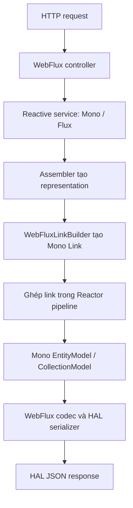

# WebFlux và HAL

Spring WebFlux cho phép xây dựng REST API theo mô hình reactive với `Mono` và `Flux`. Khi API cần trả về tài nguyên có liên kết hypermedia, Spring HATEOAS cung cấp các representation model như `EntityModel` và `CollectionModel`, cùng `WebFluxLinkBuilder` để tạo link trong pipeline reactive.

Điểm khác biệt quan trọng so với Spring MVC là việc tạo link trong WebFlux có thể cần ngữ cảnh request bất đồng bộ. Vì vậy, `WebFluxLinkBuilder` cung cấp `Mono<Link>` thay vì tạo `Link` ngay lập tức. Ứng dụng cần kết hợp kết quả đó bằng các toán tử Reactor như `map`, `flatMap` và `zip`, sau đó trả `Mono<RepresentationModel>` hoặc `Mono<CollectionModel<...>>` từ controller. Spring WebFlux sẽ tuần tự hóa representation thành HAL JSON khi media type được cấu hình và thương lượng phù hợp.

## WebFlux, HATEOAS và HAL phối hợp như thế nào?

Một endpoint WebFlux có thể trả `Mono<EntityModel<OrderResponse>>` cho một đơn hàng hoặc `Mono<CollectionModel<EntityModel<OrderResponse>>>` cho một tập hợp. Nội dung phản hồi chứa dữ liệu nghiệp vụ; các link mô tả quan hệ như `self`, `customer`, `orders` hoặc `cancel`.

Luồng xử lý tổng quát:



Các thành phần đảm nhiệm những việc khác nhau:

| Thành phần | Vai trò |
|---|---|
| `Mono<T>` | Biểu diễn kết quả bất đồng bộ có tối đa một phần tử |
| `Flux<T>` | Biểu diễn một luồng có thể có nhiều phần tử |
| `EntityModel<T>` | Bọc nội dung của một tài nguyên cùng các link |
| `CollectionModel<T>` | Bọc các representation trong một collection cùng link cấp collection |
| `WebFluxLinkBuilder` | Tạo link dựa trên mapping controller trong ngữ cảnh reactive |
| HAL | Biểu diễn nội dung, link và embedded resource dưới dạng JSON hypermedia |

WebFlux không yêu cầu thay đổi ý nghĩa của HATEOAS. Client vẫn điều hướng theo relation (`rel`) và URL (`href`); phần thay đổi nằm ở cách server xây dựng link và trả response trong pipeline reactive.

## Cấu hình dependency cho WebFlux

Với Spring Boot, dùng WebFlux starter và dependency Spring HATEOAS trực tiếp. `spring-boot-starter-hateoas` được thiết kế cho Spring MVC, vì vậy không nên dùng starter đó trong ứng dụng WebFlux.

Ví dụ Gradle:

```groovy
dependencies {
    implementation 'org.springframework.boot:spring-boot-starter-webflux'
    implementation 'org.springframework.hateoas:spring-hateoas'
}
```

Khi dùng Spring Boot dependency management, để BOM của Spring Boot quản lý phiên bản Spring HATEOAS tương thích. Tránh tự chọn phiên bản Spring HATEOAS khác dòng tương thích với Spring Framework và Spring Boot của ứng dụng.

Spring Boot cung cấp auto-configuration cho Spring HATEOAS. Nếu cần kiểm soát tường minh việc kích hoạt hypermedia cho WebFlux, có thể dùng `@EnableHypermediaSupport`:

```java
import org.springframework.context.annotation.Configuration;
import org.springframework.hateoas.config.EnableHypermediaSupport;
import org.springframework.hateoas.config.EnableHypermediaSupport.HypermediaType;
import org.springframework.hateoas.support.WebStack;

@Configuration
@EnableHypermediaSupport(
        type = HypermediaType.HAL,
        stacks = WebStack.WEBFLUX
)
public class HypermediaConfiguration {
}
```

`HypermediaType.HAL` bật cách tuần tự hóa HAL; `WebStack.WEBFLUX` giới hạn cấu hình vào stack WebFlux. Khi đã dùng Spring Boot auto-configuration, chỉ thêm annotation này nếu ứng dụng chủ động quản lý cấu hình hypermedia. Việc tự bật cấu hình có thể thay đổi cách Boot tùy biến `JsonMapper`.

## Tạo link bằng WebFluxLinkBuilder

`WebFluxLinkBuilder` nằm trong package `org.springframework.hateoas.server.reactive`. Có thể tạo link từ một lời gọi phương thức controller giả lập bằng `methodOn(...)`:

```java
import org.springframework.hateoas.Link;
import org.springframework.web.server.ServerWebExchange;
import reactor.core.publisher.Mono;

import static org.springframework.hateoas.server.reactive.WebFluxLinkBuilder.linkTo;
import static org.springframework.hateoas.server.reactive.WebFluxLinkBuilder.methodOn;

Mono<Link> selfLink = linkTo(
        methodOn(OrderController.class).one(orderId),
        exchange
).withSelfRel().toMono();
```

Trong ví dụ, `exchange` là `ServerWebExchange` của request hiện tại. `linkTo(invocation, exchange)` dùng trực tiếp ngữ cảnh request để tạo URI. `withSelfRel()` đặt relation `self`, còn `toMono()` trả về `Mono<Link>` để tiếp tục xử lý bất đồng bộ.

Có hai cách lấy ngữ cảnh request:

- `WebFluxLinkBuilder.linkTo(invocation)` kiểm tra Reactor Context để tìm `ServerWebExchange`. Nếu không có exchange, builder có thể tạo URI tương đối.
- `WebFluxLinkBuilder.linkTo(invocation, exchange)` nhận `ServerWebExchange` tường minh, hữu ích khi assembler đã được truyền exchange.

Không gọi `block()` để lấy link bên trong controller hoặc assembler reactive. Việc chặn luồng sẽ phá vỡ tính bất đồng bộ và có thể gây nghẽn event loop. Hãy giữ `Mono<Link>` trong pipeline và kết hợp bằng các toán tử Reactor.

## Xây dựng EntityModel trong pipeline reactive

Ví dụ dưới đây tạo representation đơn hàng với link `self`, `customer` và `cancel` nếu trạng thái cho phép:

```java
import java.util.UUID;

import org.springframework.hateoas.EntityModel;
import org.springframework.hateoas.Link;
import org.springframework.hateoas.server.reactive.WebFluxLinkBuilder;
import org.springframework.stereotype.Component;
import org.springframework.web.server.ServerWebExchange;

import reactor.core.publisher.Mono;

import static org.springframework.hateoas.server.reactive.WebFluxLinkBuilder.linkTo;
import static org.springframework.hateoas.server.reactive.WebFluxLinkBuilder.methodOn;

@Component
public class OrderModelAssembler {

    public Mono<EntityModel<OrderResponse>> toModel(
            Order order,
            ServerWebExchange exchange
    ) {
        UUID id = order.getId();

        Mono<Link> self = linkTo(
                methodOn(OrderController.class).one(id), exchange
        ).withSelfRel().toMono();

        Mono<Link> customer = linkTo(
                methodOn(OrderController.class).customer(order.getCustomerId()), exchange
        ).withRel("customer").toMono();

        Mono<Link> cancel = order.canBeCancelled()
                ? linkTo(methodOn(OrderController.class).cancel(id), exchange)
                        .withRel("cancel").toMono()
                : Mono.empty();

        return Mono.zip(self, customer)
                .map(links -> EntityModel.of(
                        new OrderResponse(
                                id,
                                order.getStatus().name(),
                                order.getTotal()
                        ),
                        links.getT1(),
                        links.getT2()
                ))
                .flatMap(model -> cancel
                        .map(model::add)
                        .defaultIfEmpty(model));
    }
}
```

`self` và `customer` được tạo thành hai `Mono<Link>`, sau đó `Mono.zip(...)` chờ cả hai link trước khi tạo `EntityModel`. `cancel` là link tùy chọn; khi đơn hàng không thể hủy, `Mono.empty()` giúp pipeline trả model mà không thêm link. Khi có thể hủy, `flatMap(...)` gắn link vào model.

Các kiểu `Order`, `OrderResponse` và các phương thức controller là thành phần của ứng dụng. Điểm cần giữ là việc tạo link và ghép link đều diễn ra trong pipeline reactive, không chặn luồng để chờ kết quả.

## Tạo controller trả về Mono và Flux

Controller WebFlux trả trực tiếp publisher. Spring WebFlux subscribe và ghi kết quả vào response khi xử lý HTTP request.

```java
import java.util.UUID;

import org.springframework.hateoas.EntityModel;
import org.springframework.hateoas.MediaTypes;
import org.springframework.web.bind.annotation.GetMapping;
import org.springframework.web.bind.annotation.PathVariable;
import org.springframework.web.bind.annotation.RequestMapping;
import org.springframework.web.bind.annotation.RestController;
import org.springframework.web.server.ServerWebExchange;

import reactor.core.publisher.Mono;

@RestController
@RequestMapping("/api/orders")
public class OrderController {

    private final OrderService service;
    private final OrderModelAssembler assembler;

    public OrderController(OrderService service, OrderModelAssembler assembler) {
        this.service = service;
        this.assembler = assembler;
    }

    @GetMapping(value = "/{id}", produces = MediaTypes.HAL_JSON_VALUE)
    public Mono<EntityModel<OrderResponse>> one(
            @PathVariable UUID id,
            ServerWebExchange exchange
    ) {
        return service.findById(id)
                .switchIfEmpty(Mono.error(new OrderNotFoundException(id)))
                .flatMap(order -> assembler.toModel(order, exchange));
    }
}
```

`service.findById(...)` trả `Mono<Order>`. `flatMap(...)` gọi assembler vì assembler cũng trả `Mono<EntityModel<OrderResponse>>`. `switchIfEmpty(...)` chuyển trường hợp không tìm thấy tài nguyên thành lỗi HTTP theo exception handler của ứng dụng.

Không gọi `subscribe()` trong controller. Nếu controller tự subscribe, Spring WebFlux không còn kiểm soát đúng vòng đời kết quả, lỗi và việc ghi response. Hãy trả publisher để framework xử lý.

## Tạo collection response từ Flux

Với collection, service trả `Flux<Order>`. Có thể chuyển từng phần tử thành `EntityModel` rồi gom thành `CollectionModel`. Ví dụ:

```java
import java.util.UUID;

import org.springframework.hateoas.CollectionModel;
import org.springframework.hateoas.EntityModel;
import org.springframework.hateoas.MediaTypes;
import org.springframework.web.bind.annotation.GetMapping;
import org.springframework.web.server.ServerWebExchange;

import reactor.core.publisher.Mono;

import static org.springframework.hateoas.server.reactive.WebFluxLinkBuilder.linkTo;
import static org.springframework.hateoas.server.reactive.WebFluxLinkBuilder.methodOn;

@GetMapping(produces = MediaTypes.HAL_JSON_VALUE)
public Mono<CollectionModel<EntityModel<OrderResponse>>> all(
        ServerWebExchange exchange
) {
    return service.findAll()
            .flatMap(order -> assembler.toModel(order, exchange))
            .collectList()
            .flatMap(orders -> linkTo(
                    methodOn(OrderController.class).all(exchange), exchange
            ).withSelfRel().toMono()
                    .map(self -> CollectionModel.of(orders, self)));
}
```

`flatMap(...)` chuyển từng đơn hàng thành representation bất đồng bộ. `collectList()` gom các model thành danh sách; sau đó link `self` của collection được tạo và dùng để khởi tạo `CollectionModel`.

Với codebase lớn, Spring HATEOAS còn cung cấp `ReactiveRepresentationModelAssembler<T, D>` trong package `server.reactive`. Interface này có `toModel(T, ServerWebExchange)` trả `Mono<D>` và phương thức mặc định `toCollectionModel(Flux<T>, ServerWebExchange)` trả `Mono<CollectionModel<D>>`. Có thể triển khai interface này để dùng chung cách chuyển đổi tài nguyên và collection trong nhiều controller.

Ví dụ khai báo assembler theo interface reactive:

```java
import org.springframework.hateoas.EntityModel;
import org.springframework.hateoas.Link;
import org.springframework.hateoas.server.reactive.ReactiveRepresentationModelAssembler;
import org.springframework.stereotype.Component;
import org.springframework.web.server.ServerWebExchange;
import reactor.core.publisher.Mono;

import static org.springframework.hateoas.server.reactive.WebFluxLinkBuilder.linkTo;
import static org.springframework.hateoas.server.reactive.WebFluxLinkBuilder.methodOn;

@Component
public class OrderModelAssembler
        implements ReactiveRepresentationModelAssembler<Order, EntityModel<OrderResponse>> {

    @Override
    public Mono<EntityModel<OrderResponse>> toModel(
            Order order,
            ServerWebExchange exchange
    ) {
        OrderResponse content = new OrderResponse(
                order.getId(),
                order.getStatus().name(),
                order.getTotal()
        );

        return linkTo(methodOn(OrderController.class).one(order.getId()), exchange)
                .withSelfRel()
                .toMono()
                .map(self -> EntityModel.of(content, self));
    }
}
```

Khi đó controller có thể gọi `assembler.toCollectionModel(service.findAll(), exchange)` để tạo collection. Sau khi có collection, vẫn có thể bổ sung link cấp collection bằng `flatMap(...)` và `WebFluxLinkBuilder`.

## HAL JSON được trả về như thế nào?

Client yêu cầu HAL bằng header:

```http
GET /api/orders/8a31 HTTP/1.1
Accept: application/hal+json
```

Controller trả `Mono<EntityModel<OrderResponse>>`. Khi publisher phát ra model, WebFlux codec kết hợp Jackson module của Spring HATEOAS để tạo HAL JSON:

```json
{
  "id": "8a31",
  "status": "PENDING",
  "total": 1250000,
  "_links": {
    "self": {
      "href": "http://localhost:8080/api/orders/8a31"
    },
    "customer": {
      "href": "http://localhost:8080/api/customers/C-100"
    },
    "cancel": {
      "href": "http://localhost:8080/api/orders/8a31/cancel"
    }
  }
}
```

Các trường dữ liệu đến từ content của `EntityModel`; các link được biểu diễn trong `_links`. Với collection, HAL đặt các phần tử trong `_embedded` theo collection relation và link của collection trong `_links` ở cấp ngoài. Mỗi phần tử có thể chứa `_links` riêng.

Không cần tự gọi Jackson để chuyển `EntityModel` thành chuỗi JSON trong controller. Hãy trả model từ endpoint để WebFlux codec thực hiện serialization theo media type được thương lượng.

## Content negotiation và media type

`Accept` cho biết client muốn nhận định dạng nào. Với HAL JSON, dùng `application/hal+json`. Controller có thể khai báo `produces` để làm rõ định dạng được hỗ trợ:

```java
@GetMapping(value = "/{id}", produces = "application/hal+json")
public Mono<EntityModel<OrderResponse>> one(...) {
    // Trả representation model.
}
```

Nếu client yêu cầu một media type mà endpoint không hỗ trợ, WebFlux có thể trả `406 Not Acceptable`. Hãy thống nhất media type với client và kiểm tra `Content-Type` thực tế của response.

Trong cấu hình Spring Boot, tài liệu hiện hành mô tả rằng request chấp nhận `application/json` mặc định có thể nhận response HAL. Nếu muốn tắt hành vi này, có thể đặt `spring.hateoas.use-hal-as-default-json-media-type=false` và cấu hình hypermedia mapping phù hợp. Đối với API công khai, nên công bố rõ media type mà client cần gửi.

## Xử lý forwarded headers trong WebFlux

Ứng dụng WebFlux có thể chạy phía sau reverse proxy hoặc load balancer. Khi đó địa chỉ nội bộ của ứng dụng có thể khác địa chỉ công khai. Nếu link builder chỉ nhìn thấy URI nội bộ, `href` có thể chứa hostname, scheme hoặc port mà client không truy cập được.

Spring WebFlux có `ForwardedHeaderTransformer` để xử lý các header chuyển tiếp:

```java
import org.springframework.context.annotation.Bean;
import org.springframework.context.annotation.Configuration;
import org.springframework.web.server.adapter.ForwardedHeaderTransformer;

@Configuration
public class ForwardedHeaderConfiguration {

    @Bean
    ForwardedHeaderTransformer forwardedHeaderTransformer() {
        return new ForwardedHeaderTransformer();
    }
}
```

Transformer giúp request phản ánh scheme, host và port công khai được proxy chuyển tiếp. Chỉ bật forwarded header handling khi hạ tầng proxy được kiểm soát và cấu hình tin cậy rõ ràng. Không để client tùy ý gửi `Forwarded` hoặc `X-Forwarded-*` rồi quyết định host xuất hiện trong link; điều đó có thể khiến server tạo URL trỏ tới miền không mong muốn.

## Kiểm thử bằng WebTestClient

Với Spring WebFlux, `WebTestClient` là công cụ phù hợp để gọi endpoint reactive và kiểm tra response. Có thể xác nhận status, media type, content và các link HAL bằng JSONPath:

```java
import java.util.UUID;

import org.springframework.beans.factory.annotation.Autowired;
import org.springframework.boot.test.autoconfigure.web.reactive.AutoConfigureWebTestClient;
import org.springframework.boot.test.context.SpringBootTest;
import org.springframework.hateoas.MediaTypes;
import org.springframework.test.web.reactive.server.WebTestClient;
import org.junit.jupiter.api.Test;

@SpringBootTest
@AutoConfigureWebTestClient
class OrderWebFluxTest {

    @Autowired
    WebTestClient webTestClient;

    @Test
    void returnsOrderAsHal() {
        UUID orderId = UUID.fromString("8a31f7a0-45a1-4a8c-9d9e-3b28e5f16d10");

        webTestClient.get()
                .uri("/api/orders/{id}", orderId)
                .accept(MediaTypes.HAL_JSON)
                .exchange()
                .expectStatus().isOk()
                .expectHeader().contentTypeCompatibleWith(MediaTypes.HAL_JSON)
                .expectBody()
                .jsonPath("$.id").isEqualTo(orderId.toString())
                .jsonPath("$._links.self.href").exists()
                .jsonPath("$._links.customer.href").exists();
    }
}
```

Test kiểm tra HTTP response thực tế: status, `Content-Type`, dữ liệu và các quan hệ link. Có thể thêm test cho đơn hàng không được phép hủy để xác nhận `_links.cancel` không xuất hiện.

Nếu cần giải mã response thành `EntityModel<T>` hoặc `CollectionModel<T>` trong test, hãy áp dụng `HypermediaWebTestClientConfigurer` cho `WebTestClient.Builder`:

```java
import org.springframework.hateoas.config.HypermediaWebTestClientConfigurer;
import org.springframework.hateoas.server.core.TypeReferences;

@Autowired
WebTestClient.Builder builder;

@Autowired
HypermediaWebTestClientConfigurer hypermediaConfigurer;

WebTestClient hypermediaClient = builder
        .apply(hypermediaConfigurer)
        .build();
```

Sau đó có thể dùng `TypeReferences.EntityModelType<OrderResponse>` hoặc `TypeReferences.CollectionModelType<EntityModel<OrderResponse>>` để yêu cầu body được giải mã thành kiểu Spring HATEOAS tương ứng. Cách này hữu ích khi muốn kiểm tra trực tiếp `getRequiredLink(...)` hoặc `getContent()` thay vì chỉ đọc JSONPath.

## Những lỗi thường gặp khi dùng WebFlux với HAL

| Lỗi | Hệ quả | Cách xử lý |
|---|---|---|
| Dùng `WebMvcLinkBuilder` trong controller WebFlux | Dùng nhầm cơ chế tạo link theo Servlet request | Dùng `WebFluxLinkBuilder` |
| Gọi `block()` để lấy `Link` | Chặn pipeline và có thể nghẽn event loop | Dùng `toMono()`, `map`, `flatMap`, `zip` |
| Gọi `subscribe()` trong controller | Tách xử lý khỏi vòng đời HTTP và khó quản lý lỗi | Trả `Mono` hoặc `Flux` cho WebFlux |
| Dùng `spring-boot-starter-hateoas` cho WebFlux | Kéo cấu hình starter dành cho Spring MVC | Dùng `spring-hateoas` cùng `spring-boot-starter-webflux` |
| Không cấu hình hypermedia support | `EntityModel` không được tuần tự hóa theo HAL như mong muốn | Dùng Boot auto-configuration hoặc bật HAL cho WebFlux |
| Không truyền `ServerWebExchange` khi cần URI tuyệt đối | Builder có thể chỉ tạo URI tương đối nếu không tìm thấy exchange trong Reactor Context | Dùng `linkTo(invocation, exchange)` hoặc bảo đảm Reactor Context được giữ |
| Bỏ qua forwarded headers | Link chứa địa chỉ nội bộ sau reverse proxy | Cấu hình `ForwardedHeaderTransformer` từ proxy đáng tin cậy |
| Chỉ kiểm tra status HTTP | Không phát hiện lỗi trong `_links` hoặc media type | Dùng WebTestClient kiểm tra JSONPath và `Content-Type` |

## Quy trình triển khai WebFlux và HAL

1. Thêm `spring-boot-starter-webflux` và dependency `spring-hateoas` tương thích.
2. Cấu hình hypermedia HAL bằng Boot auto-configuration hoặc `@EnableHypermediaSupport` cho `WebStack.WEBFLUX`.
3. Dùng `Mono` cho tài nguyên đơn và `Flux` cho dữ liệu nhiều phần tử.
4. Tạo link qua `WebFluxLinkBuilder` và giữ kết quả trong `Mono<Link>`.
5. Ghép link với representation bằng `map`, `flatMap` hoặc `zip`; không chặn luồng bằng `block()`.
6. Trả `Mono<EntityModel<T>>` hoặc `Mono<CollectionModel<T>>` từ controller.
7. Kiểm tra media type HAL, forwarded headers và URI công khai khi chạy sau proxy.
8. Dùng `WebTestClient` để kiểm thử status, content, relation và `href`.

## Tài liệu tham khảo

- [Spring Boot – Spring HATEOAS](https://docs.spring.io/spring-boot/reference/web/spring-hateoas.html): dependency và cấu hình auto-configuration cho WebFlux.
- [Spring HATEOAS – WebFluxLinkBuilder API](https://docs.spring.io/spring-hateoas/docs/current/api/org/springframework/hateoas/server/reactive/WebFluxLinkBuilder.html): tạo link trong reactive pipeline.
- [Spring HATEOAS – ReactiveRepresentationModelAssembler API](https://docs.spring.io/spring-hateoas/docs/current/api/org/springframework/hateoas/server/reactive/ReactiveRepresentationModelAssembler.html): chuyển đổi reactive cho tài nguyên và collection.

## Kết luận

Spring WebFlux có thể trả representation HATEOAS theo mô hình reactive bằng `Mono`, `Flux`, `EntityModel` và `CollectionModel`. `WebFluxLinkBuilder` tạo link trong ngữ cảnh `ServerWebExchange` và trả `Mono<Link>`, vì vậy ứng dụng cần ghép link trong Reactor pipeline thay vì chặn luồng. Khi cấu hình HAL đúng, WebFlux codec tuần tự hóa các model thành JSON có `_links` và `_embedded`; `WebTestClient` giúp xác nhận response, relation và URI trong các tình huống thực tế.
