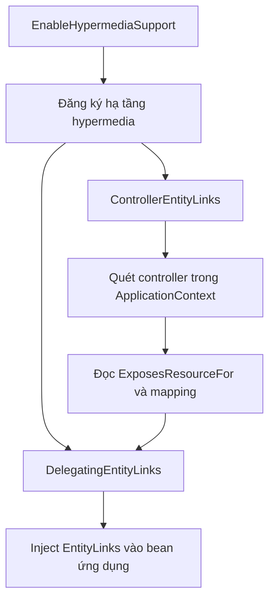

# Đăng ký EntityLinks

`EntityLinks` là một abstraction của Spring HATEOAS cho phép tạo liên kết tới tài nguyên dựa trên kiểu domain, thay vì phải tham chiếu trực tiếp class controller hoặc tự ghép URI. Để Spring HATEOAS tìm được endpoint của một entity, controller cần khai báo loại tài nguyên mà nó cung cấp bằng `@ExposesResourceFor` và tuân theo quy ước mapping collection/item. Trong ứng dụng Spring MVC, `@EnableHypermediaSupport` đăng ký hạ tầng hypermedia và các implementation `EntityLinks` mặc định để có thể inject `EntityLinks` vào service hoặc controller khác.

Ví dụ, `OrderController` công bố tài nguyên `Order` tại `/orders`. Một controller thanh toán chỉ cần gọi `entityLinks.linkToItemResource(Order.class, orderId)` để lấy liên kết tới đơn hàng tương ứng. Khi mapping của `OrderController` thay đổi, nơi sử dụng `EntityLinks` vẫn tham chiếu theo kiểu `Order` và tiếp tục lấy URI từ metadata controller.

## Mục tiêu

Sau bài học, bạn có thể:

- Giải thích vai trò của `EntityLinks` và `ControllerEntityLinks`.
- Bật hỗ trợ hypermedia bằng `@EnableHypermediaSupport`.
- Đánh dấu controller bằng `@ExposesResourceFor` và khai báo mapping collection/item.
- Inject `EntityLinks` để tạo link tới collection hoặc item resource.
- Dùng `TypedEntityLinks` để tái sử dụng cách lấy ID.
- Đăng ký implementation `EntityLinks` tùy chỉnh khi mapping không theo quy ước mặc định.
- Kiểm thử việc đăng ký bean và URI được tạo từ controller mapping.

## EntityLinks giải quyết vấn đề gì?

Khi tạo liên kết tới một tài nguyên, code thường không cần biết controller nào xử lý tài nguyên đó. Ví dụ, `PaymentController` cần liên kết tới đơn hàng đã được thanh toán. Nếu controller này tham chiếu trực tiếp `OrderController`, các thành phần bắt đầu phụ thuộc vào cách tổ chức controller. Nếu tự nối chuỗi `"/orders/" + orderId`, đường dẫn bị lặp lại ở nhiều nơi.

`EntityLinks` cho phép yêu cầu liên kết dựa trên kiểu entity:

```java
Link orderLink = entityLinks.linkToItemResource(Order.class, 42L);
Link ordersLink = entityLinks.linkToCollectionResource(Order.class);
```

Spring HATEOAS tìm controller quản lý `Order`, đọc mapping và tạo liên kết tới collection hoặc item resource. `EntityLinks` đóng vai trò abstraction giữa nơi cần liên kết và controller đang công bố tài nguyên.

## Bật hạ tầng hypermedia

Trong cấu hình Spring MVC thuần, thêm `@EnableHypermediaSupport` vào một class `@Configuration`. Ví dụ chọn HAL làm định dạng hypermedia:

```java
import org.springframework.context.annotation.Configuration;
import org.springframework.hateoas.config.EnableHypermediaSupport;
import org.springframework.hateoas.config.EnableHypermediaSupport.HypermediaType;

@Configuration
@EnableHypermediaSupport(type = HypermediaType.HAL)
class HypermediaConfiguration {
}
```

Annotation này đăng ký các thành phần hạ tầng cần thiết cho định dạng đã chọn. Với `EntityLinks`, Spring HATEOAS tạo một `DelegatingEntityLinks` và đưa các implementation `EntityLinks` có trong `ApplicationContext` vào registry. Implementation mặc định quan trọng là `ControllerEntityLinks`, có nhiệm vụ tìm controller được đánh dấu bằng `@ExposesResourceFor`.

Luồng đăng ký có thể hình dung như sau:



Trong ứng dụng Spring Boot dùng `spring-boot-starter-hateoas`, auto-configuration của Boot thường đã cung cấp cấu hình hypermedia. Tài liệu Spring Boot hiện tại nêu rõ auto-configuration thay thế nhu cầu dùng `@EnableHypermediaSupport` trong trường hợp thông thường. Chỉ thêm annotation khi bạn chủ động kiểm soát cấu hình hypermedia; việc dùng annotation sẽ chuyển quyền cấu hình sang Spring HATEOAS và thay đổi cách Boot tùy biến `JsonMapper`.

Dependency Gradle cho ứng dụng Spring MVC:

```groovy
dependencies {
    implementation 'org.springframework.boot:spring-boot-starter-web'
    implementation 'org.springframework.boot:spring-boot-starter-hateoas'
}
```

## Đánh dấu controller bằng `@ExposesResourceFor`

`ControllerEntityLinks` cần biết controller nào công bố collection và item resource cho một kiểu domain. Đặt `@ExposesResourceFor(Order.class)` trên controller, khai báo mapping cấp class cho collection và một method mapping có path variable cho item.

```java
import java.util.List;

import org.springframework.hateoas.server.ExposesResourceFor;
import org.springframework.web.bind.annotation.GetMapping;
import org.springframework.web.bind.annotation.PathVariable;
import org.springframework.web.bind.annotation.RequestMapping;
import org.springframework.web.bind.annotation.RestController;

@RestController
@ExposesResourceFor(Order.class)
@RequestMapping("/orders")
class OrderController {

    private final OrderService orders;

    OrderController(OrderService orders) {
        this.orders = orders;
    }

    @GetMapping
    List<OrderView> all() {
        return orders.findAll().stream()
            .map(OrderView::from)
            .toList();
    }

    @GetMapping("/{id}")
    OrderView one(@PathVariable("id") Long id) {
        return OrderView.from(orders.findById(id));
    }
}
```

Trong ví dụ:

- `@ExposesResourceFor(Order.class)` khai báo entity type mà controller quản lý.
- `@RequestMapping("/orders")` là mapping gốc của collection resource.
- `@GetMapping` ở phương thức `all()` công bố collection resource.
- `@GetMapping("/{id}")` công bố item resource với một path variable định danh đơn hàng.

Đây là quy ước mà `ControllerEntityLinks` dùng để suy ra URI. Controller phải nằm trong `ApplicationContext` được cấu hình hypermedia. Nếu controller không có `@ExposesResourceFor`, mapping item không có path variable, hoặc cấu trúc URI khác quy ước này, `ControllerEntityLinks` có thể không nhận diện được entity type.

Các kiểu dữ liệu và service contract tối giản dùng trong ví dụ:

```java
import java.util.List;

record Order(Long id, String status) {
}

record OrderView(Long id, String status) {
    static OrderView from(Order order) {
        return new OrderView(order.id(), order.status());
    }
}

interface OrderService {
    List<Order> findAll();
    Order findById(Long id);
}
```

## Inject EntityLinks và tạo link

Sau khi bật hypermedia support và khai báo controller, có thể inject `EntityLinks` vào bất kỳ bean nào trong cùng application context:

```java
import org.springframework.hateoas.EntityModel;
import org.springframework.hateoas.Link;
import org.springframework.hateoas.server.EntityLinks;
import org.springframework.web.bind.annotation.GetMapping;
import org.springframework.web.bind.annotation.PathVariable;
import org.springframework.web.bind.annotation.RequestMapping;
import org.springframework.web.bind.annotation.RestController;

@RestController
@RequestMapping("/payments")
class PaymentController {

    private final EntityLinks entityLinks;

    PaymentController(EntityLinks entityLinks) {
        this.entityLinks = entityLinks;
    }

    @GetMapping("/orders/{orderId}/link")
    EntityModel<PaymentView> orderLink(@PathVariable Long orderId) {
        PaymentView payment = new PaymentView(orderId, "PENDING");

        Link order = entityLinks
            .linkToItemResource(Order.class, orderId)
            .withRel("order");

        Link orders = entityLinks
            .linkToCollectionResource(Order.class)
            .withRel("orders");

        return EntityModel.of(payment, order, orders);
    }
}

record PaymentView(Long orderId, String status) {
}
```

`linkToItemResource(Order.class, orderId)` tạo link tới đơn hàng cụ thể. `linkToCollectionResource(Order.class)` tạo link tới tập hợp đơn hàng. Các link trả về có relation mặc định của implementation; trong representation thanh toán, ví dụ đổi relation thành `order` và `orders` để thể hiện vai trò của chúng trong ngữ cảnh đó.

Điểm đáng chú ý là `PaymentController` không cần import hoặc tham chiếu `OrderController.class`. Nó chỉ phụ thuộc vào kiểu domain `Order` và abstraction `EntityLinks`. Nếu đường dẫn collection thay đổi từ `/orders` sang `/sales/orders`, nơi dùng `EntityLinks` vẫn yêu cầu liên kết cho `Order` và nhận URI theo mapping mới.

## Các API EntityLinks thường dùng

| API | Kết quả | Trường hợp sử dụng |
|---|---|---|
| `linkFor(Order.class)` | `LinkBuilder` | Tạo builder cho collection resource và bổ sung segment hoặc tham số |
| `linkToCollectionResource(Order.class)` | `Link` | Tạo link hoàn chỉnh tới collection resource |
| `linkToItemResource(Order.class, id)` | `Link` | Tạo link hoàn chỉnh tới item resource |
| `forType(Order::id)` | `TypedEntityLinks<Order>` | Cố định cách lấy ID để tái sử dụng khi tạo link item |

Các phương thức bắt đầu bằng `linkFor...` trả về builder để có thể mở rộng. Các phương thức bắt đầu bằng `linkTo...` trả về `Link` đã được tạo hoàn chỉnh.

Ví dụ dùng `linkFor(...)` để thêm path segment:

```java
import org.springframework.hateoas.server.LinkBuilder;

LinkBuilder orderBuilder = entityLinks.linkFor(Order.class);

Link order = orderBuilder
    .slash(42L)
    .withSelfRel();
```

Trong trường hợp thông thường, nên dùng `linkToItemResource` vì phương thức này thể hiện rõ ý định tạo link tới item resource và nhận ID trực tiếp.

## Dùng TypedEntityLinks để tái sử dụng ID extractor

Nếu nhiều nơi cần tạo link cho cùng kiểu entity, bạn có thể phải lặp lại cách lấy ID. `TypedEntityLinks<T>` cho phép đăng ký hàm trích xuất ID một lần:

```java
import org.springframework.hateoas.Link;
import org.springframework.hateoas.server.EntityLinks;
import org.springframework.hateoas.server.TypedEntityLinks;
import org.springframework.stereotype.Component;

@Component
class OrderLinkFactory {

    private final TypedEntityLinks<Order> orderLinks;

    OrderLinkFactory(EntityLinks entityLinks) {
        this.orderLinks = entityLinks.forType(Order::id);
    }

    Link self(Order order) {
        return orderLinks.linkToItemResource(order);
    }
}
```

`forType(Order::id)` tạo đối tượng link helper biết cách lấy ID từ một `Order`. Sau đó `linkToItemResource(order)` chỉ cần entity, không cần truyền ID mỗi lần. Cách này hữu ích khi assembler hoặc nhiều service cùng tạo link tới một loại tài nguyên.

## Đăng ký implementation EntityLinks tùy chỉnh

`ControllerEntityLinks` phù hợp khi controller tuân theo quy ước mapping collection/item. Nếu API dùng cấu trúc phức tạp hơn, chẳng hạn URI lồng nhiều cấp hoặc ID được mã hóa theo quy tắc riêng, bạn có thể cung cấp implementation `EntityLinks` của ứng dụng.

Khai báo implementation tùy chỉnh dưới dạng Spring bean:

```java
import org.springframework.context.annotation.Bean;
import org.springframework.context.annotation.Configuration;

@Configuration
class CustomEntityLinksConfiguration {

    @Bean
    MyEntityLinks myEntityLinks(OrderUriPolicy uriPolicy) {
        return new MyEntityLinks(uriPolicy);
    }
}
```

`MyEntityLinks` là class do ứng dụng định nghĩa và triển khai `EntityLinks`; `OrderUriPolicy` là thành phần chứa quy tắc tạo URI riêng. Khi `@EnableHypermediaSupport` đăng ký `DelegatingEntityLinks`, các implementation `EntityLinks` đã được đăng ký thành bean sẽ được đưa vào cơ chế ủy quyền. Spring Data REST cũng cung cấp `RepositoryEntityLinks`, dùng mapping repository để tạo liên kết tới tài nguyên do Spring Data REST công bố.

Khi viết implementation riêng, có thể kế thừa `AbstractEntityLinks` để giảm phần code phải triển khai. Hãy định nghĩa rõ kiểu entity mà implementation hỗ trợ và bảo đảm các link collection/item nhất quán với hợp đồng API. Nếu chỉ cần thay đổi URI của một controller theo quy ước chuẩn, hãy cân nhắc điều chỉnh mapping controller trước khi tạo SPI riêng.

## EntityLinks và Spring WebFlux

`EntityLinks` hiện được thiết kế chủ yếu cho Spring MVC. Tài liệu Spring HATEOAS hiện tại ghi rõ các implementation `EntityLinks` và SPI này chưa được cung cấp sẵn cho ứng dụng Spring WebFlux, vì hợp đồng chưa xét đến kiểu trả về Reactor. Nếu ứng dụng dùng WebFlux, hãy tạo liên kết bằng `WebFluxLinkBuilder` trong pipeline reactive hoặc truyền `ServerWebExchange` theo cách phù hợp.

Không nên kết hợp `spring-boot-starter-hateoas` dành cho Spring MVC với `spring-boot-starter-webflux` trong cùng ứng dụng theo cấu hình mặc định. Với WebFlux, Spring Boot hướng dẫn dùng dependency `spring-hateoas` trực tiếp cùng starter WebFlux.

## Kiểm thử việc đăng ký EntityLinks

Một kiểm thử tích hợp có thể xác nhận bean `EntityLinks` được inject và link item trỏ tới mapping của `OrderController`. Endpoint kiểm thử gọi `PaymentController`, nơi sử dụng `EntityLinks` để tra mapping của `OrderController`.

```java
import static org.hamcrest.Matchers.endsWith;
import static org.springframework.test.web.servlet.request.MockMvcRequestBuilders.get;
import static org.springframework.test.web.servlet.result.MockMvcResultMatchers.jsonPath;
import static org.springframework.test.web.servlet.result.MockMvcResultMatchers.status;

import org.junit.jupiter.api.Test;
import org.springframework.beans.factory.annotation.Autowired;
import org.springframework.boot.test.autoconfigure.web.servlet.AutoConfigureMockMvc;
import org.springframework.boot.test.mock.mockito.MockBean;
import org.springframework.boot.test.context.SpringBootTest;
import org.springframework.hateoas.MediaTypes;
import org.springframework.test.web.servlet.MockMvc;

@SpringBootTest
@AutoConfigureMockMvc
class EntityLinksRegistrationTest {

    @Autowired
    MockMvc mockMvc;

    @MockBean
    OrderService orders;

    @Test
    void createsOrderLinkFromExposedControllerMapping() throws Exception {
        mockMvc.perform(get("/payments/orders/{orderId}/link", 42L)
                .accept(MediaTypes.HAL_JSON))
            .andExpect(status().isOk())
            .andExpect(jsonPath("$._links.order.href", endsWith("/orders/42")))
            .andExpect(jsonPath("$._links.orders.href", endsWith("/orders")));
    }
}
```

Test này cần có `HypermediaConfiguration` hoặc cấu hình auto-configuration của Spring Boot, `OrderController` và `PaymentController` được đăng ký, và `PaymentController` có thể inject `EntityLinks`. `OrderService` được mock vì bài test chỉ kiểm tra quá trình khám phá mapping, không thực thi nghiệp vụ đọc đơn hàng. Nếu test dùng `@WebMvcTest`, cần import cấu hình hypermedia và đưa cả controller quản lý entity vào test slice. Nên kiểm thử cả trường hợp controller thiếu `@ExposesResourceFor` hoặc mapping item không theo quy ước để phát hiện lỗi cấu hình sớm.

## Lỗi thường gặp

| Lỗi | Hệ quả | Cách xử lý |
|---|---|---|
| Chỉ thêm `@ExposesResourceFor` nhưng không bật hypermedia support | Không có bean `EntityLinks` để inject | Dùng `@EnableHypermediaSupport` trong Spring MVC thuần hoặc cấu hình auto-configuration của Boot |
| Quên `@ExposesResourceFor` | `ControllerEntityLinks` không biết controller quản lý entity nào | Đánh dấu controller bằng domain type chính xác |
| Không có mapping collection hoặc item theo quy ước | Không tạo được link cho collection/item | Khai báo mapping cấp class và mapping item có path variable |
| Dùng nhầm DTO thay cho domain type được expose | `EntityLinks` không tìm thấy controller phù hợp | Truyền đúng class đã khai báo trong `@ExposesResourceFor` |
| Mapping API phức tạp nhưng vẫn mong `ControllerEntityLinks` suy luận được | Link có thể không được tạo đúng | Dùng `EntityLinks` implementation tùy chỉnh hoặc builder phù hợp |
| Cố dùng EntityLinks trong WebFlux | Không có implementation reactive tương ứng được cung cấp sẵn | Dùng `WebFluxLinkBuilder` |
| Thêm `@EnableHypermediaSupport` vào Boot mà không xét auto-configuration | Có thể thay đổi cấu hình JSON mapper mặc định của Boot | Chỉ tự kiểm soát cấu hình khi có nhu cầu rõ ràng |

## Ghi nhớ

Để đăng ký `EntityLinks` cho Spring MVC, bật hạ tầng bằng `@EnableHypermediaSupport` hoặc dùng auto-configuration tương ứng của Spring Boot. Đánh dấu controller quản lý entity bằng `@ExposesResourceFor`, đặt mapping collection ở cấp class và mapping item có path variable ở cấp phương thức. `ControllerEntityLinks` dùng metadata đó để cung cấp link collection/item qua bean `EntityLinks`. Nơi sử dụng chỉ cần gọi `linkToCollectionResource` hoặc `linkToItemResource` theo kiểu domain, không phải phụ thuộc trực tiếp vào controller. Khi mapping không theo quy ước, đăng ký implementation `EntityLinks` tùy chỉnh; với WebFlux, dùng `WebFluxLinkBuilder` thay cho SPI này.

## Tài liệu tham khảo

- [Spring HATEOAS – Using the EntityLinks interface](https://docs.spring.io/spring-hateoas/docs/current/reference/html/#server.entity-links)
- [Spring HATEOAS – ControllerEntityLinks API](https://docs.spring.io/spring-hateoas/docs/current/api/org/springframework/hateoas/server/core/ControllerEntityLinks.html)
- [Spring HATEOAS – EnableHypermediaSupport API](https://docs.spring.io/spring-hateoas/docs/current/api/org/springframework/hateoas/config/EnableHypermediaSupport.html)
- [Spring Boot – Spring HATEOAS auto-configuration](https://docs.spring.io/spring-boot/reference/web/spring-hateoas.html)
