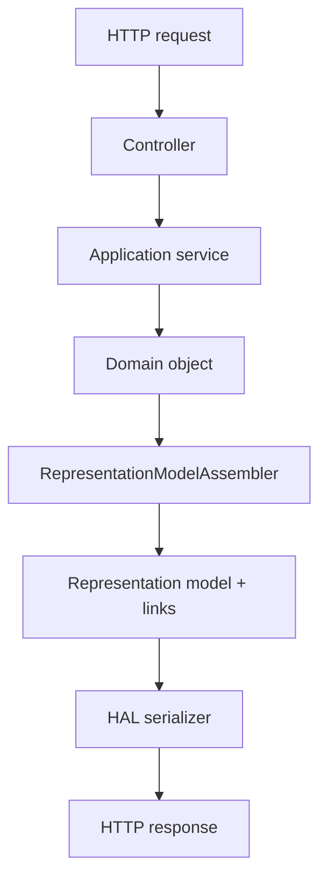

# RepresentationModelAssembler

## Mục tiêu

Sau bài này, bạn có thể giải thích vai trò của `RepresentationModelAssembler` trong Spring HATEOAS, chuyển domain object thành representation có dữ liệu và hypermedia links, xây dựng representation cho collection, tích hợp assembler với controller và kiểm thử hợp đồng HAL.

## 1. Vì sao cần assembler?

Một ứng dụng thường có nhiều lớp dữ liệu phục vụ những mục đích khác nhau:

- **Domain object** biểu diễn nghiệp vụ và có thể chứa trạng thái, quy tắc hoặc quan hệ nội bộ.
- **Representation model** biểu diễn dữ liệu mà API muốn công bố cho client, kèm các liên kết hypermedia.
- **Controller** nhận HTTP request, gọi service và trả representation phù hợp.

Nếu mỗi controller tự chuyển domain object thành response, logic ánh xạ trường dữ liệu và tạo link sẽ dễ bị lặp. Một endpoint có thể thêm link `self`, endpoint khác quên link đó; hoặc hai response dùng tên relation khác nhau cho cùng một quan hệ.

Spring HATEOAS cung cấp `RepresentationModelAssembler` để tập trung công việc chuyển một đối tượng nguồn thành representation. Assembler xác định dữ liệu nào được công bố, các relation nào cần có và href nào dẫn đến tài nguyên hoặc hành động liên quan.

Luồng xử lý điển hình:



Controller không cần tự biết cách tạo từng link. Nó nhận dữ liệu từ service, chuyển qua assembler và trả representation cho Spring để tuần tự hóa.

## 2. RepresentationModelAssembler là gì?

Interface `RepresentationModelAssembler<T, D>` nằm trong package `org.springframework.hateoas.server`. Hai tham số kiểu có ý nghĩa:

- `T`: kiểu đối tượng nguồn, thường là domain object hoặc kết quả từ service.
- `D`: kiểu representation đích, phải là một kiểu kế thừa `RepresentationModel`.

Phương thức chính:

| Phương thức | Vai trò |
|---|---|
| `toModel(T entity)` | Chuyển một đối tượng nguồn thành một representation |
| `toCollectionModel(Iterable<? extends T> entities)` | Chuyển nhiều đối tượng nguồn thành `CollectionModel<D>` |

Một assembler thường thực hiện ba việc:

1. Chọn và ánh xạ các trường dữ liệu cần công bố.
2. Tạo các liên kết như `self`, `customer`, `collection` hoặc link hành động.
3. Trả model có kiểu rõ ràng để controller và serializer sử dụng.

`toCollectionModel(...)` có implementation mặc định gọi `toModel(...)` cho từng phần tử và gom kết quả thành `CollectionModel`. Có thể ghi đè phương thức này nếu collection cần link hoặc metadata cấp tập hợp riêng.

## 3. Xây dựng representation model

Ví dụ API đơn hàng có domain object `Order`. Thay vì trả trực tiếp entity persistence, ta tạo lớp `OrderModel` để kiểm soát dữ liệu công khai:

```java
import java.math.BigDecimal;
import java.util.UUID;

import org.springframework.hateoas.RepresentationModel;
import org.springframework.hateoas.server.core.Relation;

@Relation(value = "order", collectionRelation = "orders")
public class OrderModel extends RepresentationModel<OrderModel> {

    private final UUID id;
    private final String status;
    private final BigDecimal total;

    public OrderModel(UUID id, String status, BigDecimal total) {
        this.id = id;
        this.status = status;
        this.total = total;
    }

    public UUID getId() {
        return id;
    }

    public String getStatus() {
        return status;
    }

    public BigDecimal getTotal() {
        return total;
    }
}
```

Lớp này kế thừa `RepresentationModel<OrderModel>`, vì vậy có thể mang các link hypermedia. Nó chỉ công bố mã đơn, trạng thái và tổng tiền; các trường nội bộ như ghi chú vận hành, khóa persistence hoặc thông tin nhạy cảm không tự động xuất hiện trong response.

Annotation `@Relation` định nghĩa relation dùng cho một phần tử (`order`) và relation của collection nhúng (`orders`) trong HAL. Nhờ vậy, response collection có thể dùng tên `_embedded.orders` ổn định thay vì phụ thuộc vào tên lớp Java.

## 4. Cài đặt assembler cho một tài nguyên

Assembler nhận một `Order`, tạo `OrderModel`, rồi thêm link dựa trên mapping controller:

```java
import org.springframework.hateoas.server.RepresentationModelAssembler;
import org.springframework.stereotype.Component;

import static org.springframework.hateoas.server.mvc.WebMvcLinkBuilder.linkTo;
import static org.springframework.hateoas.server.mvc.WebMvcLinkBuilder.methodOn;

@Component
public class OrderModelAssembler
        implements RepresentationModelAssembler<Order, OrderModel> {

    @Override
    public OrderModel toModel(Order order) {
        OrderModel model = new OrderModel(
                order.getId(),
                order.getStatus().name(),
                order.getTotal()
        );

        model.add(linkTo(methodOn(OrderController.class)
                .getOrder(order.getId())).withSelfRel());

        model.add(linkTo(methodOn(CustomerController.class)
                .getCustomer(order.getCustomerId())).withRel("customer"));

        if (order.canBeCancelled()) {
            model.add(linkTo(methodOn(OrderController.class)
                    .cancelOrder(order.getId(), null)).withRel("cancel"));
        }

        return model;
    }
}
```

Các điểm chính:

- `implements RepresentationModelAssembler<Order, OrderModel>` khai báo nguồn là `Order`, đích là `OrderModel`.
- `toModel(...)` ánh xạ dữ liệu nghiệp vụ sang model dành cho API.
- `withSelfRel()` tạo relation `self` trỏ đến endpoint đọc chính đơn hàng.
- `withRel("customer")` tạo link đến khách hàng liên quan.
- Link `cancel` chỉ được thêm khi trạng thái đơn hàng cho phép hủy.

Đối số `null` trong lời gọi `cancelOrder(..., null)` là giá trị giữ chỗ để Spring HATEOAS phân tích chữ ký phương thức có request body. `methodOn` không gửi request và không thực thi hành động hủy.

Ví dụ giả định controller có các phương thức `getOrder(UUID)`, `cancelOrder(UUID, CancellationRequest)` và controller khách hàng có `getCustomer(UUID)`. Trong ứng dụng thực tế, hãy thay các kiểu và phương thức này bằng mapping đang có.

Việc công bố link `cancel` là hướng dẫn cho client. Endpoint hủy vẫn phải kiểm tra trạng thái, quyền người dùng và dữ liệu request ở server, vì client có thể gửi request trực tiếp hoặc dùng một representation cũ.

## 5. Tạo collection bằng toCollectionModel

Khi controller trả danh sách, assembler có thể chuyển từng domain object thành model bằng `toCollectionModel(...)`. Ta cũng có thể ghi đè phương thức này để thêm link ở cấp collection:

```java
import org.springframework.hateoas.CollectionModel;
import org.springframework.hateoas.server.RepresentationModelAssembler;

@Override
public CollectionModel<OrderModel> toCollectionModel(
        Iterable<? extends Order> orders) {

    CollectionModel<OrderModel> collection =
            RepresentationModelAssembler.super.toCollectionModel(orders);

    collection.add(linkTo(methodOn(OrderController.class)
            .getOrders()).withSelfRel());

    return collection;
}
```

Lời gọi `RepresentationModelAssembler.super.toCollectionModel(orders)` sử dụng implementation mặc định để ánh xạ từng phần tử thông qua `toModel(...)`. Sau đó assembler bổ sung self link cho collection.

Nhờ cách tổ chức này, mỗi `OrderModel` có self link riêng và collection có self link cấp ngoài. Nếu cần link tìm kiếm, tạo mới hoặc thống kê ở cấp tập hợp, có thể thêm chúng vào `collection` trước khi trả về.

Không phải collection nào cũng cần ghi đè `toCollectionModel`. Nếu chỉ cần chuyển từng phần tử và không có link cấp collection bổ sung, implementation mặc định đã đủ.

## 6. Tích hợp assembler với controller

Controller có thể inject assembler qua constructor và sử dụng cùng một quy tắc ánh xạ cho cả endpoint chi tiết lẫn endpoint collection:

```java
@RestController
@RequestMapping("/orders")
public class OrderController {

    private final OrderService orderService;
    private final OrderModelAssembler assembler;

    public OrderController(
            OrderService orderService,
            OrderModelAssembler assembler) {
        this.orderService = orderService;
        this.assembler = assembler;
    }

    @GetMapping("/{id}")
    public OrderModel getOrder(@PathVariable UUID id) {
        return assembler.toModel(orderService.getRequired(id));
    }

    @GetMapping
    public CollectionModel<OrderModel> getOrders() {
        return assembler.toCollectionModel(orderService.findAll());
    }

    @PostMapping("/{id}/cancellations")
    public OrderModel cancelOrder(
            @PathVariable UUID id,
            @RequestBody CancellationRequest request) {
        Order updated = orderService.cancel(id, request.reason());
        return assembler.toModel(updated);
    }
}
```

Các import minh họa cho controller:

```java
import java.util.UUID;

import org.springframework.hateoas.CollectionModel;
import org.springframework.web.bind.annotation.GetMapping;
import org.springframework.web.bind.annotation.PathVariable;
import org.springframework.web.bind.annotation.PostMapping;
import org.springframework.web.bind.annotation.RequestBody;
import org.springframework.web.bind.annotation.RequestMapping;
import org.springframework.web.bind.annotation.RestController;
```

Controller chỉ điều phối request và service. Việc chuyển `Order` thành `OrderModel` được thực hiện nhất quán ở assembler. Sau khi thao tác hủy hoàn tất, controller gọi lại `toModel(...)`; assembler sẽ quyết định link `cancel` còn phù hợp với trạng thái mới hay không.

Cách này cũng giúp response của nhiều endpoint không bị lệch cấu trúc. Nếu cần đổi tên trường hoặc bổ sung relation, có thể cập nhật assembler và representation model tại một nơi.

## 7. Dùng assembler với kết quả phân trang

Với Spring Data, service thường trả `Page<Order>` thay vì toàn bộ danh sách. `PagedResourcesAssembler` có thể phối hợp với `RepresentationModelAssembler` để chuyển các phần tử thành model và tạo metadata phân trang:

```java
@GetMapping("/search")
public PagedModel<OrderModel> searchOrders(
        Pageable pageable,
        PagedResourcesAssembler<Order> pagedAssembler) {

    Page<Order> page = orderService.findAll(pageable);

    return pagedAssembler.toModel(page, assembler);
}
```

Trong ví dụ:

- `Pageable` chứa số trang, kích thước trang và thông tin sắp xếp.
- `Page<Order>` chứa các domain object của trang hiện tại cùng tổng số phần tử.
- `PagedResourcesAssembler` gọi assembler cho từng phần tử, tạo `PagedModel` với metadata và các link điều hướng.

Client nhận được các relation như `first`, `prev`, `self`, `next` và `last` khi chúng phù hợp với vị trí trang. Không cần tự ghép URL phân trang trong controller.

Nếu API cần giữ các bộ lọc hoặc tiêu chí sắp xếp khi điều hướng, hãy bảo đảm các tham số đó được giữ trong request và các link trang được tạo từ ngữ cảnh truy vấn phù hợp.

## 8. Cấu trúc HAL sau khi assembler chạy

Với `OrderModel` có relation được khai báo bằng `@Relation`, response collection HAL có thể có dạng:

```json
{
  "_embedded": {
    "orders": [
      {
        "id": "42",
        "status": "PENDING",
        "total": 125000,
        "_links": {
          "self": {
            "href": "/orders/42"
          },
          "customer": {
            "href": "/customers/7"
          },
          "cancel": {
            "href": "/orders/42/cancellations"
          }
        }
      }
    ]
  },
  "_links": {
    "self": {
      "href": "/orders"
    }
  }
}
```

Response minh họa thể hiện hai cấp:

- `_embedded.orders` chứa các representation của từng đơn hàng.
- `_links.self` ở cấp ngoài trỏ đến collection.
- Các link `self`, `customer` và `cancel` bên trong một phần tử mô tả tài nguyên và các quan hệ của đơn hàng đó.

Nếu trạng thái đơn hàng không cho phép hủy, assembler không thêm relation `cancel`. Khi đó, client có thể điều chỉnh giao diện theo các hành động mà server công bố. Server vẫn phải thực thi kiểm tra nghiệp vụ khi nhận request.

## 9. Kiểm thử assembler và response

Kiểm thử HTTP với MockMvc xác nhận kết quả cuối cùng sau khi controller gọi assembler và Spring tuần tự hóa model thành HAL.

Kiểm tra endpoint chi tiết:

```java
mockMvc.perform(get("/orders/{id}", orderId)
        .accept(MediaTypes.HAL_JSON))
    .andExpect(status().isOk())
    .andExpect(jsonPath("$.id").value(orderId.toString()))
    .andExpect(jsonPath("$._links.self.href").exists())
    .andExpect(jsonPath("$._links.customer.href").exists());
```

Với đơn hàng đang chờ xử lý và có thể hủy, kiểm tra link hành động:

```java
mockMvc.perform(get("/orders/{id}", pendingOrderId)
        .accept(MediaTypes.HAL_JSON))
    .andExpect(status().isOk())
    .andExpect(jsonPath("$._links.cancel.href").exists());
```

Với đơn hàng đã giao, link hủy không nên xuất hiện:

```java
mockMvc.perform(get("/orders/{id}", shippedOrderId)
        .accept(MediaTypes.HAL_JSON))
    .andExpect(status().isOk())
    .andExpect(jsonPath("$._links.cancel").doesNotExist());
```

Kiểm tra collection:

```java
mockMvc.perform(get("/orders")
        .accept(MediaTypes.HAL_JSON))
    .andExpect(status().isOk())
    .andExpect(jsonPath("$._links.self.href").exists())
    .andExpect(jsonPath("$._embedded.orders").isArray())
    .andExpect(jsonPath("$._embedded.orders[0]._links.self.href").exists());
```

Ngoài kiểm thử response, có thể viết unit test cho assembler để xác nhận các trường được ánh xạ đúng và relation thay đổi theo trạng thái. Test HTTP vẫn cần thiết vì nó xác nhận relation được tuần tự hóa theo đúng media type và tên collection relation mà client sử dụng.

## 10. Những lỗi thường gặp

**Trả domain object trực tiếp ở mọi endpoint.** Entity có thể chứa trường nội bộ hoặc quan hệ persistence không nên công bố. Dùng representation model để kiểm soát hợp đồng dữ liệu.

**Lặp logic tạo link trong nhiều controller.** Link có thể thiếu hoặc không nhất quán. Chuyển quy tắc ánh xạ và link vào assembler dùng chung.

**Quên link cấp collection.** Implementation mặc định của `toCollectionModel` chuyển từng phần tử; nếu collection cần self link hoặc link tìm kiếm riêng, hãy bổ sung bằng cách ghi đè phương thức.

**Dùng sai relation cho collection nhúng.** Nếu client phụ thuộc `_embedded.orders`, khai báo collection relation rõ ràng bằng `@Relation` và kiểm thử JSON thực tế.

**Đưa logic nghiệp vụ vào assembler.** Assembler nên chuyển đổi dữ liệu và mô tả khả năng điều hướng. Việc tính giá, kiểm tra trạng thái phức tạp hoặc truy vấn dữ liệu nên thuộc service hoặc tầng nghiệp vụ.

**Cho rằng link bảo vệ endpoint.** Link chỉ hướng dẫn client. Controller/service/security vẫn phải xác thực, phân quyền và kiểm tra điều kiện trên mỗi request.

**Bỏ qua collection rỗng và phân trang.** Hãy kiểm thử cả collection không có phần tử và các trang đầu/cuối để bảo đảm link điều hướng và metadata phù hợp.

## 11. Nguyên tắc thiết kế

- Một assembler tập trung cho một loại representation giúp dữ liệu và relation nhất quán.
- Dùng DTO hoặc representation model để kiểm soát các trường công khai.
- Dùng `toModel(...)` cho từng phần tử và `toCollectionModel(...)` cho tập hợp.
- Ghi đè `toCollectionModel(...)` khi collection cần link hoặc metadata cấp ngoài.
- Dùng `@Relation` để kiểm soát tên relation của item và collection nhúng.
- Dùng `PagedResourcesAssembler` khi nguồn dữ liệu là `Page<T>`.
- Chỉ công bố affordance phù hợp với trạng thái và quyền hiện tại, nhưng luôn kiểm tra lại ở server.
- Kiểm thử relation, href, dữ liệu và media type như một phần hợp đồng API.

## Kết luận

`RepresentationModelAssembler<T, D>` là điểm tập trung để chuyển domain object thành representation có dữ liệu và hypermedia links. `toModel(...)` tạo model cho một tài nguyên; `toCollectionModel(...)` ánh xạ một tập hợp và có thể được ghi đè để thêm link cấp collection. Khi tích hợp với controller hoặc `PagedResourcesAssembler`, cùng một quy tắc ánh xạ được sử dụng cho response chi tiết, collection và phân trang. Tách assembler khỏi nghiệp vụ, kiểm soát relation và kiểm thử response HAL giúp hợp đồng API nhất quán và dễ tiến hóa.

