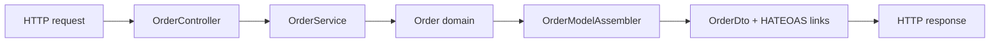

# Tách assembler khỏi controller

Trong một REST API dùng Spring HATEOAS, controller nên tập trung tiếp nhận HTTP request, gọi nghiệp vụ và trả response. Việc chuyển domain object thành dữ liệu công khai, gắn link `self`, link collection và các link hành động nên được gom vào một lớp assembler. Spring HATEOAS cung cấp `RepresentationModelAssembler` để chuẩn hóa ranh giới này.

Khi chưa tách assembler, controller thường vừa gọi service, vừa tạo DTO, vừa dựng URI, vừa quyết định relation nào xuất hiện. Một controller có nhiều endpoint sẽ lặp lại cách ánh xạ và tạo link. Khi cấu trúc response thay đổi, phải sửa nhiều nơi và rất dễ làm các endpoint trả representation không nhất quán.

Tách assembler giúp mỗi thành phần có một trách nhiệm rõ ràng: service thực hiện nghiệp vụ và truy xuất dữ liệu; assembler chuyển domain object thành resource representation cùng hypermedia link; controller điều phối HTTP và gọi assembler. Đây là cách tổ chức phù hợp với mục tiêu của Spring HATEOAS: công bố tài nguyên có dữ liệu và các quan hệ điều hướng để client khám phá.

## Ranh giới trách nhiệm

Giả sử API quản lý đơn hàng. Khi client gọi `GET /api/orders/{id}`, ứng dụng cần tìm đơn hàng, chuyển nó thành DTO công khai và gắn các link như `self`, `orders`, `cancel` nếu thao tác còn khả dụng.



| Thành phần | Trách nhiệm | Không nên làm |
| --- | --- | --- |
| Controller | Ánh xạ endpoint, đọc path/query/body, gọi service và trả status/header/body. | Tự viết lặp lại logic ánh xạ từng trường và ghép URL bằng chuỗi. |
| Service | Thực hiện quy tắc nghiệp vụ, kiểm tra trạng thái/quyền và lấy domain data. | Tạo JSON hoặc phụ thuộc vào `EntityModel` nếu domain không cần biết HTTP. |
| Assembler | Chuyển domain object thành DTO/resource model và thêm link theo ngữ cảnh representation. | Truy vấn database, thực hiện nghiệp vụ hoặc gọi controller bean. |
| DTO/resource model | Định nghĩa dữ liệu và hypermedia được công bố cho client. | Phơi bày toàn bộ JPA entity và quan hệ lưu trữ nội bộ. |

Assembler là lớp chuyển đổi ở ranh giới API. Nó có thể biết endpoint controller để tạo link theo mapping, nhưng không cần inject controller như một Spring bean hoặc gọi trực tiếp method controller. `methodOn(...)` tạo một mô tả method để Spring HATEOAS phân tích mapping; nó không phải lời gọi HTTP và không thực thi nghiệp vụ controller.

## Bắt đầu từ DTO và resource representation

Không nên mặc định trả trực tiếp JPA entity. Hãy định nghĩa dữ liệu mà client cần đọc. Ví dụ, response đơn hàng chỉ công bố mã, trạng thái và tổng tiền:

```java
import java.math.BigDecimal;
import java.util.UUID;

public record OrderDto(
        UUID id,
        String status,
        BigDecimal totalAmount
) {
}
```

`OrderDto` không chứa link. `EntityModel<OrderDto>` sẽ bọc DTO cùng các link của resource. Cách này giữ riêng dữ liệu công khai và metadata hypermedia, đồng thời cho phép domain model thay đổi mà không buộc response phải thay đổi theo.

Nếu cần một resource có cấu trúc riêng, có thể định nghĩa class kế thừa `RepresentationModel`. Tuy nhiên, với DTO đã mô tả đầy đủ nội dung, `EntityModel<DTO>` thường là lựa chọn ngắn gọn và dễ đọc.

## Dùng RepresentationModelAssembler

`RepresentationModelAssembler<T, D>` là interface của Spring HATEOAS. `T` là kiểu domain input; `D` là kiểu representation được tạo và phải kế thừa `RepresentationModel`. Phương thức quan trọng nhất là `toModel(T entity)`, nhận một đối tượng và trả về resource model.

Assembler cho đơn hàng có thể được viết như sau:

```java
import static org.springframework.hateoas.server.mvc.WebMvcLinkBuilder.linkTo;
import static org.springframework.hateoas.server.mvc.WebMvcLinkBuilder.methodOn;

import org.springframework.hateoas.EntityModel;
import org.springframework.hateoas.server.RepresentationModelAssembler;
import org.springframework.stereotype.Component;

@Component
public class OrderModelAssembler
        implements RepresentationModelAssembler<Order, EntityModel<OrderDto>> {

    @Override
    public EntityModel<OrderDto> toModel(Order order) {
        OrderDto dto = new OrderDto(
                order.getId(),
                order.getStatus().name(),
                order.getTotalAmount());

        EntityModel<OrderDto> model = EntityModel.of(dto,
                linkTo(methodOn(OrderController.class)
                        .one(order.getId())).withSelfRel(),
                linkTo(methodOn(OrderController.class)
                        .all()).withRel("orders"));

        if (order.canBeCancelled()) {
            model.add(linkTo(methodOn(OrderController.class)
                    .cancel(order.getId())).withRel("cancel"));
        }

        return model;
    }
}
```

Trong ví dụ, `Order` là domain object; `OrderDto` là dữ liệu response; `EntityModel<OrderDto>` là representation hoàn chỉnh có link. `linkTo(...)` và `methodOn(...)` tạo URI theo mapping controller. Relation `cancel` chỉ xuất hiện khi trạng thái đơn hàng cho phép hủy. `canBeCancelled()` là quy tắc domain giả định của ứng dụng, không phải method của Spring HATEOAS.

Assembler không gọi `OrderService` để tự tìm đơn hàng. Controller hoặc tầng ứng dụng cung cấp domain object đã được tải và kiểm tra. Nhờ vậy, phép chuyển đổi có đầu vào rõ ràng, dễ kiểm thử và không phát sinh truy vấn ẩn trong lúc serialize response.

## Controller chỉ điều phối request

Sau khi có assembler, controller không cần ánh xạ từng trường hoặc tạo link cho từng đơn hàng:

```java
import java.net.URI;
import java.util.UUID;

import org.springframework.hateoas.CollectionModel;
import org.springframework.hateoas.EntityModel;
import org.springframework.hateoas.MediaTypes;
import org.springframework.http.ResponseEntity;
import org.springframework.web.bind.annotation.GetMapping;
import org.springframework.web.bind.annotation.PathVariable;
import org.springframework.web.bind.annotation.PostMapping;
import org.springframework.web.bind.annotation.RequestMapping;
import org.springframework.web.bind.annotation.RestController;

import static org.springframework.hateoas.server.mvc.WebMvcLinkBuilder.linkTo;
import static org.springframework.hateoas.server.mvc.WebMvcLinkBuilder.methodOn;

@RestController
@RequestMapping("/api/orders")
class OrderController {

    private final OrderService service;
    private final OrderModelAssembler assembler;

    OrderController(OrderService service, OrderModelAssembler assembler) {
        this.service = service;
        this.assembler = assembler;
    }

    @GetMapping(value = "/{id}", produces = MediaTypes.HAL_JSON_VALUE)
    EntityModel<OrderDto> one(@PathVariable UUID id) {
        return assembler.toModel(service.findById(id));
    }

    @GetMapping(produces = MediaTypes.HAL_JSON_VALUE)
    CollectionModel<EntityModel<OrderDto>> all() {
        return assembler.toCollectionModel(service.findAll())
                .add(linkTo(methodOn(OrderController.class).all()).withSelfRel());
    }

    @PostMapping
    ResponseEntity<EntityModel<OrderDto>> create() {
        Order created = service.create();
        EntityModel<OrderDto> resource = assembler.toModel(created);
        URI location = resource.getRequiredLink("self").toUri();

        return ResponseEntity.created(location).body(resource);
    }

    @PostMapping("/{id}/cancellation")
    ResponseEntity<Void> cancel(@PathVariable UUID id) {
        service.cancel(id);
        return ResponseEntity.noContent().build();
    }
}
```

Controller chỉ biết service và assembler. Endpoint chi tiết lấy domain object rồi chuyển cho `toModel`. Endpoint collection dùng `toCollectionModel`, phương thức mặc định của `RepresentationModelAssembler`, để ánh xạ từng phần tử thành model. Controller thêm self link cho collection vì đây là link của endpoint collection hiện tại.

Trong ví dụ `create()` được rút gọn để làm rõ luồng; ứng dụng thực tế thường nhận request DTO, validate dữ liệu, truyền command vào service và trả response `201 Created` cùng `Location`. Link `self` của resource vừa tạo có thể được dùng làm URI trong header `Location`, giúp body và header cùng trỏ đến một tài nguyên.

Nếu muốn gom cả self link collection vào assembler, có thể override `toCollectionModel(...)`. Chỉ nên làm vậy khi assembler luôn biết chính xác endpoint collection cần đại diện. Nếu cùng loại item được trả trong nhiều collection khác nhau, hãy để controller hoặc một assembler chuyên biệt thêm link theo ngữ cảnh collection.

## Tách assembler không có nghĩa là bỏ mọi liên hệ với controller

Trong ví dụ, `OrderModelAssembler` tham chiếu `OrderController.class` để dùng `methodOn`. Đây là phụ thuộc kiểu ở mức biên dịch, không phải phụ thuộc bean lúc chạy. Assembler không inject `OrderController`, không gọi `one()` trực tiếp và không phụ thuộc vào `OrderService`.

Sự phân tách có ý nghĩa ở chỗ controller không chứa logic dựng representation, còn assembler không điều phối HTTP request. Nếu cần giảm phụ thuộc vào class controller hơn nữa, có thể xem xét các abstraction tạo link theo entity như `EntityLinks` hoặc một dịch vụ URI riêng. Cách đó phù hợp khi ứng dụng có quy ước URI thống nhất hoặc muốn tách hẳn mapping khỏi assembler; không cần thêm abstraction nếu một tham chiếu `methodOn` đã đủ rõ ràng.

Không nên inject controller vào assembler để gọi method controller. Việc đó tạo phụ thuộc vòng giữa controller và assembler, trộn trách nhiệm HTTP với chuyển đổi representation và khiến kiểm thử khó hơn. `methodOn` chỉ dùng để mô tả method/mapping khi tạo URI.

## Đặt điều kiện link đúng nơi

Assembler có thể quyết định link nào được công bố dựa trên trạng thái đã có trong domain object. Ví dụ, link `cancel` chỉ xuất hiện với đơn hàng `PENDING`. Nếu quyết định phụ thuộc quyền người dùng hoặc một chính sách phức tạp, hãy tính khả năng đó ở tầng ứng dụng/security rồi truyền kết quả vào assembler, hoặc inject một collaborator chuyên đánh giá khả năng thao tác.

Tránh để assembler tự truy vấn repository hay lặp lại quy tắc nghiệp vụ. Nếu `toModel` phải gọi database để xác định quyền, assembler sẽ trở thành một service khó nhận biết, có thể tạo N+1 query khi ánh xạ collection. Đầu vào của assembler nên chứa đủ dữ liệu cần thiết để xây representation.

Link không phải cơ chế bảo mật. Dù response không có link `cancel`, endpoint hủy vẫn phải xác thực, kiểm tra quyền và kiểm tra trạng thái mỗi khi nhận request. Trạng thái có thể thay đổi sau khi client nhận representation.

## Tổ chức nhiều assembler theo use case

Một loại domain object có thể có nhiều cách biểu diễn. Ví dụ, danh sách đơn hàng chỉ cần mã và trạng thái, còn trang chi tiết cần thêm tổng tiền, địa chỉ giao hàng và link hóa đơn. Có thể tạo các DTO/resource riêng như `OrderSummaryModel` và `OrderDetailModel`, cùng assembler tương ứng.

| Trường hợp | Cách tổ chức |
| --- | --- |
| Cùng dữ liệu, cùng tập link ở nhiều endpoint | Dùng một assembler chung. |
| Danh sách và chi tiết có payload khác nhau | Tách DTO và assembler theo representation. |
| Link phụ thuộc ngữ cảnh collection | Thêm link ở controller collection hoặc assembler chuyên biệt. |
| Nhiều domain type có chung một relation/URI convention | Cân nhắc abstraction dùng chung sau khi có nhu cầu thực tế. |

Không nên tạo một assembler duy nhất với nhiều cờ boolean như `toModel(order, true, false, true)` để điều khiển mọi biến thể. Các tham số như vậy khiến ý nghĩa response khó đọc và dễ tạo tổ hợp không hợp lệ. Tên assembler theo use case giúp hợp đồng rõ ràng hơn.

## Kiểm thử assembler và controller

Nên kiểm thử hai lớp ở hai mức khác nhau. Unit test assembler tập trung vào ánh xạ trường và quy tắc thêm link. Kiểm thử controller qua MockMvc xác nhận wiring, status, media type và JSON HAL mà client thực sự nhận.

Ví dụ kiểm thử tích hợp:

```java
import static org.springframework.test.web.servlet.request.MockMvcRequestBuilders.get;
import static org.springframework.test.web.servlet.result.MockMvcResultMatchers.content;
import static org.springframework.test.web.servlet.result.MockMvcResultMatchers.jsonPath;
import static org.springframework.test.web.servlet.result.MockMvcResultMatchers.status;

import org.junit.jupiter.api.Test;
import org.springframework.beans.factory.annotation.Autowired;
import org.springframework.boot.test.autoconfigure.web.servlet.AutoConfigureMockMvc;
import org.springframework.boot.test.context.SpringBootTest;
import org.springframework.hateoas.MediaTypes;
import org.springframework.test.web.servlet.MockMvc;

@SpringBootTest
@AutoConfigureMockMvc
class OrderControllerTest {

    @Autowired
    MockMvc mockMvc;

    @Test
    void detailReturnsDtoAndLinksFromAssembler() throws Exception {
        mockMvc.perform(get("/api/orders/{id}",
                        "7d3d5f70-8fcb-4d5d-9b3c-7c52b2a10042")
                        .accept(MediaTypes.HAL_JSON))
                .andExpect(status().isOk())
                .andExpect(content().contentTypeCompatibleWith(MediaTypes.HAL_JSON))
                .andExpect(jsonPath("$.id").exists())
                .andExpect(jsonPath("$.status").exists())
                .andExpect(jsonPath("$._links.self.href").exists())
                .andExpect(jsonPath("$._links.orders.href").exists());
    }
}
```

Test cần có fixture cho UUID đã dùng. Nếu kiểm thử riêng assembler với `WebMvcLinkBuilder`, hãy thiết lập request context giả lập phù hợp cho việc dựng base URI, hoặc dùng kiểm thử tích hợp qua MockMvc để Spring cung cấp request context. Luôn dọn `RequestContextHolder` sau unit test để tránh rò rỉ context giữa các test.

Các trường hợp nên kiểm tra thêm:

- `toModel` ánh xạ đúng các trường được phép công bố và không để lộ thuộc tính nội bộ.
- Mỗi resource có self link trỏ đến đúng ID.
- Link hành động xuất hiện khi trạng thái và quyền cho phép, đồng thời vắng mặt khi không cho phép.
- `toCollectionModel` tạo đúng item model; collection có self link phù hợp với endpoint.
- Controller trả đúng `Content-Type`, status và `Location` khi tạo tài nguyên.
- Lỗi từ service như không tìm thấy hoặc không có quyền được chuyển thành HTTP response theo hợp đồng.

## Lỗi thường gặp khi chưa tách assembler

| Vấn đề | Hệ quả | Cách xử lý |
| --- | --- | --- |
| Controller tự tạo DTO và link ở nhiều method | Logic lặp lại và response không đồng nhất. | Chuyển ánh xạ item sang `RepresentationModelAssembler`. |
| Assembler inject controller bean | Có thể tạo dependency vòng và trộn trách nhiệm. | Dùng `methodOn(Controller.class)` để tham chiếu mapping. |
| Assembler truy vấn repository | Tạo N+1 query và làm lớp chuyển đổi khó kiểm thử. | Tải dữ liệu ở service trước, truyền domain object đầy đủ vào assembler. |
| Assembler thực hiện quy tắc nghiệp vụ | Logic domain bị phân tán ở lớp biểu diễn. | Để service/domain quyết định trạng thái và khả năng thao tác. |
| Dùng một DTO cho mọi representation | Payload thừa hoặc thiếu trường theo use case. | Tạo DTO/assembler theo summary, detail hoặc use case cụ thể. |
| Chỉ kiểm thử mapper, không kiểm thử HTTP | Có thể bỏ sót cấu hình HAL, content negotiation hoặc controller wiring. | Bổ sung MockMvc contract test. |

## Nguyên tắc thiết kế

- Dùng `RepresentationModelAssembler` để gom việc chuyển domain object thành resource representation.
- Giữ controller tập trung vào HTTP orchestration và lời gọi service.
- Dùng DTO riêng để kiểm soát dữ liệu công khai; bọc DTO bằng `EntityModel` khi cần link.
- Tạo URI bằng `linkTo(methodOn(...))`, không ghép URL thủ công.
- Không inject hoặc gọi controller bean từ assembler; `methodOn` chỉ mô tả mapping.
- Không truy vấn database hay triển khai nghiệp vụ trong assembler.
- Tách assembler theo use case khi payload hoặc tập link khác nhau đáng kể.
- Kiểm thử cả phép ánh xạ và response HAL cuối cùng.

Khi assembler chịu trách nhiệm tạo representation, controller trở nên ngắn và dễ đọc hơn. Quy tắc ánh xạ cùng hypermedia link được tập trung, tái sử dụng và kiểm thử độc lập; controller chỉ điều phối request và để service xử lý nghiệp vụ. Ranh giới này giúp API giữ response nhất quán khi số endpoint và quan hệ tài nguyên tăng lên.
