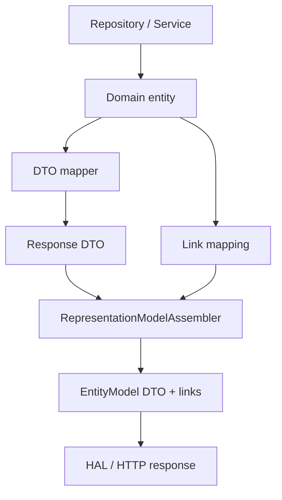

# Assembler và mapping DTO

Trong API dùng Spring HATEOAS, dữ liệu miền (domain model) và dữ liệu công bố qua HTTP thường có cấu trúc khác nhau. Entity JPA có thể chứa quan hệ persistence, trường nội bộ hoặc thuộc tính phục vụ nghiệp vụ; DTO phản hồi chỉ nên chứa những trường mà client cần. Sau khi chuyển entity thành DTO, ứng dụng còn phải gắn các liên kết hypermedia như `self`, `orders` hoặc `cancel`.

`RepresentationModelAssembler<T, D>` gom bước chuyển một đối tượng nguồn `T` thành mô hình biểu diễn `D`. Khi `D` là `EntityModel<OrderResponse>`, assembler thực hiện hai việc phối hợp: gọi mapper để tạo DTO và thêm các liên kết phù hợp vào `EntityModel`. Nhờ vậy, controller có thể tập trung lấy dữ liệu và trả mô hình, còn quy tắc ánh xạ và tạo hypermedia được tái sử dụng.

Bài học này thuộc chương **Representation assembler** trong module **SPRING_HATEOAS**, tập trung vào ranh giới giữa mapping DTO và assembly hypermedia, cách triển khai `RepresentationModelAssembler`, sử dụng assembler cho item, collection và trang phân trang, cũng như kiểm thử hợp đồng phản hồi.

Sau bài học, bạn có thể:

- Phân biệt mapper domain-to-DTO với `RepresentationModelAssembler`.
- Thiết kế DTO phản hồi không phụ thuộc cấu trúc entity persistence.
- Triển khai `RepresentationModelAssembler<T, EntityModel<D>>`.
- Tạo link theo entity nguồn và dữ liệu DTO.
- Tái sử dụng assembler cho endpoint chi tiết, collection và `PagedModel`.
- Tách quy tắc link theo trạng thái khỏi controller.
- Kiểm thử nội dung DTO, relation, media type và các trạng thái khác nhau.

## 1. Hai bước riêng biệt: mapping và assembly

Một endpoint HATEOAS thường cần chuyển đổi qua hai lớp:

1. **Mapping dữ liệu:** chuyển domain object hoặc entity thành DTO phù hợp với hợp đồng API.
2. **Assembly hypermedia:** bọc DTO vào `EntityModel` hoặc một kiểu `RepresentationModel` khác, sau đó gắn các link mô tả tài nguyên và khả năng điều hướng.



Hai bước này có trách nhiệm khác nhau:

| Thành phần | Đầu vào | Đầu ra | Trách nhiệm |
|---|---|---|---|
| DTO mapper | Entity/domain object | DTO | Chọn và chuyển dữ liệu được công bố. |
| `RepresentationModelAssembler` | Entity/domain object | Representation model | Tạo DTO, thêm link và trả mô hình hypermedia. |
| Controller | HTTP request và service | HTTP response | Điều phối truy vấn, xử lý status và trả mô hình. |

Có thể viết mapper riêng rồi inject vào assembler, hoặc ánh xạ DTO trực tiếp trong `toModel` nếu logic rất nhỏ. Với hệ thống có nhiều trường, nested object hoặc quy tắc mapping dùng lại, tách mapper giúp assembler dễ đọc và dễ kiểm thử hơn.

Không nên đặt quy tắc nghiệp vụ cốt lõi trong mapper hoặc assembler. Mapper chuyển dữ liệu; assembler tạo biểu diễn và link; service/domain layer vẫn quyết định nghiệp vụ như tính tổng tiền, xác nhận đơn hàng hoặc cho phép hủy.

## 2. Thiết kế DTO phản hồi

Giả sử entity đơn hàng có các trường `id`, `status`, `total`, `createdAt` và quan hệ tới khách hàng. API chỉ cần công bố mã đơn, trạng thái, tổng tiền và tên khách hàng:

```java
import java.math.BigDecimal;
import java.time.Instant;

public record OrderResponse(
        Long id,
        String status,
        BigDecimal total,
        Instant createdAt,
        String customerName
) {}
```

DTO này là hợp đồng dữ liệu của endpoint. Nó không cần kế thừa `RepresentationModel`, vì assembler sẽ bọc nó trong `EntityModel<OrderResponse>`. Cách này tách cấu trúc JSON của dữ liệu khỏi các liên kết hypermedia.

Một DTO tốt nên:

- Chỉ công bố các trường client được phép và thực sự cần.
- Dùng kiểu dữ liệu rõ ràng, ổn định, không để lộ proxy hoặc collection persistence.
- Tránh tham chiếu trực tiếp entity JPA khác nếu có nguy cơ lazy loading hoặc vòng tham chiếu.
- Có thể bổ sung trường dẫn xuất như `customerName` mà không thay đổi schema entity.
- Giữ tên và ý nghĩa trường ổn định theo hợp đồng API.

Không nên trả trực tiếp entity chỉ để tiết kiệm một lớp DTO nếu entity chứa dữ liệu nội bộ, quan hệ phức tạp hoặc có vòng đời khác với API. DTO giúp kiểm soát chính xác dữ liệu được tuần tự hóa.

## 3. Tạo mapper từ entity sang DTO

Mapper chịu trách nhiệm chuyển dữ liệu. Có thể viết thủ công với một lớp hoặc phương thức đơn giản:

```java
import org.springframework.stereotype.Component;

@Component
public class DefaultOrderMapper implements OrderMapper {

    @Override
    public OrderResponse toResponse(Order order) {
        return new OrderResponse(
                order.getId(),
                order.getStatus().name(),
                order.getTotal(),
                order.getCreatedAt(),
                order.getCustomer().getName()
        );
    }
}
```

Hợp đồng mapper là một interface nhỏ:

```java
public interface OrderMapper {
    OrderResponse toResponse(Order order);
}
```

Ví dụ giả định `Order` có `getStatus()`, `getCustomer()` và các getter tương ứng; `getCustomer()` phải trả về quan hệ đã được tải trong phạm vi transaction hoặc được service chuẩn bị trước. Nếu không, việc truy cập `getCustomer().getName()` có thể gây lazy loading ngoài transaction hoặc phát sinh truy vấn không mong muốn.

Nếu cần mapping phức tạp hoặc nhiều DTO, có thể dùng MapStruct. MapStruct sinh code mapper ở thời điểm biên dịch:

```java
import org.mapstruct.Mapper;
import org.mapstruct.Mapping;

@Mapper(componentModel = "spring")
public interface OrderMapper {

    @Mapping(target = "customerName", source = "customer.name")
    OrderResponse toResponse(Order order);
}
```

Đoạn MapStruct là implementation thay thế cho interface `OrderMapper`; không đăng ký đồng thời `DefaultOrderMapper` và mapper MapStruct nếu cả hai cùng là bean cho một interface. MapStruct có thể chuyển enum sang tên chuỗi trong trường hợp cơ bản; với quy tắc hiển thị khác, hãy khai báo method chuyển đổi rõ ràng.

MapStruct cần dependency và annotation processor tương ứng trong cấu hình Maven hoặc Gradle. Đây là lựa chọn của tầng mapping; Spring HATEOAS không yêu cầu MapStruct. Một mapper thủ công hoàn toàn phù hợp khi số lượng trường nhỏ và chuyển đổi dễ hiểu.

## 4. Triển khai RepresentationModelAssembler

`RepresentationModelAssembler<T, D>` nằm trong gói `org.springframework.hateoas.server`. Tham số `T` là đối tượng nguồn; `D` là kiểu mô hình biểu diễn, phải kế thừa `RepresentationModel`.

Với entity `Order` và DTO `OrderResponse`, có thể triển khai như sau:

```java
import org.springframework.hateoas.EntityModel;
import org.springframework.hateoas.server.RepresentationModelAssembler;
import org.springframework.stereotype.Component;

import static org.springframework.hateoas.server.mvc.WebMvcLinkBuilder.linkTo;
import static org.springframework.hateoas.server.mvc.WebMvcLinkBuilder.methodOn;

@Component
public class OrderModelAssembler
        implements RepresentationModelAssembler<Order, EntityModel<OrderResponse>> {

    private final OrderMapper mapper;

    public OrderModelAssembler(OrderMapper mapper) {
        this.mapper = mapper;
    }

    @Override
    public EntityModel<OrderResponse> toModel(Order order) {
        OrderResponse response = mapper.toResponse(order);

        return EntityModel.of(
                response,
                linkTo(methodOn(OrderController.class).one(order.getId()))
                        .withSelfRel(),
                linkTo(methodOn(OrderController.class).all())
                        .withRel("orders")
        );
    }
}
```

Phương thức `toModel` là điểm chuyển một entity thành một representation. Nó gọi mapper để tạo content rồi gắn hai link:

- `self` trỏ tới endpoint chi tiết của chính đơn hàng.
- `orders` trỏ tới collection đơn hàng.

`methodOn(...)` dùng mapping controller để dựng URI. Lời gọi proxy này không chạy nghiệp vụ của controller. Assembler không truy vấn repository; đối tượng `Order` phải được controller hoặc service cung cấp trước.

Nếu không cần mapper riêng, có thể tạo DTO trực tiếp trong `toModel`. Tuy nhiên, khi logic mapping tăng lên, giữ mapper tách biệt giúp assembler tập trung vào link và biểu diễn.

## 5. Thêm link theo trạng thái tài nguyên

Một representation có thể công bố các hành động khác nhau tùy trạng thái nghiệp vụ. Ví dụ, đơn hàng chỉ được phép hủy khi trạng thái là `PENDING`:

```java
@Override
public EntityModel<OrderResponse> toModel(Order order) {
    OrderResponse response = mapper.toResponse(order);

    EntityModel<OrderResponse> model = EntityModel.of(
            response,
            linkTo(methodOn(OrderController.class).one(order.getId()))
                    .withSelfRel(),
            linkTo(methodOn(OrderController.class).all())
                    .withRel("orders")
    );

    if (order.getStatus() == OrderStatus.PENDING) {
        model.add(linkTo(methodOn(OrderController.class).cancel(order.getId()))
                .withRel("cancel"));
    }

    return model;
}
```

Client đọc relation `cancel` để biết thao tác hủy đang được công bố. Nếu đơn đã giao hoặc đã hủy, assembler không thêm link này.

Việc ẩn link không thay thế bảo mật. Endpoint `cancel` vẫn phải kiểm tra quyền, trạng thái hiện tại và các điều kiện nghiệp vụ khi nhận request. Trạng thái có thể thay đổi giữa lúc client nhận biểu diễn và lúc gửi thao tác.

Nếu quy tắc khả dụng phức tạp, chẳng hạn phụ thuộc quyền người dùng hoặc policy, có thể inject một policy/service chuyên trách vào assembler để xác định link cần công bố. Không nên để assembler tự triển khai lại các quy tắc nghiệp vụ vốn đã thuộc service/domain layer.

## 6. Dùng assembler trong controller cho một item

Controller không cần biết cách tạo DTO hoặc link. Nó lấy entity từ service rồi gọi `toModel`:

```java
import org.springframework.hateoas.EntityModel;
import org.springframework.http.HttpStatus;
import org.springframework.http.ResponseEntity;
import org.springframework.web.bind.annotation.GetMapping;
import org.springframework.web.bind.annotation.PathVariable;
import org.springframework.web.bind.annotation.PostMapping;
import org.springframework.web.bind.annotation.RequestMapping;
import org.springframework.web.bind.annotation.RestController;
import org.springframework.web.server.ResponseStatusException;

@RestController
@RequestMapping("/orders")
public class OrderController {

    private final OrderService service;
    private final OrderModelAssembler assembler;

    public OrderController(OrderService service, OrderModelAssembler assembler) {
        this.service = service;
        this.assembler = assembler;
    }

    @GetMapping("/{id}")
    public EntityModel<OrderResponse> one(@PathVariable Long id) {
        Order order = service.findById(id)
                .orElseThrow(() -> new ResponseStatusException(HttpStatus.NOT_FOUND));

        return assembler.toModel(order);
    }

    @PostMapping("/{id}/cancellation")
    public ResponseEntity<Void> cancel(@PathVariable Long id) {
        service.cancel(id);
        return ResponseEntity.noContent().build();
    }
}
```

Controller chịu trách nhiệm xử lý HTTP và trường hợp không tìm thấy. `OrderService` chịu trách nhiệm truy vấn và chuẩn bị dữ liệu cần thiết. `OrderModelAssembler` chịu trách nhiệm chuyển DTO và tạo link. Mỗi lớp có một nhiệm vụ rõ ràng nên có thể thay đổi độc lập hơn.

## 7. Dùng assembler cho collection

`RepresentationModelAssembler` cung cấp phương thức `toCollectionModel(Iterable<? extends T>)` để chuyển nhiều đối tượng nguồn thành một `CollectionModel` chứa các mô hình phần tử. Phương thức này dùng `toModel` cho từng phần tử, vì vậy link của mỗi item được tạo theo cùng một quy tắc.

```java
@GetMapping
public CollectionModel<EntityModel<OrderResponse>> all() {
    List<Order> orders = service.findAll();

    CollectionModel<EntityModel<OrderResponse>> model =
            assembler.toCollectionModel(orders);

    model.add(linkTo(methodOn(OrderController.class).all()).withSelfRel());
    return model;
}
```

Đây là phần thân phương thức đặt bên trong `OrderController` ở phần trước; khai báo `CollectionModel`, `EntityModel`, `List` và static import `linkTo`, `methodOn` ở đầu file. `toCollectionModel` tạo mô hình cho từng item. Link `self` của collection được thêm riêng để biểu diễn URI của toàn bộ danh sách.

Không nên nhầm link `self` của collection với link `self` của từng item. Collection self link trỏ tới `/orders`; mỗi item self link trỏ tới `/orders/{id}`. Nếu endpoint collection có filter hoặc sort, self link cần giữ các tham số của request hiện tại.

## 8. Dùng assembler với PagedModel

Khi repository trả `Page<Order>`, `PagedResourcesAssembler<Order>` có thể kết hợp với cùng `OrderModelAssembler` để tạo `PagedModel<EntityModel<OrderResponse>>`:

```java
@GetMapping("/page")
public PagedModel<EntityModel<OrderResponse>> page(
        Pageable pageable,
        PagedResourcesAssembler<Order> pagedAssembler) {

    Page<Order> page = service.findAll(pageable);
    return pagedAssembler.toModel(page, assembler);
}
```

Đây là phần thân một phương thức phân trang riêng trong `OrderController`; khai báo `Page`, `Pageable`, `PagedResourcesAssembler`, `EntityModel` và `PagedModel` ở đầu file. `PagedResourcesAssembler` đảm nhiệm metadata trang và link điều hướng; `OrderModelAssembler` vẫn đảm nhiệm DTO cùng link của từng đơn hàng. Nhờ đó, logic ánh xạ entity sang DTO không bị lặp giữa endpoint chi tiết, collection và trang dữ liệu.

Nếu cần giới hạn kích thước trang, sắp xếp hoặc filter, hãy cấu hình `Pageable` và service/repository tương ứng. Không nên lấy toàn bộ dữ liệu rồi mới phân trang trong bộ nhớ khi tập dữ liệu lớn.

## 9. Tách mapper và assembler khi mapping phức tạp

Với API lớn, mapper và assembler có thể có nhiều trách nhiệm khác nhau:

| Thành phần | Ví dụ trách nhiệm |
|---|---|
| `OrderMapper` | Entity sang DTO, enum sang chuỗi, nested customer sang `customerName`. |
| `OrderModelAssembler` | Thêm `self`, `orders`, `customer`, `cancel` và các affordance. |
| `OrderService` | Kiểm tra trạng thái, quyền nghiệp vụ, truy vấn và tính toán. |
| `OrderController` | Nhận HTTP request, gọi service và trả representation. |

Nếu cần biểu diễn nhiều góc nhìn, có thể tạo nhiều DTO và mapper riêng, ví dụ `OrderSummaryResponse` cho collection và `OrderDetailResponse` cho trang chi tiết. Khi đó có thể tạo assembler tương ứng cho mỗi representation:

```java
public interface OrderSummaryMapper {
    OrderSummaryResponse toSummary(Order order);
}

public interface OrderDetailMapper {
    OrderDetailResponse toDetail(Order order);
}
```

Mỗi assembler có thể dùng mapper phù hợp nhưng vẫn chia sẻ quy tắc tạo link chung qua helper hoặc một thành phần link factory. Tránh gom mọi biến thể DTO vào một assembler lớn với nhiều cờ boolean, vì cách đó làm khó xác định endpoint nào công bố trường và relation nào.

## 10. Khi nào dùng RepresentationModelAssemblerSupport?

Spring HATEOAS còn cung cấp lớp `RepresentationModelAssemblerSupport<T, D>` như một lớp cơ sở hỗ trợ tạo representation model và liên kết tới item. Đây là lựa chọn khi muốn kế thừa cơ chế tạo model gắn với controller và kiểu representation.

Tuy nhiên, với đa số ứng dụng hiện đại, triển khai trực tiếp interface `RepresentationModelAssembler<T, D>` thường dễ hiểu và linh hoạt hơn: mapper được inject rõ ràng, link được khai báo tường minh, và không phụ thuộc cấu trúc kế thừa của assembler.

Hãy chọn `RepresentationModelAssemblerSupport` khi quy ước của dự án đã sử dụng lớp này hoặc cần các helper mà nó cung cấp. Trước khi dùng, hãy đọc API theo phiên bản Spring HATEOAS của dự án vì một số dự án cũ có thể dùng tên lớp hoặc kiểu model theo phiên bản trước.

## 11. Kiểm thử mapper và assembler

Nên kiểm thử hai lớp theo hai mục tiêu khác nhau:

- Mapper: xác nhận trường DTO được chuyển đúng, kể cả nested property, enum, null và trường dẫn xuất.
- Assembler: xác nhận content được bọc đúng và các relation cần thiết được gắn theo dữ liệu/trạng thái.

Ví dụ unit test cho assembler:

```java
import org.junit.jupiter.api.AfterEach;
import org.junit.jupiter.api.BeforeEach;
import org.junit.jupiter.api.Test;
import org.springframework.hateoas.EntityModel;
import org.springframework.mock.web.MockHttpServletRequest;
import org.springframework.web.context.request.RequestContextHolder;
import org.springframework.web.context.request.ServletRequestAttributes;

import static org.assertj.core.api.Assertions.assertThat;

class OrderModelAssemblerTest {

    @BeforeEach
    void setUpRequestContext() {
        MockHttpServletRequest request = new MockHttpServletRequest();
        request.setScheme("http");
        request.setServerName("localhost");
        request.setServerPort(8080);
        request.setRequestURI("/orders/42");
        RequestContextHolder.setRequestAttributes(new ServletRequestAttributes(request));
    }

    @AfterEach
    void clearRequestContext() {
        RequestContextHolder.resetRequestAttributes();
    }

    @Test
    void pendingOrderContainsSelfOrdersAndCancelLinks() {
        OrderMapper mapper = order -> new OrderResponse(
                order.getId(),
                order.getStatus().name(),
                order.getTotal(),
                order.getCreatedAt(),
                order.getCustomer().getName()
        );

        OrderModelAssembler assembler = new OrderModelAssembler(mapper);
        Order order = OrderFixtures.pendingOrder(42L);

        EntityModel<OrderResponse> model = assembler.toModel(order);

        assertThat(model.getContent().id()).isEqualTo(42L);
        assertThat(model.getLink("self")).isPresent();
        assertThat(model.getLink("orders")).isPresent();
        assertThat(model.getLink("cancel")).isPresent();
    }

    @Test
    void deliveredOrderDoesNotContainCancelLink() {
        OrderMapper mapper = order -> new OrderResponse(
                order.getId(), order.getStatus().name(), order.getTotal(),
                order.getCreatedAt(), order.getCustomer().getName());

        OrderModelAssembler assembler = new OrderModelAssembler(mapper);
        Order order = OrderFixtures.deliveredOrder(43L);

        EntityModel<OrderResponse> model = assembler.toModel(order);

        assertThat(model.getLink("self")).isPresent();
        assertThat(model.getLink("cancel")).isEmpty();
    }
}
```

`OrderFixtures` là helper của test tạo entity hợp lệ cùng customer và các trường bắt buộc. Ví dụ dùng lambda cho mapper để tập trung vào hành vi assembler; trong test mapper riêng, hãy kiểm tra trực tiếp từng trường được chuyển đổi.

### Kiểm thử phản hồi HTTP

Unit test không xác nhận được serializer HAL và mapping controller. Nên có ít nhất một integration test qua MockMvc:

```java
import org.junit.jupiter.api.Test;
import org.springframework.beans.factory.annotation.Autowired;
import org.springframework.boot.test.autoconfigure.web.servlet.AutoConfigureMockMvc;
import org.springframework.boot.test.context.SpringBootTest;
import org.springframework.hateoas.MediaTypes;
import org.springframework.test.web.servlet.MockMvc;

import static org.springframework.test.web.servlet.request.MockMvcRequestBuilders.get;
import static org.springframework.test.web.servlet.result.MockMvcResultMatchers.content;
import static org.springframework.test.web.servlet.result.MockMvcResultMatchers.jsonPath;
import static org.springframework.test.web.servlet.result.MockMvcResultMatchers.status;

@SpringBootTest
@AutoConfigureMockMvc
class OrderRepresentationTest {

    @Autowired
    MockMvc mockMvc;

    @Test
    void orderEndpointReturnsDtoAndHypermediaLinks() throws Exception {
        mockMvc.perform(get("/orders/42").accept(MediaTypes.HAL_JSON))
                .andExpect(status().isOk())
                .andExpect(content().contentTypeCompatibleWith(MediaTypes.HAL_JSON))
                .andExpect(jsonPath("$.id").value(42))
                .andExpect(jsonPath("$.customerName").exists())
                .andExpect(jsonPath("$._links.self.href").exists())
                .andExpect(jsonPath("$._links.orders.href").exists())
                .andExpect(jsonPath("$._links.cancel.href").exists());
    }
}
```

Ví dụ giả định fixture cho đơn hàng `42` ở trạng thái `PENDING`, dữ liệu khách hàng đã được chuẩn bị và endpoint trả HAL JSON. Với đơn hàng đã giao, nên kiểm tra relation `cancel` không xuất hiện. Với collection hoặc page, kiểm tra thêm self link cấp collection và metadata phân trang.

## 12. Các lỗi thường gặp

| Lỗi | Hệ quả | Cách xử lý |
|---|---|---|
| Mapper trả về entity thay vì DTO | Persistence model bị đưa thẳng vào API. | Chuyển sang DTO có trường được kiểm soát. |
| Assembler chứa toàn bộ logic nghiệp vụ | Quy tắc trạng thái và quyền bị lặp hoặc khó kiểm thử. | Đưa nghiệp vụ vào service/domain policy. |
| Controller tự map DTO và tự tạo mọi link | Logic biểu diễn lặp ở nhiều endpoint. | Dùng mapper và `RepresentationModelAssembler` dùng chung. |
| Assembler chỉ tạo DTO nhưng quên link | Phản hồi có dữ liệu nhưng thiếu hypermedia. | Kiểm thử relation `self` và link nghiệp vụ. |
| Dùng một assembler quá lớn cho nhiều loại DTO | Nhiều nhánh điều kiện và trường không nhất quán. | Tạo assembler riêng theo representation/use case. |
| Gọi lazy association trong mapper | N+1 query hoặc lỗi lazy loading. | Chuẩn bị dữ liệu trong service/query hoặc dùng projection phù hợp. |
| Giả định `toCollectionModel` tự thêm link collection | Collection có thể thiếu self link. | Chủ động thêm link collection nếu hợp đồng yêu cầu. |
| Dùng `EntityModel<List<DTO>>` cho collection | Mất mô hình collection và link từng item. | Dùng `CollectionModel<EntityModel<DTO>>`. |
| Chỉ test mapper mà không test HAL | Lỗi serializer, media type hoặc relation không được phát hiện. | Bổ sung MockMvc integration test. |

## 13. Quy trình triển khai

Khi tạo một endpoint trả DTO có hypermedia, có thể làm theo trình tự:

1. Xác định dữ liệu client cần và thiết kế response DTO.
2. Viết mapper từ entity/domain object sang DTO; xử lý nested property và null có chủ đích.
3. Tạo `RepresentationModelAssembler<Entity, EntityModel<DTO>>` và inject mapper.
4. Trong `toModel`, chuyển DTO rồi gắn self link và các relation liên quan.
5. Thêm link hành động theo trạng thái hoặc policy đã được service/domain xác định.
6. Dùng `toCollectionModel` cho collection và thêm self link cấp collection khi cần.
7. Dùng `PagedResourcesAssembler` cho `Page<T>` để giữ metadata và link điều hướng.
8. Giữ controller tập trung vào request, service và status code.
9. Kiểm thử mapper, assembler và phản hồi HTTP theo các trạng thái khác nhau.

`RepresentationModelAssembler` là ranh giới chuyển domain object thành biểu diễn hypermedia. Khi mapper chịu trách nhiệm chọn dữ liệu DTO, còn assembler chịu trách nhiệm bọc DTO và tạo link, API có thể thay đổi cấu trúc persistence mà vẫn giữ hợp đồng HTTP rõ ràng. Controller cũng gọn hơn vì không phải lặp logic ánh xạ và liên kết ở từng endpoint.

## Tài liệu tham khảo

- [Spring HATEOAS – Representation Model Assemblers](https://docs.spring.io/spring-hateoas/reference/server/representation-models.html#representation-model-assemblers)
- [Spring HATEOAS – RepresentationModelAssembler API](https://docs.spring.io/spring-hateoas/docs/current/api/org/springframework/hateoas/server/RepresentationModelAssembler.html)
- [Spring HATEOAS – RepresentationModelAssemblerSupport API](https://docs.spring.io/spring-hateoas/docs/current/api/org/springframework/hateoas/server/mvc/RepresentationModelAssemblerSupport.html)
- [MapStruct – Reference Guide](https://mapstruct.org/documentation/stable/reference/html/)
