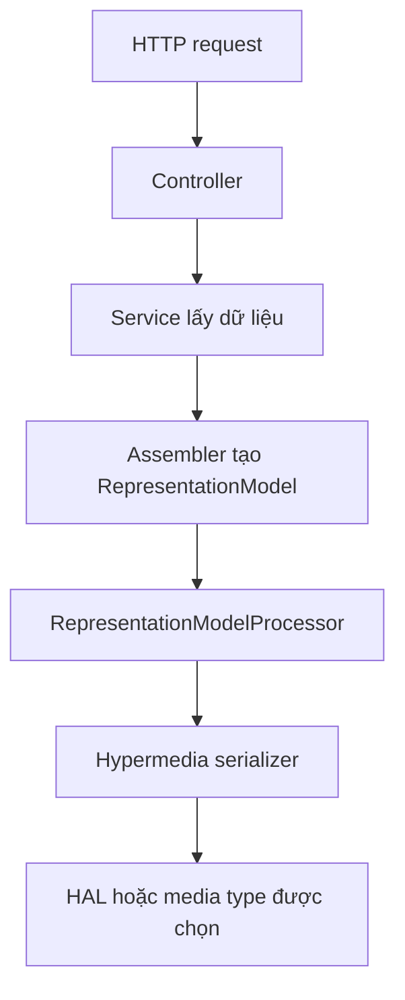

# RepresentationModelProcessor

Một API có thể tạo representation đơn hàng từ nhiều controller hoặc nhiều luồng xử lý. Các assembler đã thêm dữ liệu và link riêng cho từng use case, nhưng toàn hệ thống vẫn cần bổ sung một số liên kết chung, chẳng hạn link đến hồ sơ khách hàng hoặc tài liệu chính sách. Nếu lặp lại logic đó trong từng controller, các response dễ thiếu link hoặc dùng relation không nhất quán.

Spring HATEOAS cung cấp `RepresentationModelProcessor` để xử lý representation model sau khi controller hoặc assembler tạo xong. Processor nhận một model thuộc kiểu được khai báo, bổ sung hoặc điều chỉnh các link rồi trả lại model. Cách này phù hợp với những quy tắc hypermedia dùng chung cho một loại representation.

## RepresentationModelProcessor là gì?

`RepresentationModelProcessor<T>` là interface trong package `org.springframework.hateoas.server`. Kiểu `T` phải là một kiểu kế thừa `RepresentationModel<?>`. Interface có một phương thức:

```java
T process(T model);
```

Processor nhận representation model, thực hiện bước xử lý bổ sung và trả về model. Thông thường processor thêm link hoặc affordance dựa trên dữ liệu đã có trong model. Nó không thay thế controller, service hoặc assembler.

Processor cũng có thể điều chỉnh dữ liệu hoặc thay model bằng một instance khác, nhưng kiểu trả về phải tương thích với kiểu đầu vào đã khai báo trong `RepresentationModelProcessor<T>`. Trong đa số trường hợp, chỉ cần cập nhật model hiện có rồi trả lại chính instance đó.

Trong ứng dụng Spring MVC có cấu hình Spring HATEOAS, các processor được đăng ký dưới dạng Spring bean. Cơ chế tích hợp của Spring HATEOAS áp dụng processor phù hợp cho representation model được trả về từ controller trước khi model được serialize thành JSON hoặc media type hypermedia khác.

Luồng xử lý khái quát:



Processor hoạt động ở bước hoàn thiện representation. Vì vậy, nó có thể bổ sung một link dùng chung mà không cần sửa từng nơi gọi assembler.

## Khi nào nên dùng processor?

Processor hữu ích khi có quy tắc bổ sung hypermedia áp dụng cho một loại model ở nhiều endpoint. Ví dụ:

- Thêm link `profile` đến tài liệu mô tả resource cho mọi representation đơn hàng.
- Thêm link đến chính sách hỗ trợ hoặc hướng dẫn có liên quan đến một loại resource.
- Bổ sung affordance dùng chung cho model khi điều kiện nghiệp vụ đã được biểu diễn trong model.
- Chuẩn hóa một nhóm link chung cho collection resource.

Không nên dùng processor cho mọi thao tác ánh xạ. Nếu cần chuyển `Order` thành `OrderView`, chọn trường dữ liệu, hoặc tạo link riêng theo từng use case, `RepresentationModelAssembler` thường phù hợp hơn. Nếu chỉ một controller cần một link riêng, thêm link trực tiếp trong controller có thể đơn giản hơn.

| Thành phần | Trách nhiệm chính |
| --- | --- |
| Controller | Nhận request, điều phối use case và trả representation. |
| Service | Thực hiện nghiệp vụ và lấy dữ liệu. |
| `RepresentationModelAssembler` | Chuyển domain object/DTO thành representation model, tạo link theo item. |
| `RepresentationModelProcessor` | Bổ sung hoặc điều chỉnh link dùng chung sau khi model đã được tạo. |
| Serializer | Chuyển model thành HAL hoặc media type được thương lượng. |

## Tạo processor cho EntityModel

Giả sử API có DTO đơn hàng:

```java
import java.util.UUID;

public record OrderView(
    UUID id,
    UUID customerId,
    String status
) {
}
```

Một processor có thể bổ sung link `customer` cho mọi `EntityModel<OrderView>`:

```java
import static org.springframework.hateoas.server.mvc.WebMvcLinkBuilder.linkTo;
import static org.springframework.hateoas.server.mvc.WebMvcLinkBuilder.methodOn;

import org.springframework.hateoas.EntityModel;
import org.springframework.hateoas.server.RepresentationModelProcessor;
import org.springframework.stereotype.Component;

@Component
class OrderRepresentationProcessor
        implements RepresentationModelProcessor<EntityModel<OrderView>> {

    @Override
    public EntityModel<OrderView> process(EntityModel<OrderView> model) {
        OrderView order = model.getContent();

        if (order != null && order.customerId() != null
                && !model.hasLink("customer")) {
            model.add(linkTo(methodOn(CustomerController.class)
                .one(order.customerId()))
                .withRel("customer"));
        }

        return model;
    }
}
```

Processor được đăng ký bằng `@Component`, nên Spring có thể phát hiện và quản lý bean. Generic `EntityModel<OrderView>` xác định loại representation mà processor này nhắm đến. Khi processor được áp dụng, nó đọc nội dung DTO, thêm link `customer` nếu chưa có và trả lại chính model.

Ví dụ giả định `CustomerController.one(UUID id)` là endpoint đọc hồ sơ khách hàng. Trong ứng dụng thực tế, cần xử lý trường hợp `customerId` không có hoặc quan hệ không được phép công bố. Việc link có xuất hiện hay không nên theo hợp đồng và quyền truy cập của API.

### Vì sao kiểm tra link trước khi thêm?

Một model có thể đã có link `customer` do assembler hoặc controller thêm trước đó. Nếu processor luôn thêm một link cùng relation, response có thể chứa nhiều đích cho cùng một quan hệ mà client không mong đợi.

`hasLink(...)` giúp processor chỉ thêm link khi chưa tồn tại. Nếu chính sách yêu cầu thay thế link đã có, hãy thực hiện rõ ràng bằng cách xóa hoặc thay link theo API của `RepresentationModel`, sau đó kiểm thử kết quả. Không nên vô tình tạo duplicate relation.

## Processor cho CollectionModel

Processor cũng có thể nhắm đến collection model. Ví dụ, một collection đơn hàng luôn cần link `profile` trỏ đến tài liệu mô tả cấu trúc collection:

```java
import org.springframework.hateoas.Link;
import org.springframework.hateoas.CollectionModel;
import org.springframework.hateoas.server.RepresentationModelProcessor;
import org.springframework.stereotype.Component;

@Component
class OrderCollectionProcessor
        implements RepresentationModelProcessor<CollectionModel<OrderView>> {

    @Override
    public CollectionModel<OrderView> process(
            CollectionModel<OrderView> collection) {

        if (!collection.hasLink("profile")) {
            collection.add(Link.of("https://api.example.com/profiles/orders")
                .withRel("profile"));
        }

        return collection;
    }
}
```

Ví dụ dùng `CollectionModel<OrderView>` để minh họa collection có DTO trực tiếp làm phần tử. Nếu ứng dụng trả `CollectionModel<EntityModel<OrderView>>`, generic của processor phải khớp với kiểu collection thực tế đó.

Processor collection xử lý model collection ở cấp cao nhất. Không nên giả định processor của `EntityModel<OrderView>` sẽ tự động chạy đệ quy cho từng item nằm trong `_embedded`. Nếu từng item cần link riêng, hãy thêm chúng trong assembler hoặc dùng một cơ chế xử lý item rõ ràng rồi kiểm thử response cuối cùng.

## Collection rỗng và fallback type

Với collection có phần tử, Spring HATEOAS có thể suy ra kiểu phần tử từ nội dung. Với collection rỗng, không có item để xác định generic payload tại runtime do Java type erasure. Vì vậy, processor nhắm đến một kiểu collection cụ thể có thể không được chọn nếu framework không xác định được kiểu phần tử.

Có thể cung cấp fallback type khi tạo collection rỗng:

```java
CollectionModel<OrderView> empty = CollectionModel.empty(OrderView.class);
```

Fallback type cho biết collection rỗng đại diện cho kiểu phần tử nào. Điều này giúp hạ tầng nhận diện collection đúng kiểu để áp dụng processor phù hợp. Nếu API dùng collection có phần tử kiểu `EntityModel<OrderView>`, hãy cung cấp fallback type phù hợp với cấu trúc generic mà processor nhắm đến và xác minh bằng test theo phiên bản Spring HATEOAS đang sử dụng.

Không nên bỏ link collection chỉ vì không có item. Self link và link cấp collection vẫn có thể được thêm trực tiếp khi tạo model; fallback type giải quyết việc nhận diện kiểu model cho những bước xử lý dựa trên generic.

## Processor với model tùy chỉnh

`RepresentationModelProcessor` không giới hạn ở `EntityModel` hoặc `CollectionModel`. Nó có thể nhắm đến lớp riêng kế thừa `RepresentationModel`:

```java
import java.util.UUID;

public class OrderModel extends RepresentationModel<OrderModel> {

    private UUID id;
    private String status;

    public OrderModel(UUID id, String status) {
        this.id = id;
        this.status = status;
    }

    public UUID getId() {
        return id;
    }

    public String getStatus() {
        return status;
    }
}
```

Processor cho model tùy chỉnh:

```java
import org.springframework.hateoas.Link;
import org.springframework.stereotype.Component;

@Component
class OrderCustomModelProcessor
        implements RepresentationModelProcessor<OrderModel> {

    @Override
    public OrderModel process(OrderModel model) {
        model.add(Link.of("https://api.example.com/order-help")
            .withRel("help"));
        return model;
    }
}
```

Vì `OrderModel` kế thừa `RepresentationModel<OrderModel>`, nó có thể được xử lý bởi `RepresentationModelProcessor<OrderModel>`. Model tùy chỉnh vẫn nên được tạo bởi assembler; processor chỉ bổ sung khía cạnh hypermedia dùng chung.

## Đăng ký và áp dụng processor

Trong ứng dụng Spring, processor thường được đăng ký như một bean bằng `@Component` hoặc `@Bean`:

```java
import static org.springframework.hateoas.server.mvc.WebMvcLinkBuilder.linkTo;
import static org.springframework.hateoas.server.mvc.WebMvcLinkBuilder.methodOn;

import org.springframework.context.annotation.Bean;
import org.springframework.context.annotation.Configuration;
import org.springframework.hateoas.EntityModel;
import org.springframework.hateoas.server.RepresentationModelProcessor;

@Configuration
class HypermediaProcessorConfiguration {

    @Bean
    RepresentationModelProcessor<EntityModel<OrderView>> orderProcessor() {
        return model -> {
            OrderView order = model.getContent();
            if (order != null && order.customerId() != null
                    && !model.hasLink("customer")) {
                model.add(linkTo(methodOn(CustomerController.class)
                    .one(order.customerId())).withRel("customer"));
            }
            return model;
        };
    }
}
```

Ví dụ trên dùng lambda để minh họa cách đăng ký qua `@Bean`; trong code thực tế cần có static import và các dependency tương ứng. Chọn `@Component` cho processor có logic riêng hoặc `@Bean` khi muốn cấu hình nó tập trung.

Với Spring Boot và starter HATEOAS, phần tích hợp thường được cấu hình tự động. Nếu tự cấu hình Spring MVC, cần bật hỗ trợ hypermedia phù hợp để các return value handler của Spring HATEOAS được đăng ký. Chỉ có bean processor mà thiếu cơ chế tích hợp xử lý representation thì không đủ để bảo đảm processor được gọi.

`RepresentationModelProcessor` được mô tả là SPI xử lý model trả về từ Spring MVC controller. Nếu ứng dụng dùng Spring WebFlux, không nên mặc định rằng cùng return value handler MVC sẽ áp dụng; hãy kiểm tra hỗ trợ của phiên bản và stack reactive đang dùng hoặc xây cơ chế tích hợp tương ứng.

## Nhiều processor và thứ tự xử lý

Một ứng dụng có thể có nhiều processor cho các loại model khác nhau hoặc nhiều processor cùng áp dụng cho một loại model. Hãy giữ mỗi processor tập trung vào một trách nhiệm, chẳng hạn thêm link tài liệu, link collection hoặc affordance theo trạng thái.

Nếu nhiều processor cùng sửa một model, thứ tự có thể ảnh hưởng kết quả. Có thể dùng cơ chế ordering của Spring như `@Order` khi thực sự cần một thứ tự xác định. Tuy nhiên, thiết kế tốt nên hạn chế phụ thuộc thứ tự: processor kiểm tra link đã có trước khi thêm, không xóa link của processor khác và không giả định một processor cụ thể đã chạy trước.

Ví dụ đánh dấu thứ tự:

```java
import org.springframework.hateoas.Link;
import org.springframework.stereotype.Component;
import org.springframework.core.Ordered;
import org.springframework.core.annotation.Order;

@Component
@Order(Ordered.LOWEST_PRECEDENCE)
class OrderDocumentationProcessor
        implements RepresentationModelProcessor<EntityModel<OrderView>> {

    @Override
    public EntityModel<OrderView> process(EntityModel<OrderView> model) {
        if (!model.hasLink("profile")) {
            model.add(Link.of("https://api.example.com/profiles/order")
                .withRel("profile"));
        }
        return model;
    }
}
```

`@Order` chỉ nên được dùng khi có lý do rõ ràng và cần kiểm thử thứ tự thực tế. Tránh tạo chuỗi processor phụ thuộc lẫn nhau khiến việc thay đổi một bean làm thay đổi response ở nhiều endpoint.

## Processor không thay thế assembler

Assembler và processor đều có thể thêm link, nhưng thời điểm và mục tiêu khác nhau:

| Tiêu chí | Assembler | Processor |
| --- | --- | --- |
| Thời điểm | Khi chuyển domain object/DTO thành representation | Sau khi representation model đã được tạo |
| Phạm vi | Thường gắn với một loại item hoặc use case cụ thể | Quy tắc bổ sung dùng chung cho một kiểu model |
| Dữ liệu | Có nguồn object rõ ràng để ánh xạ | Nhận representation model đã tạo |
| Ví dụ | Tạo `OrderView`, link `self` và link liên quan của item | Thêm link `profile` chung cho mọi `EntityModel<OrderView>` |
| Nơi gọi | Controller/service thường gọi assembler tường minh | Hạ tầng Spring HATEOAS áp dụng processor đã đăng ký |

Nếu link cần một dữ liệu chỉ có trong domain object và không xuất hiện trong representation, assembler thường là nơi phù hợp hơn. Processor không nên phải truy vấn cơ sở dữ liệu cho từng model để bổ sung link, vì điều đó có thể gây N+1 query và làm tăng độ trễ.

## Processor và điều kiện bảo mật

Processor có thể dựa trên trạng thái hoặc ngữ cảnh người dùng để quyết định link nào được công bố. Ví dụ, chỉ thêm link `cancel` khi đơn hàng đang `PENDING`. Tuy nhiên, việc không công bố link không ngăn client gọi trực tiếp endpoint.

Mọi thao tác vẫn phải được xác thực, phân quyền và kiểm tra invariant nghiệp vụ tại endpoint/service. Processor chỉ định hình affordance mà representation công bố cho client. Không dùng processor làm ranh giới bảo mật duy nhất.

Ngoài ra, nếu response được cache, link phụ thuộc người dùng hoặc quyền cần chính sách cache phù hợp. Không để cache dùng chung response chứa link cá nhân cho người dùng khác.

## Kiểm thử RepresentationModelProcessor

Nên có hai lớp kiểm thử:

1. Unit test cho processor để xác nhận model đầu vào được bổ sung đúng relation và không tạo duplicate.
2. Integration test cho controller để xác nhận processor thực sự được áp dụng trước khi response được serialize.

Ví dụ unit test:

```java
import static org.assertj.core.api.Assertions.assertThat;

import org.springframework.hateoas.EntityModel;

OrderView order = new OrderView(orderId, customerId, "PENDING");
EntityModel<OrderView> model = EntityModel.of(order);

EntityModel<OrderView> result = processor.process(model);

assertThat(result.hasLink("customer")).isTrue();
```

Với MockMvc, kiểm tra link xuất hiện trong HAL response:

```java
mockMvc.perform(get("/api/orders/{id}", orderId)
        .accept(MediaType.parseMediaType("application/hal+json")))
    .andExpect(status().isOk())
    .andExpect(jsonPath("$._links.customer.href").exists());
```

Nếu processor thêm link có điều kiện, kiểm tra cả hai nhánh:

```java
mockMvc.perform(get("/api/orders/{id}", pendingOrderId)
        .accept(MediaType.parseMediaType("application/hal+json")))
    .andExpect(jsonPath("$._links.cancel.href").exists());

mockMvc.perform(get("/api/orders/{id}", shippedOrderId)
        .accept(MediaType.parseMediaType("application/hal+json")))
    .andExpect(jsonPath("$._links.cancel").doesNotExist());
```

Với collection rỗng, cần kiểm thử riêng việc fallback type có giúp processor được áp dụng theo cấu hình mong đợi hay không. Không nên chỉ unit test phương thức `process(...)`, vì điều đó không chứng minh Spring HATEOAS đã chọn đúng processor trong pipeline MVC.

## Những lỗi thường gặp

| Lỗi | Hệ quả | Cách xử lý |
| --- | --- | --- |
| Dùng processor để thay toàn bộ assembler | Logic ánh xạ domain và link theo use case trở nên khó theo dõi. | Dùng assembler cho việc tạo model; processor cho phần bổ sung dùng chung. |
| Generic processor không khớp kiểu model trả về | Processor không được áp dụng cho representation mong đợi. | Khai báo đúng generic của `EntityModel`, `CollectionModel` hoặc custom model. |
| Cho rằng processor chạy đệ quy trên embedded item | Link của từng item có thể không được bổ sung. | Thêm item link trong assembler và kiểm thử response collection. |
| Collection rỗng không có fallback type | Framework không suy ra được kiểu phần tử để chọn processor. | Cung cấp fallback type cho collection rỗng khi cần. |
| Thêm cùng relation nhiều lần | Response có duplicate link hoặc nhiều đích ngoài ý muốn. | Kiểm tra `hasLink(...)` trước khi thêm hoặc thay link có chủ đích. |
| Truy vấn database trong mỗi processor | Tăng độ trễ và có thể tạo N+1 query. | Chuẩn bị dữ liệu cần thiết ở service/assembler trước khi tạo model. |
| Coi việc ẩn affordance là phân quyền | Client vẫn có thể gọi trực tiếp endpoint. | Kiểm tra quyền và trạng thái tại server cho mọi request. |
| Chỉ unit test process() | Không phát hiện processor không được đăng ký hoặc không được gọi trong MVC pipeline. | Bổ sung integration test bằng MockMvc. |

## Ghi nhớ

- `RepresentationModelProcessor<T>` nhận một `RepresentationModel` và trả lại model sau khi xử lý bổ sung.
- Đăng ký processor thành Spring bean bằng `@Component` hoặc `@Bean`.
- Generic `T` xác định loại model mà processor nhắm đến; cần khớp kiểu representation thực tế.
- Dùng processor cho link hoặc affordance dùng chung; dùng assembler cho ánh xạ domain và link đặc thù item.
- Collection rỗng có thể cần fallback type để framework nhận diện kiểu phần tử và chọn processor.
- Không giả định processor tự chạy đệ quy trên các item trong `_embedded`.
- Tránh duplicate relation, truy vấn dữ liệu nặng và phụ thuộc thứ tự processor.
- Processor không thay thế xác thực/phân quyền ở endpoint; kiểm thử cả processor lẫn MVC pipeline.

## Tài liệu tham khảo

- [Spring HATEOAS Reference Documentation](https://docs.spring.io/spring-hateoas/docs/current/reference/html/)
- [Spring HATEOAS API – RepresentationModelProcessor](https://docs.spring.io/spring-hateoas/docs/current/api/org/springframework/hateoas/server/RepresentationModelProcessor.html)
- [Spring HATEOAS API – CollectionModel](https://docs.spring.io/spring-hateoas/docs/current/api/org/springframework/hateoas/CollectionModel.html)
- [Spring HATEOAS API – RepresentationModel](https://docs.spring.io/spring-hateoas/docs/current/api/org/springframework/hateoas/RepresentationModel.html)
