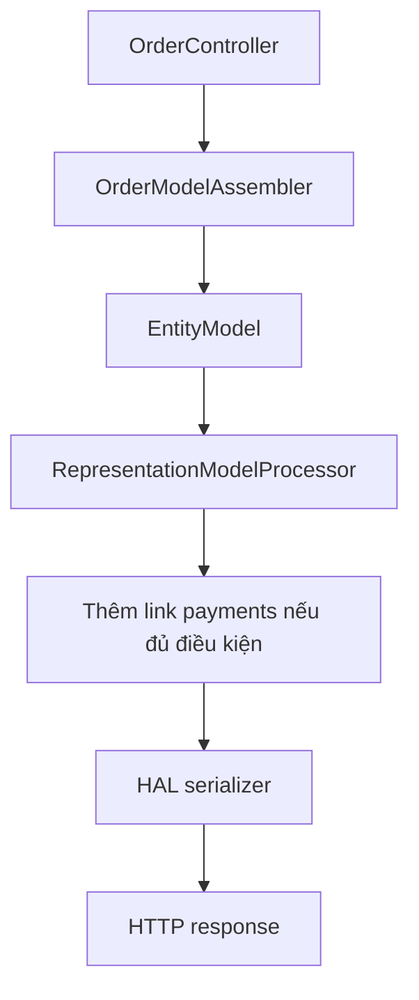

# Thêm link dùng chung

Một tài nguyên có thể cần các liên kết đến nhiều phần khác của hệ thống. Ví dụ, biểu diễn đơn hàng cần có `self`, `orders` và liên kết tới thanh toán khi đơn đang chờ thanh toán. Nếu mọi controller tự thêm các liên kết dùng chung, cùng một quy tắc sẽ bị lặp và các nhóm chức năng phải biết chi tiết của nhau.

Spring HATEOAS cung cấp `RepresentationModelProcessor<T>` để xử lý một mô hình biểu diễn sau khi controller hoặc assembler đã tạo nó. Processor có thể bổ sung liên kết dùng chung, điều chỉnh liên kết hiện có hoặc thay đổi mô hình trước khi được tuần tự hóa. Đây là một điểm mở rộng phù hợp khi một nhóm chức năng muốn bổ sung hypermedia cho biểu diễn do nhóm khác tạo ra mà không đưa logic đó vào controller gốc.

Bài học này thuộc chương **Model processor** trong module **SPRING_HATEOAS**, tập trung vào cách triển khai và đăng ký `RepresentationModelProcessor`, giới hạn processor theo kiểu representation, thêm link có điều kiện, phân biệt processor với assembler và kiểm thử liên kết được bổ sung.

Sau bài học, bạn có thể:

- Giải thích vai trò của `RepresentationModelProcessor<T>` trong vòng đời phản hồi.
- Triển khai phương thức `process(T model)` cho một kiểu representation cụ thể.
- Đăng ký processor bằng `@Component` hoặc `@Bean`.
- Thêm link dùng chung bằng `WebMvcLinkBuilder` và dữ liệu trong content.
- Giới hạn phạm vi processor theo `EntityModel<T>` hoặc `CollectionModel<T>`.
- Chọn giữa assembler, processor và logic tạo link trong controller.
- Kiểm thử processor qua unit test và MockMvc.

## 1. Vì sao cần model processor?

Giả sử nhóm Order sở hữu `OrderController` và tạo biểu diễn đơn hàng. Nhóm Payment cần thêm link tới danh sách thanh toán của đơn hàng khi trạng thái là `AWAITING_PAYMENT`. Nếu sửa `OrderController`, nhóm Order phải phụ thuộc vào `PaymentController` và hiểu thêm quy tắc của nghiệp vụ thanh toán.

Một processor cho phép nhóm Payment bổ sung link sau khi mô hình đơn hàng đã được tạo:



Processor nhận mô hình biểu diễn đã được tạo và trả về mô hình sau xử lý. Vì thế, nó phù hợp với các quy tắc hypermedia cần áp dụng xuyên qua nhiều endpoint hoặc thuộc một chức năng khác với chức năng tạo dữ liệu gốc.

Các trường hợp thường gặp:

- Bổ sung link tới chức năng thanh toán vào biểu diễn đơn hàng.
- Thêm link trợ giúp hoặc tài liệu API vào một loại tài nguyên.
- Bổ sung link theo quyền của người dùng hiện tại.
- Thêm quan hệ tới tài nguyên do một module hoặc hệ thống khác quản lý.
- Áp dụng một quy tắc link chung cho mọi representation thuộc một kiểu xác định.

Processor không thay thế service, repository hoặc assembler. Nó xử lý representation và link; dữ liệu nghiệp vụ vẫn nên được chuẩn bị bởi service và mô hình gốc vẫn do controller/assembler tạo ra.

## 2. RepresentationModelProcessor là gì?

`RepresentationModelProcessor<T>` thuộc package `org.springframework.hateoas.server`. Đây là một SPI (*Service Provider Interface*) cho phép ứng dụng đăng ký các thành phần xử lý mô hình biểu diễn trước khi phản hồi được tuần tự hóa.

Khai báo khái quát:

```java
public interface RepresentationModelProcessor<T extends RepresentationModel<?>> {

    T process(T model);
}
```

Kiểu `T` phải là một kiểu kế thừa `RepresentationModel`. Phương thức `process` nhận mô hình, thực hiện thay đổi rồi trả lại mô hình có cùng kiểu. Trong trường hợp thông dụng, processor thêm link vào mô hình hiện có:

```java
@Override
public EntityModel<OrderResponse> process(EntityModel<OrderResponse> model) {
    model.add(extraLink);
    return model;
}
```

Processor có thể thay đổi hoặc thay thế đối tượng representation, nhưng kiểu trả về phải tương ứng với kiểu đầu vào mà processor khai báo. Để dễ hiểu và ít gây bất ngờ cho client, nên ưu tiên bổ sung hypermedia thay vì thay đổi content hoặc thay thế toàn bộ mô hình.

Trong Spring MVC, Spring HATEOAS sử dụng cơ chế processor invoker để áp dụng các processor đã đăng ký cho những representation model được controller trả về trước khi chuyển tới bước xử lý tiếp theo. Spring Data REST cũng có điểm tích hợp riêng để gọi processor khi xuất tài nguyên repository.

## 3. Tạo processor cho EntityModel

Ví dụ, `OrderResponse` là DTO mà Order API trả về:

```java
import java.math.BigDecimal;

public record OrderResponse(
        Long id,
        String status,
        BigDecimal total
) {}
```

Payment API cung cấp endpoint để liệt kê các khoản thanh toán theo đơn hàng:

```java
import org.springframework.hateoas.CollectionModel;
import org.springframework.web.bind.annotation.GetMapping;
import org.springframework.web.bind.annotation.PathVariable;
import org.springframework.web.bind.annotation.RequestMapping;
import org.springframework.web.bind.annotation.RestController;

record PaymentResponse(Long id) {}

@RestController
@RequestMapping("/orders/{orderId}/payments")
public class PaymentController {

    @GetMapping
    public CollectionModel<PaymentResponse> forOrder(@PathVariable("orderId") Long orderId) {
        // Truy vấn và trả các khoản thanh toán của đơn hàng.
        return CollectionModel.empty(PaymentResponse.class);
    }
}
```

Processor có thể thêm link tới endpoint trên vào các `EntityModel<OrderResponse>` mà controller trả về:

```java
import org.springframework.hateoas.EntityModel;
import org.springframework.hateoas.server.RepresentationModelProcessor;
import org.springframework.stereotype.Component;

import static org.springframework.hateoas.server.mvc.WebMvcLinkBuilder.linkTo;
import static org.springframework.hateoas.server.mvc.WebMvcLinkBuilder.methodOn;

@Component
class OrderPaymentLinkProcessor
        implements RepresentationModelProcessor<EntityModel<OrderResponse>> {

    @Override
    public EntityModel<OrderResponse> process(EntityModel<OrderResponse> model) {
        OrderResponse order = model.getContent();

        if (order != null && "AWAITING_PAYMENT".equals(order.status())) {
            model.add(linkTo(methodOn(PaymentController.class).forOrder(order.id()))
                    .withRel("payments"));
        }

        return model;
    }
}
```

Điểm cần chú ý:

- Generic `EntityModel<OrderResponse>` giới hạn processor vào biểu diễn đơn hàng có content là `OrderResponse`.
- Processor đọc trạng thái từ DTO để quyết định có thêm link `payments` hay không.
- `linkTo(methodOn(...))` tạo URI dựa trên mapping của `PaymentController`.
- `process` luôn trả lại mô hình để Spring HATEOAS tiếp tục tuần tự hóa.

Như vậy, Order API không phải tham chiếu `PaymentController`. Liên kết thanh toán được bổ sung từ một thành phần thuộc ranh giới tích hợp hoặc module Payment.

## 4. Đăng ký processor trong ApplicationContext

Processor cần được đăng ký thành Spring bean để hạ tầng Spring HATEOAS phát hiện và gọi nó. Có thể dùng `@Component` như ví dụ trước, hoặc khai báo bằng `@Bean`:

```java
import org.springframework.context.annotation.Bean;
import org.springframework.context.annotation.Configuration;
import org.springframework.hateoas.config.EnableHypermediaSupport;
import org.springframework.hateoas.config.EnableHypermediaSupport.HypermediaType;

@Configuration
@EnableHypermediaSupport(type = HypermediaType.HAL)
class PaymentHypermediaConfiguration {

    @Bean
    OrderPaymentLinkProcessor orderPaymentLinkProcessor() {
        return new OrderPaymentLinkProcessor();
    }
}
```

Đoạn cấu hình này là cách đăng ký thay thế cho `@Component` ở ví dụ trước: nếu dùng `@Bean`, hãy bỏ `@Component` khỏi `OrderPaymentLinkProcessor`. Chọn một cách đăng ký cho mỗi processor để tránh có hai bean cùng thực hiện một thao tác. Trong ứng dụng Spring Boot đã tự cấu hình Spring HATEOAS qua starter, không cần khai báo lại `@EnableHypermediaSupport` nếu cấu hình đó đã được kích hoạt.

Nếu processor cần service, policy hoặc một thành phần tạo link, hãy inject qua constructor:

```java
@Component
class OrderPaymentLinkProcessor
        implements RepresentationModelProcessor<EntityModel<OrderResponse>> {

    private final PaymentAvailability paymentAvailability;

    OrderPaymentLinkProcessor(PaymentAvailability paymentAvailability) {
        this.paymentAvailability = paymentAvailability;
    }

    // process(...) dùng paymentAvailability để quyết định link.
}
```

Spring quản lý vòng đời bean và cung cấp dependency. Nên giữ processor stateless; không lưu mô hình hoặc dữ liệu request vào field vì cùng một bean có thể được dùng đồng thời cho nhiều request.

## 5. Giới hạn processor theo kiểu representation

Generic type là một phần quan trọng trong cách Spring HATEOAS chọn processor. Một processor khai báo `RepresentationModelProcessor<EntityModel<OrderResponse>>` nhắm tới mô hình `EntityModel` chứa `OrderResponse`, không phải mọi `EntityModel` trong ứng dụng.

Ví dụ các kiểu sau là các mục tiêu khác nhau:

```java
RepresentationModelProcessor<EntityModel<OrderResponse>> orderProcessor;

RepresentationModelProcessor<EntityModel<CustomerResponse>> customerProcessor;

RepresentationModelProcessor<CollectionModel<EntityModel<OrderResponse>>> orderCollectionProcessor;
```

Nếu cần xử lý collection, hãy khai báo kiểu processor cho collection tương ứng. Không nên cho rằng processor dành cho item tự động được gọi riêng cho từng phần tử bên trong `CollectionModel`. Khi muốn thêm link cho từng item, hãy tạo link trong assembler của item; khi muốn thêm link cấp collection, hãy xử lý `CollectionModel`.

Ví dụ processor cho collection đơn hàng:

```java
import org.springframework.hateoas.CollectionModel;
import org.springframework.hateoas.EntityModel;
import org.springframework.hateoas.server.RepresentationModelProcessor;
import org.springframework.stereotype.Component;

import static org.springframework.hateoas.server.mvc.WebMvcLinkBuilder.linkTo;
import static org.springframework.hateoas.server.mvc.WebMvcLinkBuilder.methodOn;

@Component
class OrderCollectionProcessor implements
        RepresentationModelProcessor<CollectionModel<EntityModel<OrderResponse>>> {

    @Override
    public CollectionModel<EntityModel<OrderResponse>> process(
            CollectionModel<EntityModel<OrderResponse>> model) {

        model.add(linkTo(methodOn(OrderController.class).all())
                .withRel("orders"));
        return model;
    }
}
```

Ví dụ trên minh họa link ở cấp collection. Nếu collection assembler đã thêm cùng relation, hãy tránh tạo link trùng lặp; có thể kiểm tra `hasLink("orders")` trước khi thêm hoặc giao trách nhiệm cho một nơi duy nhất.

### Collection rỗng và generic type

Spring HATEOAS xác định processor cho `CollectionModel` bằng cách phân tích generic type và, khi có phần tử, kiểm tra kiểu của các phần tử bên trong. Do Java type erasure, một collection rỗng tạo bằng `CollectionModel.empty()` không cung cấp đủ thông tin để suy ra kiểu phần tử; vì vậy processor cho collection không được gọi theo mặc định trong trường hợp này.

Hãy khai báo fallback type khi tạo collection rỗng. Với collection chứa `EntityModel<OrderResponse>`, có thể dùng `ParameterizedTypeReference`:

```java
import org.springframework.core.ParameterizedTypeReference;
import org.springframework.hateoas.CollectionModel;
import org.springframework.hateoas.EntityModel;

CollectionModel<EntityModel<OrderResponse>> emptyOrders = CollectionModel.empty(
        new ParameterizedTypeReference<EntityModel<OrderResponse>>() {});
```

Nếu collection được tạo từ một iterable có thể rỗng, gọi `withFallbackType(...)` trên mô hình cũng cung cấp thông tin tương tự. Hãy kiểm thử cả collection có phần tử và collection rỗng để xác nhận processor được áp dụng như dự kiến.

## 6. Thêm link dùng chung từ module khác

Processor đặc biệt hữu ích khi link thuộc một module khác với module tạo representation. Ví dụ, Payment có thể bổ sung link tới lịch sử giao dịch, còn Support có thể bổ sung link tới yêu cầu hỗ trợ.

```java
import org.springframework.hateoas.EntityModel;
import org.springframework.hateoas.server.RepresentationModelProcessor;
import org.springframework.stereotype.Component;

import static org.springframework.hateoas.server.mvc.WebMvcLinkBuilder.linkTo;
import static org.springframework.hateoas.server.mvc.WebMvcLinkBuilder.methodOn;

@Component
class OrderSupportLinkProcessor
        implements RepresentationModelProcessor<EntityModel<OrderResponse>> {

    @Override
    public EntityModel<OrderResponse> process(EntityModel<OrderResponse> model) {
        OrderResponse order = model.getContent();

        if (order != null && !model.hasLink("support")) {
            model.add(linkTo(methodOn(SupportController.class).forOrder(order.id()))
                    .withRel("support"));
        }

        return model;
    }
}
```

Trong ví dụ, `SupportController` là endpoint của module hỗ trợ và `forOrder` nhận mã đơn hàng. Processor có thể thêm link cho mọi đơn hàng, hoặc áp dụng điều kiện theo trạng thái/quyền. Việc kiểm tra `hasLink` giúp tránh bổ sung lại một relation đã được assembler hoặc processor khác tạo.

Nếu module tích hợp không nên phụ thuộc trực tiếp vào controller class, hãy tạo một abstraction link factory hoặc dùng URI template/base URI được cấu hình tập trung. `WebMvcLinkBuilder` phù hợp khi endpoint đích là Spring MVC controller trong cùng ứng dụng và cần bám theo mapping.

## 7. Dùng service hoặc quyền người dùng để quyết định link

Processor có thể inject service hoặc policy để thêm link theo ngữ cảnh hiện tại. Ví dụ, chỉ công bố link thanh toán khi người dùng có quyền và đơn hàng còn chờ thanh toán:

```java
import org.springframework.hateoas.EntityModel;
import org.springframework.hateoas.server.RepresentationModelProcessor;
import org.springframework.stereotype.Component;

import static org.springframework.hateoas.server.mvc.WebMvcLinkBuilder.linkTo;
import static org.springframework.hateoas.server.mvc.WebMvcLinkBuilder.methodOn;

@Component
class OrderPaymentLinkProcessor
        implements RepresentationModelProcessor<EntityModel<OrderResponse>> {

    private final PaymentAvailability paymentAvailability;

    OrderPaymentLinkProcessor(PaymentAvailability paymentAvailability) {
        this.paymentAvailability = paymentAvailability;
    }

    @Override
    public EntityModel<OrderResponse> process(EntityModel<OrderResponse> model) {
        OrderResponse order = model.getContent();

        if (order != null && paymentAvailability.canPay(order.id())
                && !model.hasLink("payments")) {
            model.add(linkTo(methodOn(PaymentController.class).forOrder(order.id()))
                    .withRel("payments"));
        }

        return model;
    }
}
```

`PaymentAvailability` là abstraction nghiệp vụ của ứng dụng. Nó có thể kiểm tra trạng thái, quyền và điều kiện thanh toán. Processor chỉ dùng kết quả để quyết định biểu diễn link.

Đây là biến thể thay thế cho processor không có dependency ở mục 3; trong một ứng dụng chỉ đăng ký một implementation cho quy tắc `payments`.

Hãy lưu ý chi phí khi gọi service trong `process`. Một collection có thể được xử lý qua processor cho từng item hoặc nhiều representation trong một response; nếu mỗi lần lại truy vấn database, có thể phát sinh N+1 query. Nên đưa dữ liệu cần thiết vào DTO, dùng policy không cần truy vấn lặp, hoặc chuẩn bị trạng thái theo lô ở service trước khi tạo representation.

Ẩn link theo quyền chỉ hỗ trợ giao diện khám phá hành động. Endpoint thanh toán vẫn phải xác thực, phân quyền và kiểm tra trạng thái khi request thực sự được gửi.

## 8. Processor và assembler khác nhau thế nào?

Hai thành phần đều có thể thêm link, nhưng được dùng ở những thời điểm và phạm vi khác nhau:

| Tiêu chí | `RepresentationModelAssembler` | `RepresentationModelProcessor` |
|---|---|---|
| Đầu vào | Domain/entity object | Representation model đã được tạo |
| Đầu ra | Representation model mới | Representation model sau xử lý |
| Vai trò chính | Chuyển domain object thành biểu diễn và tạo link gắn với tài nguyên | Bổ sung hoặc điều chỉnh biểu diễn đã có |
| Phạm vi | Thường gắn với một loại tài nguyên và luồng tạo mô hình | Áp dụng cho các representation có kiểu khớp processor đã đăng ký |
| Nơi phù hợp | DTO mapping, self link, link riêng của item | Link dùng chung, liên kết xuyên module, link theo ngữ cảnh |

Ví dụ:

- `OrderModelAssembler` tạo `EntityModel<OrderResponse>` từ `Order`, ánh xạ DTO và thêm `self`.
- `OrderPaymentLinkProcessor` nhận `EntityModel<OrderResponse>` đã được tạo, sau đó thêm `payments` nếu đơn đang chờ thanh toán.

Nếu một link chỉ thuộc riêng cách biểu diễn của một endpoint và cần dữ liệu entity nguồn, đặt link trong assembler thường dễ theo dõi hơn. Nếu link cần được thêm sau assembly và dùng chung qua nhiều controller trả cùng kiểu representation, processor là lựa chọn phù hợp.

Không nên đưa mọi link vào processor chỉ vì muốn giảm số dòng trong assembler. Quá nhiều processor áp dụng chồng lấn khiến khó truy ra nơi một relation xuất hiện hoặc bị thay đổi. Giữ mỗi quy tắc ở thành phần sở hữu rõ ràng.

## 9. Processor và controller advice

`RepresentationModelProcessor` xử lý đối tượng hypermedia, có hiểu biết về kiểu `RepresentationModel` và các link. `ResponseBodyAdvice` của Spring MVC hoạt động ở tầng HTTP message conversion, có thể can thiệp vào body trước khi ghi ra response.

| Nhu cầu | Cơ chế phù hợp |
|---|---|
| Thêm relation vào `EntityModel` hoặc `CollectionModel` | `RepresentationModelProcessor` |
| Chuyển đổi hoặc bọc response body ở tầng MVC | `ResponseBodyAdvice` |
| Tạo DTO và link từ entity nguồn | `RepresentationModelAssembler` |
| Xử lý nghiệp vụ và truy vấn dữ liệu | Service/domain layer |

Nếu mục tiêu là thêm link hypermedia, dùng processor để thao tác trực tiếp trên mô hình. Không nên dùng `ResponseBodyAdvice` để tự phân tích JSON đã tuần tự hóa rồi chèn `_links`, vì cách đó bỏ qua abstraction và serializer của Spring HATEOAS.

## 10. Tích hợp với Spring Data REST

Spring Data REST cũng tích hợp `RepresentationModelProcessor`. Khi ứng dụng xuất entity qua repository, các bean processor có kiểu `RepresentationModelProcessor<EntityModel<T>>` được Spring Data REST phát hiện và áp dụng khi tạo representation của entity `T`.

Ví dụ bổ sung link hỗ trợ vào `EntityModel<Customer>`:

Giả sử `SupportController` cung cấp method `forCustomer(Long id)` và mapping tới tài nguyên hỗ trợ khách hàng.

```java
import org.springframework.hateoas.EntityModel;
import org.springframework.hateoas.server.RepresentationModelProcessor;
import org.springframework.stereotype.Component;

import static org.springframework.hateoas.server.mvc.WebMvcLinkBuilder.linkTo;
import static org.springframework.hateoas.server.mvc.WebMvcLinkBuilder.methodOn;

@Component
class CustomerProcessor
        implements RepresentationModelProcessor<EntityModel<Customer>> {

    @Override
    public EntityModel<Customer> process(EntityModel<Customer> model) {
        model.add(linkTo(methodOn(SupportController.class)
                .forCustomer(model.getContent().getId())).withRel("support"));
        return model;
    }
}
```

Ví dụ dùng `WebMvcLinkBuilder` để bám theo mapping của `SupportController`. Nếu đích là tài nguyên được export bởi Spring Data REST, có thể inject `RepositoryRestConfiguration` hoặc `RepositoryEntityLinks` để tạo link tuân theo base path và repository mapping đã cấu hình.

Không cần thêm `@RepositoryRestController` vào processor. Annotation đó dành cho controller tùy chỉnh trong hạ tầng Spring Data REST; processor chỉ cần là bean được phát hiện trong `ApplicationContext`.

## 11. Kiểm thử processor

Có thể kiểm thử trực tiếp `process` để xác nhận processor thêm link đúng điều kiện:

```java
import java.math.BigDecimal;

import org.junit.jupiter.api.AfterEach;
import org.junit.jupiter.api.BeforeEach;
import org.junit.jupiter.api.Test;
import org.springframework.hateoas.EntityModel;
import org.springframework.mock.web.MockHttpServletRequest;
import org.springframework.web.context.request.RequestContextHolder;
import org.springframework.web.context.request.ServletRequestAttributes;

import static org.assertj.core.api.Assertions.assertThat;

class OrderPaymentLinkProcessorTest {

    @BeforeEach
    void setUpRequestContext() {
        MockHttpServletRequest request = new MockHttpServletRequest();
        request.setScheme("http");
        request.setServerName("localhost");
        request.setServerPort(8080);
        request.setRequestURI("/orders/42");
        RequestContextHolder.setRequestAttributes(new ServletRequestAttributes(request));
    }

    @AfterEach
    void clearRequestContext() {
        RequestContextHolder.resetRequestAttributes();
    }

    @Test
    void addsPaymentsLinkWhenOrderAwaitsPayment() {
        OrderPaymentLinkProcessor processor = new OrderPaymentLinkProcessor();
        OrderResponse order = new OrderResponse(42L, "AWAITING_PAYMENT", new BigDecimal("100000"));
        EntityModel<OrderResponse> model = EntityModel.of(order);

        EntityModel<OrderResponse> result = processor.process(model);

        assertThat(result.getLink("payments")).isPresent();
    }

    @Test
    void doesNotAddPaymentsLinkWhenOrderIsAlreadyPaid() {
        OrderPaymentLinkProcessor processor = new OrderPaymentLinkProcessor();
        OrderResponse order = new OrderResponse(42L, "PAID", new BigDecimal("100000"));
        EntityModel<OrderResponse> model = EntityModel.of(order);

        EntityModel<OrderResponse> result = processor.process(model);

        assertThat(result.getLink("payments")).isEmpty();
    }
}
```

Unit test này kiểm tra phiên bản processor không có dependency ở mục 3 và thiết lập request context giả lập vì `WebMvcLinkBuilder` lấy base URI từ request hiện tại. Nếu kiểm thử biến thể dùng `PaymentAvailability` ở mục 7, hãy inject một fake/mock policy để kiểm soát kết quả.

### Kiểm thử qua MockMvc

Unit test xác nhận logic `process`, nhưng chưa chứng minh Spring HATEOAS tự động phát hiện và gọi processor. Cần thêm integration test với controller trả về đúng kiểu representation:

```java
import org.junit.jupiter.api.Test;
import org.springframework.beans.factory.annotation.Autowired;
import org.springframework.boot.test.autoconfigure.web.servlet.AutoConfigureMockMvc;
import org.springframework.boot.test.context.SpringBootTest;
import org.springframework.hateoas.MediaTypes;
import org.springframework.test.web.servlet.MockMvc;

import static org.springframework.test.web.servlet.request.MockMvcRequestBuilders.get;
import static org.springframework.test.web.servlet.result.MockMvcResultMatchers.jsonPath;
import static org.springframework.test.web.servlet.result.MockMvcResultMatchers.status;

@SpringBootTest
@AutoConfigureMockMvc
class OrderProcessorIntegrationTest {

    @Autowired
    MockMvc mockMvc;

    @Test
    void controllerResponseContainsProcessorLink() throws Exception {
        mockMvc.perform(get("/orders/42").accept(MediaTypes.HAL_JSON))
                .andExpect(status().isOk())
                .andExpect(jsonPath("$._links.self.href").exists())
                .andExpect(jsonPath("$._links.payments.href").exists());
    }
}
```

Ví dụ giả định đơn hàng `42` có trạng thái `AWAITING_PAYMENT`, processor được đăng ký trong ApplicationContext và endpoint trả HAL JSON. Bổ sung một test cho trạng thái `PAID` để xác nhận link không xuất hiện. Nếu processor chỉ nhắm `EntityModel<OrderResponse>`, test cũng cần xác nhận một representation type khác không bị thay đổi ngoài ý muốn.

## 12. Những lỗi thường gặp

| Lỗi | Hệ quả | Cách xử lý |
|---|---|---|
| Không đăng ký processor thành bean | Processor không được Spring HATEOAS phát hiện. | Dùng `@Component` hoặc khai báo `@Bean`. |
| Khai báo generic quá rộng | Processor có thể tác động tới nhiều representation ngoài dự kiến. | Chọn kiểu cụ thể như `EntityModel<OrderResponse>`. |
| Nhầm processor cho item sẽ xử lý mọi item trong collection | Link cấp item không được bổ sung như kỳ vọng. | Dùng assembler cho item hoặc processor có kiểu collection phù hợp. |
| Collection rỗng không gọi processor | Hạ tầng không suy ra được generic payload do type erasure. | Khai báo fallback type bằng `CollectionModel.empty(...)` hoặc `withFallbackType(...)`. |
| Quên trả model từ `process` | Luồng xử lý không có representation sau cùng đúng kiểu. | Luôn trả mô hình đã xử lý. |
| Đưa truy vấn nặng vào processor | Tăng độ trễ hoặc phát sinh N+1 query. | Chuẩn bị dữ liệu trước hoặc dùng policy hiệu quả. |
| Processor và assembler cùng thêm một relation | Link bị lặp hoặc quy tắc khó quản lý. | Chỉ định rõ thành phần sở hữu relation; kiểm tra `hasLink` khi cần. |
| Dùng processor để thực hiện nghiệp vụ | Tầng biểu diễn phụ thuộc và thực thi logic domain. | Để service/domain quyết định; processor chỉ phản ánh kết quả thành link. |
| Cho rằng link thay thế phân quyền | Endpoint vẫn có thể bị gọi trực tiếp. | Kiểm tra quyền tại endpoint. |
| Unit test thành công nhưng MVC không áp dụng processor | Bean, generic hoặc cấu hình tích hợp chưa đúng. | Bổ sung MockMvc integration test. |

## 13. Quy trình áp dụng

Khi cần bổ sung một liên kết dùng chung vào representation, thực hiện theo trình tự:

1. Xác định kiểu representation cần xử lý, ví dụ `EntityModel<OrderResponse>`.
2. Xác định relation và URI đích cần bổ sung, cùng điều kiện nghiệp vụ để link xuất hiện.
3. Tạo bean triển khai `RepresentationModelProcessor<T>` với `T` cụ thể.
4. Trong `process`, đọc content hoặc dùng policy/service để quyết định link; tạo URI bằng link builder phù hợp.
5. Kiểm tra relation đã tồn tại nếu assembler hoặc processor khác có thể tạo cùng link.
6. Trả lại representation đã xử lý và đăng ký bean trong ApplicationContext.
7. Kiểm thử unit test cho điều kiện thêm link và integration test để xác nhận processor được gọi trước khi serialize.
8. Kiểm tra các representation type khác để bảo đảm phạm vi xử lý đúng như dự kiến.

`RepresentationModelProcessor` là điểm mở rộng để bổ sung hypermedia sau bước assembly. Khi được giới hạn theo kiểu representation và chỉ xử lý các quy tắc link dùng chung, processor giúp các module bổ sung khả năng điều hướng cho tài nguyên mà không phải đưa phụ thuộc của chúng vào controller tạo dữ liệu ban đầu.

## Tài liệu tham khảo

- [Spring HATEOAS – Reference Documentation, mục Representation Model Processors](https://docs.spring.io/spring-hateoas/docs/current/reference/html/)
- [Spring HATEOAS – RepresentationModelProcessor API](https://docs.spring.io/spring-hateoas/docs/current/api/org/springframework/hateoas/server/RepresentationModelProcessor.html)
- [Spring HATEOAS – RepresentationModelProcessorInvoker API](https://docs.spring.io/spring-hateoas/docs/current/api/org/springframework/hateoas/server/mvc/RepresentationModelProcessorInvoker.html)
- [Spring Data REST – Customizing the JSON Output](https://docs.spring.io/spring-data/rest/reference/customizing/customizing-json-output.html)
