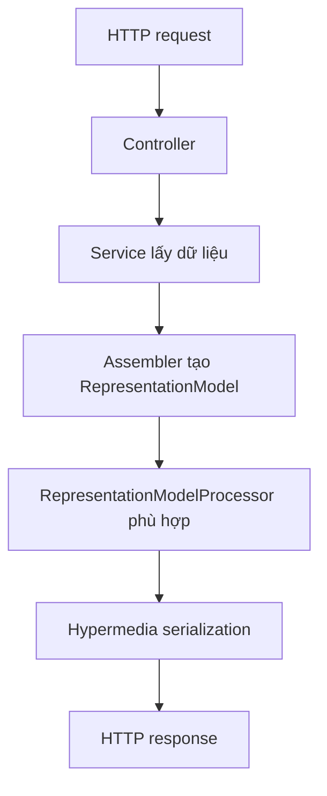

# Điều kiện áp dụng RepresentationModelProcessor

Spring HATEOAS cung cấp `RepresentationModelProcessor` để bổ sung hoặc điều chỉnh một representation model trước khi model được trả về cho client. Processor có thể thêm những liên kết dùng chung cho một loại model, hoặc công bố một relation khi dữ liệu đáp ứng điều kiện nhất định. Tuy nhiên, processor chỉ được áp dụng khi nó được đăng ký trong Spring context và kiểu model mà nó khai báo phù hợp với representation đi qua luồng xử lý hypermedia.

Bài học này tập trung vào các điều kiện khiến processor được gọi, cách giới hạn phạm vi bằng generic type, cách đặt điều kiện nghiệp vụ trong `process(...)`, và cách kiểm thử cả trường hợp được áp dụng lẫn không được áp dụng. Ví dụ xuyên suốt là API quản lý đơn hàng, trong đó relation `cancel` chỉ được công bố cho đơn hàng đang chờ xử lý.

## 1. RepresentationModelProcessor hoạt động ở giai đoạn nào?

Một assembler thường chuyển domain object thành model và tạo những liên kết gắn trực tiếp với tài nguyên. `RepresentationModelProcessor` tham gia ở bước xử lý representation sau khi model đã được tạo, trước khi response được serialize và gửi cho client.

Luồng khái quát:



Processor phù hợp có thể bổ sung link hoặc cập nhật model ở bước E. Nhờ đó, logic dùng chung cho một loại representation có thể được đặt bên ngoài từng controller và assembler.

Ví dụ, assembler tạo `EntityModel<OrderView>` với dữ liệu đơn hàng và self link. Processor có thể xem trạng thái đơn hàng rồi thêm relation `cancel` nếu điều kiện phù hợp. Controller không cần lặp lại cùng đoạn logic ở mọi endpoint trả về loại model đó.

## 2. Điều kiện thứ nhất: processor phải là Spring bean

Spring HATEOAS cần tìm thấy processor trong application context để tích hợp nó vào luồng xử lý representation. Cách thông dụng là khai báo class với `@Component` hoặc đăng ký bằng một phương thức `@Bean` trong cấu hình Spring.

Ví dụ:

```java
@Component
class OrderModelProcessor
        implements RepresentationModelProcessor<EntityModel<OrderView>> {

    @Override
    public EntityModel<OrderView> process(EntityModel<OrderView> model) {
        return model;
    }
}
```

Class này cần nằm trong phạm vi component scan hoặc được import vào application context. Nếu chỉ tạo một instance bằng `new OrderModelProcessor()` trong test hay trong một service, Spring HATEOAS không tự biết instance đó để tự động gọi.

Cũng có thể đăng ký tường minh:

```java
@Configuration
class HypermediaConfiguration {

    @Bean
    OrderModelProcessor orderModelProcessor() {
        return new OrderModelProcessor();
    }
}
```

Không đăng ký cùng một processor bằng nhiều cách nếu điều đó tạo nhiều bean cho cùng mục đích. Nếu processor xuất hiện hai lần trong context, cùng một bước xử lý có thể được thực hiện nhiều lần.

## 3. Điều kiện thứ hai: kiểu model phải tương thích với generic của processor

Tham số generic của `RepresentationModelProcessor<T>` xác định loại representation mà processor muốn xử lý. `T` phải là một kiểu kế thừa `RepresentationModel<?>`.

Ví dụ:

```java
class OrderModelProcessor
        implements RepresentationModelProcessor<EntityModel<OrderView>> {
    // Chỉ xử lý representation có kiểu EntityModel<OrderView>.
}
```

Processor này được thiết kế cho `EntityModel<OrderView>`. Nó không phải processor chung cho mọi response JSON, DTO `OrderView` thuần hoặc mọi model của ứng dụng.

Một vài ví dụ về phạm vi kiểu:

| Kiểu generic processor | Representation được nhắm tới |
| --- | --- |
| `RepresentationModelProcessor<EntityModel<OrderView>>` | Model bọc `OrderView`. |
| `RepresentationModelProcessor<OrderModel>` | Model class chuyên biệt `OrderModel`. |
| `RepresentationModelProcessor<CollectionModel<EntityModel<OrderView>>>` | Collection model chứa các `EntityModel<OrderView>`. |

Hãy khai báo đúng kiểu model mà controller hoặc assembler thực sự trả về. Nếu endpoint trả `OrderModel` nhưng processor lại khai báo cho `EntityModel<OrderView>`, processor đó không nhắm tới representation của endpoint này.

## 4. Điều kiện thứ ba: representation phải đi qua tích hợp Spring HATEOAS

Việc có processor bean và generic phù hợp chưa đủ nếu model không đi qua luồng xử lý hypermedia của Spring. Trong ứng dụng Spring MVC, Spring HATEOAS tích hợp xử lý representation model với cơ chế xử lý giá trị trả về của controller. Cấu hình Spring Boot có starter HATEOAS thường thiết lập phần tích hợp cần thiết; với cấu hình thủ công, cần bật hỗ trợ hypermedia tương ứng.

Processor được áp dụng khi controller trả về một representation model phù hợp qua luồng web đã tích hợp. Nếu một đoạn code chỉ gọi trực tiếp `assembler.toModel(order)` trong unit test, lời gọi đó chỉ tạo model; nó không tự đi qua bước xử lý response của Spring MVC. Vì vậy, đừng kỳ vọng processor bean tự chạy trong một unit test assembler thuần.

Các trường hợp thường không kích hoạt processor tự động:

- Controller trả DTO hoặc `String` thông thường thay vì representation model.
- Processor chưa được đăng ký thành Spring bean.
- Generic type của processor không khớp loại model được xử lý.
- Model được tạo và sử dụng trực tiếp trong một unit test mà không đi qua tích hợp web của Spring HATEOAS.
- Cấu hình web hypermedia cần thiết chưa được bật trong ứng dụng tùy chỉnh.

Khi chưa chắc processor có được gọi hay không, hãy xác minh bằng một kiểm thử HTTP qua MockMvc hoặc WebTestClient thay vì chỉ gọi phương thức assembler trực tiếp.

## 5. Phân biệt điều kiện kiểu và điều kiện nghiệp vụ

Có hai lớp điều kiện khác nhau:

1. **Điều kiện áp dụng processor:** Spring HATEOAS xác định processor có phù hợp với representation model đang xử lý hay không. Điều này gắn với bean registration, generic type và luồng tích hợp web.
2. **Điều kiện xử lý bên trong processor:** phương thức `process(...)` kiểm tra nội dung model hoặc chính sách ứng dụng để quyết định có thay đổi model hay không.

Ví dụ, `OrderModelProcessor` được áp dụng cho mọi `EntityModel<OrderView>` mà nó nhắm tới, nhưng chỉ thêm link `cancel` khi đơn hàng có trạng thái `PENDING`:

```java
@Component
class OrderModelProcessor
        implements RepresentationModelProcessor<EntityModel<OrderView>> {

    @Override
    public EntityModel<OrderView> process(EntityModel<OrderView> model) {
        OrderView order = model.getContent();

        if ("PENDING".equals(order.status()) && !model.hasLink("cancel")) {
            model.add(linkTo(methodOn(OrderController.class)
                    .cancel(order.id())).withRel("cancel"));
        }

        return model;
    }
}
```

Điều kiện trạng thái không quyết định Spring có gọi processor hay không. Nó quyết định processor sẽ làm gì sau khi đã được áp dụng. Nếu trạng thái là `SHIPPED`, processor vẫn có thể được gọi, nhưng không thêm link `cancel`.

## 6. Khi nào processor phù hợp với một loại model?

Chọn generic type theo phạm vi trách nhiệm:

- Nếu logic chỉ áp dụng cho `EntityModel<OrderView>`, khai báo đúng kiểu đó.
- Nếu logic chỉ áp dụng cho một model class riêng, nhắm tới class đó.
- Nếu logic dành cho collection, khai báo processor cho kiểu `CollectionModel` tương ứng.
- Nếu logic thực sự dùng chung cho nhiều loại representation, cân nhắc một kiểu cơ sở phù hợp và kiểm tra kỹ tác động trên tất cả model con.

Ví dụ processor cho collection đơn hàng:

```java
@Component
class OrderCollectionProcessor implements
        RepresentationModelProcessor<CollectionModel<EntityModel<OrderView>>> {

    @Override
    public CollectionModel<EntityModel<OrderView>> process(
            CollectionModel<EntityModel<OrderView>> collection) {

        collection.add(linkTo(methodOn(OrderController.class).all())
                .withSelfRel());
        return collection;
    }
}
```

Processor này nhắm tới representation ở cấp collection. Nó thêm self link cho danh sách, không thay thế self link riêng của từng item. Các item cần được assembler tạo link của chính chúng.

Đừng giả định processor cho `EntityModel<OrderView>` sẽ tự động chạy đệ quy trên từng phần tử nhúng bên trong `CollectionModel`. Hãy nhắm tới đúng model root mà luồng response xử lý, và dùng assembler để tạo link cho item. Nếu cần xử lý collection model, khai báo processor cho collection model và kiểm thử phạm vi thực tế.

## 7. Dùng processor cho logic liên kết dùng chung

Processor hữu ích khi cùng một loại model cần một nhóm liên kết hoặc quy tắc hậu xử lý được dùng ở nhiều endpoint. Ví dụ, mọi representation đơn hàng có thể công bố link tới tài liệu hướng dẫn hoặc chính sách hỗ trợ.

```java
@Component
class OrderHelpProcessor
        implements RepresentationModelProcessor<EntityModel<OrderView>> {

    @Override
    public EntityModel<OrderView> process(EntityModel<OrderView> model) {
        if (!model.hasLink("help")) {
            model.add(Link.of("/help/orders", "help")
                    .withTitle("Hướng dẫn về đơn hàng"));
        }

        return model;
    }
}
```

Nếu nhiều controller trả cùng loại `EntityModel<OrderView>`, processor có thể áp dụng quy tắc link dùng chung mà không cần lặp lại trong từng assembler. Tuy nhiên, link đặc thù chỉ có ý nghĩa với một endpoint nên được tạo ở assembler hoặc controller tương ứng.

Điều kiện `hasLink("help")` giúp tránh thêm lại một relation đã có. Cách kiểm tra này hữu ích với relation chỉ nên xuất hiện một lần. Với relation được phép có nhiều link như `alternate`, không nên áp dụng quy tắc loại trùng chung một cách máy móc.

## 8. Kết hợp trạng thái nghiệp vụ và quyền truy cập

Processor có thể quyết định công bố link theo trạng thái của tài nguyên. Ví dụ:

| Trạng thái đơn hàng | Link `cancel` |
| --- | --- |
| `PENDING` | Có thể công bố nếu chính sách nghiệp vụ cho phép. |
| `PROCESSING` | Phụ thuộc quy tắc hủy trong ứng dụng. |
| `SHIPPED` | Không công bố nếu đơn không thể hủy. |
| `CANCELLED` | Không công bố thao tác hủy lần nữa. |

Nếu link còn phụ thuộc vào người dùng hiện tại, processor có thể phối hợp với một chính sách quyền truy cập của ứng dụng để quyết định có công bố affordance hay không. Hãy giữ việc đánh giá quyền trong một service/policy chuyên trách thay vì viết logic bảo mật phức tạp trực tiếp trong processor.

Dù link có xuất hiện hay không, endpoint đích vẫn phải xác thực người dùng, kiểm tra quyền trên đúng tài nguyên và kiểm tra lại trạng thái khi request đến. Processor chỉ định hình khả năng client khám phá; nó không bảo vệ endpoint và không thay thế authorization.

## 9. Processor nên làm gì và không nên làm gì?

Processor phù hợp với các thao tác hậu xử lý nhẹ, có phạm vi rõ:

- Bổ sung link dùng chung cho một loại representation.
- Thêm relation khi dữ liệu model đáp ứng điều kiện.
- Chuẩn hóa một nhóm metadata hypermedia dùng chung.
- Bổ sung link cấp collection cho một loại collection model.

Không nên biến processor thành nơi thực hiện toàn bộ logic tạo representation:

- Không tải lại domain entity cho từng model nếu assembler đã có dữ liệu cần thiết.
- Tránh truy vấn database theo từng item, vì có thể tạo N+1 query.
- Không gọi dịch vụ mạng chậm hoặc thao tác blocking trong quá trình serialize response.
- Không thay đổi dữ liệu nghiệp vụ; processor xử lý representation.
- Không thêm link hành động nếu chưa có quy tắc rõ ràng về trạng thái và quyền.
- Không lưu trạng thái request vào field của processor singleton.

Nếu logic cần nhiều dữ liệu nghiệp vụ, hãy để service tải dữ liệu hoặc tạo một view model đủ thông tin trước khi processor chạy. Processor nên tiêu thụ model đã sẵn sàng và thực hiện quyết định nhỏ, dễ kiểm thử.

## 10. Khi nên dùng assembler thay vì processor?

Assembler và processor đều có thể thêm link, nhưng thời điểm và phạm vi trách nhiệm khác nhau:

| Tiêu chí | Assembler | Model processor |
| --- | --- | --- |
| Thời điểm | Khi chuyển domain object thành representation. | Sau khi representation được tạo trong luồng xử lý hypermedia. |
| Phạm vi | Thường gắn với một loại tài nguyên và quy tắc chuyển đổi cụ thể. | Có thể áp dụng cho mọi response model phù hợp với generic type. |
| Dữ liệu | Có thể nhận domain object và chuyển đổi các trường. | Thường thao tác trên model đã được tạo. |
| Dùng tốt cho | Trường dữ liệu, self link, quan hệ trực tiếp của item. | Link dùng chung, quy tắc hậu xử lý xuyên nhiều endpoint. |
| Kiểm thử | Gọi trực tiếp `toModel` hoặc `toCollectionModel`. | Kiểm thử phương thức `process` và luồng HTTP tích hợp. |

Nếu chỉ một endpoint cần relation `customer`, thêm nó trong assembler thường rõ ràng hơn. Nếu mọi representation đơn hàng đều cần link `help`, processor có thể giảm lặp. Nếu một collection cần link `self`, có thể tạo tại controller hoặc dùng processor nhắm tới collection model; hãy chọn một nơi sở hữu link đó để tránh trùng relation.

## 11. Kiểm thử điều kiện áp dụng processor

Nên có cả unit test cho logic `process(...)` và integration test để xác nhận Spring tự áp dụng processor trong response.

### Unit test: trạng thái cho phép

```java
@Test
void addsCancelLinkForPendingOrder() {
    OrderView view = new OrderView(orderId, "PENDING", total);
    EntityModel<OrderView> model = EntityModel.of(view);

    EntityModel<OrderView> result = processor.process(model);

    assertThat(result.hasLink("cancel")).isTrue();
}
```

### Unit test: trạng thái không cho phép

```java
@Test
void doesNotAddCancelLinkForShippedOrder() {
    OrderView view = new OrderView(orderId, "SHIPPED", total);
    EntityModel<OrderView> model = EntityModel.of(view);

    EntityModel<OrderView> result = processor.process(model);

    assertThat(result.hasLink("cancel")).isFalse();
}
```

Các ví dụ giả định `OrderView` là record và `processor` đã được inject. Unit test gọi trực tiếp `process` để kiểm tra điều kiện nghiệp vụ, nhưng chưa xác nhận processor bean được Spring HATEOAS tự động gọi.

### Integration test: processor được áp dụng qua HTTP

Với MockMvc, gọi endpoint thực tế và xác nhận relation xuất hiện trong HAL:

```java
mockMvc.perform(get("/orders/{id}", pendingOrderId)
        .accept(MediaTypes.HAL_JSON))
    .andExpect(status().isOk())
    .andExpect(jsonPath("$._links.cancel.href").exists());
```

Với đơn hàng đã giao:

```java
mockMvc.perform(get("/orders/{id}", shippedOrderId)
        .accept(MediaTypes.HAL_JSON))
    .andExpect(status().isOk())
    .andExpect(jsonPath("$._links.cancel").doesNotExist());
```

Integration test xác nhận cả bean registration, model type matching, web integration và điều kiện xử lý trong processor. Nếu processor không chạy, hãy kiểm tra lần lượt các điều kiện đó thay vì chỉ sửa logic `process`.

## 12. Các lỗi thường gặp

**Quên đăng ký bean.** Class triển khai interface nhưng không được Spring quản lý thì không được tự động phát hiện. Dùng `@Component` hoặc `@Bean`.

**Khai báo generic không khớp.** Processor cho `EntityModel<OrderView>` không nhắm tới `OrderModel` hoặc DTO thuần. Kiểm tra kiểu controller thực sự trả về.

**Chỉ test assembler rồi kết luận processor hoạt động.** Unit test assembler không đi qua bước xử lý model của web integration. Dùng kiểm thử HTTP để xác nhận processor được gọi tự động.

**Nhầm điều kiện áp dụng với điều kiện nghiệp vụ.** Generic type quyết định phạm vi model; `if` trong `process` quyết định có sửa model hay không.

**Đưa mọi link vào processor.** Link đặc thù một endpoint nên nằm trong assembler hoặc controller. Processor chỉ nên xử lý quy tắc có phạm vi dùng chung.

**Thêm link trùng.** Kiểm tra relation đã tồn tại trước khi thêm những link chỉ nên có một bản.

**Cho rằng link bảo vệ endpoint.** Server vẫn phải xác thực, phân quyền và kiểm tra trạng thái khi nhận request.

**Truy vấn hoặc blocking trong processor.** Processor chạy trong quá trình tạo response; thao tác nặng làm tăng độ trễ và có thể ảnh hưởng luồng xử lý. Hãy chuẩn bị dữ liệu từ service/assembler.

## 13. Bài tập thực hành và tiêu chí hoàn thành

Hãy triển khai processor cho API đơn hàng:

1. Tạo `OrderModelProcessor` triển khai `RepresentationModelProcessor<EntityModel<OrderView>>`.
2. Đăng ký processor bằng `@Component` hoặc `@Bean`.
3. Xác nhận controller trả đúng `EntityModel<OrderView>` để processor nhắm tới.
4. Trong `process`, chỉ thêm link `cancel` khi trạng thái cho phép.
5. Kiểm tra link không bị thêm lặp nếu model đã có relation `cancel`.
6. Viết unit test cho trạng thái `PENDING`, `SHIPPED` và `CANCELLED`.
7. Dùng MockMvc kiểm tra processor được áp dụng trong response HAL.
8. Tạo một endpoint trả model type khác và xác nhận processor đơn hàng không sửa representation đó.
9. Nếu cần link cấp collection, khai báo processor riêng cho collection model hoặc tạo link tại controller; không thêm lại link item.
10. Kiểm tra endpoint hủy vẫn từ chối request không có quyền hoặc trạng thái không hợp lệ.

Bạn đã hiểu điều kiện áp dụng processor khi có thể giải thích vai trò của Spring bean, generic model type và web integration; phân biệt chúng với điều kiện nghiệp vụ trong `process(...)`; chọn đúng phạm vi item hoặc collection; và chứng minh hành vi bằng unit test cùng integration test. Khi được đặt đúng chỗ, `RepresentationModelProcessor` giúp bổ sung hypermedia dùng chung mà không làm assembler và controller lặp lại cùng một quy tắc.
