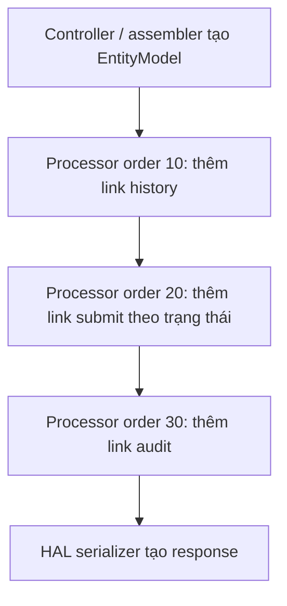

# Thứ tự processor

Trong Spring HATEOAS, `RepresentationModelProcessor<T>` cho phép bổ sung hoặc điều chỉnh một representation sau khi controller hoặc assembler đã tạo model. Một ứng dụng có thể đăng ký nhiều processor cùng áp dụng lên một kiểu model, chẳng hạn một processor thêm link đến khách hàng, một processor thêm link thanh toán và một processor bổ sung hành động theo trạng thái đơn hàng. Khi đó, **thứ tự processor** quyết định thứ tự các bước hậu xử lý được thực hiện.

Spring HATEOAS sử dụng cơ chế ordering của Spring để sắp xếp các processor. Có thể khai báo thứ tự bằng annotation `@Order` hoặc triển khai `Ordered`. Giá trị order càng nhỏ thì processor được gọi càng sớm. Nếu thứ tự giữa các processor có ảnh hưởng đến kết quả, hãy khai báo các giá trị khác nhau và kiểm thử chuỗi xử lý thực tế.

## 1. RepresentationModelProcessor hoạt động ở đâu?

`RepresentationModelProcessor<T>` thuộc package `org.springframework.hateoas.server`. Kiểu `T` phải kế thừa `RepresentationModel<?>`. Interface có một phương thức:

```java
public interface RepresentationModelProcessor<T extends RepresentationModel<?>> {

    T process(T model);
}
```

Processor nhận một representation model, thực hiện bước hậu xử lý rồi trả về model để tiếp tục được serialize theo media type của response. Nó có thể thêm link, thay đổi dữ liệu representation hoặc trả về một instance khác cùng kiểu khai báo.

Trong tích hợp Spring MVC, Spring HATEOAS đăng ký cơ chế gọi các `RepresentationModelProcessor` phù hợp trên model controller trả về trước khi chuyển response cho bước serialize. Vì vậy, controller không cần gọi từng processor bằng tay.

Ví dụ, controller và assembler đã tạo `EntityModel<OrderRepresentation>` gồm dữ liệu đơn hàng và link `self`. Một processor riêng có thể thêm link đến thanh toán mà không đưa chi tiết `PaymentController` vào `OrderController` hoặc assembler đơn hàng.

## 2. Processor chỉ áp dụng cho kiểu model phù hợp

Generic type của processor xác định loại representation mà nó xử lý. Ví dụ:

```java
import org.springframework.hateoas.EntityModel;
import org.springframework.hateoas.server.RepresentationModelProcessor;
import org.springframework.stereotype.Component;

@Component
class OrderProcessor
        implements RepresentationModelProcessor<EntityModel<OrderRepresentation>> {

    @Override
    public EntityModel<OrderRepresentation> process(
            EntityModel<OrderRepresentation> model) {
        // Bổ sung thông tin cho representation của OrderRepresentation.
        return model;
    }
}
```

Processor này được đăng ký cho `EntityModel<OrderRepresentation>`. Nó không phải processor dùng chung cho mọi `EntityModel` bất kể kiểu content. Cơ chế của Spring HATEOAS phân tích generic type để chọn processor phù hợp với model đang được xử lý.

Điều này có ý nghĩa khi một ứng dụng có nhiều representation khác nhau, ví dụ `EntityModel<OrderRepresentation>`, `EntityModel<CustomerRepresentation>` và `CollectionModel<EntityModel<OrderRepresentation>>`. Hãy khai báo generic type đúng với model cần hậu xử lý để tránh áp dụng logic của resource này sang resource khác.

Trong các ví dụ bên dưới, `OrderRepresentation` là DTO được công bố trong response:

```java
import java.util.UUID;

public record OrderRepresentation(UUID id, String status) {
}
```

Với `CollectionModel`, Java type erasure khiến runtime không phải lúc nào cũng biết kiểu phần tử từ generic declaration. Spring HATEOAS có thể xem các phần tử bên trong collection để xác định kiểu. Vì vậy, mặc định processor có thể không được gọi cho collection rỗng. Nếu cần xử lý cả collection rỗng, hãy cung cấp fallback type phù hợp với payload type mà processor khai báo, ví dụ `CollectionModel.empty(OrderRepresentation.class)` khi collection trực tiếp chứa `OrderRepresentation`, hoặc gọi `withFallbackType(...)` trên collection đã tạo.

## 3. Khai báo thứ tự bằng @Order

Cách đơn giản nhất là gắn `@Order` lên lớp processor:

```java
import org.springframework.hateoas.EntityModel;
import org.springframework.hateoas.Link;
import org.springframework.hateoas.server.RepresentationModelProcessor;
import org.springframework.core.annotation.Order;
import org.springframework.stereotype.Component;

@Component
@Order(10)
class OrderIdentityProcessor
        implements RepresentationModelProcessor<EntityModel<OrderRepresentation>> {

    @Override
    public EntityModel<OrderRepresentation> process(
            EntityModel<OrderRepresentation> model) {
        model.add(Link.of("/orders/" + model.getContent().id() + "/history")
                .withRel("history"));
        return model;
    }
}
```

Một processor khác có thể chạy sau:

```java
import org.springframework.hateoas.EntityModel;
import org.springframework.hateoas.Link;
import org.springframework.hateoas.server.RepresentationModelProcessor;
import org.springframework.core.annotation.Order;
import org.springframework.stereotype.Component;

@Component
@Order(20)
class OrderActionProcessor
        implements RepresentationModelProcessor<EntityModel<OrderRepresentation>> {

    @Override
    public EntityModel<OrderRepresentation> process(
            EntityModel<OrderRepresentation> model) {

        if ("DRAFT".equals(model.getContent().status())) {
            model.add(Link.of("/orders/" + model.getContent().id() + "/submit")
                    .withRel("submit"));
        }

        return model;
    }
}
```

Trong ví dụ, `OrderIdentityProcessor` có order `10` và được chạy trước `OrderActionProcessor` có order `20`. Mỗi processor nhận kết quả từ bước trước, nên processor thứ hai có thể quan sát model đã được processor thứ nhất bổ sung.

Các class `OrderRepresentation` và cấu trúc URI là ví dụ minh họa. Ứng dụng thực tế nên tạo link từ mapping controller bằng `WebMvcLinkBuilder` hoặc `EntityLinks` khi phù hợp, thay vì ghép chuỗi URI cố định.

## 4. Quy tắc giá trị order

Spring sử dụng thứ tự số để sắp xếp các processor:

| Giá trị | Ý nghĩa tương đối |
| --- | --- |
| `@Order(0)` | Ưu tiên chạy sớm hơn `@Order(10)` |
| `@Order(10)` | Chạy trước `@Order(20)` |
| `@Order(20)` | Chạy sau processor có giá trị nhỏ hơn |
| Không khai báo order | Mặc định có độ ưu tiên thấp nhất (`Ordered.LOWEST_PRECEDENCE`) |

Giá trị nhỏ hơn có độ ưu tiên cao hơn và được xử lý trước. Giá trị lớn hơn được xử lý sau. Có thể để khoảng trống như `10`, `20`, `30` để dễ chèn processor mới vào giữa khi hệ thống phát triển.

Nếu nhiều processor có cùng order value, không nên dựa vào thứ tự đăng ký bean hoặc thứ tự tên class để suy ra thứ tự chạy. Khi kết quả phụ thuộc vào processor nào chạy trước, hãy gán các giá trị khác nhau. Nếu chúng độc lập, việc cùng mức ưu tiên có thể chấp nhận được, nhưng vẫn nên tránh tạo phụ thuộc ngầm.

## 5. Dùng Ordered thay cho @Order

Ngoài annotation, processor có thể triển khai `org.springframework.core.Ordered` và trả về giá trị từ `getOrder()`:

```java
import org.springframework.hateoas.EntityModel;
import org.springframework.hateoas.Link;
import org.springframework.hateoas.server.RepresentationModelProcessor;
import org.springframework.core.Ordered;
import org.springframework.stereotype.Component;

@Component
class OrderAuditProcessor
        implements RepresentationModelProcessor<EntityModel<OrderRepresentation>>, Ordered {

    @Override
    public int getOrder() {
        return 30;
    }

    @Override
    public EntityModel<OrderRepresentation> process(
            EntityModel<OrderRepresentation> model) {
        model.add(Link.of("/orders/" + model.getContent().id() + "/audit")
                .withRel("audit"));
        return model;
    }
}
```

`Ordered` phù hợp khi giá trị ưu tiên cần được tính động hoặc được cung cấp bởi cấu hình của đối tượng. Với thứ tự cố định, `@Order` thường ngắn gọn và dễ đọc hơn.

Không cần triển khai đồng thời cả hai cách nếu không có lý do rõ ràng. Nếu một processor vừa triển khai `Ordered` vừa mang `@Order`, quy tắc ưu tiên của Spring có thể khiến giá trị từ `Ordered` được dùng trước metadata annotation. Hãy chọn một nguồn cấu hình order để tránh người đọc hiểu nhầm.

## 6. Thứ tự áp dụng và kết quả của nhiều processor

Giả sử một representation được xử lý bởi ba processor:



Thứ tự này hữu ích khi một processor phụ thuộc vào kết quả của processor trước. Ví dụ:

- Processor thứ nhất chuẩn hóa dữ liệu hoặc thêm link nền tảng.
- Processor thứ hai kiểm tra model sau chuẩn hóa để quyết định thêm link hành động.
- Processor thứ ba bổ sung link kiểm toán hoặc metadata dùng chung.

Processor sau nhìn thấy cùng model đã được processor trước sửa đổi nếu các processor cùng chỉnh sửa instance đó. Nếu processor trả về một instance mới, processor sau nhận instance được trả về. Vì vậy, luôn trả về model đã xử lý; đừng chỉ sửa một object rồi trả về `null` hoặc một kiểu representation không tương thích.

Không nên tạo phụ thuộc phức tạp giữa nhiều processor. Nếu một bước chỉ có ý nghĩa khi bước khác đã chạy, hãy ghi rõ thứ tự, đặt các giá trị `@Order` riêng biệt và kiểm thử kết quả cuối. Nếu logic có quan hệ chặt chẽ và chỉ dùng cho một resource, có thể đặt chung trong assembler thay vì tách thành nhiều processor.

## 7. Đăng ký processor trong Spring

Processor phải được Spring quản lý để hạ tầng Spring HATEOAS có thể phát hiện và gọi. Có thể dùng `@Component`:

```java
import org.springframework.hateoas.EntityModel;
import org.springframework.hateoas.Link;
import org.springframework.hateoas.server.RepresentationModelProcessor;
import org.springframework.core.annotation.Order;
import org.springframework.stereotype.Component;

@Component
@Order(10)
class PaymentLinkProcessor
        implements RepresentationModelProcessor<EntityModel<OrderRepresentation>> {

    @Override
    public EntityModel<OrderRepresentation> process(
            EntityModel<OrderRepresentation> model) {
        model.add(Link.of("/payments/{orderId}")
                .expand(model.getContent().id())
                .withRel("payments"));
        return model;
    }
}
```

Hoặc đăng ký bằng `@Bean`:

Khi dùng cách này, bỏ `@Component` khỏi lớp `PaymentLinkProcessor` để Spring chỉ đăng ký một bean.

```java
import org.springframework.context.annotation.Bean;
import org.springframework.context.annotation.Configuration;
import org.springframework.core.annotation.Order;

@Configuration
class ModelProcessorConfiguration {

    @Bean
    @Order(10)
    PaymentLinkProcessor paymentLinkProcessor() {
        return new PaymentLinkProcessor();
    }
}
```

Chọn một cách đăng ký cho mỗi processor. Nếu một class vừa được component scan qua `@Component` vừa được tạo thêm bằng `@Bean`, có thể vô tình đăng ký hai instance và processor bị gọi hai lần.

## 8. Processor và assembler có trách nhiệm khác nhau

`RepresentationModelAssembler` và `RepresentationModelProcessor` đều có thể tác động đến representation, nhưng được dùng ở những giai đoạn và phạm vi khác nhau:

| Thành phần | Vai trò chính | Phạm vi phù hợp |
| --- | --- | --- |
| `RepresentationModelAssembler` | Chuyển domain object/DTO thành model và tạo link cơ bản | Logic biểu diễn riêng cho một loại resource |
| `RepresentationModelProcessor` | Hậu xử lý model đã được tạo, bổ sung link hoặc điều chỉnh nội dung | Logic dùng chung, tích hợp ngang giữa nhiều controller hoặc resource |

Ví dụ, assembler của đơn hàng có thể tạo `self`, `customer` và `items`. Một processor thanh toán có thể bổ sung link `payments` cho mọi `EntityModel<OrderRepresentation>` có trạng thái chờ thanh toán. Cách này giữ chi tiết thanh toán tách khỏi assembler đơn hàng.

Processor không nên thay thế service nghiệp vụ. Nó có thể đọc trạng thái có sẵn trong model hoặc dùng dependency để xác định link phù hợp, nhưng không nên thực hiện giao dịch như thanh toán, hủy hoặc xóa resource trong lúc response đang được dựng.

## 9. Kiểm thử thứ tự processor

Để kiểm tra thứ tự thực tế, có thể tạo một representation giữ danh sách các bước đã chạy:

```java
import java.util.ArrayList;
import java.util.List;

import org.springframework.hateoas.RepresentationModel;

class ProcessorTraceModel extends RepresentationModel<ProcessorTraceModel> {

    private final List<String> steps = new ArrayList<>();

    public void addStep(String step) {
        steps.add(step);
    }

    public List<String> getSteps() {
        return steps;
    }
}
```

Hai processor thêm dấu vết theo thứ tự được khai báo:

```java
import org.springframework.core.annotation.Order;
import org.springframework.hateoas.server.RepresentationModelProcessor;
import org.springframework.stereotype.Component;

@Component
@Order(10)
class FirstTraceProcessor implements RepresentationModelProcessor<ProcessorTraceModel> {

    @Override
    public ProcessorTraceModel process(ProcessorTraceModel model) {
        model.addStep("first");
        return model;
    }
}

@Component
@Order(20)
class SecondTraceProcessor implements RepresentationModelProcessor<ProcessorTraceModel> {

    @Override
    public ProcessorTraceModel process(ProcessorTraceModel model) {
        model.addStep("second");
        return model;
    }
}
```

Một controller test trả về model mới:

```java
import org.springframework.web.bind.annotation.GetMapping;
import org.springframework.web.bind.annotation.RestController;

@RestController
class ProcessorProbeController {

    @GetMapping("/processor-probe")
    ProcessorTraceModel probe() {
        return new ProcessorTraceModel();
    }
}
```

Với Spring MVC và `MockMvc`, kiểm tra response chứa `steps` theo đúng thứ tự:

```java
mockMvc.perform(get("/processor-probe"))
        .andExpect(status().isOk())
        .andExpect(jsonPath("$.steps[0]").value("first"))
        .andExpect(jsonPath("$.steps[1]").value("second"));
```

Đây là ví dụ minh họa; test thực tế cần các processor và controller được đăng ký trong cùng Spring test context, cùng các import Spring MVC/JUnit phù hợp. Điểm quan trọng là kiểm thử qua hạ tầng controller để xác nhận processor được tự động gọi, chứ không chỉ gọi từng `process(...)` thủ công.

## 10. Những trường hợp cần kiểm thử thêm

- Processor có generic type phù hợp được gọi cho model mục tiêu.
- Processor dành cho một kiểu model không bị áp dụng nhầm cho kiểu khác.
- Giá trị `@Order` thấp hơn được thực thi trước giá trị cao hơn.
- Processor không khai báo order không được dùng làm bước có phụ thuộc thứ tự rõ ràng.
- Nhiều processor cùng thay đổi relation không tạo link trùng ngoài ý muốn.
- Processor sau nhận đúng model do processor trước trả về.
- Processor trả về đúng kiểu model khai báo.
- Collection rỗng được xử lý đúng nếu processor nhắm đến `CollectionModel`; cung cấp fallback type khi cần suy ra kiểu phần tử.
- Processor chỉ thêm link khi điều kiện representation phù hợp.
- Response cuối cùng serialize đúng content, link và media type.

## 11. Lỗi thường gặp

**Cho rằng thứ tự bean đăng ký là thứ tự processor:** Spring dùng ordering metadata để sắp xếp processor. Hãy khai báo `@Order` hoặc `Ordered` khi trình tự có ý nghĩa.

**Đảo ngược ý nghĩa giá trị:** `@Order(10)` chạy trước `@Order(20)`, không phải sau. Số càng nhỏ thì độ ưu tiên càng cao.

**Dùng cùng order value cho các bước phụ thuộc:** nếu hai processor có cùng giá trị, không nên dựa vào thứ tự tương đối. Hãy gán các giá trị khác nhau.

**Nghĩ mọi processor đều chạy với mọi representation:** generic type quyết định phạm vi áp dụng. Khai báo đúng `EntityModel<T>` hoặc `CollectionModel<T>`.

**Quên trả về model:** phương thức `process(...)` phải trả representation đã xử lý để pipeline tiếp tục.

**Đăng ký processor hai lần:** component scan và `@Bean` cùng tạo một processor có thể khiến logic chạy lặp. Chỉ đăng ký một instance.

**Dùng processor thay cho logic nghiệp vụ:** processor nên tập trung hậu xử lý representation. Giao dịch và kiểm tra điều kiện nghiệp vụ thuộc service/domain.

## 12. Checklist thiết kế thứ tự processor

- Xác định chính xác kiểu representation mà từng processor xử lý.
- Đăng ký processor như một Spring bean.
- Dùng `@Order` cho thứ tự cố định hoặc `Ordered` cho thứ tự được tính từ code.
- Nhớ rằng số nhỏ chạy trước và giá trị mặc định là `Ordered.LOWEST_PRECEDENCE`.
- Dùng giá trị order riêng biệt khi các bước phụ thuộc nhau.
- Giữ processor độc lập khi có thể; gom logic phụ thuộc chặt vào cùng assembler hoặc processor.
- Trả về đúng kiểu model sau khi xử lý.
- Xử lý trường hợp collection rỗng bằng fallback type khi cần.
- Kiểm thử thứ tự qua Spring MVC integration và kiểm tra representation sau cùng.
- Tránh đăng ký trùng processor và tránh side effect nghiệp vụ trong bước dựng response.

Thứ tự processor giúp tổ chức các bước hậu xử lý hypermedia theo một chuỗi có thể dự đoán. Khi chọn đúng generic type, đăng ký mỗi processor một lần và dùng `@Order` hoặc `Ordered` một cách rõ ràng, ứng dụng có thể bổ sung link xuyên suốt nhiều resource mà vẫn kiểm soát được kết quả representation trước khi serialize.

## Tài liệu tham khảo

- [Spring HATEOAS Reference — Representation Model Processors](https://docs.spring.io/spring-hateoas/docs/current/reference/html/#representation-model-processors)
- [RepresentationModelProcessor API](https://docs.spring.io/spring-hateoas/docs/current/api/org/springframework/hateoas/server/RepresentationModelProcessor.html)
- [RepresentationModelProcessorInvoker API](https://docs.spring.io/spring-hateoas/docs/current/api/org/springframework/hateoas/server/mvc/RepresentationModelProcessorInvoker.html)
